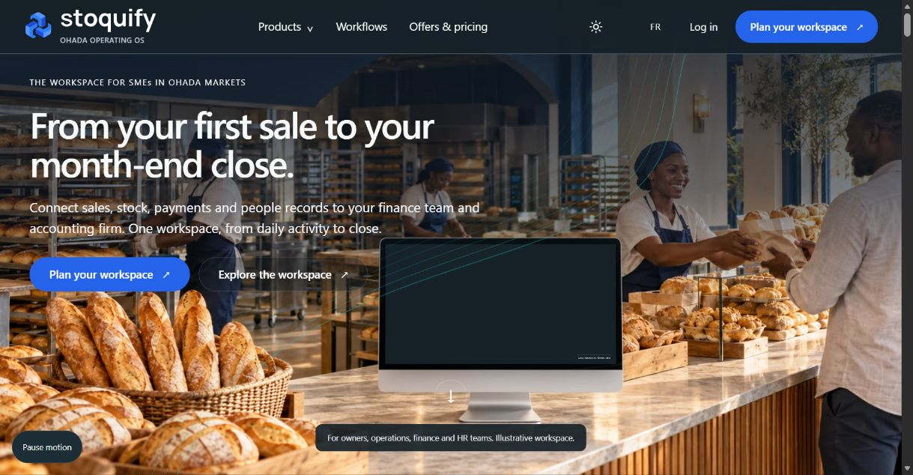

# Edge follow-up — 26 October 2026

Result: the isolated preview is available, but repeated Edge control remains unverified. No permanent debugger repair was established. Managed settings and application source were not changed.

## What changed today

Reviewed the previous fresh-chat failure report. The installed Browser plugin remains 26.1021.31345. The public report at https://github.com/openai/codex/issues/54606 remains open without a confirmed repair in the fetched discussion. It describes similar symptoms; that is not proof of an identical cause. OpenAI's current guidance at https://learn.chatgpt.com/docs/chrome-extension still provides the previously attempted connection recovery steps and a feedback/support route.

Tested a staged attachment sequence using supported CUA APIs: create a blank Edge tab, successfully capture it, then navigate. Blank capture took 1.250 seconds. Navigation to localhost:3000 returned ERR_CONNECTION_REFUSED, a server-address availability failure distinct from a debugger timeout.

Read-only listener inspection later found two processes on port 3000: PID 27216 on IPv6 ::, and a verified Stoquify Next.js process PID 33972 on IPv4 127.0.0.1. The IPv4 HTTP probe exceeded 45 seconds. The listeners were not stopped. These observations do not establish the cause of historical debugger failures, and the listeners may have appeared after the initial connection refusal.

## Preview recovery

After inspecting the repository workflow, command registry, dev launcher, Prisma preparation and configuration, ran npm run agent:workflow:check successfully. The first hidden startup failed because arguments did not reach the Next launcher as intended. The npm.cmd retry preserved arguments but encountered an occupied port 3000. Both failed attempts have separate logs.

Started the supported launcher using npm.cmd run dev -- --port 3101 --hostname 127.0.0.1. It reused the generated Prisma Client and created .next-dev-session-ez7AZb with its sibling TypeScript configuration. No migration or seed ran. Launcher PowerShell PID 8844 was left running for the user's preview at http://127.0.0.1:3101. No successful process from another task was terminated.

The server reported ready in 10.2 seconds. Initial landing compilation took 43 seconds, and its server request log reported HTTP 200 after 57.469 seconds. The separate HTTP client still reached its 60-second timeout; preserve both observations rather than calling that client request a pass.

Sequential read-only preparation of the remaining routes returned HTTP 200:

| Route | First measured response |
| --- | --- |
| /en/workflows | 15.426 s |
| /en/login | 27.553 s |
| /en/register | 19.127 s |

These are server checks only, not browser-rendering or authentication checks.

## Browser results and limitations

- A static motif navigation attempt on the original task tab reported Debugger unattached. It did not reach the requested static page.
- A new tab navigated to the now-ready isolated landing page successfully in 11.694 seconds. Its screenshot succeeded in 9.452 seconds and visibly showed Stoquify's landing content and contour motif.
- During preparation of the remaining routes, that new tab ceased to exist. The cause of removal was not observable. Do not attribute this to the user or the provider without evidence.
- One subsequent helper invocation retained the removed tab handle despite a reassignment in a later REPL cell. This test-harness reference failure is recorded separately and is not evidence of a new provider timeout.
- Replacing that helper with an explicit tab argument targeted the remaining original diagnostic tab. Navigation then reported Debugger unattached in 160 ms. Its URL remained the older localhost:3000 page.
- Native Edge accessibility was readable initially, but selecting the task tab failed with unavailable coordinate geometry. The native screenshot showed Codex content rather than the target Edge window and was not retained as website evidence. The exposed Raise action then failed to produce usable Edge accessibility state. Native control did not provide a verified recovery.
- Closing the remaining task tab also reported Debugger unattached. It was not marked for retention; normal browser-tool cleanup remains responsible.

No complete four-page reliability cycle passed. There is one fresh website screenshot, landing-cycle-1.jpg. Fresh workflow, login and registration screenshots are missing from this run; prior screenshots remain historical evidence. No mobile viewport override or form submission was performed.

## Conclusion

Restoring a distinct, compiled preview removes today's missing-server condition from further testing. It does not repair the intermittent debugger attachment failures. The staged screenshot preflight, ready preview and native control attempt did not establish a reliable browser-control workflow. A supported permanent fix was not identified through the available controls.

The next useful escalation is to provide the existing reproducible evidence to browser integration support, rather than repeat reinstall/fresh-chat attempts or change managed settings. No report has been sent externally. This report and results.json are local evidence suitable for review before any authorized submission.

## Evidence classes

- Repository workflow contract: passed; 196 scripts outside the reviewed manifest.
- Source inspection: startup/configuration side effects reviewed; no application source edits.
- HTTP: route preparation results above, separately from browser checks.
- Browser: one rendered landing capture; failed repeat/control attempts preserved.
- Unit/database tests: not run; no database migration, seed or business mutation performed.
- Artifacts: results.json, prewarm-results.json, landing-cycle-1.jpg, preflight-blank.jpg and startup logs.

The live preview and generated development output are intentional effects of this run. Stop only its verified process tree when it is no longer needed; do not delete output while its server is running.
