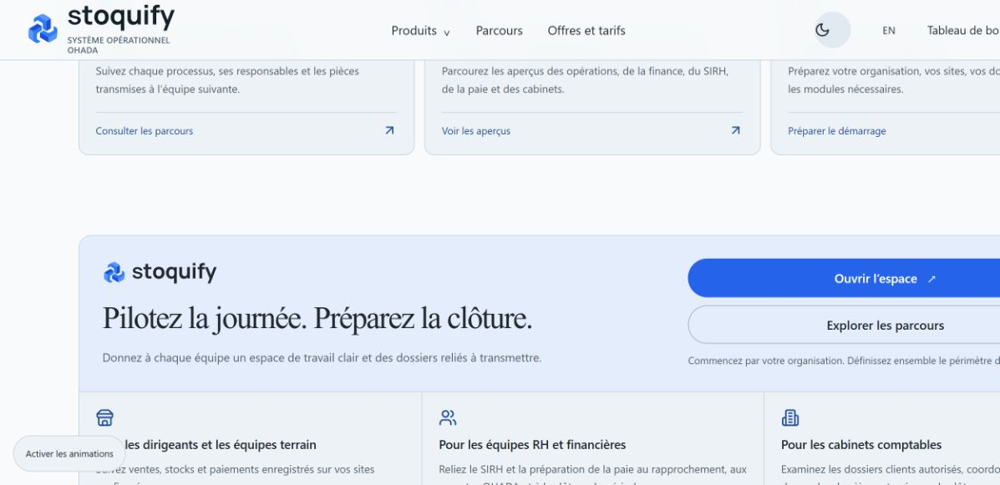

# Landing page final visual review — 24 October 2026

Source: `9ab93a2a1d81e37ef7e0b10357885b48a3bc5886` plus the existing local working tree. Review started on 23 October and continued on 24 October. Unrelated changes were preserved; no commit or deployment was made.

## Fixes in this review

- `components/landing/cinematic.css`: corrected the paused-motion mobile hero's height specificity, preventing its content from overlapping the next section; reduced internal device-screen padding/gaps so the merchant preview's final row remains visible.
- `components/landing/landing-sections.css`: constrained mobile checkout/product columns and removed the small-screen receipt rotation; aligned business-journey icons and text; corrected borders in two-column grids; aligned the footer to the page content grid; removed the closing CTA's unintended extra outline while preserving keyboard focus treatment.
- `components/landing/cinematic-setup.tsx`: replaced the platform-dependent arrow character with the existing Lucide arrow icon.
- `components/landing/landing-decision-guide.tsx`: kept French punctuation attached to the preceding word using nonbreaking spaces.

These files already contained earlier landing-page work. Only the changes described above belong to this final review; the full Git diff also contains that earlier work.

## Source inspection

Read the project workflow, command registry, design master, public/auth page contract and the repository UI/UX Pro Max skill. Used its focused responsive-overflow/spacing guidance within the existing design system.

Checked the shared logo components and localized hero assets. The header/footer use the canonical Stoquify identity; the refreshed English/French hero dashboard images and the pharmacy, materials and accounting-firm device previews display the current blue mark. The latter use live branded overlays on the refreshed screen backgrounds. No remaining old logo was found in the reviewed landing-page surfaces, so no logo assets were replaced in this pass.

## Rendered/browser evidence

Reviewed `http://localhost:3000/en` and `/fr` on the existing development server. The main review used desktop 1440px and phone 390px layouts, with additional 320px state checks. Visually inspected the hero, workflow library, sales story, responsibility cards, business introduction and three business/device panels, OHADA close, HRIS/payroll, module catalog, offers, cost guide, decision guide, setup, resources, closing section and footer. Mobile sections were reviewed through scrolling and targeted geometry checks, rather than relying on a scaled full-page image.

- No page-level horizontal overflow in the reviewed English/French desktop and phone layouts.
- At English 320px after the final layout changes, all 23 workflows, 18 catalog entries, six sales-story views, five HRIS/payroll chapters and three setup steps stayed inside their panels and retained the same frame height within each component.
- English 320px frame heights: workflows 1572px; catalog 1095px; sales story 1390px; HRIS/payroll 1704px; setup 1238px. These stacked phone components require normal page scrolling.
- The French 320px exhaustive state check also found no horizontal content overflow after the receipt fix. Later shared hero/device CSS corrections were checked separately in French.
- English 390px paused-motion hero and content both measured about 950px; English 320px both measured about 1031px. The earlier 390px hero overlap of approximately 106px was removed.
- Final French 390px paused-motion hero and content both measured about 978px. All three embedded photo-screen pages had equal content/scroll heights (111/111, 111/111 and 110/110px), with no clipped final row.
- At English 390px, opening all 21 native disclosures and switching all four cost options produced no horizontal overflow. The preview dialog fit the phone viewport, and Escape closed it and restored focus to its trigger. The mobile navigation also closed with Escape.
- Final French intermediate-width checks at 768px and 1024px found document scroll width equal to client width. The French closing/footer were also inspected in light theme; footer columns share the same content bounds. Dark theme and normal motion were restored after review.
- The final in-app browser session reported no captured console errors. It had an existing signed-in session, so its public-page CTA labels differed appropriately from the anonymous main review.

The browser tool restarted during the last evidence-capture stage. Earlier visual screenshots were inspected inline but were not retained as local files. A later full-page capture failed; it is not counted as evidence. The retained image below is a **partial viewport detail**, not an uncropped full-page or full-width certification:

## Executed checks

- `npm run agent:workflow:check` — passed. The registry reported 196 unclassified scripts; no unclassified application/database command was executed on that basis.
- `node node_modules/jest/bin/jest.js --config scripts/jest.landing-showcase.config.cjs --runInBand --no-cache` — 2 suites, 90 tests passed. This isolated lane uses mocks and ran after the initial visual fixes.
- `node node_modules/jest/bin/jest.js --config scripts/jest.landing-showcase.config.cjs --runInBand --no-cache --testNamePattern 'cost and decision'` — 2 tests passed, 88 skipped, after the French punctuation change.
- `node node_modules/eslint/bin/eslint.js components/landing/cinematic-setup.tsx components/landing/landing-decision-guide.tsx --no-cache` — passed.
- `git diff --check -- components/landing/cinematic.css components/landing/cinematic-setup.tsx` — passed; Git emitted only line-ending notices.

The final hero/device CSS adjustments were verified in the rendered browser after the mocked suite. Source inspection, mocked tests and browser checks are separate evidence classes. No real database test, production build, schema migration or deployment was performed.

## Rollback

Revert only the narrow changes listed under “Fixes in this review.” Do not reset these files wholesale: they include earlier requested landing-page work and the workspace contains unrelated edits.
