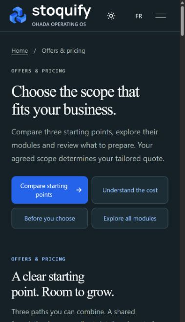
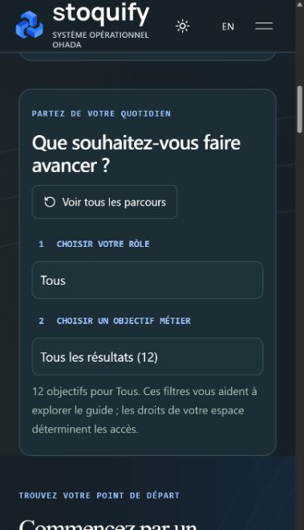

# Pricing and workflows presentation — 24 October 2026

Base revision: `9ab93a2a1d81e37ef7e0b10357885b48a3bc5886`, with the existing local working tree preserved. No commit, deployment, schema operation or production build.

## Changes

- Pricing now presents the three adoption paths first. Its compact introduction links directly to offers, total-cost guidance, decision questions and the complete 18-entry module/workspace catalog.
- Removed the older standalone eight-module presentation in favor of the landing page's existing catalog. Offer selection, commercial caveats, comparison, cost guidance and localized destinations remain available.
- Workflow pages use the same content width and footer alignment as the landing page, with smaller section gaps and integrated preview styling.
- All five business-example records share an intrinsic-height grid. Hidden records are inert and excluded from assistive technology; the selected title is announced. Long French step links stack into full-width rows on phones.
- Added compact native role/outcome selectors on phones, synchronized with the desktop controls and the existing role-conditioned outcome logic.
- The 12 primary guides keep a concise result visible, with source/destination, responsibilities, prerequisites and controls inside their expandable details. The workflow index has a bounded vertical scroll area.
- Added the nine supporting journeys already explained on the landing page: accountant invitations, client portfolios, evidence review, supplier payments, stock loss, employee self-service, financial reporting, cash follow-up and opening data. Their existing bilingual explanations and access limitations are reused. These sit in a separately labelled section alongside the 12 filtered primary guides.
- Direct firm-guide bookmarks open and focus the relevant guide. The supporting-section link focuses its overview without expanding the first card.

Owned edits: `components/landing/public-pages.tsx`, `cinematic-offers.tsx`, `landing-sections.css`, `workflow-atlas.tsx`, `workflow-atlas.css`, `workflow-story.tsx`, the export in `landing-workflow-library.ts`, the workflows route's shared stylesheet import, and the two relevant existing component test files. Several of these files already contained earlier user-requested changes; do not revert whole files to roll back this task.

## Source and design inspection

Read the project workflow, command registry, design master, public/auth contract and project UI/UX Pro Max skill. Its focused UX search returned heading balance, horizontal overflow and viewport guidance from `ux-guidelines.csv`; applied natural text wrapping and reflow within the existing design, without changing the framework or palette. Consulted existing graph references for the workflow component and checked current source before implementation.

Header and footer retain the canonical `StoquifyLogo`. The catalog uses `PreviewLogo`. Workflow laptop/PC scenes use the refreshed v2 backgrounds and live, localized branded overlays. Checked the current blue logo in the rendered retail, pharmacy and accounting-firm previews and the shared source used by all five scenes. No new logo files were needed.

## Executed checks

- `npm run agent:workflow:check`: passed; 196 scripts remain unclassified. Inspected the runner/registry before execution.
- `node node_modules/jest/bin/jest.js --config scripts/jest.landing-showcase.config.cjs --runInBand --no-cache --testMatch '**/CinematicLanding.test.tsx' '**/workflow-atlas.test.tsx' '**/workflow-details.test.tsx'`: 3 suites, 72 tests passed after the core pricing, stable-preview and compact-filter changes.
- After adding supporting guides, reran the workflow suite: 19 tests passed.
- After adding the firm-bookmark regression and refining section navigation, final workflow run using the same isolated config with `--testMatch '**/workflow-atlas.test.tsx'`: 20 tests passed.
- ESLint on `public-pages.tsx`, `cinematic-offers.tsx`, `workflow-atlas.tsx`, `workflow-story.tsx` and `landing-workflow-library.ts` with `--no-cache`: passed. The final navigation refinement was subsequently exercised by the workflow tests and browser.
- Scoped `git diff --check`: passed, with only Git line-ending notices.

These are isolated mocked component tests, not real database or release tests. The Jest setup and configuration were inspected; the lane does not load application configuration or run database operations.

## Rendered browser checks

Used the existing server at `http://localhost:3000`, routes `/en/pricing`, `/fr/pricing`, `/en/workflows`, `/fr/workflows`. The browser had an existing signed-in session, so public CTAs appropriately offered workspace access. No protected destination was opened and no business data was changed. Tested responsive desktop/phone viewports, not physical devices. Checked actual browser CSS dimensions because the tool's requested sizes were affected by device scaling.

| Surface and viewport | Result |
| --- | --- |
| Pricing EN/FR, desktop 1440px | Layout and offer cards inspected; no page horizontal overflow; selection and comparison work |
| Pricing EN, 390px | All 18 catalog choices share a 970px frame; four cost choices work; comparison and all 12 answers expanded without page overflow |
| Pricing FR, 320px | All 18 catalog choices share a 1140px frame; all four cost expansions share a 397px frame; all 13 disclosures open without page or visible text overflow |
| Pricing FR, 390px | All three offer choices keep the next-step panel at 418px; catalog-to-offer link selects the matching path |
| Pricing EN, desktop 1440px | All 18 catalog choices share a 604px frame; Home moves focus and selection to the first module |
| Workflows EN, 390px | Five business examples maintained one frame height; native filters correctly reset an unavailable outcome when switching from HR/payroll to cashier |
| Workflows FR, 320px | All 21 guides expanded without page overflow; corrected the one overflowing long example link; post-fix example frame measures 606px and its step links fit |
| Workflows FR, desktop 1440px | All five example frames measure 631px; localized laptop/PC overlays and light-theme supporting guides inspected |
| Intermediate widths 768/1024px | English pricing and French workflows report document width equal to client width |

Also verified the French 320px preview dialog fits (288px wide), Escape closes it, localized page navigation preserves the destination, and `/fr/workflows#workflow-accountant-portfolio` opens/focuses the correct guide at 1024px. Light-theme spot checks covered English pricing and French workflow guides. The final captured console-error logs were empty. Review finished in dark theme with normal motion; temporary viewport overrides were reset.

Long expanded guides use normal page scrolling. The comparison table intentionally scrolls horizontally inside its labelled region; the workflow index and desktop catalog navigation intentionally scroll vertically. They do not create page-level horizontal overflow.

Retained viewport evidence:

Desktop and additional state screenshots were inspected inline. These two retained images are representative viewport evidence, not full-page captures or a cross-browser accessibility certification.

## Rollback

Revert only this task's edits described above, preserving the earlier landing-page work and unrelated local changes. No backend or data rollback is needed.
