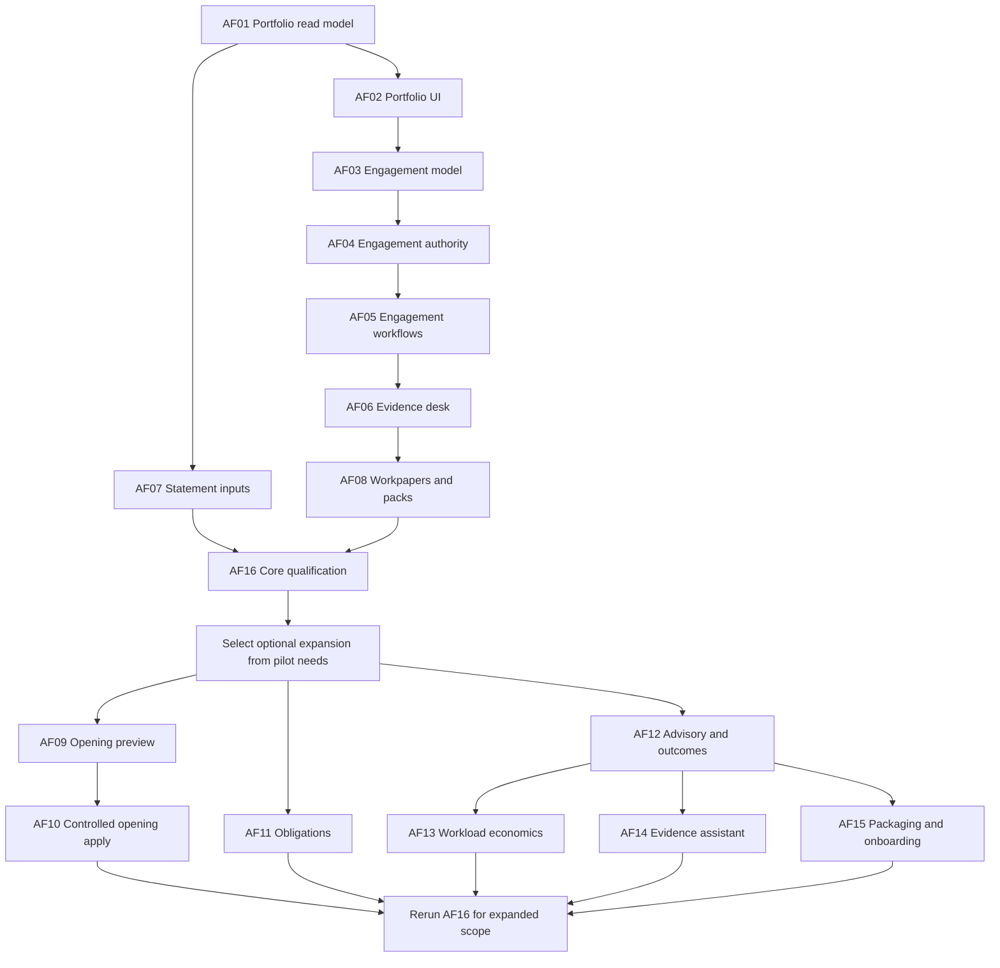

# Accounting firms in Stoquify: implementation roadmap and execution prompts

**2 November 2026 sealed obligation follow-up:** [AF11 operational browser verification](execution/AF16/SEALED_OBLIGATION_BROWSER_2026-11-02.md) PASS: 8 workflow groups, 4 scoped EN/FR scans, exact retry, independent review, UNKNOWN statutory state and authority recovery. AF11 country qualification remains IMPLEMENTED_UNVERIFIED; production NO_GO. Next: AF06 delegated evidence workflow on the same artifact.

**2 November 2026 engagement repair follow-up:** [Replacement artifact and AF03–AF05 verification](execution/AF16/ENGAGEMENT_REPAIR_2026-11-02.md) PASS within the selected scope: eight component recovery checks, reproduced old pending-refresh defect, full build/artifact verification, 11 lifecycle/layout groups and 6 restrictive recovery groups; 4 scoped axe scans. The 28 October failure remains historical. Next: AF11 operational register on this replacement artifact. Production remains NO_GO.

**28 October 2026 sealed engagement follow-up:** [AF03–AF05 browser attempt](execution/AF16/SEALED_ENGAGEMENT_BROWSER_2026-10-28.md) FAILED during client-grant setup: the preparer grant saved but the form remained pending; a diagnostic recovered the form on reload, then failed in the next grant/password-confirmation flow. Lifecycle, EN/FR/axe and recovery matrices were not reached. Next: diagnose this blocker before AF11. Production remains NO_GO.

**26 October 2026 sealed opening follow-up:** [AF09–AF10 browser verification](execution/AF16/SEALED_OPENING_BROWSER_2026-10-26.md) passes on the verified full application: three real identities, secure cookies, staged review, separate financial approval, injected failure rollback, lost-response recovery, replay and current-module denial; six scoped axe scans. Remaining browser, predecessor rollback and other release gates stay open.

**26 October 2026 AF16 follow-up:** [Current build assurance](execution/AF16/BUILD_ASSURANCE_2026-10-26.md): workflow and full lint pass (0 errors, 24 warnings); attempt 5 completed the full build, sealed/verified 5,284 runtime files and passed eight isolated HTTP checks. A fresh locked install passed with lifecycle scripts disabled. Production remains NO_GO pending the remaining release gates.


**25 October 2026 AF16 development verification:** Current AF01–AF13 synthetic verification is recorded in [AF16 RESULT](execution/AF16/RESULT.md): 1317 regressions, 161 phase/worker cases, a shared reviewed-client journey, scoped types, populated migration/replay and three authenticated browser journeys. Formal release remains IMPLEMENTED_UNVERIFIED / NO_GO; the pilot is prepared and live validation deferred. AF14–AF15 remain unstarted.


**Prepared:** 19 October 2026. **Status:** AF01–AF10 verified within their phase scopes, including staged opening preview and controlled apply/recovery; AF11 is IMPLEMENTED_UNVERIFIED pending qualified country evidence; AF12 is verified within its bounded advisory scope; AF13 is verified within its synthetic development scope; AF14–AF15 remain planned; AF16 development verification is recorded with explicit release gaps. Updated 25 October 2026. See the linked execution register for current evidence and limitations, including the remaining AF16 release gate.  
**Source:** [Accounting-firm capability audit](<E:/ohada saas/Focused projects/stoquify/docs/accounting-firms/roadmap-2026-10-19/00_SOURCE_REPORT.md>), baseline `6ee84a90c760d2864f6aef672d8b393ac2b65971` plus the inspected dirty working tree. Future executors must refresh the relevant source.  
**Execution controls:** [Shared contract](<E:/ohada saas/Focused projects/stoquify/docs/accounting-firms/roadmap-2026-10-19/02_EXECUTION_CONTRACT.md>) · [Phase status](<E:/ohada saas/Focused projects/stoquify/docs/accounting-firms/roadmap-2026-10-19/STATUS.md>).

[AF11 results](execution/AF11/RESULT.md) document the operational obligation/evidence register in the existing firm workspace. Source-bound revisions, independent evidence review, exact retry and payroll redaction reuse existing country packs, Close exports, declaration evidence and AF04 authority. Technical evidence includes 112 pure/mocked tests, 26 component checks, 14 real PostgreSQL scenarios, focused types/schema and 105-migration clean / 104→105 populated upgrade checks. Current official definitions and qualified country review remain missing; statutory candidates stay UNKNOWN and no legal deadlines or live filing are enabled. The full phase is IMPLEMENTED_UNVERIFIED; see the result for authenticated browser and publication evidence.

[AF12 results](execution/AF12/RESULT.md) record reviewed advisory observations, independent narrative review, client agreement and publication, private firm notes, source-change history and explicit outcome measurements. Evidence includes 135 reused regressions, nine real PostgreSQL scenarios plus a pure duration scenario, focused types, 118 clean migrations / populated 105→118 preservation and replay, the authenticated three-role workflow, eight scoped EN/FR desktop/mobile axe scans without violations, and reconciled PDF/CSV/JSON. No live benefit baseline or release qualification is claimed.

## 1. Product objective and first release

Execution update: [AF02 results](execution/AF02/RESULT.md) record bilingual historical/current proof, search and continuation, safe recovery and real authenticated browser evidence across 105 synthetic clients. [AF03 results](execution/AF03/RESULT.md) verify the additive engagement/assignment/mandate-link/history foundation, clean and populated database migrations, and conservative dormant-access controls. [AF04 results](execution/AF04/RESULT.md) verify the current-authority intersection, explicit enrollment, lifecycle/handover, replay and rollback controls, and concurrent acceptance/export versus suspension/revocation. Its evidence includes 538 focused tests, 27 PostgreSQL tests on each clean/upgrade target, and 101-migration application/replay. [AF05 results](execution/AF05/RESULT.md) now verify setup, named consent/enrollment, staff handover, retained work and invitation delivery states: 102 focused tests, 541 overlapping regressions, five PostgreSQL tests, scoped types and authenticated EN/FR desktop/mobile/recovery checks. [AF06 results](execution/AF06/RESULT.md) verify the delegated request/tracking composer, client response and independent acceptance with typed settlement-proof mapping: 355 focused tests, seven PostgreSQL scenarios, focused types, a real three-identity browser loop and four EN/FR desktop/mobile scoped axe scans. The synthetic collection receipt does not certify reconciliation. AF07 and AF08 subsequent results are recorded below; AF16 release qualification remains open.

[AF07 results](execution/AF07/RESULT.md) verify strict synthetic CSV/JSON formats, retained fingerprints/replay, changed-identity holds and current signed-source coverage: 112 focused tests, nine PostgreSQL scenarios, focused types and final workflow check. The 1,000-record pilot limit was measured with normal transaction settings. Live provider connectivity and AF16 release qualification remain unverified.

[AF08 results](execution/AF08/RESULT.md) verify a four-schedule period binder, source-bound preparation and independent review, structure-only roll-forward and redacted PDF/CSV delivery from canonical JSON. Evidence includes 135 focused tests, ten real PostgreSQL scenarios across main/targeted runs, scoped types, authenticated review/export/recovery, four EN/FR desktop/mobile axe scans without violations and actual artifact reconciliation. These draft workpapers do not certify the Close run. The shared workflow failure recorded during AF08 is historical; the AF09 check now passes. AF16 release qualification remains open.

[AF09 results](execution/AF09/RESULT.md) verify a separate immutable opening-position preview with independent controls, exact tie-out, mappings to current client masters and independent review: 101 focused tests, eight real PostgreSQL scenarios, focused types, clean and populated migration/replay, and authenticated bilingual desktop/mobile checks. AF09 itself does not apply financial changes. The user explicitly selected AF09 before AF16; this does not qualify a production expansion.

[AF10 results](execution/AF10/RESULT.md) verify separate client financial approval, atomic ledger/receivable/payable/stock initialization, persisted reconciliation before activation, cancellation of unapplied approvals and exact recovery after rollback or a lost response. AF09 staging and existing domain writers remain in use. Evidence includes 413 focused tests, 19 real PostgreSQL scenarios, focused types, clean 104-migration application, populated 103→104 upgrade/replay, authenticated bilingual desktop/mobile checks and six scoped axe scans without violations. The 100-row synthetic apply took 4,487 ms within the normal 30-second timeout. This is a bounded empty-client CM/XAF pilot; retained ACTIVE status is a historical cutover receipt. Production migration, whole-cutover undo and AF16 release qualification remain open.

Build a dependable daily workspace in which an accounting firm can see which clients require attention, assign authorized staff, obtain missing evidence, review the resulting work and deliver an understandable close pack.

Start with firms serving clients already using Stoquify. This minimizes migration risk and tests the strongest existing capability: connecting operational records to accounting evidence and review. Cameroon-first, English/French delivery is a pilot hypothesis from the audit, subject to actual capability and expert review; this package does not expand statutory support.

The first release should support this complete journey:

1. A client grants a named accountant access; the firm establishes an engagement and assigns eligible staff.
2. The accountant sees all authorized clients, with honest coverage, assessment age and current-proof state.
3. The manager or permitted worker assigns an evidence issue without expanding anyone's access.
4. The client responds through the existing evidence workflow.
5. An independently authorized reviewer checks the response against current source records.
6. The firm assembles workpapers and delivers a readable, source-linked pack.
7. A later source change makes previous review/proof visibly stale.
8. Revocation, staff departure and engagement suspension stop access while preserving attributable history.

The reason to return is newly actionable work: a client response, a source change, an expiring mandate, an overdue request or a review waiting for an authorized decision. Successful quiet periods should require fewer visits. Do not optimize screen time or manufacture notifications.

## 2. Delivery order and release cuts

| Release cut | Phases | User outcome | Exit gate |
|---|---|---|---|
| R1: reliable portfolio | AF01 → AF02 | Complete, bounded client coverage and truthful current proof | Source/detail agreement, 101+ client traversal, privacy and UI-state evidence |
| R2: firm engagements | AF03 → AF04 → AF05 | Explicit engagements, staff assignment and safe handover | Additive upgrade proof, managed-access intersection and lifecycle race tests |
| R3: evidence-to-close | AF06; AF07; AF08 | Evidence requests become reviewed work and readable deliverables | Completed synthetic journey with current evidence and correct totals |
| Core qualification | AF16 for AF01–AF08 | A documented decision on the exact first-release scope | Current database, browser, artifact, performance and recovery evidence |
| R4: selective expansion | AF09 → AF10; AF11; AF12 | Migration, obligations and advisory, selected by actual client need | Each optional slice passes its own criteria; rerun AF16 for expanded scope |
| R5: validated scale | AF13; AF14; AF15 | Workload economics, bounded AI help and repeatable onboarding | Measured need, quality/commercial evidence and refreshed AF16 |

**Default execution sequence:** AF01, AF02, AF03, AF04, AF05, AF06, AF07, AF08, **AF16**, then selected AF09–AF15. AF16 is numbered last because it is reusable release assurance, not because it should wait for every optional feature.

AF07 technically depends only on AF01 and can be scheduled independently after that contract stabilizes. Preserve the user's portfolio/engagement priority in the default sequence. AF09 and AF11 technically depend on AF05, but the program should qualify the core journey before spending on optional expansion. These are engineering dependency distinctions, not instructions to create parallel agents.



The diagram emphasizes delivery order. Exact technical prerequisites appear in the phase table and prompts.

## 3. Scope, ownership and planning estimates

Estimates are planning ranges for experienced contributors familiar with this codebase, including focused implementation tests but excluding waiting for access, independent expert review, production deployment and live pilot cycles. They are not measured throughput. Re-estimate after each phase's discovery and dependency review.

| Phase | Priority | Technical prerequisite | Accountable disciplines | Effort | Ready-to-use prompt |
|---|---|---|---|---|---|
| AF01: Portfolio reliability – current proof and complete coverage | P0 | Baseline refresh | Backend/accounting + security + QA | 4–7 engineer-days | [AF01 prompt](<E:/ohada saas/Focused projects/stoquify/docs/accounting-firms/roadmap-2026-10-19/prompts/AF01-portfolio-read-model.md>) |
| AF02: Portfolio reliability – actionable bilingual UI | P0 | AF01 | Frontend/workflow UX + accessibility + QA | 3–5 engineer-days | [AF02 prompt](<E:/ohada saas/Focused projects/stoquify/docs/accounting-firms/roadmap-2026-10-19/prompts/AF02-portfolio-ui.md>) |
| AF03: Firm engagements – domain contract and additive schema | P0 | AF02 | Domain/data architecture + IAM + accounting product owner | 4–7 engineer-days | [AF03 prompt](<E:/ohada saas/Focused projects/stoquify/docs/accounting-firms/roadmap-2026-10-19/prompts/AF03-engagement-model.md>) |
| AF04: Firm engagements – authorization and lifecycle services | P0 | AF03 | Backend/IAM + data integrity + QA | 5–9 engineer-days | [AF04 prompt](<E:/ohada saas/Focused projects/stoquify/docs/accounting-firms/roadmap-2026-10-19/prompts/AF04-engagement-authority.md>) |
| AF05: Firm engagements – setup, staff assignment and handover UI | P0 | AF04 | Frontend/workflow UX + backend integration + QA | 4–7 engineer-days | [AF05 prompt](<E:/ohada saas/Focused projects/stoquify/docs/accounting-firms/roadmap-2026-10-19/prompts/AF05-engagement-workflows.md>) |
| AF06: Delegated evidence work – complete the firm-to-client loop | P1 | AF05 | Accounting backend + workflow UX + IAM/QA | 5–8 engineer-days | [AF06 prompt](<E:/ohada saas/Focused projects/stoquify/docs/accounting-firms/roadmap-2026-10-19/prompts/AF06-delegated-evidence-desk.md>) |
| AF07: Reconciliation inputs – provider formats and account coverage | P1 | AF01 | Payments/reconciliation + data QA + operations | 4–8 engineer-days | [AF07 prompt](<E:/ohada saas/Focused projects/stoquify/docs/accounting-firms/roadmap-2026-10-19/prompts/AF07-provider-coverage.md>) |
| AF08: Review workpapers and readable close deliverables | P1 | AF06 | Accounting/reporting + data controls + frontend/QA | 7–12 engineer-days | [AF08 prompt](<E:/ohada saas/Focused projects/stoquify/docs/accounting-firms/roadmap-2026-10-19/prompts/AF08-workpapers-deliverables.md>) |
| AF09: Financial onboarding – staged opening position and tie-out preview | P1 for new-client migration; optional for existing-client pilot | AF05 | Accounting/data migration + inventory/AP/AR owners | 6–10 engineer-days | [AF09 prompt](<E:/ohada saas/Focused projects/stoquify/docs/accounting-firms/roadmap-2026-10-19/prompts/AF09-opening-preview.md>) |
| AF10: Financial onboarding – controlled apply, recovery and activation | P1 for migration release only | AF09, AF04 | Domain backend + database + accounting controls + QA | 8–15 engineer-days | [AF10 prompt](<E:/ohada saas/Focused projects/stoquify/docs/accounting-firms/roadmap-2026-10-19/prompts/AF10-opening-apply.md>) |
| AF11: Country-specific obligations and evidence register | P2; country approval is an external dependency | AF05 | Compliance/product + qualified country reviewer + backend/QA | 5–9 engineer-days plus expert review | [AF11 prompt](<E:/ohada saas/Focused projects/stoquify/docs/accounting-firms/roadmap-2026-10-19/prompts/AF11-obligation-register.md>) |
| AF12: Client advisory packs and outcome measurement | P2 | AF08 | Reporting/product analytics + accounting reviewer | 4–7 engineer-days | [AF12 prompt](<E:/ohada saas/Focused projects/stoquify/docs/accounting-firms/roadmap-2026-10-19/prompts/AF12-advisory-outcomes.md>) |
| AF13: Firm workload and engagement economics | P3; activate after pilot demand | AF05, AF12 | Practice operations/product + privacy + backend | 5–9 engineer-days | [AF13 prompt](<E:/ohada saas/Focused projects/stoquify/docs/accounting-firms/roadmap-2026-10-19/prompts/AF13-workload-economics.md>) |
| AF14: Evidence-grounded drafting and review assistant | P3; activate after reliable manual workflow | AF06, AF08, AF12 | AI/backend + accounting reviewer + privacy/evaluation | 5–10 engineer-days plus evaluation | [AF14 prompt](<E:/ohada saas/Focused projects/stoquify/docs/accounting-firms/roadmap-2026-10-19/prompts/AF14-evidence-assistant.md>) |
| AF15: Firm onboarding, coexistence and packaging | P3; commercial validation first | AF05, AF08, AF12 | Product/CS + modules/billing architect + integrations | 4–8 engineer-days | [AF15 prompt](<E:/ohada saas/Focused projects/stoquify/docs/accounting-firms/roadmap-2026-10-19/prompts/AF15-partner-packaging.md>) |
| AF16: Integration, release assurance and measured pilot | P0 release gate; run after AF08, then rerun for expansion | AF01, AF02, AF03, AF04, AF05, AF06, AF07, AF08 | QA/release + IAM/data + accounting owner + operations | 5–10 engineer-days technical assurance; two monthly pilot cycles separately | [AF16 prompt](<E:/ohada saas/Focused projects/stoquify/docs/accounting-firms/roadmap-2026-10-19/prompts/AF16-pilot-release-assurance.md>) |

AF01–AF08 total **36–63 engineer-days**; AF16 adds **5–10 engineer-days** of technical assurance. The first qualified slice therefore has a provisional **41–73 engineer-day** budget, before two monthly pilot cycles. This is effort, not elapsed delivery time. Do not divide blindly by headcount: AF03–AF05 share one authorization contract and require ordered work.

P0 protects trust, access or release qualification. P1 completes the core value chain or removes a specific onboarding barrier. P2 expands an already reliable service. P3 needs evidence of demand or quality before investment. AF09/AF10 are P1 only for migration-dependent clients; they are unnecessary for the first existing-client pilot.

## 4. Reuse map and explicit boundaries

| Existing functionality | Reuse in this roadmap | Preserve or repair |
|---|---|---|
| [Named accountant grants and portfolio](<E:/ohada saas/Focused projects/stoquify/services/accounting/accountant-access.service.ts:467>) | AF01–AF05 portfolio and engagement access | Replace silent 100-row truncation with bounded continuation; keep client consent authoritative |
| [Current-proof derivation](<E:/ohada saas/Focused projects/stoquify/services/accounting/close-assurance-current-proof.ts>) and [assessment selection](<E:/ohada saas/Focused projects/stoquify/services/accounting/close-assessment-order.service.ts>) | AF01, AF08, AF16 | Reuse both; a stored score alone does not establish current proof |
| [Source revision service](<E:/ohada saas/Focused projects/stoquify/services/accounting/close-source-revision.service.ts>) | AF01 read semantics; AF08 invalidation | The locking helper can write; a portfolio read must use read-only projection logic |
| [Accountant portfolio](<E:/ohada saas/Focused projects/stoquify/components/accounting/AccountantPortfolio.tsx>) and [work desk](<E:/ohada saas/Focused projects/stoquify/components/accounting/AccountantWorkDesk.tsx>) | AF02, AF05, AF06 | Extend existing routes and state patterns; work-desk ten-client scope is not a firm-wide total |
| [Organization, users and grants](<E:/ohada saas/Focused projects/stoquify/prisma/schema.prisma>) | AF03–AF05 | Single home organization/global email uniqueness remain; firmName is descriptive, not identity |
| [Accountant invitation](<E:/ohada saas/Focused projects/stoquify/services/accounting/accountant-client-invite.service.ts>) | AF05, AF15 | Existing direction is client → accountant; do not relabel it as firm → new SME onboarding |
| [Evidence workflow](<E:/ohada saas/Focused projects/stoquify/services/accounting/close-evidence-workflow.service.ts>) and [acceptance authority](<E:/ohada saas/Focused projects/stoquify/services/accounting/close-evidence-acceptance-authority.service.ts>) | AF04, AF06, AF08 | Preserve current source checks, independent acceptance, audit/outbox and request lifecycle |
| [Statement import](<E:/ohada saas/Focused projects/stoquify/services/payments/statement-import.service.ts>) and [account coverage](<E:/ohada saas/Focused projects/stoquify/services/reconciliation/account-close-coverage.service.ts>) | AF07 | Format validation, fingerprints, no-activity evidence and truthful provider/coverage status |
| [Accounting reports](<E:/ohada saas/Focused projects/stoquify/services/accounting/reports.service.ts>), [financial statements](<E:/ohada saas/Focused projects/stoquify/services/accounting/financial-statements.service.ts>), [close packs](<E:/ohada saas/Focused projects/stoquify/services/accounting/close-assurance-pack.service.ts>) | AF08, AF12 | Existing ledger/evidence remains canonical; readable formats add delivery value without another ledger |
| [Master import](<E:/ohada saas/Focused projects/stoquify/services/onboarding/master-data-import.service.ts>) and [opening readiness](<E:/ohada saas/Focused projects/stoquify/services/onboarding/opening-readiness.ts>) | AF09–AF10 | Financial openings require separate staging/tie-out and approved domain writers |
| [Country pack registry](<E:/ohada saas/Focused projects/stoquify/services/regulatory/country-packs/registry.ts>) and [fiscal adapters](<E:/ohada saas/Focused projects/stoquify/services/compliance/adapters/registry.ts>) | AF11 | Manual, sandbox and verified production capabilities remain distinct |
| [Retention metrics](<E:/ohada saas/Focused projects/stoquify/services/analytics/retention-outcomes.ts>) and [tenant sales metrics service](<E:/ohada saas/Focused projects/stoquify/services/analytics/retention-outcomes.service.ts>) | AF12–AF13 pattern reuse only | The existing sales/POS tenant endpoint is not a cross-client firm metrics service |
| [Copilot proposals](<E:/ohada saas/Focused projects/stoquify/services/ai/copilot-proposal.service.ts>) and [agent redaction](<E:/ohada saas/Focused projects/stoquify/services/agents/agent-redaction.service.ts>) | AF14 | Evidence-grounded drafts with executionAuthority NONE; no autonomous accounting authority |
| [Module entitlements](<E:/ohada saas/Focused projects/stoquify/services/modules/module-entitlement.service.ts>) and [referral attribution](<E:/ohada saas/Focused projects/stoquify/services/referrals/referral-attribution.service.ts>) | All phases; AF15 commercial design | Do not create duplicate billing, entitlements or referral obligations |

Reuse means preserving the owning service's rules and calling contract. It does not mean calling a workspace-only action with a caller-supplied client ID. Delegation must be explicitly supported and authorized at each domain boundary.

## 5. First priority: portfolio reliability

### AF01 contract to settle before UI work

The service should expose a bounded page of authorized clients with a stable cursor, loaded/continuation scope and a checked-at time. Each row needs the client identity the actor may see, grant state/expiry, the client's own selected period, current-proof state/reasons, assessment time and any historical score clearly identified as historical.

These are required semantics, not mandated field names. Align the DTO with existing conventions. An exact total is optional unless it can be computed within the same authorized scope; an honest partial count is better than a false whole-portfolio total.

A current-proof projection must account for canonical assessment order, source revisions, evidence availability and valid retained exports. Avoid per-client calls that create a new assessment or write source-revision locks. If extracting shared read-only code is necessary, keep it narrow and verify agreement with close detail. Per-client snapshots can have different observation times; do not imply one global atomic snapshot across every tenant.

Pagination needs explicit behavior for newly granted/revoked clients and changing sort values. Test stable fixtures above 100 clients and changing-grant fixtures. Search and counts must not disclose clients the actor cannot access. Set a query/fan-out budget during discovery and measure it on a disposable target; do not invent performance achievements.

### AF02 user experience

Keep the existing accountant portfolio route. Show what requires action, why it requires action, when it was checked and which client/period it concerns. Make stale, unavailable, ambiguous and historical states visible. A score cannot substitute for an evidence state.

Provide bounded loading/search/navigation; keep the separate work-desk coverage visible. Clear client-sensitive UI state on permission/session changes. Test keyboard operation, English/French labels, narrow screens and denied/partial/retry states. The exit gate is a trustworthy view of all authorized clients, not a redesigned visual theme.

## 6. Second priority: firm engagements

### AF03 domain contract

Use the existing Organization as the firm's identity where appropriate; add a profile only for genuinely missing firm attributes. Propose additive engagement, assignment and transition records with explicit firm organization, client organization, service scope, effective dates, lifecycle state and actor/version provenance.

Keep three separate concepts:

- **Client mandate:** the named accountant's current permission from the client.
- **Engagement:** the firm's relationship, scope and operating lifecycle for that client.
- **Assignment:** the worker's role/responsibility within the engagement.

Adopt draft → active → suspended/ended as the initial lifecycle proposal and record permitted transitions in the ADR. Resolve renewal, reactivation and handover semantics before coding commands. Preserve historical attribution and prevent duplicate active assignments according to the agreed uniqueness rules.

A managed grant must retain explicit engagement linkage. Existing unlinked grants keep their current semantics until explicitly enrolled; do not infer firm membership from names, registration strings or email domains. Once managed, suspension or rollback must not silently recover access through the legacy grant-only path.

### AF04 authority and transaction boundaries

For managed work, access is the intersection of active actor/home membership, permitted action, applicable entitlement, valid client mandate, active engagement/assignment and domain-specific controls. These checks belong in shared service boundaries, including direct actions, exports, work-desk drill-down and evidence acceptance.

A manager's staff assignment authority does not imply authority to review all client evidence. READ_ONLY remains restricted. PREPARER/REVIEWER labels require action-specific mapping; their existing general helper capabilities must not be presented as stronger segregation than actually implemented.

Record state transitions, audit/outbox events and idempotency in the same appropriate transaction. Define lock ordering and version predicates. Test revocation, staff deactivation and source changes that occur while a command waits. Retention of historical decisions must not preserve former staff's live access to client data.

### AF05 operating workflow

Implement firm setup, engagement creation/enrollment, assignment, renewal, suspension and handover using existing navigation and invitation infrastructure. Show separately whether a person is assigned and whether the client's mandate is active.

Do not move an accountant with a different home organization into the firm. External reviewers need an explicit existing mandate and a supported relationship; do not introduce a broad multi-organization identity rewrite.

Handover must account for open requests/reviews, successor authorization and attributable history. An engagement cannot look successfully transferred while its unresolved work has no owner. A controlled unassigned state is acceptable when visible and recoverable.

## 7. Phase delivery briefs

Each linked prompt is self-contained: it includes discovery targets, ordered implementation tasks, acceptance IDs, controls, non-goals, evidence outputs and rollback requirements. The short invocation can be pasted into a new implementation turn in this repository; it reads the full prompt rather than replacing it.

### AF01 — Portfolio reliability — current proof and complete coverage

**Starting point:** Portfolio reads at most 100 grants, uses stored close scores and returns no cursor. Current-proof and assessment-order helpers exist separately.

**Data/change boundary:** No new financial tables expected. Add DTO/query contracts; propose an index only after query-plan evidence.

**Required delivery evidence:** RESULT.md, PORTFOLIO_READ_CONTRACT.md, focused tests, sanitized query/coverage evidence.

**Key exit checks:**

- A 101+ grant fixture is traversable without silent truncation; counts and loaded scope remain truthful.
- Persisted CERTIFIED/100% with stale, absent, superseded or ambiguous evidence never appears as current proof.
- Portal/close detail and portfolio agree for the same actor, client, period and snapshot semantics.

**Rollback:** Revert owned DTO/consumer changes coherently or disable only the new presentation. Do not restore a misleading current-proof label. Preserve grants and financial history.

[AF01 prompt](<E:/ohada saas/Focused projects/stoquify/docs/accounting-firms/roadmap-2026-10-19/prompts/AF01-portfolio-read-model.md>)

```text
Read and execute E:/ohada saas/Focused projects/stoquify/docs/accounting-firms/roadmap-2026-10-19/prompts/AF01-portfolio-read-model.md. Complete only AF01, preserve unrelated edits, and update its evidence and STATUS.md.
```

### AF02 — Portfolio reliability — actionable bilingual UI

**Starting point:** Portfolio cards show stored score/blockers/expiry; work desk has separate bounded-page and incomplete states.

**Data/change boundary:** Consume AF01's contract; do not add persistence for client-derived financial status.

**Required delivery evidence:** RESULT.md, UI_STATE_MATRIX.md, component results and sanitized browser screenshots/trace.

**Key exit checks:**

- Users can distinguish historical readiness, current proof and unavailable data without opening detail.
- 101+ authorized clients are reachable; no unlabeled partial total.
- Opening evidence carries the correct client and period and retains server authorization.

**Rollback:** Disable/revert owned UI changes with compatible DTO handling; retain truthful status labels and authorization-safe cache behavior.

[AF02 prompt](<E:/ohada saas/Focused projects/stoquify/docs/accounting-firms/roadmap-2026-10-19/prompts/AF02-portfolio-ui.md>)

```text
Read and execute E:/ohada saas/Focused projects/stoquify/docs/accounting-firms/roadmap-2026-10-19/prompts/AF02-portfolio-ui.md. Complete only AF02, preserve unrelated edits, and update its evidence and STATUS.md.
```

### AF03 — Firm engagements — domain contract and additive schema

**Starting point:** User has one required home organization and globally unique email. Grants name individual accountants; firm name/registration are descriptive strings.

**Data/change boundary:** Additive engagement/assignment/transition structures and explicit legacy-grant linkage if needed. Never infer firm identity from free-text firm names.

**Required delivery evidence:** RESULT.md, ENGAGEMENT_ADR.md, CAPABILITY_MATRIX.md, DATA_MIGRATION_PLAN.md, additive migration and fixture evidence.

**Key exit checks:**

- Every proposed entity has an owner, scope, lifecycle, retention rule and access consequence.
- Database constraints reject mismatched firm/client/assignment relationships and duplicate active identities as defined in the ADR.
- No schema or backfill grants new client visibility; legacy behavior is documented and fixture-tested.

**Rollback:** Leave additive tables/history intact; disable creation/enrollment through existing controls. Managed grants remain fail-closed; never unlink records to regain legacy access.

[AF03 prompt](<E:/ohada saas/Focused projects/stoquify/docs/accounting-firms/roadmap-2026-10-19/prompts/AF03-engagement-model.md>)

```text
Read and execute E:/ohada saas/Focused projects/stoquify/docs/accounting-firms/roadmap-2026-10-19/prompts/AF03-engagement-model.md. Complete only AF03, preserve unrelated edits, and update its evidence and STATUS.md.
```

### AF04 — Firm engagements — authorization and lifecycle services

**Starting point:** Per-user grant and tenant authorization exist. No verified managed-engagement enforcement layer yet.

**Data/change boundary:** Implement AF03's versioned records, explicit linkage, audit/outbox events and concurrency predicates; avoid a second permission store.

**Required delivery evidence:** RESULT.md, AUTHORITY_AND_LOCK_ORDER.md, service/action tests and real-database race/replay evidence.

**Key exit checks:**

- Managed access requires every stated predicate; missing one denies data and mutations.
- Concurrent suspend/revoke versus accept/export has a deterministic authorized outcome and retained evidence on a disposable database.
- Same idempotency key/same payload replays; changed payload or stale version conflicts; no duplicate transitions.

**Rollback:** Stop new engagement commands while retaining restrictive managed-access checks and transition evidence. Do not revert to grant-only authorization for enrolled clients.

[AF04 prompt](<E:/ohada saas/Focused projects/stoquify/docs/accounting-firms/roadmap-2026-10-19/prompts/AF04-engagement-authority.md>)

```text
Read and execute E:/ohada saas/Focused projects/stoquify/docs/accounting-firms/roadmap-2026-10-19/prompts/AF04-engagement-authority.md. Complete only AF04, preserve unrelated edits, and update its evidence and STATUS.md.
```

### AF05 — Firm engagements — setup, staff assignment and handover UI

**Starting point:** Accountant access manager, portfolio and invitation flows exist; firm setup/team workflow is not established.

**Data/change boundary:** Use AF03/AF04; add no UI-owned authorization state. Staff onboarding must reuse existing organization-user mechanisms.

**Required delivery evidence:** RESULT.md, ENGAGEMENT_JOURNEY.md, permission-state matrix, browser/component evidence and pilot training notes.

**Key exit checks:**

- A manager can set up an engagement and understand why a member can or cannot access client data.
- A client grants/revokes named access through the supported flow; firm assignment alone never activates access.
- Staff handover preserves work and history, removes obsolete access and grants no implicit permissions.

**Rollback:** Hide new enrollment/setup entry points while retaining managed-access enforcement and read-only history under approved authority.

[AF05 prompt](<E:/ohada saas/Focused projects/stoquify/docs/accounting-firms/roadmap-2026-10-19/prompts/AF05-engagement-workflows.md>)

```text
Read and execute E:/ohada saas/Focused projects/stoquify/docs/accounting-firms/roadmap-2026-10-19/prompts/AF05-engagement-workflows.md. Complete only AF05, preserve unrelated edits, and update its evidence and STATUS.md.
```

### AF06 — Delegated evidence work — complete the firm-to-client loop

**Starting point:** Close-evidence request/response/acceptance and a redacted cross-client work desk already exist. Ordinary journal/close commands remain tenant-scoped.

**Data/change boundary:** Prefer extending current typed close-evidence contracts. Persist new case metadata only where the current records cannot express the agreed case.

**Required delivery evidence:** RESULT.md, DELEGATED_CAPABILITY_MATRIX.md, CASE_CONTRACT.md, end-to-end synthetic evidence and request-resolution metric definitions.

**Key exit checks:**

- An eligible firm user completes a real typed evidence loop in synthetic fixtures without sharing client credentials.
- Revoked assignment/mandate or expired session stops both list/detail access and pending acceptance.
- Duplicate/changed submissions, recipient changes, stale proof and notification failures recover with truthful state.

**Rollback:** Disable new case creation while retaining authorized completion/history of existing requests; keep domain resolution and managed-authorization restrictions.

[AF06 prompt](<E:/ohada saas/Focused projects/stoquify/docs/accounting-firms/roadmap-2026-10-19/prompts/AF06-delegated-evidence-desk.md>)

```text
Read and execute E:/ohada saas/Focused projects/stoquify/docs/accounting-firms/roadmap-2026-10-19/prompts/AF06-delegated-evidence-desk.md. Complete only AF06, preserve unrelated edits, and update its evidence and STATUS.md.
```

### AF07 — Reconciliation inputs — provider formats and account coverage

**Starting point:** Statement import, duplicate detection, account coverage and generic mobile-money HMAC/CSV adapter exist; simple CSV splitting is a format risk.

**Data/change boundary:** Preserve existing fingerprints or version compatibility explicitly; no silent reinterpretation/reimport of historical statements.

**Required delivery evidence:** RESULT.md, SUPPORTED_FORMATS.md, normalization/fingerprint contract, fixtures and import/coverage evidence.

**Key exit checks:**

- Quoted commas/newlines, escaping, BOM, fees, reversals and malformed lines have defined tested outcomes.
- Totals match declared fixture controls with Decimal-safe arithmetic; no partial or duplicate posting/import is hidden.
- No-activity and stale/missing account coverage states are accurate.

**Rollback:** Disable newly enabled format profiles and preserve imported records/fingerprint versions. Correct bad imports through existing audited domain procedures, not deletion.

[AF07 prompt](<E:/ohada saas/Focused projects/stoquify/docs/accounting-firms/roadmap-2026-10-19/prompts/AF07-provider-coverage.md>)

```text
Read and execute E:/ohada saas/Focused projects/stoquify/docs/accounting-firms/roadmap-2026-10-19/prompts/AF07-provider-coverage.md. Complete only AF07, preserve unrelated edits, and update its evidence and STATUS.md.
```

### AF08 — Review workpapers and readable close deliverables

**Starting point:** Ledger reports, source links, close comments/reviews and JSON trust/close packs exist; full account workpapers and readable binders are not established.

**Data/change boundary:** Add only missing workpaper/decision/version metadata. Canonical ledger and existing evidence remain authoritative; never materialize a second financial ledger.

**Required delivery evidence:** RESULT.md, WORKPAPER_CONTRACT.md, sample sanitized outputs, reconciliation checks and rendered review evidence.

**Key exit checks:**

- Four pilot schedules tie to the selected ledger/source controls and disclose unavailable inputs.
- Reviews retain actor, evidence revision and conclusion; changed source cannot keep an unqualified current approval.
- PDF and spreadsheet-compatible output agree with JSON/ledger and include scope, date, limitations and correct redaction.

**Rollback:** Disable new template creation/export while keeping canonical evidence and authorized retained documents accessible under existing policy.

[AF08 prompt](<E:/ohada saas/Focused projects/stoquify/docs/accounting-firms/roadmap-2026-10-19/prompts/AF08-workpapers-deliverables.md>)

```text
Read and execute E:/ohada saas/Focused projects/stoquify/docs/accounting-firms/roadmap-2026-10-19/prompts/AF08-workpapers-deliverables.md. Complete only AF08, preserve unrelated edits, and update its evidence and STATUS.md.
```

### AF09 — Financial onboarding — staged opening position and tie-out preview

**Starting point:** Master-data importer stages identities/catalogs; opening readiness explicitly leaves financial cutover unsupported/unverified.

**Data/change boundary:** Separate staged financial-opening records from master identity imports; persist source hashes, mappings, proposed domains and control totals with a versioned cutover contract.

**Required delivery evidence:** RESULT.md, CUTOVER_CONTRACT.md, DOMAIN_WRITE_PLAN.md, synthetic datasets and tie-out previews.

**Key exit checks:**

- Preview produces explainable detail/control differences and preserves source provenance.
- No preview/import approval action writes opening balances, stock movements or journals.
- Changed source/mapping invalidates the prior review; duplicate sources are detected.

**Rollback:** Disable staging or abandon uncommitted drafts while retaining their evidence; no financial reversal is needed because application has not occurred.

[AF09 prompt](<E:/ohada saas/Focused projects/stoquify/docs/accounting-firms/roadmap-2026-10-19/prompts/AF09-opening-preview.md>)

```text
Read and execute E:/ohada saas/Focused projects/stoquify/docs/accounting-firms/roadmap-2026-10-19/prompts/AF09-opening-preview.md. Complete only AF09, preserve unrelated edits, and update its evidence and STATUS.md.
```

### AF10 — Financial onboarding — controlled apply, recovery and activation

**Starting point:** AF09 provides an approved source-bound preview and verified domain write plan. No generic direct-balance shortcut is permitted.

**Data/change boundary:** Persist cutover execution/version receipts and per-domain operation identities; use existing financial entities and retained proof. Any missing opening-domain writer must be implemented as a bounded domain-owned slice.

**Required delivery evidence:** RESULT.md, CUTOVER_RECOVERY_RUNBOOK.md, failure matrix, reconciliation manifest and database/browser evidence.

**Key exit checks:**

- Every committed domain operation has an immutable source-bound receipt; exact retry cannot duplicate financial effects.
- Independent reviewer/source version/period controls remain effective under concurrency.
- Partial failure resumes or produces explicit controlled correction steps; never reports clean activation prematurely.

**Rollback:** Stop new cutovers; preserve receipts and in-progress recovery. Correct applied effects through approved domain reversals, with downstream close invalidation.

[AF10 prompt](<E:/ohada saas/Focused projects/stoquify/docs/accounting-firms/roadmap-2026-10-19/prompts/AF10-opening-apply.md>)

```text
Read and execute E:/ohada saas/Focused projects/stoquify/docs/accounting-firms/roadmap-2026-10-19/prompts/AF10-opening-apply.md. Complete only AF10, preserve unrelated edits, and update its evidence and STATUS.md.
```

### AF11 — Country-specific obligations and evidence register

**Starting point:** Country packs, payroll declaration lifecycle and close deadlines exist; inspected static registry is Cameroon-only and fiscal adapters are sandbox.

**Data/change boundary:** Version applicability/obligation instances and attach domain evidence references. Reuse declaration records rather than creating competing filing statuses.

**Required delivery evidence:** RESULT.md, OBLIGATION_SOURCE_REGISTER.md, capability matrix, rule-change tests and country-review gaps.

**Key exit checks:**

- Every statutory obligation shown as verified has dated official provenance and qualified review evidence.
- Sandbox/manual submission cannot appear as accepted live filing.
- Changed applicability/source version makes affected obligations reviewable without erasing history.

**Rollback:** Disable newly introduced rule versions/reminders, retaining obligation/evidence history and current unknown/blocked states.

[AF11 prompt](<E:/ohada saas/Focused projects/stoquify/docs/accounting-firms/roadmap-2026-10-19/prompts/AF11-obligation-register.md>)

```text
Read and execute E:/ohada saas/Focused projects/stoquify/docs/accounting-firms/roadmap-2026-10-19/prompts/AF11-obligation-register.md. Complete only AF11, preserve unrelated edits, and update its evidence and STATUS.md.
```

### AF12 — Client advisory packs and outcome measurement

**Starting point:** Financial statements, AR/AP evidence, daily digest and retention analytics patterns exist. Existing retention outcome service is tenant sales/POS scoped, not a firm KPI API.

**Data/change boundary:** Reuse source events/timestamps and export contracts; add only missing engagement outcome/action metadata. No shadow financial calculations.

**Required delivery evidence:** RESULT.md, METRIC_DICTIONARY.md, sample advisory pack, reconciliation/source checks and pilot baseline procedure.

**Key exit checks:**

- Each material financial observation is traceable to the same reviewed sources as its workpaper.
- No missing data is converted into zero or an improvement claim.
- Outcome reports disclose cohort/window/coverage and separate work time from client waiting.

**Rollback:** Disable new advisory templates/metric views, preserve source and delivered records, and continue the existing reviewed workflow.

[AF12 prompt](<E:/ohada saas/Focused projects/stoquify/docs/accounting-firms/roadmap-2026-10-19/prompts/AF12-advisory-outcomes.md>)

```text
Read and execute E:/ohada saas/Focused projects/stoquify/docs/accounting-firms/roadmap-2026-10-19/prompts/AF12-advisory-outcomes.md. Complete only AF12, preserve unrelated edits, and update its evidence and STATUS.md.
```

### AF13 — Firm workload and engagement economics

**25 October 2026 implementation:** AF13 is VERIFIED within the user-authorized synthetic development scope. The new firm desk reuses AF05/AF08/AF12 for manual effort, retained corrections, independent review, staffing plans, confidential currency-separated budgets and guarded JSON snapshots. Focused types, 111 regressions, ten PostgreSQL scenarios, populated 118→120 upgrade/replay and authenticated EN/FR desktop/mobile checks pass. [Result](execution/AF13/RESULT.md) and [scope override](execution/AF13/SYNTHETIC_DEVELOPMENT_SCOPE.md) record the evidence. Live demand/benefit validation and AF16 release remain deferred.

**Starting point:** Firm-specific capacity, service fee budgets and realization were not established. HR time entries and client operational billing are not substitutes.

**Data/change boundary:** Add narrowly scoped firm-owned engagement budget/effort records only after pilot demand is documented. Reuse organization identity, not employee payroll records.

**Required delivery evidence:** RESULT.md, PRACTICE_METRIC_CONTRACT.md, access tests and pilot demand/decision evidence.

**Key exit checks:**

- Workload and economics are linked to authorized engagements with stated coverage.
- No HR/payroll or other-client data leaks through effort/budget views.
- Estimated, recorded, missing and corrected inputs remain distinct.

**Rollback:** Disable new entry/views; retain authorized corrected records and exportability without touching operational accounts.

[AF13 prompt](<E:/ohada saas/Focused projects/stoquify/docs/accounting-firms/roadmap-2026-10-19/prompts/AF13-workload-economics.md>)

```text
Read and execute E:/ohada saas/Focused projects/stoquify/docs/accounting-firms/roadmap-2026-10-19/prompts/AF13-workload-economics.md. Complete only AF13, preserve unrelated edits, and update its evidence and STATUS.md.
```

### AF14 — Evidence-grounded drafting and review assistant

**Starting point:** Copilot proposals already carry evidence references, TTL and executionAuthority NONE.

**Data/change boundary:** Reuse existing proposal/evidence/audit records; avoid a parallel assistant permission system or unrestricted evidence cache.

**Required delivery evidence:** RESULT.md, EVALUATION_SET.md, sanitized evaluation results, redaction/adversarial tests and provider boundary note.

**Key exit checks:**

- The assistant cannot post, approve, pay, file, change access or certify evidence through proposal acceptance.
- Cross-client context and injected instructions fail to obtain private data or action authority.
- All asserted material facts in the evaluated accepted drafts are source-supported; failures and abstentions are reported.

**Rollback:** Disable the proposal type/provider through existing release controls; retain auditable drafts/decisions without executing them.

[AF14 prompt](<E:/ohada saas/Focused projects/stoquify/docs/accounting-firms/roadmap-2026-10-19/prompts/AF14-evidence-assistant.md>)

```text
Read and execute E:/ohada saas/Focused projects/stoquify/docs/accounting-firms/roadmap-2026-10-19/prompts/AF14-evidence-assistant.md. Complete only AF14, preserve unrelated edits, and update its evidence and STATUS.md.
```

### AF15 — Firm onboarding, coexistence and packaging

**Starting point:** Client-to-accountant invitation and referral attribution exist. A firm-to-new-SME signup journey and firm commissions were not established.

**Data/change boundary:** Reuse attribution and entitlement contracts. Do not create duplicate subscriptions, automatically enroll firms or fabricate referral commission obligations.

**Required delivery evidence:** RESULT.md, FIRM_ONBOARDING_PLAYBOOK.md, PACKAGING_DECISION.md, coexistence profiles and activation tests.

**Key exit checks:**

- Onboarding describes only implemented invitation/activation directions and required modules.
- Activation metrics use retained actual work evidence and cannot imply access from historical acceptance.
- Export/coexistence claims match tested formats.

**Rollback:** Disable new activation/configuration views without changing existing entitlements or client mandates; retain attribution history.

[AF15 prompt](<E:/ohada saas/Focused projects/stoquify/docs/accounting-firms/roadmap-2026-10-19/prompts/AF15-partner-packaging.md>)

```text
Read and execute E:/ohada saas/Focused projects/stoquify/docs/accounting-firms/roadmap-2026-10-19/prompts/AF15-partner-packaging.md. Complete only AF15, preserve unrelated edits, and update its evidence and STATUS.md.
```

### AF16 — Integration, release assurance and measured pilot

**Starting point:** The earlier audit passed 100 mocked/component tests, but supplied no new real-database or current authenticated-browser proof. Those old results do not qualify changed code.

**Data/change boundary:** Test additive upgrade/legacy-to-managed enrollment on disposable databases only. Production rollout is a separate authorized operation.

**Required delivery evidence:** RESULT.md, RELEASE_SCOPE.md, GO_NO_GO.md, PILOT_PROTOCOL.md, ROLLBACK_RUNBOOK.md and current test/performance/browser evidence.

**Key exit checks:**

- Every included phase passes its required current unit/DB/browser/artifact checks, or release is explicitly NO-GO with the gap.
- End-to-end fixtures show truthful portfolio state, preserved consent and independent evidence review.
- No cross-client disclosure, false current-proof state, duplicated financial effect or permissive rollback in acceptance scenarios.

**Rollback:** Use the existing release mechanism to stop new work while retaining restrictive managed authorization, existing obligations and retained evidence. Roll back additive code compatibly; no destructive data reversal.

[AF16 prompt](<E:/ohada saas/Focused projects/stoquify/docs/accounting-firms/roadmap-2026-10-19/prompts/AF16-pilot-release-assurance.md>)

```text
Read and execute E:/ohada saas/Focused projects/stoquify/docs/accounting-firms/roadmap-2026-10-19/prompts/AF16-pilot-release-assurance.md. Complete only AF16, preserve unrelated edits, and update its evidence and STATUS.md.
```


## 8. Measurement and pilot protocol

Prepare a proposed pilot of **three firms and five to ten clients per firm**, over **two monthly close cycles**. These are recruitment targets, not existing customers or a statistically powered sample. Actual outreach, activation and production access require separate authorization.

Use a recent comparable close as the baseline where records exist; otherwise collect a baseline period before claiming improvement. Stratify by client size, transaction volume and service scope. Distinguish work time from time waiting for clients. A small pilot provides directional learning, not a universal ROI claim.

| Metric | Definition | Why it matters |
|---|---|---|
| Portfolio coverage | Authorized in-scope clients reachable through paging / authorized in-scope clients in the controlled fixture or reconciled source | Detect silent omission; benchmark fixture must reach 100% |
| Misleading current proof | Rows shown as current when canonical proof is stale/unavailable/ambiguous | Trust invariant; zero in deterministic adversarial tests |
| Engagement activation | In-scope engagements with current consent, eligible assignment and a completed first workflow / engagements started | Measure usable setup, not merely invitations |
| Evidence resolution time | Median and p90 request-to-accepted-current-evidence duration; separate response wait and review wait | Measure the work the platform is meant to improve |
| Manual follow-up touches | Human reminders and off-platform chases per accepted request, using agreed capture and missing-data labels | Detect whether coordination effort falls |
| Review rework | Returned/reopened review decisions / completed decisions, with source-change reasons separated | Avoid faster delivery with poorer quality |
| Close elapsed time | Agreed period-end/readiness-start to reviewed pack; same definition across baseline and pilot | Measure client delivery, not clicks |
| Recurring useful activity | Eligible staff performing an authorized triage, request, response, review or deliverable action each week | Indicates a useful recurring workflow; no login-only target |
| Deliverable correctness | Exported totals/source identifiers reconciled to the canonical snapshot | Mandatory gate before client-facing delivery |
| Firm effort and support | Captured staff effort and support incidents per completed engagement cycle, with coverage disclosed | Input to later economics and packaging |

AF06 should instrument request/response/review events from existing records early; AF12 adds the explicit metric dictionary and advisory/outcome views. Do not wait until the end of the pilot to discover no baseline exists.

Before live pilot activation, agree proposed success thresholds with the pilot owner using baseline distribution and measurement quality. Require zero unresolved critical access/control defects and passing deterministic correctness gates. Set improvement targets for follow-up effort and resolution time prospectively; this document deliberately does not assert unmeasured percentages.

**Continue:** core controls pass, firms finish the workflow and matched baseline evidence shows practical benefit.  
**Repair:** firms use the workflow but data quality, review delays or usability interrupt completion.  
**Defer expansion:** the core journey remains incomplete or the proposed optional feature lacks demand.  
**Stop activation:** access leakage, wrong financial totals, misleading proof or unrecoverable financial writes are unresolved.

## 9. Verification, release and operational acceptance

Keep separate evidence lanes for source, mocked unit tests, component checks, real database behavior, browser journeys, rendered deliverables and qualified country review. The source audit's four suites/100 tests are historical. They do not certify engagement migrations, live concurrency or the new UI.

AF16 must declare exact release scope and test current code plus relevant working-tree changes. Include:

- Legacy grant compatibility and explicit managed enrollment; no managed-to-legacy authorization bypass.
- Concurrent suspension/revocation, staff removal, stale approvals and retry/idempotency behavior.
- Client-bound export/detail links, source-change invalidation and retained-history privacy.
- Full English/French keyboard and narrow-screen journeys with denied, missing-data and recovery states.
- Validated statement formats, rejected/partial imports and provider/worker failure recovery.
- Workpaper/pack totals, period/currency boundaries, currentness, export safety and rendered readability.
- Reviewed schema artifacts and tested additive upgrade on disposable databases; production promotion remains separate.
- Read budgets, safe telemetry, support/runbook ownership and rollback preserving access restrictions and evidence.

Use `GO_TECHNICAL`, `NO_GO` and `PILOT_PREPARED` with explicit scope. A technically qualified build can have a pilot merely prepared. A pilot can be marked completed only after observed live cycles and measured outcomes; never infer this from synthetic tests.

## 10. Decisions to preserve and work deliberately deferred

1. Build on current accountant portfolio, work desk and evidence services; no parallel firm dashboard architecture.
2. Preserve named client consent, single home organization and existing domain approval boundaries.
3. Introduce additive engagement organization and work responsibility before delegating more financial authority.
4. Start with existing Stoquify clients. Financial migration requires AF09/AF10 and its own stronger gates.
5. Keep country support capability-specific and evidence-backed. Do not promise live statutory submission.
6. Build readable, source-linked work products before an assistant that summarizes them.
7. Add firm economics after explicit demand; use manual effort records first and protect firm financial data.
8. Package only demonstrated workflows. Firm-led creation of a new SME workspace is a separate future scope.
9. Preserve exports and customer choice. Repeat use must come from solved work, not forced dependence.
10. Claims of exceptional value require comparative workflow evidence. Features alone do not demonstrate that no other system solves the problem.

Start with **[AF01 prompt](<E:/ohada saas/Focused projects/stoquify/docs/accounting-firms/roadmap-2026-10-19/prompts/AF01-portfolio-read-model.md>)**. The package defines the work and review gates; no application behavior, schema or customer state has been changed by preparing it.

