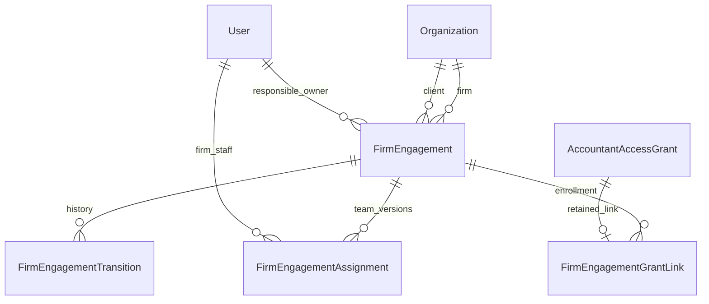

# AF03 engagement domain decision

Date: 19 October 2026. Decision: additive, dormant foundation; no runtime enrollment endpoint. This ADR precedes schema implementation.

## Reuse and boundary

Organization is the firm identity and client identity. Existing User.organizationId and tenant Role membership are the staff foundation. No firm profile is needed: name, trade name, tax identifier, address and country already exist. These attributes do not establish professional registration or legal verification. Globally unique email and required home organization remain unchanged. External reviewers remain on explicit independent legacy mandates; nobody is relocated or duplicated.

AccountantAccessGrant is still the sole client consent record. Existing protected actions, module entitlements, invite service and access resolver remain unchanged. No new permission, event framework, financial writer, invitation or UI is introduced here.

## Entities and ownership

| Entity | Owner and scope | Lifecycle and retention | Access consequence |
| --- | --- | --- | --- |
| FirmEngagement | Firm organization; explicit client organization; firm-home creator and responsible owner | DRAFT → ACTIVE/SUSPENDED → ENDED; immutable identity/terms; retained with transition history; no ordinary deletion | Organization only; never consent |
| FirmEngagementAssignment | Same firm/client/engagement; existing firm-home accountant; firm-home assigning and ending actors | Append version per accountant; one unended version; end once with actor/reason, then append next version; retained, no deletion | Future restriction on a named mandate; never creates visibility |
| FirmEngagementGrantLink | Exact engagement, client, accountant and existing mandate; firm-home enrolling actor | Permanent immutable enrollment tombstone; one link per grant, retained even after termination | Prevents silently treating an enrolled grant as legacy |
| FirmEngagementTransition | Same firm/client/engagement and firm-home actor | Immutable ordered receipt, unique version and idempotency key per engagement; retained | Evidence of state change, not business approval or authority |

Retention is indefinite pending an approved organization retention/purge policy, not a statutory retention claim. RESTRICT foreign keys and history triggers prevent ordinary cascading destruction. Support must use a separately reviewed retention procedure; this phase supplies no purge bypass. These tables contain identifiers, limited scope and operational reasons, not client financial records.

## Entity diagram

Each child uses a composite engagement/firm/client foreign key. Staff and responsible actors use composite user/home-organization keys. Links use a composite mandate/client/accountant key. Firm and client must differ. A partial unique index permits only one non-ended engagement for a firm/client pair; scope changes require ending and replacing the engagement, retaining old links. No identity is inferred from descriptive firm names, domains or registration strings.

## State transitions

| From | To | Meaning and required controls |
| --- | --- | --- |
| New | DRAFT | Version zero, no transition receipt; internal organization only |
| DRAFT | ACTIVE | Ordered retained receipt; later AF04/AF05 actor and client-mandate checks required before access |
| DRAFT | ENDED | Cancel without acquiring access |
| ACTIVE | SUSPENDED | Immediate restriction; retain assignments, mandates and links |
| ACTIVE | ENDED | Terminal restriction |
| SUSPENDED | ACTIVE | Explicit resumption receipt; future resolver must recheck all mandates and windows |
| SUSPENDED | ENDED | Terminal restriction |
| ENDED | Any | Forbidden; create a new engagement if required |

No same-state version bumps. Receipt version must be exactly current+1, from/to must match, and unused receipts cannot commit. Identity, scope, effective window and responsible owner are frozen in this first contract; amend by ending/replacing. Assignment versions have their own effective/expiry windows contained in the engagement window, with one unended version per accountant and monotonically increasing versions. Ending an assignment is irreversible and cannot be backdated before creation. Replacement must not overlap the previous effective interval. Concurrent insertions serialize on the engagement row; unique constraints are the final arbiter.

Dates use existing PostgreSQL TIMESTAMP(3)/Prisma DateTime conventions and UTC instants. Windows are inclusive start/exclusive expiry. ENDED and SUSPENDED remain restrictive even if wall-clock windows overlap.

## Conservative rollout fence

The current resolver does not inspect managed engagement links. Adding live enrollment now would therefore be unsafe. AF03 exposes no writer and adds a database fence: a link may reference only a REVOKED grant, and a linked grant cannot become ACTIVE. No migration revokes, creates or backfills a mandate. Synthetic fixtures explicitly create revoked mandates before linking. Legacy unlinked active grants continue to work unchanged.

This fence is stricter than the final managed model and deliberately temporary. AF04 must first implement and verify fresh engagement/assignment/grant intersection at every sensitive boundary, then review a migration replacing the fence. AF05 may expose enrollment only afterward. Disabling a flag or reverting an application must never delete links or restore legacy access. After live managed enrollment exists, an application lacking engagement enforcement is not a safe rollback unless managed mandates are explicitly disabled first under the reviewed rollout procedure.

Manager ownership is organizational responsibility, not permission to review, export, post, file or pay. READ_ONLY/REVIEWER/PREPARER retain their existing global meanings. The future effective capability set is the intersection of mandate, engagement ceiling, current assignment ceiling, actor permissions, module/domain controls and current dates/statuses. A missing assignment, mismatched home organization, inactive engagement, expired mandate or failed lookup denies access. See CAPABILITY_MATRIX.md.

## Consequences and deferred work

No production migration or backfill; no automatic access and no legal-firm verification. AF04 owns enforcement, authorization and enrollment transaction design; AF05 owns workflows. Database constraints validate structure and lifecycle, not the acting user's RBAC permission. Future protected services must own that decision. Country rules, AI, billing, provider integrations, accessibility and localization are not applicable to this schema-only phase; existing contracts remain intact. Operational impact is additive indexes/tables and guarded writes only; no new reads on the portfolio hot path.
