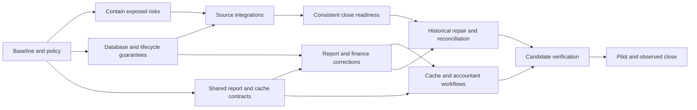

# Accounting correction execution roadmap

**Prepared:** 8 September 2026. **Status:** Roadmap ready; implementation has not started under this roadmap.

**Objective:** Correct the audited accounting mismatches and control flaws, establish source-to-ledger consistency, repair affected data where necessary, and release only the capabilities supported by verification evidence.

**Recommended planning envelope:** **12–16 weeks from kickoff**, assuming three engineers (core/database, integrations, reporting/frontend), one QA engineer, and part-time controller/domain reviewers and SRE. This is a reference schedule, not a promised date or a statement of available staffing.

## 1. Delivery approach and scope

Use the existing [audit report](<E:/ohada saas/Focused projects/stoquify/docs/accounting/audit-report.md>), [risk register](<E:/ohada saas/Focused projects/stoquify/docs/accounting/risk-register.md>) and [remediation plan](<E:/ohada saas/Focused projects/stoquify/docs/accounting/remediation-plan.md>) as the baseline. This roadmap converts them into **28 work items, eight milestones and eight evidence gates**, with all 15 audit findings mapped to implementation work. Audit tests and findings describe the audited revision; refresh them before changing code because purchasing was changing concurrently.

The initial release assumption is an explicitly supported single-base-currency scope per eligible organization. Unsupported conversion must fail clearly, and existing mixed-currency data must not be reported as a valid single-currency total. This is containment until the scope decision in ACR-01; it does not authorize abandoning existing settlement obligations or claiming full FX support. Full multi-currency requirements and affected historical tenants can change the schedule.

Maintain two connected work tracks: **prevent new defects in code** and **investigate/correct existing mismatches**. A code fix alone does not repair historical data. Conversely, a balancing adjustment does not cure an unsafe posting path. Both must reach the release gate for affected tenants.

### Planning assumptions

- Week 1 begins at the agreed kickoff; no calendar dates or named assignees are assumed. Milestone windows overlap where dependency and staffing allow.
- The backlog totals **81–130 engineering person-days**. At three engineers and 80% planned allocation, capacity is about 12 person-days per week; specialist sequencing and the observed close cycle make elapsed time longer than this simple capacity division. Re-estimate after G0 and G2. Controller, QA and external review capacity must also be available.
- Reserve roughly 20% of engineering capacity for review, integration and unexpected findings. Do not schedule the same specialist at full capacity in several workstreams.
- Unknown-volume historical repair, full FX expansion and external statutory/provider approvals are separately estimated. A one-engineer execution preserves the same order but needs a longer schedule; it must not compress independent financial review into self-approval.
- Target a narrow, verified pilot first. Broader country, currency or unsupported workflows require their own evidence before expansion.

## 2. Milestones and expected outcomes

| Milestone | Reference window | Business outcome / gate |
|---|---|---|
| M0 — Establish the execution baseline | Week 1 | Current findings reproduced or explicitly superseded; supported policy, owners, isolated environment and exposure scan agreed. Gate: G0. |
| M1 — Contain the demonstrated risks | Weeks 1–3 | Currency, locked settings, source reversal and finance-label protections verified through direct service/action paths. Gate: G1. |
| M2 — Protect ledger history and period boundaries | Weeks 3–6 | Tenant references, posted immutability, concurrent lifecycle and fiscal calendars validated on PostgreSQL. Gate: G2. |
| M3 — Reconcile every material producer and close | Weeks 6–10 | POS, AP, inventory, payroll, payments and event recovery satisfy the shared source/ledger/close contracts. Gate: G3. |
| M4 — Correct reporting and finance totals | Contract in Week 2; implementation Weeks 6–10 | Reports have correct currency, opening/closing, full populations and consistent bounded reads. Gate: G4. |
| M5 — Finish accountant workflows and cache controls | Weeks 8–11 | Amounts, scope, stale states, pagination, sensitive-action review and access changes are reliable in both locales. Gate: G5. |
| M6 — Rehearse data correction and prove the release | Weeks 10–13 | Repair evidence or verified no-repair disposition, green candidate tests, deployment rehearsal and release packet. Gate: G6. |
| M7 — Pilot, observe and close the findings | Weeks 12–16 | A bounded pilot completes observed operations and a close cycle; all released-scope findings have accepted evidence. Gate: G7. |

### Main dependency path

For printed reading: baseline/contracts enable containment and kernel work; the kernel enables source integration; source integration enables reliable close; correct reports and UI then converge with historical reconciliation at the candidate gate, followed by pilot observation. The backlog JSON contains the validated acyclic dependency graph and a valid task ordering.

The audit register included mutual references between ACC-001/011 (currency/display), ACC-009/013 (GL/performance), and ACC-010/012 (cache/UI state). Those are coordination relationships. **ACR-01 and ACR-18 establish shared contracts first**; monetary semantics precede optimization, and cache identity precedes the final UI integration. Implementers therefore do not wait on circular ticket dependencies.

M1 may start as soon as the necessary contracts and isolated fixtures exist, while the exposure investigation continues. A slow production-data access task should not delay safe code containment. It does prevent a claim that existing data is clean or ready for pilot.

## 3. First ten business days

| Window | Core/database lane | Integration lane | Reporting/frontend lane | QA/controller deliverable |
|---|---|---|---|---|
| Days 1–2 | ACR-00: choose candidate, preserve work, refresh findings | Inventory current source writers and AP changes | Validate finance labels and identify affected views | Assign real owners; establish failed-test baseline and permitted test environment |
| Days 2–4 | ACR-01/02: policy and disposable DB; start ACR-03 | Define source-owned correction matrix and replay cases | ACR-07 label containment; draft shared DTO with ACR-18 | Expected accounting effects, two-tenant fixtures and exposure-query review |
| Days 4–7 | ACR-04/05: currency and settings guards | ACR-06: generic reversal restrictions; start ACR-17 failure triage | Finish honest completeness/proof labels | Direct action/service tests and current-permission denial cases |
| Days 8–10 | Review G1 and prepare ACR-08/09 migrations | Verify legitimate settlement/correction still works | Freeze ACR-18 report/cache contract | Containment evidence pack; G0/G1 decisions; re-estimated kernel backlog |

These windows are targets. A gate remains open if a required test fails. The next independent ready work item can proceed, but an unmet dependency is not marked complete to protect a date.

## 4. Work ownership and delivery boundaries

| Role | Primary responsibility | Boundary |
|---|---|---|
| Program owner / product lead | Sequence, named owners, scope, release decision and support handover | Does not certify accounting by accepting a UI demonstration |
| Core/database engineer | Money/policy guards, references, immutability, period protocol, calendar and close contract | Owns shared schema and kernel changes; coordinates migrations and lock order with producer owners |
| Integration engineer with domain reviewers | POS, purchasing/AP, inventory, payroll, customer settlement, payment/suspense and events | Each source retains ownership of its business correction; applies the shared kernel contract |
| Reporting/frontend engineer | Report DTOs, aggregation, money display, cache invalidation and accountant workflows | Does not recreate accounting calculations or trust scores in the client |
| QA engineer | Independent expected-value fixtures, real DB races, action/access and authenticated workflow evidence | A mocked service pass does not replace an installed-constraint or browser test |
| Controller / qualified accountant | Recognition, mappings, monetary precision, timing differences, repair and close acceptance | Country-specific statutory approval remains distinct from internal accounting correctness |
| SRE/security/support reviewers | Application-role privileges, observability, deploy/restore/rollback, consent and incident response | Confirm the environment actually runs the intended controls and recovery jobs |

Before coding, assign one actual owner to each ticket and identify the exact touched files. Use small coherent changes; do not run concurrent edits against the same schema or posting kernel without explicit ownership. Existing local changes must be retained and compared rather than overwritten. A ticket can be reviewed and merged before the entire programme ends, but its release gate remains evidence-driven.

## 5. Executable backlog

The estimates below are engineering effort. Each ticket requires fresh source inspection, a coherent change, relevant tests and an evidence record. All are initially planned; only ACR-00 is ready to start without another roadmap dependency.

### M0 — Establish the execution baseline

**Window:** Week 1. **Exit gate G0:** Current candidate and finding dispositions recorded; owners, supported policy and test fixtures defined. Exposure access gaps have owners and block affected production/pilot claims, not independent implementation.

#### ACR-00 — Rebaseline the audit on a stable candidate

**Owner role:** Core lead + QA. **Estimate:** 1–2 engineering days. **Prerequisites:** None. **Findings:** ACC-015.

**Deliverable:** Candidate commit/source hashes; refreshed finding register; actual owners and PR boundaries.

**Acceptance evidence:**

- Reproduce or supersede each ACC finding against the chosen working revision; retain the old evidence.
- Identify concurrent AP changes and distinguish existing fixes from remaining work.
- Record named owners and exact test commands; do not copy audit defects blindly into implementation.
#### ACR-01 — Freeze accounting and workflow contracts

**Owner role:** Controller + core lead. **Estimate:** 2–3 engineering days. **Prerequisites:** ACR-00. **Findings:** ACC-001, ACC-002, ACC-003, ACC-005, ACC-008, ACC-009, ACC-011, ACC-014.

**Deliverable:** Versioned money, calendar, policy-change, source-ownership and close-state contracts.

**Acceptance evidence:**

- Declare supported base currencies, precision, rounding stage, business dates/timezone and fiscal boundaries.
- Specify posting lock versus reviewed close versus certified export; classify allowed manual adjustments.
- Define shared report/cache DTOs early enough to remove circular implementation dependencies.
#### ACR-02 — Provision isolated verification and fixtures

**Owner role:** QA + database lead. **Estimate:** 2–3 engineering days. **Prerequisites:** ACR-00. **Findings:** ACC-004, ACC-007, ACC-010, ACC-012, ACC-015.

**Deliverable:** Disposable PostgreSQL database, real application role, two tenants, actor roles and reproducible financial fixtures.

**Acceptance evidence:**

- No production writes or seeded customer records.
- Fixtures include cash/credit sales, AP, inventory, payroll, suspense, reversal, closed period and mixed-currency rejection.
- Authenticated browser roles and concurrency barriers work; environment scripts are reviewed before execution.
#### ACR-03 — Measure existing data exposure

**Owner role:** Database lead + controller. **Estimate:** 2–4 engineering days. **Prerequisites:** ACR-00. **Findings:** ACC-001, ACC-002, ACC-003, ACC-004, ACC-005, ACC-006, ACC-007, ACC-008.

**Deliverable:** Read-only exposure report grouped by tenant, source, period and currency, with a repair classification.

**Acceptance evidence:**

- Scan currency/base inconsistencies, historical settings, generic source reversals, orphan/foreign references and overlapping periods.
- Compare closed periods with source failures and assurance blockers.
- Classify none found, confirmed affected, or access unavailable; unavailable is never treated as clean.

### M1 — Contain the demonstrated risks

**Window:** Weeks 1–3. **Exit gate G1:** All four containment changes pass direct service/action tests. Reporting clearly identifies unsupported or contaminated populations. Existing financial obligations retain a controlled resolution path.

#### ACR-04 — Enforce the supported currency scope

**Owner role:** Core engineer + producer owners. **Estimate:** 3–5 engineering days. **Prerequisites:** ACR-01, ACR-02. **Findings:** ACC-001.

**Deliverable:** Server-enforced currency admission and explicit unsupported/mixed-data report states.

**Acceptance evidence:**

- Every producer derives the correct supported organization/source currency instead of falling back silently to XAF.
- Unsupported conversion fails explicitly; contaminated historical aggregates cannot appear trustworthy.
- Existing settlement/correction obligations receive an explicit supported recovery path rather than a blanket dead end.
#### ACR-05 — Protect material accounting settings

**Owner role:** Core engineer. **Estimate:** 2–3 engineering days. **Prerequisites:** ACR-01, ACR-02. **Findings:** ACC-002.

**Deliverable:** Validated policy enums and a used/locked-setting mutation boundary.

**Acceptance evidence:**

- Direct actions and service calls reject prohibited base-currency, valuation and calendar mutations.
- Before/after policy evidence is retained for permitted changes.
- Any future effective-dated transition is separate from an unrestricted generic update.
#### ACR-06 — Restrict generic reversal to valid sources

**Owner role:** Integration engineer + controller. **Estimate:** 2–4 engineering days. **Prerequisites:** ACR-01, ACR-02. **Findings:** ACC-003.

**Deliverable:** Source-to-correction routing and guarded generic reversal.

**Acceptance evidence:**

- POS/AP/inventory/payroll/payment source types cannot bypass their owning correction command.
- Legitimate manual adjustment and reversal semantics remain supported and traceable.
- Current authorization, reason/date and source identity are validated; a UI-only restriction does not pass.
#### ACR-07 — Correct misleading finance proof labels

**Owner role:** Reporting/frontend engineer. **Estimate:** 1–2 engineering days. **Prerequisites:** ACR-00. **Findings:** ACC-014.

**Deliverable:** Truthful operational-versus-ledger labels and partial-source disclosure.

**Acceptance evidence:**

- Operational sales orders never receive a posted-ledger badge by assumption.
- Heuristic confidence cannot produce certification.
- Existing capped metrics are visibly partial until full-population aggregation is delivered in ACR-21.

### M2 — Protect ledger history and period boundaries

**Window:** Weeks 3–6. **Exit gate G2:** Real application-role SQL and PostgreSQL concurrency tests prove tenant references, posted immutability, period finality and allowed correction semantics. Constraint rollout has a tested preflight.

#### ACR-08 — Enforce tenant-safe ledger relationships and dimensions

**Owner role:** Database/core engineer. **Estimate:** 3–5 engineering days. **Prerequisites:** ACR-01, ACR-02, ACR-03. **Findings:** ACC-006, ACC-007.

**Deliverable:** Constraint design, scoped dimension validation, migration preflight and invalid-reference report.

**Acceptance evidence:**

- Foreign or missing account/parent/customer/supplier/item/location references fail at the appropriate boundary.
- Existing invalid references are investigated before constraints are validated.
- Retention, cascade behavior and permitted historical dimension changes are documented.
#### ACR-09 — Make posted financial content immutable

**Owner role:** Database/core engineer. **Estimate:** 4–7 engineering days. **Prerequisites:** ACR-08. **Findings:** ACC-007.

**Deliverable:** Migration and privilege boundary for posted monetary content, with safe allowed transitions.

**Acceptance evidence:**

- Application-role SQL cannot mutate/delete protected posted financial content.
- Valid multi-line posting and controlled reversal/status changes remain possible within one transaction.
- Migration rehearsals include existing data, backup/restore, validation failure and rollback behavior.
#### ACR-10 — Serialize posting, reversal and closing

**Owner role:** Core/database engineer. **Estimate:** 5–8 engineering days. **Prerequisites:** ACR-08, ACR-09. **Findings:** ACC-004.

**Deliverable:** Shared period-lock order, atomic lifecycle claims, stable command identity and bounded retries.

**Acceptance evidence:**

- Real PostgreSQL tests cover post-versus-close, simultaneous reversal and ambiguous-commit retry.
- Close acquires its boundary before preflight; writers use the compatible protocol.
- Retries neither create an extra effect nor leave the caller with an unexplained result; deadlocks terminate predictably.
#### ACR-11 — Correct fiscal boundaries and overlapping periods

**Owner role:** Core engineer. **Estimate:** 2–3 engineering days. **Prerequisites:** ACR-01, ACR-02, ACR-10. **Findings:** ACC-008.

**Deliverable:** Calendar boundary fix and concurrent overlap protection.

**Acceptance evidence:**

- Short years, mid-month starts, leap dates and timezone cutoffs resolve correctly.
- Each allowed date has the intended unambiguous period.
- Existing posted calendar exceptions follow reviewed correction rather than silent reassignment.

### M3 — Reconcile every material producer and close

**Window:** Weeks 6–10. **Exit gate G3:** POS, AP, inventory, payroll and settlement/suspense each reconcile source, subledger, GL and close evidence. Durable failures are visible, owned and recoverable. The two audit integration failures are resolved without weakening controls.

#### ACR-12 — Verify POS, refunds and offline replay against the kernel

**Owner role:** Integration engineer: POS. **Estimate:** 3–5 engineering days. **Prerequisites:** ACR-04, ACR-06, ACR-10. **Findings:** ACC-001, ACC-003, ACC-004, ACC-015.

**Deliverable:** POS source-to-stock/tender/ledger reconciliation suite and owned recovery contract.

**Acceptance evidence:**

- Cash, credit, split tender, discounts/tax, refund/void and source cost effects reconcile.
- Duplicate/offline replay and lost responses create one intended effect; changed payloads fail.
- Shift-close evidence assertions match the intended event audit contract.
#### ACR-13 — Verify purchasing/AP recognition and correction

**Owner role:** Integration engineer: AP. **Estimate:** 3–5 engineering days. **Prerequisites:** ACR-04, ACR-06, ACR-10. **Findings:** ACC-001, ACC-003, ACC-004, ACC-015.

**Deliverable:** PO/receipt/invoice/payment/credit reconciliation matrix and validated posting recovery.

**Acceptance evidence:**

- Partial receipts and receipt/invoice timing differences have explicit clearing/exception ownership.
- Posting replay verifies source hashes and existing effects; preparation correction cannot alter posted obligations.
- Supplier payment, return and credit corrections reconcile to source, subledger and GL.
#### ACR-14 — Verify inventory valuation and corrections

**Owner role:** Integration engineer: inventory. **Estimate:** 3–5 engineering days. **Prerequisites:** ACR-04, ACR-06, ACR-08, ACR-10. **Findings:** ACC-001, ACC-003, ACC-004, ACC-005, ACC-006.

**Deliverable:** Valuation/COGS/source-movement reconciliation with adjustment and reversal proof.

**Acceptance evidence:**

- Receipt/issue/transfer/reservation semantics preserve owned-stock meaning.
- Backdating and negative-stock behavior are either policy-valid and tested or explicitly blocked.
- Write-off/adjustment/reversal and source currency reconcile to class-3 accounts and close evidence.
#### ACR-15 — Verify payroll, settlement and suspense integrations

**Owner role:** Integration engineer with payroll/reconciliation reviewers. **Estimate:** 5–8 engineering days. **Prerequisites:** ACR-04, ACR-06, ACR-10. **Findings:** ACC-001, ACC-003, ACC-004, ACC-005.

**Deliverable:** Payroll/AR/payment/suspense reconciliation cases and current evidence boundaries.

**Acceptance evidence:**

- Approved payroll liabilities and later payments/corrections reconcile without exposing person-level data to unauthorized readers.
- Customer allocation, provider evidence, fees/suspense and partial matching cannot double-consume a source amount.
- Country/provider applicability is explicit; unavailable external evidence blocks only the capability that depends on it.
#### ACR-16 — Unify close blockers and evidence freshness

**Owner role:** Core engineer + controller. **Estimate:** 4–6 engineering days. **Prerequisites:** ACR-10, ACR-11, ACR-12, ACR-13, ACR-14, ACR-15, ACR-17. **Findings:** ACC-005.

**Deliverable:** Shared close readiness contract including unassigned failures and applicable module evidence.

**Acceptance evidence:**

- Inventory/payroll/AP/payment blockers govern the policy-defined reviewed-close transition.
- Late source changes invalidate affected evidence and exports; current evidence is rechecked at action time.
- Locked, closed, reviewed and certified states remain distinct and existing stronger pack controls are preserved.
#### ACR-17 — Harden event conflict recovery and operational ownership

**Owner role:** Integration engineer + SRE. **Estimate:** 2–3 engineering days. **Prerequisites:** ACR-01, ACR-02. **Findings:** ACC-015.

**Deliverable:** Resolved event-test contract drift, replay runbook and failure/age signals.

**Acceptance evidence:**

- Inventory conflict testing proves durable conflict evidence and no stock mutation, including evidence-write failure.
- Outbox duplicate, stale lease, retry exhaustion and changed-payload cases retain a recoverable state.
- Each pending/failed source has an owner and a documented recovery action.

### M4 — Correct reporting and finance totals

**Window:** Contract in Week 2; implementation Weeks 6–10. **Exit gate G4:** Report currency, opening/activity/closing, full-population totals and a common as-of contract pass independent expected-value fixtures. Agreed resource budgets are met without sacrificing consistency.

#### ACR-18 — Define one financial report and cache contract

**Owner role:** Reporting engineer + controller. **Estimate:** 2–3 engineering days. **Prerequisites:** ACR-01, ACR-02. **Findings:** ACC-001, ACC-009, ACC-010, ACC-011, ACC-012, ACC-013, ACC-014.

**Deliverable:** DTO contract for currency, scope, opening/activity/closing, as-of version, completeness and access identity.

**Acceptance evidence:**

- P&L activity and cumulative balance sheet use explicit different windows.
- Paging, aggregate totals, stable ordering and source proof meanings are defined before implementation.
- Cache identity includes every result-changing filter and access scope; no dependency on finished UI is required.
#### ACR-19 — Correct report monetary and balance semantics

**Owner role:** Reporting/backend engineer. **Estimate:** 4–6 engineering days. **Prerequisites:** ACR-04, ACR-11, ACR-18. **Findings:** ACC-001, ACC-009, ACC-011.

**Deliverable:** Correct GL opening/activity/closing, currency aggregation and exact decimal serialization.

**Acceptance evidence:**

- Opening plus activity equals closing for debit/credit accounts, including cross-period reversal.
- Mixed unsupported currency is rejected or safely partitioned under the approved policy.
- TB, GL, statements and exact exports agree; archived posted accounts and contra-account signs remain correct.
#### ACR-20 — Bound reporting work and preserve snapshot consistency

**Owner role:** Reporting/backend engineer + database reviewer. **Estimate:** 4–6 engineering days. **Prerequisites:** ACR-19. **Findings:** ACC-013.

**Deliverable:** SQL totals, cursor details, consistent report version and benchmark evidence.

**Acceptance evidence:**

- 100k-line fixtures and the measured pilot tenant envelope meet agreed latency/payload budgets.
- Concurrent posting cannot produce an internally inconsistent report snapshot.
- Pagination/streaming maintains ordering and totals; any summary rebuild reconciles to the ledger.
#### ACR-21 — Correct full-population finance metrics

**Owner role:** Reporting/backend engineer + finance product owner. **Estimate:** 3–5 engineering days. **Prerequisites:** ACR-07, ACR-18, ACR-19, ACR-20. **Findings:** ACC-014.

**Deliverable:** Ledger/operational metric separation, uncapped totals and source-backed labels.

**Acceptance evidence:**

- More than 250 source rows produce complete totals or an explicit unavailable/partial state.
- Recognized revenue, COGS, expenses and cash movements retain distinct definitions.
- Proof labels derive from evidence state, not a heuristic score or the absence of an overdue item.

### M5 — Finish accountant workflows and cache controls

**Window:** Weeks 8–11. **Exit gate G5:** Authenticated English/French workflows show correct amounts and states; large histories remain discoverable; consent/session changes evict protected cache; keyboard and assistive-technology review is complete.

#### ACR-22 — Implement scoped cache and mutation invalidation

**Owner role:** Frontend engineer + IAM reviewer. **Estimate:** 3–4 engineering days. **Prerequisites:** ACR-02, ACR-18. **Findings:** ACC-010.

**Deliverable:** Scoped key factories, cache eviction and a cross-module invalidation matrix.

**Acceptance evidence:**

- Two tenants, different limits and changed permission/consent versions never reuse protected results.
- Logout without reload, revocation and session changes remove stale protected cache.
- Posting, reversal, payment, reconciliation and close refresh all affected mounted views.
#### ACR-23 — Complete safe accountant UI and localized formatting

**Owner role:** Frontend engineer + QA/accountant reviewer. **Estimate:** 4–6 engineering days. **Prerequisites:** ACR-06, ACR-18, ACR-19, ACR-22. **Findings:** ACC-011, ACC-012.

**Deliverable:** Correct currency/decimal display, server totals/paging, visible stale/error states and reviewed financial actions.

**Acceptance evidence:**

- More than 100 journals remain discoverable; count scope is accurate.
- Invalid/missing/stale values cannot look like current certified zeroes.
- English/French desktop/mobile and keyboard/screen-reader flows show source, date, amount and action consequences.

### M6 — Rehearse data correction and prove the release

**Window:** Weeks 10–13. **Exit gate G6:** Exact release candidate has green affected suites, database/access/UI evidence and a rehearsed deploy/rollback. Affected historical data has been corrected and reconciled before admission to the pilot, or the tenant remains excluded.

#### ACR-24 — Rehearse and reconcile any required data repair

**Owner role:** Database lead + controller. **Estimate:** 3–5 engineering days. **Prerequisites:** ACR-03, ACR-04, ACR-05, ACR-09, ACR-10, ACR-11, ACR-12, ACR-13, ACR-14, ACR-15, ACR-16, ACR-19, ACR-21. **Findings:** ACC-001, ACC-002, ACC-003, ACC-005, ACC-006, ACC-007, ACC-008.

**Deliverable:** Tenant-scoped repair packet or verified no-repair disposition; rehearsal reconciliation and rollback proof.

**Acceptance evidence:**

- Every affected record has source evidence, proposed correction, reviewer and before/after reconciliation.
- Preserve original posted history; use owned corrections/adjustments or a reviewed migration design.
- Estimate is for packet/rehearsal only; unknown-volume live repair is separately estimated and blocks affected tenants from pilot.
#### ACR-25 — Prove the release candidate end to end

**Owner role:** QA lead with core/frontend/SRE reviewers. **Estimate:** 4–6 engineering days. **Prerequisites:** ACR-16, ACR-17, ACR-20, ACR-21, ACR-23, ACR-24. **Findings:** ACC-015.

**Deliverable:** Candidate-specific verification packet and a deployment/rollback rehearsal.

**Acceptance evidence:**

- Affected regression suites are green; direct endpoint, real DB concurrency and authenticated UI tests cover the repaired findings.
- Installed constraints/privileges match the candidate; backup/restore and deploy failure are rehearsed.
- No unresolved high-risk finding remains in the proposed release scope; unsupported statutory/provider/FX capabilities stay explicitly gated.

### M7 — Pilot, observe and close the findings

**Window:** Weeks 12–16. **Exit gate G7:** Pilot observation and a complete close cycle meet the acceptance criteria. Every released-scope finding has accepted evidence, support ownership and a controlled expansion decision.

#### ACR-26 — Pilot the correction set with close observation

**Owner role:** Release lead + controller + support. **Estimate:** 3–5 engineering days. **Prerequisites:** ACR-25. **Findings:** ACC-015.

**Deliverable:** Bounded tenant pilot, daily reconciliation dashboard and observed close cycle.

**Acceptance evidence:**

- Start with one eligible tenant/scope, then expand to 3–5 only after the first gate remains clean.
- Observe at least ten business days and one complete close/reconciliation cycle; use a longer window if the real close calendar requires it.
- Unexplained mismatch, duplicate effect, closed-period write or tenant leak stops expansion and invokes the incident plan.
#### ACR-27 — Close findings and expand within proven scope

**Owner role:** Program owner + controller + release lead. **Estimate:** 2–3 engineering days. **Prerequisites:** ACR-26. **Findings:** ACC-015.

**Deliverable:** Accepted finding evidence, residual-scope register, release decision and support handover.

**Acceptance evidence:**

- Each ACC finding is verified fixed, no longer reproducible with proof, or outside the explicitly restricted release scope.
- Data repair, runbooks, owners and pilot results are attached to the exact released revision.
- Completion is evidence-based; neither code merged nor a percentage-complete dashboard alone closes a financial control.

## 6. Acceptance scenarios that must reconcile

These are proposed implementation tests, not newly executed checks. Each scenario records source IDs, tenant, currency, period, expected journal lines, subledger movements and report/close outcomes. Expected values must be derived independently from the implementation under test.

| Scenario family | Required cases | Evidence of success |
|---|---|---|
| Money and settings | Supported base currencies; non-base rejection; invalid amounts; precision boundaries; locked settings; mixed historical data | Correct exact values or explicit rejection; no mislabeled balanced totals; no historical policy reinterpretation |
| Lifecycle / database | Concurrent post-close; simultaneous reversal; lost response after commit; application-role SQL; foreign IDs; overlapping periods | One intended effect, no unauthorized posted mutation or tenant crossing, correct period and stable retained result |
| Source integrations | Cash/credit/split tender; refunds/voids; partial receipt/invoice/payment/credit; stock adjustment; payroll and settlement/suspense | Source → subledger → GL effects reconcile by currency/period; legitimate timing items remain individually documented |
| Reports | Prior opening, current activity, later reversal, contra accounts, archived accounts; 251+ source rows; 101+ journals | Opening + activity = closing; full totals and stable paging; correct source classification and no false proof labels |
| Cache and UX | Two tenants; revoked grants; logout without reload; changed limits; background failure; both locales; mobile and keyboard/screen reader | No protected stale reuse; unavailable/error/stale/zero distinguishable; exact amounts and actionable review |
| Recovery and operations | Missing rule, delayed outbox, duplicate/reordered delivery, exhausted retries, interrupted deploy, restore and resumed work | Failure remains durable, owned and recoverable; retries preserve accounting identity; rollback does not duplicate or silently discard effects |

Use the audit verification log to locate the two failing integration contracts and the seven synthetic defect probes. During implementation, retain the original audit evidence and add correctness regression tests that fail before the fix and pass afterward. Do not edit historical probe results to imply they always passed correctly. A test reporting a reproduced flaw is not a successful accounting acceptance test.

## 7. Historical mismatches: investigate, correct and reconcile

1. **Classify exposure (ACR-03).** Partition discrepancies by organization, source, period and currency. Distinguish a display-only error, an incorrect source posting, an orphan/cross-tenant reference, a legitimate timing difference and an unresolved ambiguity.
2. **Stop recurrence (M1–M3).** Before applying bulk repairs, prove the code path no longer produces the discrepancy. A temporary restriction must preserve controlled settlement, historical reads and recovery obligations.
3. **Prepare correction packets (ACR-24).** Retain original IDs/hashes, proposed financial effects, period treatment, evidence, reviewer and repeat-execution identity. Quantify affected record counts and monetary totals without inventing a loss estimate.
4. **Rehearse.** Run the proposed migration or source correction on a disposable clone/synthetic reproduction. Compare before/after source, subledger, GL, reports and close; rehearse interrupted execution and restoration.
5. **Apply under the actual execution scope.** Use source-owned correction or reviewed adjusting entries. If a migration is required, follow the reviewed deployment and rollback plan. This roadmap does not itself execute or approve a particular live-data repair.
6. **Verify admission to pilot.** Reconcile affected tenants and invalidate/regenerate impacted reports and close evidence. Exclude an unresolved affected tenant until its data is acceptable; do not declare the whole platform clean from one corrected sample.

A rollback of application code cannot erase committed economic events. When a new financial effect is wrong, stop the affected operation, preserve evidence and use a controlled corrective path. Database restore is reserved for the rehearsed incident scenario and recovery policy; it is not the routine undo mechanism for an already posted transaction.

## 8. Progress tracking and review cadence

Use [the CSV backlog](<E:/ohada saas/Focused projects/stoquify/docs/accounting/accounting-correction-backlog-2026-09-08.csv>) for a task board or spreadsheet, and [the JSON backlog](<E:/ohada saas/Focused projects/stoquify/docs/accounting/accounting-correction-backlog-2026-09-08.json>) for dependency-aware execution. Neither file creates scheduled work or claims implementation has begun.

States: **PLANNED → READY → IN_PROGRESS → IN_REVIEW → VERIFIED**; use BLOCKED with the concrete missing input or failing evidence and the next action. A task becomes READY only when its prerequisites and required access/inputs are satisfied. Track named owner, candidate commit, PR/change set, dates, tests, data disposition, reviewer and evidence links.

- **Daily working check:** current blockers, failed financial tests, integration conflicts, remaining source mismatches and the next ready ticket.
- **Weekly controller/engineering review:** monetary semantics, scope changes, gate evidence, actual effort and data-repair estimates.
- **Each merge:** relevant regression checks and a fresh finding disposition. Re-run broader checks when affected dependencies, failures or candidate changes justify them.
- **Each gate:** record PASS/FAIL/BLOCKED, the exact revision, environment, reviewer and evidence; independent work can continue while a failed gate is repaired.

Proposed execution evidence layout: `what-next/accounting-hardening/<run-id>/<ACR-id>/` containing source references, change summary, commands/results and data/rollback evidence where applicable. This is a future output contract; the directory has not been populated by this planning task.

### Measures that determine readiness

| Measure | Gate target | Owner |
|---|---|---|
| High-risk findings in proposed release scope | Zero unresolved; restrictions must actually prevent excluded capabilities | Program owner + controller |
| Accounting reconciliation | Zero unexplained monetary differences at the approved currency precision; legitimate timing items have source, amount, owner and resolution date | Controller + domain owners |
| Duplicate or unauthorized effects | Zero in the required repeat/concurrency/access test matrix | Core/integration + QA |
| Report equivalence | Opening/activity/closing and source totals match independent expected-value fixtures and reconciled pilot records | Reporting + controller |
| Affected test results | All required candidate checks pass; no skipped or unavailable test is counted as passed | QA |
| Operational recovery | Every failed/pending item is visible and owned; recovery and alert thresholds set in G0 are met in pilot | SRE + support |
| Performance | Measured p95/payload budgets agreed in G0 for the actual pilot scale, with no correctness regression | Reporting + SRE |
| Evidence completeness | Each closed finding links to a revision, test result, reviewer and data disposition | Program owner |

A percentage-complete dashboard may aid scheduling, but it cannot replace these gates. Do not waive tenant isolation, duplicate-effect prevention or incorrect monetary meaning merely to reach a date. Lower-risk changes can be released separately when their dependencies and scope are explicit.

## 9. Pilot and expansion

Start with one eligible, reconciled tenant under the supported currency/country/workflow scope. Verify daily source/subledger/GL reconciliation, posting failures, close invalidations and real recovery ownership. Expand to 3–5 eligible tenants only after the first cohort remains clean. The proposed observation minimum is ten business days plus a complete close/reconciliation cycle. If an actual month-end or payroll cycle falls later, extend the milestone; a calendar deadline does not substitute for observing it.

Stop expansion for any unexplained material mismatch, duplicate accounting effect, tenant leak, prohibited closed-period posting or failure to recover a blocked financial operation. Contain the affected workflow, preserve evidence, reconcile committed events and requalify the corrected candidate. A label/performance regression without accounting impact can have a narrower rollback, based on the recorded incident facts.

Broader release follows G7 and named controller/release-owner acceptance. Unsupported FX, country-specific filing, landed-cost or treasury capabilities remain explicitly limited until their own evidence is complete. Do not market pilot completion as statutory certification.

## 10. Scope decisions and optional extensions

| Decision at kickoff | Recommended initial treatment | When it changes the critical path |
|---|---|---|
| Full FX required now? | Enforce and verify the supported single-base-currency scope; inspect all existing non-base obligations | If pilot tenants require FX, add rate provenance, conversion, FX correction/revaluation as applicable and reconciliation tests before their admission; allow an additional 2–4 weeks as an initial estimate |
| Affected historical data exists? | Quantify first; prepare source-owned adjustments or a reviewed migration packet | Unknown-volume repair is separately estimated and must finish for each affected pilot tenant |
| Jurisdiction/provider production approval available? | Keep unapproved calculation/submission/provider capabilities gated | Missing external evidence blocks that capability or tenant, not independent core accounting fixes |
| Complete treasury/landed-cost/year-end capability required? | Record actual supported/manual/blocked behavior from the rebaseline | A new business workflow requires a separate scope/estimate; do not conceal it inside a defect ticket |
| Staff or environments unavailable? | Retain task order and advance independent ready work | Re-estimate dates; never treat missing production/browser/database evidence as passed |

## 11. Traceability to the audit

| Finding | Priority | Implementation work items |
|---|---|---|
| ACC-001 — Currency conversion and reporting do not preserve base-currency meaning | P1 | ACR-01, ACR-03, ACR-04, ACR-12, ACR-13, ACR-14, ACR-15, ACR-18, ACR-19, ACR-24 |
| ACC-002 — Locked accounting configuration remains mutable | P1 | ACR-01, ACR-03, ACR-05, ACR-24 |
| ACC-003 — Generic journal reversal bypasses source-owned correction workflows | P1 | ACR-01, ACR-03, ACR-06, ACR-12, ACR-13, ACR-14, ACR-15, ACR-24 |
| ACC-004 — Posting, reversal and period close lack a uniform concurrency protocol | P1 | ACR-02, ACR-03, ACR-10, ACR-12, ACR-13, ACR-14, ACR-15 |
| ACC-005 — Period closure and close-assurance readiness use different blockers | P1 | ACR-01, ACR-03, ACR-14, ACR-15, ACR-16, ACR-24 |
| ACC-006 — Manual journal dimensions are not validated against tenant ownership | P2 | ACR-03, ACR-08, ACR-14, ACR-24 |
| ACC-007 — Ledger immutability and tenant consistency depend primarily on application paths | P1 | ACR-02, ACR-03, ACR-08, ACR-09, ACR-24 |
| ACC-008 — Fiscal period creation can extend before the requested fiscal year and allows overlap | P2 | ACR-01, ACR-03, ACR-11, ACR-24 |
| ACC-009 — Date-filtered general ledger omits the opening balance | P2 | ACR-01, ACR-18, ACR-19 |
| ACC-010 — Accountant portal cache identity and refresh coverage are incomplete | P2 | ACR-02, ACR-18, ACR-22 |
| ACC-011 — Shared accounting display can mislabel currency, round away precision and turn invalid values into zero | P2 | ACR-01, ACR-18, ACR-19, ACR-23 |
| ACC-012 — Journal and portal screens overstate completeness or freshness in edge states | P2 | ACR-02, ACR-18, ACR-23 |
| ACC-013 — Large ledger reads are unbounded and statements lack a shared read snapshot | P2 | ACR-18, ACR-20 |
| ACC-014 — Finance operational metrics are presented with accounting proof labels | P1 | ACR-01, ACR-07, ACR-18, ACR-21 |
| ACC-015 — Integration verification is not green and production assurance evidence remains incomplete | P2 | ACR-00, ACR-02, ACR-12, ACR-13, ACR-17, ACR-25, ACR-26, ACR-27 |

Repository navigation and source relationships remain documented in the [architecture map](<E:/ohada saas/Focused projects/stoquify/docs/accounting/architecture-and-flow-map.md>); exact audit evidence is in the [evidence index](<E:/ohada saas/Focused projects/stoquify/docs/accounting/evidence-index.md>). The roadmap changes dependency sequencing, not the historical audit results. No production code, database record, migration or deployment was modified as part of producing it.

**First executable action:** ACR-00 — confirm the current candidate, refresh all 15 finding dispositions and assign actual owners. Then start currency/settings/reversal/label containment as their policy and fixture prerequisites become ready.
