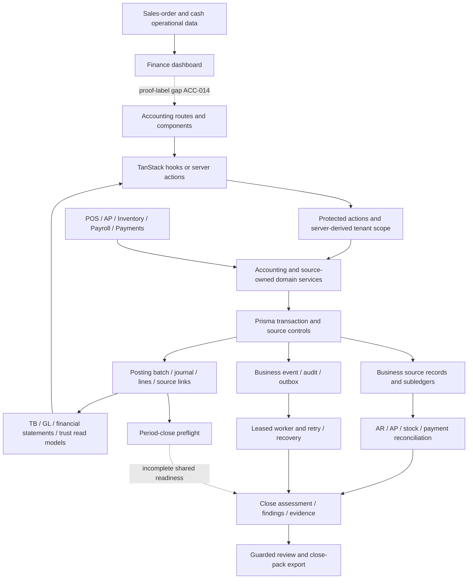
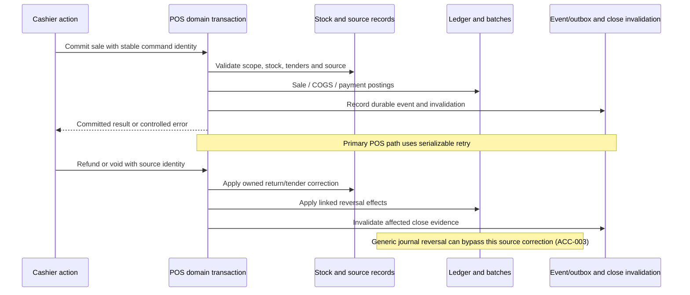

# Accounting architecture and cross-module flow map

**Date:** 8 September 2026. **Basis:** current source, historical graphs used for navigation, selected tests and audit probes. This map records inspected relationships and explicit gaps; it does not imply every flow was executed end to end.

## Architecture

The printable interpretation is: protected entry points derive tenant and actor scope; source services own business effects and ledger writes; read models consume the ledger or operational sources according to their explicit basis; reconciliation and close build evidence above those records. Financial write correctness must hold inside the transaction. An outbox notification or later assurance run cannot substitute for an atomic financial invariant. The diagram's dashed edges denote identified gaps, not implemented guarantees.

## Database and service inventory

| Layer | Principal records or surfaces | Owner / current contract |
|---|---|---|
| Accounting configuration | OrganizationAccountingSettings, ChartOfAccount, Journal, FiscalYear, AccountingPeriod, posting-rule records | Settings, chart, journal, period and rule services. Required mappings exist; material settings remain mutable (ACC-002). |
| Ledger | JournalEntry, JournalEntryLine, LedgerPostingBatch, AccountingSourceLink, LedgerAuditEvent | Several source writers plus generic manual posting. Decimal monetary fields, source identity and per-organization keys; database backstops need ACC-007. |
| Receivables/payables | CustomerLedgerEntry, immutable receivable documents/states, settlement allocations, SupplierInvoice/SupplierLedgerEntry, supplier payments/credits | Customer settlement/document services and AP services. Preserve source ownership and allocation truth. |
| Inventory | InventoryTransaction, inventory levels and business-event evidence | Inventory stock-event, adjustment, reversal, transfer and reconciliation services. Reservations and projections are distinct from owned stock/ledger effects. |
| Payroll | PayrollRun/lines, payment batches/allocations, declarations and evidence | Payroll control and employee-balance services create controlled accounting effects. Country-pack applicability is separate. |
| Payment evidence | Provider events/accounts, statements/lines, reconciliation runs, exceptions and suspense | Payments and reconciliation services; provider evidence is not equivalent to settled/reconciled accounting. |
| Close and external accountant | CloseRun, checklist items, findings, evidence, exports, reviews/comments, AccountantAccessGrant | Close-assurance, close-pack, data-trust and accountant-access services. Consent and current evidence govern access/export. |
| Event/recovery | BusinessEvent, BusinessEventAudit/Anomaly, BusinessEventOutbox | Hash-based identity, leased delivery, attempts and recovery. Actual scheduler/service health not verified. |

The initial [source inventory](<E:/ohada saas/Focused projects/stoquify/what-next/accounting-enterprise-audit/2026-09-08-run-01/evidence/source-inventory.json>) covers 389 selected files, including 162 test files. The [literal writer inventory](<E:/ohada saas/Focused projects/stoquify/what-next/accounting-enterprise-audit/2026-09-08-run-01/evidence/journal-producer-inventory.json>) records 22 journal/line mutation call sites. This is a navigation inventory rather than a claim that aliases or raw SQL cannot exist.

Principal writer families are manual journal creation/post/reversal; POS sale/payment/refund/void helpers; delivery goods issue/invoice; customer settlement/reversal; AP invoice/payment/return/credit/correction; payroll control/employee balance; payment suspense; and inventory adjustment/reversal. They do not all delegate the final write to one kernel, so new invariants must cover every family.

## Entry points, read models and UI

| User capability | Entry and service path | Consumer / data-fetching contract |
|---|---|---|
| Setup, chart and periods | accounting settings/accounts actions → accounting-settings, chart-of-accounts, periods services | Accounting setup/accounts routes; server action results. Fresh authentication on sensitive settings; policy lock gap remains. |
| Manual journal | journals actions → journals.service → posting.service | Journal list and ManualJournalDraftForm. Server actions and redirect; list limited to latest 100 without complete totals/paging. |
| Reports | reports actions → reports.service / financial-statements.service | Trial-balance and financial-statements routes, canonical table wrappers. GL exists as action/service contract; a dedicated GL page was not found among the accounting routes. |
| Accounting command center | settings/control-center action → control-center.service | useAccountingControlCenter → AccountingControlCenter; current org is normally derived from initial data. |
| Accountant portal | data-trust action → data-trust/access services | useAccountantPortal → AccountantPortal. Dates/period in key; organization/access/limit omission is ACC-010. |
| Close center | close-assurance actions → assessment/evidence/pack services | useCloseAssurance → CloseAssuranceCenter. Keys support org, period and locale, but default org token is current; callers must provide real scope consistently. |
| Accountant access/portfolio | accountant-access actions → accountant-access.service | Access manager and portfolio routes; effective time window and read/export/review capabilities. |
| Finance operations | finance dashboard service → operational source lists and payroll forecast proof | useFinanceDashboard → FinanceCommandCenterDashboard; not the same basis as posted accounting statements. |

The accounting route catalog declares permission-based surfaces. Module admission is an additional policy boundary: it intentionally blocks new work while allowing designated settlement, correction, mandatory-ledger and offline-replay obligations. The presence of an optional module field in a route guard is not, by itself, proof of an authorization bypass. A release matrix still needs to exercise active, suspended and deactivated states with pending obligations.

The shared [query-key file](<E:/ohada saas/Focused projects/stoquify/types/queryKeys.ts>) is not the sole source of accounting cache identity. Accounting-control, portal and close hooks own local key factories. Mutation dependency coverage must therefore include those factories, server path revalidation, source module actions and consent/session transitions.

## Critical source flow: POS and later correction

Sale recognition and tender settlement are separate effects. A split tender must create the intended allocations without duplicating revenue. The main POS caller passes transaction cost into sale posting; the audit did not mistake the fallback live-cost path for the primary COGS calculation. Offline retries and provider settlement can arrive later, so stable command identity, source versions and changed-payload rejection must survive replay. The mocked tests cover relevant contracts; live offline/device/provider behavior remains unverified.

## Cross-module reconciliation matrix

Expected effects below are policy-level descriptions to be validated against approved mappings. They are not a jurisdiction-specific accounting opinion.

| Flow | Source ownership and expected effect | Actual evidence and disposition | Exceptions, timing and recovery |
|---|---|---|---|
| POS cash/credit sale, discount and tax | POS source; recognize net sales/output tax and receivable or clearing; debit COGS/credit stock for owned goods | post-sale and post-payment services, default posting rules and POS transaction; source tests executed. Currency defaults and source-reversal issues remain. | Credit collection is later settlement, not new revenue. Missing mappings or period readiness must block or be durable exceptions. Finance/POS controller owns tie-out. |
| Split/electronic tender | Payment allocation and provider authority; move receivable/clearing into the appropriate cash/bank asset | POS electronic-tender-authority and payment service tests; source evidence linked. | Provider acceptance, payout and bank reconciliation are distinct times. Duplicate/out-of-order callbacks require stable identity; live credentials/provider traffic not exercised. |
| Refund, void and return | POS owns original sale, lines, restock and tender correction | Dedicated post-refund/post-void and reversal helpers. Generic reverse path remains an inappropriate alternative for these sources. | Preserve original source/cost basis; limit cumulative refund to the valid source amount. Repeat command should return retained result. |
| Shift close and cash variance | POS session/drawer; expected versus counted cash and variance evidence | Shift close transaction/evidence exists; one exact-payload test fails after added event-audit data. | Variance is an investigation/approval obligation. Automatic journal resolution is not established merely by a drawer delta or shortage readiness artifact. |
| Delivery reservation, issue and invoice | order-to-cash owns reservation, goods issue, invoice and AR | delivery-order.service explicitly records reservation accountingImpact NONE; goods issue and invoice call separate accounting postings. Tests pass in the broad run. | Reservation is not revenue. Goods issue/invoice timing may legitimately differ; link both to delivery source and reconcile unbilled issues. |
| PO and partial receipts | Purchasing/receipt and inventory events; commitments precede received ownership | AP and inventory stock-event paths; mapping/rule contracts and reconciliation present. | Receipt versus invoice timing requires a clearing/accrual policy, not forced immediate equality. Confirm partial quantities, cost/price variances and unbilled receipts with real fixtures. |
| Supplier invoice and matching | AP invoice and three-way-match evidence; recognize liability, inventory/expense and recoverable tax as applicable | AP kernel validates source/request/journal hashes and source links; failed posting returns a durable blocked status and has a recovery path. | Mismatch exceptions and missing country/mapping rules are owned by AP/controller. Do not count an approved operational invoice as posted ledger without batch proof. |
| Supplier payment, return and credit | Supplier payment/allocation and purchase correction sources | AP posting purposes and dedicated purchase-return-credit/correction services; tested contracts. | Allocation, bank settlement and ledger timing must reconcile; generic journal reversal can break source evidence. |
| New invoice preparation correction | Original maker may reprepare unposted, unpaid source only | Concurrently added invoice-correction service rejects existing journal/batch/liability, uses revision hashes, fresh authority and serializable retry. Static review plus separately timestamped tests only. | This is a pre-posting correction boundary, not a replacement for posted AP reversal. Active worktree development limits readiness claims. |
| Stock issue/receipt/valuation | Stock-event source and cost policy; inventory movement and class-3 ledger | inventory-reconciliation computes movement/opening/closing populations and identifies source mismatches; adjustment/reversal paths create linked evidence. | Negative stock, backdating and cost fallback need policy-specific scenarios. An imbalance is a blocker owned by inventory/controller, not solved by changing reporting totals. |
| Transfers and reservations | Inventory location movement / allocation of availability | Transfer service and tests; reservation code distinguishes no accounting effect. | Location-only transfer need not change total owned inventory. Cross-entity ownership or valuation change requires an explicit separate policy; not certified here. |
| Write-off and adjustment | Inventory adjustment source; stock and expense/variance effects | Dedicated adjustment plus linked reversal. Durable posting batch blockers support recovery. | Hardcoded currency and generic reversal require hardening. Preserve cause, approver, source quantity/value and close invalidation. |
| Landed costs / FX revaluation | Valuation or treasury source | A complete independently verified end-to-end workflow was not established in this audit. | Mark unsupported or require controlled accountant workflow until source allocation, timing, currency and reconciling evidence are demonstrated. |
| Customer settlement and statement | Immutable receivable documents/allocations; debit cash/clearing and credit AR | Customer settlement/reversal services, AR open items and statements. Opening + movement = closing is explicitly checked in statement service. | Overpayment, partial allocation, reversal and recipient access have dedicated contracts; external delivery and live access expiry still need runtime evidence. |
| Suspense, fees and reconciliation | Provider/statement evidence and reconciliation-owned suspense | payment-suspense-ledger and workflow, sign-off/evidence/certification services; selected tests pass. | Unmatched items remain exceptions; signed evidence and current hashes govern certification. Prove partial/replayed matches cannot consume the same external amount twice. |
| Expense, cash/bank transfer and treasury | Appropriate source command and reviewed posting rule | Finance dashboard reads expense/payment/drawer data. The literal journal-writer inventory did not establish complete standalone expense/bank-transfer posting commands. | Read-only operational visibility does not prove GL integration. Record the supported manual/automated boundary before adding or advertising workflows. |
| Payroll accrual and settlement | Approved payroll run/employee balance; expense, liabilities, deductions and payment release | Payroll control and employee-balance writers; selected control/register/balance tests pass; repository immutability and close evidence exist. | Pay-run approval, provider settlement and declaration submission differ. Country approval, retained snapshots and source correction must remain mandatory. |
| Tax and fiscal documents | Source tax base and country-pack/version/evidence | Tax lines/mappings and compliance integration exist; production country calculations/adapters remain gated. | Exact legal rates, exemption eligibility and filing validation were not established. Qualified local reviewer owns approval. |
| Close, exports and accountant review | Ledger/subledgers plus evidence run/version and granted access | Protected export and T3/T4 evidence controls, consent/expiry and reviews; current static gates pass. | Period CLOSED is not equivalent to certified. Material late changes invalidate evidence; operators need a clear reassessment/recovery action. |

## Reporting semantics and reconciliation expectations

Trial balance and GL exclude drafts; REVERSED originals remain historical evidence. Selected-period P&L activity and cumulative balance-sheet balances are deliberately different windows. Retained earnings/accumulated earnings are presented separately; no full audited year-end rollover was executed. Each currency, control account and source subledger must be reconciled independently of aggregate debit/credit equality.

The next real-database tie-out should compare: source net/tax/COGS and tender allocations to POS journals; supplier invoices, receipts and payments to AP/stock clearing; AR open documents and settlements to control accounts; inventory event valuation to class-3 movements; payroll run liabilities and payments to the ledger; provider/statement allocations to clearing/suspense; and report opening + movement = closing. Identify legitimate timing items with source IDs, dates, owners and expected resolution dates. Unexplained differences must remain blockers.

## Graph provenance

The historical graphs contain 1,044 action nodes, 622 app nodes, 1,173 component nodes, 308 hook nodes and 72 type nodes in the files read, differing from the counts quoted in AGENTS.md. Accounting-relevant extracts contained 74, 70, 67 and 19 nodes respectively; the type-name filter returned no matching node, not an absence of accounting types.

Useful navigation nodes included `accounting_accountant_access_actions_ts` (community 58), `locale_dashboard_dashboard_accounting_page_tsx` (196), `accounting_accountantaccessmanager_tsx` (48), and `useaccountingcontrolcenter_ts` / `hooks_useaccountingcontrolcenter_useaccountingcontrolcenter` (16). Current source, not graph community membership, supports the claims above. See [graph extract](<E:/ohada saas/Focused projects/stoquify/what-next/accounting-enterprise-audit/2026-09-08-run-01/evidence/graph-accounting-extract.json>).
