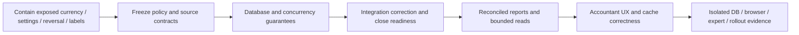

# Accounting remediation and validation plan

**Date:** 8 September 2026. This is a proposed execution programme. No package below was implemented by the audit. Estimates are engineering effort ranges, not commitments; qualified review, data volume and concurrent product changes affect elapsed time.

## Sequence and release gates

Work may overlap where independent, but currency and source truth must be settled before optimizing or certifying derived reports. Do not add caches or materialized summaries over an unresolved monetary contract.

| Package | Scope / findings | Accountable owner | Effort estimate | Completion gate |
|---|---|---|---|---|
| W0 — Immediate containment | ACC-001/002/003/014 | Accounting lead + product/backend | 3–5 days | Unsupported currencies and prohibited policy mutations rejected; inappropriate generic source reversal blocked; misleading posted/certified labels removed. |
| W1 — Accounting policy and data exposure | Currency, precision, fiscal calendar, valuation, source correction policy | Controller + domain/database leads | 3–7 days; expert timing separate | Versioned supported-policy matrix and tenant/source exposure inventory approved for the intended scope. |
| W2 — Ledger database and lifecycle | ACC-004/006/007/008 | Database/platform lead | 1–3 weeks | Tenant-safe references, immutable posted content, deterministic periods and one concurrency protocol pass real PostgreSQL tests. |
| W3 — Source integration and close | ACC-003/005, AP/event contract drift | POS/AP/inventory/payroll/reconciliation owners | 1–2 weeks | Source/ledger/subledger corrections reconcile and policy-defined close blockers/freshness apply consistently. |
| W4 — Reporting and analytics | ACC-001/009/013/014 | Accounting reporting + analytics | 1–2 weeks | Exact currency/opening/closing semantics, consistent snapshot, full-population totals and performance evidence. |
| W5 — Accountant workflow and cache | ACC-010/011/012 | Frontend + accountant UX/IAM | 1–2 weeks | Scope-aware cache, complete paging/counts, truthful states/amounts and accessible sensitive-action workflows. |
| W6 — Release evidence | ACC-015 and capability limitations | QA/SRE/release + qualified country reviewer | 1–2 weeks after fixes; external review separate | Targeted tests green, real DB/browser/provider scope proven, reconciliation monitoring and rollback rehearsed. |

Do not sum these estimates into a guaranteed delivery date: packages overlap, and full FX support can itself require another 2–4 weeks. A supported single-base-currency policy is a valid narrower release choice if enforced across every entry point and communicated honestly.

## W0: Contain demonstrated exposure

1. Enforce the supported base currency in actions and every producer until verified conversion is available. Merely hiding a currency field is insufficient. Detect mixed existing data before presenting a single-currency total as trustworthy.
2. Reject changes to base currency, valuation, calendar and other material settings after they are locked/used unless an approved transition exists. Validate supported policy enums and scale.
3. Restrict generic reversal by source ownership. Direct users to POS refund/void, customer settlement reversal, AP correction, inventory reversal, payroll correction or reconciliation-owned commands as applicable. An accountant adjustment needs its own classification and reconciling evidence.
4. Correct finance proof labels and metric definitions. Capped sales-order totals cannot establish posted revenue; a heuristic confidence score cannot establish certification. Display operational scope and completeness explicitly.

**Validation:** service and direct action cases for supported/unsupported currencies, LOCKED configuration, every source type and finance totals above 250 rows. Retain the seven audit probes as defect reproductions, then replace their observed-defect assertions with appropriate product regression tests during implementation.

## W1–W2: Establish policy and durable invariants

Document transaction currency, base currency, exchange-rate source/effective date, rounding stage, allowed precision, business timezone, fiscal-year boundaries and control-account dimensions. Confirm recognition timing and posting-rule mappings with a qualified accountant. Preserve intentional management-versus-statutory boundaries.

Inventory all literal and indirect ledger writers, migrations, scripts and application-role privileges. Introduce database guarantees only after checking existing data. Tenant consistency may require composite keys or equivalent verified constraints; posted monetary content should be immutable while permitted status/correction links remain controlled. Balance checks across multiple lines need a transaction-compatible design, rather than an immediate row trigger that rejects a temporarily incomplete insert.

Use a shared period lock protocol. Acquire the period boundary before evaluating close preflight and before a writer commits a new effect. Specify lock order across organization, source, period, posting batch and journal to avoid deadlocks. Use compare-and-set claims and stable command identity for reversals. Unique numbering can cause a safe failure but is not a substitute for idempotency or controlled retry.

**Required isolated PostgreSQL scenarios:** post versus close; AP/POS/payroll versus close; two simultaneous reversals; retry after a committed response is lost; wrong tenant parent/account/dimension; posted update/delete under the real application role; conflicting fiscal calendars; deferred balance validation; and interrupted migration validation. Never exercise destructive tests against customer records.

## W3: Reconcile source corrections, events and close

For each producer, define its expected accounting purposes and terminal states. A source operation may be intentionally durable while accounting is blocked only if the state is explicit, monitored, assigned and recoverable. Recovery must verify the original request/source hash and existing journal/link evidence, never post an additional effect simply because a retry occurred.

Unify posting lock, reviewed close and certified close semantics. Decide which inventory, payroll, AP, payment, unassigned-batch and source-completeness blockers are mandatory for each transition. Material changes must invalidate affected periods, read models and exports. Preserve stronger existing close-pack gates.

Resolve the POS shift-close and inventory event-conflict test failures against the intended current evidence model. Do not remove new audit evidence just to satisfy an older exact-object test. The inventory duplicate-conflict test should establish durable conflict evidence, correct error semantics and zero stock movement, including when evidence persistence fails.

**Recovery runbook:** detect the exception → identify source/tenant/period/hash → compare existing effects → assign accountable owner → obtain current authority → execute the owned idempotent correction → reconcile source/subledger/GL → invalidate and rerun close → retain before/after proof. Escalate ambiguous or partially changed sources instead of forcing a retry.

## W4: Repair report contracts before performance tuning

Financial results need a declared currency and as-of/version boundary. General ledger should expose opening, activity and closing with stable ordering. Period P&L and cumulative balance sheet must remain distinct. Preserve archived accounts with posted evidence and disclose classification fallbacks. Validate year-end transfer/carry-forward treatment before introducing automated year-end posting.

Use full-population database aggregates for totals and close preflight. Keep paged details and recent activity samples separate from totals. For exports, choose streaming or an asynchronous artifact with source version, integrity hash, access checks and audit provenance. Any summary table needs rebuild and drift-reconciliation logic.

The audit's 50,000-line in-memory GL returned about 13.37 MB and used a 491.4 ms median CPU sample. This supports prioritizing bounded payloads; it is not a database benchmark. Measure query plans, realistic cardinalities, cold/warm behavior, p95 latency, memory and concurrent posting on a disposable environment before choosing indexes or caches. Record agreed budgets based on expected tenant scale.

## W5: Make accounting workflows explicit and dependable

Define cache keys with organization and access identity/version plus period, currency and every result-changing filter. Use a shared mutation dependency map for journals, source payments/corrections, reconciliation, settings and close. Clear protected cache on revoked access and in-place session changes; default logout reload is only one path.

Return full totals and cursor metadata for journal history. Label recent samples. Show a visible stale/error state when a background fetch fails while retaining old data; suppress a current-trust implication. Invalid values must not become zero. Carry decimal meaning, currency and locale through the formatter and export.

For posting/reversal, show source, affected period, amount/currency, accounting impact, reason and approval/verification requirements. Use a review step when it prevents a costly error. Provide source drill-down and a clear recovery action. Validate English and French content, keyboard traversal, screen-reader announcements, responsive tables, focus/error placement and reduced-motion behavior in an authenticated synthetic tenant. The existing component tests do not certify these experiences.

## Data investigation and repair protocol

Run read-only tenant-scoped investigations first. Required populations include mixed currencies and inconsistent base amounts; historical settings changes; source journals reversed without owned source correction; postings around closedAt; duplicate reversal links; foreign/orphaned dimensions; ledger/line tenant mismatches; overlapping calendars; closed periods with blocked assurance; and source/subledger/GL differences.

For each exception record original immutable IDs and hashes, affected dates/currencies, evidence basis, proposed financial effect, reviewer and recovery method. Prefer source-owned corrective events or reviewed adjusting entries. Never rewrite posted history merely to make a report balance. If a migration/backfill is necessary, prepare a dry-run diff, reconciliation totals, backup/restore proof, reversible rollout and post-run verification before execution.

Display-only and cache defects generally need no journal repair. Regenerate affected reports or explain corrected operational metrics where appropriate. A wrong dashboard total is not evidence that the underlying journal should change.

## W6: Honest release and ongoing operations

Release only the capabilities proven for a stable candidate revision. Preserve historical access and settlement/recovery obligations through module suspension; test current permissions and consent at execution time. Roll out by a bounded tenant cohort and currency/country policy, with controller sign-off for financial behavior and separate expert approval for statutory claims.

Monitor at least failed/pending posting age, source-to-ledger completeness, unmatched allocations/suspense, inventory/AR/AP/payroll reconciliation differences, invalidated close age, outbox retry exhaustion, conflict anomalies and report generation failures. Each signal needs an owner, threshold, escalation route and retained evidence. The audit saw mechanisms and readiness code but did not verify a running scheduler, real alerts, backup recovery or incident response.

A release decision must include green affected tests, real-database invariant/race evidence, authenticated workflow/accessibility evidence, provider scope evidence, deployment constraint/role inspection and rollback rehearsal. Country/regime/rate/effective-version approval remains independent. No technical gate alone grants statutory or professional certification.
