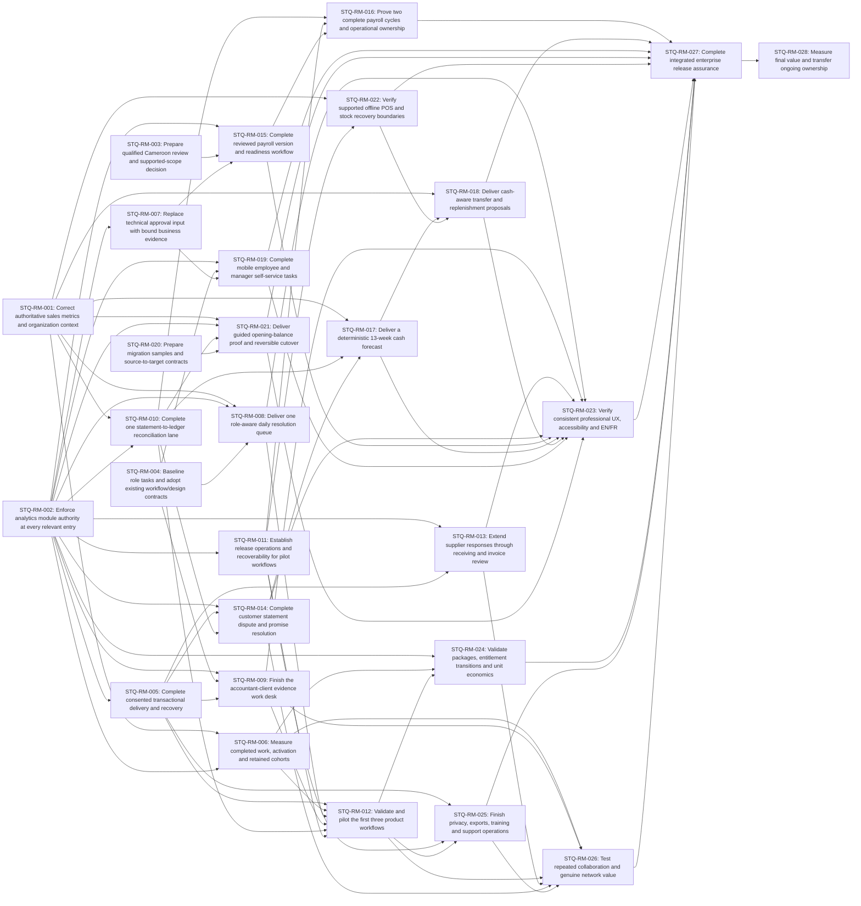

# Stoquify enterprise execution roadmap

Planning date: **6 September 2026**. Scope: the five findings, all ten bounded initial opportunity releases, and their shared hardening, adoption and operating work. This is an execution package; no application code, database, external communications or deployment was changed by this run.

## Decision and next work

Start **STQ-RM-001 sales correctness**, **STQ-RM-002 analytics access**, and **STQ-RM-003 qualified country-review preparation**. The first two can proceed independently; the third starts as a small preparation and external-review track, without treating expert approval as engineering output. Begin recruitment, design and migration sample collection early under packages 004 and 020. The first product wave remains **O1 accountant-client desk, O2 daily resolution queue and O3 statement-to-ledger reconciliation**.

The complete defined scope is **28 packages and 67 traceable recommendations**. Estimated engineering effort is **71.5/103/158 person-weeks (low/base/high)**, excluding specialist allocations and external waiting. A lean three-engineer team should plan around **64–80 elapsed weeks** for the base scope through final value observation. Six engineers with appropriate shared specialists should plan around **48–60 weeks**. These are planning windows, not release commitments. High workload, recruitment, provider or statutory delays can take the program beyond them.

The critical engineering path runs through trustworthy money → reconciliation → receivables → cash forecast → cash-aware stock proposals → cross-workflow UX assurance → integrated release → observed value. The country/payroll and delivery/collaboration tracks can become critical when external evidence arrives late.

## 1. Current truth and evidence boundary

Branch: `codex/migration-control-plane-release-2026-08-29`. Commit: `a05a41ef66cd5d98fd69ae3df18225795f912232`. At evidence collection, **237 modified tracked entries and 264 untracked entries** existed, including this task's evidence directory. The pre-directory snapshot had 263 untracked entries. Counts are Git status entries, not individual files. The candidate is not frozen; source hashes, rather than HEAD alone, identify what was checked.

| Finding | Current state | Consequence for the plan |
| --- | --- | --- |
| F1 | CONFIRMED_OPEN | Fresh source-hashed reproduction still returns 1,000/2 for completed 100 plus draft 900. Business Pulse currency/time defaults persist. Existing context normalizer and new daily-sales service are reusable, not runtime closure of this path. |
| F2 | CONFIRMED_OPEN | Fresh wrapper reproduction still calls downstream read for RBAC-authorized disabled analytics. The exact wrapper/catalog source hashes match the audit; durable grants/navigation already exist. |
| F3 | CONFIRMED_OPEN | Fresh static gate is blocked; 11/12 checks and expert approval absent. Static registry CM only; deployed pack inventory and legal scope remain unverified. |
| F4 | CONFIRMED_OPEN | Manual Approval evidence hash remains at HrisApprovalInbox.tsx:353; multiple operating entries remain. Ownership/design and table work already exists. Screen redundancy/abandonment still requires task evidence. |
| F5 | PARTIALLY_RESOLVED | Participation tokens, buyer review, richer accountant/customer delivery and registration attribution exist. Supplier issue event still has empty outbox; referral scope remains ALL_TIME. Delivery and retained task outcome chain remain unverified. |

Fresh safe verification: **8 suites / 119 tests passed** in 9.22 seconds. Current-source synthetic reproductions still show F1/F2. All three reproduction-file hashes match the audit. The freshly evaluated static country gate remains **11/12, blocked on source-artifact expert approval**. Its report builder prints report mode; the explicit fail-mode evaluation returned blocked/exit code 1. The collection script itself completed successfully because collecting a known blocker is not a collection failure.

Tests covered Business Pulse, analytical context, the new daily-sales read service, managed entitlements/transport, manual reconciliation, referral funnel and payroll tax evaluation. They do not cover every proposed acceptance case. No new browser, screen-reader, live database, provider, restore, deployment or professional approval was exercised here. Earlier audit results and earlier local browser/database evidence remain historical and must be rebound before reuse.

Relevant ongoing work changes the starting point:

- The September 2 analytics packet already defines twelve surface families, 53 metric owners and an analytical context contract. It explicitly says Business Pulse runtime remediation remains unfinished. Reuse that design; reconcile AN-D03/04/11/12 with the actual finance owner instead of inventing approval.
- The new daily-sales service uses organization context, decimal aggregates and half-open periods, with fresh tests. It describes order aggregation with several recognized order statuses; do not copy that predicate into finalized POS-sales semantics without review.
- September 5 workflow modernization includes manual-match residual/permission/retry improvements and historical real PostgreSQL/browser evidence. Reuse those fixes in O3; prove remaining end-to-end statement/sign-off gaps. The modernization assignment is explicitly incomplete.
- The latest inspected modernization report records a Windows standalone-packaging failure after compilation. Older September 2 TypeScript failures are historical; they are not automatically current blockers. Recheck only on the actual candidate in packages 011/027.
- June Daily Digest and finance route-state notes establish existing loading/error/denied-state work. Do not rebuild those primitives. Current task and accessibility evidence is still needed.

Graph navigation was checked across six JSON files: components 1,173 nodes; actions 1,044; app 622; hooks 308; types 72; services 5,719. Relevant nodes include `analytics_sales_analytics_service_getbusinesspulsecommandreadmodel` (community 24), `accounting_accountant_access_service_getaccountantportfolio` (1), `accounting_accountantportfolio_tsx` (140), `daily_habit_dailyhabitdigestdashboard_tsx` (156), and the reconciliation-workbench hook (40). These explain existing extension points; current source is authoritative.

## 2. Scope, assumptions and program boundaries

Assume an initial Cameroon trading/distribution or retail SME cohort, approximately 10–100 employees and 1–5 locations, working with an accountant. This is a pilot-design hypothesis. A qualified reviewer must define the exact employer/profile/effective-date payroll scope. OHADA accounting coverage does not establish uniform regional payroll/tax support. No fresh market or legal research was performed for this roadmap; competitive hypotheses and dated vendor evidence are inherited from the September 6 audit.

Each opportunity is a completed initial user job. Later firm advisory expansion, extra rails/countries, multi-buyer inboxes, saved cash scenarios, seasonality and additional competitor import templates remain conditional. The conditional register also excludes public marketplace/ratings, lending/custody, cross-company credit scoring/benchmarks and autonomous financial agents. Those items have reconsideration criteria and no implementation estimates in this program.

Preserve source-owned posting, exact money, transactions, immutable evidence, bounded external proposals, independent client grants, employee privacy, exports and authorized corrections. Changes extend existing services, portals, import mechanisms and design primitives. No broad rewrite, unrelated lint work, new generic home dashboard or speculative infrastructure is included.

## 3. Full phased program

Phases group outcomes; they are not blanket locks. Start an independent package when its actual hard prerequisites, capacity and source ownership permit it. An external blocker in payroll does not halt unrelated inventory or accountant work. Shared primitives are built once.

| Phase | Packages | Exit outcome | Base planning window: lean / staffed |
| --- | --- | --- | --- |
| P0 — Trust and preparation | STQ-RM-001, STQ-RM-002, STQ-RM-003, STQ-RM-004, STQ-RM-011, STQ-RM-020 | Correctness/access verified; scoped country review, task baselines and samples started; operations evidence prepared. | Weeks 1–14 / 1–7; long-lead review can remain open |
| P1 — First useful workflows | STQ-RM-005, STQ-RM-006, STQ-RM-007, STQ-RM-008, STQ-RM-009, STQ-RM-010 | Delivery, event semantics and O1/O2/O3 complete internally; general approval evidence usability improved. | Weeks 5–24 / 3–13 |
| P2 — Pilots and participation | STQ-RM-012, STQ-RM-013, STQ-RM-014, STQ-RM-015, STQ-RM-019, STQ-RM-022 | First O1/O2/O3 pilot and safe supplier/customer responses; mobile, payroll version and supported offline paths. | Weeks 20–42 / 11–26 |
| P3 — Complete domain outcomes | STQ-RM-016, STQ-RM-017, STQ-RM-018, STQ-RM-021, STQ-RM-023, STQ-RM-024, STQ-RM-025, STQ-RM-026 | Two payroll cycles, forecast, stock proposals, opening balances, bilingual/accessibility assurance, sustainable support and network experiment. | Weeks 30–64 / 18–46 |
| P4 — Release and value | STQ-RM-027, STQ-RM-028 | Candidate-bound full-scope release decision and final observed-value/ownership decision. | Weeks 56–80 / 40–60 |

Wave 1 introduces a source-linked resolution desk and proof-based reconciliation. Wave 2 completes supplier/customer participation and narrow mobile HR utility. Wave 3 completes evidence-backed planning and migration plus the reviewed payroll cycle. Final assurance joins the lanes; it does not postpone ordinary per-package QA or accessibility until the end.

| Package | Outcome | Source IDs | Hard prerequisites | Engineer-weeks L/B/H |
| --- | --- | --- | --- | --- |
| STQ-RM-001 — Correct authoritative sales metrics and organization context | An owner can reconcile displayed sales to finalized source facts in the correct local period and currency. | F1 | None; declared scope/external limits | 3 / 4 / 6 |
| STQ-RM-002 — Enforce analytics module authority at every relevant entry | Direct analytics links, actions and exports honor the same durable module authority as navigation. | F2 | None; declared scope/external limits | 2 / 3 / 5 |
| STQ-RM-003 — Prepare qualified Cameroon review and supported-scope decision | The team and buyer know precisely which employer profile, dates and country rules can be supported. | F3, O7 | None; declared scope/external limits | 0.5 / 1 / 2 |
| STQ-RM-004 — Baseline role tasks and adopt existing workflow/design contracts | Users and implementers agree on one starting point and the exact tasks that should become easier. | F4, O1, O2, O9, O10 | None; declared scope/external limits | 1 / 2 / 3 |
| STQ-RM-005 — Complete consented transactional delivery and recovery | A permitted recipient reliably receives one useful invitation and can recover from delivery failure. | F5, O1, O4, O6 | STQ-RM-002 | 3 / 4 / 6 |
| STQ-RM-006 — Measure completed work, activation and retained cohorts | Product decisions use completed business work and retained cohorts instead of links and registrations. | F5, O1, O2, O3, O4, O6 | STQ-RM-001, STQ-RM-002 | 2 / 3 / 5 |
| STQ-RM-007 — Replace technical approval input with bound business evidence | An authorized approver completes an ordinary decision without typing a technical hash. | F4, O7, O9 | STQ-RM-002 | 2 / 3 / 4 |
| STQ-RM-008 — Deliver one role-aware daily resolution queue | Owners and managers resolve their most important tasks from one trusted starting route. | F4, O2 | STQ-RM-001, STQ-RM-002, STQ-RM-004 | 3 / 4 / 6 |
| STQ-RM-009 — Finish the accountant-client evidence work desk | Accountants and clients close a specific missing-evidence request without chasing files. | O1 | STQ-RM-002, STQ-RM-004, STQ-RM-005 | 3 / 4 / 6 |
| STQ-RM-010 — Complete one statement-to-ledger reconciliation lane | A finance operator imports a supported statement, resolves exceptions and exports a reconciled proof trail. | O3 | STQ-RM-001, STQ-RM-002 | 4 / 6 / 9 |
| STQ-RM-011 — Establish release operations and recoverability for pilot workflows | Operators can detect, contain and recover pilot failures with known service and data-loss targets. | F5, O2, O3 | STQ-RM-002 | 3 / 4 / 6 |
| STQ-RM-012 — Validate and pilot the first three product workflows | The first cohort proves useful repeated work before adjacent features and commercial expansion. | O1, O2, O3 | STQ-RM-005, STQ-RM-006, STQ-RM-008, STQ-RM-009, STQ-RM-010, STQ-RM-011 | 2 / 3 / 5 |
| STQ-RM-013 — Extend supplier responses through receiving and invoice review | A supplier confirms a PO and submits delivery/invoice evidence that the buyer can safely review. | F5, O4 | STQ-RM-002, STQ-RM-005 | 3 / 4 / 6 |
| STQ-RM-014 — Complete customer statement dispute and promise resolution | A customer understands a balance, disputes a line or gives a payment reference, and sees a reviewed outcome. | O6 | STQ-RM-002, STQ-RM-005, STQ-RM-010 | 3 / 4 / 6 |
| STQ-RM-015 — Complete reviewed payroll version and readiness workflow | The supported employer scope has an explainable, versioned path from approved inputs to payroll obligations. | F3, O7 | STQ-RM-002, STQ-RM-003, STQ-RM-007 | 3 / 5 / 8 |
| STQ-RM-016 — Prove two complete payroll cycles and operational ownership | Payroll users finish two reviewed cycles with correct payslips, ledger, settlement and declaration evidence. | F3, O7 | STQ-RM-010, STQ-RM-011, STQ-RM-015 | 2 / 3 / 5 |
| STQ-RM-017 — Deliver a deterministic 13-week cash forecast | An owner can explain a future cash shortfall from dated obligations and explicit assumptions. | O5 | STQ-RM-001, STQ-RM-010, STQ-RM-014 | 4 / 5 / 7 |
| STQ-RM-018 — Deliver cash-aware transfer and replenishment proposals | A stock manager can choose transfer, purchase or wait using reliable stock and an approved cash limit. | O8 | STQ-RM-001, STQ-RM-017, STQ-RM-022 | 4 / 5 / 7 |
| STQ-RM-019 — Complete mobile employee and manager self-service tasks | Employees request leave/time correction and read payslips; managers approve their scoped requests on ordinary phones. | F4, O9 | STQ-RM-002, STQ-RM-004, STQ-RM-007 | 2 / 3 / 5 |
| STQ-RM-020 — Prepare migration samples and source-to-target contracts | An accountant can establish whether a proposed business migration is feasible before cutover work starts. | O10 | None; declared scope/external limits | 1 / 2 / 3 |
| STQ-RM-021 — Deliver guided opening-balance proof and reversible cutover | A business switches with reconciled opening stock, receivables, payables and supported payroll obligations. | O10 | STQ-RM-001, STQ-RM-002, STQ-RM-010, STQ-RM-020 | 4 / 6 / 9 |
| STQ-RM-022 — Verify supported offline POS and stock recovery boundaries | The stock and cash foundations remain reliable through documented supported connectivity failures. | O3, O8 | STQ-RM-001, STQ-RM-011 | 2 / 3 / 5 |
| STQ-RM-023 — Verify consistent professional UX, accessibility and EN/FR | All scoped jobs feel coherent and remain usable across language, device and ability. | F4, O1, O2, O3, O4, O5, O6, O7, O8, O9, O10 | STQ-RM-008, STQ-RM-009, STQ-RM-013, STQ-RM-014, STQ-RM-015, STQ-RM-017, STQ-RM-018, STQ-RM-019, STQ-RM-021 | 3 / 4 / 6 |
| STQ-RM-024 — Validate packages, entitlement transitions and unit economics | Buyers understand the offer and can change packages without losing control of continuing obligations. | F2, F5, O1, O2, O3, O4, O6, O7, O9, O10 | STQ-RM-002, STQ-RM-006, STQ-RM-012 | 2 / 3 / 5 |
| STQ-RM-025 — Finish privacy, exports, training and support operations | Customers can onboard, get help, recover access and export their work with accountable support. | F4, F5, O1, O3, O4, O6, O7, O9, O10 | STQ-RM-005, STQ-RM-011, STQ-RM-012 | 3 / 4 / 6 |
| STQ-RM-026 — Test repeated collaboration and genuine network value | The team knows whether more participants improve outcomes for existing relationships. | F5, O1, O4, O6 | STQ-RM-006, STQ-RM-009, STQ-RM-012, STQ-RM-013, STQ-RM-014, STQ-RM-025 | 2 / 3 / 5 |
| STQ-RM-027 — Complete integrated enterprise release assurance | The defined ten-opportunity release has current-candidate correctness, security, recovery and operating evidence. | F1, F2, F3, F4, F5, O1, O2, O3, O4, O5, O6, O7, O8, O9, O10 | STQ-RM-016, STQ-RM-018, STQ-RM-019, STQ-RM-021, STQ-RM-022, STQ-RM-023, STQ-RM-024, STQ-RM-025, STQ-RM-026 | 4 / 6 / 9 |
| STQ-RM-028 — Measure final value and transfer ongoing ownership | Each released workflow has a value decision, support owner and sustainable next step. | O1, O2, O3, O4, O5, O6, O7, O8, O9, O10 | STQ-RM-027 | 1 / 2 / 3 |

The machine-readable register contains the full executable contract for each package: current paths, tests, precise inclusion/exclusion, minimum useful delivery, owners/reviewers, hard/soft/shared dependencies, implementation/data/recovery outline, observable acceptance, missing checks, estimates, gates and measures. It is the detailed companion to this roadmap, not a list of feature names.

## 4. Dependencies, critical path and shared ownership

Hard dependencies above are contractual prerequisites. Soft dependencies improve value but must not falsely block a useful safe slice. For example, mobile leave/profile work can precede payroll production approval; an incomplete payroll source must visibly limit forecast coverage. Live provider availability is separate from the manual statement lane.

At **1.4 effective engineering FTE per package**, with unlimited parallel teams and the stated observation periods, the dependency-only lower bound is **41.7 weeks**:

STQ-RM-001 → STQ-RM-010 → STQ-RM-014 → STQ-RM-017 → STQ-RM-018 → STQ-RM-023 → STQ-RM-027 → STQ-RM-028.

This is not the staffed delivery forecast: it omits shared specialist and engineering contention, provider review delays, recruitment and integration rework. Recompute from actual throughput at day 30, day 90 and each pilot gate. The payroll branch 003→015→016 and delivery→accountant/supplier→026 may overtake it; two payroll cycles and eight-week retention/network observations cannot be shortened by adding developers.

| Shared area | Single accountable integration owner | Conflict policy |
| --- | --- | --- |
| sales-analytics, analytical-context, daily-sales and cash read models | Analytics/finance lead | 001 owns recognition/context; 006/008/017 consume the version. Reconcile concurrent daily-sales changes; no blind cherry-pick/rewrite. |
| server-authz, module-entitlement/navigation/stop-policy | Platform access lead | 002 owns the scoped enforcement contract; 024 consumes it. Billing never becomes direct authority. |
| outbox/delivery, token/consent, referral events | Integration lead | 005 owns dispatch semantics; 006 owns outcome definitions; 009/013/014 extend domain payloads. |
| payroll-control, HRIS evidence/readiness and payslip services | Payroll lead | 007 precedes 015/019 evidence consumption. Serialize shared writer changes; reviewer controls pack promotion. |
| reconciliation writers/read models and workbench | Payments lead | 010 rebases against ongoing manual-match fixes. 016/017 consume approved proof contracts. |
| Prisma schema/migrations, sidebar, shared tables, EN/FR messages | Database lead for schema; frontend lead for shell/copy | One editor/integration queue per shared file group. Feature branches may prepare separate files; merge only after contract review. |
| Release pipeline, test environment and evidence registers | QA/SRE lead | Serialize environment-changing rehearsals. Preserve previous records; never overwrite an unrelated program status file. |

Lean WIP: two major engineering packages; country/recruitment preparation uses explicitly budgeted fractional time. Staffed WIP: three major packages, with at most one changing a given shared contract. Observation can run beside engineering but consumes QA/support/domain capacity. A blocked package releases its engineering slot after preserving a concrete handoff. The first-30-days schedule accounts for this instead of treating all 28 packages as active.

## 5. Staffing and time model

| Capability | Lean allocation | Better-staffed allocation |
| --- | --- | --- |
| Engineering | 3 people: 2 backend/domain, 1 frontend with integration capability; 70% program focus = 2.1 effective FTE | 6 people: 3 backend/domain, 2 frontend/full-stack, 1 data/integration; 70% = 4.2 effective FTE |
| Product/program | 0.5 FTE | 1.0 FTE |
| Design/research/accessibility | 0.5 FTE, with specialist assist for screen-reader review | 0.75 FTE plus accessibility specialist as needed |
| QA/release | 0.75 FTE | 1.25 FTE |
| Security/privacy | 0.2 FTE plus booked review sessions | 0.3 FTE |
| SRE/operations | 0.25 FTE | 0.5 FTE |
| Accounting/payroll/country experts | 0.2 FTE finance and 0.2 FTE payroll availability plus separately booked qualified review; not interchangeable with engineering | 0.4 FTE combined ongoing domain review plus dedicated country review blocks |
| Support/onboarding | 0.25 FTE early, 0.75 during pilots | 0.5 FTE early, 1.0 during pilots |

Engineering workload alone is **34.0/49.0/75.2 elapsed weeks** at lean effective capacity, and **17.0/24.5/37.6** at staffed capacity. These are workload floors, not schedules. The dependency lower bound, external evidence and observation periods still apply.

Base planning windows are 64–80 and 48–60 weeks. Optimistic engineering/rapid-review cases may approach 50 and 42 weeks respectively; high-effort/review/recruitment cases can exceed 100 and 78 weeks. No finite maximum is guaranteed when a qualified reviewer, participant or provider is unavailable. The high package effort is not secretly contained in the base window.

Package specialist effort is separately estimated in person-days; developer tests remain in engineering effort, independent QA/research/controls work does not. At five working days per person-week, assign these days within the allocations above and reforecast at each gate. The 30% engineering focus reserve covers ordinary interruptions/reviews outside package implementation; do not add it again as a second contingency multiplier. Staffing assumptions are unconfirmed business decisions, not acquired capacity.

The August 30 **42–50-week** plan scoped analytics and controlled network phases 0–3 with about ten effective FTE across engineering and specialists, approximately six effective engineering FTE, and a two-major-package WIP limit. The September 6 audit's **six-month** sketch intentionally covered selected O1/O2/O3 and one adjacent pilot. This roadmap includes all ten initial user jobs, reviewed payroll cycles, migration, mobile work, stock planning and integrated assurance. Its six-engineer scenario has only 4.2 effective engineering FTE at the stated focus level. Do not add the old plan's estimates to the new 103 person-week total or infer that the broader scope fits six months.

## 6. Days 31–90 and continuation

Days are calendar days from mobilization; a sprint is fourteen calendar days, with five working days/week assumed and holidays excluded from this first forecast. Day 0 is an index, not a demand to start on the planning date. Capacity is approximately 9 effective engineer-weeks in days 1–30 for lean and 18 for staffed. See the separate day-30 artifact for the detailed first backlog.

| Window | Lean team: priority and realistic exit | Better-staffed team: additional feasible progress |
| --- | --- | --- |
| Days 31–44 / sprint 3 | Finish remaining 004 task design and 020 sample contracts; begin 005 delivery and 006 event contracts as slots free. External intake runs throughout. | Finish 005 and advance 011; build 008 from approved 001/002/004 contracts. Begin 010 once its hard gates hold. |
| Days 45–58 / sprint 4 | Complete most 005 synthetic delivery behavior; progress 006; begin 008 when its assigned slot is free. | Finish 008; begin/advance 009 after delivery contract; complete 006 and 010 proof fixtures. |
| Days 59–72 / sprint 5 | Finish 005 internal verification and 006; continue 008. Start 011 recovery evidence after a slot frees. | Complete O1/O2/O3 internal evidence, close 011 rehearsal gaps, and finish 007 evidence UX. 012 can enter only when all its prerequisites are evidenced. |
| Days 73–86 / sprint 6 | Finish 008 internal task evidence; continue 011. Prepare scoped O1/O3 fixtures, without claiming delivery. | Begin 012 pilot after applicable gates; concurrently prepare 013/014 or 015 according to independent capacity and external evidence. |
| Days 87–90 / checkpoint | Reforecast remaining 011 plus 009/010. O1/O3 completion and external pilot are expected after day 90 in the lean case. | First pilot may be live/observing; its four-week value result will generally extend beyond day 90. Reforecast payroll and participation branches. |

For lean continuation, complete O1/O3 and the initial pilot around weeks 14–28; use the next free slot for 007/015/019 while 013/014 complete private trading-partner work. Start 021 once samples and reconciliation contracts are ready, and 022 before inventory planning. Build 017 then 018 only on trusted source coverage. Finish 016 whenever qualified evidence and two cycles permit. Run 023/024/025 and the eight-week 026 cohort as their prerequisites become ready, then 027/028. The staffed scenario overlaps three independent lanes, preserving identical gates and full scope.

## 7. Observable enterprise quality and staged gates

| Dimension | Required evidence |
| --- | --- |
| business correctness | Source-to-projection/ledger/quantity/time tie-out and domain-reviewed golden cases; finance gate G02. |
| complete workflows | Source state transition plus denial, stale evidence, duplicate, concurrent, failure and authorized correction; G04. |
| access privacy | Organization/object/role/location/module matrix, fresh auth where required, revoke/expire/redaction and zero unauthorized reads; G03. |
| professional experience | Unassisted role-task completion, consistent terminology/tables, clear next action and complete state handling; G08. |
| accessibility localization | Actual keyboard, focus, screen-reader, zoom/reflow and EN/FR task matrix; automated scans supplement manual evidence; G08. |
| resilience | Transactional interruption, concurrent writer, idempotency/replay and recovery evidence; G04/G07. |
| operational readiness | Owned alerts/runbooks, backup/restore, measured service targets and cost; G07. |
| data governance portability | Originals, versions, lawful retention, authorized export, migration reconciliation and preserved correction history; G09. |
| commercial readiness | Comprehensible packages, durable entitlement transitions, narrow access and cost-to-serve; G11. |
| product value | Source-bound completed-task baseline, countermetric, retention and falsifiable collaboration benefit; G12. |

| Gate | Meaning | Evidence owner |
| --- | --- | --- |
| G01 — Candidate and source binding | Current commit plus changed-file hashes, schema/config versions and evidence timestamp; unrelated concurrent edits reconciled. | Quality/release |
| G02 — Business correctness | Reviewed monetary/quantity/time/recognition fixtures and source tie-out; zero unexplained differences. | Finance controls |
| G03 — Access and privacy | Tenant/object/role/location/module matrix including exports, revocation and denied zero reads; appropriate fresh auth and separation of duties. | Security/IAM/privacy |
| G04 — Complete resilient workflow | Positive, correction, duplicate, concurrent, stale-evidence and partial-failure paths pass with source-owned outcomes. | Backend/integration |
| G05 — External channel proof | Named country/channel configuration, destination consent, sandbox delivery/unknown/retry evidence, support and limits. Manual import/sharing does not clear a live-channel claim. | APIs/events |
| G06 — Qualified country scope | Version/effective-date-specific qualified review, permitted employer scope and two-cycle proof; automation only for evidenced channels. | Country statutory |
| G07 — Operations and recovery | Demonstrated recovery targets, current release packaging, queue/backup/restore, alerts, cost budget and accountable operator. | SRE |
| G08 — Usable EN/FR and accessibility | Critical scoped tasks pass manual keyboard/screen-reader and agreed device/language matrix; no unresolved task-blocking issue. | UX/accessibility/localization |
| G09 — Data and history | Reconciled migration/backfill where present; provenance, retention, authorized exports and safe correction/recovery. | Database |
| G10 — Pilot entry | Named consenting cohort, current candidate G01-G04/G07-G09 plus relevant G05/G06, first-task onboarding, limits, support and rollback owner. | Product |
| G11 — Commercial production entry | Pilot evidence and operational owner; scope, package transitions, support economics, current applicable gates and release decision. | SaaS packaging |
| G12 — Observed value | Baseline and denominator-bound outcome/countermetric, week-4/week-8 or two-cycle evidence, and keep/revise/stop decision. Negative/inconclusive evidence cannot pass a positive value target. | Product |

All gate statuses in this plan are **not verified for the proposed release**. Package delivery uses five distinct milestones:

1. Engineering complete: scoped contract, implementation and developer tests exist on a bound candidate.
2. Behavior validated: applicable integration, failure, privacy, accessibility and correction cases pass, with independent review.
3. Pilot ready: a named cohort, consent, support, limits, recovery and exact external evidence permit the specific lane.
4. Production ready: current applicable gates, sustainable operations and a documented release decision permit supported scope.
5. Customer value observed: defined baselines/countermetrics and enough task cycles demonstrate useful retained work. Negative or inconclusive outcomes remain visible.

Package 012 makes an early O1/O2/O3 pilot possible without waiting for every later feature. Package 027 is the integrated full-scope production gate, not a substitute for per-lane gates. Package 028 makes a measured decision; a completed experiment may reject a feature's value or a network claim. That is not the same as achieving a positive target.

Proposed initial operating targets, to ratify and test in 011: no duplicate financial effects; zero unexplained balances; source tasks show freshness and accountable recovery; p75 useful interactive response ≤2 seconds on an agreed pilot device/network/load for ordinary read workflows; alerts for critical financial/authorization failures acknowledged within 15 minutes during staffed pilot hours; RPO ≤15 minutes and RTO ≤4 hours for the pilot database if the selected deployment can demonstrate them. These are design targets, not observed SLAs or promises of 24/7 coverage. Heavy exports/imports need separate asynchronous completion targets. Measure cost and adjust cohort limits before external promises.

Rollout sequence per workflow: local synthetic fixtures → isolated database/authenticated internal rehearsal → allowlisted consented pilot → supported limited production → measured expansion. A financial discrepancy, privacy leak, stale authorization acceptance, unexplained duplicate or failed recovery stops the affected lane. Disable new actions/dispatch and retain evidence; correct accepted financial work through established reversals/replay. Never roll back by deleting real payroll, ledger or stock history.

## 8. Adoption, network tests and economics

The measurement chain is **useful invitation → successful delivery → first completed task → repeated collaboration → productive organization activation → retained organization**. Count each stage separately, with an eligible denominator and source event. Define attribution windows before reporting conversion; a proposed starting policy is first useful task within 14 days of delivery, productive activation within 30 days, week-4/week-8 task retention, and two pay cycles for payroll. Report other windows as sensitivity checks. Bot previews, repeated tokens, test staff and failed delivery are not human activation.

Meaningful activity advances or closes an authoritative task. Dismissing an alert, logging in, viewing a dashboard or registering does not qualify. The recurring-value metric is organizations completing expected operating work on time, segmented by role and workflow cadence.

For O1, observe existing-client request resolution as a firm's independently granted active client count changes; control for staff capacity, task type and onboarding assistance. For O4, observe existing buyers' supplier response time/reliability as the same supplier gains independently consented active buyer relationships. Require at least ten repeated collaborations and source-backed observations; assess whether the sample can support the inference. If only acquisition improves, describe distribution. If confidence is weak, report inconclusive and keep the useful single-relationship product.

Internal employee collaboration is not a cross-company network; more connectors are integration coverage; retained history creates switching cost but is not a reason to restrict export. Optional customer consolidation and broader partner/template networks remain conditional. A business recommending Stoquify to a competitor may benefit through a shared accountant or supplier; test that reason without exposing prices, employee identities, balances or small-cohort performance.

The audit's improvement thresholds (20–30% task-time reductions, 80–90% unassisted completion, migration zero-difference and forecast source coverage) are **proposed targets**. Baselines are currently unknown. Track support minutes, onboarding corrections, country maintenance, storage/delivery/provider costs and hosting per completed workflow. Test a concrete understandable offer: core daily resolution; finance/reconciliation add-on; paid buyer procurement with useful narrow supplier access; firm/client option; employee-count payroll with narrow employee access; transparent assisted onboarding. No present revenue forecast or willingness-to-pay claim is justified.

## 9. Evidence, blockers and completion conditions

The companion traceability document maps each recommendation, reviewer and blocker. Qualified country review, named provider/delivery evidence, a candidate-bound environment, actual participants/samples and capacity/package decisions remain open. Discovery and safe implementation can proceed independently as specified; no assumed approval clears a gate.

Planning verification status: source/graph reconciliation **passed**; eight-suite focused test run **passed**; defect reproduction **reproduced F1/F2**; country production gate **blocked**; new live/database/browser/accessibility/release checks **not run**. Full build, seeds, migrations and provider operations were intentionally outside this planning run. Inspect package scripts before execution: the current `build` script invokes migration deployment, so it is not a harmless validation command.

Planning completion requires valid package/source/gate references, an acyclic dependency graph, all F/O IDs and supporting recommendations mapped, no duplicated shared effort, four saved artifacts and no fabricated release readiness. Engineering completion requires executing the packages and producing the stated evidence; this document does not do that work.

## Artifact index

- [Machine-readable work packages, estimates, gates and reviewer register](<E:/ohada saas/Focused projects/stoquify/what-next/2026-09-06-stoquify-enterprise-work-packages.json>)
- [Traceability, blockers and conditional ideas](<E:/ohada saas/Focused projects/stoquify/what-next/2026-09-06-stoquify-enterprise-traceability-and-blockers.md>)
- [First 30 days and first three execution briefs](<E:/ohada saas/Focused projects/stoquify/what-next/2026-09-06-stoquify-enterprise-first-30-days.md>)
- [Source hashes, worktree and graph evidence](<E:/ohada saas/Focused projects/stoquify/what-next/2026-09-06-stoquify-enterprise-roadmap-evidence/baseline.json>)
- [Fresh focused tests](<E:/ohada saas/Focused projects/stoquify/what-next/2026-09-06-stoquify-enterprise-roadmap-evidence/focused-tests.json>)
- [Fresh isolated defect reproductions](<E:/ohada saas/Focused projects/stoquify/what-next/2026-09-06-stoquify-enterprise-roadmap-evidence/finding-reproductions.json>)
- [Fresh statutory readiness evidence](<E:/ohada saas/Focused projects/stoquify/what-next/2026-09-06-stoquify-enterprise-roadmap-evidence/statutory-readiness.md>)
- [Source product and competitive audit](<E:/ohada saas/Focused projects/stoquify/what-next/2026-09-06-ohada-product-competitive-audit.md>)
- [Earlier 42–50-week analytics/network roadmap](<E:/ohada saas/Focused projects/stoquify/what-next/STOQUIFY_ANALYTICS_NETWORK_PHASES_0_TO_3_EXECUTION_ROADMAP_2026-08-30.md>)
- [Existing analytics ownership/context acceptance packet](<E:/ohada saas/Focused projects/stoquify/what-next/analytics-network-program/P0_02_P0_03_ACCEPTANCE_PACKET_2026-09-02.md>)
- [Ongoing workflow modernization completion audit](<E:/ohada saas/Focused projects/stoquify/what-next/workflow-modernization/2026-09-05-run-01/COMPLETION_AUDIT.md>)
