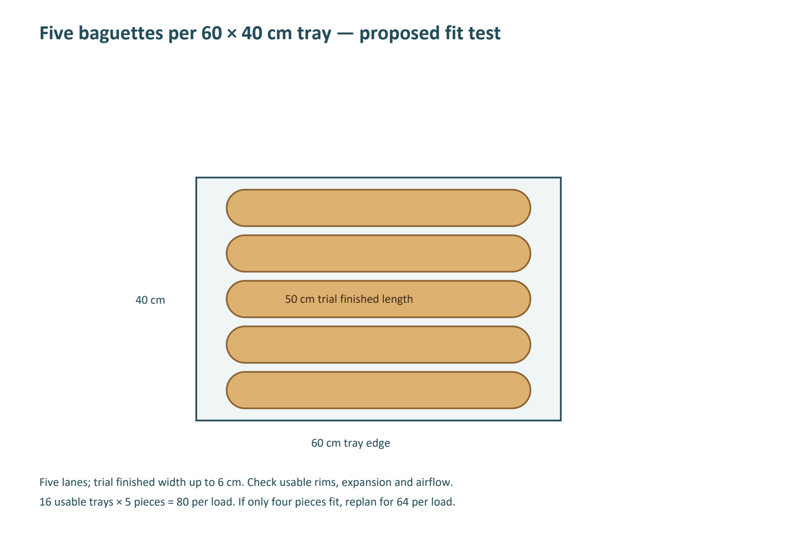
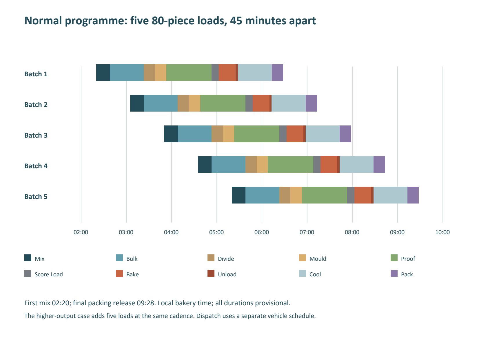

# Nkambe Bakery Recipe Anthology and Production Manual

Harmonized working edition H3 • 8 October 2026

Prepared for the owner and production team in Nkambe, North-West Region, Cameroon.

This booklet brings the bakery’s bread, pastry, savoury-food and frozen-dessert formulas into one controlled working collection. Begin with a small group of pilot recipes, measure output and complete costs, then release only the versions that meet the agreed quality and handling requirements.

The operating cards preserve the 13 breads from Module 1, the more fully specified components and products from the previous handbook, and selected new adaptations that fill gaps in the older workbooks. The comparison volume preserves alternative formulations and the research volume records additional recipes that still need ingredient, process or transcription work. A documented formula is not a documented successful production trial. No owner batch logs establishing production validation were found.

## How to use this edition

Use the recipe ID on the production sheet, stock issue, batch label and sales record. Print the entire card together with its supporting components. Select one version per product and record any deviation before mixing. Similar names can describe substantially different products: keep lean baguettes, soft baguettes, rich milk loaves, laminated pastries, cake doughnuts and yeast doughnuts separate.

EDC is not butter and must not be treated or priced as margarine. Its identity, specification, permitted application, dose and purchase price remain unresolved. Keep EDC as a separate historical ingredient and hold affected formulas until it is identified. The earlier owner-workbook butter-to-margarine instruction remains separate; true dairy butter in independent recipes retains its specification. Milk tantalizer and improver remain omitted from revised recipes.

Milk powder is Millac Premium fat-filled powder. It cannot silently replace skim powder or whole milk powder in a frozen-dessert balance. Top Milk’s purchase price is known, but its identity as sweetened condensed, evaporated or another concentrated product remains unconfirmed. Formulas requiring a particular concentrated milk stay conditional until the tin specification is checked.

All operating temperatures, times, yields and tray counts are starting points unless backed by a recorded trial. Scale ingredients, not mixing, fermentation, cooking or cooling times. Purchase prices are owner-supplied quotes, not a market-price survey. “UNPRICED” means missing information; it never means free.

## Scope and evidence

The staged search covered the current workspace, Documents, Desktop, Downloads, locally accessible OneDrive and WPS locations, the user-home top level, and document filenames on accessible D and E drives. It identified 590 filename candidates and 179 different file contents before final relevance screening. Exact file duplicates were detected by content hash. Related PDF, Word and text editions were also reviewed as a single publication family where appropriate.

The large pastry scan and three short recipe PDFs were processed locally with Windows OCR. OCR wording and numerals are research evidence until checked against the page image; only selected adopted material has been visually checked. Unreadable characters, vague spoon/cup measures and unnamed ingredients are not converted into invented production weights.

Search limits: protected System Volume Information folders on D and E denied access; eleven long software snapshot paths could not be statted. System/program folders were not exhaustively content-searched. A filename-led search can miss a recipe stored under an unrelated name. Cloud-only material and external accounts are not assumed to have been read. The source register records exclusions and file-level limitations; it does not claim a forensic search of every file on the computer.

The source IDs S001–S179 belong to this project. Earlier handbooks reused S numbers for web references; those historical references are not the same numbering system. This edition cites the actual local file, sheet/cell or section through its source register. Recipe IDs such as S-B01 remain recipe IDs, not source IDs.

## Selection and comparison decisions

The earlier handbook provides the operating baseline for specified savoury components, assemblies and specialist dairy recipes because it separates raw and cooked masses and supplies more complete procedures. It remains a development document. Module 1 is retained as a separate family because its owner-priced bread formulas differ from those baselines. The Melto spreadsheets remain the authority for what their historical cells contained, but their batch multipliers, partial sums, piece counts and margins are not accepted without recalculation.

Workbook comparison uses flour as the common denominator where appropriate and total mass otherwise. It preserves different ratios and quantity columns, including columns that may be scaling errors rather than deliberate recipes. Exact formula ratios occurring in several sheets are linked, not counted as independent trials. Ingredient spelling differences and explicit ingredient identities are recorded; merely sharing a product name is not a reason to average formulas.

The H-series adds fixed-mass trials for Agege bread, tangzhong milk loaf, ciabatta, whole-wheat bread, Danisa-style biscuits, Melto biscuits, milk shortbread, marble cake, genoise, chin-chin, beignets soufflés, croissants, chocolate laminated rolls, local galette bread, zebra loaf, focaccia, plantain chips, onion-cheese filling, pastry cream and granola. These changes serve portion consistency and fill actual source gaps. This is a trial library, not a recommendation to launch all products together.

## Ingredient purchasing register

| Ingredient | Owner purchase unit | Purchase FCFA | Normalized price | Use and remaining check |
|---|---|---|---|---|
| Le Choix du Boulanger flour | 50 kg | 21,000 | 420.00 FCFA/kg | Check protein, absorption and suitability for each bread/cake/biscuit |
| Nevada instant dry yeast | 24 packs × 450 g = 10.8 kg | 18,000 | 1,666.67 FCFA/kg | Verify strain and performance in sweet dough; keep dry and follow storage label |
| Roma margarine | 9 kg bucket | 12,000 | 1,333.33 FCFA/kg | Confirm fat, salt, allergens and creaming performance; not assumed to be roll-in fat |
| Millac Premium fat-filled powder | 25 kg | 80,000 | 3,200.00 FCFA/kg | Confirm milk solids, vegetable fat and reconstitution instructions |
| Top Milk concentrated milk | 30 tins × 1 kg | 30,000 | 1,000.00 FCFA/kg | Exact type and composition unresolved; price is not substitution permission |
| Granulated sugar | 50 kg | 32,000 | 640.00 FCFA/kg | Icing sugar remains a separate unpriced ingredient |
| Salt | 18 kg | 3,500 | 194.44 FCFA/kg | Food-grade fine salt; full precision used in calculations |
| Cooking oil | 20 L | 26,000 | 1,300.00 FCFA/L | At provisional 0.92 kg/L: 1,413.04 FCFA/kg; verify brand, frying suitability and net mass |

Missing quotes include eggs by edible mass, drinking water, butter, specific dairy products, meat, fish, vegetables, fruit, cocoa/chocolate, nuts, spices, cultures, stabilizers, packaging and process consumables. Obtain supplier specifications along with prices. Do not inherit historical egg-carton weights or older milk prices as current facts.

For eggs bought by count, weigh a representative sample without shells. Edible-egg price per kg = carton cost divided by measured edible kg. For produce and meat, choose either a purchased-raw basis with measured preparation loss or a ready-to-use basis, and apply it consistently. Avoid charging peeling or cooking loss twice.

## Facility and capacity rules

Facility A starts around 02:00 and performs mixing, baking, meat cooking, fillings, sauces and liquid preparations. The reported 16-tray diesel rotary oven has working steam injection and 60 × 40 cm trays. Tin dimensions, rack clearance, loaded temperature recovery and tray spacing still require checks. Use the oven’s approved steam controls; do not throw water into a hot diesel oven.

The spiral mixer is described as having a 50 kg flour capacity. Confirm maximum finished-dough mass, minimum load, hydration limits and duty cycle; a 50 kg flour label is not automatic approval for any enriched 90 kg dough. Pilot quantities below the minimum require appropriate small equipment or hand mixing. Cakes, creamed biscuits and foams need a paddle/whisk; a dough spiral and a slow cooking scraper cannot be assumed to perform those functions.

Two proofers, induction frying equipment and a mixing/cooking pot are reported. Verify their controls and hygienic design. No assumption is made that the pot is a qualified dairy pasteurizer, that a refrigerator can rapidly chill a bulk hot batch, or that a holding freezer has adequate hardening capacity.

Facility B receives finished products and controlled-temperature components, then assembles, reheats, fries small samosa batches and freezes/dispenses approved liquid mixes. Samosas are prepared and frozen at A, kept frozen during transfer and storage, then fried to order using a validated frozen-piece process. Shawarma meat is cooked at A; the decorative machine does not justify leaving meat outside temperature control.

Owner-reported A power is a 20 kW inverter, 30 kWh nominal battery and 25 kW diesel generator. Retail induction is described as about 2.5 kW, with per-burner versus combined meaning unresolved. Plan one burner at a time until measured electrical limits permit more. Older claims of different retail inverter capacity are not treated as current confirmation. Protect refrigeration and qualified cooling before adding production load. Solar energy is unavailable at the 02:00 start and is not a reason to price all energy at zero.

## C01 General food safety and two site controls

Use potable water, approved suppliers, cleanable equipment and separate raw-meat and ready-to-eat tools. Check ingredient lots, expiry, damaged tins and cold-chain history. Wash hands appropriately; gloves do not replace hand hygiene. Clean and sanitize using the chemical label’s concentration, contact time and rinsing instructions. Prevent allergen cross-contact and carry component allergens onto the finished-product label.

House operating targets for cooked meat, poultry, fish and egg dishes are at least 75°C for 30 seconds in the coldest representative centre; hot holding at least 63°C; chilled storage at 4°C or below. These are external technical guidance and internal targets, not claims about Cameroonian statutory limits. Validate the probe location, batch thickness and repeatability. Reheat rapidly under a written process and verify the same house endpoint; never use hot holding to slowly warm a cold batch. [UK government cooking guidance](https://www.gov.uk/food-hygiene-businesses/cooking)

For cooked perishable food, verify cooling from 57°C to 21°C within two hours and to 5°C or below within six hours total; this bakery’s final cold-storage target is 4°C. Use shallow portions, ice baths or qualified rapid-cooling equipment and log the slowest cooling point. The two hours are part of the six, not additional. Failed or unknown histories require segregation and disposition under the site procedure; smell is not evidence of safety. [FDA Food Code 2026, section 3-501.14, PDF pages 98–99](https://www.fda.gov/media/194741/download?attachment=)

At dispatch and receipt record lot, time, food temperature, container condition and receiver. Use clean covered containers and qualified hot/chilled/frozen transport. Keep frozen products at a working target of −18°C or below and prevent thaw/refreeze cycles; check each machine’s instructions and local requirements. An outage response must preserve food-temperature evidence and identify suspect lots. Do not reset the shelf-life clock after transfer or reheating.

## C02 Dairy mix and frozen desserts

Every dairy base needs a specified, validated treatment system. Reconstituted powder is not sterile. The University of Guelph describes batch ice-cream pasteurization at at least 69°C for 30 minutes in appropriate equipment. Use this as a technical reference for a qualified process, not permission to heat an unverified pot for an approximate interval. Establish agitation, the cold point, instrument accuracy, treatment hold and rapid chilling to 4°C or below. If equipment cannot demonstrate these controls, use a suitable approved commercial mix. [University of Guelph pasteurization guidance](https://books.lib.uoguelph.ca/icecreamtechnologyebook/chapter/pasteurization-of-mix/)

Follow the actual stabilizer/emulsifier technical sheet. Generic CMC, guar, xanthan, starch and proprietary blends are not interchangeable gram for gram. Hold any formula with an unidentified additive, unspecified “others,” or an unverified dose. Mixing or whipping does not replace pasteurization or pressure homogenization. A milk-containing “sorbet” is not dairy-free. Renaming a product does not change its allergens.

Age mixes cold only within the qualified schedule; apply the manufacturer’s sanitation, hopper-temperature, minimum-fill and overnight rules. Never top fresh mix onto an uncontrolled old batch. Measure mix and dispensed product mass. Overrun changes volume, not ingredient mass: overrun = (mass of equal-volume mix / mass of equal-volume frozen product − 1) × 100. A 1 kg formulation pilot may be too small to charge a machine safely.

## C03 Fruit drinks and fruit ices

Freezing, lemon juice, ginger and bissap acidity do not by themselves make a contaminated mixture safe. Use qualified ready-to-eat fruit preparations or a validated treatment for the finished product; additions after heating can recontaminate it. Treat juice and purée recipes as perishable until their process, pH, soluble solids, packaging and storage have been evaluated. Use a calibrated pH meter and refractometer where specified; neither replaces microbiological/process validation. No ambient bottled-juice or hot-fill process is established by this booklet.

Set sweetness by measured fruit solids and a recorded small trial, not an unlogged “add sugar to taste” instruction. Do not automatically replace pineapple, banana, mango, coconut and milk by equal volumes. They contribute different sugar, fibre, acid and fat. Record actual batch mass and mould-fill mass; litres of water plus kilograms of solids do not necessarily equal the claimed final litres.

## C04 Cultured yogurt

Use an identified food-production starter with the actual supplier dose and instructions. Do not use chilli stems, spontaneous souring, an unidentified stock yogurt or an indefinitely recycled culture as the production culture. Older documents containing those practices are retained only for comparison and are not approved procedures.

As a technical reference, Tetra Pak describes yogurt milk treatment at 90–95°C for about five minutes, inoculation around the culture’s specified temperature, fermentation to about pH 4.5 and prompt cooling. Verify the chosen powder’s composition and the culture’s temperature/dose rather than transferring one supplier’s units to another. Record the fermentation curve and a validated maximum time; failed acidification requires segregation. [Tetra Pak fermented milk guidance](https://dairyprocessinghandbook.tetrapak.com/chapter/fermented-milk-products)

Cool using a validated process to the house 4°C storage target. Post-fermentation fruit, sugar solutions and flavours must be suitable for ready-to-eat addition. A longer fermentation, more stabilizer or preservative is not a substitute for hygiene or refrigeration. No two-week, thirty-day or ambient yogurt life is established here.

## C05 Release and shelf life

Use same-production-day quality policy for plain breads and simple snacks during initial trials. Perishable fillings, sauces and desserts require a written chilled/frozen life decision before commercial sale, based on the formulation, treatment, packaging, actual temperature history and appropriate testing. Trial checkpoints at several ages are observations, not an approved selling period. Supplier use-by limits remain applicable. Confirm permits, labeling and applicable product requirements with the relevant Cameroonian authorities; international references here do not establish local legal compliance.

## Costing method and commercial decisions

For each ingredient, extended cost = input grams / 1,000 × confirmed FCFA/kg. The cost audit shows known amounts and unresolved inputs separately. Prepared components carry their ingredient cost per usable gram into an assembly once. Do not charge both the component and all its raw ingredients again to the finished product. The same rule applies to labour and energy already included in a component’s full variable cost.

Complete batch variable cost = ingredients + allocated process consumables/oil loss + packaging + variable labour + metered or defensibly allocated energy + variable transport + commissions + other variable expenses. Divide by saleable units after rejects, samples and unsold waste, using the chosen time period consistently. Contribution = selling price less full variable cost. Net profit also deducts fixed expenses; these are different measures.

An illustration only: if a batch’s complete variable cost is 12,000 FCFA and 100 units sell, variable cost is 120 FCFA/unit. At a hypothetical 200 FCFA price, contribution is 80 FCFA/unit and 8,000 FCFA per batch. If only 80 units sell and all 12,000 FCFA remains incurred, cost per sold unit is 150 FCFA and batch contribution is 4,000 FCFA. These are arithmetic scenarios, not a forecast for Nkambe.

At the same hypothetical 80 FCFA contribution per unit, 240,000 FCFA monthly fixed expenses would require 3,000 sold units merely to cover those fixed expenses, before any other excluded costs. Use this relationship only after recording actual price, sell-through and complete cost. Do not accept the older spreadsheets’ automatic 16% deduction as a substitute for actual operating expenses.

For bread, track loaf/roll count per kg flour, measured bake loss, saleable yield, rejects, returns and contribution per oven-tray minute. For samosas, track frozen-piece rejects, centre-temperature performance, oil use and customer wait. For frozen desserts, track mix lost during cleaning, overrun, power and usable portions. The best-looking ingredient margin can be inferior after slow service, unsold stock or cold-chain losses.

## Purchasing and first pilot sequence

Begin with M1-B01 or S-B02 for the everyday loaf, one milk bun, one baguette, T01 cake doughnuts and H10 chin-chin. Trial these on separate identified batches before choosing a permanent formula. Add O-P18 samosas and a single shawarma assembly only after cooling, transport and reheating/frying have been demonstrated. Release frozen dairy and yogurt only after their equipment and process gates are met. Customer demand and willingness to pay remain hypotheses to test locally.

Create the purchase list from the selected recipes’ commercial quantities, then add measured preparation yield and a controlled stock buffer. Do not purchase ingredients for the entire library at once. Consolidate identical ingredients and count components at the lowest raw-material level once. Order allergens and perishable materials in volumes compatible with segregation and safe storage.

| Initial pilot activity | Suggested window from 02:00 | Release observation |
|---|---|---|
| Opening sanitation, lot checks and instruments | 02:00–02:20 | Cold stores and probes acceptable; power plan confirmed |
| First bread dough | From 02:20 | Dough temperature, consistency, mixer load and recipe ID recorded |
| Bulk fermentation, division and proof | Recipe dependent | Use expansion endpoints; stagger a second mix only when bench/proofer capacity allows |
| Baking and protected cooling | Recipe dependent | Rack colour and centre set checked; cooled weights recorded |
| Savoury cooking and active cooling | Separate controlled work block | Raw-to-ready-to-eat segregation and cooling logs complete |
| Dispatch | After release, not a fixed promise | Packaged count, lot and food-temperature handover |
| Retail finishing | In response to demand | Small loads, measured fryer recovery and safe centre endpoint |

## Version history and unresolved decisions

| Version | Change | Evidence status |
|---|---|---|
| Earlier local manuals and workbooks | Historical recipes and concepts | Related generated editions and source records; no independent production validation inferred |
| Module 1 v0.2 | Thirteen bread formulas with owner purchase prices | Retained in M1 series; full operating expenses still incomplete |
| H2 | Adds BAG-H2-01 and three corrected baguette production scenarios; H1 recipe library preserved | Timed trials and full costs outstanding |
| Harmonized H1 | Cross-source comparison, current costs, margarine clarification, removal of two additives, selected adaptations and research holds | Working edition requiring practical release trials |

Critical open items are Top Milk’s type; flour and fat specifications; Nevada suitability in sweet dough; tin dimensions; mixer limits; dairy treatment and rapid cooling; freezer and machine capacity; culture/stabilizer identities; oil density and actual uptake; ingredient quotes; complete operating costs; product life and sale prices. The detailed issue and recipe registers identify where each matters.

# Baguette Production Planning and Daily Capacity

H2 planning module • 8 October 2026 • Nkambe, Cameroon • All clock times are local bakery planning times.

## H3 ingredient correction

EDC is not butter and must not be treated or priced as margarine. Its identity, specification, permitted application, dose and purchase price remain unresolved. Keep EDC as a separate historical ingredient and hold affected formulas until it is identified. The earlier owner-workbook butter-to-margarine instruction remains separate; true dairy butter in independent recipes retains its specification. Milk tantalizer and improver remain omitted from revised recipes.

T01 cake doughnuts and H05 Danisa biscuits are held. Ninety-two historical formula variants retain EDC separately and unpriced. The lean baguette programme BAG-H2-01 contains no EDC and its formula and timing assumptions are unchanged. H3 supersedes the EDC interpretation in H1 and H2; original editions are retained only as historical records.

## Decision and source identification

The requested document was located: **Staggered_Baguette_Production_Schedule.pdf**, source S038, in the owner's Downloads folder. It has two pages and was modified on 11 September 2026. Its filename describes scheduling; its internal heading is “Commercial Baguette Production Guide”. This is the closest direct match, supported by the five-batch programmes in S026 and S027. Current file hashes match the H1 source inventory.

S038 describes two 80-piece batches. S026/S027 extend related reasoning to five batches of allegedly 101 pieces each, implying 505 pieces in a production campaign. That is a source claim, not a verified daily output. No sales orders, successful timed campaign, installed rack count or signed production record were supplied.

H2 retains the useful idea of staggered mixing and converts it into whole-load programmes. It does not adopt the source's contradictory clocks, unverified equipment claims or immediate closed-box packing. The new recipe BAG-H2-01 is a separate direct-dough commercial trial; existing M1-B12, M1-B13 and S-B01 remain separate formulas.

| Source | Relevant evidence | Decision |
|---|---|---|
| S038 | PDF p1 formulation/cadence; p2 two-rack timeline and controls | Primary requested scheduling document; correct arithmetic and sequencing |
| S030 | PDF pp1–2; 80-piece formula and industrial workflow | Formula/process companion; contains the same yield discrepancy |
| S027 | PDF pp1–2; five-batch checklist, 18 kg flour and 101 pieces/batch | Retain implied 505-piece target as historical; rack and timing claims rejected |
| S026 | Lines 9–29 schedule; 33–70 staff/logistics; subsequent water/ice discussion | Useful duty and distribution concepts; reject hot airtight packing and unqualified par-bake route |
| S001 | PDF p1 audit and section 4 baguette system | Earlier corrections are supporting analysis, not a production test |
| S131 / S137 | Equipment sections and two-site business plans | Broad operating context; not the requested baguette-specific programme |

| ID | Document | Full path |
|---|---|---|
| S038 | Staggered_Baguette_Production_Schedule.pdf | C:\Users\J COMPUTER\Downloads\Staggered_Baguette_Production_Schedule.pdf |
| S030 | Commercial_Baguette_Production_Guide.pdf | C:\Users\J COMPUTER\Downloads\Commercial_Baguette_Production_Guide.pdf |
| S027 | Bakery_Empire_Master_Operations_Manual.pdf | C:\Users\J COMPUTER\Downloads\Bakery_Empire_Master_Operations_Manual.pdf |
| S026 | Bakery_Empire_Master_Operations_Manual.md | C:\Users\J COMPUTER\Downloads\Bakery_Empire_Master_Operations_Manual.md |
| S001 | bakery_strategy_and_recipe_manual_updated.pdf | C:\Users\J COMPUTER\Documents\Codex\2026-09-12\x20-go\docs\bakery\bakery_strategy_and_recipe_manual_updated.pdf |
| S131 | Nkambe_Bakery_Business_and_Production_Plan.pdf | C:\Users\J COMPUTER\WPS Cloud Files\.3728209773449\cachedata\2B0BE17ABD444588A82615757DB640F5\Nkambe_Bakery_Business_and_Production_Plan.pdf |
| S137 | Nkambe_Bakery_Business_and_Production_Plan.pdf | C:\Users\J COMPUTER\WPS Cloud Files\.3728209773449\cachedata\D084D8E5B0104800B3A610A601B8DF7B\Nkambe_Bakery_Business_and_Production_Plan.pdf |

## Source audit and corrected calculations

| Topic | Original claim / input | H2 correction |
|---|---|---|
| Ingredient total | S038 lists flour 14.20 kg, water 9.37 kg, salt 284 g, yeast 71 g. | Sum = 23.925 kg. At exactly 66% water, water would be 9.372 kg and total 23.927 kg. Neither is 24 kg. |
| Whole pieces | S038 says the batch yields exactly 80 × 300 g. | 23,925 / 300 = 79 pieces and 225 g left before handling loss. With 1% handling loss: 23,685.75 g → 78 pieces and 285.75 g left. |
| Cooled weight | 300 g raw is described as 250 g at 15% bake loss. | 300 × 0.85 = 255 g. A mathematical 250 g target at 15% loss requires 294.118 g raw, before portion and process variation. |
| 18 kg flour variant | S027 uses 18 kg flour, 8.28 kg water, 3.6 kg ice, 360 g salt, 90 g yeast. | Total 30.330 kg, hydration 66% including ice. Before handling loss: 101 pieces + 30 g. At 1% loss: 100 pieces + 26.7 g. |
| Five-batch output | Five batches are claimed to yield 505 baguettes. | With 1% handling loss and 300 g portions, five 18 kg-flour batches give 500 pieces before rejects. At 80/load, 7 pooled loads are needed; if every batch is kept separate, 10 loads (80+20 per batch). Proofing must be redesigned for either route. |
| Rack geometry | 101 pieces are treated like one 16-tray load. | 16 × 5 = 80. 101 requires at least 21 trays at 5/tray. It cannot fit the assumed one-load geometry. |
| Proof window | S038 p2 starts batch 1 proof at elapsed 01:30, promises 60 min, but loads at 02:15. | That window is 45 min. Batch 2 proof 02:15–03:15 is 60 min. H2 uses a common explicit 60-minute planning slot, subject to dough endpoint. |
| Remaining times | At 00:45, S038 says batch 1 has 27 min left in bulk; its bulk actually ends 01:03. | 18 min remain. Several remaining-time and overlap annotations disagree with their own start/end times. |
| Cadence | S038 calls the oven cycle 25 min, prescribes 45-minute mixing starts, then shows first/second oven starts 60 min apart. | These are three different intervals. H2 reserves 40 minutes for scoring/loading, baking, unloading and recovery; 45-minute starts leave 5 minutes of nominal slack. |
| Recovery | S038 alternates 3-minute recovery and a mandatory 23-minute thermal recovery statement. | Neither is a measured requirement. Time actual recovery; H2 provisionally reserves 5 min after unloading. If 23 min is actually required, the H2 45-min cadence fails. |
| Mix rest | A 10-minute rest with yeast already included is labelled autolyse. | H2 calls it a hydrated-dough rest. A flour/water-only autolyse is a different method and must not be inserted as extra time without revising the schedule. |
| Dispatch | Some related manuals seal hot bread immediately and assume a 23-minute delivery. | Cool in a protected ventilated area; validate packing readiness. H2 uses explicit cooling, packing, vehicle loading, travel, handover and return assumptions. |
| Retail bake | S026 offers a 15-minute par-bake option. | This edition schedules full baking at A. A qualified second bake, cooling/storage process and suitable B oven have not been established. |

## BAG-H2-01 Direct-dough commercial baguette

Status: harmonized source adaptation, version H2, production trials required. Sources: S038 pp1–2, S030 pp1–2 and S027 pp1–2. Intended result: a lean, crisp-crusted, roughly 48–50 cm commercial baguette, with an evenly expanded crumb and consistent raw portion. It is not a claim to a protected French designation or to a guaranteed finished retail weight.

Retain the source's nominal flour 100%, water 66%, salt 2% and instant yeast 0.5%. Scale to the required portions and allow 1% handling loss. Round flour upward to a whole gram, water to a gram, and salt/yeast to 0.1 g; recheck the resulting total. This avoids promising an additional whole piece from a rounded-down batch. The 40-piece pilot needs a suitably sized mixer; it is not automatically a permissible minimum load for the large spiral.

| Ingredient / specification | Baker % | Pilot 40 pieces, g | One load 80 pieces, g |
|---|---|---|---|
| Le Choix du Boulanger flour; absorption/protein to verify | 100 | 7,194 | 14,388 |
| Potable chilled water; ice included within this total | 66 | 4,748 | 9,496 |
| Fine food-grade salt | 2 | 143.9 | 287.8 |
| Nevada instant dry yeast | 0.5 | 36.0 | 71.9 |
| Total weighed input | 168.5 nominal | 12,121.9 | 24,243.7 |

| Mass/yield measure | 40-piece pilot | 80-piece load |
|---|---|---|
| Input g | 12,121.90 | 24,243.70 |
| After 1% handling loss, g | 12,000.68 | 24,001.26 |
| Raw pieces × 300 g | 40 × 300 = 12,000 | 80 × 300 = 24,000 |
| Unallocated dough after handling, g | 0.68 | 1.26 |
| Bake loss illustration | 15%; 255 g cooled per piece | 15%; 255 g cooled per piece |
| Before-reject cooled mass, kg | 10.200 | 20.400 |
| Reject allowance: ceil(pieces × 2%) | 1 piece; 39 retained | 2 pieces; 78 retained |
| Retained saleable mass illustration, kg | 9.945 | 19.890 |

“Retained saleable” is a planning allowance, not a measured result or an order forecast. Rounding rejects upward makes the effective allowance 2.5% in these examples. Unsold stock is a separate commercial loss and is not silently included in this allowance. Record leftovers and their disposition; no extra loaf or unpriced rework is assumed.

At 13–17% bake loss a 300 g portion finishes around 261–249 g. Therefore this plan does not establish a guaranteed 250 g net weight. Measure cooled weights and their variation before choosing a declared weight. If a particular minimum is required, design the portion allowance from actual worst-case process data and applicable requirements.

### Numbered process and observable endpoints

1. Before mixing, verify ingredient lots, clean scales, water supply, tray/rack fit, guards and steam controls. Record room, flour and water temperatures. Do not taste raw flour or dough. Prepare batch labels and weigh all ingredients separately; no improver, Milk tantalizer, milk, margarine or sugar belongs in BAG-H2-01.

2. Start with most of the listed water, flour and yeast, mix gently for about 3 minutes, rest the hydrated dough for 10 minutes, then add salt and the balance of the listed water and mix about 5 minutes to moderate development. The 18-minute slot is a trial. Target source-derived final dough temperature 23–24°C; adjust water temperature from measured friction and ambient conditions. Do not automatically use 4°C water or a fixed ice percentage in every season. All ice must be food-grade, melt by the end of mixing and replace an equal mass of listed water.

3. Transfer into a covered food-grade bulk bin. Allow a provisional 45-minute bulk fermentation. Require visible fermentation and extensibility, not a timer alone. At 0.5% instant yeast and this dough temperature, actual required time may be longer. Record the result; if the baseline under-ferments, extend bulk/proof and rerun the resource model rather than increasing yeast ad hoc.

4. Divide and preshape in a 15-minute planning slot, checking pieces against 300 g. Keep pieces in numbered first-in/first-out order. The next 15-minute slot moulds those same pieces in the same order: at an even rate each piece has approximately 15 minutes between preshape and moulding. That rest overlaps division of later pieces; do not insert another full-batch 15 minutes unless the schedule is revised. Irregular work rates require timed subgroups and a new slot allowance.

5. Mould gently, using verified roller settings and minimal measured dusting flour. Trial 48–50 cm lengths. Place seam-down, five per 60 × 40 cm tray only if the finished width and airflow test pass. Dusting flour is an additional process quantity to weigh and cost; the dough formula does not include an unlimited dusting allowance.

6. Load a verified proofer bay. Plan 60 minutes from the last tray loaded, near 26°C and 75–80% relative humidity if the installed controls can maintain it. The first formed pieces begin expanding earlier. Check tray-to-tray consistency; a slowly recovering light indentation and expanded, aerated dough are guides. Bake at the appropriate endpoint. The schedule includes a further 10-minute scoring/loading slot; dough must tolerate that actual elapsed time. Record proof exit and oven entry separately.

7. Preheat using the oven manual and a measured lead time. A trial starting point inherited from the source is 240°C preheat, about 220°C baking and 22 minutes for this size. Commission a steam programme through the working injection system; the source's 15–20-second pulse is not a universal setting. Score before loading, following the shaping style and a blade-handling procedure. Never throw water into the diesel oven or improvise the steam plumbing. Use the manufacturer's damper procedure to finish the crust.

8. Check even colour, expansion and fully set crumb using cooled cut samples as well as the established bake controls. Unload with appropriate heat protection. Log recovery to the next qualified loading condition, rather than assuming the thermostat display proves recovery. Reserve 3 minutes to unload and 5 minutes to recover in the model; replace these with measurements.

9. Cool protected on racks. The 45-minute allowance is a trial, not automatic packing release. Check that packaging causes no condensation and the crust specification is acceptable. Pack in clean food-grade paper or the qualified pack; use protected ventilated transport crates. Do not tightly seal steaming bread, reuse raw-food containers or place bread directly against vehicle surfaces.

10. Release by lot and measured count, then dispatch to B. Check transport hygiene, quantities, time and condition at handover. Plan same-production-day quality review under C05; no multi-day shelf life is established. Retail replenishment follows actual sales and available display space. Segregate underbaked, damaged or otherwise rejected pieces; record any food-safe alternative use as a separate authorised product, not hidden yield.

Allergens: wheat/gluten; review flour processing aids, yeast and shared-equipment labels for additional allergens or cross-contact. No allergen-free claim is made. C01 and C05 remain applicable; filled baguettes additionally require the relevant meat, egg, dairy and sauce controls.

### Cost audit and labour distinction

| Input | One-load amount | Confirmed rate | Known FCFA |
|---|---|---|---|
| Flour | 14.388 kg | 420/kg | 6,042.96 |
| Salt | 0.2878 kg | 194.44/kg | 55.96 |
| Nevada yeast | 0.0719 kg | 1,666.67/kg | 119.83 |
| Water | 9.496 kg | UNPRICED | UNPRICED |
| Known ingredient subtotal | 80 raw / 78 retained units | Incomplete | 6,218.75 |

The known subtotal is 79.73 FCFA per planned retained unit. It excludes water, dusting flour, consumables, packaging, energy, paid labour, transport and unsold stock. No complete margin or selling-price recommendation follows from it. A 10% increase in currently priced inputs adds 7.97 FCFA per retained unit; 10% fewer sold units increases the same batch-cost allocation by 11.11% before whole-unit rounding.

Reserve 35 staff-minutes per batch for M1 preweighing, mixer supervision, transfer and cleaning; 20 for D2 division/bench cleaning; 20 for F3 moulding/loading/bench cleaning; 13 active minutes for O4 score/load and unload; and 25 for P5 packing and tray-set cleanup. This gives about 113 allocated staff-minutes per batch before opening/closing, quality monitoring, relief, walking, transport or paid waiting. It includes the supervised dough-rest interval and is not a measured stopwatch labour standard. Record hands-on labour separately. Cost actual paid staffed hours, including coverage and waiting; do not multiply 113 minutes by a wage and call it full campaign labour cost.

The model's first-batch elapsed time from mixing start to packing release is 248 minutes, plus opening checks before mixing. Active labour and elapsed process time are different quantities. The staffing allocation is intentionally generous for a commissioning bakery and can be redesigned only after timed trials.

## Tray layout, rack count and capacity gates

Trial layout: orient baguette length along the 60 cm tray edge. Five pieces at up to 6 cm finished width occupy five parallel lanes across the 40 cm edge: centres at about 5, 12.5, 20, 27.5 and 35 cm. A 50 cm finished length leaves 5 cm at each end; 6 cm width leaves 2 cm outer margins and 1.5 cm inter-piece gaps. These are geometric trial allowances, not proof of adequate airflow, pan-channel fit or final expansion. Check the actual usable surface inside rims. If loaves spread wider, use four per tray and replan quantities.

The accompanying tray-layout diagram is schematic. The full 16-tray test must check all levels, colour, clearance, steam distribution and rack weight. The partial commissioning load uses 8 trays × 5 pieces, spread according to the oven manual; do not claim half the baking time because the load is halved.

| Constraint | H2 baseline requirement | What changes the plan |
|---|---|---|
| Mixer | 80-piece batch 24.244 kg dough, 14.388 kg flour | Verify minimum/maximum dough mass and duty cycle; the reported 50 kg flour description is not a confirmed bowl or dough rating |
| Moulding / division | Two separate work surfaces/operators; 80 pieces in each 15-minute stage | Slower actual throughput increases stage slots; revise rest and proof age |
| Proofers | Two independently usable bays, each holding one full 16-tray rack | 60 min proof + 5 min bay turnover at 45 min starts needs two bays. At 90 min proof, two bays require cadence at least 47.5 min: trial 50 min, then recheck all stages |
| Oven | 10 min score/load + 22 bake + 3 unload + 5 recovery = 40 min reservation | 45 min starts leave 5 min nominal slack. A measured 23 min recovery makes reservation 58 min and requires a slower programme |
| Rack/tray sets | Four active sets in steady operation; a fifth full set provides contingency | A set is occupied from mould/loading through proof, bake, cool, pack and 10-min cleanup: 180 min. At 45-min starts, four sets are the calculated minimum; five sets = 80 trays, ownership unconfirmed |
| Cooling/packing space | Two full-load equivalent positions for cooling/packing overlap | Keep a separate dispatch staging area sized to the delivery waves; do not borrow proofer space |
| Vehicle | One vehicle, assumed 85-minute loaded-to-ready round trip | 5 load + 30 outward + 15 handover + 30 return + 5 clean/check. Driver and vehicle cannot be sent on two overlapping trips |
| Power and fuel | Measured connected electrical loads, priority cold stores and oven diesel consumption | 20 kW inverter, 30 kWh nominal storage and 25 kW generator are reported; usable energy, electrical phase, surges and diesel litres/hour remain open |

Rack sets are not the same as the oven's one-rack capacity. A rack occupied by cooling bread cannot simultaneously carry the next proofed load. The fifth contingency set is a planning provision, not a finding that the bakery owns five racks. No purchase has been made or assumed.

At five pieces/tray the nominal oven-only rate is 80 × 60 / 40 = 120 pieces/hour. The planned 45-minute production cadence is 106.67 pieces/hour once the pipeline is filled. Neither rate applies from 02:00: the first-batch lead time, opening work, cooling, dispatch and end-of-shift cleaning remain. With only four pieces/tray, each load becomes 64; five/ten loads become 320/640 raw pieces before rejects if all other stage times still pass.

If 505 is an actual sales requirement rather than the historical raw-output claim, distinguish the two. Seven full 80-piece loads give 560 raw and 546 retained pieces under the stated reject model. A calculated alternative is six full loads plus a separately scaled 38-piece last load: 6 × 78 + (38 − 1 reject) = 505 retained pieces from 518 raw. That mixed-load option needs its own last-batch weighing and partial-rack test; it is not a fourth released programme or a recommendation to manufacture unsold surplus.

## Chronological production scenarios

All scenarios begin opening checks at 02:00 and first mixing at 02:20. Times are planning outputs; they are not proof that dough will be ready on those clocks. The 800-piece case extends the campaign at the same cadence; it does not claim faster fermentation or an unproven faster oven.

| Programme | Loads and cadence | Raw / retained pieces | Final pack release |
|---|---|---|---|
| PLAN-BAG-P | 2 × 40; 90 min | 80 / 78 | 07:58 |
| PLAN-BAG-N | 5 × 80; 45 min | 400 / 390 | 09:28 |
| PLAN-BAG-H | 10 × 80; 45 min | 800 / 780 | 13:13 |

### PLAN-BAG-P Commissioning programme

| Batch | Mix | Bulk | Divide → mould | Proof bay / proof | Score/load → bake out |
|---|---|---|---|---|---|
| 1 | 02:20–02:38 | 02:38–03:23 | 03:23–03:38 → 03:38–03:53 | 1: 03:53–04:53 | 04:53 → 05:25 |
| 2 | 03:50–04:08 | 04:08–04:53 | 04:53–05:08 → 05:08–05:23 | 2: 05:23–06:23 | 06:23 → 06:55 |

| Batch | Unload / recover done | Cooling | Packing / lot release | Rack free after clean |
|---|---|---|---|---|
| 1 | 05:28 / 05:33 | 05:28–06:13 | 06:13–06:28 | 06:38 |
| 2 | 06:58 / 07:03 | 06:58–07:43 | 07:43–07:58 | 08:08 |

| Delivery wave | Batches / retained units | Load → depart | Arrival at B | Vehicle ready back at A |
|---|---|---|---|---|
| 1 | 1 / 39 | 06:28 → 06:33 | 07:03 | 07:53 |
| 2 | 2 / 39 | 07:58 → 08:03 | 08:33 | 09:23 |

Calculated simultaneous requirements for this finite campaign: 1 proofer bays; 2 active rack/tray sets; 1 full-load equivalent cooling/packing positions. Maximum packed staging wait before vehicle loading is 0 minutes. These waits affect crust quality and sales freshness and must be tested.

Commissioning is a learning run. Use a verified small mixer or an approved large-mixer load. Check the partial rack, portion consistency and process endpoints before increasing to 80 pieces per load. Retained-unit figures do not authorize sale of an unsuccessful trial.

### PLAN-BAG-N Proposed normal programme

| Batch | Mix | Bulk | Divide → mould | Proof bay / proof | Score/load → bake out |
|---|---|---|---|---|---|
| 1 | 02:20–02:38 | 02:38–03:23 | 03:23–03:38 → 03:38–03:53 | 1: 03:53–04:53 | 04:53 → 05:25 |
| 2 | 03:05–03:23 | 03:23–04:08 | 04:08–04:23 → 04:23–04:38 | 2: 04:38–05:38 | 05:38 → 06:10 |
| 3 | 03:50–04:08 | 04:08–04:53 | 04:53–05:08 → 05:08–05:23 | 1: 05:23–06:23 | 06:23 → 06:55 |
| 4 | 04:35–04:53 | 04:53–05:38 | 05:38–05:53 → 05:53–06:08 | 2: 06:08–07:08 | 07:08 → 07:40 |
| 5 | 05:20–05:38 | 05:38–06:23 | 06:23–06:38 → 06:38–06:53 | 1: 06:53–07:53 | 07:53 → 08:25 |

| Batch | Unload / recover done | Cooling | Packing / lot release | Rack free after clean |
|---|---|---|---|---|
| 1 | 05:28 / 05:33 | 05:28–06:13 | 06:13–06:28 | 06:38 |
| 2 | 06:13 / 06:18 | 06:13–06:58 | 06:58–07:13 | 07:23 |
| 3 | 06:58 / 07:03 | 06:58–07:43 | 07:43–07:58 | 08:08 |
| 4 | 07:43 / 07:48 | 07:43–08:28 | 08:28–08:43 | 08:53 |
| 5 | 08:28 / 08:33 | 08:28–09:13 | 09:13–09:28 | 09:38 |

| Delivery wave | Batches / retained units | Load → depart | Arrival at B | Vehicle ready back at A |
|---|---|---|---|---|
| 1 | 1 / 78 | 06:28 → 06:33 | 07:03 | 07:53 |
| 2 | 2,3 / 156 | 07:58 → 08:03 | 08:33 | 09:23 |
| 3 | 4,5 / 156 | 09:28 → 09:33 | 10:03 | 10:53 |

Calculated simultaneous requirements for this finite campaign: 2 proofer bays; 4 active rack/tray sets; 2 full-load equivalent cooling/packing positions. Maximum packed staging wait before vehicle loading is 45 minutes. These waits affect crust quality and sales freshness and must be tested.

This replaces the historical five-mix/505-piece claim with five deliberately matched 80-piece loads. It requires confirmed rack sets, two proof bays, five production roles and an independent delivery driver. Do not combine the old 18 kg flour charge with this one-load schedule.

### PLAN-BAG-H Higher-output extended programme

| Batch | Mix | Bulk | Divide → mould | Proof bay / proof | Score/load → bake out |
|---|---|---|---|---|---|
| 1 | 02:20–02:38 | 02:38–03:23 | 03:23–03:38 → 03:38–03:53 | 1: 03:53–04:53 | 04:53 → 05:25 |
| 2 | 03:05–03:23 | 03:23–04:08 | 04:08–04:23 → 04:23–04:38 | 2: 04:38–05:38 | 05:38 → 06:10 |
| 3 | 03:50–04:08 | 04:08–04:53 | 04:53–05:08 → 05:08–05:23 | 1: 05:23–06:23 | 06:23 → 06:55 |
| 4 | 04:35–04:53 | 04:53–05:38 | 05:38–05:53 → 05:53–06:08 | 2: 06:08–07:08 | 07:08 → 07:40 |
| 5 | 05:20–05:38 | 05:38–06:23 | 06:23–06:38 → 06:38–06:53 | 1: 06:53–07:53 | 07:53 → 08:25 |
| 6 | 06:05–06:23 | 06:23–07:08 | 07:08–07:23 → 07:23–07:38 | 2: 07:38–08:38 | 08:38 → 09:10 |
| 7 | 06:50–07:08 | 07:08–07:53 | 07:53–08:08 → 08:08–08:23 | 1: 08:23–09:23 | 09:23 → 09:55 |
| 8 | 07:35–07:53 | 07:53–08:38 | 08:38–08:53 → 08:53–09:08 | 2: 09:08–10:08 | 10:08 → 10:40 |
| 9 | 08:20–08:38 | 08:38–09:23 | 09:23–09:38 → 09:38–09:53 | 1: 09:53–10:53 | 10:53 → 11:25 |
| 10 | 09:05–09:23 | 09:23–10:08 | 10:08–10:23 → 10:23–10:38 | 2: 10:38–11:38 | 11:38 → 12:10 |

| Batch | Unload / recover done | Cooling | Packing / lot release | Rack free after clean |
|---|---|---|---|---|
| 1 | 05:28 / 05:33 | 05:28–06:13 | 06:13–06:28 | 06:38 |
| 2 | 06:13 / 06:18 | 06:13–06:58 | 06:58–07:13 | 07:23 |
| 3 | 06:58 / 07:03 | 06:58–07:43 | 07:43–07:58 | 08:08 |
| 4 | 07:43 / 07:48 | 07:43–08:28 | 08:28–08:43 | 08:53 |
| 5 | 08:28 / 08:33 | 08:28–09:13 | 09:13–09:28 | 09:38 |
| 6 | 09:13 / 09:18 | 09:13–09:58 | 09:58–10:13 | 10:23 |
| 7 | 09:58 / 10:03 | 09:58–10:43 | 10:43–10:58 | 11:08 |
| 8 | 10:43 / 10:48 | 10:43–11:28 | 11:28–11:43 | 11:53 |
| 9 | 11:28 / 11:33 | 11:28–12:13 | 12:13–12:28 | 12:38 |
| 10 | 12:13 / 12:18 | 12:13–12:58 | 12:58–13:13 | 13:23 |

| Delivery wave | Batches / retained units | Load → depart | Arrival at B | Vehicle ready back at A |
|---|---|---|---|---|
| 1 | 1 / 78 | 06:28 → 06:33 | 07:03 | 07:53 |
| 2 | 2,3 / 156 | 07:58 → 08:03 | 08:33 | 09:23 |
| 3 | 4,5 / 156 | 09:28 → 09:33 | 10:03 | 10:53 |
| 4 | 6,7 / 156 | 10:58 → 11:03 | 11:33 | 12:23 |
| 5 | 8,9 / 156 | 12:28 → 12:33 | 13:03 | 13:53 |
| 6 | 10 / 78 | 13:53 → 13:58 | 14:28 | 15:18 |

Calculated simultaneous requirements for this finite campaign: 2 proofer bays; 4 active rack/tray sets; 2 full-load equivalent cooling/packing positions. Maximum packed staging wait before vehicle loading is 45 minutes. These waits affect crust quality and sales freshness and must be tested.

The final delivery is later than the final bake because one vehicle must finish its earlier trip before collecting the last load. The workbook exposes that queue. Use preorders and measured afternoon demand; a larger campaign is not automatically a better commercial choice. If the market needs all 800 pieces early in the morning, this programme does not meet that requirement. A separately validated earlier start, fermentation-retardation process, capacity expansion or revised product mix would be needed. Provide shift relief and handovers; do not assign a single person to an unbroken extended shift.

### Day-before preparation and staffing

Opening allocation: M1 checks scales, ingredient labels and the mixer from 02:00–02:10, then preweighs batch 1 from 02:10–02:20. D2/F3 prepare clean work surfaces, bins and trays. O4 checks the oven and steam system before starting an approved preheat programme. A provisional 45-minute preheat lead would mean 04:08 for the default first scoring/loading slot at 04:53; actual required lead time and readiness override this illustration. Count preheat and standby fuel/electricity in campaign costs. Complete opening sanitation before exposed-food handling.

BAG-H2-01 is direct dough and does not require a poolish. Before the night shift, arrange water-temperature control, ingredients, clean racks/trays, labelled bulk bins, dispatch crates, fuel and customer orders. Do not leave mixed dough overnight under this recipe.

M1-B12 is a different poolish baguette. Its 300 g flour, 300 g water and 0.3 g yeast preferment per 1 kg total flour are part of the total formula. Its 12–16-hour maturation must be started the previous day and assessed for readiness. Do not use BAG-H2-01's clock or add a second full flour/water charge. M1-B13 is a softer baguette; S-B01 is another daily baguette formula. Each requires its own dough, proof, bake and dispatch validation before being assigned a production programme.

| Role | Reserved work | Coverage / staffing condition |
|---|---|---|
| M1 mixer lead | 10 min preweigh before mix; 18-min mix/rest supervision; 7-min transfer and clean | 35 minutes reserved per batch. On the extended plan relief R6 covers all of batch 4 weighing/mixing/cleanup so M1 can take an uninterrupted break; further breaks require recorded coverage. |
| D2 divider/preshaper | 15-min division plus 5-min bench clean | Separate from F3. Keep FIFO labels and weight checks; batch count assumes this rate can be maintained. |
| F3 moulder/rack loader | 15-min mould/load plus 5-min work-area clean | Track first/last tray formation age; use a separate surface so cleaning does not obstruct D2. |
| O4 oven/proof lead | Proof endpoint checks, 10-min score/load, supervised bake, 3-min unload and recovery monitoring | Dedicated to hot operations; do not use this person as the delivery driver. Arrange qualified relief during the extended campaign. |
| P5 cooling/packing | Cooling checks, 15-min pack, 10-min rack/tray cleanup; opening/closing support | Packing and dispatch staging must remain separate from raw-food handling. |
| R6 relief | Named trained relief for break coverage and handovers | Extended campaign needs planned staffing beyond uninterrupted single-worker shifts. Never double-book the relief person across simultaneous roles. |
| Driver / B receiver | Vehicle waves as listed; independent receiving person at B | Load handover is not full receiving-staff capacity planning. Confirm vehicle/crate capacity for the largest wave and retailer storage. |

Treat the roles as the resource model, not proof of the exact payroll required. Named people, opening/closing periods, lawful shift arrangements, breaks and paid hours must be assigned before release. Short gaps between tasks are not automatically sufficient rest breaks. The workbook schedules production stages and vehicle use; the supervisor must also schedule quality checks, breaks and other products. The extended programme remains on hold if that staffing plan is not supplied.

## Purchasing, complete costing and sensitivity

| Programme | Flour kg | Water kg | Salt kg | Yeast kg | Known subtotal FCFA |
|---|---|---|---|---|---|
| PLAN-BAG-P | 14.388 | 9.496 | 0.2878 | 0.0720 | 6,218.92 |
| PLAN-BAG-N | 71.940 | 47.480 | 1.4390 | 0.3595 | 31,093.77 |
| PLAN-BAG-H | 143.880 | 94.960 | 2.8780 | 0.7190 | 62,187.54 |

These are campaign consumption quantities, not instructions to buy a full bag/carton for every batch. Flour bags are 50 kg; yeast packs are 450 g. Deduct usable opening stock, choose a documented stock buffer, then round purchasing to supplier packs. Record chilled-water/ice energy, dusting flour and leftovers separately. Never add ice on top of the recipe water allowance.

The editable workbook leaves water, packaging, dusting/consumables, electrical energy, diesel, variable staffing and transport blank until supplied. A genuinely zero cost must be explicitly entered as zero. Full variable campaign cost and contribution stay unavailable while required fields are blank. All paid staffing relevant to the campaign must be included once; do not add both a full shift and the same batch labour again.

No selling price is imposed. Enter a candidate price and expected sold units only after a customer and outlet check. Contribution is revenue less complete variable cost; fixed rent, depreciation, financing and other fixed expenses still separate it from net profit. Cold storage and other products may share power and labour; document an allocation instead of assuming baguettes use the entire generator or that all energy is free solar power at 02:00.

Sensitivity checks to run before release: 10% flour-price increase; lower actual sold units; 4 instead of 5 pieces/tray; proof 90 instead of 60 minutes; slower moulding; recovery 23 instead of 5 minutes; longer cooling; and delayed vehicle return. A resource conflict means the schedule is invalid until recalculated, not permission to hold proofed dough indefinitely.

## Contingencies, quality and release records

| Trigger | Action |
|---|---|
| Proof not ready | Bake by dough endpoint; record the extension, hold the next mix if needed and recalculate bay/cadence requirements. Do not compress bulk or proof to catch up. |
| Dough ready before oven | Stop further starts; assess the batch with the lead baker. No unverified fridge/retarder shortcut or repeated arbitrary knock-back is prescribed. |
| Power or diesel interruption | Stop machinery safely, protect cold stores and record dough stage/time/temperature. Follow equipment restart procedures. Decide batch disposition from condition; recalculate the queue before restarting. |
| Slow recovery / pale or uneven bake | Measure loaded oven recovery and map tray levels. Reduce load or revise oven cycle. Do not direct combustion exhaust toward food, staff or the street. |
| Moulding tears / sticking | Check relaxation, flour absorption, dough temperature, roller gaps and measured dusting. Do not add flour or oil without logging the formula change. |
| Weight / reject variance | Check scales and cooled samples across trays. Recalculate portions, handling loss, bake loss and rejects from measurements; do not sell an assumed net weight. |
| Cooling or packaging condensation | Delay packing until release criteria pass; expand protected cooling space or slow starts. Record the delay and its rack impact. |
| Delivery delay / low sell-through | Keep protected staging, notify the receiving team through normal business procedures, reduce subsequent production and update sold-unit costing. Do not make additional batches solely to keep the oven busy. |

For each trial record: recipe/version; date; batch; operator/relief; ingredient lots and weighed masses; room/flour/water/dough temperatures; actual mix end; bulk start/end; first/last divide and mould; proof start/end and actual temperature/humidity; score/load and bake times; steam programme; unloaded weight/count; recovery time; cooled sample weights; rejects/leftovers; packing release; tray/rack available time; staff hours; water/dusting/oil-free process consumables; electricity and diesel; dispatch/arrival/return; B receipt; sold/returned units; full cost; corrective action; reviewer.

Run at least three independently acceptable trials of the selected load and cadence before treating the programme as an operating standard. The programme is conditional on demonstrated product quality, safe handling and resource availability. Reissue the schedule when recipe, portion, oven load, proof duration, staff or route changes.

### Technical reference and evidence limit

King Arthur's professional baguette material reinforces that fermentation, shaping and steam are process-specific. Its professional sourdough formula uses a different fermentation system and is not the recipe adopted here. The H2 numerical timings come from the audited local sources and explicit planning assumptions, not from a manufacturer validation of this oven. [King Arthur professional baguette reference](https://www.kingarthurbaking.com/pro/formulas/sourdough-baguettes)

The source register distinguishes the local documents from this external technical reference. C01–C05 and their authoritative references remain in the anthology. This new section establishes no new Cameroon legal limit, food shelf life or guaranteed output.

## H2 integration and verification record

H2 adds one traceable recipe, BAG-H2-01, and three planning scenarios to the 137 working cards and 792 H1 coverage records. It preserves all earlier formulas, variants, prices and unresolved source records. H1 remains unchanged. The corrected baguette section supersedes conflicting scheduling statements for BAG-H2-01 only; it does not rewrite another recipe's fermentation method.

The programme has been checked for batch mass, integer portions, loss arithmetic, source discrepancies, nonoverlapping equipment bookings, two-bay proof allocation, rack/cooling peaks and serialized delivery trips. Passing those arithmetic checks does not validate the assumed cycle times, named staffing, product quality or customer demand. Open gates remain visible in the workbook and issue register.

# Working recipe cards

Cards with shared components are read together. “Commercial” means a scaling example, not permission to load equipment beyond verified limits. Recipes remain provisional until their batch record is signed.

# Module 1 breads and baguettes

## M1-B01 Standard English block bread

**Status: Retained Module 1 formulation — production trial required**

Source: S016; recipe B01.

A lightly sweet, soft sandwich loaf with a fine, resilient crumb and a golden crust. This is a proposed local-market trial, not a claim to reproduce a particular existing Nkambe loaf.

| Ingredient | Pilot g | Production g | Baker % |
| --- | --- | --- | --- |
| Le Choix du Boulanger flour | 1,000.00 | 10,000.00 | 100.00 |
| Potable water | 600.00 | 6,000.00 | 60.00 |
| White granulated sugar | 50.00 | 500.00 | 5.00 |
| Millac Premium powder | 20.00 | 200.00 | 2.00 |
| Roma margarine | 40.00 | 400.00 | 4.00 |
| Fine food-grade salt | 20.00 | 200.00 | 2.00 |
| Nevada instant dry yeast | 10.00 | 100.00 | 1.00 |

Pilot flour 1,000 g; commercial example 10,000 g flour. Both are planning scales; use a mixer within its verified load limits.

### Production method

1. Weigh every ingredient and record water temperature. For plain/enriched dough, mix the dry ingredients with most of the listed water, develop partly, then add margarine or oil gradually. Add raisins or coconut late before bulk fermentation. Target 25–27°C dough.

2. Bulk fermentation: 45–60 min at 25–27°C; aim for about 60–80% volume increase, not collapse.

3. Shape: Flatten each 500 g piece gently, roll into a tight log, seal and place seam-down in a greased tin. Trial internal dimensions around 20 × 10 × 10 cm; confirm by tin-volume and proof-height tests before ordering tins.

4. Proof: 45–70 min at about 28–30°C. For the trial open tin, start baking when the crown is approximately level with or just above the rim and a light indentation recovers slowly.

5. Bake or cook: 185–195°C, approximately 28–35 min; begin checking at 25 min. No steam is needed. Trial crumb endpoint 93–96°C plus a set, non-gummy crumb.

6. Cool on protected racks, weigh cooled pieces and pack only when condensation does not form. Score baguettes after proof, immediately before loading.

Equipment and layout: Begin with 4 tins per 60 × 40 cm tray, arranged 2 × 2 with air gaps. Confirm external tin dimensions, rack pitch and airflow; do not infer full-rack capacity from tray area.

Active labour: 25–35 min pilot; 40–60 min at 10 kg flour, excluding washing and rack moves. Elapsed: About 3.5–4.5 h including cooling; fermentation is condition-dependent.

Yield model: 1,740.00 g input; assume 1% handling loss → 1,722.60 g usable dough; 3 whole pieces × 500 g raw with 222.60 g leftover. Trial bake loss 10–14%; midpoint saleable mass 1,320.00 g. Measure rather than printing this as a verified label weight.

Controlled substitution: A like-for-like bakery margarine can replace Roma by equal mass only after matching fat and salt content. Bread flour from another supplier needs a new water-absorption trial; do not change flour and yeast simultaneously.

| Defect | Likely cause | Trial correction |
| --- | --- | --- |
| Dense base | Insufficient final proof or weak shaping | Check dough temperature, proof development and seam tension; do not add yeast blindly. |
| Waisted or collapsed loaf | Overproofing or unsuitable tin fill | Reduce proof endpoint or dough weight after a measured tin trial. |
| Dry crumb | Overbaking or too little water for the flour | Measure baked weight loss and record a controlled water adjustment in the next trial. |

### Harmonization and current cost audit

Preserve this owner-priced v0.2 recipe as a distinct variant. New cost audit includes every ingredient; no unmeasured operating expense is assumed to be zero.

| Ingredient or component | Pilot g | FCFA/kg | Extended FCFA |
| --- | --- | --- | --- |
| Le Choix du Boulanger flour | 1,000.00 | 420.00 | 420.00 |
| Potable water | 600.00 | UNPRICED | UNPRICED |
| White granulated sugar | 50.00 | 640.00 | 32.00 |
| Millac Premium powder | 20.00 | 3,200.00 | 64.00 |
| Roma margarine | 40.00 | 1,333.33 | 53.33 |
| Fine food-grade salt | 20.00 | 194.44 | 3.89 |
| Nevada instant dry yeast | 10.00 | 1,666.67 | 16.67 |

Known ingredient subtotal: **589.89 FCFA per pilot**. Unpriced or unresolved inputs: Potable water. Water, process aids, frying-oil quantity where applicable, packaging, energy, labour, transport and losses outside the stated model must be completed before a full variable cost or contribution is reported.

Illustrative known-ingredient subtotal per planned unit: 196.63 FCFA for 3 units. This is not complete unit cost. A 10% increase in all currently priced inputs adds 19.66 FCFA per planned unit; 10% fewer saleable units raises the same batch-cost allocation by 11.11% before whole-unit rounding.

Allergen review: Wheat/gluten unless a verified gluten-free ingredient is specified; Milk; check margarine and compound ingredients Include the labels of every prepared component.

Site and packing: prepare centrally at A; transfer with lot, time and temperature records. Plain unfilled bread/biscuits require protected cooling and dry food-grade packaging. Meat, egg, dairy, wet fillings and sauces follow C01–C04 with validated cooling and chilled transport. Retail B performs only the specified finishing/assembly. Keep frozen products continuously frozen; never display cooked meat on an unheated shawarma spit. Storage duration requires a product-specific release decision; no inherited shelf-life guarantee applies.

Trial record for this card: date/lot ____; ingredient specifications ____; batch input ____ g; water actually used ____ g; start/end times ____; active labour ____ min; critical temperatures/pH ____; cooled usable mass ____ g; saleable units ____; rejects/leftovers ____ g; measured energy/oil ____; sensory result ____; complete cost ____ FCFA; approved version and reviewer ____. Repeat independently before scale-up.

## M1-B02 Golden milk loaf

**Status: Retained Module 1 formulation — production trial required**

Source: S016; recipe B02.

A soft, evenly textured, moderately sweet family loaf with a milk-powder aroma. Millac and Roma make this a dairy-containing, vegetable-fat-enriched trial formula, not an all-butter or all-milk-fat loaf.

| Ingredient | Pilot g | Production g | Baker % |
| --- | --- | --- | --- |
| Le Choix du Boulanger flour | 1,000.00 | 10,000.00 | 100.00 |
| Potable water | 600.00 | 6,000.00 | 60.00 |
| White granulated sugar | 100.00 | 1,000.00 | 10.00 |
| Millac Premium powder | 60.00 | 600.00 | 6.00 |
| Roma margarine | 80.00 | 800.00 | 8.00 |
| Fine food-grade salt | 20.00 | 200.00 | 2.00 |
| Nevada instant dry yeast | 12.00 | 120.00 | 1.20 |

Pilot flour 1,000 g; commercial example 10,000 g flour. Both are planning scales; use a mixer within its verified load limits.

### Production method

1. Weigh every ingredient and record water temperature. For plain/enriched dough, mix the dry ingredients with most of the listed water, develop partly, then add margarine or oil gradually. Add raisins or coconut late before bulk fermentation. Target 25–27°C dough.

2. Bulk fermentation: 50–70 min at 25–27°C; aim for 60–80% expansion.

3. Shape: Scale 500 g; flatten, roll tightly and seal. Use the same provisional 20 × 10 × 10 cm internal tin trial as B01. Compare three independently mixed batches before fixing tin fill.

4. Proof: 60–90 min around 28–30°C, ending at the measured tin-height target with slow indentation recovery.

5. Bake or cook: 175–185°C, about 28–36 min. Start at 180°C without steam; check from 25 min. Trial crumb endpoint 93–96°C and an evenly set centre.

6. Cool on protected racks, weigh cooled pieces and pack only when condensation does not form. Score baguettes after proof, immediately before loading.

Equipment and layout: Start with 4 tins per tray. Keep this richer loaf separate from hotter baguette loads.

Active labour: 30–40 min pilot; 45–65 min at 10 kg flour. Elapsed: About 4–5 h with cooling; sweet dough may ferment slowly with an unsuitable yeast strain.

Yield model: 1,872.00 g input; assume 1% handling loss → 1,853.28 g usable dough; 3 whole pieces × 500 g raw with 353.28 g leftover. Trial bake loss 10–14%; midpoint saleable mass 1,320.00 g. Measure rather than printing this as a verified label weight.

Controlled substitution: Whole milk powder can be tested at the same 60 g mass, but this changes fat, protein and lactose balance and is a new recipe version. Sweetened condensed milk is not a one-for-one replacement: obtain its composition and rebalance sugar, water and fat before using it.

| Defect | Likely cause | Trial correction |
| --- | --- | --- |
| Dark crust before centre sets | Sugar and milk solids brown quickly | Lower the next bake by 5–10°C and verify core and weight loss. |
| Slow proof | Yeast not suited to enriched dough or low dough temperature | Confirm Nevada variant, dough temperature and shelf condition; test a manufacturer-recommended sweet-dough yeast. |
| Greasy crumb | Fat added too early or poor incorporation | Develop the dough partially before adding softened margarine in stages. |

### Harmonization and current cost audit

Preserve this owner-priced v0.2 recipe as a distinct variant. New cost audit includes every ingredient; no unmeasured operating expense is assumed to be zero.

| Ingredient or component | Pilot g | FCFA/kg | Extended FCFA |
| --- | --- | --- | --- |
| Le Choix du Boulanger flour | 1,000.00 | 420.00 | 420.00 |
| Potable water | 600.00 | UNPRICED | UNPRICED |
| White granulated sugar | 100.00 | 640.00 | 64.00 |
| Millac Premium powder | 60.00 | 3,200.00 | 192.00 |
| Roma margarine | 80.00 | 1,333.33 | 106.67 |
| Fine food-grade salt | 20.00 | 194.44 | 3.89 |
| Nevada instant dry yeast | 12.00 | 1,666.67 | 20.00 |

Known ingredient subtotal: **806.56 FCFA per pilot**. Unpriced or unresolved inputs: Potable water. Water, process aids, frying-oil quantity where applicable, packaging, energy, labour, transport and losses outside the stated model must be completed before a full variable cost or contribution is reported.

Illustrative known-ingredient subtotal per planned unit: 268.85 FCFA for 3 units. This is not complete unit cost. A 10% increase in all currently priced inputs adds 26.89 FCFA per planned unit; 10% fewer saleable units raises the same batch-cost allocation by 11.11% before whole-unit rounding.

Allergen review: Wheat/gluten unless a verified gluten-free ingredient is specified; Milk; check margarine and compound ingredients Include the labels of every prepared component.

Site and packing: prepare centrally at A; transfer with lot, time and temperature records. Plain unfilled bread/biscuits require protected cooling and dry food-grade packaging. Meat, egg, dairy, wet fillings and sauces follow C01–C04 with validated cooling and chilled transport. Retail B performs only the specified finishing/assembly. Keep frozen products continuously frozen; never display cooked meat on an unheated shawarma spit. Storage duration requires a product-specific release decision; no inherited shelf-life guarantee applies.

Trial record for this card: date/lot ____; ingredient specifications ____; batch input ____ g; water actually used ____ g; start/end times ____; active labour ____ min; critical temperatures/pH ____; cooled usable mass ____ g; saleable units ____; rejects/leftovers ____ g; measured energy/oil ____; sensory result ____; complete cost ____ FCFA; approved version and reviewer ____. Repeat independently before scale-up.

## M1-B03 Tea rolls with Roma margarine

**Status: Retained Module 1 formulation — production trial required**

Source: S016; recipe B03.

Small, soft breakfast rolls with a fine crumb and an even golden top. These reconcile the report’s butter tea rolls with the supplied Roma margarine. Use a butter name only for a butter formulation.

| Ingredient | Pilot g | Production g | Baker % |
| --- | --- | --- | --- |
| Le Choix du Boulanger flour | 1,000.00 | 10,000.00 | 100.00 |
| Potable water | 580.00 | 5,800.00 | 58.00 |
| White granulated sugar | 80.00 | 800.00 | 8.00 |
| Millac Premium powder | 40.00 | 400.00 | 4.00 |
| Roma margarine | 100.00 | 1,000.00 | 10.00 |
| Fine food-grade salt | 18.00 | 180.00 | 1.80 |
| Nevada instant dry yeast | 12.00 | 120.00 | 1.20 |

Pilot flour 1,000 g; commercial example 10,000 g flour. Both are planning scales; use a mixer within its verified load limits.

### Production method

1. Weigh every ingredient and record water temperature. For plain/enriched dough, mix the dry ingredients with most of the listed water, develop partly, then add margarine or oil gradually. Add raisins or coconut late before bulk fermentation. Target 25–27°C dough.

2. Bulk fermentation: 45–60 min at 25–27°C to about 60–80% expansion.

3. Shape: Round 60 g pieces with the seam underneath. Leave unglazed for the baseline trial. Aim for a finished diameter about 6–7 cm, then adjust against actual expansion.

4. Proof: 45–70 min at 28–30°C; rolls look aerated and a shallow indentation returns slowly.

5. Bake or cook: 175–185°C for about 12–17 min without steam. Begin checking at 11 min; centre should be set with no wet streaks.

6. Cool on protected racks, weigh cooled pieces and pack only when condensation does not form. Score baguettes after proof, immediately before loading.

Equipment and layout: Start with 24 pieces per 60 × 40 cm tray in 6 × 4 rows, about 10 cm centres. Reduce count if rolls touch before the desired crust forms.

Active labour: 25–35 min pilot; 55–80 min at 10 kg flour by hand. Elapsed: About 3–4 h including cooling.

Yield model: 1,830.00 g input; assume 1% handling loss → 1,811.70 g usable dough; 30 whole pieces × 60 g raw with 11.70 g leftover. Trial bake loss 8–12%; midpoint saleable mass 1,620.00 g. Measure rather than printing this as a verified label weight.

Controlled substitution: For a butter trial, replace the 100 g Roma with 100 g unsalted butter only if Roma is a comparable roughly 80–82% fat baking margarine. Otherwise rebalance from labels first. Butter changes flavour, cost and allergen declaration; compare as a separately costed B03 variant.

| Defect | Likely cause | Trial correction |
| --- | --- | --- |
| Rolls merge excessively | Tray density too high | Reduce from 24 to 20 or 18 pieces after measuring proofed width. |
| Tough surface | Proofing skin or excessive bench flour | Cover trays without contact and minimise measured dusting flour. |
| Weak margarine flavour appeal | Fat flavour does not meet target | Blind-test the butter variant against the Roma version, with its added cost shown. |

### Harmonization and current cost audit

Preserve this owner-priced v0.2 recipe as a distinct variant. New cost audit includes every ingredient; no unmeasured operating expense is assumed to be zero.

| Ingredient or component | Pilot g | FCFA/kg | Extended FCFA |
| --- | --- | --- | --- |
| Le Choix du Boulanger flour | 1,000.00 | 420.00 | 420.00 |
| Potable water | 580.00 | UNPRICED | UNPRICED |
| White granulated sugar | 80.00 | 640.00 | 51.20 |
| Millac Premium powder | 40.00 | 3,200.00 | 128.00 |
| Roma margarine | 100.00 | 1,333.33 | 133.33 |
| Fine food-grade salt | 18.00 | 194.44 | 3.50 |
| Nevada instant dry yeast | 12.00 | 1,666.67 | 20.00 |

Known ingredient subtotal: **756.03 FCFA per pilot**. Unpriced or unresolved inputs: Potable water. Water, process aids, frying-oil quantity where applicable, packaging, energy, labour, transport and losses outside the stated model must be completed before a full variable cost or contribution is reported.

Illustrative known-ingredient subtotal per planned unit: 25.20 FCFA for 30 units. This is not complete unit cost. A 10% increase in all currently priced inputs adds 2.52 FCFA per planned unit; 10% fewer saleable units raises the same batch-cost allocation by 11.11% before whole-unit rounding.

Allergen review: Wheat/gluten unless a verified gluten-free ingredient is specified; Milk; check margarine and compound ingredients Include the labels of every prepared component.

Site and packing: prepare centrally at A; transfer with lot, time and temperature records. Plain unfilled bread/biscuits require protected cooling and dry food-grade packaging. Meat, egg, dairy, wet fillings and sauces follow C01–C04 with validated cooling and chilled transport. Retail B performs only the specified finishing/assembly. Keep frozen products continuously frozen; never display cooked meat on an unheated shawarma spit. Storage duration requires a product-specific release decision; no inherited shelf-life guarantee applies.

Trial record for this card: date/lot ____; ingredient specifications ____; batch input ____ g; water actually used ____ g; start/end times ____; active labour ____ min; critical temperatures/pH ____; cooled usable mass ____ g; saleable units ____; rejects/leftovers ____ g; measured energy/oil ____; sensory result ____; complete cost ____ FCFA; approved version and reviewer ____. Repeat independently before scale-up.

## M1-B04 Sweet milk buns

**Status: Retained Module 1 formulation — production trial required**

Source: S016; recipe B04.

An affordable round sweet bun with a soft, close crumb and moderate milky flavour. It can later support filled-bun variants, but those need their own filling and food-safety cards.

| Ingredient | Pilot g | Production g | Baker % |
| --- | --- | --- | --- |
| Le Choix du Boulanger flour | 1,000.00 | 10,000.00 | 100.00 |
| Potable water | 600.00 | 6,000.00 | 60.00 |
| White granulated sugar | 120.00 | 1,200.00 | 12.00 |
| Millac Premium powder | 40.00 | 400.00 | 4.00 |
| Roma margarine | 60.00 | 600.00 | 6.00 |
| Fine food-grade salt | 18.00 | 180.00 | 1.80 |
| Nevada instant dry yeast | 12.00 | 120.00 | 1.20 |

Pilot flour 1,000 g; commercial example 10,000 g flour. Both are planning scales; use a mixer within its verified load limits.

### Production method

1. Weigh every ingredient and record water temperature. For plain/enriched dough, mix the dry ingredients with most of the listed water, develop partly, then add margarine or oil gradually. Add raisins or coconut late before bulk fermentation. Target 25–27°C dough.

2. Bulk fermentation: 50–70 min at 25–27°C until visibly aerated, about 60–80% expansion.

3. Shape: Round 80 g pieces with a sealed underside. Baseline finish is plain: no egg wash, glaze or filling is included in this formula.

4. Proof: 60–90 min at 28–30°C. Judge expansion and slow spring-back; do not force proof by overheating.

5. Bake or cook: 175–185°C for about 14–18 min without steam. Start checking at 13 min and confirm an evenly set centre.

6. Cool on protected racks, weigh cooled pieces and pack only when condensation does not form. Score baguettes after proof, immediately before loading.

Equipment and layout: Start with 20 pieces per tray in 5 × 4 rows. Target a finished diameter around 7–8 cm; maintain clearance after proof.

Active labour: 25–35 min pilot; 50–75 min at 10 kg flour by hand. Elapsed: About 3.5–4.5 h with cooling.

Yield model: 1,850.00 g input; assume 1% handling loss → 1,831.50 g usable dough; 22 whole pieces × 80 g raw with 71.50 g leftover. Trial bake loss 8–12%; midpoint saleable mass 1,584.00 g. Measure rather than printing this as a verified label weight.

Controlled substitution: Use a manufacturer-recommended osmotolerant instant yeast at its stated starting dose if Nevada cannot perform reliably at 12% added sugar. Recalculate formula totals if the dose changes. Do not substitute active dry yeast without its supplier’s conversion and activation method.

| Defect | Likely cause | Trial correction |
| --- | --- | --- |
| Small dense buns | Underproofing in sweet dough | Check yeast suitability and actual dough temperature first. |
| Variable size | Uncontrolled hand division | Weigh every pilot piece and every tenth commercial piece. |
| Sticky packaging | Packed while warm | Cool with air circulation and verify the condensation test before closing bags. |

### Harmonization and current cost audit

Preserve this owner-priced v0.2 recipe as a distinct variant. New cost audit includes every ingredient; no unmeasured operating expense is assumed to be zero.

| Ingredient or component | Pilot g | FCFA/kg | Extended FCFA |
| --- | --- | --- | --- |
| Le Choix du Boulanger flour | 1,000.00 | 420.00 | 420.00 |
| Potable water | 600.00 | UNPRICED | UNPRICED |
| White granulated sugar | 120.00 | 640.00 | 76.80 |
| Millac Premium powder | 40.00 | 3,200.00 | 128.00 |
| Roma margarine | 60.00 | 1,333.33 | 80.00 |
| Fine food-grade salt | 18.00 | 194.44 | 3.50 |
| Nevada instant dry yeast | 12.00 | 1,666.67 | 20.00 |

Known ingredient subtotal: **728.30 FCFA per pilot**. Unpriced or unresolved inputs: Potable water. Water, process aids, frying-oil quantity where applicable, packaging, energy, labour, transport and losses outside the stated model must be completed before a full variable cost or contribution is reported.

Illustrative known-ingredient subtotal per planned unit: 33.10 FCFA for 22 units. This is not complete unit cost. A 10% increase in all currently priced inputs adds 3.31 FCFA per planned unit; 10% fewer saleable units raises the same batch-cost allocation by 11.11% before whole-unit rounding.

Allergen review: Wheat/gluten unless a verified gluten-free ingredient is specified; Milk; check margarine and compound ingredients Include the labels of every prepared component.

Site and packing: prepare centrally at A; transfer with lot, time and temperature records. Plain unfilled bread/biscuits require protected cooling and dry food-grade packaging. Meat, egg, dairy, wet fillings and sauces follow C01–C04 with validated cooling and chilled transport. Retail B performs only the specified finishing/assembly. Keep frozen products continuously frozen; never display cooked meat on an unheated shawarma spit. Storage duration requires a product-specific release decision; no inherited shelf-life guarantee applies.

Trial record for this card: date/lot ____; ingredient specifications ____; batch input ____ g; water actually used ____ g; start/end times ____; active labour ____ min; critical temperatures/pH ____; cooled usable mass ____ g; saleable units ____; rejects/leftovers ____ g; measured energy/oil ____; sensory result ____; complete cost ____ FCFA; approved version and reviewer ____. Repeat independently before scale-up.

## M1-B05 Coconut sweet buns

**Status: Retained Module 1 formulation — production trial required**

Source: S016; recipe B05.

A soft bun with coconut distributed through the crumb. The recipe uses dry, unsweetened coconut, not fresh grated coconut or sweetened coconut flakes.

| Ingredient | Pilot g | Production g | Baker % |
| --- | --- | --- | --- |
| Le Choix du Boulanger flour | 1,000.00 | 10,000.00 | 100.00 |
| Potable water | 650.00 | 6,500.00 | 65.00 |
| White granulated sugar | 120.00 | 1,200.00 | 12.00 |
| Millac Premium powder | 40.00 | 400.00 | 4.00 |
| Roma margarine | 60.00 | 600.00 | 6.00 |
| Fine food-grade salt | 18.00 | 180.00 | 1.80 |
| Nevada instant dry yeast | 12.00 | 120.00 | 1.20 |
| Unsweetened fine desiccated coconut | 100.00 | 1,000.00 | 10.00 |

Pilot flour 1,000 g; commercial example 10,000 g flour. Both are planning scales; use a mixer within its verified load limits.

### Production method

1. Weigh every ingredient and record water temperature. For plain/enriched dough, mix the dry ingredients with most of the listed water, develop partly, then add margarine or oil gradually. Add raisins or coconut late before bulk fermentation. Target 25–27°C dough.

2. Bulk fermentation: 50–70 min at 25–27°C to about 60–80% expansion.

3. Shape: Round 90 g pieces; do not add a moist topping. Coconut must already have been incorporated at the end of mixing, before bulk fermentation.

4. Proof: 60–90 min at 28–30°C until light and aerated with slow spring-back.

5. Bake or cook: 175–180°C for roughly 15–20 min, no steam. Check from 14 min; avoid scorching coconut at the surface.

6. Cool on protected racks, weigh cooled pieces and pack only when condensation does not form. Score baguettes after proof, immediately before loading.

Equipment and layout: Start with 20 pieces per tray in 5 × 4 rows. Inspect expansion and coconut browning on the top and bottom racks.

Active labour: 30–40 min pilot; 60–85 min at 10 kg flour. Elapsed: About 3.5–4.5 h including cooling.

Yield model: 2,000.00 g input; assume 1% handling loss → 1,980.00 g usable dough; 22 whole pieces × 90 g raw with 0.00 g leftover. Trial bake loss 8–12%; midpoint saleable mass 1,782.00 g. Measure rather than printing this as a verified label weight.

Controlled substitution: Another unsweetened fine desiccated coconut can replace the same 100 g, with a hydration trial. Fresh coconut is not an equivalent substitute: it changes water, microbial risk and shelf life. Declare coconut as an ingredient and assess customer-specific allergy needs.

| Defect | Likely cause | Trial correction |
| --- | --- | --- |
| Dry crumb | Coconut absorbed more water than assumed | Measure softness and test 10 g/kg flour more water in a new trial, recording the revised yield. |
| Poor rise | Coconut added before gluten develops | Add the hydrated coconut late on low speed. |
| Scorched flakes | Exposed particles and excessive heat | Reduce setpoint slightly or improve distribution; do not underbake the centre. |

### Harmonization and current cost audit

Preserve this owner-priced v0.2 recipe as a distinct variant. New cost audit includes every ingredient; no unmeasured operating expense is assumed to be zero.

| Ingredient or component | Pilot g | FCFA/kg | Extended FCFA |
| --- | --- | --- | --- |
| Le Choix du Boulanger flour | 1,000.00 | 420.00 | 420.00 |
| Potable water | 650.00 | UNPRICED | UNPRICED |
| White granulated sugar | 120.00 | 640.00 | 76.80 |
| Millac Premium powder | 40.00 | 3,200.00 | 128.00 |
| Roma margarine | 60.00 | 1,333.33 | 80.00 |
| Fine food-grade salt | 18.00 | 194.44 | 3.50 |
| Nevada instant dry yeast | 12.00 | 1,666.67 | 20.00 |
| Unsweetened fine desiccated coconut | 100.00 | UNPRICED | UNPRICED |

Known ingredient subtotal: **728.30 FCFA per pilot**. Unpriced or unresolved inputs: Potable water, Unsweetened fine desiccated coconut. Water, process aids, frying-oil quantity where applicable, packaging, energy, labour, transport and losses outside the stated model must be completed before a full variable cost or contribution is reported.

Illustrative known-ingredient subtotal per planned unit: 33.10 FCFA for 22 units. This is not complete unit cost. A 10% increase in all currently priced inputs adds 3.31 FCFA per planned unit; 10% fewer saleable units raises the same batch-cost allocation by 11.11% before whole-unit rounding.

Allergen review: Wheat/gluten unless a verified gluten-free ingredient is specified; Milk; check margarine and compound ingredients Include the labels of every prepared component.

Site and packing: prepare centrally at A; transfer with lot, time and temperature records. Plain unfilled bread/biscuits require protected cooling and dry food-grade packaging. Meat, egg, dairy, wet fillings and sauces follow C01–C04 with validated cooling and chilled transport. Retail B performs only the specified finishing/assembly. Keep frozen products continuously frozen; never display cooked meat on an unheated shawarma spit. Storage duration requires a product-specific release decision; no inherited shelf-life guarantee applies.

Trial record for this card: date/lot ____; ingredient specifications ____; batch input ____ g; water actually used ____ g; start/end times ____; active labour ____ min; critical temperatures/pH ____; cooled usable mass ____ g; saleable units ____; rejects/leftovers ____ g; measured energy/oil ____; sensory result ____; complete cost ____ FCFA; approved version and reviewer ____. Repeat independently before scale-up.

## M1-B06 Raisin milk buns

**Status: Retained Module 1 formulation — production trial required**

Source: S016; recipe B06.

A soft sweet bun with evenly distributed raisins, suitable as a premium breakfast snack. Raisins are weighed dry as purchased; no soaking liquid is included.

| Ingredient | Pilot g | Production g | Baker % |
| --- | --- | --- | --- |
| Le Choix du Boulanger flour | 1,000.00 | 10,000.00 | 100.00 |
| Potable water | 600.00 | 6,000.00 | 60.00 |
| White granulated sugar | 100.00 | 1,000.00 | 10.00 |
| Millac Premium powder | 40.00 | 400.00 | 4.00 |
| Roma margarine | 60.00 | 600.00 | 6.00 |
| Fine food-grade salt | 18.00 | 180.00 | 1.80 |
| Nevada instant dry yeast | 12.00 | 120.00 | 1.20 |
| Ready-to-use seedless raisins | 200.00 | 2,000.00 | 20.00 |

Pilot flour 1,000 g; commercial example 10,000 g flour. Both are planning scales; use a mixer within its verified load limits.

### Production method

1. Weigh every ingredient and record water temperature. For plain/enriched dough, mix the dry ingredients with most of the listed water, develop partly, then add margarine or oil gradually. Add raisins or coconut late before bulk fermentation. Target 25–27°C dough.

2. Bulk fermentation: 50–70 min at 25–27°C; avoid tearing the dough while folding.

3. Shape: Round 100 g pieces and tuck exposed raisins into the surface. Raisins must already have been incorporated at the end of mixing, before bulk fermentation.

4. Proof: 60–90 min at 28–30°C; use dough expansion and indentation recovery.

5. Bake or cook: 175–185°C for roughly 16–21 min without steam. Check from 15 min; shield by process adjustment rather than removing burnt fruit after baking.

6. Cool on protected racks, weigh cooled pieces and pack only when condensation does not form. Score baguettes after proof, immediately before loading.

Equipment and layout: Start with 20 pieces per tray in 5 × 4 rows; reduce to 18 if the buns touch after proof.

Active labour: 30–45 min pilot; 65–90 min at 10 kg flour. Elapsed: About 3.5–4.5 h including cooling.

Yield model: 2,030.00 g input; assume 1% handling loss → 2,009.70 g usable dough; 20 whole pieces × 100 g raw with 9.70 g leftover. Trial bake loss 8–12%; midpoint saleable mass 1,800.00 g. Measure rather than printing this as a verified label weight.

Controlled substitution: Sultanas of similar moisture and size can replace raisins gram for gram. Check sulphite declarations. Do not add a soaking stage without weighing absorbed water and revising the formula and holding procedure.

| Defect | Likely cause | Trial correction |
| --- | --- | --- |
| Fruit falls out | Exposed raisins at shaping | Tuck fruit inside and tighten the seam gently. |
| Torn crumb | Overmixing after fruit addition | Add raisins only after gluten development and use the lowest practical speed. |
| Uneven sweetness | Poor distribution | Inspect cut pilot buns from different parts of the batch. |

### Harmonization and current cost audit

Preserve this owner-priced v0.2 recipe as a distinct variant. New cost audit includes every ingredient; no unmeasured operating expense is assumed to be zero.

| Ingredient or component | Pilot g | FCFA/kg | Extended FCFA |
| --- | --- | --- | --- |
| Le Choix du Boulanger flour | 1,000.00 | 420.00 | 420.00 |
| Potable water | 600.00 | UNPRICED | UNPRICED |
| White granulated sugar | 100.00 | 640.00 | 64.00 |
| Millac Premium powder | 40.00 | 3,200.00 | 128.00 |
| Roma margarine | 60.00 | 1,333.33 | 80.00 |
| Fine food-grade salt | 18.00 | 194.44 | 3.50 |
| Nevada instant dry yeast | 12.00 | 1,666.67 | 20.00 |
| Ready-to-use seedless raisins | 200.00 | UNPRICED | UNPRICED |

Known ingredient subtotal: **715.50 FCFA per pilot**. Unpriced or unresolved inputs: Potable water, Ready-to-use seedless raisins. Water, process aids, frying-oil quantity where applicable, packaging, energy, labour, transport and losses outside the stated model must be completed before a full variable cost or contribution is reported.

Illustrative known-ingredient subtotal per planned unit: 35.78 FCFA for 20 units. This is not complete unit cost. A 10% increase in all currently priced inputs adds 3.58 FCFA per planned unit; 10% fewer saleable units raises the same batch-cost allocation by 11.11% before whole-unit rounding.

Allergen review: Wheat/gluten unless a verified gluten-free ingredient is specified; Milk; check margarine and compound ingredients Include the labels of every prepared component.

Site and packing: prepare centrally at A; transfer with lot, time and temperature records. Plain unfilled bread/biscuits require protected cooling and dry food-grade packaging. Meat, egg, dairy, wet fillings and sauces follow C01–C04 with validated cooling and chilled transport. Retail B performs only the specified finishing/assembly. Keep frozen products continuously frozen; never display cooked meat on an unheated shawarma spit. Storage duration requires a product-specific release decision; no inherited shelf-life guarantee applies.

Trial record for this card: date/lot ____; ingredient specifications ____; batch input ____ g; water actually used ____ g; start/end times ____; active labour ____ min; critical temperatures/pH ____; cooled usable mass ____ g; saleable units ____; rejects/leftovers ____ g; measured energy/oil ____; sensory result ____; complete cost ____ FCFA; approved version and reviewer ____. Repeat independently before scale-up.

## M1-B07 Cinnamon milk buns

**Status: Retained Module 1 formulation — production trial required**

Source: S016; recipe B07.

A fragrant, soft cinnamon bun with spice throughout the crumb. This version is a round bun, not a filled cinnamon scroll; it requires no uncosted icing.

| Ingredient | Pilot g | Production g | Baker % |
| --- | --- | --- | --- |
| Le Choix du Boulanger flour | 1,000.00 | 10,000.00 | 100.00 |
| Potable water | 600.00 | 6,000.00 | 60.00 |
| White granulated sugar | 120.00 | 1,200.00 | 12.00 |
| Millac Premium powder | 40.00 | 400.00 | 4.00 |
| Roma margarine | 60.00 | 600.00 | 6.00 |
| Fine food-grade salt | 18.00 | 180.00 | 1.80 |
| Nevada instant dry yeast | 14.00 | 140.00 | 1.40 |
| Ground cinnamon | 10.00 | 100.00 | 1.00 |

Pilot flour 1,000 g; commercial example 10,000 g flour. Both are planning scales; use a mixer within its verified load limits.

### Production method

1. Weigh every ingredient and record water temperature. For plain/enriched dough, mix the dry ingredients with most of the listed water, develop partly, then add margarine or oil gradually. Add raisins or coconut late before bulk fermentation. Target 25–27°C dough.

2. Bulk fermentation: 60–80 min at 25–27°C; cinnamon and sugar may slow fermentation.

3. Shape: Round 80 g pieces; the cinnamon must already be evenly mixed into the dough. Keep the spice quantity exact and record whether it slows the chosen yeast.

4. Proof: 60–100 min at 28–30°C, subject to actual expansion and slow indentation recovery.

5. Bake or cook: 175–185°C for about 14–19 min without steam. Check from 13 min; crumb colour is naturally darker than B04.

6. Cool on protected racks, weigh cooled pieces and pack only when condensation does not form. Score baguettes after proof, immediately before loading.

Equipment and layout: Start with 20 pieces per tray in 5 × 4 rows. Use no wet glaze in the baseline trial.

Active labour: 25–35 min pilot; 50–75 min at 10 kg flour. Elapsed: About 3.5–5 h including cooling.

Yield model: 1,862.00 g input; assume 1% handling loss → 1,843.38 g usable dough; 23 whole pieces × 80 g raw with 3.38 g leftover. Trial bake loss 8–12%; midpoint saleable mass 1,656.00 g. Measure rather than printing this as a verified label weight.

Controlled substitution: Use the same cinnamon species and grind between batches. A 1:1 brand substitution requires a tasting trial because aroma strength varies. A cinnamon scroll with filling or icing is a new product requiring separate components and cost calculations.

| Defect | Likely cause | Trial correction |
| --- | --- | --- |
| Very slow rise | Spice potency or yeast tolerance | Confirm the 10 g dose and compare a small control batch without cinnamon. |
| Bitter flavour | Excessive or uneven spice | Check scale accuracy and sift the spice through the flour. |
| Uneven crumb colour | Poor dry blending | Blend flour and cinnamon uniformly before adding liquids. |

### Harmonization and current cost audit

Preserve this owner-priced v0.2 recipe as a distinct variant. New cost audit includes every ingredient; no unmeasured operating expense is assumed to be zero.

| Ingredient or component | Pilot g | FCFA/kg | Extended FCFA |
| --- | --- | --- | --- |
| Le Choix du Boulanger flour | 1,000.00 | 420.00 | 420.00 |
| Potable water | 600.00 | UNPRICED | UNPRICED |
| White granulated sugar | 120.00 | 640.00 | 76.80 |
| Millac Premium powder | 40.00 | 3,200.00 | 128.00 |
| Roma margarine | 60.00 | 1,333.33 | 80.00 |
| Fine food-grade salt | 18.00 | 194.44 | 3.50 |
| Nevada instant dry yeast | 14.00 | 1,666.67 | 23.33 |
| Ground cinnamon | 10.00 | UNPRICED | UNPRICED |

Known ingredient subtotal: **731.63 FCFA per pilot**. Unpriced or unresolved inputs: Ground cinnamon, Potable water. Water, process aids, frying-oil quantity where applicable, packaging, energy, labour, transport and losses outside the stated model must be completed before a full variable cost or contribution is reported.

Illustrative known-ingredient subtotal per planned unit: 31.81 FCFA for 23 units. This is not complete unit cost. A 10% increase in all currently priced inputs adds 3.18 FCFA per planned unit; 10% fewer saleable units raises the same batch-cost allocation by 11.11% before whole-unit rounding.

Allergen review: Wheat/gluten unless a verified gluten-free ingredient is specified; Milk; check margarine and compound ingredients Include the labels of every prepared component.

Site and packing: prepare centrally at A; transfer with lot, time and temperature records. Plain unfilled bread/biscuits require protected cooling and dry food-grade packaging. Meat, egg, dairy, wet fillings and sauces follow C01–C04 with validated cooling and chilled transport. Retail B performs only the specified finishing/assembly. Keep frozen products continuously frozen; never display cooked meat on an unheated shawarma spit. Storage duration requires a product-specific release decision; no inherited shelf-life guarantee applies.

Trial record for this card: date/lot ____; ingredient specifications ____; batch input ____ g; water actually used ____ g; start/end times ____; active labour ____ min; critical temperatures/pH ____; cooled usable mass ____ g; saleable units ____; rejects/leftovers ____ g; measured energy/oil ____; sensory result ____; complete cost ____ FCFA; approved version and reviewer ____. Repeat independently before scale-up.

## M1-B08 Baked garlic and herb bread

**Status: Retained Module 1 formulation — production trial required**

Source: S016; recipe B08.

A savoury, aromatic small loaf with garlic and dried herbs baked into the dough. It avoids making or storing a fresh-garlic-in-oil spread.

| Ingredient | Pilot g | Production g | Baker % |
| --- | --- | --- | --- |
| Le Choix du Boulanger flour | 1,000.00 | 10,000.00 | 100.00 |
| Potable water | 620.00 | 6,200.00 | 62.00 |
| White granulated sugar | 20.00 | 200.00 | 2.00 |
| Neutral food-grade oil | 40.00 | 400.00 | 4.00 |
| Fine food-grade salt | 18.00 | 180.00 | 1.80 |
| Nevada instant dry yeast | 10.00 | 100.00 | 1.00 |
| Food-grade garlic powder | 8.00 | 80.00 | 0.80 |
| Dried mixed herbs | 4.00 | 40.00 | 0.40 |

Pilot flour 1,000 g; commercial example 10,000 g flour. Both are planning scales; use a mixer within its verified load limits.

### Production method

1. Weigh every ingredient and record water temperature. For plain/enriched dough, mix the dry ingredients with most of the listed water, develop partly, then add margarine or oil gradually. Add raisins or coconut late before bulk fermentation. Target 25–27°C dough.

2. Bulk fermentation: 60–75 min at 25–27°C to roughly 70% expansion; fold once midway if slack.

3. Shape: Shape 250 g oval loaves and seal underneath. The garlic powder and herbs must already be mixed into the dough.

4. Proof: 40–60 min at 28–30°C until aerated with slow spring-back.

5. Bake or cook: 195–205°C for about 20–26 min. No steam in the baseline. Trial centre 94–97°C plus a fully set crumb.

6. Cool on protected racks, weigh cooled pieces and pack only when condensation does not form. Score baguettes after proof, immediately before loading.

Equipment and layout: Start with 8 pieces per tray in 2 × 4 rows, with long axes along the 60 cm direction. Target about 18 cm finished length and retain airflow gaps.

Active labour: 25–35 min pilot; 40–60 min at 10 kg flour. Elapsed: About 3–4 h including cooling.

Yield model: 1,720.00 g input; assume 1% handling loss → 1,702.80 g usable dough; 6 whole pieces × 250 g raw with 202.80 g leftover. Trial bake loss 10–14%; midpoint saleable mass 1,320.00 g. Measure rather than printing this as a verified label weight.

Controlled substitution: Keep dried herb blend composition constant and obtain supplier allergen details. Do not replace garlic powder with equal-weight fresh garlic. Fresh garlic butter is a separate refrigerated component requiring its own validated handling procedure.

| Defect | Likely cause | Trial correction |
| --- | --- | --- |
| Weak rise | Excess garlic or poor dispersion | Verify 8 g/kg flour and distribute evenly. |
| Bitter herbs | Overbaking or poor spice quality | Use a fresh, documented spice lot and verify bake loss. |
| Uneven shape | Insufficient bench rest | Allow the stated rest before extending the dough; do not tear it. |

### Harmonization and current cost audit

Preserve this owner-priced v0.2 recipe as a distinct variant. New cost audit includes every ingredient; no unmeasured operating expense is assumed to be zero.

| Ingredient or component | Pilot g | FCFA/kg | Extended FCFA |
| --- | --- | --- | --- |
| Le Choix du Boulanger flour | 1,000.00 | 420.00 | 420.00 |
| Potable water | 620.00 | UNPRICED | UNPRICED |
| White granulated sugar | 20.00 | 640.00 | 12.80 |
| Neutral food-grade oil | 40.00 | 1,413.04 | 56.52 |
| Fine food-grade salt | 18.00 | 194.44 | 3.50 |
| Nevada instant dry yeast | 10.00 | 1,666.67 | 16.67 |
| Food-grade garlic powder | 8.00 | UNPRICED | UNPRICED |
| Dried mixed herbs | 4.00 | UNPRICED | UNPRICED |

Known ingredient subtotal: **509.49 FCFA per pilot**. Unpriced or unresolved inputs: Dried mixed herbs, Food-grade garlic powder, Potable water. Water, process aids, frying-oil quantity where applicable, packaging, energy, labour, transport and losses outside the stated model must be completed before a full variable cost or contribution is reported.

Illustrative known-ingredient subtotal per planned unit: 84.91 FCFA for 6 units. This is not complete unit cost. A 10% increase in all currently priced inputs adds 8.49 FCFA per planned unit; 10% fewer saleable units raises the same batch-cost allocation by 11.11% before whole-unit rounding.

Allergen review: Wheat/gluten unless a verified gluten-free ingredient is specified Include the labels of every prepared component.

Site and packing: prepare centrally at A; transfer with lot, time and temperature records. Plain unfilled bread/biscuits require protected cooling and dry food-grade packaging. Meat, egg, dairy, wet fillings and sauces follow C01–C04 with validated cooling and chilled transport. Retail B performs only the specified finishing/assembly. Keep frozen products continuously frozen; never display cooked meat on an unheated shawarma spit. Storage duration requires a product-specific release decision; no inherited shelf-life guarantee applies.

Trial record for this card: date/lot ____; ingredient specifications ____; batch input ____ g; water actually used ____ g; start/end times ____; active labour ____ min; critical temperatures/pH ____; cooled usable mass ____ g; saleable units ____; rejects/leftovers ____ g; measured energy/oil ____; sensory result ____; complete cost ____ FCFA; approved version and reviewer ____. Repeat independently before scale-up.

## M1-B09 Soft burger buns

**Status: Retained Module 1 formulation — production trial required**

Source: S016; recipe B09.

A soft but resilient bun that holds a cooked patty and sauces without disintegrating. The baseline has no sesame, egg wash or filling.

| Ingredient | Pilot g | Production g | Baker % |
| --- | --- | --- | --- |
| Le Choix du Boulanger flour | 1,000.00 | 10,000.00 | 100.00 |
| Potable water | 600.00 | 6,000.00 | 60.00 |
| White granulated sugar | 60.00 | 600.00 | 6.00 |
| Millac Premium powder | 30.00 | 300.00 | 3.00 |
| Roma margarine | 60.00 | 600.00 | 6.00 |
| Fine food-grade salt | 20.00 | 200.00 | 2.00 |
| Nevada instant dry yeast | 12.00 | 120.00 | 1.20 |

Pilot flour 1,000 g; commercial example 10,000 g flour. Both are planning scales; use a mixer within its verified load limits.

### Production method

1. Weigh every ingredient and record water temperature. For plain/enriched dough, mix the dry ingredients with most of the listed water, develop partly, then add margarine or oil gradually. Add raisins or coconut late before bulk fermentation. Target 25–27°C dough.

2. Bulk fermentation: 45–60 min at 25–27°C to about 60–80% expansion.

3. Shape: Round 90 g pieces, rest 10 min, then flatten to an even 8–9 cm disc. Trial a finished diameter about 10–11 cm; size against the actual patty.

4. Proof: 45–75 min at 28–30°C until visibly light with slow spring-back.

5. Bake or cook: 180–190°C for about 13–18 min, no steam. Start checking at 12 min; verify a resilient fully set centre.

6. Cool on protected racks, weigh cooled pieces and pack only when condensation does not form. Score baguettes after proof, immediately before loading.

Equipment and layout: Start with 15 buns per tray in 5 × 3 rows. Allow roughly 12–13 cm centres; confirm after proof.

Active labour: 25–35 min pilot; 50–75 min at 10 kg flour. Elapsed: About 3–4 h including cooling.

Yield model: 1,782.00 g input; assume 1% handling loss → 1,764.18 g usable dough; 19 whole pieces × 90 g raw with 54.18 g leftover. Trial bake loss 8–12%; midpoint saleable mass 1,539.00 g. Measure rather than printing this as a verified label weight.

Controlled substitution: For a seeded variant, add exactly 1 g sesame per bun before baking using a separately specified adhesion method; add its cost and allergen declaration. The unseeded base remains the control. Do not cost a seeded bun as the plain recipe.

| Defect | Likely cause | Trial correction |
| --- | --- | --- |
| Bun collapses under filling | Underbake or overproof | Check crumb set and proof endpoint; assess with the standard patty and sauce weights in the later assembly card. |
| Too domed | Insufficient flattening | Flatten uniformly after rounding and resting. |
| Soggy cut faces | Wet filling or early assembly | Toast only at assembly and control sauce and filling quantities. |

### Harmonization and current cost audit

Preserve this owner-priced v0.2 recipe as a distinct variant. New cost audit includes every ingredient; no unmeasured operating expense is assumed to be zero.

| Ingredient or component | Pilot g | FCFA/kg | Extended FCFA |
| --- | --- | --- | --- |
| Le Choix du Boulanger flour | 1,000.00 | 420.00 | 420.00 |
| Potable water | 600.00 | UNPRICED | UNPRICED |
| White granulated sugar | 60.00 | 640.00 | 38.40 |
| Millac Premium powder | 30.00 | 3,200.00 | 96.00 |
| Roma margarine | 60.00 | 1,333.33 | 80.00 |
| Fine food-grade salt | 20.00 | 194.44 | 3.89 |
| Nevada instant dry yeast | 12.00 | 1,666.67 | 20.00 |

Known ingredient subtotal: **658.29 FCFA per pilot**. Unpriced or unresolved inputs: Potable water. Water, process aids, frying-oil quantity where applicable, packaging, energy, labour, transport and losses outside the stated model must be completed before a full variable cost or contribution is reported.

Illustrative known-ingredient subtotal per planned unit: 34.65 FCFA for 19 units. This is not complete unit cost. A 10% increase in all currently priced inputs adds 3.46 FCFA per planned unit; 10% fewer saleable units raises the same batch-cost allocation by 11.11% before whole-unit rounding.

Allergen review: Wheat/gluten unless a verified gluten-free ingredient is specified; Milk; check margarine and compound ingredients Include the labels of every prepared component.

Site and packing: prepare centrally at A; transfer with lot, time and temperature records. Plain unfilled bread/biscuits require protected cooling and dry food-grade packaging. Meat, egg, dairy, wet fillings and sauces follow C01–C04 with validated cooling and chilled transport. Retail B performs only the specified finishing/assembly. Keep frozen products continuously frozen; never display cooked meat on an unheated shawarma spit. Storage duration requires a product-specific release decision; no inherited shelf-life guarantee applies.

Trial record for this card: date/lot ____; ingredient specifications ____; batch input ____ g; water actually used ____ g; start/end times ____; active labour ____ min; critical temperatures/pH ____; cooled usable mass ____ g; saleable units ____; rejects/leftovers ____ g; measured energy/oil ____; sensory result ____; complete cost ____ FCFA; approved version and reviewer ____. Repeat independently before scale-up.

## M1-B10 Soft shawarma flatbreads

**Status: Retained Module 1 formulation — production trial required**

Source: S016; recipe B10.

A thin, flexible flatbread that wraps around a weighed filling without cracking. This is a pan-cooked wrap, not a pocket-pita specification.

| Ingredient | Pilot g | Production g | Baker % |
| --- | --- | --- | --- |
| Le Choix du Boulanger flour | 1,000.00 | 10,000.00 | 100.00 |
| Potable water | 580.00 | 5,800.00 | 58.00 |
| White granulated sugar | 20.00 | 200.00 | 2.00 |
| Neutral food-grade oil | 50.00 | 500.00 | 5.00 |
| Fine food-grade salt | 18.00 | 180.00 | 1.80 |
| Nevada instant dry yeast | 5.00 | 50.00 | 0.50 |

Pilot flour 1,000 g; commercial example 10,000 g flour. Both are planning scales; use a mixer within its verified load limits.

### Production method

1. Weigh every ingredient and record water temperature. For plain/enriched dough, mix the dry ingredients with most of the listed water, develop partly, then add margarine or oil gradually. Add raisins or coconut late before bulk fermentation. Target 25–27°C dough.

2. Bulk fermentation: 30–45 min at 25–27°C, allowing gentle relaxation rather than doubling.

3. Shape: Round 90 g balls, cover and rest 20–30 min. Roll to 24–26 cm diameter and about 1.5–2 mm thickness. If it springs back, rest 5 min rather than forcing it.

4. Proof: No extended final proof: rest rounded balls 20–30 min covered, then cook promptly after rolling.

5. Bake or cook: Trial pan surface 190–210°C, roughly 40–60 s first side and 30–50 s second side, then brief turns as needed. Require opaque set dough throughout with light brown spots and no wet raw-flour layer.

6. Cool on protected racks, weigh cooled pieces and pack only when condensation does not form. Score baguettes after proof, immediately before loading.

Equipment and layout: Use a flat, induction-compatible 28–30 cm pan or verified production griddle at Facility A. Stage rolled pieces singly; do not assume the rotary oven reproduces pan cooking.

Active labour: 35–50 min pilot on one pan; commercial labour depends on pan count and includes continuous tending. Elapsed: Pilot about 2–2.5 h with cooling. At 10 kg flour, plan 184 breads after the assumed handling loss; one pan at 90–120 s each needs about 4.6–6.2 h just to cook. Split into several smaller dough batches.

Yield model: 1,673.00 g input; assume 1% handling loss → 1,656.27 g usable dough; 18 whole pieces × 90 g raw with 36.27 g leftover. Trial bake loss 7–11%; midpoint saleable mass 1,474.20 g. Measure rather than printing this as a verified label weight.

Controlled substitution: A similar neutral oil may replace the listed oil gram for gram. Oil and margarine are not interchangeable at equal mass without a water/fat rebalance. A baked pocket pita requires another formulation and a validated oven method.

| Defect | Likely cause | Trial correction |
| --- | --- | --- |
| Cracking when folded | Overcooking or excessive bench flour | Reduce exposure after the centre sets; weigh dusting flour and use controlled short covered stacking. |
| Raw layer | Pan too hot or bread too thick | Reduce heat and standardise thickness, then validate cooking time. |
| Condensation in bags | Packed before cooling | Vent the cooling stack and pack only after the condensation test passes. |

### Harmonization and current cost audit

Preserve this owner-priced v0.2 recipe as a distinct variant. New cost audit includes every ingredient; no unmeasured operating expense is assumed to be zero.

| Ingredient or component | Pilot g | FCFA/kg | Extended FCFA |
| --- | --- | --- | --- |
| Le Choix du Boulanger flour | 1,000.00 | 420.00 | 420.00 |
| Potable water | 580.00 | UNPRICED | UNPRICED |
| White granulated sugar | 20.00 | 640.00 | 12.80 |
| Neutral food-grade oil | 50.00 | 1,413.04 | 70.65 |
| Fine food-grade salt | 18.00 | 194.44 | 3.50 |
| Nevada instant dry yeast | 5.00 | 1,666.67 | 8.33 |

Known ingredient subtotal: **515.29 FCFA per pilot**. Unpriced or unresolved inputs: Potable water. Water, process aids, frying-oil quantity where applicable, packaging, energy, labour, transport and losses outside the stated model must be completed before a full variable cost or contribution is reported.

Illustrative known-ingredient subtotal per planned unit: 28.63 FCFA for 18 units. This is not complete unit cost. A 10% increase in all currently priced inputs adds 2.86 FCFA per planned unit; 10% fewer saleable units raises the same batch-cost allocation by 11.11% before whole-unit rounding.

Allergen review: Wheat/gluten unless a verified gluten-free ingredient is specified Include the labels of every prepared component.

Site and packing: prepare centrally at A; transfer with lot, time and temperature records. Plain unfilled bread/biscuits require protected cooling and dry food-grade packaging. Meat, egg, dairy, wet fillings and sauces follow C01–C04 with validated cooling and chilled transport. Retail B performs only the specified finishing/assembly. Keep frozen products continuously frozen; never display cooked meat on an unheated shawarma spit. Storage duration requires a product-specific release decision; no inherited shelf-life guarantee applies.

Trial record for this card: date/lot ____; ingredient specifications ____; batch input ____ g; water actually used ____ g; start/end times ____; active labour ____ min; critical temperatures/pH ____; cooled usable mass ____ g; saleable units ____; rejects/leftovers ____ g; measured energy/oil ____; sensory result ____; complete cost ____ FCFA; approved version and reviewer ____. Repeat independently before scale-up.

## M1-B11 Small sandwich rolls

**Status: Retained Module 1 formulation — production trial required**

Source: S016; recipe B11.

A lightly enriched oval roll for egg, chicken or beef fillings. It has a firmer structure than the sweet bun and remains a plain bread until assembly.

| Ingredient | Pilot g | Production g | Baker % |
| --- | --- | --- | --- |
| Le Choix du Boulanger flour | 1,000.00 | 10,000.00 | 100.00 |
| Potable water | 620.00 | 6,200.00 | 62.00 |
| White granulated sugar | 40.00 | 400.00 | 4.00 |
| Neutral food-grade oil | 40.00 | 400.00 | 4.00 |
| Fine food-grade salt | 20.00 | 200.00 | 2.00 |
| Nevada instant dry yeast | 10.00 | 100.00 | 1.00 |

Pilot flour 1,000 g; commercial example 10,000 g flour. Both are planning scales; use a mixer within its verified load limits.

### Production method

1. Weigh every ingredient and record water temperature. For plain/enriched dough, mix the dry ingredients with most of the listed water, develop partly, then add margarine or oil gradually. Add raisins or coconut late before bulk fermentation. Target 25–27°C dough.

2. Bulk fermentation: 50–65 min at 25–27°C to about 70% expansion.

3. Shape: Round 100 g pieces, rest 10–15 min and roll into 13–15 cm ovals. Seal underneath; keep covered until final proof.

4. Proof: 45–65 min at 28–30°C until aerated and slow to spring back.

5. Bake or cook: 190–200°C for about 15–20 min, without steam in the baseline. Check from 14 min; trial core 94–97°C with a set crumb.

6. Cool on protected racks, weigh cooled pieces and pack only when condensation does not form. Score baguettes after proof, immediately before loading.

Equipment and layout: Start with 12 pieces per tray in 3 × 4 rows; long axes along the 60 cm side. Verify actual final length and spacing.

Active labour: 25–35 min pilot; 45–65 min at 10 kg flour. Elapsed: About 3–4 h including cooling.

Yield model: 1,730.00 g input; assume 1% handling loss → 1,712.70 g usable dough; 17 whole pieces × 100 g raw with 12.70 g leftover. Trial bake loss 9–13%; midpoint saleable mass 1,513.00 g. Measure rather than printing this as a verified label weight.

Controlled substitution: Another refined neutral oil can replace the same mass. Do not make a milk-powder substitution in this recipe because no milk powder is specified. Adding dairy creates a new formula and changes allergen handling.

| Defect | Likely cause | Trial correction |
| --- | --- | --- |
| Side bursts | Tight skin or insufficient proof | Cover during proof, check proof maturity and improve scoring. |
| Roll too chewy | Excess bake loss or insufficient enrichment for target | Verify actual loss first; change one formula variable in the next trial. |
| Uneven filling fit | Length inconsistent | Use a simple length guide at shaping and weigh each pilot piece. |

### Harmonization and current cost audit

Preserve this owner-priced v0.2 recipe as a distinct variant. New cost audit includes every ingredient; no unmeasured operating expense is assumed to be zero.

| Ingredient or component | Pilot g | FCFA/kg | Extended FCFA |
| --- | --- | --- | --- |
| Le Choix du Boulanger flour | 1,000.00 | 420.00 | 420.00 |
| Potable water | 620.00 | UNPRICED | UNPRICED |
| White granulated sugar | 40.00 | 640.00 | 25.60 |
| Neutral food-grade oil | 40.00 | 1,413.04 | 56.52 |
| Fine food-grade salt | 20.00 | 194.44 | 3.89 |
| Nevada instant dry yeast | 10.00 | 1,666.67 | 16.67 |

Known ingredient subtotal: **522.68 FCFA per pilot**. Unpriced or unresolved inputs: Potable water. Water, process aids, frying-oil quantity where applicable, packaging, energy, labour, transport and losses outside the stated model must be completed before a full variable cost or contribution is reported.

Illustrative known-ingredient subtotal per planned unit: 30.75 FCFA for 17 units. This is not complete unit cost. A 10% increase in all currently priced inputs adds 3.07 FCFA per planned unit; 10% fewer saleable units raises the same batch-cost allocation by 11.11% before whole-unit rounding.

Allergen review: Wheat/gluten unless a verified gluten-free ingredient is specified Include the labels of every prepared component.

Site and packing: prepare centrally at A; transfer with lot, time and temperature records. Plain unfilled bread/biscuits require protected cooling and dry food-grade packaging. Meat, egg, dairy, wet fillings and sauces follow C01–C04 with validated cooling and chilled transport. Retail B performs only the specified finishing/assembly. Keep frozen products continuously frozen; never display cooked meat on an unheated shawarma spit. Storage duration requires a product-specific release decision; no inherited shelf-life guarantee applies.

Trial record for this card: date/lot ____; ingredient specifications ____; batch input ____ g; water actually used ____ g; start/end times ____; active labour ____ min; critical temperatures/pH ____; cooled usable mass ____ g; saleable units ____; rejects/leftovers ____ g; measured energy/oil ____; sensory result ____; complete cost ____ FCFA; approved version and reviewer ____. Repeat independently before scale-up.

## M1-B12 French-style poolish baguettes

**Status: Retained Module 1 formulation — production trial required**

Source: S016; recipe B12.

See the preferment allocation below; all poolish flour and water are included once in the formula.

A lean, crisp-crusted baguette with an irregular, moderately open crumb and fermented aroma. A poolish is a flour-and-water preferment. This is a proposed adaptation, not a certified French designation.

| Ingredient | Pilot g | Production g | Baker % |
| --- | --- | --- | --- |
| Le Choix du Boulanger flour | 1,000.00 | 10,000.00 | 100.00 |
| Potable water | 680.00 | 6,800.00 | 68.00 |
| Fine food-grade salt | 20.00 | 200.00 | 2.00 |
| Nevada instant dry yeast | 5.00 | 50.00 | 0.50 |

Pilot flour 1,000 g; commercial example 10,000 g flour. Both are planning scales; use a mixer within its verified load limits.

### Production method

1. Prepare poolish using 300 g of the listed flour, 300 g of the listed water and 0.3 g of the listed yeast. Ferment covered about 12–16 h at 20–22°C until bubbly and just beginning to flatten; adapt to room temperature. Add the remaining 700 g flour, remaining water, remaining yeast and all salt to the mature poolish. Mix to an elastic, extensible dough at 24–26°C. Do not add a second full flour or water quantity.

2. Bulk fermentation: 90–120 min at 24–26°C with a gentle fold at about 45–60 min; stop before the dough becomes weak.

3. Shape: Divide gently into 300 g pieces, pre-shape short cylinders, rest 20 min covered and extend to 45–50 cm without forcing. Keep covered; scoring takes place after final proof, immediately before loading.

4. Proof: 40–60 min at about 25–28°C, protected from drying. Look for expansion and slight recovery after a gentle indentation.

5. Bake or cook: 225–235°C initial trial for about 20–26 min. Apply only the manufacturer’s approved steam dose at loading; vent near the end as instructed. Target a crisp golden crust, set crumb and trial core 96–98°C.

6. Cool on protected racks, weigh cooled pieces and pack only when condensation does not form. Score baguettes after proof, immediately before loading.

Equipment and layout: Start with 4 baguettes per 60 × 40 cm perforated tray, long axes along the 60 cm side. Check rack clearance, safe handling and the oven’s steam instructions.

Active labour: 30–45 min pilot plus 5–10 min poolish preparation; 50–75 min at 10 kg flour. Elapsed: Poolish 12–14 h under controlled 20–22°C conditions, then about 3.5–4.5 h for final dough through cooling. A 02:00 final mix requires prior-day poolish preparation.

Yield model: 1,705.00 g input; assume 1% handling loss → 1,687.95 g usable dough; 5 whole pieces × 300 g raw with 187.95 g leftover. Trial bake loss 16–22%; midpoint saleable mass 1,215.00 g. Measure rather than printing this as a verified label weight.

Controlled substitution: A comparable extensible bread flour can replace the flour after an absorption and shaping test. If no controlled cool space exists for poolish, do not leave it overnight in unknown heat: trial a separately timed same-day method before production.

| Defect | Likely cause | Trial correction |
| --- | --- | --- |
| Dense crumb | Excess degassing or underproof | Handle gently after bulk fermentation and assess proof maturity. |
| Poor ear or side tear | Scoring angle or skin drying | Use a clean sharp blade and protect proofing dough from drafts. |
| Soft crust | Too little drying or sealed packaging | Follow approved venting instructions and use paper sleeves after full cooling. |

### Harmonization and current cost audit

Preserve this owner-priced v0.2 recipe as a distinct variant. New cost audit includes every ingredient; no unmeasured operating expense is assumed to be zero.

| Ingredient or component | Pilot g | FCFA/kg | Extended FCFA |
| --- | --- | --- | --- |
| Le Choix du Boulanger flour | 1,000.00 | 420.00 | 420.00 |
| Potable water | 680.00 | UNPRICED | UNPRICED |
| Fine food-grade salt | 20.00 | 194.44 | 3.89 |
| Nevada instant dry yeast | 5.00 | 1,666.67 | 8.33 |

Known ingredient subtotal: **432.22 FCFA per pilot**. Unpriced or unresolved inputs: Potable water. Water, process aids, frying-oil quantity where applicable, packaging, energy, labour, transport and losses outside the stated model must be completed before a full variable cost or contribution is reported.

Illustrative known-ingredient subtotal per planned unit: 86.44 FCFA for 5 units. This is not complete unit cost. A 10% increase in all currently priced inputs adds 8.64 FCFA per planned unit; 10% fewer saleable units raises the same batch-cost allocation by 11.11% before whole-unit rounding.

Allergen review: Wheat/gluten unless a verified gluten-free ingredient is specified Include the labels of every prepared component.

Site and packing: prepare centrally at A; transfer with lot, time and temperature records. Plain unfilled bread/biscuits require protected cooling and dry food-grade packaging. Meat, egg, dairy, wet fillings and sauces follow C01–C04 with validated cooling and chilled transport. Retail B performs only the specified finishing/assembly. Keep frozen products continuously frozen; never display cooked meat on an unheated shawarma spit. Storage duration requires a product-specific release decision; no inherited shelf-life guarantee applies.

Trial record for this card: date/lot ____; ingredient specifications ____; batch input ____ g; water actually used ____ g; start/end times ____; active labour ____ min; critical temperatures/pH ____; cooled usable mass ____ g; saleable units ____; rejects/leftovers ____ g; measured energy/oil ____; sensory result ____; complete cost ____ FCFA; approved version and reviewer ____. Repeat independently before scale-up.

## M1-B13 Soft baguette-style bread

**Status: Retained Module 1 formulation — production trial required**

Source: S016; recipe B13.

A softer, lightly enriched long bread for customers who prefer easier chewing or sandwiches. Label it soft baguette-style bread so its texture promise is clear.

| Ingredient | Pilot g | Production g | Baker % |
| --- | --- | --- | --- |
| Le Choix du Boulanger flour | 1,000.00 | 10,000.00 | 100.00 |
| Potable water | 620.00 | 6,200.00 | 62.00 |
| White granulated sugar | 30.00 | 300.00 | 3.00 |
| Neutral food-grade oil | 30.00 | 300.00 | 3.00 |
| Fine food-grade salt | 20.00 | 200.00 | 2.00 |
| Nevada instant dry yeast | 10.00 | 100.00 | 1.00 |

Pilot flour 1,000 g; commercial example 10,000 g flour. Both are planning scales; use a mixer within its verified load limits.

### Production method

1. Weigh every ingredient and record water temperature. For plain/enriched dough, mix the dry ingredients with most of the listed water, develop partly, then add margarine or oil gradually. Add raisins or coconut late before bulk fermentation. Target 25–27°C dough.

2. Bulk fermentation: 60–75 min at 25–27°C with one gentle fold if needed.

3. Shape: Divide 300 g, pre-shape a cylinder, rest 15–20 min and extend to about 40–45 cm. Seal the seam; score after final proof, immediately before loading.

4. Proof: 45–65 min at 28–30°C, ending when aerated with slow indentation recovery.

5. Bake or cook: 195–205°C for approximately 20–27 min. Baseline uses no steam; target a thin golden crust and trial core 94–97°C. Avoid an extended dry-out phase.

6. Cool on protected racks, weigh cooled pieces and pack only when condensation does not form. Score baguettes after proof, immediately before loading.

Equipment and layout: Start with 4 pieces per 60 × 40 cm tray, lengthways along the 60 cm side. Keep separate from B12’s hotter, drier bake.

Active labour: 25–40 min pilot; 45–65 min at 10 kg flour. Elapsed: About 3–4 h including cooling.

Yield model: 1,710.00 g input; assume 1% handling loss → 1,692.90 g usable dough; 5 whole pieces × 300 g raw with 192.90 g leftover. Trial bake loss 10–14%; midpoint saleable mass 1,320.00 g. Measure rather than printing this as a verified label weight.

Controlled substitution: Use a neutral oil of similar flavour at the same mass. Do not add milk or margarine without recalculating the dough and allergens. Compare customer preference and contribution against B12 in a small controlled trial.

| Defect | Likely cause | Trial correction |
| --- | --- | --- |
| Crust too hard | Too much drying or excessive bake loss | Shorten the dry-out phase while still fully baking the centre. |
| Wrinkled sides | Overproofing or packed warm | Check proof endpoint and cool on racks before bagging. |
| Too little flavour | Rushed fermentation | Check dough temperature and bulk development before changing salt or sugar. |

### Harmonization and current cost audit

Preserve this owner-priced v0.2 recipe as a distinct variant. New cost audit includes every ingredient; no unmeasured operating expense is assumed to be zero.

| Ingredient or component | Pilot g | FCFA/kg | Extended FCFA |
| --- | --- | --- | --- |
| Le Choix du Boulanger flour | 1,000.00 | 420.00 | 420.00 |
| Potable water | 620.00 | UNPRICED | UNPRICED |
| White granulated sugar | 30.00 | 640.00 | 19.20 |
| Neutral food-grade oil | 30.00 | 1,413.04 | 42.39 |
| Fine food-grade salt | 20.00 | 194.44 | 3.89 |
| Nevada instant dry yeast | 10.00 | 1,666.67 | 16.67 |

Known ingredient subtotal: **502.15 FCFA per pilot**. Unpriced or unresolved inputs: Potable water. Water, process aids, frying-oil quantity where applicable, packaging, energy, labour, transport and losses outside the stated model must be completed before a full variable cost or contribution is reported.

Illustrative known-ingredient subtotal per planned unit: 100.43 FCFA for 5 units. This is not complete unit cost. A 10% increase in all currently priced inputs adds 10.04 FCFA per planned unit; 10% fewer saleable units raises the same batch-cost allocation by 11.11% before whole-unit rounding.

Allergen review: Wheat/gluten unless a verified gluten-free ingredient is specified Include the labels of every prepared component.

Site and packing: prepare centrally at A; transfer with lot, time and temperature records. Plain unfilled bread/biscuits require protected cooling and dry food-grade packaging. Meat, egg, dairy, wet fillings and sauces follow C01–C04 with validated cooling and chilled transport. Retail B performs only the specified finishing/assembly. Keep frozen products continuously frozen; never display cooked meat on an unheated shawarma spit. Storage duration requires a product-specific release decision; no inherited shelf-life guarantee applies.

Trial record for this card: date/lot ____; ingredient specifications ____; batch input ____ g; water actually used ____ g; start/end times ____; active labour ____ min; critical temperatures/pH ____; cooled usable mass ____ g; saleable units ____; rejects/leftovers ____ g; measured energy/oil ____; sensory result ____; complete cost ____ FCFA; approved version and reviewer ____. Repeat independently before scale-up.

# Shared bakery savoury and sauce components

## O-B01 Family bread dough

**Status: Harmonized source formulation — production trial required**

Source: S163; lines 186-212.

Pilot input 1,715 g; target usable output 1,700 g. Planning production batch is x5: input 8,575 g and usable output 8,500 g. These are trial targets; machine minimum/maximum batch capacities remain unverified.

| Ingredient or prepared component | Pilot g | Production g | Baker % |
| --- | --- | --- | --- |
| Bread flour | 1,000 | 5,000 | 100.00% |
| Water | 600 | 3,000 | 60.00% |
| Sugar | 50 | 250 | 5.00% |
| Margarine | 35 | 175 | 3.50% |
| Salt | 18 | 90 | 1.80% |
| Yeast | 12 | 60 | 1.20% |

Baker’s percentages use 1,000 g total flour as 100%; added milk/egg/fat are weighed ingredients, not equivalent to water.

1. Weigh ingredients. Reserve 30 g of the listed water; add only if the flour absorbs it. The stated yield assumes all 600 g is used.

2. Mix flour, water, sugar and yeast about 3 minutes at low speed. Add salt, then mix 4–7 minutes at the mixer’s dough-development speed. Add margarine during the final 2 minutes. Stop at a thin elastic window and a dough temperature near 26–28°C.

3. Rest covered 15 minutes. Divide, pre-round, rest 10 minutes, then mould and tin as specified on the product card.

4. Trial proof at 30–35°C with enough humidity to prevent skinning, approximately 45–75 minutes. Bake when a gentle indentation returns slowly; do not use the clock alone.

Yield and process note: Input 1,715 g; allow 15 g bowl/handling loss. Improver omitted by owner instruction; do not add it to this version.

### Normalized formula and labour planning

| Weighed ingredient/component | % of listed input |
| --- | --- |
| Bread flour | 58.31 |
| Water | 34.99 |
| Sugar | 2.92 |
| Margarine | 2.04 |
| Salt | 1.05 |
| Yeast | 0.70 |

Total-formula basis: 1,715.00 g of the listed weighed inputs = 100%. Prepared-component masses are counted once; these percentages do not replace flour-based baker percentages above. Rounding may cause a 0.01-point display difference.

Planning allowance: 20–45 minutes active pilot labour; total elapsed time is the sum of the process stages above plus measured cooling/holding time. Log both separately; equipment capacity and batch handwork can change these estimates substantially.

### Harmonization and current cost audit

Retain the specified source formula because its ingredients, process and component routing are more explicit than the earlier drafts. Replace obsolete costs; use Nevada for the named instant yeast at the stated trial dose. Keep true butter, skim powder, whole powder and sweetened condensed milk specifications separate from the owner’s stocked substitutes.

| Ingredient or component | Pilot g | FCFA/kg | Extended FCFA |
| --- | --- | --- | --- |
| Bread flour | 1,000.00 | 420.00 | 420.00 |
| Water | 600.00 | UNPRICED | UNPRICED |
| Sugar | 50.00 | 640.00 | 32.00 |
| Margarine | 35.00 | 1,333.33 | 46.67 |
| Salt | 18.00 | 194.44 | 3.50 |
| Yeast | 12.00 | 1,666.67 | 20.00 |

Known ingredient subtotal: **522.17 FCFA per pilot**. Unpriced or unresolved inputs: Water. Water, process aids, frying-oil quantity where applicable, packaging, energy, labour, transport and losses outside the stated model must be completed before a full variable cost or contribution is reported.

Allergen review: Wheat/gluten unless a verified gluten-free ingredient is specified; Milk; check margarine and compound ingredients Include the labels of every prepared component.

Site and packing: prepare centrally at A; transfer with lot, time and temperature records. Plain unfilled bread/biscuits require protected cooling and dry food-grade packaging. Meat, egg, dairy, wet fillings and sauces follow C01–C04 with validated cooling and chilled transport. Retail B performs only the specified finishing/assembly. Keep frozen products continuously frozen; never display cooked meat on an unheated shawarma spit. Storage duration requires a product-specific release decision; no inherited shelf-life guarantee applies.

Trial record for this card: date/lot ____; ingredient specifications ____; batch input ____ g; water actually used ____ g; start/end times ____; active labour ____ min; critical temperatures/pH ____; cooled usable mass ____ g; saleable units ____; rejects/leftovers ____ g; measured energy/oil ____; sensory result ____; complete cost ____ FCFA; approved version and reviewer ____. Repeat independently before scale-up.

## O-B02 Condensed milk bun dough

**Status: Harmonized source formulation — production trial required**

Source: S163; lines 213-243.

Pilot input 1,895 g; target usable output 1,870 g. Planning production batch is x5: input 9,475 g and usable output 9,350 g. These are trial targets; machine minimum/maximum batch capacities remain unverified.

| Ingredient or prepared component | Pilot g | Production g | Baker % |
| --- | --- | --- | --- |
| Bread flour | 1,000 | 5,000 | 100.00% |
| Water | 430 | 2,150 | 43.00% |
| Condensed milk | 150 | 750 | 15.00% |
| Sugar | 80 | 400 | 8.00% |
| Egg | 100 | 500 | 10.00% |
| Margarine | 80 | 400 | 8.00% |
| Whole milk powder | 20 | 100 | 2.00% |
| Salt | 16 | 80 | 1.60% |
| Yeast | 15 | 75 | 1.50% |
| Vanilla | 4 | 20 | 0.40% |

Baker’s percentages use 1,000 g total flour as 100%; added milk/egg/fat are weighed ingredients, not equivalent to water.

1. Dissolve condensed milk in water. Mix with flour, sugar, milk powder, yeast and egg on low for 3 minutes; reserve 25 g water until dough consistency is clear.

2. Add salt, develop 4–6 minutes, then add margarine gradually and mix another 2–4 minutes to an elastic film. Target 26–28°C dough; stop before overheating.

3. Rest covered 15 minutes. Portion and round with a tight surface; use the product card for bun weights.

4. Proof around 30–35°C for approximately 50–80 minutes until light and a gentle indentation returns slowly.

Yield and process note: Input 1,895 g; 25 g handling allowance. Egg wash is listed separately on the product card.

### Normalized formula and labour planning

| Weighed ingredient/component | % of listed input |
| --- | --- |
| Bread flour | 52.77 |
| Water | 22.69 |
| Condensed milk | 7.92 |
| Sugar | 4.22 |
| Egg | 5.28 |
| Margarine | 4.22 |
| Whole milk powder | 1.06 |
| Salt | 0.84 |
| Yeast | 0.79 |
| Vanilla | 0.21 |

Total-formula basis: 1,895.00 g of the listed weighed inputs = 100%. Prepared-component masses are counted once; these percentages do not replace flour-based baker percentages above. Rounding may cause a 0.01-point display difference.

Planning allowance: 20–45 minutes active pilot labour; total elapsed time is the sum of the process stages above plus measured cooling/holding time. Log both separately; equipment capacity and batch handwork can change these estimates substantially.

### Harmonization and current cost audit

Retain the specified source formula because its ingredients, process and component routing are more explicit than the earlier drafts. Replace obsolete costs; use Nevada for the named instant yeast at the stated trial dose. Keep true butter, skim powder, whole powder and sweetened condensed milk specifications separate from the owner’s stocked substitutes.

| Ingredient or component | Pilot g | FCFA/kg | Extended FCFA |
| --- | --- | --- | --- |
| Bread flour | 1,000.00 | 420.00 | 420.00 |
| Water | 430.00 | UNPRICED | UNPRICED |
| Condensed milk | 150.00 | UNPRICED | UNPRICED |
| Sugar | 80.00 | 640.00 | 51.20 |
| Egg | 100.00 | UNPRICED | UNPRICED |
| Margarine | 80.00 | 1,333.33 | 106.67 |
| Whole milk powder | 20.00 | UNPRICED | UNPRICED |
| Salt | 16.00 | 194.44 | 3.11 |
| Yeast | 15.00 | 1,666.67 | 25.00 |
| Vanilla | 4.00 | UNPRICED | UNPRICED |

Known ingredient subtotal: **605.98 FCFA per pilot**. Unpriced or unresolved inputs: Condensed milk, Egg, Vanilla, Water, Whole milk powder. Water, process aids, frying-oil quantity where applicable, packaging, energy, labour, transport and losses outside the stated model must be completed before a full variable cost or contribution is reported.

Allergen review: Wheat/gluten unless a verified gluten-free ingredient is specified; Milk; check margarine and compound ingredients; Egg; verify mayonnaise specification Include the labels of every prepared component.

Site and packing: prepare centrally at A; transfer with lot, time and temperature records. Plain unfilled bread/biscuits require protected cooling and dry food-grade packaging. Meat, egg, dairy, wet fillings and sauces follow C01–C04 with validated cooling and chilled transport. Retail B performs only the specified finishing/assembly. Keep frozen products continuously frozen; never display cooked meat on an unheated shawarma spit. Storage duration requires a product-specific release decision; no inherited shelf-life guarantee applies.

Trial record for this card: date/lot ____; ingredient specifications ____; batch input ____ g; water actually used ____ g; start/end times ____; active labour ____ min; critical temperatures/pH ____; cooled usable mass ____ g; saleable units ____; rejects/leftovers ____ g; measured energy/oil ____; sensory result ____; complete cost ____ FCFA; approved version and reviewer ____. Repeat independently before scale-up.

## O-B03 Sweet potato milk bread dough

**Status: Harmonized source formulation — production trial required**

Source: S163; lines 244-273.

Pilot input 1,812 g; target usable output 1,790 g. Planning production batch is x5: input 9,060 g and usable output 8,950 g. These are trial targets; machine minimum/maximum batch capacities remain unverified.

| Ingredient or prepared component | Pilot g | Production g | Baker % |
| --- | --- | --- | --- |
| Bread flour | 850 | 4,250 | 85.00% |
| Sweet potato flour | 150 | 750 | 15.00% |
| Water | 570 | 2,850 | 57.00% |
| Condensed milk | 100 | 500 | 10.00% |
| Sugar | 40 | 200 | 4.00% |
| Margarine | 50 | 250 | 5.00% |
| Whole milk powder | 20 | 100 | 2.00% |
| Salt | 18 | 90 | 1.80% |
| Yeast | 14 | 70 | 1.40% |

Baker’s percentages use 1,000 g total flour as 100%; added milk/egg/fat are weighed ingredients, not equivalent to water.

1. Blend the two flours thoroughly; baker’s percentages use their combined 1,000 g. Reserve 40 g water for absorption adjustment.

2. Mix all except margarine for 3 minutes slowly, then develop 5–8 minutes. Add margarine and mix until extensible. Expect a less strong window than wheat-only bread; excessive mixing will not restore absent gluten.

3. Rest 15 minutes, divide and mould gently. Proof around 30–33°C to a resilient loaf, stopping before the surface weakens.

4. Use the product card for baking. Record actual loaf volume, sweetness and day-of-sale softness before increasing sweet potato flour.

Yield and process note: Input 1,812 g; 22 g handling allowance. Start at 15% sweet potato flour, not an untested high replacement ratio.

### Normalized formula and labour planning

| Weighed ingredient/component | % of listed input |
| --- | --- |
| Bread flour | 46.91 |
| Sweet potato flour | 8.28 |
| Water | 31.46 |
| Condensed milk | 5.52 |
| Sugar | 2.21 |
| Margarine | 2.76 |
| Whole milk powder | 1.10 |
| Salt | 0.99 |
| Yeast | 0.77 |

Total-formula basis: 1,812.00 g of the listed weighed inputs = 100%. Prepared-component masses are counted once; these percentages do not replace flour-based baker percentages above. Rounding may cause a 0.01-point display difference.

Planning allowance: 20–45 minutes active pilot labour; total elapsed time is the sum of the process stages above plus measured cooling/holding time. Log both separately; equipment capacity and batch handwork can change these estimates substantially.

### Harmonization and current cost audit

Retain the specified source formula because its ingredients, process and component routing are more explicit than the earlier drafts. Replace obsolete costs; use Nevada for the named instant yeast at the stated trial dose. Keep true butter, skim powder, whole powder and sweetened condensed milk specifications separate from the owner’s stocked substitutes.

| Ingredient or component | Pilot g | FCFA/kg | Extended FCFA |
| --- | --- | --- | --- |
| Bread flour | 850.00 | 420.00 | 357.00 |
| Sweet potato flour | 150.00 | UNPRICED | UNPRICED |
| Water | 570.00 | UNPRICED | UNPRICED |
| Condensed milk | 100.00 | UNPRICED | UNPRICED |
| Sugar | 40.00 | 640.00 | 25.60 |
| Margarine | 50.00 | 1,333.33 | 66.67 |
| Whole milk powder | 20.00 | UNPRICED | UNPRICED |
| Salt | 18.00 | 194.44 | 3.50 |
| Yeast | 14.00 | 1,666.67 | 23.33 |

Known ingredient subtotal: **476.10 FCFA per pilot**. Unpriced or unresolved inputs: Condensed milk, Sweet potato flour, Water, Whole milk powder. Water, process aids, frying-oil quantity where applicable, packaging, energy, labour, transport and losses outside the stated model must be completed before a full variable cost or contribution is reported.

Allergen review: Wheat/gluten unless a verified gluten-free ingredient is specified; Milk; check margarine and compound ingredients Include the labels of every prepared component.

Site and packing: prepare centrally at A; transfer with lot, time and temperature records. Plain unfilled bread/biscuits require protected cooling and dry food-grade packaging. Meat, egg, dairy, wet fillings and sauces follow C01–C04 with validated cooling and chilled transport. Retail B performs only the specified finishing/assembly. Keep frozen products continuously frozen; never display cooked meat on an unheated shawarma spit. Storage duration requires a product-specific release decision; no inherited shelf-life guarantee applies.

Trial record for this card: date/lot ____; ingredient specifications ____; batch input ____ g; water actually used ____ g; start/end times ____; active labour ____ min; critical temperatures/pH ____; cooled usable mass ____ g; saleable units ____; rejects/leftovers ____ g; measured energy/oil ____; sensory result ____; complete cost ____ FCFA; approved version and reviewer ____. Repeat independently before scale-up.

## O-B04 Yeast doughnut dough

**Status: Harmonized source formulation — production trial required**

Source: S163; lines 274-304.

Pilot input 1,808 g; target usable output 1,780 g. Planning production batch is x5: input 9,040 g and usable output 8,900 g. These are trial targets; machine minimum/maximum batch capacities remain unverified.

| Ingredient or prepared component | Pilot g | Production g | Baker % |
| --- | --- | --- | --- |
| Bread flour | 1,000 | 5,000 | 100.00% |
| Water | 440 | 2,200 | 44.00% |
| Egg | 100 | 500 | 10.00% |
| Sugar | 120 | 600 | 12.00% |
| Margarine | 80 | 400 | 8.00% |
| Whole milk powder | 30 | 150 | 3.00% |
| Salt | 15 | 75 | 1.50% |
| Yeast | 18 | 90 | 1.80% |
| Nutmeg | 2 | 10 | 0.20% |
| Vanilla | 3 | 15 | 0.30% |

Baker’s percentages use 1,000 g total flour as 100%; added milk/egg/fat are weighed ingredients, not equivalent to water.

1. Mix flour, water, egg, sugar, milk powder and yeast 3 minutes slowly. Add salt and mix 4–6 minutes; finish by incorporating margarine, nutmeg and vanilla.

2. Stop at elastic dough near 26–28°C. Rest covered 15 minutes; weigh individual pieces instead of repeatedly rerolling scraps.

3. Round or form rings; proof around 30°C for approximately 40–65 minutes until light, not fragile. Uncover only briefly to make transfer manageable.

4. Fry as specified on the product card; use a thermometer and allow oil temperature to recover between loads.

Yield and process note: Input 1,808 g; 28 g handling allowance. No filling is included.

### Normalized formula and labour planning

| Weighed ingredient/component | % of listed input |
| --- | --- |
| Bread flour | 55.31 |
| Water | 24.34 |
| Egg | 5.53 |
| Sugar | 6.64 |
| Margarine | 4.42 |
| Whole milk powder | 1.66 |
| Salt | 0.83 |
| Yeast | 1.00 |
| Nutmeg | 0.11 |
| Vanilla | 0.17 |

Total-formula basis: 1,808.00 g of the listed weighed inputs = 100%. Prepared-component masses are counted once; these percentages do not replace flour-based baker percentages above. Rounding may cause a 0.01-point display difference.

Planning allowance: 20–45 minutes active pilot labour; total elapsed time is the sum of the process stages above plus measured cooling/holding time. Log both separately; equipment capacity and batch handwork can change these estimates substantially.

### Harmonization and current cost audit

Retain the specified source formula because its ingredients, process and component routing are more explicit than the earlier drafts. Replace obsolete costs; use Nevada for the named instant yeast at the stated trial dose. Keep true butter, skim powder, whole powder and sweetened condensed milk specifications separate from the owner’s stocked substitutes.

| Ingredient or component | Pilot g | FCFA/kg | Extended FCFA |
| --- | --- | --- | --- |
| Bread flour | 1,000.00 | 420.00 | 420.00 |
| Water | 440.00 | UNPRICED | UNPRICED |
| Egg | 100.00 | UNPRICED | UNPRICED |
| Sugar | 120.00 | 640.00 | 76.80 |
| Margarine | 80.00 | 1,333.33 | 106.67 |
| Whole milk powder | 30.00 | UNPRICED | UNPRICED |
| Salt | 15.00 | 194.44 | 2.92 |
| Yeast | 18.00 | 1,666.67 | 30.00 |
| Nutmeg | 2.00 | UNPRICED | UNPRICED |
| Vanilla | 3.00 | UNPRICED | UNPRICED |

Known ingredient subtotal: **636.38 FCFA per pilot**. Unpriced or unresolved inputs: Egg, Nutmeg, Vanilla, Water, Whole milk powder. Water, process aids, frying-oil quantity where applicable, packaging, energy, labour, transport and losses outside the stated model must be completed before a full variable cost or contribution is reported.

Allergen review: Wheat/gluten unless a verified gluten-free ingredient is specified; Milk; check margarine and compound ingredients; Egg; verify mayonnaise specification Include the labels of every prepared component.

Site and packing: prepare centrally at A; transfer with lot, time and temperature records. Plain unfilled bread/biscuits require protected cooling and dry food-grade packaging. Meat, egg, dairy, wet fillings and sauces follow C01–C04 with validated cooling and chilled transport. Retail B performs only the specified finishing/assembly. Keep frozen products continuously frozen; never display cooked meat on an unheated shawarma spit. Storage duration requires a product-specific release decision; no inherited shelf-life guarantee applies.

Trial record for this card: date/lot ____; ingredient specifications ____; batch input ____ g; water actually used ____ g; start/end times ____; active labour ____ min; critical temperatures/pH ____; cooled usable mass ____ g; saleable units ____; rejects/leftovers ____ g; measured energy/oil ____; sensory result ____; complete cost ____ FCFA; approved version and reviewer ____. Repeat independently before scale-up.

## O-B05 Puff puff batter

**Status: Harmonized source formulation — production trial required**

Source: S163; lines 305-331.

Pilot input 1,846 g; target usable output 1,830 g. Planning production batch is x5: input 9,230 g and usable output 9,150 g. These are trial targets; machine minimum/maximum batch capacities remain unverified.

| Ingredient or prepared component | Pilot g | Production g | Baker % |
| --- | --- | --- | --- |
| Plain flour | 1,000 | 5,000 | 100.00% |
| Water | 700 | 3,500 | 70.00% |
| Sugar | 120 | 600 | 12.00% |
| Salt | 12 | 60 | 1.20% |
| Yeast | 12 | 60 | 1.20% |
| Nutmeg | 2 | 10 | 0.20% |

Baker’s percentages use 1,000 g total flour as 100%; added milk/egg/fat are weighed ingredients, not equivalent to water.

1. Mix dry ingredients, then add water and beat 4–6 minutes to a cohesive sticky batter without dry flour.

2. Cover and ferment near 26–30°C for approximately 45–75 minutes, until bubbly and substantially expanded. Stir once gently if bubbles are very uneven.

3. Use a calibrated scoop to deliver 30 g portions. Trial fry one piece before loading the fryer.

4. Fry at 165–175°C, turning for even colour and checking the centre is set, typically 4–6 minutes depending on size.

Yield and process note: Input 1,846 g; 16 g bowl loss. Fermentation time is conditional on temperature.

### Normalized formula and labour planning

| Weighed ingredient/component | % of listed input |
| --- | --- |
| Plain flour | 54.17 |
| Water | 37.92 |
| Sugar | 6.50 |
| Salt | 0.65 |
| Yeast | 0.65 |
| Nutmeg | 0.11 |

Total-formula basis: 1,846.00 g of the listed weighed inputs = 100%. Prepared-component masses are counted once; these percentages do not replace flour-based baker percentages above. Rounding may cause a 0.01-point display difference.

Planning allowance: 20–45 minutes active pilot labour; total elapsed time is the sum of the process stages above plus measured cooling/holding time. Log both separately; equipment capacity and batch handwork can change these estimates substantially.

### Harmonization and current cost audit

Retain the specified source formula because its ingredients, process and component routing are more explicit than the earlier drafts. Replace obsolete costs; use Nevada for the named instant yeast at the stated trial dose. Keep true butter, skim powder, whole powder and sweetened condensed milk specifications separate from the owner’s stocked substitutes.

| Ingredient or component | Pilot g | FCFA/kg | Extended FCFA |
| --- | --- | --- | --- |
| Plain flour | 1,000.00 | UNPRICED | UNPRICED |
| Water | 700.00 | UNPRICED | UNPRICED |
| Sugar | 120.00 | 640.00 | 76.80 |
| Salt | 12.00 | 194.44 | 2.33 |
| Yeast | 12.00 | 1,666.67 | 20.00 |
| Nutmeg | 2.00 | UNPRICED | UNPRICED |

Known ingredient subtotal: **99.13 FCFA per pilot**. Unpriced or unresolved inputs: Nutmeg, Plain flour, Water. Water, process aids, frying-oil quantity where applicable, packaging, energy, labour, transport and losses outside the stated model must be completed before a full variable cost or contribution is reported.

Allergen review: Wheat/gluten unless a verified gluten-free ingredient is specified Include the labels of every prepared component.

Site and packing: prepare centrally at A; transfer with lot, time and temperature records. Plain unfilled bread/biscuits require protected cooling and dry food-grade packaging. Meat, egg, dairy, wet fillings and sauces follow C01–C04 with validated cooling and chilled transport. Retail B performs only the specified finishing/assembly. Keep frozen products continuously frozen; never display cooked meat on an unheated shawarma spit. Storage duration requires a product-specific release decision; no inherited shelf-life guarantee applies.

Trial record for this card: date/lot ____; ingredient specifications ____; batch input ____ g; water actually used ____ g; start/end times ____; active labour ____ min; critical temperatures/pH ____; cooled usable mass ____ g; saleable units ____; rejects/leftovers ____ g; measured energy/oil ____; sensory result ____; complete cost ____ FCFA; approved version and reviewer ____. Repeat independently before scale-up.

## O-B06 Fish roll dough

**Status: Harmonized source formulation — production trial required**

Source: S163; lines 332-360.

Pilot input 1,679 g; target usable output 1,660 g. Planning production batch is x5: input 8,395 g and usable output 8,300 g. These are trial targets; machine minimum/maximum batch capacities remain unverified.

| Ingredient or prepared component | Pilot g | Production g | Baker % |
| --- | --- | --- | --- |
| Plain flour | 1,000 | 5,000 | 100.00% |
| Water | 470 | 2,350 | 47.00% |
| Margarine | 100 | 500 | 10.00% |
| Sugar | 60 | 300 | 6.00% |
| Whole milk powder | 20 | 100 | 2.00% |
| Salt | 15 | 75 | 1.50% |
| Yeast | 12 | 60 | 1.20% |
| Nutmeg | 2 | 10 | 0.20% |

Baker’s percentages use 1,000 g total flour as 100%; added milk/egg/fat are weighed ingredients, not equivalent to water.

1. Mix flour, sugar, powder, yeast and water on low for 3 minutes. Add salt, margarine and nutmeg; mix another 4–6 minutes until smooth, with moderate gluten development.

2. Rest covered 20 minutes. Divide and roll as specified, without making the wrapper excessively thick.

3. Use fully chilled filling; seal clean dough edges firmly, with no filling trapped in the seam.

4. Rest assembled rolls 15–25 minutes before frying. They should be slightly aerated rather than fully doubled.

Yield and process note: Input 1,679 g; 19 g handling loss.

### Normalized formula and labour planning

| Weighed ingredient/component | % of listed input |
| --- | --- |
| Plain flour | 59.56 |
| Water | 27.99 |
| Margarine | 5.96 |
| Sugar | 3.57 |
| Whole milk powder | 1.19 |
| Salt | 0.89 |
| Yeast | 0.71 |
| Nutmeg | 0.12 |

Total-formula basis: 1,679.00 g of the listed weighed inputs = 100%. Prepared-component masses are counted once; these percentages do not replace flour-based baker percentages above. Rounding may cause a 0.01-point display difference.

Planning allowance: 20–45 minutes active pilot labour; total elapsed time is the sum of the process stages above plus measured cooling/holding time. Log both separately; equipment capacity and batch handwork can change these estimates substantially.

### Harmonization and current cost audit

Retain the specified source formula because its ingredients, process and component routing are more explicit than the earlier drafts. Replace obsolete costs; use Nevada for the named instant yeast at the stated trial dose. Keep true butter, skim powder, whole powder and sweetened condensed milk specifications separate from the owner’s stocked substitutes.

| Ingredient or component | Pilot g | FCFA/kg | Extended FCFA |
| --- | --- | --- | --- |
| Plain flour | 1,000.00 | UNPRICED | UNPRICED |
| Water | 470.00 | UNPRICED | UNPRICED |
| Margarine | 100.00 | 1,333.33 | 133.33 |
| Sugar | 60.00 | 640.00 | 38.40 |
| Whole milk powder | 20.00 | UNPRICED | UNPRICED |
| Salt | 15.00 | 194.44 | 2.92 |
| Yeast | 12.00 | 1,666.67 | 20.00 |
| Nutmeg | 2.00 | UNPRICED | UNPRICED |

Known ingredient subtotal: **194.65 FCFA per pilot**. Unpriced or unresolved inputs: Nutmeg, Plain flour, Water, Whole milk powder. Water, process aids, frying-oil quantity where applicable, packaging, energy, labour, transport and losses outside the stated model must be completed before a full variable cost or contribution is reported.

Allergen review: Wheat/gluten unless a verified gluten-free ingredient is specified; Milk; check margarine and compound ingredients Include the labels of every prepared component.

Site and packing: prepare centrally at A; transfer with lot, time and temperature records. Plain unfilled bread/biscuits require protected cooling and dry food-grade packaging. Meat, egg, dairy, wet fillings and sauces follow C01–C04 with validated cooling and chilled transport. Retail B performs only the specified finishing/assembly. Keep frozen products continuously frozen; never display cooked meat on an unheated shawarma spit. Storage duration requires a product-specific release decision; no inherited shelf-life guarantee applies.

Trial record for this card: date/lot ____; ingredient specifications ____; batch input ____ g; water actually used ____ g; start/end times ____; active labour ____ min; critical temperatures/pH ____; cooled usable mass ____ g; saleable units ____; rejects/leftovers ____ g; measured energy/oil ____; sensory result ____; complete cost ____ FCFA; approved version and reviewer ____. Repeat independently before scale-up.

## O-B07 Shortcrust pie pastry

**Status: Harmonized source formulation — production trial required**

Source: S163; lines 361-387.

Pilot input 1,773 g; target usable output 1,740 g. Planning production batch is x5: input 8,865 g and usable output 8,700 g. These are trial targets; machine minimum/maximum batch capacities remain unverified.

| Ingredient or prepared component | Pilot g | Production g | Baker % |
| --- | --- | --- | --- |
| Plain flour | 1,000 | 5,000 | 100.00% |
| Margarine | 400 | 2,000 | 40.00% |
| Water | 290 | 1,450 | 29.00% |
| Egg | 60 | 300 | 6.00% |
| Salt | 15 | 75 | 1.50% |
| Baking powder | 8 | 40 | 0.80% |

Baker’s percentages use 1,000 g total flour as 100%; added milk/egg/fat are weighed ingredients, not equivalent to water.

1. Keep fat and water cool. Mix flour, salt and baking powder; rub in margarine to coarse crumbs.

2. Add egg and most of the water. Fold just until cohesive; add the remainder only if needed. Do not develop a bread-like gluten network.

3. Cover and refrigerate 30–45 minutes. Roll to about 3 mm on a lightly floured surface.

4. Weigh cut portions, use chilled filling and seal. Rework clean trimmings only once; include any additional scrap in the recorded yield loss.

Yield and process note: Input 1,773 g; 33 g planned trimming/bowl loss after limited rework. Dusting flour must be recorded if material.

### Normalized formula and labour planning

| Weighed ingredient/component | % of listed input |
| --- | --- |
| Plain flour | 56.40 |
| Margarine | 22.56 |
| Water | 16.36 |
| Egg | 3.38 |
| Salt | 0.85 |
| Baking powder | 0.45 |

Total-formula basis: 1,773.00 g of the listed weighed inputs = 100%. Prepared-component masses are counted once; these percentages do not replace flour-based baker percentages above. Rounding may cause a 0.01-point display difference.

Planning allowance: 20–45 minutes active pilot labour; total elapsed time is the sum of the process stages above plus measured cooling/holding time. Log both separately; equipment capacity and batch handwork can change these estimates substantially.

### Harmonization and current cost audit

Retain the specified source formula because its ingredients, process and component routing are more explicit than the earlier drafts. Replace obsolete costs; use Nevada for the named instant yeast at the stated trial dose. Keep true butter, skim powder, whole powder and sweetened condensed milk specifications separate from the owner’s stocked substitutes.

| Ingredient or component | Pilot g | FCFA/kg | Extended FCFA |
| --- | --- | --- | --- |
| Plain flour | 1,000.00 | UNPRICED | UNPRICED |
| Margarine | 400.00 | 1,333.33 | 533.33 |
| Water | 290.00 | UNPRICED | UNPRICED |
| Egg | 60.00 | UNPRICED | UNPRICED |
| Salt | 15.00 | 194.44 | 2.92 |
| Baking powder | 8.00 | UNPRICED | UNPRICED |

Known ingredient subtotal: **536.25 FCFA per pilot**. Unpriced or unresolved inputs: Baking powder, Egg, Plain flour, Water. Water, process aids, frying-oil quantity where applicable, packaging, energy, labour, transport and losses outside the stated model must be completed before a full variable cost or contribution is reported.

Allergen review: Wheat/gluten unless a verified gluten-free ingredient is specified; Milk; check margarine and compound ingredients; Egg; verify mayonnaise specification Include the labels of every prepared component.

Site and packing: prepare centrally at A; transfer with lot, time and temperature records. Plain unfilled bread/biscuits require protected cooling and dry food-grade packaging. Meat, egg, dairy, wet fillings and sauces follow C01–C04 with validated cooling and chilled transport. Retail B performs only the specified finishing/assembly. Keep frozen products continuously frozen; never display cooked meat on an unheated shawarma spit. Storage duration requires a product-specific release decision; no inherited shelf-life guarantee applies.

Trial record for this card: date/lot ____; ingredient specifications ____; batch input ____ g; water actually used ____ g; start/end times ____; active labour ____ min; critical temperatures/pH ____; cooled usable mass ____ g; saleable units ____; rejects/leftovers ____ g; measured energy/oil ____; sensory result ____; complete cost ____ FCFA; approved version and reviewer ____. Repeat independently before scale-up.

## O-B08 Fish filling

**Status: Harmonized source formulation — production trial required**

Source: S163; lines 388-415.

Pilot input 783 g; target usable output 700 g. Planning production batch is x5: input 3,915 g and usable output 3,500 g. These are trial targets; machine minimum/maximum batch capacities remain unverified.

| Ingredient or prepared component | Pilot g | Production g | Baker % |
| --- | --- | --- | --- |
| Canned fish drained | 500 | 2,500 | — |
| Onion trimmed | 150 | 750 | — |
| Carrot trimmed | 80 | 400 | — |
| Oil | 25 | 125 | — |
| Garlic peeled | 10 | 50 | — |
| Ginger peeled | 8 | 40 | — |
| Salt | 5 | 25 | — |
| Black pepper | 2 | 10 | — |
| Paprika | 3 | 15 | — |

1. Check fish for bones. Weigh drained edible fish; the cost input is per drained kilogram, not unopened-can weight.

2. Soften finely chopped onion and carrot in oil 5–7 minutes. Add garlic, ginger and spices, then fish.

3. Cook while stirring until cohesive and fairly dry. Weigh the finished filling; target 700 g, with no free liquid.

4. Spread in shallow pans and actively cool under control C01–C05. Chill before filling dough; never leave a large warm pot on a counter.

Yield and process note: Input 783 g; target 700 g after evaporation. If yield differs, recompute cost per gram.

### Normalized formula and labour planning

| Weighed ingredient/component | % of listed input |
| --- | --- |
| Canned fish drained | 63.86 |
| Onion trimmed | 19.16 |
| Carrot trimmed | 10.22 |
| Oil | 3.19 |
| Garlic peeled | 1.28 |
| Ginger peeled | 1.02 |
| Salt | 0.64 |
| Black pepper | 0.26 |
| Paprika | 0.38 |

Total-formula basis: 783.00 g of the listed weighed inputs = 100%. Prepared-component masses are counted once; these percentages do not replace flour-based baker percentages above. Rounding may cause a 0.01-point display difference.

Planning allowance: 20–45 minutes active pilot labour; total elapsed time is the sum of the process stages above plus measured cooling/holding time. Log both separately; equipment capacity and batch handwork can change these estimates substantially.

### Harmonization and current cost audit

Retain the specified source formula because its ingredients, process and component routing are more explicit than the earlier drafts. Replace obsolete costs; use Nevada for the named instant yeast at the stated trial dose. Keep true butter, skim powder, whole powder and sweetened condensed milk specifications separate from the owner’s stocked substitutes.

| Ingredient or component | Pilot g | FCFA/kg | Extended FCFA |
| --- | --- | --- | --- |
| Canned fish drained | 500.00 | UNPRICED | UNPRICED |
| Onion trimmed | 150.00 | UNPRICED | UNPRICED |
| Carrot trimmed | 80.00 | UNPRICED | UNPRICED |
| Oil | 25.00 | 1,413.04 | 35.33 |
| Garlic peeled | 10.00 | UNPRICED | UNPRICED |
| Ginger peeled | 8.00 | UNPRICED | UNPRICED |
| Salt | 5.00 | 194.44 | 0.97 |
| Black pepper | 2.00 | UNPRICED | UNPRICED |
| Paprika | 3.00 | UNPRICED | UNPRICED |

Known ingredient subtotal: **36.30 FCFA per pilot**. Unpriced or unresolved inputs: Black pepper, Canned fish drained, Carrot trimmed, Garlic peeled, Ginger peeled, Onion trimmed, Paprika. Water, process aids, frying-oil quantity where applicable, packaging, energy, labour, transport and losses outside the stated model must be completed before a full variable cost or contribution is reported.

Allergen review: Fish Include the labels of every prepared component.

Site and packing: prepare centrally at A; transfer with lot, time and temperature records. Plain unfilled bread/biscuits require protected cooling and dry food-grade packaging. Meat, egg, dairy, wet fillings and sauces follow C01–C04 with validated cooling and chilled transport. Retail B performs only the specified finishing/assembly. Keep frozen products continuously frozen; never display cooked meat on an unheated shawarma spit. Storage duration requires a product-specific release decision; no inherited shelf-life guarantee applies.

Trial record for this card: date/lot ____; ingredient specifications ____; batch input ____ g; water actually used ____ g; start/end times ____; active labour ____ min; critical temperatures/pH ____; cooled usable mass ____ g; saleable units ____; rejects/leftovers ____ g; measured energy/oil ____; sensory result ____; complete cost ____ FCFA; approved version and reviewer ____. Repeat independently before scale-up.

## O-B09 Beef pie filling

**Status: Harmonized source formulation — production trial required**

Source: S163; lines 416-447.

Pilot input 1,506 g; target usable output 1,300 g. Planning production batch is x5: input 7,530 g and usable output 6,500 g. These are trial targets; machine minimum/maximum batch capacities remain unverified.

| Ingredient or prepared component | Pilot g | Production g | Baker % |
| --- | --- | --- | --- |
| Beef mince | 500 | 2,500 | — |
| Potato peeled | 300 | 1,500 | — |
| Carrot trimmed | 150 | 750 | — |
| Onion trimmed | 200 | 1,000 | — |
| Oil | 30 | 150 | — |
| Plain flour | 35 | 175 | — |
| Water | 250 | 1,250 | — |
| Garlic peeled | 12 | 60 | — |
| Ginger peeled | 8 | 40 | — |
| Salt | 12 | 60 | — |
| Black pepper | 3 | 15 | — |
| Thyme | 2 | 10 | — |
| Curry powder | 4 | 20 | — |

1. Dice vegetables to about 5 mm. Brown beef in oil, breaking lumps; cook onion, garlic and ginger with it.

2. Add potato, carrot, seasonings and water. Simmer until vegetables soften; stir in flour dispersed in a little reserved water.

3. Cook until thick without raw flour taste and verify ground-meat control C01–C05. Target 1,300 g finished filling; reduce gently if wet.

4. Rapidly cool in shallow pans under C01–C05, cover after cooling and refrigerate. Use cold in pastry.

Yield and process note: Input 1,506 g; 206 g expected evaporation. Do not top up with cold untreated liquid after cooking.

### Normalized formula and labour planning

| Weighed ingredient/component | % of listed input |
| --- | --- |
| Beef mince | 33.20 |
| Potato peeled | 19.92 |
| Carrot trimmed | 9.96 |
| Onion trimmed | 13.28 |
| Oil | 1.99 |
| Plain flour | 2.32 |
| Water | 16.60 |
| Garlic peeled | 0.80 |
| Ginger peeled | 0.53 |
| Salt | 0.80 |
| Black pepper | 0.20 |
| Thyme | 0.13 |
| Curry powder | 0.27 |

Total-formula basis: 1,506.00 g of the listed weighed inputs = 100%. Prepared-component masses are counted once; these percentages do not replace flour-based baker percentages above. Rounding may cause a 0.01-point display difference.

Planning allowance: 20–45 minutes active pilot labour; total elapsed time is the sum of the process stages above plus measured cooling/holding time. Log both separately; equipment capacity and batch handwork can change these estimates substantially.

### Harmonization and current cost audit

Retain the specified source formula because its ingredients, process and component routing are more explicit than the earlier drafts. Replace obsolete costs; use Nevada for the named instant yeast at the stated trial dose. Keep true butter, skim powder, whole powder and sweetened condensed milk specifications separate from the owner’s stocked substitutes.

| Ingredient or component | Pilot g | FCFA/kg | Extended FCFA |
| --- | --- | --- | --- |
| Beef mince | 500.00 | UNPRICED | UNPRICED |
| Potato peeled | 300.00 | UNPRICED | UNPRICED |
| Carrot trimmed | 150.00 | UNPRICED | UNPRICED |
| Onion trimmed | 200.00 | UNPRICED | UNPRICED |
| Oil | 30.00 | 1,413.04 | 42.39 |
| Plain flour | 35.00 | UNPRICED | UNPRICED |
| Water | 250.00 | UNPRICED | UNPRICED |
| Garlic peeled | 12.00 | UNPRICED | UNPRICED |
| Ginger peeled | 8.00 | UNPRICED | UNPRICED |
| Salt | 12.00 | 194.44 | 2.33 |
| Black pepper | 3.00 | UNPRICED | UNPRICED |
| Thyme | 2.00 | UNPRICED | UNPRICED |
| Curry powder | 4.00 | UNPRICED | UNPRICED |

Known ingredient subtotal: **44.72 FCFA per pilot**. Unpriced or unresolved inputs: Beef mince, Black pepper, Carrot trimmed, Curry powder, Garlic peeled, Ginger peeled, Onion trimmed, Plain flour, Potato peeled, Thyme, Water. Water, process aids, frying-oil quantity where applicable, packaging, energy, labour, transport and losses outside the stated model must be completed before a full variable cost or contribution is reported.

Allergen review: Wheat/gluten unless a verified gluten-free ingredient is specified Include the labels of every prepared component.

Site and packing: prepare centrally at A; transfer with lot, time and temperature records. Plain unfilled bread/biscuits require protected cooling and dry food-grade packaging. Meat, egg, dairy, wet fillings and sauces follow C01–C04 with validated cooling and chilled transport. Retail B performs only the specified finishing/assembly. Keep frozen products continuously frozen; never display cooked meat on an unheated shawarma spit. Storage duration requires a product-specific release decision; no inherited shelf-life guarantee applies.

Trial record for this card: date/lot ____; ingredient specifications ____; batch input ____ g; water actually used ____ g; start/end times ____; active labour ____ min; critical temperatures/pH ____; cooled usable mass ____ g; saleable units ____; rejects/leftovers ____ g; measured energy/oil ____; sensory result ____; complete cost ____ FCFA; approved version and reviewer ____. Repeat independently before scale-up.

## O-B10 Sausage roll filling

**Status: Harmonized source formulation — production trial required**

Source: S163; lines 448-474.

Pilot input 1,000 g; target usable output 980 g. Planning production batch is x5: input 5,000 g and usable output 4,900 g. These are trial targets; machine minimum/maximum batch capacities remain unverified.

| Ingredient or prepared component | Pilot g | Production g | Baker % |
| --- | --- | --- | --- |
| Sausage meat | 750 | 3,750 | — |
| Onion trimmed | 100 | 500 | — |
| Breadcrumbs | 70 | 350 | — |
| Egg | 60 | 300 | — |
| Garlic peeled | 10 | 50 | — |
| Black pepper | 2 | 10 | — |
| Paprika | 3 | 15 | — |
| Salt | 5 | 25 | — |

1. Use chilled food-grade sausage meat; verify species and allergens with supplier. Reduce the added salt if the supplied meat is already strongly seasoned.

2. Finely mince onion and garlic, then combine all ingredients just until evenly distributed.

3. Keep covered and cold; portion 40 g cylinders for assembly. Keep raw-meat tools away from cooked products.

4. Cook fully inside pastry according to C01–C05; oven colour alone does not establish meat safety.

Yield and process note: Input 1,000 g; 20 g handling loss. Yield is raw filling; cooking loss is applied in the product card.

### Normalized formula and labour planning

| Weighed ingredient/component | % of listed input |
| --- | --- |
| Sausage meat | 75.00 |
| Onion trimmed | 10.00 |
| Breadcrumbs | 7.00 |
| Egg | 6.00 |
| Garlic peeled | 1.00 |
| Black pepper | 0.20 |
| Paprika | 0.30 |
| Salt | 0.50 |

Total-formula basis: 1,000.00 g of the listed weighed inputs = 100%. Prepared-component masses are counted once; these percentages do not replace flour-based baker percentages above. Rounding may cause a 0.01-point display difference.

Planning allowance: 20–45 minutes active pilot labour; total elapsed time is the sum of the process stages above plus measured cooling/holding time. Log both separately; equipment capacity and batch handwork can change these estimates substantially.

### Harmonization and current cost audit

Retain the specified source formula because its ingredients, process and component routing are more explicit than the earlier drafts. Replace obsolete costs; use Nevada for the named instant yeast at the stated trial dose. Keep true butter, skim powder, whole powder and sweetened condensed milk specifications separate from the owner’s stocked substitutes.

| Ingredient or component | Pilot g | FCFA/kg | Extended FCFA |
| --- | --- | --- | --- |
| Sausage meat | 750.00 | UNPRICED | UNPRICED |
| Onion trimmed | 100.00 | UNPRICED | UNPRICED |
| Breadcrumbs | 70.00 | UNPRICED | UNPRICED |
| Egg | 60.00 | UNPRICED | UNPRICED |
| Garlic peeled | 10.00 | UNPRICED | UNPRICED |
| Black pepper | 2.00 | UNPRICED | UNPRICED |
| Paprika | 3.00 | UNPRICED | UNPRICED |
| Salt | 5.00 | 194.44 | 0.97 |

Known ingredient subtotal: **0.97 FCFA per pilot**. Unpriced or unresolved inputs: Black pepper, Breadcrumbs, Egg, Garlic peeled, Onion trimmed, Paprika, Sausage meat. Water, process aids, frying-oil quantity where applicable, packaging, energy, labour, transport and losses outside the stated model must be completed before a full variable cost or contribution is reported.

Allergen review: Wheat/gluten unless a verified gluten-free ingredient is specified; Egg; verify mayonnaise specification Include the labels of every prepared component.

Site and packing: prepare centrally at A; transfer with lot, time and temperature records. Plain unfilled bread/biscuits require protected cooling and dry food-grade packaging. Meat, egg, dairy, wet fillings and sauces follow C01–C04 with validated cooling and chilled transport. Retail B performs only the specified finishing/assembly. Keep frozen products continuously frozen; never display cooked meat on an unheated shawarma spit. Storage duration requires a product-specific release decision; no inherited shelf-life guarantee applies.

Trial record for this card: date/lot ____; ingredient specifications ____; batch input ____ g; water actually used ____ g; start/end times ____; active labour ____ min; critical temperatures/pH ____; cooled usable mass ____ g; saleable units ____; rejects/leftovers ____ g; measured energy/oil ____; sensory result ____; complete cost ____ FCFA; approved version and reviewer ____. Repeat independently before scale-up.

## O-B11 Creamy chicken filling

**Status: Harmonized source formulation — production trial required**

Source: S163; lines 475-506.

Pilot input 1,502 g; target usable output 1,300 g. Planning production batch is x5: input 7,510 g and usable output 6,500 g. These are trial targets; machine minimum/maximum batch capacities remain unverified.

| Ingredient or prepared component | Pilot g | Production g | Baker % |
| --- | --- | --- | --- |
| Chicken boneless | 600 | 3,000 | — |
| Potato peeled | 150 | 750 | — |
| Carrot trimmed | 100 | 500 | — |
| Onion trimmed | 120 | 600 | — |
| Pepper trimmed | 80 | 400 | — |
| Margarine | 30 | 150 | — |
| Plain flour | 45 | 225 | — |
| UHT milk | 250 | 1,250 | — |
| Water | 100 | 500 | — |
| Garlic peeled | 10 | 50 | — |
| Salt | 12 | 60 | — |
| Black pepper | 3 | 15 | — |
| Thyme | 2 | 10 | — |

1. Dice raw boneless chicken separately from vegetables. Cook chicken thoroughly under C01–C05, then chop with cleaned utensils.

2. Soften onion, potato, carrot and pepper in margarine. Add garlic and flour; cook briefly, then gradually stir in milk and water.

3. Add cooked chicken and seasonings; simmer to a thick spoonable filling. Verify final centre temperature under C01–C05; target 1,300 g.

4. Cool actively in shallow pans under C01–C05 and refrigerate. This is a refrigerated filling, not a room-temperature display food.

Yield and process note: Input 1,502 g; target 1,300 g cooked. Raw chicken cost and cooking loss are included.

### Normalized formula and labour planning

| Weighed ingredient/component | % of listed input |
| --- | --- |
| Chicken boneless | 39.95 |
| Potato peeled | 9.99 |
| Carrot trimmed | 6.66 |
| Onion trimmed | 7.99 |
| Pepper trimmed | 5.33 |
| Margarine | 2.00 |
| Plain flour | 3.00 |
| UHT milk | 16.64 |
| Water | 6.66 |
| Garlic peeled | 0.67 |
| Salt | 0.80 |
| Black pepper | 0.20 |
| Thyme | 0.13 |

Total-formula basis: 1,502.00 g of the listed weighed inputs = 100%. Prepared-component masses are counted once; these percentages do not replace flour-based baker percentages above. Rounding may cause a 0.01-point display difference.

Planning allowance: 20–45 minutes active pilot labour; total elapsed time is the sum of the process stages above plus measured cooling/holding time. Log both separately; equipment capacity and batch handwork can change these estimates substantially.

### Harmonization and current cost audit

Retain the specified source formula because its ingredients, process and component routing are more explicit than the earlier drafts. Replace obsolete costs; use Nevada for the named instant yeast at the stated trial dose. Keep true butter, skim powder, whole powder and sweetened condensed milk specifications separate from the owner’s stocked substitutes.

| Ingredient or component | Pilot g | FCFA/kg | Extended FCFA |
| --- | --- | --- | --- |
| Chicken boneless | 600.00 | UNPRICED | UNPRICED |
| Potato peeled | 150.00 | UNPRICED | UNPRICED |
| Carrot trimmed | 100.00 | UNPRICED | UNPRICED |
| Onion trimmed | 120.00 | UNPRICED | UNPRICED |
| Pepper trimmed | 80.00 | UNPRICED | UNPRICED |
| Margarine | 30.00 | 1,333.33 | 40.00 |
| Plain flour | 45.00 | UNPRICED | UNPRICED |
| UHT milk | 250.00 | UNPRICED | UNPRICED |
| Water | 100.00 | UNPRICED | UNPRICED |
| Garlic peeled | 10.00 | UNPRICED | UNPRICED |
| Salt | 12.00 | 194.44 | 2.33 |
| Black pepper | 3.00 | UNPRICED | UNPRICED |
| Thyme | 2.00 | UNPRICED | UNPRICED |

Known ingredient subtotal: **42.33 FCFA per pilot**. Unpriced or unresolved inputs: Black pepper, Carrot trimmed, Chicken boneless, Garlic peeled, Onion trimmed, Pepper trimmed, Plain flour, Potato peeled, Thyme, UHT milk, Water. Water, process aids, frying-oil quantity where applicable, packaging, energy, labour, transport and losses outside the stated model must be completed before a full variable cost or contribution is reported.

Allergen review: Wheat/gluten unless a verified gluten-free ingredient is specified; Milk; check margarine and compound ingredients Include the labels of every prepared component.

Site and packing: prepare centrally at A; transfer with lot, time and temperature records. Plain unfilled bread/biscuits require protected cooling and dry food-grade packaging. Meat, egg, dairy, wet fillings and sauces follow C01–C04 with validated cooling and chilled transport. Retail B performs only the specified finishing/assembly. Keep frozen products continuously frozen; never display cooked meat on an unheated shawarma spit. Storage duration requires a product-specific release decision; no inherited shelf-life guarantee applies.

Trial record for this card: date/lot ____; ingredient specifications ____; batch input ____ g; water actually used ____ g; start/end times ____; active labour ____ min; critical temperatures/pH ____; cooled usable mass ____ g; saleable units ____; rejects/leftovers ____ g; measured energy/oil ____; sensory result ____; complete cost ____ FCFA; approved version and reviewer ____. Repeat independently before scale-up.

## O-B12 Egg roll dough

**Status: Harmonized source formulation — production trial required**

Source: S163; lines 507-535.

Pilot input 1,674 g; target usable output 1,650 g. Planning production batch is x5: input 8,370 g and usable output 8,250 g. These are trial targets; machine minimum/maximum batch capacities remain unverified.

| Ingredient or prepared component | Pilot g | Production g | Baker % |
| --- | --- | --- | --- |
| Plain flour | 1,000 | 5,000 | 100.00% |
| Water | 470 | 2,350 | 47.00% |
| Sugar | 80 | 400 | 8.00% |
| Margarine | 70 | 350 | 7.00% |
| Whole milk powder | 25 | 125 | 2.50% |
| Salt | 15 | 75 | 1.50% |
| Yeast | 12 | 60 | 1.20% |
| Nutmeg | 2 | 10 | 0.20% |

Baker’s percentages use 1,000 g total flour as 100%; added milk/egg/fat are weighed ingredients, not equivalent to water.

1. Mix flour, water, sugar, powder and yeast 3 minutes slowly. Add salt and fat; mix another 5–7 minutes until smooth.

2. Rest covered 15 minutes. Weigh 100 g pieces and flatten evenly.

3. Enclose a fully cooked, chilled, peeled egg; eliminate air pockets and close the seam completely.

4. Proof assembled rolls 20–35 minutes until slightly expanded, then fry according to the product card.

Yield and process note: Input 1,674 g; 24 g handling loss. Hard-boiled egg is a separate component.

### Normalized formula and labour planning

| Weighed ingredient/component | % of listed input |
| --- | --- |
| Plain flour | 59.74 |
| Water | 28.08 |
| Sugar | 4.78 |
| Margarine | 4.18 |
| Whole milk powder | 1.49 |
| Salt | 0.90 |
| Yeast | 0.72 |
| Nutmeg | 0.12 |

Total-formula basis: 1,674.00 g of the listed weighed inputs = 100%. Prepared-component masses are counted once; these percentages do not replace flour-based baker percentages above. Rounding may cause a 0.01-point display difference.

Planning allowance: 20–45 minutes active pilot labour; total elapsed time is the sum of the process stages above plus measured cooling/holding time. Log both separately; equipment capacity and batch handwork can change these estimates substantially.

### Harmonization and current cost audit

Retain the specified source formula because its ingredients, process and component routing are more explicit than the earlier drafts. Replace obsolete costs; use Nevada for the named instant yeast at the stated trial dose. Keep true butter, skim powder, whole powder and sweetened condensed milk specifications separate from the owner’s stocked substitutes.

| Ingredient or component | Pilot g | FCFA/kg | Extended FCFA |
| --- | --- | --- | --- |
| Plain flour | 1,000.00 | UNPRICED | UNPRICED |
| Water | 470.00 | UNPRICED | UNPRICED |
| Sugar | 80.00 | 640.00 | 51.20 |
| Margarine | 70.00 | 1,333.33 | 93.33 |
| Whole milk powder | 25.00 | UNPRICED | UNPRICED |
| Salt | 15.00 | 194.44 | 2.92 |
| Yeast | 12.00 | 1,666.67 | 20.00 |
| Nutmeg | 2.00 | UNPRICED | UNPRICED |

Known ingredient subtotal: **167.45 FCFA per pilot**. Unpriced or unresolved inputs: Nutmeg, Plain flour, Water, Whole milk powder. Water, process aids, frying-oil quantity where applicable, packaging, energy, labour, transport and losses outside the stated model must be completed before a full variable cost or contribution is reported.

Allergen review: Wheat/gluten unless a verified gluten-free ingredient is specified; Milk; check margarine and compound ingredients Include the labels of every prepared component.

Site and packing: prepare centrally at A; transfer with lot, time and temperature records. Plain unfilled bread/biscuits require protected cooling and dry food-grade packaging. Meat, egg, dairy, wet fillings and sauces follow C01–C04 with validated cooling and chilled transport. Retail B performs only the specified finishing/assembly. Keep frozen products continuously frozen; never display cooked meat on an unheated shawarma spit. Storage duration requires a product-specific release decision; no inherited shelf-life guarantee applies.

Trial record for this card: date/lot ____; ingredient specifications ____; batch input ____ g; water actually used ____ g; start/end times ____; active labour ____ min; critical temperatures/pH ____; cooled usable mass ____ g; saleable units ____; rejects/leftovers ____ g; measured energy/oil ____; sensory result ____; complete cost ____ FCFA; approved version and reviewer ____. Repeat independently before scale-up.

## O-B13 Hard boiled peeled eggs

**Status: Harmonized source formulation — production trial required**

Source: S163; lines 536-555.

Pilot input 1,000 g; target usable output 970 g. Planning production batch is x5: input 5,000 g and usable output 4,850 g. These are trial targets; machine minimum/maximum batch capacities remain unverified.

| Ingredient or prepared component | Pilot g | Production g | Baker % |
| --- | --- | --- | --- |
| Egg | 1,000 | 5,000 | — |

1. The formula uses edible egg weight. Purchase intact eggs, keep shell-handling separate, and wash hands after handling.

2. Lower into boiling water, simmer until yolks and whites are fully set; a starting trial is 10–12 minutes for medium eggs, then verify by cutting a sample.

3. Cool rapidly in potable ice water, peel hygienically and refrigerate. Weigh peeled cooked yield.

4. Portion by actual egg size; the model uses 50 g peeled eggs. Do not store peeled eggs at ambient temperature.

Yield and process note: 970 g expected cooked edible yield from 1,000 g raw edible equivalent. Shell cost is already converted into the egg price input.

### Normalized formula and labour planning

| Weighed ingredient/component | % of listed input |
| --- | --- |
| Egg | 100.00 |

Total-formula basis: 1,000.00 g of the listed weighed inputs = 100%. Prepared-component masses are counted once; these percentages do not replace flour-based baker percentages above. Rounding may cause a 0.01-point display difference.

Planning allowance: 20–45 minutes active pilot labour; total elapsed time is the sum of the process stages above plus measured cooling/holding time. Log both separately; equipment capacity and batch handwork can change these estimates substantially.

### Harmonization and current cost audit

Retain the specified source formula because its ingredients, process and component routing are more explicit than the earlier drafts. Replace obsolete costs; use Nevada for the named instant yeast at the stated trial dose. Keep true butter, skim powder, whole powder and sweetened condensed milk specifications separate from the owner’s stocked substitutes.

| Ingredient or component | Pilot g | FCFA/kg | Extended FCFA |
| --- | --- | --- | --- |
| Egg | 1,000.00 | UNPRICED | UNPRICED |

Known ingredient subtotal: **0.00 FCFA per pilot**. Unpriced or unresolved inputs: Egg. Water, process aids, frying-oil quantity where applicable, packaging, energy, labour, transport and losses outside the stated model must be completed before a full variable cost or contribution is reported.

Allergen review: Egg; verify mayonnaise specification Include the labels of every prepared component.

Site and packing: prepare centrally at A; transfer with lot, time and temperature records. Plain unfilled bread/biscuits require protected cooling and dry food-grade packaging. Meat, egg, dairy, wet fillings and sauces follow C01–C04 with validated cooling and chilled transport. Retail B performs only the specified finishing/assembly. Keep frozen products continuously frozen; never display cooked meat on an unheated shawarma spit. Storage duration requires a product-specific release decision; no inherited shelf-life guarantee applies.

Trial record for this card: date/lot ____; ingredient specifications ____; batch input ____ g; water actually used ____ g; start/end times ____; active labour ____ min; critical temperatures/pH ____; cooled usable mass ____ g; saleable units ____; rejects/leftovers ____ g; measured energy/oil ____; sensory result ____; complete cost ____ FCFA; approved version and reviewer ____. Repeat independently before scale-up.

## O-B14 Banana condensed milk cake batter

**Status: Harmonized source formulation — production trial required**

Source: S163; lines 556-585.

Pilot input 3,061 g; target usable output 3,010 g. Planning production batch is x5: input 15,305 g and usable output 15,050 g. These are trial targets; machine minimum/maximum batch capacities remain unverified.

| Ingredient or prepared component | Pilot g | Production g | Baker % |
| --- | --- | --- | --- |
| Plain flour | 1,000 | 5,000 | — |
| Banana peeled | 900 | 4,500 | — |
| Egg | 400 | 2,000 | — |
| Oil | 300 | 1,500 | — |
| Sugar | 220 | 1,100 | — |
| Condensed milk | 200 | 1,000 | — |
| Baking powder | 20 | 100 | — |
| Baking soda | 5 | 25 | — |
| Salt | 8 | 40 | — |
| Vanilla | 5 | 25 | — |
| Cinnamon | 3 | 15 | — |

1. Mash sound ripe peeled bananas. Discard mouldy or fermented fruit; ripeness is not permission to use spoilage.

2. Whisk egg, sugar, condensed milk and oil, then banana. Sift flour, raising agents, salt and cinnamon together.

3. Fold dry into wet just until no dry flour remains. Deposit promptly into lined tins.

4. Bake under the product card. Do not leave mixed batter waiting while another oven load finishes.

Yield and process note: Input 3,061 g; 51 g bowl loss. No peanut is included in the baseline.

### Normalized formula and labour planning

| Weighed ingredient/component | % of listed input |
| --- | --- |
| Plain flour | 32.67 |
| Banana peeled | 29.40 |
| Egg | 13.07 |
| Oil | 9.80 |
| Sugar | 7.19 |
| Condensed milk | 6.53 |
| Baking powder | 0.65 |
| Baking soda | 0.16 |
| Salt | 0.26 |
| Vanilla | 0.16 |
| Cinnamon | 0.10 |

Total-formula basis: 3,061.00 g of the listed weighed inputs = 100%. Prepared-component masses are counted once; these percentages do not replace flour-based baker percentages above. Rounding may cause a 0.01-point display difference.

Planning allowance: 20–45 minutes active pilot labour; total elapsed time is the sum of the process stages above plus measured cooling/holding time. Log both separately; equipment capacity and batch handwork can change these estimates substantially.

### Harmonization and current cost audit

Retain the specified source formula because its ingredients, process and component routing are more explicit than the earlier drafts. Replace obsolete costs; use Nevada for the named instant yeast at the stated trial dose. Keep true butter, skim powder, whole powder and sweetened condensed milk specifications separate from the owner’s stocked substitutes.

| Ingredient or component | Pilot g | FCFA/kg | Extended FCFA |
| --- | --- | --- | --- |
| Plain flour | 1,000.00 | UNPRICED | UNPRICED |
| Banana peeled | 900.00 | UNPRICED | UNPRICED |
| Egg | 400.00 | UNPRICED | UNPRICED |
| Oil | 300.00 | 1,413.04 | 423.91 |
| Sugar | 220.00 | 640.00 | 140.80 |
| Condensed milk | 200.00 | UNPRICED | UNPRICED |
| Baking powder | 20.00 | UNPRICED | UNPRICED |
| Baking soda | 5.00 | UNPRICED | UNPRICED |
| Salt | 8.00 | 194.44 | 1.56 |
| Vanilla | 5.00 | UNPRICED | UNPRICED |
| Cinnamon | 3.00 | UNPRICED | UNPRICED |

Known ingredient subtotal: **566.27 FCFA per pilot**. Unpriced or unresolved inputs: Baking powder, Baking soda, Banana peeled, Cinnamon, Condensed milk, Egg, Plain flour, Vanilla. Water, process aids, frying-oil quantity where applicable, packaging, energy, labour, transport and losses outside the stated model must be completed before a full variable cost or contribution is reported.

Allergen review: Wheat/gluten unless a verified gluten-free ingredient is specified; Milk; check margarine and compound ingredients; Egg; verify mayonnaise specification Include the labels of every prepared component.

Site and packing: prepare centrally at A; transfer with lot, time and temperature records. Plain unfilled bread/biscuits require protected cooling and dry food-grade packaging. Meat, egg, dairy, wet fillings and sauces follow C01–C04 with validated cooling and chilled transport. Retail B performs only the specified finishing/assembly. Keep frozen products continuously frozen; never display cooked meat on an unheated shawarma spit. Storage duration requires a product-specific release decision; no inherited shelf-life guarantee applies.

Trial record for this card: date/lot ____; ingredient specifications ____; batch input ____ g; water actually used ____ g; start/end times ____; active labour ____ min; critical temperatures/pH ____; cooled usable mass ____ g; saleable units ____; rejects/leftovers ____ g; measured energy/oil ____; sensory result ____; complete cost ____ FCFA; approved version and reviewer ____. Repeat independently before scale-up.

## O-B15 Pizza dough

**Status: Harmonized source formulation — production trial required**

Source: S163; lines 586-612.

Pilot input 1,708 g; target usable output 1,690 g. Planning production batch is x5: input 8,540 g and usable output 8,450 g. These are trial targets; machine minimum/maximum batch capacities remain unverified.

| Ingredient or prepared component | Pilot g | Production g | Baker % |
| --- | --- | --- | --- |
| Bread flour | 1,000 | 5,000 | 100.00% |
| Water | 620 | 3,100 | 62.00% |
| Salt | 20 | 100 | 2.00% |
| Sugar | 20 | 100 | 2.00% |
| Yeast | 8 | 40 | 0.80% |
| Oil | 40 | 200 | 4.00% |

Baker’s percentages use 1,000 g total flour as 100%; added milk/egg/fat are weighed ingredients, not equivalent to water.

1. Mix flour, water, sugar and yeast 3 minutes slowly; add salt and develop 5–7 minutes. Add oil near the end.

2. Cover and ferment approximately 60–90 minutes at 24–27°C until aerated. Fold once if needed.

3. Divide into 150 g balls, rest covered 20–30 minutes, then stretch to 18–20 cm without flattening every bubble at the rim.

4. Top immediately before baking; use cooked chicken and chilled sauce, not raw poultry.

Yield and process note: Input 1,708 g; 18 g handling loss.

### Normalized formula and labour planning

| Weighed ingredient/component | % of listed input |
| --- | --- |
| Bread flour | 58.55 |
| Water | 36.30 |
| Salt | 1.17 |
| Sugar | 1.17 |
| Yeast | 0.47 |
| Oil | 2.34 |

Total-formula basis: 1,708.00 g of the listed weighed inputs = 100%. Prepared-component masses are counted once; these percentages do not replace flour-based baker percentages above. Rounding may cause a 0.01-point display difference.

Planning allowance: 20–45 minutes active pilot labour; total elapsed time is the sum of the process stages above plus measured cooling/holding time. Log both separately; equipment capacity and batch handwork can change these estimates substantially.

### Harmonization and current cost audit

Retain the specified source formula because its ingredients, process and component routing are more explicit than the earlier drafts. Replace obsolete costs; use Nevada for the named instant yeast at the stated trial dose. Keep true butter, skim powder, whole powder and sweetened condensed milk specifications separate from the owner’s stocked substitutes.

| Ingredient or component | Pilot g | FCFA/kg | Extended FCFA |
| --- | --- | --- | --- |
| Bread flour | 1,000.00 | 420.00 | 420.00 |
| Water | 620.00 | UNPRICED | UNPRICED |
| Salt | 20.00 | 194.44 | 3.89 |
| Sugar | 20.00 | 640.00 | 12.80 |
| Yeast | 8.00 | 1,666.67 | 13.33 |
| Oil | 40.00 | 1,413.04 | 56.52 |

Known ingredient subtotal: **506.54 FCFA per pilot**. Unpriced or unresolved inputs: Water. Water, process aids, frying-oil quantity where applicable, packaging, energy, labour, transport and losses outside the stated model must be completed before a full variable cost or contribution is reported.

Allergen review: Wheat/gluten unless a verified gluten-free ingredient is specified Include the labels of every prepared component.

Site and packing: prepare centrally at A; transfer with lot, time and temperature records. Plain unfilled bread/biscuits require protected cooling and dry food-grade packaging. Meat, egg, dairy, wet fillings and sauces follow C01–C04 with validated cooling and chilled transport. Retail B performs only the specified finishing/assembly. Keep frozen products continuously frozen; never display cooked meat on an unheated shawarma spit. Storage duration requires a product-specific release decision; no inherited shelf-life guarantee applies.

Trial record for this card: date/lot ____; ingredient specifications ____; batch input ____ g; water actually used ____ g; start/end times ____; active labour ____ min; critical temperatures/pH ____; cooled usable mass ____ g; saleable units ____; rejects/leftovers ____ g; measured energy/oil ____; sensory result ____; complete cost ____ FCFA; approved version and reviewer ____. Repeat independently before scale-up.

## O-B16 Pizza tomato sauce

**Status: Harmonized source formulation — production trial required**

Source: S163; lines 613-639.

Pilot input 977 g; target usable output 750 g. Planning production batch is x5: input 4,885 g and usable output 3,750 g. These are trial targets; machine minimum/maximum batch capacities remain unverified.

| Ingredient or prepared component | Pilot g | Production g | Baker % |
| --- | --- | --- | --- |
| Tomato trimmed | 800 | 4,000 | — |
| Onion trimmed | 100 | 500 | — |
| Oil | 30 | 150 | — |
| Garlic peeled | 15 | 75 | — |
| Sugar | 15 | 75 | — |
| Salt | 12 | 60 | — |
| Oregano | 3 | 15 | — |
| Black pepper | 2 | 10 | — |

1. Chop tomatoes and onions; soften onion and garlic in oil.

2. Add tomatoes, sugar and seasoning; simmer and stir until thick enough not to flood pizza dough.

3. Blend with sanitized equipment if a smooth sauce is wanted; finish at 750 g target yield.

4. Rapidly cool and refrigerate under C01–C05. Portion 40 g per pizza.

Yield and process note: Input 977 g; evaporation target 227 g. Tomato ripeness changes yield.

### Normalized formula and labour planning

| Weighed ingredient/component | % of listed input |
| --- | --- |
| Tomato trimmed | 81.88 |
| Onion trimmed | 10.24 |
| Oil | 3.07 |
| Garlic peeled | 1.54 |
| Sugar | 1.54 |
| Salt | 1.23 |
| Oregano | 0.31 |
| Black pepper | 0.20 |

Total-formula basis: 977.00 g of the listed weighed inputs = 100%. Prepared-component masses are counted once; these percentages do not replace flour-based baker percentages above. Rounding may cause a 0.01-point display difference.

Planning allowance: 20–45 minutes active pilot labour; total elapsed time is the sum of the process stages above plus measured cooling/holding time. Log both separately; equipment capacity and batch handwork can change these estimates substantially.

### Harmonization and current cost audit

Retain the specified source formula because its ingredients, process and component routing are more explicit than the earlier drafts. Replace obsolete costs; use Nevada for the named instant yeast at the stated trial dose. Keep true butter, skim powder, whole powder and sweetened condensed milk specifications separate from the owner’s stocked substitutes.

| Ingredient or component | Pilot g | FCFA/kg | Extended FCFA |
| --- | --- | --- | --- |
| Tomato trimmed | 800.00 | UNPRICED | UNPRICED |
| Onion trimmed | 100.00 | UNPRICED | UNPRICED |
| Oil | 30.00 | 1,413.04 | 42.39 |
| Garlic peeled | 15.00 | UNPRICED | UNPRICED |
| Sugar | 15.00 | 640.00 | 9.60 |
| Salt | 12.00 | 194.44 | 2.33 |
| Oregano | 3.00 | UNPRICED | UNPRICED |
| Black pepper | 2.00 | UNPRICED | UNPRICED |

Known ingredient subtotal: **54.32 FCFA per pilot**. Unpriced or unresolved inputs: Black pepper, Garlic peeled, Onion trimmed, Oregano, Tomato trimmed. Water, process aids, frying-oil quantity where applicable, packaging, energy, labour, transport and losses outside the stated model must be completed before a full variable cost or contribution is reported.

Allergen review: Check all ingredient labels and prepared-component allergens; no allergen-free claim. Include the labels of every prepared component.

Site and packing: prepare centrally at A; transfer with lot, time and temperature records. Plain unfilled bread/biscuits require protected cooling and dry food-grade packaging. Meat, egg, dairy, wet fillings and sauces follow C01–C04 with validated cooling and chilled transport. Retail B performs only the specified finishing/assembly. Keep frozen products continuously frozen; never display cooked meat on an unheated shawarma spit. Storage duration requires a product-specific release decision; no inherited shelf-life guarantee applies.

Trial record for this card: date/lot ____; ingredient specifications ____; batch input ____ g; water actually used ____ g; start/end times ____; active labour ____ min; critical temperatures/pH ____; cooled usable mass ____ g; saleable units ____; rejects/leftovers ____ g; measured energy/oil ____; sensory result ____; complete cost ____ FCFA; approved version and reviewer ____. Repeat independently before scale-up.

## O-B25 Burger buns

**Status: Harmonized source formulation — production trial required**

Source: S163; lines 640-668.

Pilot input 1,802 g; target usable output 1,580 g. Planning production batch is x5: input 9,010 g and usable output 7,900 g. These are trial targets; machine minimum/maximum batch capacities remain unverified.

| Ingredient or prepared component | Pilot g | Production g | Baker % |
| --- | --- | --- | --- |
| Bread flour | 1,000 | 5,000 | 100.00% |
| Water | 540 | 2,700 | 54.00% |
| Egg | 80 | 400 | 8.00% |
| Sugar | 65 | 325 | 6.50% |
| Margarine | 60 | 300 | 6.00% |
| Whole milk powder | 25 | 125 | 2.50% |
| Salt | 18 | 90 | 1.80% |
| Yeast | 14 | 70 | 1.40% |

Baker’s percentages use 1,000 g total flour as 100%; added milk/egg/fat are weighed ingredients, not equivalent to water.

1. Mix flour, water, egg, sugar, powder and yeast 3 minutes slowly; add salt and develop 5–7 minutes. Add margarine at the end.

2. Rest 15 minutes; divide into 18 pieces of 99 g before normal handling loss. Round, rest and flatten gently.

3. Proof around 30–35°C until light. Bake at a trial 185–195°C for 14–18 minutes; cool on racks.

4. Target 1,580 g baked buns, about eighteen 87 g buns. For costing the output below is corrected to cooked usable mass.

Yield and process note: Input 1,802 g. Cooked output 1,580 g includes handling and baking losses; no egg wash or sesame included.

### Normalized formula and labour planning

| Weighed ingredient/component | % of listed input |
| --- | --- |
| Bread flour | 55.49 |
| Water | 29.97 |
| Egg | 4.44 |
| Sugar | 3.61 |
| Margarine | 3.33 |
| Whole milk powder | 1.39 |
| Salt | 1.00 |
| Yeast | 0.78 |

Total-formula basis: 1,802.00 g of the listed weighed inputs = 100%. Prepared-component masses are counted once; these percentages do not replace flour-based baker percentages above. Rounding may cause a 0.01-point display difference.

Planning allowance: 20–45 minutes active pilot labour; total elapsed time is the sum of the process stages above plus measured cooling/holding time. Log both separately; equipment capacity and batch handwork can change these estimates substantially.

### Harmonization and current cost audit

Retain the specified source formula because its ingredients, process and component routing are more explicit than the earlier drafts. Replace obsolete costs; use Nevada for the named instant yeast at the stated trial dose. Keep true butter, skim powder, whole powder and sweetened condensed milk specifications separate from the owner’s stocked substitutes.

| Ingredient or component | Pilot g | FCFA/kg | Extended FCFA |
| --- | --- | --- | --- |
| Bread flour | 1,000.00 | 420.00 | 420.00 |
| Water | 540.00 | UNPRICED | UNPRICED |
| Egg | 80.00 | UNPRICED | UNPRICED |
| Sugar | 65.00 | 640.00 | 41.60 |
| Margarine | 60.00 | 1,333.33 | 80.00 |
| Whole milk powder | 25.00 | UNPRICED | UNPRICED |
| Salt | 18.00 | 194.44 | 3.50 |
| Yeast | 14.00 | 1,666.67 | 23.33 |

Known ingredient subtotal: **568.43 FCFA per pilot**. Unpriced or unresolved inputs: Egg, Water, Whole milk powder. Water, process aids, frying-oil quantity where applicable, packaging, energy, labour, transport and losses outside the stated model must be completed before a full variable cost or contribution is reported.

Allergen review: Wheat/gluten unless a verified gluten-free ingredient is specified; Milk; check margarine and compound ingredients; Egg; verify mayonnaise specification Include the labels of every prepared component.

Site and packing: prepare centrally at A; transfer with lot, time and temperature records. Plain unfilled bread/biscuits require protected cooling and dry food-grade packaging. Meat, egg, dairy, wet fillings and sauces follow C01–C04 with validated cooling and chilled transport. Retail B performs only the specified finishing/assembly. Keep frozen products continuously frozen; never display cooked meat on an unheated shawarma spit. Storage duration requires a product-specific release decision; no inherited shelf-life guarantee applies.

Trial record for this card: date/lot ____; ingredient specifications ____; batch input ____ g; water actually used ____ g; start/end times ____; active labour ____ min; critical temperatures/pH ____; cooled usable mass ____ g; saleable units ____; rejects/leftovers ____ g; measured energy/oil ____; sensory result ____; complete cost ____ FCFA; approved version and reviewer ____. Repeat independently before scale-up.

## O-B26 Cooked crispy chicken pieces

**Status: Harmonized source formulation — production trial required**

Source: S163; lines 669-698.

Pilot input 1,772 g; target usable output 1,150 g. Planning production batch is x5: input 8,860 g and usable output 5,750 g. These are trial targets; machine minimum/maximum batch capacities remain unverified.

| Ingredient or prepared component | Pilot g | Production g | Baker % |
| --- | --- | --- | --- |
| Chicken boneless | 1,000 | 5,000 | — |
| Yogurt plain | 150 | 750 | — |
| Water | 100 | 500 | — |
| Salt | 16 | 80 | — |
| Garlic peeled | 15 | 75 | — |
| Ginger peeled | 10 | 50 | — |
| Paprika | 8 | 40 | — |
| Black pepper | 3 | 15 | — |
| Plain flour | 280 | 1,400 | — |
| Corn starch | 70 | 350 | — |
| Oil | 120 | 600 | — |

1. Cut chicken into even boneless portions. Marinate refrigerated with yogurt, water, 10 g salt, garlic and ginger for 4–8 hours.

2. Mix flour, starch, remaining salt, paprika and pepper. Coat drained chicken, dip only into a separate working portion of marinade, then coat again. Discard all raw-contact surplus.

3. Fry in small loads at a trial 170–175°C, roughly 5–8 minutes for flattened pieces, until the thickest part meets C01–C05 poultry temperature.

4. Drain on a rack; weigh the cooked coated output. Target 1,150 g saleable product including coating. Service is immediate or controlled hot holding.

Yield and process note: Gross input includes excess coating, discarded marinade and 120 g frying-oil allowance. All are charged; 1,150 g output is a trial yield, not an absorption guarantee.

### Normalized formula and labour planning

| Weighed ingredient/component | % of listed input |
| --- | --- |
| Chicken boneless | 56.43 |
| Yogurt plain | 8.47 |
| Water | 5.64 |
| Salt | 0.90 |
| Garlic peeled | 0.85 |
| Ginger peeled | 0.56 |
| Paprika | 0.45 |
| Black pepper | 0.17 |
| Plain flour | 15.80 |
| Corn starch | 3.95 |
| Oil | 6.77 |

Total-formula basis: 1,772.00 g of the listed weighed inputs = 100%. Prepared-component masses are counted once; these percentages do not replace flour-based baker percentages above. Rounding may cause a 0.01-point display difference.

Planning allowance: 20–45 minutes active pilot labour; total elapsed time is the sum of the process stages above plus measured cooling/holding time. Log both separately; equipment capacity and batch handwork can change these estimates substantially.

### Harmonization and current cost audit

Retain the specified source formula because its ingredients, process and component routing are more explicit than the earlier drafts. Replace obsolete costs; use Nevada for the named instant yeast at the stated trial dose. Keep true butter, skim powder, whole powder and sweetened condensed milk specifications separate from the owner’s stocked substitutes.

| Ingredient or component | Pilot g | FCFA/kg | Extended FCFA |
| --- | --- | --- | --- |
| Chicken boneless | 1,000.00 | UNPRICED | UNPRICED |
| Yogurt plain | 150.00 | UNPRICED | UNPRICED |
| Water | 100.00 | UNPRICED | UNPRICED |
| Salt | 16.00 | 194.44 | 3.11 |
| Garlic peeled | 15.00 | UNPRICED | UNPRICED |
| Ginger peeled | 10.00 | UNPRICED | UNPRICED |
| Paprika | 8.00 | UNPRICED | UNPRICED |
| Black pepper | 3.00 | UNPRICED | UNPRICED |
| Plain flour | 280.00 | UNPRICED | UNPRICED |
| Corn starch | 70.00 | UNPRICED | UNPRICED |
| Oil | 120.00 | 1,413.04 | 169.57 |

Known ingredient subtotal: **172.68 FCFA per pilot**. Unpriced or unresolved inputs: Black pepper, Chicken boneless, Corn starch, Garlic peeled, Ginger peeled, Paprika, Plain flour, Water, Yogurt plain. Water, process aids, frying-oil quantity where applicable, packaging, energy, labour, transport and losses outside the stated model must be completed before a full variable cost or contribution is reported.

Allergen review: Wheat/gluten unless a verified gluten-free ingredient is specified; Milk; check margarine and compound ingredients Include the labels of every prepared component.

Site and packing: prepare centrally at A; transfer with lot, time and temperature records. Plain unfilled bread/biscuits require protected cooling and dry food-grade packaging. Meat, egg, dairy, wet fillings and sauces follow C01–C04 with validated cooling and chilled transport. Retail B performs only the specified finishing/assembly. Keep frozen products continuously frozen; never display cooked meat on an unheated shawarma spit. Storage duration requires a product-specific release decision; no inherited shelf-life guarantee applies.

Trial record for this card: date/lot ____; ingredient specifications ____; batch input ____ g; water actually used ____ g; start/end times ____; active labour ____ min; critical temperatures/pH ____; cooled usable mass ____ g; saleable units ____; rejects/leftovers ____ g; measured energy/oil ____; sensory result ____; complete cost ____ FCFA; approved version and reviewer ____. Repeat independently before scale-up.

## O-B27 Cooked beef burger patties

**Status: Harmonized source formulation — production trial required**

Source: S163; lines 699-724.

Preparation-ahead option: chapter 6 gives the full oven, cooling, portioning and reheating method. Its final-yield adjustments apply when this base is cooked, chilled and reheated.

Pilot input 1,028 g; target usable output 750 g. Planning production batch is x5: input 5,140 g and usable output 3,750 g. These are trial targets; machine minimum/maximum batch capacities remain unverified.

| Ingredient or prepared component | Pilot g | Production g | Baker % |
| --- | --- | --- | --- |
| Beef mince | 1,000 | 5,000 | — |
| Salt | 12 | 60 | — |
| Black pepper | 3 | 15 | — |
| Paprika | 3 | 15 | — |
| Oil | 10 | 50 | — |

1. Use mince with supplier-confirmed fat content, provisionally 15–20%. Keep chilled; do not add water or breadcrumbs.

2. Mix seasoning briefly, portion ten raw patties of approximately 102 g and make a shallow centre depression.

3. Cook on a lightly oiled hot plate, turning as needed, until the centre reaches the C01–C05 ground-beef limit. Probe from the side into the thickest centre.

4. Target ten 75 g cooked patties; weigh actual yield. Assemble immediately or hold under C01–C05.

Yield and process note: Input 1,028 g; cooked yield 750 g. Oil includes pan-use allowance.

### Normalized formula and labour planning

| Weighed ingredient/component | % of listed input |
| --- | --- |
| Beef mince | 97.28 |
| Salt | 1.17 |
| Black pepper | 0.29 |
| Paprika | 0.29 |
| Oil | 0.97 |

Total-formula basis: 1,028.00 g of the listed weighed inputs = 100%. Prepared-component masses are counted once; these percentages do not replace flour-based baker percentages above. Rounding may cause a 0.01-point display difference.

Planning allowance: 20–45 minutes active pilot labour; total elapsed time is the sum of the process stages above plus measured cooling/holding time. Log both separately; equipment capacity and batch handwork can change these estimates substantially.

### Harmonization and current cost audit

Retain the specified source formula because its ingredients, process and component routing are more explicit than the earlier drafts. Replace obsolete costs; use Nevada for the named instant yeast at the stated trial dose. Keep true butter, skim powder, whole powder and sweetened condensed milk specifications separate from the owner’s stocked substitutes.

| Ingredient or component | Pilot g | FCFA/kg | Extended FCFA |
| --- | --- | --- | --- |
| Beef mince | 1,000.00 | UNPRICED | UNPRICED |
| Salt | 12.00 | 194.44 | 2.33 |
| Black pepper | 3.00 | UNPRICED | UNPRICED |
| Paprika | 3.00 | UNPRICED | UNPRICED |
| Oil | 10.00 | 1,413.04 | 14.13 |

Known ingredient subtotal: **16.46 FCFA per pilot**. Unpriced or unresolved inputs: Beef mince, Black pepper, Paprika. Water, process aids, frying-oil quantity where applicable, packaging, energy, labour, transport and losses outside the stated model must be completed before a full variable cost or contribution is reported.

Allergen review: Check all ingredient labels and prepared-component allergens; no allergen-free claim. Include the labels of every prepared component.

Site and packing: prepare centrally at A; transfer with lot, time and temperature records. Plain unfilled bread/biscuits require protected cooling and dry food-grade packaging. Meat, egg, dairy, wet fillings and sauces follow C01–C04 with validated cooling and chilled transport. Retail B performs only the specified finishing/assembly. Keep frozen products continuously frozen; never display cooked meat on an unheated shawarma spit. Storage duration requires a product-specific release decision; no inherited shelf-life guarantee applies.

Trial record for this card: date/lot ____; ingredient specifications ____; batch input ____ g; water actually used ____ g; start/end times ____; active labour ____ min; critical temperatures/pH ____; cooled usable mass ____ g; saleable units ____; rejects/leftovers ____ g; measured energy/oil ____; sensory result ____; complete cost ____ FCFA; approved version and reviewer ____. Repeat independently before scale-up.

## O-B28 Burger sauce

**Status: Harmonized source formulation — production trial required**

Source: S163; lines 725-748.

Pilot input 983 g; target usable output 975 g. Planning production batch is x5: input 4,915 g and usable output 4,875 g. These are trial targets; machine minimum/maximum batch capacities remain unverified.

| Ingredient or prepared component | Pilot g | Production g | Baker % |
| --- | --- | --- | --- |
| Mayonnaise pasteurized | 650 | 3,250 | — |
| Ketchup | 220 | 1,100 | — |
| Mustard | 50 | 250 | — |
| O-B23 Refrigerator cucumber pickles | 60 | 300 | — |
| Paprika | 3 | 15 | — |

1. Finely chop drained O-B23 pickles. Combine with pasteurized mayonnaise, ketchup, mustard and paprika.

2. Mix with sanitized utensils and portion into small clean service containers.

3. Label and refrigerate under C01–C05; replace containers instead of topping up.

4. Use 25 g per burger and record remaining sauce at service close.

Yield and process note: Input 983 g; 8 g bowl loss. Mustard, egg and other supplier-declared allergens may apply.

### Normalized formula and labour planning

| Weighed ingredient/component | % of listed input |
| --- | --- |
| Mayonnaise pasteurized | 66.12 |
| Ketchup | 22.38 |
| Mustard | 5.09 |
| O-B23 Refrigerator cucumber pickles | 6.10 |
| Paprika | 0.31 |

Total-formula basis: 983.00 g of the listed weighed inputs = 100%. Prepared-component masses are counted once; these percentages do not replace flour-based baker percentages above. Rounding may cause a 0.01-point display difference.

Planning allowance: 20–45 minutes active pilot labour; total elapsed time is the sum of the process stages above plus measured cooling/holding time. Log both separately; equipment capacity and batch handwork can change these estimates substantially.

### Harmonization and current cost audit

Retain the specified source formula because its ingredients, process and component routing are more explicit than the earlier drafts. Replace obsolete costs; use Nevada for the named instant yeast at the stated trial dose. Keep true butter, skim powder, whole powder and sweetened condensed milk specifications separate from the owner’s stocked substitutes.

| Ingredient or component | Pilot g | FCFA/kg | Extended FCFA |
| --- | --- | --- | --- |
| Mayonnaise pasteurized | 650.00 | UNPRICED | UNPRICED |
| Ketchup | 220.00 | UNPRICED | UNPRICED |
| Mustard | 50.00 | UNPRICED | UNPRICED |
| O-B23 Refrigerator cucumber pickles | 60.00 | 65.06 | 3.90 |
| Paprika | 3.00 | UNPRICED | UNPRICED |

Known ingredient subtotal: **3.90 FCFA per pilot**. Unpriced or unresolved inputs: Ketchup, Mayonnaise pasteurized, Mustard, O-B23: Cucumber trimmed, O-B23: Vinegar 5%, O-B23: Water, Paprika. Water, process aids, frying-oil quantity where applicable, packaging, energy, labour, transport and losses outside the stated model must be completed before a full variable cost or contribution is reported.

Allergen review: Egg; verify mayonnaise specification; Mustard Include the labels of every prepared component.

Site and packing: prepare centrally at A; transfer with lot, time and temperature records. Plain unfilled bread/biscuits require protected cooling and dry food-grade packaging. Meat, egg, dairy, wet fillings and sauces follow C01–C04 with validated cooling and chilled transport. Retail B performs only the specified finishing/assembly. Keep frozen products continuously frozen; never display cooked meat on an unheated shawarma spit. Storage duration requires a product-specific release decision; no inherited shelf-life guarantee applies.

Trial record for this card: date/lot ____; ingredient specifications ____; batch input ____ g; water actually used ____ g; start/end times ____; active labour ____ min; critical temperatures/pH ____; cooled usable mass ____ g; saleable units ____; rejects/leftovers ____ g; measured energy/oil ____; sensory result ____; complete cost ____ FCFA; approved version and reviewer ____. Repeat independently before scale-up.

## O-B29 Samosa wrapper dough

**Status: Harmonized source formulation — production trial required**

Source: S163; lines 749-773.

Pilot input 1,538 g; target usable output 1,510 g. Planning production batch is x5: input 7,690 g and usable output 7,550 g. These are trial targets; machine minimum/maximum batch capacities remain unverified.

| Ingredient or prepared component | Pilot g | Production g | Baker % |
| --- | --- | --- | --- |
| Plain flour | 1,000 | 5,000 | 100.00% |
| Water | 460 | 2,300 | 46.00% |
| Oil | 60 | 300 | 6.00% |
| Salt | 18 | 90 | 1.80% |

Baker’s percentages use 1,000 g total flour as 100%; added milk/egg/fat are weighed ingredients, not equivalent to water.

1. Mix flour and salt with oil, then add water to make a firm smooth dough. Knead 5–7 minutes.

2. Cover and rest 30 minutes. Divide 30 g portions and roll thinly into circles; cut/fold into cones as preferred.

3. Make sealing paste from O-B30; fill with 40 g chilled O-B31 and exclude trapped air.

4. Seal all seams completely and fry promptly in small batches as specified on the product card.

Yield and process note: Input 1,538 g; 28 g handling/trimming loss. No yeast.

### Normalized formula and labour planning

| Weighed ingredient/component | % of listed input |
| --- | --- |
| Plain flour | 65.02 |
| Water | 29.91 |
| Oil | 3.90 |
| Salt | 1.17 |

Total-formula basis: 1,538.00 g of the listed weighed inputs = 100%. Prepared-component masses are counted once; these percentages do not replace flour-based baker percentages above. Rounding may cause a 0.01-point display difference.

Planning allowance: 20–45 minutes active pilot labour; total elapsed time is the sum of the process stages above plus measured cooling/holding time. Log both separately; equipment capacity and batch handwork can change these estimates substantially.

### Harmonization and current cost audit

Retain the specified source formula because its ingredients, process and component routing are more explicit than the earlier drafts. Replace obsolete costs; use Nevada for the named instant yeast at the stated trial dose. Keep true butter, skim powder, whole powder and sweetened condensed milk specifications separate from the owner’s stocked substitutes.

| Ingredient or component | Pilot g | FCFA/kg | Extended FCFA |
| --- | --- | --- | --- |
| Plain flour | 1,000.00 | UNPRICED | UNPRICED |
| Water | 460.00 | UNPRICED | UNPRICED |
| Oil | 60.00 | 1,413.04 | 84.78 |
| Salt | 18.00 | 194.44 | 3.50 |

Known ingredient subtotal: **88.28 FCFA per pilot**. Unpriced or unresolved inputs: Plain flour, Water. Water, process aids, frying-oil quantity where applicable, packaging, energy, labour, transport and losses outside the stated model must be completed before a full variable cost or contribution is reported.

Allergen review: Wheat/gluten unless a verified gluten-free ingredient is specified Include the labels of every prepared component.

Site and packing: prepare centrally at A; transfer with lot, time and temperature records. Plain unfilled bread/biscuits require protected cooling and dry food-grade packaging. Meat, egg, dairy, wet fillings and sauces follow C01–C04 with validated cooling and chilled transport. Retail B performs only the specified finishing/assembly. Keep frozen products continuously frozen; never display cooked meat on an unheated shawarma spit. Storage duration requires a product-specific release decision; no inherited shelf-life guarantee applies.

Trial record for this card: date/lot ____; ingredient specifications ____; batch input ____ g; water actually used ____ g; start/end times ____; active labour ____ min; critical temperatures/pH ____; cooled usable mass ____ g; saleable units ____; rejects/leftovers ____ g; measured energy/oil ____; sensory result ____; complete cost ____ FCFA; approved version and reviewer ____. Repeat independently before scale-up.

## O-B30 Samosa sealing paste

**Status: Harmonized source formulation — production trial required**

Source: S163; lines 774-794.

Pilot input 100 g; target usable output 98 g. Planning production batch is x5: input 500 g and usable output 490 g. These are trial targets; machine minimum/maximum batch capacities remain unverified.

| Ingredient or prepared component | Pilot g | Production g | Baker % |
| --- | --- | --- | --- |
| Plain flour | 40 | 200 | — |
| Water | 60 | 300 | — |

1. Whisk water into flour to a thick smooth paste.

2. Prepare a small quantity for one assembly session; keep covered and cool.

3. Apply 2 g to each seam; cook the sealed pastry thoroughly.

4. Discard the working remainder after assembly; never use it as a ready-to-eat sauce.

Yield and process note: Input 100 g; 2 g bowl loss.

### Normalized formula and labour planning

| Weighed ingredient/component | % of listed input |
| --- | --- |
| Plain flour | 40.00 |
| Water | 60.00 |

Total-formula basis: 100.00 g of the listed weighed inputs = 100%. Prepared-component masses are counted once; these percentages do not replace flour-based baker percentages above. Rounding may cause a 0.01-point display difference.

Planning allowance: 20–45 minutes active pilot labour; total elapsed time is the sum of the process stages above plus measured cooling/holding time. Log both separately; equipment capacity and batch handwork can change these estimates substantially.

### Harmonization and current cost audit

Retain the specified source formula because its ingredients, process and component routing are more explicit than the earlier drafts. Replace obsolete costs; use Nevada for the named instant yeast at the stated trial dose. Keep true butter, skim powder, whole powder and sweetened condensed milk specifications separate from the owner’s stocked substitutes.

| Ingredient or component | Pilot g | FCFA/kg | Extended FCFA |
| --- | --- | --- | --- |
| Plain flour | 40.00 | UNPRICED | UNPRICED |
| Water | 60.00 | UNPRICED | UNPRICED |

Known ingredient subtotal: **0.00 FCFA per pilot**. Unpriced or unresolved inputs: Plain flour, Water. Water, process aids, frying-oil quantity where applicable, packaging, energy, labour, transport and losses outside the stated model must be completed before a full variable cost or contribution is reported.

Allergen review: Wheat/gluten unless a verified gluten-free ingredient is specified Include the labels of every prepared component.

Site and packing: prepare centrally at A; transfer with lot, time and temperature records. Plain unfilled bread/biscuits require protected cooling and dry food-grade packaging. Meat, egg, dairy, wet fillings and sauces follow C01–C04 with validated cooling and chilled transport. Retail B performs only the specified finishing/assembly. Keep frozen products continuously frozen; never display cooked meat on an unheated shawarma spit. Storage duration requires a product-specific release decision; no inherited shelf-life guarantee applies.

Trial record for this card: date/lot ____; ingredient specifications ____; batch input ____ g; water actually used ____ g; start/end times ____; active labour ____ min; critical temperatures/pH ____; cooled usable mass ____ g; saleable units ____; rejects/leftovers ____ g; measured energy/oil ____; sensory result ____; complete cost ____ FCFA; approved version and reviewer ____. Repeat independently before scale-up.

## O-B31 Chicken vegetable samosa filling

**Status: Harmonized source formulation — production trial required**

Source: S163; lines 795-824.

Pilot input 1,141 g; target usable output 1,000 g. Planning production batch is x5: input 5,705 g and usable output 5,000 g. These are trial targets; machine minimum/maximum batch capacities remain unverified.

| Ingredient or prepared component | Pilot g | Production g | Baker % |
| --- | --- | --- | --- |
| Chicken boneless | 350 | 1,750 | — |
| Potato peeled | 350 | 1,750 | — |
| Carrot trimmed | 120 | 600 | — |
| Onion trimmed | 150 | 750 | — |
| Oil | 30 | 150 | — |
| Water | 100 | 500 | — |
| Garlic peeled | 10 | 50 | — |
| Ginger peeled | 10 | 50 | — |
| Salt | 12 | 60 | — |
| Curry powder | 6 | 30 | — |
| Cumin | 3 | 15 | — |

1. Cook finely diced chicken thoroughly under C01–C05 using separate raw-meat utensils.

2. Soften onion, garlic and ginger in oil; add diced potato, carrot and water, then simmer until tender.

3. Fold in chicken and seasonings; cook to a dry filling and target 1,000 g cooked mass.

4. Rapidly cool in shallow trays under C01–C05; use cold at 40 g per samosa.

Yield and process note: Input 1,141 g; target 1,000 g after cooking.

### Normalized formula and labour planning

| Weighed ingredient/component | % of listed input |
| --- | --- |
| Chicken boneless | 30.67 |
| Potato peeled | 30.67 |
| Carrot trimmed | 10.52 |
| Onion trimmed | 13.15 |
| Oil | 2.63 |
| Water | 8.76 |
| Garlic peeled | 0.88 |
| Ginger peeled | 0.88 |
| Salt | 1.05 |
| Curry powder | 0.53 |
| Cumin | 0.26 |

Total-formula basis: 1,141.00 g of the listed weighed inputs = 100%. Prepared-component masses are counted once; these percentages do not replace flour-based baker percentages above. Rounding may cause a 0.01-point display difference.

Planning allowance: 20–45 minutes active pilot labour; total elapsed time is the sum of the process stages above plus measured cooling/holding time. Log both separately; equipment capacity and batch handwork can change these estimates substantially.

### Harmonization and current cost audit

Retain the specified source formula because its ingredients, process and component routing are more explicit than the earlier drafts. Replace obsolete costs; use Nevada for the named instant yeast at the stated trial dose. Keep true butter, skim powder, whole powder and sweetened condensed milk specifications separate from the owner’s stocked substitutes.

| Ingredient or component | Pilot g | FCFA/kg | Extended FCFA |
| --- | --- | --- | --- |
| Chicken boneless | 350.00 | UNPRICED | UNPRICED |
| Potato peeled | 350.00 | UNPRICED | UNPRICED |
| Carrot trimmed | 120.00 | UNPRICED | UNPRICED |
| Onion trimmed | 150.00 | UNPRICED | UNPRICED |
| Oil | 30.00 | 1,413.04 | 42.39 |
| Water | 100.00 | UNPRICED | UNPRICED |
| Garlic peeled | 10.00 | UNPRICED | UNPRICED |
| Ginger peeled | 10.00 | UNPRICED | UNPRICED |
| Salt | 12.00 | 194.44 | 2.33 |
| Curry powder | 6.00 | UNPRICED | UNPRICED |
| Cumin | 3.00 | UNPRICED | UNPRICED |

Known ingredient subtotal: **44.72 FCFA per pilot**. Unpriced or unresolved inputs: Carrot trimmed, Chicken boneless, Cumin, Curry powder, Garlic peeled, Ginger peeled, Onion trimmed, Potato peeled, Water. Water, process aids, frying-oil quantity where applicable, packaging, energy, labour, transport and losses outside the stated model must be completed before a full variable cost or contribution is reported.

Allergen review: Check all ingredient labels and prepared-component allergens; no allergen-free claim. Include the labels of every prepared component.

Site and packing: prepare centrally at A; transfer with lot, time and temperature records. Plain unfilled bread/biscuits require protected cooling and dry food-grade packaging. Meat, egg, dairy, wet fillings and sauces follow C01–C04 with validated cooling and chilled transport. Retail B performs only the specified finishing/assembly. Keep frozen products continuously frozen; never display cooked meat on an unheated shawarma spit. Storage duration requires a product-specific release decision; no inherited shelf-life guarantee applies.

Trial record for this card: date/lot ____; ingredient specifications ____; batch input ____ g; water actually used ____ g; start/end times ____; active labour ____ min; critical temperatures/pH ____; cooled usable mass ____ g; saleable units ____; rejects/leftovers ____ g; measured energy/oil ____; sensory result ____; complete cost ____ FCFA; approved version and reviewer ____. Repeat independently before scale-up.

## O-B32 Milk cake sponge: batter to baked component

**Status: Harmonized source formulation — production trial required**

Source: S163; lines 825-851.

Pilot input 1,105 g; target usable output 950 g. Planning production batch is x5: input 5,525 g and usable output 4,750 g. These are trial targets; machine minimum/maximum batch capacities remain unverified.

| Ingredient or prepared component | Pilot g | Production g | Baker % |
| --- | --- | --- | --- |
| Plain flour | 300 | 1,500 | — |
| Egg | 450 | 2,250 | — |
| Sugar | 220 | 1,100 | — |
| UHT milk | 80 | 400 | — |
| Oil | 40 | 200 | — |
| Baking powder | 8 | 40 | — |
| Salt | 3 | 15 | — |
| Vanilla | 4 | 20 | — |

1. Whip eggs and sugar in the mixing machine 6–10 minutes until thick and ribboning; use a clean bowl.

2. Sift flour, baking powder and salt. Fold into the foam gently, then fold in milk, oil and vanilla pre-mixed with a little batter.

3. Deposit into a lined shallow pan. Bake at a trial 170–180°C for 22–30 minutes until springy with no wet batter on a skewer.

4. Cool the sponge on a rack, then weigh. Target 950 g baked sponge; do not soak warm cake and leave it unrefrigerated.

Yield and process note: Input 1,105 g; about 25 g bowl and 130 g bake loss. Output used for costing is 950 g baked sponge.

### Normalized formula and labour planning

| Weighed ingredient/component | % of listed input |
| --- | --- |
| Plain flour | 27.15 |
| Egg | 40.72 |
| Sugar | 19.91 |
| UHT milk | 7.24 |
| Oil | 3.62 |
| Baking powder | 0.72 |
| Salt | 0.27 |
| Vanilla | 0.36 |

Total-formula basis: 1,105.00 g of the listed weighed inputs = 100%. Prepared-component masses are counted once; these percentages do not replace flour-based baker percentages above. Rounding may cause a 0.01-point display difference.

Planning allowance: 20–45 minutes active pilot labour; total elapsed time is the sum of the process stages above plus measured cooling/holding time. Log both separately; equipment capacity and batch handwork can change these estimates substantially.

### Harmonization and current cost audit

Retain the specified source formula because its ingredients, process and component routing are more explicit than the earlier drafts. Replace obsolete costs; use Nevada for the named instant yeast at the stated trial dose. Keep true butter, skim powder, whole powder and sweetened condensed milk specifications separate from the owner’s stocked substitutes.

| Ingredient or component | Pilot g | FCFA/kg | Extended FCFA |
| --- | --- | --- | --- |
| Plain flour | 300.00 | UNPRICED | UNPRICED |
| Egg | 450.00 | UNPRICED | UNPRICED |
| Sugar | 220.00 | 640.00 | 140.80 |
| UHT milk | 80.00 | UNPRICED | UNPRICED |
| Oil | 40.00 | 1,413.04 | 56.52 |
| Baking powder | 8.00 | UNPRICED | UNPRICED |
| Salt | 3.00 | 194.44 | 0.58 |
| Vanilla | 4.00 | UNPRICED | UNPRICED |

Known ingredient subtotal: **197.91 FCFA per pilot**. Unpriced or unresolved inputs: Baking powder, Egg, Plain flour, UHT milk, Vanilla. Water, process aids, frying-oil quantity where applicable, packaging, energy, labour, transport and losses outside the stated model must be completed before a full variable cost or contribution is reported.

Allergen review: Wheat/gluten unless a verified gluten-free ingredient is specified; Milk; check margarine and compound ingredients; Egg; verify mayonnaise specification Include the labels of every prepared component.

Site and packing: prepare centrally at A; transfer with lot, time and temperature records. Plain unfilled bread/biscuits require protected cooling and dry food-grade packaging. Meat, egg, dairy, wet fillings and sauces follow C01–C04 with validated cooling and chilled transport. Retail B performs only the specified finishing/assembly. Keep frozen products continuously frozen; never display cooked meat on an unheated shawarma spit. Storage duration requires a product-specific release decision; no inherited shelf-life guarantee applies.

Trial record for this card: date/lot ____; ingredient specifications ____; batch input ____ g; water actually used ____ g; start/end times ____; active labour ____ min; critical temperatures/pH ____; cooled usable mass ____ g; saleable units ____; rejects/leftovers ____ g; measured energy/oil ____; sensory result ____; complete cost ____ FCFA; approved version and reviewer ____. Repeat independently before scale-up.

## O-B33 Three milk soak

**Status: Harmonized source formulation — production trial required**

Source: S163; lines 852-873.

Pilot input 1,000 g; target usable output 990 g. Planning production batch is x5: input 5,000 g and usable output 4,950 g. These are trial targets; machine minimum/maximum batch capacities remain unverified.

| Ingredient or prepared component | Pilot g | Production g | Baker % |
| --- | --- | --- | --- |
| Condensed milk | 400 | 2,000 | — |
| UHT milk | 400 | 2,000 | — |
| Cream 35% | 200 | 1,000 | — |

1. Mix cold pasteurized/UHT dairy in a sanitized jug.

2. Keep refrigerated; weigh the amount applied to each fully cooled sponge.

3. Use 800 g soak per 950 g O-B32 sponge and allow absorption under refrigeration.

4. Do not reuse liquid drained from a cake or serving tray.

Yield and process note: Input 1,000 g; 10 g handling loss. A full base leaves 190 g when one full O-B32 sponge is soaked.

### Normalized formula and labour planning

| Weighed ingredient/component | % of listed input |
| --- | --- |
| Condensed milk | 40.00 |
| UHT milk | 40.00 |
| Cream 35% | 20.00 |

Total-formula basis: 1,000.00 g of the listed weighed inputs = 100%. Prepared-component masses are counted once; these percentages do not replace flour-based baker percentages above. Rounding may cause a 0.01-point display difference.

Planning allowance: 20–45 minutes active pilot labour; total elapsed time is the sum of the process stages above plus measured cooling/holding time. Log both separately; equipment capacity and batch handwork can change these estimates substantially.

### Harmonization and current cost audit

Retain the specified source formula because its ingredients, process and component routing are more explicit than the earlier drafts. Replace obsolete costs; use Nevada for the named instant yeast at the stated trial dose. Keep true butter, skim powder, whole powder and sweetened condensed milk specifications separate from the owner’s stocked substitutes.

| Ingredient or component | Pilot g | FCFA/kg | Extended FCFA |
| --- | --- | --- | --- |
| Condensed milk | 400.00 | UNPRICED | UNPRICED |
| UHT milk | 400.00 | UNPRICED | UNPRICED |
| Cream 35% | 200.00 | UNPRICED | UNPRICED |

Known ingredient subtotal: **0.00 FCFA per pilot**. Unpriced or unresolved inputs: Condensed milk, Cream 35%, UHT milk. Water, process aids, frying-oil quantity where applicable, packaging, energy, labour, transport and losses outside the stated model must be completed before a full variable cost or contribution is reported.

Allergen review: Milk; check margarine and compound ingredients Include the labels of every prepared component.

Site and packing: prepare centrally at A; transfer with lot, time and temperature records. Plain unfilled bread/biscuits require protected cooling and dry food-grade packaging. Meat, egg, dairy, wet fillings and sauces follow C01–C04 with validated cooling and chilled transport. Retail B performs only the specified finishing/assembly. Keep frozen products continuously frozen; never display cooked meat on an unheated shawarma spit. Storage duration requires a product-specific release decision; no inherited shelf-life guarantee applies.

Trial record for this card: date/lot ____; ingredient specifications ____; batch input ____ g; water actually used ____ g; start/end times ____; active labour ____ min; critical temperatures/pH ____; cooled usable mass ____ g; saleable units ____; rejects/leftovers ____ g; measured energy/oil ____; sensory result ____; complete cost ____ FCFA; approved version and reviewer ____. Repeat independently before scale-up.

## O-B34 Condensed milk glaze

**Status: Harmonized source formulation — production trial required**

Source: S163; lines 874-897.

Pilot input 342 g; target usable output 335 g. Planning production batch is x5: input 1,710 g and usable output 1,675 g. These are trial targets; machine minimum/maximum batch capacities remain unverified.

| Ingredient or prepared component | Pilot g | Production g | Baker % |
| --- | --- | --- | --- |
| Condensed milk | 200 | 1,000 | — |
| Icing sugar | 100 | 500 | — |
| Butter | 20 | 100 | — |
| Water | 20 | 100 | — |
| Vanilla | 2 | 10 | — |

1. Melt butter gently. Stir into condensed milk with sifted icing sugar and vanilla.

2. Add potable water gradually to the measured consistency; use all listed water for the model yield.

3. Apply a thin measured layer to products; prepare only the quantity needed for the session.

4. Treat the diluted glaze and glazed goods under refrigerated control C01–C05 unless a competent assessment validates another holding method.

Yield and process note: Input 342 g; 7 g bowl loss. No ambient shelf-life claim.

### Normalized formula and labour planning

| Weighed ingredient/component | % of listed input |
| --- | --- |
| Condensed milk | 58.48 |
| Icing sugar | 29.24 |
| Butter | 5.85 |
| Water | 5.85 |
| Vanilla | 0.58 |

Total-formula basis: 342.00 g of the listed weighed inputs = 100%. Prepared-component masses are counted once; these percentages do not replace flour-based baker percentages above. Rounding may cause a 0.01-point display difference.

Planning allowance: 20–45 minutes active pilot labour; total elapsed time is the sum of the process stages above plus measured cooling/holding time. Log both separately; equipment capacity and batch handwork can change these estimates substantially.

### Harmonization and current cost audit

Retain the specified source formula because its ingredients, process and component routing are more explicit than the earlier drafts. Replace obsolete costs; use Nevada for the named instant yeast at the stated trial dose. Keep true butter, skim powder, whole powder and sweetened condensed milk specifications separate from the owner’s stocked substitutes.

| Ingredient or component | Pilot g | FCFA/kg | Extended FCFA |
| --- | --- | --- | --- |
| Condensed milk | 200.00 | UNPRICED | UNPRICED |
| Icing sugar | 100.00 | UNPRICED | UNPRICED |
| Butter | 20.00 | UNPRICED | UNPRICED |
| Water | 20.00 | UNPRICED | UNPRICED |
| Vanilla | 2.00 | UNPRICED | UNPRICED |

Known ingredient subtotal: **0.00 FCFA per pilot**. Unpriced or unresolved inputs: Butter, Condensed milk, Icing sugar, Vanilla, Water. Water, process aids, frying-oil quantity where applicable, packaging, energy, labour, transport and losses outside the stated model must be completed before a full variable cost or contribution is reported.

Allergen review: Milk; check margarine and compound ingredients Include the labels of every prepared component.

Site and packing: prepare centrally at A; transfer with lot, time and temperature records. Plain unfilled bread/biscuits require protected cooling and dry food-grade packaging. Meat, egg, dairy, wet fillings and sauces follow C01–C04 with validated cooling and chilled transport. Retail B performs only the specified finishing/assembly. Keep frozen products continuously frozen; never display cooked meat on an unheated shawarma spit. Storage duration requires a product-specific release decision; no inherited shelf-life guarantee applies.

Trial record for this card: date/lot ____; ingredient specifications ____; batch input ____ g; water actually used ____ g; start/end times ____; active labour ____ min; critical temperatures/pH ____; cooled usable mass ____ g; saleable units ____; rejects/leftovers ____ g; measured energy/oil ____; sensory result ____; complete cost ____ FCFA; approved version and reviewer ____. Repeat independently before scale-up.

## O-B17 Shawarma flatbread

**Status: Harmonized source formulation — production trial required**

Source: S163; lines 898-924.

Pilot input 1,681 g; target usable output 1,500 g. Planning production batch is x5: input 8,405 g and usable output 7,500 g. These are trial targets; machine minimum/maximum batch capacities remain unverified.

| Ingredient or prepared component | Pilot g | Production g | Baker % |
| --- | --- | --- | --- |
| Bread flour | 1,000 | 5,000 | 100.00% |
| Water | 610 | 3,050 | 61.00% |
| Sugar | 15 | 75 | 1.50% |
| Salt | 18 | 90 | 1.80% |
| Yeast | 8 | 40 | 0.80% |
| Oil | 30 | 150 | 3.00% |

Baker’s percentages use 1,000 g total flour as 100%; added milk/egg/fat are weighed ingredients, not equivalent to water.

1. Mix all ingredients 3 minutes slowly then 5–7 minutes until smooth and extensible.

2. Rest covered 30 minutes, divide into sixteen pieces of about 104 g, then rest another 15 minutes.

3. Roll each evenly to about 24–26 cm. Cook on a very hot clean plate or in a 240–260°C trial oven until set and just blistered, roughly 1–3 minutes; avoid crisping.

4. Stack briefly under a clean cover to retain flexibility, then cool without condensation. Target 1,500 g cooked bread; sixteen wraps at 90 g consume 1,440 g.

Yield and process note: Input 1,681 g; allow about 17 g handling and 164 g baking loss. Extra 60 g cooked bread is allocated to QC/weight variation in product costing.

### Normalized formula and labour planning

| Weighed ingredient/component | % of listed input |
| --- | --- |
| Bread flour | 59.49 |
| Water | 36.29 |
| Sugar | 0.89 |
| Salt | 1.07 |
| Yeast | 0.48 |
| Oil | 1.78 |

Total-formula basis: 1,681.00 g of the listed weighed inputs = 100%. Prepared-component masses are counted once; these percentages do not replace flour-based baker percentages above. Rounding may cause a 0.01-point display difference.

Planning allowance: 20–45 minutes active pilot labour; total elapsed time is the sum of the process stages above plus measured cooling/holding time. Log both separately; equipment capacity and batch handwork can change these estimates substantially.

### Harmonization and current cost audit

Retain the specified source formula because its ingredients, process and component routing are more explicit than the earlier drafts. Replace obsolete costs; use Nevada for the named instant yeast at the stated trial dose. Keep true butter, skim powder, whole powder and sweetened condensed milk specifications separate from the owner’s stocked substitutes.

| Ingredient or component | Pilot g | FCFA/kg | Extended FCFA |
| --- | --- | --- | --- |
| Bread flour | 1,000.00 | 420.00 | 420.00 |
| Water | 610.00 | UNPRICED | UNPRICED |
| Sugar | 15.00 | 640.00 | 9.60 |
| Salt | 18.00 | 194.44 | 3.50 |
| Yeast | 8.00 | 1,666.67 | 13.33 |
| Oil | 30.00 | 1,413.04 | 42.39 |

Known ingredient subtotal: **488.82 FCFA per pilot**. Unpriced or unresolved inputs: Water. Water, process aids, frying-oil quantity where applicable, packaging, energy, labour, transport and losses outside the stated model must be completed before a full variable cost or contribution is reported.

Allergen review: Wheat/gluten unless a verified gluten-free ingredient is specified Include the labels of every prepared component.

Site and packing: prepare centrally at A; transfer with lot, time and temperature records. Plain unfilled bread/biscuits require protected cooling and dry food-grade packaging. Meat, egg, dairy, wet fillings and sauces follow C01–C04 with validated cooling and chilled transport. Retail B performs only the specified finishing/assembly. Keep frozen products continuously frozen; never display cooked meat on an unheated shawarma spit. Storage duration requires a product-specific release decision; no inherited shelf-life guarantee applies.

Trial record for this card: date/lot ____; ingredient specifications ____; batch input ____ g; water actually used ____ g; start/end times ____; active labour ____ min; critical temperatures/pH ____; cooled usable mass ____ g; saleable units ____; rejects/leftovers ____ g; measured energy/oil ____; sensory result ____; complete cost ____ FCFA; approved version and reviewer ____. Repeat independently before scale-up.

## O-B18 Cooked chicken shawarma meat

**Status: Harmonized source formulation — production trial required**

Source: S163; lines 925-958.

Preparation-ahead option: chapter 6 gives the full oven, cooling, portioning and reheating method. Its final-yield adjustments apply when this base is cooked, chilled and reheated.

Pilot input 1,304 g; target usable output 750 g. Planning production batch is x5: input 6,520 g and usable output 3,750 g. These are trial targets; machine minimum/maximum batch capacities remain unverified.

| Ingredient or prepared component | Pilot g | Production g | Baker % |
| --- | --- | --- | --- |
| Chicken boneless | 1,000 | 5,000 | — |
| Yogurt plain | 150 | 750 | — |
| Lemon juice | 35 | 175 | — |
| Vinegar 5% | 15 | 75 | — |
| Oil | 30 | 150 | — |
| Garlic peeled | 25 | 125 | — |
| Salt | 16 | 80 | — |
| Paprika | 12 | 60 | — |
| Cumin | 6 | 30 | — |
| Coriander | 6 | 30 | — |
| Black pepper | 3 | 15 | — |
| Cinnamon | 1 | 5 | — |
| Chili trimmed | 5 | 25 | — |

1. Use trimmed boneless thigh; keep raw meat at or below 4°C. Mix marinade separately, coat meat, cover, label and marinate refrigerated 6–12 hours as a trial quality window.

2. Drain only excess free marinade. Weigh the raw load. Use the vertical machine only once its minimum cone size and safe operating instructions are established; otherwise cook small batches on a suitable hot plate.

3. Follow the dedicated shawarma service workflow in chapter 6. Shave only the cooked outer layer, then finish slices on the griddle and probe to C01–C05 poultry temperature.

4. Target 750 g saleable cooked meat per 1,000 g purchased boneless meat. All marinade cost is charged even though some is discarded. Never reuse raw marinade as sauce.

Yield and process note: Gross input 1,304 g including marinade; 750 g cooked saleable output is an assumed purchase-to-cooked yield of 75%, not 75% of the marinated total.

### Normalized formula and labour planning

| Weighed ingredient/component | % of listed input |
| --- | --- |
| Chicken boneless | 76.69 |
| Yogurt plain | 11.50 |
| Lemon juice | 2.68 |
| Vinegar 5% | 1.15 |
| Oil | 2.30 |
| Garlic peeled | 1.92 |
| Salt | 1.23 |
| Paprika | 0.92 |
| Cumin | 0.46 |
| Coriander | 0.46 |
| Black pepper | 0.23 |
| Cinnamon | 0.08 |
| Chili trimmed | 0.38 |

Total-formula basis: 1,304.00 g of the listed weighed inputs = 100%. Prepared-component masses are counted once; these percentages do not replace flour-based baker percentages above. Rounding may cause a 0.01-point display difference.

Planning allowance: 20–45 minutes active pilot labour; total elapsed time is the sum of the process stages above plus measured cooling/holding time. Log both separately; equipment capacity and batch handwork can change these estimates substantially.

### Harmonization and current cost audit

Retain the specified source formula because its ingredients, process and component routing are more explicit than the earlier drafts. Replace obsolete costs; use Nevada for the named instant yeast at the stated trial dose. Keep true butter, skim powder, whole powder and sweetened condensed milk specifications separate from the owner’s stocked substitutes.

| Ingredient or component | Pilot g | FCFA/kg | Extended FCFA |
| --- | --- | --- | --- |
| Chicken boneless | 1,000.00 | UNPRICED | UNPRICED |
| Yogurt plain | 150.00 | UNPRICED | UNPRICED |
| Lemon juice | 35.00 | UNPRICED | UNPRICED |
| Vinegar 5% | 15.00 | UNPRICED | UNPRICED |
| Oil | 30.00 | 1,413.04 | 42.39 |
| Garlic peeled | 25.00 | UNPRICED | UNPRICED |
| Salt | 16.00 | 194.44 | 3.11 |
| Paprika | 12.00 | UNPRICED | UNPRICED |
| Cumin | 6.00 | UNPRICED | UNPRICED |
| Coriander | 6.00 | UNPRICED | UNPRICED |
| Black pepper | 3.00 | UNPRICED | UNPRICED |
| Cinnamon | 1.00 | UNPRICED | UNPRICED |
| Chili trimmed | 5.00 | UNPRICED | UNPRICED |

Known ingredient subtotal: **45.50 FCFA per pilot**. Unpriced or unresolved inputs: Black pepper, Chicken boneless, Chili trimmed, Cinnamon, Coriander, Cumin, Garlic peeled, Lemon juice, Paprika, Vinegar 5%, Yogurt plain. Water, process aids, frying-oil quantity where applicable, packaging, energy, labour, transport and losses outside the stated model must be completed before a full variable cost or contribution is reported.

Allergen review: Milk; check margarine and compound ingredients Include the labels of every prepared component.

Site and packing: prepare centrally at A; transfer with lot, time and temperature records. Plain unfilled bread/biscuits require protected cooling and dry food-grade packaging. Meat, egg, dairy, wet fillings and sauces follow C01–C04 with validated cooling and chilled transport. Retail B performs only the specified finishing/assembly. Keep frozen products continuously frozen; never display cooked meat on an unheated shawarma spit. Storage duration requires a product-specific release decision; no inherited shelf-life guarantee applies.

Trial record for this card: date/lot ____; ingredient specifications ____; batch input ____ g; water actually used ____ g; start/end times ____; active labour ____ min; critical temperatures/pH ____; cooled usable mass ____ g; saleable units ____; rejects/leftovers ____ g; measured energy/oil ____; sensory result ____; complete cost ____ FCFA; approved version and reviewer ____. Repeat independently before scale-up.

## O-B19 Cooked beef shawarma meat

**Status: Harmonized source formulation — production trial required**

Source: S163; lines 959-991.

Preparation-ahead option: chapter 6 gives the full oven, cooling, portioning and reheating method. Its final-yield adjustments apply when this base is cooked, chilled and reheated.

Pilot input 1,231 g; target usable output 700 g. Planning production batch is x5: input 6,155 g and usable output 3,500 g. These are trial targets; machine minimum/maximum batch capacities remain unverified.

| Ingredient or prepared component | Pilot g | Production g | Baker % |
| --- | --- | --- | --- |
| Beef boneless | 1,000 | 5,000 | — |
| Onion trimmed | 80 | 400 | — |
| Lemon juice | 30 | 150 | — |
| Vinegar 5% | 30 | 150 | — |
| Oil | 30 | 150 | — |
| Garlic peeled | 20 | 100 | — |
| Salt | 16 | 80 | — |
| Paprika | 10 | 50 | — |
| Cumin | 6 | 30 | — |
| Coriander | 5 | 25 | — |
| Black pepper | 3 | 15 | — |
| Cinnamon | 1 | 5 | — |

1. Thinly slice trimmed beef across the grain. Combine marinade and coat in a covered food-safe container.

2. Marinate refrigerated 6–12 hours as a pilot quality window. Do not add more acid to tenderize an unsuitable tough cut indefinitely.

3. Cook using the same staged shawarma workflow as chicken; finish shaved slices thoroughly under C01–C05’s shawarma house standard.

4. Target 700 g cooked saleable beef per kilogram purchased boneless meat; record actual yield and discard raw marinade.

Yield and process note: Gross input 1,231 g; cooked saleable yield assumes 70% of raw purchased beef. It is a costing assumption, not a guaranteed yield.

### Normalized formula and labour planning

| Weighed ingredient/component | % of listed input |
| --- | --- |
| Beef boneless | 81.23 |
| Onion trimmed | 6.50 |
| Lemon juice | 2.44 |
| Vinegar 5% | 2.44 |
| Oil | 2.44 |
| Garlic peeled | 1.62 |
| Salt | 1.30 |
| Paprika | 0.81 |
| Cumin | 0.49 |
| Coriander | 0.41 |
| Black pepper | 0.24 |
| Cinnamon | 0.08 |

Total-formula basis: 1,231.00 g of the listed weighed inputs = 100%. Prepared-component masses are counted once; these percentages do not replace flour-based baker percentages above. Rounding may cause a 0.01-point display difference.

Planning allowance: 20–45 minutes active pilot labour; total elapsed time is the sum of the process stages above plus measured cooling/holding time. Log both separately; equipment capacity and batch handwork can change these estimates substantially.

### Harmonization and current cost audit

Retain the specified source formula because its ingredients, process and component routing are more explicit than the earlier drafts. Replace obsolete costs; use Nevada for the named instant yeast at the stated trial dose. Keep true butter, skim powder, whole powder and sweetened condensed milk specifications separate from the owner’s stocked substitutes.

| Ingredient or component | Pilot g | FCFA/kg | Extended FCFA |
| --- | --- | --- | --- |
| Beef boneless | 1,000.00 | UNPRICED | UNPRICED |
| Onion trimmed | 80.00 | UNPRICED | UNPRICED |
| Lemon juice | 30.00 | UNPRICED | UNPRICED |
| Vinegar 5% | 30.00 | UNPRICED | UNPRICED |
| Oil | 30.00 | 1,413.04 | 42.39 |
| Garlic peeled | 20.00 | UNPRICED | UNPRICED |
| Salt | 16.00 | 194.44 | 3.11 |
| Paprika | 10.00 | UNPRICED | UNPRICED |
| Cumin | 6.00 | UNPRICED | UNPRICED |
| Coriander | 5.00 | UNPRICED | UNPRICED |
| Black pepper | 3.00 | UNPRICED | UNPRICED |
| Cinnamon | 1.00 | UNPRICED | UNPRICED |

Known ingredient subtotal: **45.50 FCFA per pilot**. Unpriced or unresolved inputs: Beef boneless, Black pepper, Cinnamon, Coriander, Cumin, Garlic peeled, Lemon juice, Onion trimmed, Paprika, Vinegar 5%. Water, process aids, frying-oil quantity where applicable, packaging, energy, labour, transport and losses outside the stated model must be completed before a full variable cost or contribution is reported.

Allergen review: Check all ingredient labels and prepared-component allergens; no allergen-free claim. Include the labels of every prepared component.

Site and packing: prepare centrally at A; transfer with lot, time and temperature records. Plain unfilled bread/biscuits require protected cooling and dry food-grade packaging. Meat, egg, dairy, wet fillings and sauces follow C01–C04 with validated cooling and chilled transport. Retail B performs only the specified finishing/assembly. Keep frozen products continuously frozen; never display cooked meat on an unheated shawarma spit. Storage duration requires a product-specific release decision; no inherited shelf-life guarantee applies.

Trial record for this card: date/lot ____; ingredient specifications ____; batch input ____ g; water actually used ____ g; start/end times ____; active labour ____ min; critical temperatures/pH ____; cooled usable mass ____ g; saleable units ____; rejects/leftovers ____ g; measured energy/oil ____; sensory result ____; complete cost ____ FCFA; approved version and reviewer ____. Repeat independently before scale-up.

## O-B20 Garlic mayonnaise sauce

**Status: Harmonized source formulation — production trial required**

Source: S163; lines 992-1016.

Pilot input 987 g; target usable output 975 g. Planning production batch is x5: input 4,935 g and usable output 4,875 g. These are trial targets; machine minimum/maximum batch capacities remain unverified.

| Ingredient or prepared component | Pilot g | Production g | Baker % |
| --- | --- | --- | --- |
| Mayonnaise pasteurized | 800 | 4,000 | — |
| Lemon juice | 65 | 325 | — |
| Water | 65 | 325 | — |
| Garlic peeled | 50 | 250 | — |
| Salt | 5 | 25 | — |
| Black pepper | 2 | 10 | — |

1. Use commercial pasteurized mayonnaise; do not prepare a raw-egg mayonnaise.

2. Blend garlic with lemon and water using sanitized tools, then whisk into mayonnaise and season.

3. Weigh and fill small covered service bottles; label and refrigerate under C01–C05.

4. Use a clean bottle for each replenishment rather than topping fresh sauce into old sauce.

Yield and process note: Input 987 g; 12 g bowl loss. Water and garlic addition invalidate the original unopened mayonnaise shelf life.

### Normalized formula and labour planning

| Weighed ingredient/component | % of listed input |
| --- | --- |
| Mayonnaise pasteurized | 81.05 |
| Lemon juice | 6.59 |
| Water | 6.59 |
| Garlic peeled | 5.07 |
| Salt | 0.51 |
| Black pepper | 0.20 |

Total-formula basis: 987.00 g of the listed weighed inputs = 100%. Prepared-component masses are counted once; these percentages do not replace flour-based baker percentages above. Rounding may cause a 0.01-point display difference.

Planning allowance: 20–45 minutes active pilot labour; total elapsed time is the sum of the process stages above plus measured cooling/holding time. Log both separately; equipment capacity and batch handwork can change these estimates substantially.

### Harmonization and current cost audit

Retain the specified source formula because its ingredients, process and component routing are more explicit than the earlier drafts. Replace obsolete costs; use Nevada for the named instant yeast at the stated trial dose. Keep true butter, skim powder, whole powder and sweetened condensed milk specifications separate from the owner’s stocked substitutes.

| Ingredient or component | Pilot g | FCFA/kg | Extended FCFA |
| --- | --- | --- | --- |
| Mayonnaise pasteurized | 800.00 | UNPRICED | UNPRICED |
| Lemon juice | 65.00 | UNPRICED | UNPRICED |
| Water | 65.00 | UNPRICED | UNPRICED |
| Garlic peeled | 50.00 | UNPRICED | UNPRICED |
| Salt | 5.00 | 194.44 | 0.97 |
| Black pepper | 2.00 | UNPRICED | UNPRICED |

Known ingredient subtotal: **0.97 FCFA per pilot**. Unpriced or unresolved inputs: Black pepper, Garlic peeled, Lemon juice, Mayonnaise pasteurized, Water. Water, process aids, frying-oil quantity where applicable, packaging, energy, labour, transport and losses outside the stated model must be completed before a full variable cost or contribution is reported.

Allergen review: Egg; verify mayonnaise specification Include the labels of every prepared component.

Site and packing: prepare centrally at A; transfer with lot, time and temperature records. Plain unfilled bread/biscuits require protected cooling and dry food-grade packaging. Meat, egg, dairy, wet fillings and sauces follow C01–C04 with validated cooling and chilled transport. Retail B performs only the specified finishing/assembly. Keep frozen products continuously frozen; never display cooked meat on an unheated shawarma spit. Storage duration requires a product-specific release decision; no inherited shelf-life guarantee applies.

Trial record for this card: date/lot ____; ingredient specifications ____; batch input ____ g; water actually used ____ g; start/end times ____; active labour ____ min; critical temperatures/pH ____; cooled usable mass ____ g; saleable units ____; rejects/leftovers ____ g; measured energy/oil ____; sensory result ____; complete cost ____ FCFA; approved version and reviewer ____. Repeat independently before scale-up.

## O-B21 Cooked hot sauce

**Status: Harmonized source formulation — production trial required**

Source: S163; lines 1017-1043.

Pilot input 880 g; target usable output 700 g. Planning production batch is x5: input 4,400 g and usable output 3,500 g. These are trial targets; machine minimum/maximum batch capacities remain unverified.

| Ingredient or prepared component | Pilot g | Production g | Baker % |
| --- | --- | --- | --- |
| Tomato trimmed | 500 | 2,500 | — |
| Chili trimmed | 120 | 600 | — |
| Onion trimmed | 100 | 500 | — |
| Garlic peeled | 20 | 100 | — |
| Vinegar 5% | 80 | 400 | — |
| Oil | 30 | 150 | — |
| Sugar | 20 | 100 | — |
| Salt | 10 | 50 | — |

1. Soften onion and garlic in oil, add chopped tomato, chili, vinegar, sugar and salt.

2. Simmer 15–20 minutes, blend safely and return to a bubbling simmer; reduce to 700 g.

3. Cool actively under C01–C05, bottle hygienically and refrigerate.

4. Offer a measured 5 g serving separately to let customers choose heat.

Yield and process note: Input 880 g; 180 g evaporation. This is not a shelf-stable bottled sauce; acidity is unvalidated.

### Normalized formula and labour planning

| Weighed ingredient/component | % of listed input |
| --- | --- |
| Tomato trimmed | 56.82 |
| Chili trimmed | 13.64 |
| Onion trimmed | 11.36 |
| Garlic peeled | 2.27 |
| Vinegar 5% | 9.09 |
| Oil | 3.41 |
| Sugar | 2.27 |
| Salt | 1.14 |

Total-formula basis: 880.00 g of the listed weighed inputs = 100%. Prepared-component masses are counted once; these percentages do not replace flour-based baker percentages above. Rounding may cause a 0.01-point display difference.

Planning allowance: 20–45 minutes active pilot labour; total elapsed time is the sum of the process stages above plus measured cooling/holding time. Log both separately; equipment capacity and batch handwork can change these estimates substantially.

### Harmonization and current cost audit

Retain the specified source formula because its ingredients, process and component routing are more explicit than the earlier drafts. Replace obsolete costs; use Nevada for the named instant yeast at the stated trial dose. Keep true butter, skim powder, whole powder and sweetened condensed milk specifications separate from the owner’s stocked substitutes.

| Ingredient or component | Pilot g | FCFA/kg | Extended FCFA |
| --- | --- | --- | --- |
| Tomato trimmed | 500.00 | UNPRICED | UNPRICED |
| Chili trimmed | 120.00 | UNPRICED | UNPRICED |
| Onion trimmed | 100.00 | UNPRICED | UNPRICED |
| Garlic peeled | 20.00 | UNPRICED | UNPRICED |
| Vinegar 5% | 80.00 | UNPRICED | UNPRICED |
| Oil | 30.00 | 1,413.04 | 42.39 |
| Sugar | 20.00 | 640.00 | 12.80 |
| Salt | 10.00 | 194.44 | 1.94 |

Known ingredient subtotal: **57.14 FCFA per pilot**. Unpriced or unresolved inputs: Chili trimmed, Garlic peeled, Onion trimmed, Tomato trimmed, Vinegar 5%. Water, process aids, frying-oil quantity where applicable, packaging, energy, labour, transport and losses outside the stated model must be completed before a full variable cost or contribution is reported.

Allergen review: Check all ingredient labels and prepared-component allergens; no allergen-free claim. Include the labels of every prepared component.

Site and packing: prepare centrally at A; transfer with lot, time and temperature records. Plain unfilled bread/biscuits require protected cooling and dry food-grade packaging. Meat, egg, dairy, wet fillings and sauces follow C01–C04 with validated cooling and chilled transport. Retail B performs only the specified finishing/assembly. Keep frozen products continuously frozen; never display cooked meat on an unheated shawarma spit. Storage duration requires a product-specific release decision; no inherited shelf-life guarantee applies.

Trial record for this card: date/lot ____; ingredient specifications ____; batch input ____ g; water actually used ____ g; start/end times ____; active labour ____ min; critical temperatures/pH ____; cooled usable mass ____ g; saleable units ____; rejects/leftovers ____ g; measured energy/oil ____; sensory result ____; complete cost ____ FCFA; approved version and reviewer ____. Repeat independently before scale-up.

## O-B22 Shawarma slaw

**Status: Harmonized source formulation — production trial required**

Source: S163; lines 1044-1068.

Pilot input 995 g; target usable output 975 g. Planning production batch is x5: input 4,975 g and usable output 4,875 g. These are trial targets; machine minimum/maximum batch capacities remain unverified.

| Ingredient or prepared component | Pilot g | Production g | Baker % |
| --- | --- | --- | --- |
| Cabbage trimmed | 700 | 3,500 | — |
| Carrot trimmed | 180 | 900 | — |
| Onion trimmed | 60 | 300 | — |
| Vinegar 5% | 35 | 175 | — |
| Sugar | 15 | 75 | — |
| Salt | 5 | 25 | — |

1. Wash trimmed vegetables with potable water and use sanitized ready-to-eat preparation tools.

2. Shred finely, mix dressing, toss and drain excess free liquid briefly.

3. Weigh finished yield and chill covered. Portion only small quantities onto the service line.

4. Serve 45 g per wrap. Keep separate from raw poultry, its containers and its wash area.

Yield and process note: Input 995 g; 20 g draining/handling loss. Vinegar does not replace refrigeration.

### Normalized formula and labour planning

| Weighed ingredient/component | % of listed input |
| --- | --- |
| Cabbage trimmed | 70.35 |
| Carrot trimmed | 18.09 |
| Onion trimmed | 6.03 |
| Vinegar 5% | 3.52 |
| Sugar | 1.51 |
| Salt | 0.50 |

Total-formula basis: 995.00 g of the listed weighed inputs = 100%. Prepared-component masses are counted once; these percentages do not replace flour-based baker percentages above. Rounding may cause a 0.01-point display difference.

Planning allowance: 20–45 minutes active pilot labour; total elapsed time is the sum of the process stages above plus measured cooling/holding time. Log both separately; equipment capacity and batch handwork can change these estimates substantially.

### Harmonization and current cost audit

Retain the specified source formula because its ingredients, process and component routing are more explicit than the earlier drafts. Replace obsolete costs; use Nevada for the named instant yeast at the stated trial dose. Keep true butter, skim powder, whole powder and sweetened condensed milk specifications separate from the owner’s stocked substitutes.

| Ingredient or component | Pilot g | FCFA/kg | Extended FCFA |
| --- | --- | --- | --- |
| Cabbage trimmed | 700.00 | UNPRICED | UNPRICED |
| Carrot trimmed | 180.00 | UNPRICED | UNPRICED |
| Onion trimmed | 60.00 | UNPRICED | UNPRICED |
| Vinegar 5% | 35.00 | UNPRICED | UNPRICED |
| Sugar | 15.00 | 640.00 | 9.60 |
| Salt | 5.00 | 194.44 | 0.97 |

Known ingredient subtotal: **10.57 FCFA per pilot**. Unpriced or unresolved inputs: Cabbage trimmed, Carrot trimmed, Onion trimmed, Vinegar 5%. Water, process aids, frying-oil quantity where applicable, packaging, energy, labour, transport and losses outside the stated model must be completed before a full variable cost or contribution is reported.

Allergen review: Check all ingredient labels and prepared-component allergens; no allergen-free claim. Include the labels of every prepared component.

Site and packing: prepare centrally at A; transfer with lot, time and temperature records. Plain unfilled bread/biscuits require protected cooling and dry food-grade packaging. Meat, egg, dairy, wet fillings and sauces follow C01–C04 with validated cooling and chilled transport. Retail B performs only the specified finishing/assembly. Keep frozen products continuously frozen; never display cooked meat on an unheated shawarma spit. Storage duration requires a product-specific release decision; no inherited shelf-life guarantee applies.

Trial record for this card: date/lot ____; ingredient specifications ____; batch input ____ g; water actually used ____ g; start/end times ____; active labour ____ min; critical temperatures/pH ____; cooled usable mass ____ g; saleable units ____; rejects/leftovers ____ g; measured energy/oil ____; sensory result ____; complete cost ____ FCFA; approved version and reviewer ____. Repeat independently before scale-up.

## O-B23 Refrigerator cucumber pickles

**Status: Harmonized source formulation — production trial required**

Source: S163; lines 1069-1092.

Pilot input 1,480 g; target usable output 650 g. Planning production batch is x5: input 7,400 g and usable output 3,250 g. These are trial targets; machine minimum/maximum batch capacities remain unverified.

| Ingredient or prepared component | Pilot g | Production g | Baker % |
| --- | --- | --- | --- |
| Cucumber trimmed | 700 | 3,500 | — |
| Vinegar 5% | 350 | 1,750 | — |
| Water | 350 | 1,750 | — |
| Sugar | 60 | 300 | — |
| Salt | 20 | 100 | — |

1. Dissolve sugar and salt in the water with heat, add vinegar, and cool the brine rapidly before adding clean sliced cucumber.

2. Submerge in a clean covered food-safe container and refrigerate overnight for flavour.

3. Drain only the service quantity; target 650 g drained cucumber from the batch. Brine is discarded and fully charged to cost.

4. Label as refrigerated quick pickles. No ambient-storage or canning claim is made.

Yield and process note: Gross input 1,480 g including brine. Only drained pickles are costed as usable output.

### Normalized formula and labour planning

| Weighed ingredient/component | % of listed input |
| --- | --- |
| Cucumber trimmed | 47.30 |
| Vinegar 5% | 23.65 |
| Water | 23.65 |
| Sugar | 4.05 |
| Salt | 1.35 |

Total-formula basis: 1,480.00 g of the listed weighed inputs = 100%. Prepared-component masses are counted once; these percentages do not replace flour-based baker percentages above. Rounding may cause a 0.01-point display difference.

Planning allowance: 20–45 minutes active pilot labour; total elapsed time is the sum of the process stages above plus measured cooling/holding time. Log both separately; equipment capacity and batch handwork can change these estimates substantially.

### Harmonization and current cost audit

Retain the specified source formula because its ingredients, process and component routing are more explicit than the earlier drafts. Replace obsolete costs; use Nevada for the named instant yeast at the stated trial dose. Keep true butter, skim powder, whole powder and sweetened condensed milk specifications separate from the owner’s stocked substitutes.

| Ingredient or component | Pilot g | FCFA/kg | Extended FCFA |
| --- | --- | --- | --- |
| Cucumber trimmed | 700.00 | UNPRICED | UNPRICED |
| Vinegar 5% | 350.00 | UNPRICED | UNPRICED |
| Water | 350.00 | UNPRICED | UNPRICED |
| Sugar | 60.00 | 640.00 | 38.40 |
| Salt | 20.00 | 194.44 | 3.89 |

Known ingredient subtotal: **42.29 FCFA per pilot**. Unpriced or unresolved inputs: Cucumber trimmed, Vinegar 5%, Water. Water, process aids, frying-oil quantity where applicable, packaging, energy, labour, transport and losses outside the stated model must be completed before a full variable cost or contribution is reported.

Allergen review: Check all ingredient labels and prepared-component allergens; no allergen-free claim. Include the labels of every prepared component.

Site and packing: prepare centrally at A; transfer with lot, time and temperature records. Plain unfilled bread/biscuits require protected cooling and dry food-grade packaging. Meat, egg, dairy, wet fillings and sauces follow C01–C04 with validated cooling and chilled transport. Retail B performs only the specified finishing/assembly. Keep frozen products continuously frozen; never display cooked meat on an unheated shawarma spit. Storage duration requires a product-specific release decision; no inherited shelf-life guarantee applies.

Trial record for this card: date/lot ____; ingredient specifications ____; batch input ____ g; water actually used ____ g; start/end times ____; active labour ____ min; critical temperatures/pH ____; cooled usable mass ____ g; saleable units ____; rejects/leftovers ____ g; measured energy/oil ____; sensory result ____; complete cost ____ FCFA; approved version and reviewer ____. Repeat independently before scale-up.

## O-B24 Crisp fries

**Status: Harmonized source formulation — production trial required**

Source: S163; lines 1093-1114.

Pilot input 1,128 g; target usable output 650 g. Planning production batch is x5: input 5,640 g and usable output 3,250 g. These are trial targets; machine minimum/maximum batch capacities remain unverified.

| Ingredient or prepared component | Pilot g | Production g | Baker % |
| --- | --- | --- | --- |
| Potato peeled | 1,000 | 5,000 | — |
| Oil | 120 | 600 | — |
| Salt | 8 | 40 | — |

1. Cut peeled potatoes to uniform 8–10 mm sticks. Rinse with potable water, drain and dry thoroughly away from hot oil.

2. For immediate service, trial a first fry around 150–160°C until cooked but pale, then finish around 175°C until crisp. Keep batches small.

3. Drain on a rack and salt. Serve promptly; do not hold a large tray at room temperature for later frying.

4. If par-frying in advance, use the controlled cooling and refrigerated storage workflow C01–C05, then finish to order.

Yield and process note: 650 g assumed saleable fries per kg peeled potato. Oil entry is a 120 g usage/disposal cost allowance, not a claim that all oil is absorbed. Cost the fryer charge separately as working stock.

### Normalized formula and labour planning

| Weighed ingredient/component | % of listed input |
| --- | --- |
| Potato peeled | 88.65 |
| Oil | 10.64 |
| Salt | 0.71 |

Total-formula basis: 1,128.00 g of the listed weighed inputs = 100%. Prepared-component masses are counted once; these percentages do not replace flour-based baker percentages above. Rounding may cause a 0.01-point display difference.

Planning allowance: 20–45 minutes active pilot labour; total elapsed time is the sum of the process stages above plus measured cooling/holding time. Log both separately; equipment capacity and batch handwork can change these estimates substantially.

### Harmonization and current cost audit

Retain the specified source formula because its ingredients, process and component routing are more explicit than the earlier drafts. Replace obsolete costs; use Nevada for the named instant yeast at the stated trial dose. Keep true butter, skim powder, whole powder and sweetened condensed milk specifications separate from the owner’s stocked substitutes.

| Ingredient or component | Pilot g | FCFA/kg | Extended FCFA |
| --- | --- | --- | --- |
| Potato peeled | 1,000.00 | UNPRICED | UNPRICED |
| Oil | 120.00 | 1,413.04 | 169.57 |
| Salt | 8.00 | 194.44 | 1.56 |

Known ingredient subtotal: **171.12 FCFA per pilot**. Unpriced or unresolved inputs: Potato peeled. Water, process aids, frying-oil quantity where applicable, packaging, energy, labour, transport and losses outside the stated model must be completed before a full variable cost or contribution is reported.

Allergen review: Check all ingredient labels and prepared-component allergens; no allergen-free claim. Include the labels of every prepared component.

Site and packing: prepare centrally at A; transfer with lot, time and temperature records. Plain unfilled bread/biscuits require protected cooling and dry food-grade packaging. Meat, egg, dairy, wet fillings and sauces follow C01–C04 with validated cooling and chilled transport. Retail B performs only the specified finishing/assembly. Keep frozen products continuously frozen; never display cooked meat on an unheated shawarma spit. Storage duration requires a product-specific release decision; no inherited shelf-life guarantee applies.

Trial record for this card: date/lot ____; ingredient specifications ____; batch input ____ g; water actually used ____ g; start/end times ____; active labour ____ min; critical temperatures/pH ____; cooled usable mass ____ g; saleable units ____; rejects/leftovers ____ g; measured energy/oil ____; sensory result ____; complete cost ____ FCFA; approved version and reviewer ____. Repeat independently before scale-up.

## O-B35 Beef shawarma sesame sauce

**Status: Harmonized source formulation — production trial required**

Source: S163; lines 1115-1139.

Pilot input 990 g; target usable output 975 g. Planning production batch is x5: input 4,950 g and usable output 4,875 g. These are trial targets; machine minimum/maximum batch capacities remain unverified.

| Ingredient or prepared component | Pilot g | Production g | Baker % |
| --- | --- | --- | --- |
| Mayonnaise pasteurized | 500 | 2,500 | — |
| Tahini | 200 | 1,000 | — |
| Lemon juice | 80 | 400 | — |
| Water | 180 | 900 | — |
| Garlic peeled | 25 | 125 | — |
| Salt | 5 | 25 | — |

1. Whisk tahini with lemon and water until smooth, then incorporate mayonnaise, garlic and salt.

2. Use sanitized utensils and check supplier sesame and egg allergen declarations.

3. Refrigerate in small labelled service bottles under C01–C05.

4. Portion 30 g per beef wrap; keep a separate spoon for sesame sauce.

Yield and process note: Input 990 g; 15 g handling loss. A garlic-only alternative uses O-B20 at the same serving mass; re-cost.

### Normalized formula and labour planning

| Weighed ingredient/component | % of listed input |
| --- | --- |
| Mayonnaise pasteurized | 50.51 |
| Tahini | 20.20 |
| Lemon juice | 8.08 |
| Water | 18.18 |
| Garlic peeled | 2.53 |
| Salt | 0.51 |

Total-formula basis: 990.00 g of the listed weighed inputs = 100%. Prepared-component masses are counted once; these percentages do not replace flour-based baker percentages above. Rounding may cause a 0.01-point display difference.

Planning allowance: 20–45 minutes active pilot labour; total elapsed time is the sum of the process stages above plus measured cooling/holding time. Log both separately; equipment capacity and batch handwork can change these estimates substantially.

### Harmonization and current cost audit

Retain the specified source formula because its ingredients, process and component routing are more explicit than the earlier drafts. Replace obsolete costs; use Nevada for the named instant yeast at the stated trial dose. Keep true butter, skim powder, whole powder and sweetened condensed milk specifications separate from the owner’s stocked substitutes.

| Ingredient or component | Pilot g | FCFA/kg | Extended FCFA |
| --- | --- | --- | --- |
| Mayonnaise pasteurized | 500.00 | UNPRICED | UNPRICED |
| Tahini | 200.00 | UNPRICED | UNPRICED |
| Lemon juice | 80.00 | UNPRICED | UNPRICED |
| Water | 180.00 | UNPRICED | UNPRICED |
| Garlic peeled | 25.00 | UNPRICED | UNPRICED |
| Salt | 5.00 | 194.44 | 0.97 |

Known ingredient subtotal: **0.97 FCFA per pilot**. Unpriced or unresolved inputs: Garlic peeled, Lemon juice, Mayonnaise pasteurized, Tahini, Water. Water, process aids, frying-oil quantity where applicable, packaging, energy, labour, transport and losses outside the stated model must be completed before a full variable cost or contribution is reported.

Allergen review: Egg; verify mayonnaise specification; Sesame Include the labels of every prepared component.

Site and packing: prepare centrally at A; transfer with lot, time and temperature records. Plain unfilled bread/biscuits require protected cooling and dry food-grade packaging. Meat, egg, dairy, wet fillings and sauces follow C01–C04 with validated cooling and chilled transport. Retail B performs only the specified finishing/assembly. Keep frozen products continuously frozen; never display cooked meat on an unheated shawarma spit. Storage duration requires a product-specific release decision; no inherited shelf-life guarantee applies.

Trial record for this card: date/lot ____; ingredient specifications ____; batch input ____ g; water actually used ____ g; start/end times ____; active labour ____ min; critical temperatures/pH ____; cooled usable mass ____ g; saleable units ____; rejects/leftovers ____ g; measured energy/oil ____; sensory result ____; complete cost ____ FCFA; approved version and reviewer ____. Repeat independently before scale-up.

## O-B36 lemon-garlic oven fish

**Status: Harmonized source formulation — production trial required**

Source: S163; lines 1140-1164.

This is a new shared base for O-A02/O-A03. Use supplier-identified, food-grade, boneless tilapia or another firm white-fish fillet. The recipe is for trimmed edible fillet, not whole fish. Inspect carefully for pin bones before and after cooking. Keep fish utensils separate; fish is an additional allergen in the burger/wrap station.

| Ingredient | Pilot g | Production trial g (×5) |
| --- | --- | --- |
| Boneless trimmed white fish | 1,000 | 5,000 |
| Oil | 25 | 125 |
| Lemon juice | 25 | 125 |
| Garlic, finely crushed | 15 | 75 |
| Salt | 10 | 50 |
| Paprika | 4 | 20 |
| Black pepper | 2 | 10 |
| Total input | 1,081 | 5,405 |

1. Keep fillets chilled, drain excess thaw water and pat with disposable food-safe towel. Cut pieces of similar thickness, roughly 15–20 mm; keep smaller pieces in a separate trial group. Mix the listed seasonings and oil, coat fish, and refrigerate for a short trial of 15–20 minutes. Acid does not make raw fish safe; extended lemon contact can soften it.

2. Place in a single layer in a lined raised-edge pan. Trial roast at 180–190°C, checking around 10–16 minutes; thickness and oven loading determine the actual duration. Meet C01–C05 at the thickest centre. Target moist flakes and light browning, with no raw centre. Inspect for remaining bones with clean utensils without breaking every piece unnecessarily.

3. For immediate service, portion after cooking and assemble. For preparation ahead, cool, portion and transport using the controlled route above. Trial reheating covered briefly to limit drying, then uncover if surface moisture needs removal; meet C01–C05 before assembly. Do not mix yesterday's fish with a new batch or use strongly deteriorated fish with extra spice.

4. Planning yield: 800 g chilled usable fish per pilot, then 760 g after a trial 95% reheating retention. These are unverified assumptions, not measured performance. Record cooking, chilling, trimming and reheating losses separately. At 120 g final fish, one pilot supports six sale portions and a 40 g final-equivalent balance; at 100 g, seven and a 60 g balance. Balances must have an identified same-day use or be charged as waste, not counted as full portions.

### Normalized formula and labour planning

| Weighed ingredient/component | % of listed input |
| --- | --- |
| Boneless trimmed white fish | 92.51 |
| Oil | 2.31 |
| Lemon juice | 2.31 |
| Garlic, finely crushed | 1.39 |
| Salt | 0.93 |
| Paprika | 0.37 |
| Black pepper | 0.19 |

Total-formula basis: 1,081.00 g of the listed weighed inputs = 100%. Prepared-component masses are counted once; these percentages do not replace flour-based baker percentages above. Rounding may cause a 0.01-point display difference.

Planning allowance: 20–45 minutes active pilot labour; total elapsed time is the sum of the process stages above plus measured cooling/holding time. Log both separately; equipment capacity and batch handwork can change these estimates substantially.

### Harmonization and current cost audit

Retain the specified source formula because its ingredients, process and component routing are more explicit than the earlier drafts. Replace obsolete costs; use Nevada for the named instant yeast at the stated trial dose. Keep true butter, skim powder, whole powder and sweetened condensed milk specifications separate from the owner’s stocked substitutes.

| Ingredient or component | Pilot g | FCFA/kg | Extended FCFA |
| --- | --- | --- | --- |
| Boneless trimmed white fish | 1,000.00 | UNPRICED | UNPRICED |
| Oil | 25.00 | 1,413.04 | 35.33 |
| Lemon juice | 25.00 | UNPRICED | UNPRICED |
| Garlic, finely crushed | 15.00 | UNPRICED | UNPRICED |
| Salt | 10.00 | 194.44 | 1.94 |
| Paprika | 4.00 | UNPRICED | UNPRICED |
| Black pepper | 2.00 | UNPRICED | UNPRICED |

Known ingredient subtotal: **37.27 FCFA per pilot**. Unpriced or unresolved inputs: Black pepper, Boneless trimmed white fish, Garlic, finely crushed, Lemon juice, Paprika. Water, process aids, frying-oil quantity where applicable, packaging, energy, labour, transport and losses outside the stated model must be completed before a full variable cost or contribution is reported.

Allergen review: Fish Include the labels of every prepared component.

Site and packing: prepare centrally at A; transfer with lot, time and temperature records. Plain unfilled bread/biscuits require protected cooling and dry food-grade packaging. Meat, egg, dairy, wet fillings and sauces follow C01–C04 with validated cooling and chilled transport. Retail B performs only the specified finishing/assembly. Keep frozen products continuously frozen; never display cooked meat on an unheated shawarma spit. Storage duration requires a product-specific release decision; no inherited shelf-life guarantee applies.

Trial record for this card: date/lot ____; ingredient specifications ____; batch input ____ g; water actually used ____ g; start/end times ____; active labour ____ min; critical temperatures/pH ____; cooled usable mass ____ g; saleable units ____; rejects/leftovers ____ g; measured energy/oil ____; sensory result ____; complete cost ____ FCFA; approved version and reviewer ____. Repeat independently before scale-up.

# Bakery snacks and assembled meals

## O-P01 Soft family bread

**Status: Harmonized source formulation — production trial required**

Source: S163; lines 1169-1198.

Quality target: Fine even crumb, thin golden crust, clean slices and a soft but fully baked centre.

Pilot: 3 saleable units. Planning production batch: 15 units. Portion: 3 x 550 g dough; about 470–495 g baked each. Scale all components x5; validate capacity and losses before adoption.

| Prepared component or ingredient | Pilot g | Production g |
| --- | --- | --- |
| O-B01 Family bread dough | 1,700 | 8,500 |

1. Make O-B01. Weigh three 550 g dough pieces; the 50 g surplus covers QC/test dough and is charged to these loaves.

2. Pre-round, rest 10 minutes and mould into greased tins. Proof as O-B01; leave room for oven spring rather than overproofing to the tin edge.

3. Trial bake at 195–205°C for 25–32 minutes. Check a representative loaf centre near 94–96°C as a baking-quality cue, not a universal safety limit.

4. De-tin immediately. Cool on racks until no warmth/condensation remains before slicing and bagging. Verify cooled sale weight and slicing consistency.

Holding and packaging: A — Unfilled bread/plain fried snack: quality policy is sale on production day after protected cooling. No multi-day ambient safety claim. Keep clean, dry and protected; record discard or separately approved reuse. Adding dairy glaze/filling changes the class.

Troubleshooting: Dense crumb: insufficient proof/development; collapsed top: excessive proof or underbake; gummy slices: sliced too warm.

Substitution: Use the strongest consistent local wheat flour; re-trial water rather than assuming equal absorption.

### Normalized formula and labour planning

| Weighed ingredient/component | % of listed input |
| --- | --- |
| O-B01 Family bread dough | 100.00 |

Total-formula basis: 1,700.00 g of the listed weighed inputs = 100%. Prepared-component masses are counted once; these percentages do not replace flour-based baker percentages above. Rounding may cause a 0.01-point display difference.

Planning allowance: 20–45 minutes active pilot labour; total elapsed time is the sum of the process stages above plus measured cooling/holding time. Log both separately; equipment capacity and batch handwork can change these estimates substantially.

### Harmonization and current cost audit

Retain the specified source formula because its ingredients, process and component routing are more explicit than the earlier drafts. Replace obsolete costs; use Nevada for the named instant yeast at the stated trial dose. Keep true butter, skim powder, whole powder and sweetened condensed milk specifications separate from the owner’s stocked substitutes.

| Ingredient or component | Pilot g | FCFA/kg | Extended FCFA |
| --- | --- | --- | --- |
| O-B01 Family bread dough | 1,700.00 | 307.16 | 522.17 |

Known ingredient subtotal: **522.17 FCFA per pilot**. Unpriced or unresolved inputs: O-B01: Water. Water, process aids, frying-oil quantity where applicable, packaging, energy, labour, transport and losses outside the stated model must be completed before a full variable cost or contribution is reported.

Illustrative known-ingredient subtotal per planned unit: 174.06 FCFA for 3 units. This is not complete unit cost. A 10% increase in all currently priced inputs adds 17.41 FCFA per planned unit; 10% fewer saleable units raises the same batch-cost allocation by 11.11% before whole-unit rounding.

Allergen review: Wheat/gluten unless a verified gluten-free ingredient is specified Include the labels of every prepared component.

Site and packing: prepare centrally at A; transfer with lot, time and temperature records. Plain unfilled bread/biscuits require protected cooling and dry food-grade packaging. Meat, egg, dairy, wet fillings and sauces follow C01–C04 with validated cooling and chilled transport. Retail B performs only the specified finishing/assembly. Keep frozen products continuously frozen; never display cooked meat on an unheated shawarma spit. Storage duration requires a product-specific release decision; no inherited shelf-life guarantee applies.

Trial record for this card: date/lot ____; ingredient specifications ____; batch input ____ g; water actually used ____ g; start/end times ____; active labour ____ min; critical temperatures/pH ____; cooled usable mass ____ g; saleable units ____; rejects/leftovers ____ g; measured energy/oil ____; sensory result ____; complete cost ____ FCFA; approved version and reviewer ____. Repeat independently before scale-up.

## O-P02 Condensed milk breakfast buns

**Status: Harmonized source formulation — production trial required**

Source: S163; lines 1199-1229.

Quality target: Rounded golden buns, shreddable soft crumb, clear milk aroma without a wet surface.

Pilot: 20 saleable units. Planning production batch: 100 units. Portion: 20 x 90 g dough; about 78–82 g baked. Scale all components x5; validate capacity and losses before adoption.

| Prepared component or ingredient | Pilot g | Production g |
| --- | --- | --- |
| O-B02 Condensed milk bun dough | 1,870 | 9,350 |
| Egg | 40 | 200 |

1. Make O-B02 and portion twenty 90 g buns. Charge the remaining 70 g dough to QC/variation.

2. Round tightly, place with expansion space, proof using O-B02, then brush lightly with the 40 g weighed egg wash; discard unused raw-contact wash.

3. Bake at a trial 180–190°C for 14–18 minutes. Rotate only if safe and the oven’s distribution test indicates a need.

4. Cool completely and bag. Start with plain buns; an optional 8 g O-B34 glaze adds refrigerated handling and additional cost, so it is excluded from baseline pricing.

Holding and packaging: A — Unfilled bread/plain fried snack: quality policy is sale on production day after protected cooling. No multi-day ambient safety claim. Keep clean, dry and protected; record discard or separately approved reuse. Adding dairy glaze/filling changes the class.

Troubleshooting: Tight crumb: add fat too early or underproof; very dark crust: excessive sugar or heat; wrinkling: underbaking.

Substitution: Budget trial: replace each 150 g condensed milk with 68 g sugar, 42 g whole milk powder and 40 g water; sensory and cost recheck required.

### Normalized formula and labour planning

| Weighed ingredient/component | % of listed input |
| --- | --- |
| O-B02 Condensed milk bun dough | 97.91 |
| Egg | 2.09 |

Total-formula basis: 1,910.00 g of the listed weighed inputs = 100%. Prepared-component masses are counted once; these percentages do not replace flour-based baker percentages above. Rounding may cause a 0.01-point display difference.

Planning allowance: 20–45 minutes active pilot labour; total elapsed time is the sum of the process stages above plus measured cooling/holding time. Log both separately; equipment capacity and batch handwork can change these estimates substantially.

### Harmonization and current cost audit

Retain the specified source formula because its ingredients, process and component routing are more explicit than the earlier drafts. Replace obsolete costs; use Nevada for the named instant yeast at the stated trial dose. Keep true butter, skim powder, whole powder and sweetened condensed milk specifications separate from the owner’s stocked substitutes.

| Ingredient or component | Pilot g | FCFA/kg | Extended FCFA |
| --- | --- | --- | --- |
| O-B02 Condensed milk bun dough | 1,870.00 | 324.05 | 605.98 |
| Egg | 40.00 | UNPRICED | UNPRICED |

Known ingredient subtotal: **605.98 FCFA per pilot**. Unpriced or unresolved inputs: Egg, O-B02: Condensed milk, O-B02: Egg, O-B02: Vanilla, O-B02: Water, O-B02: Whole milk powder. Water, process aids, frying-oil quantity where applicable, packaging, energy, labour, transport and losses outside the stated model must be completed before a full variable cost or contribution is reported.

Illustrative known-ingredient subtotal per planned unit: 30.30 FCFA for 20 units. This is not complete unit cost. A 10% increase in all currently priced inputs adds 3.03 FCFA per planned unit; 10% fewer saleable units raises the same batch-cost allocation by 11.11% before whole-unit rounding.

Allergen review: Wheat/gluten unless a verified gluten-free ingredient is specified; Milk; check margarine and compound ingredients; Egg; verify mayonnaise specification Include the labels of every prepared component.

Site and packing: prepare centrally at A; transfer with lot, time and temperature records. Plain unfilled bread/biscuits require protected cooling and dry food-grade packaging. Meat, egg, dairy, wet fillings and sauces follow C01–C04 with validated cooling and chilled transport. Retail B performs only the specified finishing/assembly. Keep frozen products continuously frozen; never display cooked meat on an unheated shawarma spit. Storage duration requires a product-specific release decision; no inherited shelf-life guarantee applies.

Trial record for this card: date/lot ____; ingredient specifications ____; batch input ____ g; water actually used ____ g; start/end times ____; active labour ____ min; critical temperatures/pH ____; cooled usable mass ____ g; saleable units ____; rejects/leftovers ____ g; measured energy/oil ____; sensory result ____; complete cost ____ FCFA; approved version and reviewer ____. Repeat independently before scale-up.

## O-P03 Nkambe sweet potato milk loaf

**Status: Harmonized source formulation — production trial required**

Source: S163; lines 1230-1259.

Quality target: Warm yellow/brown crumb depending on flour, mild sweetness and enough elasticity for clean slices.

Pilot: 3 saleable units. Planning production batch: 15 units. Portion: 3 x 580 g dough; about 495–522 g baked. Scale all components x5; validate capacity and losses before adoption.

| Prepared component or ingredient | Pilot g | Production g |
| --- | --- | --- |
| O-B03 Sweet potato milk bread dough | 1,790 | 8,950 |

1. Make O-B03 using sound food-grade sweet potato flour. Divide three 580 g loaves; charge 50 g remaining dough to QC.

2. Mould gently, tin and proof to resilience; do not force the height of a wheat-only loaf.

3. Trial bake at 190–200°C for 27–33 minutes; verify fully baked centre and record cooled mass.

4. Cool and bag with an accurate ingredient description. Test this against O-P01 at two prices before committing a large daily volume.

Holding and packaging: A — Unfilled bread/plain fried snack: quality policy is sale on production day after protected cooling. No multi-day ambient safety claim. Keep clean, dry and protected; record discard or separately approved reuse. Adding dairy glaze/filling changes the class.

Troubleshooting: Low volume: weak flour or too much sweet potato; gummy interior: underbake/high water; gritty texture: coarse flour.

Substitution: If sweet potato flour is unavailable, sell O-P01 under its own name; cooked sweet potato puree is not a direct gram-for-gram substitute.

### Normalized formula and labour planning

| Weighed ingredient/component | % of listed input |
| --- | --- |
| O-B03 Sweet potato milk bread dough | 100.00 |

Total-formula basis: 1,790.00 g of the listed weighed inputs = 100%. Prepared-component masses are counted once; these percentages do not replace flour-based baker percentages above. Rounding may cause a 0.01-point display difference.

Planning allowance: 20–45 minutes active pilot labour; total elapsed time is the sum of the process stages above plus measured cooling/holding time. Log both separately; equipment capacity and batch handwork can change these estimates substantially.

### Harmonization and current cost audit

Retain the specified source formula because its ingredients, process and component routing are more explicit than the earlier drafts. Replace obsolete costs; use Nevada for the named instant yeast at the stated trial dose. Keep true butter, skim powder, whole powder and sweetened condensed milk specifications separate from the owner’s stocked substitutes.

| Ingredient or component | Pilot g | FCFA/kg | Extended FCFA |
| --- | --- | --- | --- |
| O-B03 Sweet potato milk bread dough | 1,790.00 | 265.98 | 476.10 |

Known ingredient subtotal: **476.10 FCFA per pilot**. Unpriced or unresolved inputs: O-B03: Condensed milk, O-B03: Sweet potato flour, O-B03: Water, O-B03: Whole milk powder. Water, process aids, frying-oil quantity where applicable, packaging, energy, labour, transport and losses outside the stated model must be completed before a full variable cost or contribution is reported.

Illustrative known-ingredient subtotal per planned unit: 158.70 FCFA for 3 units. This is not complete unit cost. A 10% increase in all currently priced inputs adds 15.87 FCFA per planned unit; 10% fewer saleable units raises the same batch-cost allocation by 11.11% before whole-unit rounding.

Allergen review: Wheat/gluten unless a verified gluten-free ingredient is specified; Milk; check margarine and compound ingredients Include the labels of every prepared component.

Site and packing: prepare centrally at A; transfer with lot, time and temperature records. Plain unfilled bread/biscuits require protected cooling and dry food-grade packaging. Meat, egg, dairy, wet fillings and sauces follow C01–C04 with validated cooling and chilled transport. Retail B performs only the specified finishing/assembly. Keep frozen products continuously frozen; never display cooked meat on an unheated shawarma spit. Storage duration requires a product-specific release decision; no inherited shelf-life guarantee applies.

Trial record for this card: date/lot ____; ingredient specifications ____; batch input ____ g; water actually used ____ g; start/end times ____; active labour ____ min; critical temperatures/pH ____; cooled usable mass ____ g; saleable units ____; rejects/leftovers ____ g; measured energy/oil ____; sensory result ____; complete cost ____ FCFA; approved version and reviewer ____. Repeat independently before scale-up.

## O-P04 Sugar ring doughnuts

**Status: Harmonized source formulation — production trial required**

Source: S163; lines 1260-1291.

Quality target: Light crumb, an even ring, thin sugar finish and no raw centre or greasy bite.

Pilot: 25 saleable units. Planning production batch: 125 units. Portion: 25 x 70 g dough; about 66–73 g finished with sugar. Scale all components x5; validate capacity and losses before adoption.

| Prepared component or ingredient | Pilot g | Production g |
| --- | --- | --- |
| O-B04 Yeast doughnut dough | 1,780 | 8,900 |
| Oil | 200 | 1,000 |
| Sugar | 120 | 600 |

1. Prepare O-B04, portion twenty-five 70 g rings; 30 g spare dough is charged to QC.

2. Proof until light. Fry at 170–175°C about 60–100 seconds per side as a trial, adjusting to centre doneness and colour.

3. Drain on a rack; apply 120 g sugar across the batch. Oil entry is usage/disposal allocation, not 200 g guaranteed absorption.

4. Sell in small replenishment waves. Glazed variant: replace sugar dusting with 8 g O-B34 per unit and use refrigerated handling; do not hide its extra cost in this baseline.

Holding and packaging: A — Unfilled bread/plain fried snack: quality policy is sale on production day after protected cooling. No multi-day ambient safety claim. Keep clean, dry and protected; record discard or separately approved reuse. Adding dairy glaze/filling changes the class.

Troubleshooting: Dark/raw centre: oil too hot; oily heavy crumb: underproof or low oil recovery; collapse: overproof.

Substitution: Omit milk powder only after water/texture trials; do not substitute baking powder for yeast in this formula.

### Normalized formula and labour planning

| Weighed ingredient/component | % of listed input |
| --- | --- |
| O-B04 Yeast doughnut dough | 84.76 |
| Oil | 9.52 |
| Sugar | 5.71 |

Total-formula basis: 2,100.00 g of the listed weighed inputs = 100%. Prepared-component masses are counted once; these percentages do not replace flour-based baker percentages above. Rounding may cause a 0.01-point display difference.

Planning allowance: 20–45 minutes active pilot labour; total elapsed time is the sum of the process stages above plus measured cooling/holding time. Log both separately; equipment capacity and batch handwork can change these estimates substantially.

### Harmonization and current cost audit

Retain the specified source formula because its ingredients, process and component routing are more explicit than the earlier drafts. Replace obsolete costs; use Nevada for the named instant yeast at the stated trial dose. Keep true butter, skim powder, whole powder and sweetened condensed milk specifications separate from the owner’s stocked substitutes.

| Ingredient or component | Pilot g | FCFA/kg | Extended FCFA |
| --- | --- | --- | --- |
| O-B04 Yeast doughnut dough | 1,780.00 | 357.52 | 636.38 |
| Oil | 200.00 | 1,413.04 | 282.61 |
| Sugar | 120.00 | 640.00 | 76.80 |

Known ingredient subtotal: **995.79 FCFA per pilot**. Unpriced or unresolved inputs: O-B04: Egg, O-B04: Nutmeg, O-B04: Vanilla, O-B04: Water, O-B04: Whole milk powder. Water, process aids, frying-oil quantity where applicable, packaging, energy, labour, transport and losses outside the stated model must be completed before a full variable cost or contribution is reported.

Illustrative known-ingredient subtotal per planned unit: 39.83 FCFA for 25 units. This is not complete unit cost. A 10% increase in all currently priced inputs adds 3.98 FCFA per planned unit; 10% fewer saleable units raises the same batch-cost allocation by 11.11% before whole-unit rounding.

Allergen review: Wheat/gluten unless a verified gluten-free ingredient is specified Include the labels of every prepared component.

Site and packing: prepare centrally at A; transfer with lot, time and temperature records. Plain unfilled bread/biscuits require protected cooling and dry food-grade packaging. Meat, egg, dairy, wet fillings and sauces follow C01–C04 with validated cooling and chilled transport. Retail B performs only the specified finishing/assembly. Keep frozen products continuously frozen; never display cooked meat on an unheated shawarma spit. Storage duration requires a product-specific release decision; no inherited shelf-life guarantee applies.

Trial record for this card: date/lot ____; ingredient specifications ____; batch input ____ g; water actually used ____ g; start/end times ____; active labour ____ min; critical temperatures/pH ____; cooled usable mass ____ g; saleable units ____; rejects/leftovers ____ g; measured energy/oil ____; sensory result ____; complete cost ____ FCFA; approved version and reviewer ____. Repeat independently before scale-up.

## O-P05 Puff puff

**Status: Harmonized source formulation — production trial required**

Source: S163; lines 1292-1322.

Quality target: Rounded pieces with an aerated cooked centre, even colour and no sour overfermentation.

Pilot: 60 saleable units. Planning production batch: 300 units. Portion: 60 x 30 g raw portions; about 27–31 g fried. Scale all components x5; validate capacity and losses before adoption.

| Prepared component or ingredient | Pilot g | Production g |
| --- | --- | --- |
| O-B05 Puff puff batter | 1,830 | 9,150 |
| Oil | 180 | 900 |

1. Make O-B05. Portion sixty 30 g scoops; the remaining 30 g is charged to trial pieces.

2. Fry at 165–175°C in small batches, turning until uniformly golden and the centre is fully set.

3. Drain and count; put five in a ventilated paper pack only when ordered. Do not seal steaming puff puff in plastic.

4. At the example price, a five-piece pack is 350–375 FCFA only if the discounted contribution remains acceptable.

Holding and packaging: A — Unfilled bread/plain fried snack: quality policy is sale on production day after protected cooling. No multi-day ambient safety claim. Keep clean, dry and protected; record discard or separately approved reuse. Adding dairy glaze/filling changes the class.

Troubleshooting: Flat pieces: thin or overfermented batter; hard centre: low hydration/underproof; oily finish: low oil recovery.

Substitution: Use a 25 g raw portion for a lower-price test only after recalculating yield and clearly preserving value.

### Normalized formula and labour planning

| Weighed ingredient/component | % of listed input |
| --- | --- |
| O-B05 Puff puff batter | 91.04 |
| Oil | 8.96 |

Total-formula basis: 2,010.00 g of the listed weighed inputs = 100%. Prepared-component masses are counted once; these percentages do not replace flour-based baker percentages above. Rounding may cause a 0.01-point display difference.

Planning allowance: 20–45 minutes active pilot labour; total elapsed time is the sum of the process stages above plus measured cooling/holding time. Log both separately; equipment capacity and batch handwork can change these estimates substantially.

### Harmonization and current cost audit

Retain the specified source formula because its ingredients, process and component routing are more explicit than the earlier drafts. Replace obsolete costs; use Nevada for the named instant yeast at the stated trial dose. Keep true butter, skim powder, whole powder and sweetened condensed milk specifications separate from the owner’s stocked substitutes.

| Ingredient or component | Pilot g | FCFA/kg | Extended FCFA |
| --- | --- | --- | --- |
| O-B05 Puff puff batter | 1,830.00 | 54.17 | 99.13 |
| Oil | 180.00 | 1,413.04 | 254.35 |

Known ingredient subtotal: **353.48 FCFA per pilot**. Unpriced or unresolved inputs: O-B05: Nutmeg, O-B05: Plain flour, O-B05: Water. Water, process aids, frying-oil quantity where applicable, packaging, energy, labour, transport and losses outside the stated model must be completed before a full variable cost or contribution is reported.

Illustrative known-ingredient subtotal per planned unit: 5.89 FCFA for 60 units. This is not complete unit cost. A 10% increase in all currently priced inputs adds 0.59 FCFA per planned unit; 10% fewer saleable units raises the same batch-cost allocation by 11.11% before whole-unit rounding.

Allergen review: Check all ingredient labels and prepared-component allergens; no allergen-free claim. Include the labels of every prepared component.

Site and packing: prepare centrally at A; transfer with lot, time and temperature records. Plain unfilled bread/biscuits require protected cooling and dry food-grade packaging. Meat, egg, dairy, wet fillings and sauces follow C01–C04 with validated cooling and chilled transport. Retail B performs only the specified finishing/assembly. Keep frozen products continuously frozen; never display cooked meat on an unheated shawarma spit. Storage duration requires a product-specific release decision; no inherited shelf-life guarantee applies.

Trial record for this card: date/lot ____; ingredient specifications ____; batch input ____ g; water actually used ____ g; start/end times ____; active labour ____ min; critical temperatures/pH ____; cooled usable mass ____ g; saleable units ____; rejects/leftovers ____ g; measured energy/oil ____; sensory result ____; complete cost ____ FCFA; approved version and reviewer ____. Repeat independently before scale-up.

## O-P06 Cameroon style fish rolls

**Status: Harmonized source formulation — production trial required**

Source: S163; lines 1323-1354.

Quality target: Crisp golden exterior, rolled seam and a clearly present dry fish filling.

Pilot: 24 saleable units. Planning production batch: 120 units. Portion: 24 x 65 g dough + 25 g filling; about 82–88 g cooked. Scale all components x5; validate capacity and losses before adoption.

| Prepared component or ingredient | Pilot g | Production g |
| --- | --- | --- |
| O-B06 Fish roll dough | 1,660 | 8,300 |
| O-B08 Fish filling | 600 | 3,000 |
| Oil | 180 | 900 |

1. Make O-B06 and O-B08 separately. Use 1,560 g dough and 600 g cold filling for 24 rolls; 100 g dough is QC allowance. A full 700 g O-B08 batch leaves 100 g allocated separately.

2. Roll 65 g dough pieces, add 25 g filling, close edges and seam, then rest briefly as O-B06.

3. Fry at a trial 165–175°C until golden and filling is thoroughly reheated under C01–C05. Check the thickest sample.

4. Drain and use holding class H. Transport finished rolls hot under control; an alternative is chilled assembled uncooked rolls for final frying at the sales site under chapter 6. Do not chill finished rolls for a second reheating of the fish filling.

Holding and packaging: H — The final bake/fry reheats the previously cooked chilled filling or topping. Serve promptly or hold hot under C01–C05, with a house quality target of at most 2 hours. Do not cool finished leftovers for another reheat. Follow the product-specific transport and finishing route in chapter 6.

Troubleshooting: Burst seams: wet filling or poor seal; gummy spiral: wrapper too thick; fishy flavour: unsuitable fish/storage.

Substitution: Use cooked deboned fresh fish only with measured purchase-to-edible yield and revised cost.

### Normalized formula and labour planning

| Weighed ingredient/component | % of listed input |
| --- | --- |
| O-B06 Fish roll dough | 68.03 |
| O-B08 Fish filling | 24.59 |
| Oil | 7.38 |

Total-formula basis: 2,440.00 g of the listed weighed inputs = 100%. Prepared-component masses are counted once; these percentages do not replace flour-based baker percentages above. Rounding may cause a 0.01-point display difference.

Planning allowance: 20–45 minutes active pilot labour; total elapsed time is the sum of the process stages above plus measured cooling/holding time. Log both separately; equipment capacity and batch handwork can change these estimates substantially.

### Harmonization and current cost audit

Retain the specified source formula because its ingredients, process and component routing are more explicit than the earlier drafts. Replace obsolete costs; use Nevada for the named instant yeast at the stated trial dose. Keep true butter, skim powder, whole powder and sweetened condensed milk specifications separate from the owner’s stocked substitutes.

| Ingredient or component | Pilot g | FCFA/kg | Extended FCFA |
| --- | --- | --- | --- |
| O-B06 Fish roll dough | 1,660.00 | 117.26 | 194.65 |
| O-B08 Fish filling | 600.00 | 51.85 | 31.11 |
| Oil | 180.00 | 1,413.04 | 254.35 |

Known ingredient subtotal: **480.11 FCFA per pilot**. Unpriced or unresolved inputs: O-B06: Nutmeg, O-B06: Plain flour, O-B06: Water, O-B06: Whole milk powder, O-B08: Black pepper, O-B08: Canned fish drained, O-B08: Carrot trimmed, O-B08: Garlic peeled, O-B08: Ginger peeled, O-B08: Onion trimmed, O-B08: Paprika. Water, process aids, frying-oil quantity where applicable, packaging, energy, labour, transport and losses outside the stated model must be completed before a full variable cost or contribution is reported.

Illustrative known-ingredient subtotal per planned unit: 20.00 FCFA for 24 units. This is not complete unit cost. A 10% increase in all currently priced inputs adds 2.00 FCFA per planned unit; 10% fewer saleable units raises the same batch-cost allocation by 11.11% before whole-unit rounding.

Allergen review: Wheat/gluten unless a verified gluten-free ingredient is specified; Fish Include the labels of every prepared component.

Site and packing: prepare centrally at A; transfer with lot, time and temperature records. Plain unfilled bread/biscuits require protected cooling and dry food-grade packaging. Meat, egg, dairy, wet fillings and sauces follow C01–C04 with validated cooling and chilled transport. Retail B performs only the specified finishing/assembly. Keep frozen products continuously frozen; never display cooked meat on an unheated shawarma spit. Storage duration requires a product-specific release decision; no inherited shelf-life guarantee applies.

Trial record for this card: date/lot ____; ingredient specifications ____; batch input ____ g; water actually used ____ g; start/end times ____; active labour ____ min; critical temperatures/pH ____; cooled usable mass ____ g; saleable units ____; rejects/leftovers ____ g; measured energy/oil ____; sensory result ____; complete cost ____ FCFA; approved version and reviewer ____. Repeat independently before scale-up.

## O-P07 Beef meat pies

**Status: Harmonized source formulation — production trial required**

Source: S163; lines 1355-1386.

Quality target: Short flaky bite, full corners, intact seal and visible beef/vegetable filling.

Pilot: 22 saleable units. Planning production batch: 110 units. Portion: 22 x 75 g pastry + 50 g filling; about 112–118 g baked. Scale all components x5; validate capacity and losses before adoption.

| Prepared component or ingredient | Pilot g | Production g |
| --- | --- | --- |
| O-B07 Shortcrust pie pastry | 1,740 | 8,700 |
| O-B09 Beef pie filling | 1,100 | 5,500 |
| Egg | 45 | 225 |

1. Prepare O-B07 and O-B09. Cut twenty-two 75 g pastry portions and add 50 g chilled filling each. Pastry surplus is 90 g; full O-B09 yields 200 g unused filling.

2. Seal with clean edges, vent, brush using 45 g allocated egg wash and discard raw-contact leftovers.

3. Trial bake at 190–200°C for 22–28 minutes. Check base colour, pastry doneness and filling temperature under C01–C05.

4. Apply H holding and package without trapping excessive steam.

Holding and packaging: H — The final bake/fry reheats the previously cooked chilled filling or topping. Serve promptly or hold hot under C01–C05, with a house quality target of at most 2 hours. Do not cool finished leftovers for another reheat. Follow the product-specific transport and finishing route in chapter 6.

Troubleshooting: Tough pastry: overmixing; soggy base: wet/hot filling; leakage: overfilling or weak seam.

Substitution: Replace part of beef with potato only as a separately labelled economy formula with recalculated portions.

### Normalized formula and labour planning

| Weighed ingredient/component | % of listed input |
| --- | --- |
| O-B07 Shortcrust pie pastry | 60.31 |
| O-B09 Beef pie filling | 38.13 |
| Egg | 1.56 |

Total-formula basis: 2,885.00 g of the listed weighed inputs = 100%. Prepared-component masses are counted once; these percentages do not replace flour-based baker percentages above. Rounding may cause a 0.01-point display difference.

Planning allowance: 20–45 minutes active pilot labour; total elapsed time is the sum of the process stages above plus measured cooling/holding time. Log both separately; equipment capacity and batch handwork can change these estimates substantially.

### Harmonization and current cost audit

Retain the specified source formula because its ingredients, process and component routing are more explicit than the earlier drafts. Replace obsolete costs; use Nevada for the named instant yeast at the stated trial dose. Keep true butter, skim powder, whole powder and sweetened condensed milk specifications separate from the owner’s stocked substitutes.

| Ingredient or component | Pilot g | FCFA/kg | Extended FCFA |
| --- | --- | --- | --- |
| O-B07 Shortcrust pie pastry | 1,740.00 | 308.19 | 536.25 |
| O-B09 Beef pie filling | 1,100.00 | 34.40 | 37.84 |
| Egg | 45.00 | UNPRICED | UNPRICED |

Known ingredient subtotal: **574.09 FCFA per pilot**. Unpriced or unresolved inputs: Egg, O-B07: Baking powder, O-B07: Egg, O-B07: Plain flour, O-B07: Water, O-B09: Beef mince, O-B09: Black pepper, O-B09: Carrot trimmed, O-B09: Curry powder, O-B09: Garlic peeled, O-B09: Ginger peeled, O-B09: Onion trimmed, O-B09: Plain flour, O-B09: Potato peeled, O-B09: Thyme, O-B09: Water. Water, process aids, frying-oil quantity where applicable, packaging, energy, labour, transport and losses outside the stated model must be completed before a full variable cost or contribution is reported.

Illustrative known-ingredient subtotal per planned unit: 26.10 FCFA for 22 units. This is not complete unit cost. A 10% increase in all currently priced inputs adds 2.61 FCFA per planned unit; 10% fewer saleable units raises the same batch-cost allocation by 11.11% before whole-unit rounding.

Allergen review: Egg; verify mayonnaise specification Include the labels of every prepared component.

Site and packing: prepare centrally at A; transfer with lot, time and temperature records. Plain unfilled bread/biscuits require protected cooling and dry food-grade packaging. Meat, egg, dairy, wet fillings and sauces follow C01–C04 with validated cooling and chilled transport. Retail B performs only the specified finishing/assembly. Keep frozen products continuously frozen; never display cooked meat on an unheated shawarma spit. Storage duration requires a product-specific release decision; no inherited shelf-life guarantee applies.

Trial record for this card: date/lot ____; ingredient specifications ____; batch input ____ g; water actually used ____ g; start/end times ____; active labour ____ min; critical temperatures/pH ____; cooled usable mass ____ g; saleable units ____; rejects/leftovers ____ g; measured energy/oil ____; sensory result ____; complete cost ____ FCFA; approved version and reviewer ____. Repeat independently before scale-up.

## O-P08 Sausage rolls

**Status: Harmonized source formulation — production trial required**

Source: S163; lines 1387-1418.

Quality target: Crisp pastry with a fully cooked moist meat centre and clean slice.

Pilot: 24 saleable units. Planning production batch: 120 units. Portion: 24 x 65 g pastry + 40 g raw filling; about 88–96 g baked. Scale all components x5; validate capacity and losses before adoption.

| Prepared component or ingredient | Pilot g | Production g |
| --- | --- | --- |
| O-B07 Shortcrust pie pastry | 1,740 | 8,700 |
| O-B10 Sausage roll filling | 960 | 4,800 |
| Egg | 45 | 225 |

1. Make O-B07 and keep O-B10 cold. Portion 24 rolls with 65 g pastry and 40 g raw filling each. Pastry surplus is 180 g; O-B10 batch leaves 20 g.

2. Form cylinders, enclose and seal pastry, apply 45 g allocated egg wash and vent the tops.

3. Trial bake at 190–200°C for 23–30 minutes. Probe meat to C01–C05 ground-meat limit, or poultry limit if sausage contains poultry.

4. Hold and transport under H. Record any grease leakage before adjusting meat fat or crumb content.

Holding and packaging: H — Serve immediately or hold hot under C01–C05. With the specified raw sausage filling, a fully baked roll may instead be rapidly cooled and reheated once using chapter 6. House hot-display quality target: at most 2 hours. Record the actual filling heat history.

Troubleshooting: Raw centre: rolls too thick or oven too hot; greasy pastry: high-fat filling; splitting: poor vent/seal.

Substitution: Supplier-seasoned mince can replace sausage meat only after checking salt, species and allergen details.

### Normalized formula and labour planning

| Weighed ingredient/component | % of listed input |
| --- | --- |
| O-B07 Shortcrust pie pastry | 63.39 |
| O-B10 Sausage roll filling | 34.97 |
| Egg | 1.64 |

Total-formula basis: 2,745.00 g of the listed weighed inputs = 100%. Prepared-component masses are counted once; these percentages do not replace flour-based baker percentages above. Rounding may cause a 0.01-point display difference.

Planning allowance: 20–45 minutes active pilot labour; total elapsed time is the sum of the process stages above plus measured cooling/holding time. Log both separately; equipment capacity and batch handwork can change these estimates substantially.

### Harmonization and current cost audit

Retain the specified source formula because its ingredients, process and component routing are more explicit than the earlier drafts. Replace obsolete costs; use Nevada for the named instant yeast at the stated trial dose. Keep true butter, skim powder, whole powder and sweetened condensed milk specifications separate from the owner’s stocked substitutes.

| Ingredient or component | Pilot g | FCFA/kg | Extended FCFA |
| --- | --- | --- | --- |
| O-B07 Shortcrust pie pastry | 1,740.00 | 308.19 | 536.25 |
| O-B10 Sausage roll filling | 960.00 | 0.99 | 0.95 |
| Egg | 45.00 | UNPRICED | UNPRICED |

Known ingredient subtotal: **537.20 FCFA per pilot**. Unpriced or unresolved inputs: Egg, O-B07: Baking powder, O-B07: Egg, O-B07: Plain flour, O-B07: Water, O-B10: Black pepper, O-B10: Breadcrumbs, O-B10: Egg, O-B10: Garlic peeled, O-B10: Onion trimmed, O-B10: Paprika, O-B10: Sausage meat. Water, process aids, frying-oil quantity where applicable, packaging, energy, labour, transport and losses outside the stated model must be completed before a full variable cost or contribution is reported.

Illustrative known-ingredient subtotal per planned unit: 22.38 FCFA for 24 units. This is not complete unit cost. A 10% increase in all currently priced inputs adds 2.24 FCFA per planned unit; 10% fewer saleable units raises the same batch-cost allocation by 11.11% before whole-unit rounding.

Allergen review: Egg; verify mayonnaise specification Include the labels of every prepared component.

Site and packing: prepare centrally at A; transfer with lot, time and temperature records. Plain unfilled bread/biscuits require protected cooling and dry food-grade packaging. Meat, egg, dairy, wet fillings and sauces follow C01–C04 with validated cooling and chilled transport. Retail B performs only the specified finishing/assembly. Keep frozen products continuously frozen; never display cooked meat on an unheated shawarma spit. Storage duration requires a product-specific release decision; no inherited shelf-life guarantee applies.

Trial record for this card: date/lot ____; ingredient specifications ____; batch input ____ g; water actually used ____ g; start/end times ____; active labour ____ min; critical temperatures/pH ____; cooled usable mass ____ g; saleable units ____; rejects/leftovers ____ g; measured energy/oil ____; sensory result ____; complete cost ____ FCFA; approved version and reviewer ____. Repeat independently before scale-up.

## O-P09 Creamy chicken pies

**Status: Harmonized source formulation — production trial required**

Source: S163; lines 1419-1450.

Quality target: Golden short pastry, moist chicken pieces and a thick sauce that does not run.

Pilot: 21 saleable units. Planning production batch: 105 units. Portion: 21 x 80 g pastry + 60 g filling; about 125–133 g baked. Scale all components x5; validate capacity and losses before adoption.

| Prepared component or ingredient | Pilot g | Production g |
| --- | --- | --- |
| O-B07 Shortcrust pie pastry | 1,740 | 8,700 |
| O-B11 Creamy chicken filling | 1,260 | 6,300 |
| Egg | 45 | 225 |

1. Make O-B07 and O-B11. Use twenty-one 80 g pastry portions and 60 g chilled filling each; dough spare 60 g, full O-B11 spare 40 g.

2. Seal, vent and apply allocated egg wash. Keep waiting trays refrigerated.

3. Trial bake at 190–200°C for 23–30 minutes; verify filling reaches C01–C05 reheating temperature.

4. Use H holding; limit hot display batches because pastry quality declines before safety-controlled holding necessarily ends.

Holding and packaging: H — The final bake/fry reheats the previously cooked chilled filling or topping. Serve promptly or hold hot under C01–C05, with a house quality target of at most 2 hours. Do not cool finished leftovers for another reheat. Follow the product-specific transport and finishing route in chapter 6.

Troubleshooting: Soggy pastry: loose sauce; dry chicken: prolonged hot holding; split pies: overfilled.

Substitution: Use cooked thigh from a separately costed plain preparation; do not assume raw and cooked chicken weights are interchangeable.

### Normalized formula and labour planning

| Weighed ingredient/component | % of listed input |
| --- | --- |
| O-B07 Shortcrust pie pastry | 57.14 |
| O-B11 Creamy chicken filling | 41.38 |
| Egg | 1.48 |

Total-formula basis: 3,045.00 g of the listed weighed inputs = 100%. Prepared-component masses are counted once; these percentages do not replace flour-based baker percentages above. Rounding may cause a 0.01-point display difference.

Planning allowance: 20–45 minutes active pilot labour; total elapsed time is the sum of the process stages above plus measured cooling/holding time. Log both separately; equipment capacity and batch handwork can change these estimates substantially.

### Harmonization and current cost audit

Retain the specified source formula because its ingredients, process and component routing are more explicit than the earlier drafts. Replace obsolete costs; use Nevada for the named instant yeast at the stated trial dose. Keep true butter, skim powder, whole powder and sweetened condensed milk specifications separate from the owner’s stocked substitutes.

| Ingredient or component | Pilot g | FCFA/kg | Extended FCFA |
| --- | --- | --- | --- |
| O-B07 Shortcrust pie pastry | 1,740.00 | 308.19 | 536.25 |
| O-B11 Creamy chicken filling | 1,260.00 | 32.56 | 41.03 |
| Egg | 45.00 | UNPRICED | UNPRICED |

Known ingredient subtotal: **577.28 FCFA per pilot**. Unpriced or unresolved inputs: Egg, O-B07: Baking powder, O-B07: Egg, O-B07: Plain flour, O-B07: Water, O-B11: Black pepper, O-B11: Carrot trimmed, O-B11: Chicken boneless, O-B11: Garlic peeled, O-B11: Onion trimmed, O-B11: Pepper trimmed, O-B11: Plain flour, O-B11: Potato peeled, O-B11: Thyme, O-B11: UHT milk, O-B11: Water. Water, process aids, frying-oil quantity where applicable, packaging, energy, labour, transport and losses outside the stated model must be completed before a full variable cost or contribution is reported.

Illustrative known-ingredient subtotal per planned unit: 27.49 FCFA for 21 units. This is not complete unit cost. A 10% increase in all currently priced inputs adds 2.75 FCFA per planned unit; 10% fewer saleable units raises the same batch-cost allocation by 11.11% before whole-unit rounding.

Allergen review: Milk; check margarine and compound ingredients; Egg; verify mayonnaise specification Include the labels of every prepared component.

Site and packing: prepare centrally at A; transfer with lot, time and temperature records. Plain unfilled bread/biscuits require protected cooling and dry food-grade packaging. Meat, egg, dairy, wet fillings and sauces follow C01–C04 with validated cooling and chilled transport. Retail B performs only the specified finishing/assembly. Keep frozen products continuously frozen; never display cooked meat on an unheated shawarma spit. Storage duration requires a product-specific release decision; no inherited shelf-life guarantee applies.

Trial record for this card: date/lot ____; ingredient specifications ____; batch input ____ g; water actually used ____ g; start/end times ____; active labour ____ min; critical temperatures/pH ____; cooled usable mass ____ g; saleable units ____; rejects/leftovers ____ g; measured energy/oil ____; sensory result ____; complete cost ____ FCFA; approved version and reviewer ____. Repeat independently before scale-up.

## O-P10 Whole egg dough rolls

**Status: Harmonized source formulation — production trial required**

Source: S163; lines 1451-1482.

Quality target: A whole fully cooked egg centred inside evenly fried dough, with no wet seam.

Pilot: 16 saleable units. Planning production batch: 80 units. Portion: 16 x 100 g dough + 50 g peeled cooked egg; about 140–148 g fried. Scale all components x5; validate capacity and losses before adoption.

| Prepared component or ingredient | Pilot g | Production g |
| --- | --- | --- |
| O-B12 Egg roll dough | 1,650 | 8,250 |
| O-B13 Hard boiled peeled eggs | 800 | 4,000 |
| Oil | 180 | 900 |

1. Prepare O-B12 and O-B13. Use sixteen 100 g dough pieces and sixteen cooked eggs averaging 50 g each; charge 50 g dough surplus to QC.

2. Wrap eggs evenly, close seams tightly and proof 20–35 minutes.

3. Trial fry at 165–170°C for 7–10 minutes, turning. Split a sample and check both dough doneness and reheated centre under C01–C05.

4. Use H holding. Full O-B13 output is 970 g: 170 g remains for separately recorded use or the next scaled batch, within the same safe production plan.

Holding and packaging: H — The final bake/fry reheats the previously cooked chilled filling or topping. Serve promptly or hold hot under C01–C05, with a house quality target of at most 2 hours. Do not cool finished leftovers for another reheat. Follow the product-specific transport and finishing route in chapter 6.

Troubleshooting: Burnt outside/raw inner dough: too high oil temperature; bursting: trapped air; uneven portions: egg sizes not checked.

Substitution: Smaller eggs require a separately priced smaller product, not silent substitution.

### Normalized formula and labour planning

| Weighed ingredient/component | % of listed input |
| --- | --- |
| O-B12 Egg roll dough | 62.74 |
| O-B13 Hard boiled peeled eggs | 30.42 |
| Oil | 6.84 |

Total-formula basis: 2,630.00 g of the listed weighed inputs = 100%. Prepared-component masses are counted once; these percentages do not replace flour-based baker percentages above. Rounding may cause a 0.01-point display difference.

Planning allowance: 20–45 minutes active pilot labour; total elapsed time is the sum of the process stages above plus measured cooling/holding time. Log both separately; equipment capacity and batch handwork can change these estimates substantially.

### Harmonization and current cost audit

Retain the specified source formula because its ingredients, process and component routing are more explicit than the earlier drafts. Replace obsolete costs; use Nevada for the named instant yeast at the stated trial dose. Keep true butter, skim powder, whole powder and sweetened condensed milk specifications separate from the owner’s stocked substitutes.

| Ingredient or component | Pilot g | FCFA/kg | Extended FCFA |
| --- | --- | --- | --- |
| O-B12 Egg roll dough | 1,650.00 | 101.48 | 167.45 |
| O-B13 Hard boiled peeled eggs | 800.00 | 0.00 | 0.00 |
| Oil | 180.00 | 1,413.04 | 254.35 |

Known ingredient subtotal: **421.80 FCFA per pilot**. Unpriced or unresolved inputs: O-B12: Nutmeg, O-B12: Plain flour, O-B12: Water, O-B12: Whole milk powder, O-B13: Egg. Water, process aids, frying-oil quantity where applicable, packaging, energy, labour, transport and losses outside the stated model must be completed before a full variable cost or contribution is reported.

Illustrative known-ingredient subtotal per planned unit: 26.36 FCFA for 16 units. This is not complete unit cost. A 10% increase in all currently priced inputs adds 2.64 FCFA per planned unit; 10% fewer saleable units raises the same batch-cost allocation by 11.11% before whole-unit rounding.

Allergen review: Wheat/gluten unless a verified gluten-free ingredient is specified; Egg; verify mayonnaise specification Include the labels of every prepared component.

Site and packing: prepare centrally at A; transfer with lot, time and temperature records. Plain unfilled bread/biscuits require protected cooling and dry food-grade packaging. Meat, egg, dairy, wet fillings and sauces follow C01–C04 with validated cooling and chilled transport. Retail B performs only the specified finishing/assembly. Keep frozen products continuously frozen; never display cooked meat on an unheated shawarma spit. Storage duration requires a product-specific release decision; no inherited shelf-life guarantee applies.

Trial record for this card: date/lot ____; ingredient specifications ____; batch input ____ g; water actually used ____ g; start/end times ____; active labour ____ min; critical temperatures/pH ____; cooled usable mass ____ g; saleable units ____; rejects/leftovers ____ g; measured energy/oil ____; sensory result ____; complete cost ____ FCFA; approved version and reviewer ____. Repeat independently before scale-up.

## O-P11 Banana condensed milk cake slices

**Status: Harmonized source formulation — production trial required**

Source: S163; lines 1483-1512.

Quality target: Moist but set crumb, clear banana aroma, clean slices and no compressed wet line.

Pilot: 24 saleable units. Planning production batch: 120 units. Portion: 3 x 1,000 g batter loaves; 24 slices about 105–113 g baked. Scale all components x5; validate capacity and losses before adoption.

| Prepared component or ingredient | Pilot g | Production g |
| --- | --- | --- |
| O-B14 Banana condensed milk cake batter | 3,010 | 15,050 |

1. Prepare O-B14 and fill three suitable loaf tins with 1,000 g batter each; 10 g is bowl/QC allocation. Choose tins with enough expansion space.

2. Trial bake at 170–180°C for 45–60 minutes; use a clean skewer and spring-back rather than time alone.

3. Cool fully, weigh each loaf, and cut each into eight equal slices; expected bake loss 10–16%.

4. Package slices only after cooling. Use moist-cake holding class M; do not assert a multi-day ambient shelf life.

Holding and packaging: M — Moist banana cake: sell on production day; protect during short display and refrigerate reserve stock at or below 4°C. Ambient multi-day shelf life requires a competent water-activity/pH assessment and validation.

Troubleshooting: Sunken centre: underbake/excess raising; gummy crumb: wet bananas; dry slice: excess bake or thin portions.

Substitution: Swap some banana for pumpkin only through a new moisture trial; optional nuts require new allergen control and cost.

### Normalized formula and labour planning

| Weighed ingredient/component | % of listed input |
| --- | --- |
| O-B14 Banana condensed milk cake batter | 100.00 |

Total-formula basis: 3,010.00 g of the listed weighed inputs = 100%. Prepared-component masses are counted once; these percentages do not replace flour-based baker percentages above. Rounding may cause a 0.01-point display difference.

Planning allowance: 20–45 minutes active pilot labour; total elapsed time is the sum of the process stages above plus measured cooling/holding time. Log both separately; equipment capacity and batch handwork can change these estimates substantially.

### Harmonization and current cost audit

Retain the specified source formula because its ingredients, process and component routing are more explicit than the earlier drafts. Replace obsolete costs; use Nevada for the named instant yeast at the stated trial dose. Keep true butter, skim powder, whole powder and sweetened condensed milk specifications separate from the owner’s stocked substitutes.

| Ingredient or component | Pilot g | FCFA/kg | Extended FCFA |
| --- | --- | --- | --- |
| O-B14 Banana condensed milk cake batter | 3,010.00 | 188.13 | 566.27 |

Known ingredient subtotal: **566.27 FCFA per pilot**. Unpriced or unresolved inputs: O-B14: Baking powder, O-B14: Baking soda, O-B14: Banana peeled, O-B14: Cinnamon, O-B14: Condensed milk, O-B14: Egg, O-B14: Plain flour, O-B14: Vanilla. Water, process aids, frying-oil quantity where applicable, packaging, energy, labour, transport and losses outside the stated model must be completed before a full variable cost or contribution is reported.

Illustrative known-ingredient subtotal per planned unit: 23.59 FCFA for 24 units. This is not complete unit cost. A 10% increase in all currently priced inputs adds 2.36 FCFA per planned unit; 10% fewer saleable units raises the same batch-cost allocation by 11.11% before whole-unit rounding.

Allergen review: Milk; check margarine and compound ingredients Include the labels of every prepared component.

Site and packing: prepare centrally at A; transfer with lot, time and temperature records. Plain unfilled bread/biscuits require protected cooling and dry food-grade packaging. Meat, egg, dairy, wet fillings and sauces follow C01–C04 with validated cooling and chilled transport. Retail B performs only the specified finishing/assembly. Keep frozen products continuously frozen; never display cooked meat on an unheated shawarma spit. Storage duration requires a product-specific release decision; no inherited shelf-life guarantee applies.

Trial record for this card: date/lot ____; ingredient specifications ____; batch input ____ g; water actually used ____ g; start/end times ____; active labour ____ min; critical temperatures/pH ____; cooled usable mass ____ g; saleable units ____; rejects/leftovers ____ g; measured energy/oil ____; sensory result ____; complete cost ____ FCFA; approved version and reviewer ____. Repeat independently before scale-up.

## O-P12 Personal chicken pizza

**Status: Harmonized source formulation — production trial required**

Source: S163; lines 1513-1547.

Quality target: Crisp underside, cooked centre, melted cheese and a a measured 50 g cooked-chicken input before baking portion.

Pilot: 11 saleable units. Planning production batch: 55 units. Portion: 11 x 150 g dough + 160 g toppings; about 275–290 g baked. Scale all components x5; validate capacity and losses before adoption.

| Prepared component or ingredient | Pilot g | Production g |
| --- | --- | --- |
| O-B15 Pizza dough | 1,690 | 8,450 |
| O-B16 Pizza tomato sauce | 440 | 2,200 |
| O-B18 Cooked chicken shawarma meat | 550 | 2,750 |
| Mozzarella | 550 | 2,750 |
| Onion trimmed | 110 | 550 |
| Pepper trimmed | 110 | 550 |

1. Make O-B15. Use eleven 150 g bases; 40 g dough spare is charged to QC.

2. Per base add 40 g O-B16, 50 g cooked O-B18, 50 g mozzarella, 10 g onion and 10 g pepper. Keep prepared toppings refrigerated.

3. Trial bake at 230–250°C for 7–11 minutes only if the diesel oven is rated for this temperature. Check base and reheated chicken under C01–C05; hotter baking needs a separate oven schedule.

4. Serve immediately. If the rotary oven cannot deliver a suitable base at its approved setting, postpone pizza or use a tested par-baked base workflow with controlled cooling.

Holding and packaging: H — The final bake/fry reheats the previously cooked chilled filling or topping. Serve promptly or hold hot under C01–C05, with a house quality target of at most 2 hours. Do not cool finished leftovers for another reheat. Follow the product-specific transport and finishing route in chapter 6.

Troubleshooting: Wet centre: excess sauce or low oven recovery; burnt cheese: long bake; high cost: uncontrolled cheese handfuls.

Substitution: Use less expensive melting cheese only after taste/melt testing; never replace measured chicken with extra fries.

### Normalized formula and labour planning

| Weighed ingredient/component | % of listed input |
| --- | --- |
| O-B15 Pizza dough | 48.99 |
| O-B16 Pizza tomato sauce | 12.75 |
| O-B18 Cooked chicken shawarma meat | 15.94 |
| Mozzarella | 15.94 |
| Onion trimmed | 3.19 |
| Pepper trimmed | 3.19 |

Total-formula basis: 3,450.00 g of the listed weighed inputs = 100%. Prepared-component masses are counted once; these percentages do not replace flour-based baker percentages above. Rounding may cause a 0.01-point display difference.

Planning allowance: 20–45 minutes active pilot labour; total elapsed time is the sum of the process stages above plus measured cooling/holding time. Log both separately; equipment capacity and batch handwork can change these estimates substantially.

### Harmonization and current cost audit

Retain the specified source formula because its ingredients, process and component routing are more explicit than the earlier drafts. Replace obsolete costs; use Nevada for the named instant yeast at the stated trial dose. Keep true butter, skim powder, whole powder and sweetened condensed milk specifications separate from the owner’s stocked substitutes.

| Ingredient or component | Pilot g | FCFA/kg | Extended FCFA |
| --- | --- | --- | --- |
| O-B15 Pizza dough | 1,690.00 | 299.73 | 506.54 |
| O-B16 Pizza tomato sauce | 440.00 | 72.43 | 31.87 |
| O-B18 Cooked chicken shawarma meat | 550.00 | 60.67 | 33.37 |
| Mozzarella | 550.00 | UNPRICED | UNPRICED |
| Onion trimmed | 110.00 | UNPRICED | UNPRICED |
| Pepper trimmed | 110.00 | UNPRICED | UNPRICED |

Known ingredient subtotal: **571.78 FCFA per pilot**. Unpriced or unresolved inputs: Mozzarella, O-B15: Water, O-B16: Black pepper, O-B16: Garlic peeled, O-B16: Onion trimmed, O-B16: Oregano, O-B16: Tomato trimmed, O-B18: Black pepper, O-B18: Chicken boneless, O-B18: Chili trimmed, O-B18: Cinnamon, O-B18: Coriander, O-B18: Cumin, O-B18: Garlic peeled, O-B18: Lemon juice, O-B18: Paprika, O-B18: Vinegar 5%, O-B18: Yogurt plain, Onion trimmed, Pepper trimmed. Water, process aids, frying-oil quantity where applicable, packaging, energy, labour, transport and losses outside the stated model must be completed before a full variable cost or contribution is reported.

Illustrative known-ingredient subtotal per planned unit: 51.98 FCFA for 11 units. This is not complete unit cost. A 10% increase in all currently priced inputs adds 5.20 FCFA per planned unit; 10% fewer saleable units raises the same batch-cost allocation by 11.11% before whole-unit rounding.

Allergen review: Wheat/gluten unless a verified gluten-free ingredient is specified Include the labels of every prepared component.

Site and packing: prepare centrally at A; transfer with lot, time and temperature records. Plain unfilled bread/biscuits require protected cooling and dry food-grade packaging. Meat, egg, dairy, wet fillings and sauces follow C01–C04 with validated cooling and chilled transport. Retail B performs only the specified finishing/assembly. Keep frozen products continuously frozen; never display cooked meat on an unheated shawarma spit. Storage duration requires a product-specific release decision; no inherited shelf-life guarantee applies.

Trial record for this card: date/lot ____; ingredient specifications ____; batch input ____ g; water actually used ____ g; start/end times ____; active labour ____ min; critical temperatures/pH ____; cooled usable mass ____ g; saleable units ____; rejects/leftovers ____ g; measured energy/oil ____; sensory result ____; complete cost ____ FCFA; approved version and reviewer ____. Repeat independently before scale-up.

## O-P13 Complete chicken shawarma

**Status: Harmonized source formulation — production trial required**

Source: S163; lines 1548-1583.

Quality target: Flexible wrap, hot juicy meat, crisp fries and balanced sauce with a tight clean roll.

Pilot: 16 saleable units. Planning production batch: 80 units. Portion: 1 wrap + 110 g cooked chicken + 145 g additions; about 345 g. Scale all components x5; validate capacity and losses before adoption.

| Prepared component or ingredient | Pilot g | Production g |
| --- | --- | --- |
| O-B17 Shawarma flatbread | 1,500 | 7,500 |
| O-B18 Cooked chicken shawarma meat | 1,760 | 8,800 |
| O-B24 Crisp fries | 800 | 4,000 |
| O-B22 Shawarma slaw | 720 | 3,600 |
| O-B23 Refrigerator cucumber pickles | 240 | 1,200 |
| O-B20 Garlic mayonnaise sauce | 480 | 2,400 |
| O-B21 Cooked hot sauce | 80 | 400 |

1. Prepare the exact components in chapter 4; this card costs sixteen full standard wraps. O-B17 delivers 16 x 90 g bread with 60 g allowance.

2. For each wrap weigh 110 g cooked O-B18, 50 g O-B24 fries, 45 g O-B22 slaw, 15 g O-B23 pickles, 30 g O-B20 garlic sauce and optional 5 g O-B21 hot sauce; hot sauce cost is included.

3. Assemble using separate hot and ready-to-eat utensils. Fold sides, roll firmly and toast about 30–60 seconds per side on the clean hot plate without crushing.

4. Wrap in food-contact paper and hand over immediately. Use fresh safe service stock; a filled wrap is not a long-hold product.

Holding and packaging: I — Assemble to order: keep hot and cold components separately controlled under C01–C05 until assembly. Hand over promptly and recommend immediate consumption; do not build an ambient ready-wrapped stock.

Troubleshooting: Wet wrap: undrained slaw or excess sauce; dry bread: overbaking; chewy meat: wrong cut or excessive holding.

Substitution: Use thigh as default; breast needs separate moisture/yield tests. A garlic-only mild option omits hot sauce without changing meat.

### Normalized formula and labour planning

| Weighed ingredient/component | % of listed input |
| --- | --- |
| O-B17 Shawarma flatbread | 26.88 |
| O-B18 Cooked chicken shawarma meat | 31.54 |
| O-B24 Crisp fries | 14.34 |
| O-B22 Shawarma slaw | 12.90 |
| O-B23 Refrigerator cucumber pickles | 4.30 |
| O-B20 Garlic mayonnaise sauce | 8.60 |
| O-B21 Cooked hot sauce | 1.43 |

Total-formula basis: 5,580.00 g of the listed weighed inputs = 100%. Prepared-component masses are counted once; these percentages do not replace flour-based baker percentages above. Rounding may cause a 0.01-point display difference.

Planning allowance: 20–45 minutes active pilot labour; total elapsed time is the sum of the process stages above plus measured cooling/holding time. Log both separately; equipment capacity and batch handwork can change these estimates substantially.

### Harmonization and current cost audit

Retain the specified source formula because its ingredients, process and component routing are more explicit than the earlier drafts. Replace obsolete costs; use Nevada for the named instant yeast at the stated trial dose. Keep true butter, skim powder, whole powder and sweetened condensed milk specifications separate from the owner’s stocked substitutes.

| Ingredient or component | Pilot g | FCFA/kg | Extended FCFA |
| --- | --- | --- | --- |
| O-B17 Shawarma flatbread | 1,500.00 | 325.88 | 488.82 |
| O-B18 Cooked chicken shawarma meat | 1,760.00 | 60.67 | 106.78 |
| O-B24 Crisp fries | 800.00 | 263.26 | 210.61 |
| O-B22 Shawarma slaw | 720.00 | 10.84 | 7.81 |
| O-B23 Refrigerator cucumber pickles | 240.00 | 65.06 | 15.61 |
| O-B20 Garlic mayonnaise sauce | 480.00 | 1.00 | 0.48 |
| O-B21 Cooked hot sauce | 80.00 | 81.62 | 6.53 |

Known ingredient subtotal: **836.64 FCFA per pilot**. Unpriced or unresolved inputs: O-B17: Water, O-B18: Black pepper, O-B18: Chicken boneless, O-B18: Chili trimmed, O-B18: Cinnamon, O-B18: Coriander, O-B18: Cumin, O-B18: Garlic peeled, O-B18: Lemon juice, O-B18: Paprika, O-B18: Vinegar 5%, O-B18: Yogurt plain, O-B20: Black pepper, O-B20: Garlic peeled, O-B20: Lemon juice, O-B20: Mayonnaise pasteurized, O-B20: Water, O-B21: Chili trimmed, O-B21: Garlic peeled, O-B21: Onion trimmed, O-B21: Tomato trimmed, O-B21: Vinegar 5%, O-B22: Cabbage trimmed, O-B22: Carrot trimmed, O-B22: Onion trimmed, O-B22: Vinegar 5%, O-B23: Cucumber trimmed, O-B23: Vinegar 5%, O-B23: Water, O-B24: Potato peeled. Water, process aids, frying-oil quantity where applicable, packaging, energy, labour, transport and losses outside the stated model must be completed before a full variable cost or contribution is reported.

Illustrative known-ingredient subtotal per planned unit: 52.29 FCFA for 16 units. This is not complete unit cost. A 10% increase in all currently priced inputs adds 5.23 FCFA per planned unit; 10% fewer saleable units raises the same batch-cost allocation by 11.11% before whole-unit rounding.

Allergen review: Wheat/gluten unless a verified gluten-free ingredient is specified; Egg; verify mayonnaise specification Include the labels of every prepared component.

Site and packing: prepare centrally at A; transfer with lot, time and temperature records. Plain unfilled bread/biscuits require protected cooling and dry food-grade packaging. Meat, egg, dairy, wet fillings and sauces follow C01–C04 with validated cooling and chilled transport. Retail B performs only the specified finishing/assembly. Keep frozen products continuously frozen; never display cooked meat on an unheated shawarma spit. Storage duration requires a product-specific release decision; no inherited shelf-life guarantee applies.

Trial record for this card: date/lot ____; ingredient specifications ____; batch input ____ g; water actually used ____ g; start/end times ____; active labour ____ min; critical temperatures/pH ____; cooled usable mass ____ g; saleable units ____; rejects/leftovers ____ g; measured energy/oil ____; sensory result ____; complete cost ____ FCFA; approved version and reviewer ____. Repeat independently before scale-up.

## O-P14 Complete beef shawarma

**Status: Harmonized source formulation — production trial required**

Source: S163; lines 1584-1619.

Quality target: Tender sliced beef with a balanced sesame sauce, no gristle and an intact wrap.

Pilot: 16 saleable units. Planning production batch: 80 units. Portion: 1 wrap + 110 g cooked beef + 145 g additions; about 345 g. Scale all components x5; validate capacity and losses before adoption.

| Prepared component or ingredient | Pilot g | Production g |
| --- | --- | --- |
| O-B17 Shawarma flatbread | 1,500 | 7,500 |
| O-B19 Cooked beef shawarma meat | 1,760 | 8,800 |
| O-B24 Crisp fries | 800 | 4,000 |
| O-B22 Shawarma slaw | 720 | 3,600 |
| O-B23 Refrigerator cucumber pickles | 240 | 1,200 |
| O-B35 Beef shawarma sesame sauce | 480 | 2,400 |
| O-B21 Cooked hot sauce | 80 | 400 |

1. Use the same sixteen-wrap bread allocation as O-P13, substituting cooked O-B19 beef and O-B35 sesame sauce.

2. Assemble each with 110 g cooked beef, 50 g fries, 45 g slaw, 15 g drained pickles, 30 g sesame sauce and optional 5 g hot sauce.

3. Toast and wrap as O-P13. Check the raw-purchase quantity using 70% beef yield before purchasing.

4. Serve immediately and disclose sesame. Keep sauce utensils separate from the garlic-only option.

Holding and packaging: I — Assemble to order: keep hot and cold components separately controlled under C01–C05 until assembly. Hand over promptly and recommend immediate consumption; do not build an ambient ready-wrapped stock.

Troubleshooting: Tough beef: wrong cut or slicing direction; bitter sauce: poor tahini; wet wrap: excess liquid.

Substitution: O-B20 can replace O-B35 at 30 g per wrap for a sesame-free recipe only when cross-contact can also be controlled.

### Normalized formula and labour planning

| Weighed ingredient/component | % of listed input |
| --- | --- |
| O-B17 Shawarma flatbread | 26.88 |
| O-B19 Cooked beef shawarma meat | 31.54 |
| O-B24 Crisp fries | 14.34 |
| O-B22 Shawarma slaw | 12.90 |
| O-B23 Refrigerator cucumber pickles | 4.30 |
| O-B35 Beef shawarma sesame sauce | 8.60 |
| O-B21 Cooked hot sauce | 1.43 |

Total-formula basis: 5,580.00 g of the listed weighed inputs = 100%. Prepared-component masses are counted once; these percentages do not replace flour-based baker percentages above. Rounding may cause a 0.01-point display difference.

Planning allowance: 20–45 minutes active pilot labour; total elapsed time is the sum of the process stages above plus measured cooling/holding time. Log both separately; equipment capacity and batch handwork can change these estimates substantially.

### Harmonization and current cost audit

Retain the specified source formula because its ingredients, process and component routing are more explicit than the earlier drafts. Replace obsolete costs; use Nevada for the named instant yeast at the stated trial dose. Keep true butter, skim powder, whole powder and sweetened condensed milk specifications separate from the owner’s stocked substitutes.

| Ingredient or component | Pilot g | FCFA/kg | Extended FCFA |
| --- | --- | --- | --- |
| O-B17 Shawarma flatbread | 1,500.00 | 325.88 | 488.82 |
| O-B19 Cooked beef shawarma meat | 1,760.00 | 65.00 | 114.41 |
| O-B24 Crisp fries | 800.00 | 263.26 | 210.61 |
| O-B22 Shawarma slaw | 720.00 | 10.84 | 7.81 |
| O-B23 Refrigerator cucumber pickles | 240.00 | 65.06 | 15.61 |
| O-B35 Beef shawarma sesame sauce | 480.00 | 1.00 | 0.48 |
| O-B21 Cooked hot sauce | 80.00 | 81.62 | 6.53 |

Known ingredient subtotal: **844.27 FCFA per pilot**. Unpriced or unresolved inputs: O-B17: Water, O-B19: Beef boneless, O-B19: Black pepper, O-B19: Cinnamon, O-B19: Coriander, O-B19: Cumin, O-B19: Garlic peeled, O-B19: Lemon juice, O-B19: Onion trimmed, O-B19: Paprika, O-B19: Vinegar 5%, O-B21: Chili trimmed, O-B21: Garlic peeled, O-B21: Onion trimmed, O-B21: Tomato trimmed, O-B21: Vinegar 5%, O-B22: Cabbage trimmed, O-B22: Carrot trimmed, O-B22: Onion trimmed, O-B22: Vinegar 5%, O-B23: Cucumber trimmed, O-B23: Vinegar 5%, O-B23: Water, O-B24: Potato peeled, O-B35: Garlic peeled, O-B35: Lemon juice, O-B35: Mayonnaise pasteurized, O-B35: Tahini, O-B35: Water. Water, process aids, frying-oil quantity where applicable, packaging, energy, labour, transport and losses outside the stated model must be completed before a full variable cost or contribution is reported.

Illustrative known-ingredient subtotal per planned unit: 52.77 FCFA for 16 units. This is not complete unit cost. A 10% increase in all currently priced inputs adds 5.28 FCFA per planned unit; 10% fewer saleable units raises the same batch-cost allocation by 11.11% before whole-unit rounding.

Allergen review: Wheat/gluten unless a verified gluten-free ingredient is specified; Sesame Include the labels of every prepared component.

Site and packing: prepare centrally at A; transfer with lot, time and temperature records. Plain unfilled bread/biscuits require protected cooling and dry food-grade packaging. Meat, egg, dairy, wet fillings and sauces follow C01–C04 with validated cooling and chilled transport. Retail B performs only the specified finishing/assembly. Keep frozen products continuously frozen; never display cooked meat on an unheated shawarma spit. Storage duration requires a product-specific release decision; no inherited shelf-life guarantee applies.

Trial record for this card: date/lot ____; ingredient specifications ____; batch input ____ g; water actually used ____ g; start/end times ____; active labour ____ min; critical temperatures/pH ____; cooled usable mass ____ g; saleable units ____; rejects/leftovers ____ g; measured energy/oil ____; sensory result ____; complete cost ____ FCFA; approved version and reviewer ____. Repeat independently before scale-up.

## O-P15 Crispy chicken burger

**Status: Harmonized source formulation — production trial required**

Source: S163; lines 1620-1654.

Quality target: Toasted soft bun, crisp fully cooked chicken and fresh measured garnish.

Pilot: 10 saleable units. Planning production batch: 50 units. Portion: 87 g bun + 110 g cooked coated chicken + 75 g garnish; about 272 g. Scale all components x5; validate capacity and losses before adoption.

| Prepared component or ingredient | Pilot g | Production g |
| --- | --- | --- |
| O-B25 Burger buns | 870 | 4,350 |
| O-B26 Cooked crispy chicken pieces | 1,100 | 5,500 |
| O-B28 Burger sauce | 250 | 1,250 |
| Lettuce trimmed | 150 | 750 |
| Tomato trimmed | 250 | 1,250 |
| O-B23 Refrigerator cucumber pickles | 100 | 500 |

1. Make or allocate O-B25 buns; a full batch supplies eighteen buns, of which ten are used here.

2. Use ten 110 g cooked coated O-B26 portions. Toast split buns on a clean hot plate.

3. Per burger add 25 g O-B28 sauce, 15 g lettuce, 25 g tomato and 10 g drained pickles. Keep garnish cold until assembly.

4. Serve immediately in a vented box. Optional cheese is 20 g and costs extra; fries are not included.

Holding and packaging: I — Assemble to order: keep hot and cold components separately controlled under C01–C05 until assembly. Hand over promptly and recommend immediate consumption; do not build an ambient ready-wrapped stock.

Troubleshooting: Soggy crust: covered hot chicken or early assembly; raw middle: chicken too thick; slippery burger: watery tomato.

Substitution: A grilled O-B18 chicken burger is a separate 110 g cooked-meat option with recalculated cost.

### Normalized formula and labour planning

| Weighed ingredient/component | % of listed input |
| --- | --- |
| O-B25 Burger buns | 31.99 |
| O-B26 Cooked crispy chicken pieces | 40.44 |
| O-B28 Burger sauce | 9.19 |
| Lettuce trimmed | 5.51 |
| Tomato trimmed | 9.19 |
| O-B23 Refrigerator cucumber pickles | 3.68 |

Total-formula basis: 2,720.00 g of the listed weighed inputs = 100%. Prepared-component masses are counted once; these percentages do not replace flour-based baker percentages above. Rounding may cause a 0.01-point display difference.

Planning allowance: 20–45 minutes active pilot labour; total elapsed time is the sum of the process stages above plus measured cooling/holding time. Log both separately; equipment capacity and batch handwork can change these estimates substantially.

### Harmonization and current cost audit

Retain the specified source formula because its ingredients, process and component routing are more explicit than the earlier drafts. Replace obsolete costs; use Nevada for the named instant yeast at the stated trial dose. Keep true butter, skim powder, whole powder and sweetened condensed milk specifications separate from the owner’s stocked substitutes.

| Ingredient or component | Pilot g | FCFA/kg | Extended FCFA |
| --- | --- | --- | --- |
| O-B25 Burger buns | 870.00 | 359.77 | 313.00 |
| O-B26 Cooked crispy chicken pieces | 1,100.00 | 150.15 | 165.17 |
| O-B28 Burger sauce | 250.00 | 4.00 | 1.00 |
| Lettuce trimmed | 150.00 | UNPRICED | UNPRICED |
| Tomato trimmed | 250.00 | UNPRICED | UNPRICED |
| O-B23 Refrigerator cucumber pickles | 100.00 | 65.06 | 6.51 |

Known ingredient subtotal: **485.67 FCFA per pilot**. Unpriced or unresolved inputs: Lettuce trimmed, O-B23: Cucumber trimmed, O-B23: Vinegar 5%, O-B23: Water, O-B25: Egg, O-B25: Water, O-B25: Whole milk powder, O-B26: Black pepper, O-B26: Chicken boneless, O-B26: Corn starch, O-B26: Garlic peeled, O-B26: Ginger peeled, O-B26: Paprika, O-B26: Plain flour, O-B26: Water, O-B26: Yogurt plain, O-B28: Ketchup, O-B28: Mayonnaise pasteurized, O-B28: Mustard, O-B28: O-B23: Cucumber trimmed, O-B28: O-B23: Vinegar 5%, O-B28: O-B23: Water, O-B28: Paprika, Tomato trimmed. Water, process aids, frying-oil quantity where applicable, packaging, energy, labour, transport and losses outside the stated model must be completed before a full variable cost or contribution is reported.

Illustrative known-ingredient subtotal per planned unit: 48.57 FCFA for 10 units. This is not complete unit cost. A 10% increase in all currently priced inputs adds 4.86 FCFA per planned unit; 10% fewer saleable units raises the same batch-cost allocation by 11.11% before whole-unit rounding.

Allergen review: Wheat/gluten unless a verified gluten-free ingredient is specified Include the labels of every prepared component.

Site and packing: prepare centrally at A; transfer with lot, time and temperature records. Plain unfilled bread/biscuits require protected cooling and dry food-grade packaging. Meat, egg, dairy, wet fillings and sauces follow C01–C04 with validated cooling and chilled transport. Retail B performs only the specified finishing/assembly. Keep frozen products continuously frozen; never display cooked meat on an unheated shawarma spit. Storage duration requires a product-specific release decision; no inherited shelf-life guarantee applies.

Trial record for this card: date/lot ____; ingredient specifications ____; batch input ____ g; water actually used ____ g; start/end times ____; active labour ____ min; critical temperatures/pH ____; cooled usable mass ____ g; saleable units ____; rejects/leftovers ____ g; measured energy/oil ____; sensory result ____; complete cost ____ FCFA; approved version and reviewer ____. Repeat independently before scale-up.

## O-P16 Beef cheeseburger

**Status: Harmonized source formulation — production trial required**

Source: S163; lines 1655-1691.

Quality target: Fully cooked juicy patty, melted cheese, toasted bun and a balanced bite.

Pilot: 10 saleable units. Planning production batch: 50 units. Portion: 87 g bun + 75 g cooked patty + 105 g cheese/garnish; about 267 g. Scale all components x5; validate capacity and losses before adoption.

| Prepared component or ingredient | Pilot g | Production g |
| --- | --- | --- |
| O-B25 Burger buns | 870 | 4,350 |
| O-B27 Cooked beef burger patties | 750 | 3,750 |
| Cheese slices | 200 | 1,000 |
| O-B28 Burger sauce | 250 | 1,250 |
| Lettuce trimmed | 150 | 750 |
| Tomato trimmed | 250 | 1,250 |
| Onion trimmed | 100 | 500 |
| O-B23 Refrigerator cucumber pickles | 100 | 500 |

1. Prepare ten O-B27 patties from the full base batch, verifying C01–C05 ground-meat temperature.

2. Toast ten O-B25 buns. Melt 20 g cheese on each cooked patty briefly.

3. Add 25 g sauce, 15 g lettuce, 25 g tomato, 10 g onion and 10 g pickles per burger.

4. Serve immediately. Advertise raw patty mass only if clearly labelled; the cooked target is 75 g, not 100 g.

Holding and packaging: I — Assemble to order: keep hot and cold components separately controlled under C01–C05 until assembly. Hand over promptly and recommend immediate consumption; do not build an ambient ready-wrapped stock.

Troubleshooting: Dry patty: lean mince or overholding; domed patty: poor shaping; cold centre: heat too high/short cook.

Substitution: Do not add breadcrumbs to conceal a beef reduction; a lower-cost patty needs a disclosed new formula.

### Normalized formula and labour planning

| Weighed ingredient/component | % of listed input |
| --- | --- |
| O-B25 Burger buns | 32.58 |
| O-B27 Cooked beef burger patties | 28.09 |
| Cheese slices | 7.49 |
| O-B28 Burger sauce | 9.36 |
| Lettuce trimmed | 5.62 |
| Tomato trimmed | 9.36 |
| Onion trimmed | 3.75 |
| O-B23 Refrigerator cucumber pickles | 3.75 |

Total-formula basis: 2,670.00 g of the listed weighed inputs = 100%. Prepared-component masses are counted once; these percentages do not replace flour-based baker percentages above. Rounding may cause a 0.01-point display difference.

Planning allowance: 20–45 minutes active pilot labour; total elapsed time is the sum of the process stages above plus measured cooling/holding time. Log both separately; equipment capacity and batch handwork can change these estimates substantially.

### Harmonization and current cost audit

Retain the specified source formula because its ingredients, process and component routing are more explicit than the earlier drafts. Replace obsolete costs; use Nevada for the named instant yeast at the stated trial dose. Keep true butter, skim powder, whole powder and sweetened condensed milk specifications separate from the owner’s stocked substitutes.

| Ingredient or component | Pilot g | FCFA/kg | Extended FCFA |
| --- | --- | --- | --- |
| O-B25 Burger buns | 870.00 | 359.77 | 313.00 |
| O-B27 Cooked beef burger patties | 750.00 | 21.95 | 16.46 |
| Cheese slices | 200.00 | UNPRICED | UNPRICED |
| O-B28 Burger sauce | 250.00 | 4.00 | 1.00 |
| Lettuce trimmed | 150.00 | UNPRICED | UNPRICED |
| Tomato trimmed | 250.00 | UNPRICED | UNPRICED |
| Onion trimmed | 100.00 | UNPRICED | UNPRICED |
| O-B23 Refrigerator cucumber pickles | 100.00 | 65.06 | 6.51 |

Known ingredient subtotal: **336.97 FCFA per pilot**. Unpriced or unresolved inputs: Cheese slices, Lettuce trimmed, O-B23: Cucumber trimmed, O-B23: Vinegar 5%, O-B23: Water, O-B25: Egg, O-B25: Water, O-B25: Whole milk powder, O-B27: Beef mince, O-B27: Black pepper, O-B27: Paprika, O-B28: Ketchup, O-B28: Mayonnaise pasteurized, O-B28: Mustard, O-B28: O-B23: Cucumber trimmed, O-B28: O-B23: Vinegar 5%, O-B28: O-B23: Water, O-B28: Paprika, Onion trimmed, Tomato trimmed. Water, process aids, frying-oil quantity where applicable, packaging, energy, labour, transport and losses outside the stated model must be completed before a full variable cost or contribution is reported.

Illustrative known-ingredient subtotal per planned unit: 33.70 FCFA for 10 units. This is not complete unit cost. A 10% increase in all currently priced inputs adds 3.37 FCFA per planned unit; 10% fewer saleable units raises the same batch-cost allocation by 11.11% before whole-unit rounding.

Allergen review: Wheat/gluten unless a verified gluten-free ingredient is specified; Milk; check margarine and compound ingredients Include the labels of every prepared component.

Site and packing: prepare centrally at A; transfer with lot, time and temperature records. Plain unfilled bread/biscuits require protected cooling and dry food-grade packaging. Meat, egg, dairy, wet fillings and sauces follow C01–C04 with validated cooling and chilled transport. Retail B performs only the specified finishing/assembly. Keep frozen products continuously frozen; never display cooked meat on an unheated shawarma spit. Storage duration requires a product-specific release decision; no inherited shelf-life guarantee applies.

Trial record for this card: date/lot ____; ingredient specifications ____; batch input ____ g; water actually used ____ g; start/end times ____; active labour ____ min; critical temperatures/pH ____; cooled usable mass ____ g; saleable units ____; rejects/leftovers ____ g; measured energy/oil ____; sensory result ____; complete cost ____ FCFA; approved version and reviewer ____. Repeat independently before scale-up.

## O-P17 Crispy chicken and fries box

**Status: Harmonized source formulation — production trial required**

Source: S163; lines 1692-1723.

Quality target: Crisp chicken pieces, hot fries, sauce in a separate cup and no trapped steam.

Pilot: 5 saleable units. Planning production batch: 25 units. Portion: 220 g cooked coated chicken + 150 g fries + 30 g sauce. Scale all components x5; validate capacity and losses before adoption.

| Prepared component or ingredient | Pilot g | Production g |
| --- | --- | --- |
| O-B26 Cooked crispy chicken pieces | 1,100 | 5,500 |
| O-B24 Crisp fries | 750 | 3,750 |
| O-B28 Burger sauce | 150 | 750 |

1. Prepare O-B26 as smaller even strips, applying the same full cooking checks. Allocate 220 g cooked coated chicken per box.

2. Finish 150 g O-B24 fries per box near handover; salt consistently.

3. Place 30 g O-B28 sauce in a separate cup. Use a vented food box.

4. Serve promptly. Do not describe this boneless-strip portion as a specified number of bone-in pieces.

Holding and packaging: I — Assemble to order: keep hot and cold components separately controlled under C01–C05 until assembly. Hand over promptly and recommend immediate consumption; do not build an ambient ready-wrapped stock.

Troubleshooting: Soft crust: steaming sealed box; uneven cook: mixed piece sizes; low contribution: unweighed chicken.

Substitution: Bone-in chicken needs a separate raw-weight, yield and cook validation; this cost is for boneless portions.

### Normalized formula and labour planning

| Weighed ingredient/component | % of listed input |
| --- | --- |
| O-B26 Cooked crispy chicken pieces | 55.00 |
| O-B24 Crisp fries | 37.50 |
| O-B28 Burger sauce | 7.50 |

Total-formula basis: 2,000.00 g of the listed weighed inputs = 100%. Prepared-component masses are counted once; these percentages do not replace flour-based baker percentages above. Rounding may cause a 0.01-point display difference.

Planning allowance: 20–45 minutes active pilot labour; total elapsed time is the sum of the process stages above plus measured cooling/holding time. Log both separately; equipment capacity and batch handwork can change these estimates substantially.

### Harmonization and current cost audit

Retain the specified source formula because its ingredients, process and component routing are more explicit than the earlier drafts. Replace obsolete costs; use Nevada for the named instant yeast at the stated trial dose. Keep true butter, skim powder, whole powder and sweetened condensed milk specifications separate from the owner’s stocked substitutes.

| Ingredient or component | Pilot g | FCFA/kg | Extended FCFA |
| --- | --- | --- | --- |
| O-B26 Cooked crispy chicken pieces | 1,100.00 | 150.15 | 165.17 |
| O-B24 Crisp fries | 750.00 | 263.26 | 197.45 |
| O-B28 Burger sauce | 150.00 | 4.00 | 0.60 |

Known ingredient subtotal: **363.22 FCFA per pilot**. Unpriced or unresolved inputs: O-B24: Potato peeled, O-B26: Black pepper, O-B26: Chicken boneless, O-B26: Corn starch, O-B26: Garlic peeled, O-B26: Ginger peeled, O-B26: Paprika, O-B26: Plain flour, O-B26: Water, O-B26: Yogurt plain, O-B28: Ketchup, O-B28: Mayonnaise pasteurized, O-B28: Mustard, O-B28: O-B23: Cucumber trimmed, O-B28: O-B23: Vinegar 5%, O-B28: O-B23: Water, O-B28: Paprika. Water, process aids, frying-oil quantity where applicable, packaging, energy, labour, transport and losses outside the stated model must be completed before a full variable cost or contribution is reported.

Illustrative known-ingredient subtotal per planned unit: 72.64 FCFA for 5 units. This is not complete unit cost. A 10% increase in all currently priced inputs adds 7.26 FCFA per planned unit; 10% fewer saleable units raises the same batch-cost allocation by 11.11% before whole-unit rounding.

Allergen review: Check all ingredient labels and prepared-component allergens; no allergen-free claim. Include the labels of every prepared component.

Site and packing: prepare centrally at A; transfer with lot, time and temperature records. Plain unfilled bread/biscuits require protected cooling and dry food-grade packaging. Meat, egg, dairy, wet fillings and sauces follow C01–C04 with validated cooling and chilled transport. Retail B performs only the specified finishing/assembly. Keep frozen products continuously frozen; never display cooked meat on an unheated shawarma spit. Storage duration requires a product-specific release decision; no inherited shelf-life guarantee applies.

Trial record for this card: date/lot ____; ingredient specifications ____; batch input ____ g; water actually used ____ g; start/end times ____; active labour ____ min; critical temperatures/pH ____; cooled usable mass ____ g; saleable units ____; rejects/leftovers ____ g; measured energy/oil ____; sensory result ____; complete cost ____ FCFA; approved version and reviewer ____. Repeat independently before scale-up.

## O-P18 Chicken vegetable samosas

**Status: Harmonized source formulation — production trial required**

Source: S163; lines 1724-1756.

Quality target: Thin crisp triangular shell, generous dry filling and fully sealed corners.

Pilot: 50 saleable units. Planning production batch: 250 units. Portion: 50 x 30 g wrapper + 40 g filling + 2 g paste; about 65–72 g cooked. Scale all components x5; validate capacity and losses before adoption.

| Prepared component or ingredient | Pilot g | Production g |
| --- | --- | --- |
| O-B29 Samosa wrapper dough | 1,510 | 7,550 |
| O-B31 Chicken vegetable samosa filling | 2,000 | 10,000 |
| O-B30 Samosa sealing paste | 100 | 500 |
| Oil | 200 | 1,000 |

1. Make O-B29 and two O-B31 batches. Weigh fifty 30 g wrappers, 40 g chilled filling and 2 g sealing paste each; wrapper spare 10 g.

2. Fold into cones, fill without air pockets and seal firmly. O-B30 must be scaled to supply 100 g usable paste, slightly above one base batch.

3. Fry at a trial 170–175°C for 4–6 minutes until crisp and filling meets C01–C05 reheating control.

4. Drain and use H holding. For catering, agree a timed handover and holding method rather than leaving trays at ambient temperature.

Holding and packaging: H — The final bake/fry reheats the previously cooked chilled filling or topping. Serve promptly or hold hot under C01–C05, with a house quality target of at most 2 hours. Do not cool finished leftovers for another reheat. Follow the product-specific transport and finishing route in chapter 6.

Troubleshooting: Blisters/leaks: poor seal or wet filling; tough wrapper: too thick; greasy shell: low oil temperature.

Substitution: Vegetable version can replace chicken with cooked lentils only as a separately costed and labelled new filling.

### Normalized formula and labour planning

| Weighed ingredient/component | % of listed input |
| --- | --- |
| O-B29 Samosa wrapper dough | 39.63 |
| O-B31 Chicken vegetable samosa filling | 52.49 |
| O-B30 Samosa sealing paste | 2.62 |
| Oil | 5.25 |

Total-formula basis: 3,810.00 g of the listed weighed inputs = 100%. Prepared-component masses are counted once; these percentages do not replace flour-based baker percentages above. Rounding may cause a 0.01-point display difference.

Planning allowance: 20–45 minutes active pilot labour; total elapsed time is the sum of the process stages above plus measured cooling/holding time. Log both separately; equipment capacity and batch handwork can change these estimates substantially.

### Harmonization and current cost audit

Retain the specified source formula because its ingredients, process and component routing are more explicit than the earlier drafts. Replace obsolete costs; use Nevada for the named instant yeast at the stated trial dose. Keep true butter, skim powder, whole powder and sweetened condensed milk specifications separate from the owner’s stocked substitutes.

| Ingredient or component | Pilot g | FCFA/kg | Extended FCFA |
| --- | --- | --- | --- |
| O-B29 Samosa wrapper dough | 1,510.00 | 58.47 | 88.28 |
| O-B31 Chicken vegetable samosa filling | 2,000.00 | 44.72 | 89.45 |
| O-B30 Samosa sealing paste | 100.00 | 0.00 | 0.00 |
| Oil | 200.00 | 1,413.04 | 282.61 |

Known ingredient subtotal: **460.34 FCFA per pilot**. Unpriced or unresolved inputs: O-B29: Plain flour, O-B29: Water, O-B30: Plain flour, O-B30: Water, O-B31: Carrot trimmed, O-B31: Chicken boneless, O-B31: Cumin, O-B31: Curry powder, O-B31: Garlic peeled, O-B31: Ginger peeled, O-B31: Onion trimmed, O-B31: Potato peeled, O-B31: Water. Water, process aids, frying-oil quantity where applicable, packaging, energy, labour, transport and losses outside the stated model must be completed before a full variable cost or contribution is reported.

Illustrative known-ingredient subtotal per planned unit: 9.21 FCFA for 50 units. This is not complete unit cost. A 10% increase in all currently priced inputs adds 0.92 FCFA per planned unit; 10% fewer saleable units raises the same batch-cost allocation by 11.11% before whole-unit rounding.

Allergen review: Wheat/gluten unless a verified gluten-free ingredient is specified Include the labels of every prepared component.

Site and packing: prepare centrally at A; transfer with lot, time and temperature records. Plain unfilled bread/biscuits require protected cooling and dry food-grade packaging. Meat, egg, dairy, wet fillings and sauces follow C01–C04 with validated cooling and chilled transport. Retail B performs only the specified finishing/assembly. Keep frozen products continuously frozen; never display cooked meat on an unheated shawarma spit. Storage duration requires a product-specific release decision; no inherited shelf-life guarantee applies.

Trial record for this card: date/lot ____; ingredient specifications ____; batch input ____ g; water actually used ____ g; start/end times ____; active labour ____ min; critical temperatures/pH ____; cooled usable mass ____ g; saleable units ____; rejects/leftovers ____ g; measured energy/oil ____; sensory result ____; complete cost ____ FCFA; approved version and reviewer ____. Repeat independently before scale-up.

## O-P19 Loaded chicken shawarma fries

**Status: Harmonized source formulation — production trial required**

Source: S163; lines 1757-1790.

Quality target: Hot crisp fries, evenly distributed chicken and restrained sauces.

Pilot: 5 saleable units. Planning production batch: 25 units. Portion: 180 g fries + 80 g chicken + 25 g garlic sauce + 5 g hot sauce + 15 g pickle. Scale all components x5; validate capacity and losses before adoption.

| Prepared component or ingredient | Pilot g | Production g |
| --- | --- | --- |
| O-B24 Crisp fries | 900 | 4,500 |
| O-B18 Cooked chicken shawarma meat | 400 | 2,000 |
| O-B20 Garlic mayonnaise sauce | 125 | 625 |
| O-B21 Cooked hot sauce | 25 | 125 |
| O-B23 Refrigerator cucumber pickles | 75 | 375 |

1. Finish five portions of 180 g fries close to service.

2. Add 80 g freshly cooked or safely held O-B18 chicken to each, then 25 g O-B20, 5 g O-B21 and 15 g drained O-B23.

3. Use a wide shallow tray; sauce immediately before handover.

4. Never use this product to dispose of meat outside its safe time/temperature controls.

Holding and packaging: I — Assemble to order: keep hot and cold components separately controlled under C01–C05 until assembly. Hand over promptly and recommend immediate consumption; do not build an ambient ready-wrapped stock.

Troubleshooting: Soggy base: over-saucing or deep closed box; uneven value: unweighed chicken; lukewarm fries: early assembly.

Substitution: Offer mild with sauce on the side; removing hot sauce alone does not materially reduce cost.

### Normalized formula and labour planning

| Weighed ingredient/component | % of listed input |
| --- | --- |
| O-B24 Crisp fries | 59.02 |
| O-B18 Cooked chicken shawarma meat | 26.23 |
| O-B20 Garlic mayonnaise sauce | 8.20 |
| O-B21 Cooked hot sauce | 1.64 |
| O-B23 Refrigerator cucumber pickles | 4.92 |

Total-formula basis: 1,525.00 g of the listed weighed inputs = 100%. Prepared-component masses are counted once; these percentages do not replace flour-based baker percentages above. Rounding may cause a 0.01-point display difference.

Planning allowance: 20–45 minutes active pilot labour; total elapsed time is the sum of the process stages above plus measured cooling/holding time. Log both separately; equipment capacity and batch handwork can change these estimates substantially.

### Harmonization and current cost audit

Retain the specified source formula because its ingredients, process and component routing are more explicit than the earlier drafts. Replace obsolete costs; use Nevada for the named instant yeast at the stated trial dose. Keep true butter, skim powder, whole powder and sweetened condensed milk specifications separate from the owner’s stocked substitutes.

| Ingredient or component | Pilot g | FCFA/kg | Extended FCFA |
| --- | --- | --- | --- |
| O-B24 Crisp fries | 900.00 | 263.26 | 236.94 |
| O-B18 Cooked chicken shawarma meat | 400.00 | 60.67 | 24.27 |
| O-B20 Garlic mayonnaise sauce | 125.00 | 1.00 | 0.12 |
| O-B21 Cooked hot sauce | 25.00 | 81.62 | 2.04 |
| O-B23 Refrigerator cucumber pickles | 75.00 | 65.06 | 4.88 |

Known ingredient subtotal: **268.25 FCFA per pilot**. Unpriced or unresolved inputs: O-B18: Black pepper, O-B18: Chicken boneless, O-B18: Chili trimmed, O-B18: Cinnamon, O-B18: Coriander, O-B18: Cumin, O-B18: Garlic peeled, O-B18: Lemon juice, O-B18: Paprika, O-B18: Vinegar 5%, O-B18: Yogurt plain, O-B20: Black pepper, O-B20: Garlic peeled, O-B20: Lemon juice, O-B20: Mayonnaise pasteurized, O-B20: Water, O-B21: Chili trimmed, O-B21: Garlic peeled, O-B21: Onion trimmed, O-B21: Tomato trimmed, O-B21: Vinegar 5%, O-B23: Cucumber trimmed, O-B23: Vinegar 5%, O-B23: Water, O-B24: Potato peeled. Water, process aids, frying-oil quantity where applicable, packaging, energy, labour, transport and losses outside the stated model must be completed before a full variable cost or contribution is reported.

Illustrative known-ingredient subtotal per planned unit: 53.65 FCFA for 5 units. This is not complete unit cost. A 10% increase in all currently priced inputs adds 5.36 FCFA per planned unit; 10% fewer saleable units raises the same batch-cost allocation by 11.11% before whole-unit rounding.

Allergen review: Egg; verify mayonnaise specification Include the labels of every prepared component.

Site and packing: prepare centrally at A; transfer with lot, time and temperature records. Plain unfilled bread/biscuits require protected cooling and dry food-grade packaging. Meat, egg, dairy, wet fillings and sauces follow C01–C04 with validated cooling and chilled transport. Retail B performs only the specified finishing/assembly. Keep frozen products continuously frozen; never display cooked meat on an unheated shawarma spit. Storage duration requires a product-specific release decision; no inherited shelf-life guarantee applies.

Trial record for this card: date/lot ____; ingredient specifications ____; batch input ____ g; water actually used ____ g; start/end times ____; active labour ____ min; critical temperatures/pH ____; cooled usable mass ____ g; saleable units ____; rejects/leftovers ____ g; measured energy/oil ____; sensory result ____; complete cost ____ FCFA; approved version and reviewer ____. Repeat independently before scale-up.

## O-P20 Condensed milk soaked cake portions

**Status: Harmonized source formulation — production trial required**

Source: S163; lines 1791-1821.

Quality target: Moist evenly soaked sponge that holds its shape, with no large pool of liquid.

Pilot: 12 saleable units. Planning production batch: 60 units. Portion: 950 g baked sponge + 800 g soak; 12 portions about 140 g after trim. Scale all components x5; validate capacity and losses before adoption.

| Prepared component or ingredient | Pilot g | Production g |
| --- | --- | --- |
| O-B32 baked milk cake sponge | 950 | 4,750 |
| O-B33 Three milk soak | 800 | 4,000 |

1. Bake a full O-B32 sponge and cool. Make or allocate 800 g O-B33; a full soak base leaves 190 g.

2. Prick sponge evenly, apply the weighed cold soak gradually, cover and refrigerate immediately.

3. Chill 4 hours as a quality trial; trim and divide into twelve portions. Gross cake mass 1,750 g less 70 g planned trim leaves 1,680 g, or 140 g each.

4. Sell from a refrigerator under holding class C. No whipped topping is included; add one only with a full formula, cost and cold-chain plan.

Holding and packaging: C — Chilled dairy cake: display and transport at or below 4°C. House pilot policy is prepare for same-day sale and discard unsold portions at close. This is a conservative operating policy, not a validated shelf life.

Troubleshooting: Wet puddles: too much soak or weak sponge; dry centre: uneven perforation; collapse: underbaked sponge.

Substitution: Use UHT milk and cream as specified; evaporated milk substitutions need solids/sweetness recalculation.

### Normalized formula and labour planning

| Weighed ingredient/component | % of listed input |
| --- | --- |
| O-B32 baked milk cake sponge | 54.29 |
| O-B33 Three milk soak | 45.71 |

Total-formula basis: 1,750.00 g of the listed weighed inputs = 100%. Prepared-component masses are counted once; these percentages do not replace flour-based baker percentages above. Rounding may cause a 0.01-point display difference.

Planning allowance: 20–45 minutes active pilot labour; total elapsed time is the sum of the process stages above plus measured cooling/holding time. Log both separately; equipment capacity and batch handwork can change these estimates substantially.

### Harmonization and current cost audit

Retain the specified source formula because its ingredients, process and component routing are more explicit than the earlier drafts. Replace obsolete costs; use Nevada for the named instant yeast at the stated trial dose. Keep true butter, skim powder, whole powder and sweetened condensed milk specifications separate from the owner’s stocked substitutes.

| Ingredient or component | Pilot g | FCFA/kg | Extended FCFA |
| --- | --- | --- | --- |
| O-B32 baked milk cake sponge | 950.00 | 208.32 | 197.91 |
| O-B33 Three milk soak | 800.00 | 0.00 | 0.00 |

Known ingredient subtotal: **197.91 FCFA per pilot**. Unpriced or unresolved inputs: O-B32: Baking powder, O-B32: Egg, O-B32: Plain flour, O-B32: UHT milk, O-B32: Vanilla, O-B33: Condensed milk, O-B33: Cream 35%, O-B33: UHT milk. Water, process aids, frying-oil quantity where applicable, packaging, energy, labour, transport and losses outside the stated model must be completed before a full variable cost or contribution is reported.

Illustrative known-ingredient subtotal per planned unit: 16.49 FCFA for 12 units. This is not complete unit cost. A 10% increase in all currently priced inputs adds 1.65 FCFA per planned unit; 10% fewer saleable units raises the same batch-cost allocation by 11.11% before whole-unit rounding.

Allergen review: Milk; check margarine and compound ingredients Include the labels of every prepared component.

Site and packing: prepare centrally at A; transfer with lot, time and temperature records. Plain unfilled bread/biscuits require protected cooling and dry food-grade packaging. Meat, egg, dairy, wet fillings and sauces follow C01–C04 with validated cooling and chilled transport. Retail B performs only the specified finishing/assembly. Keep frozen products continuously frozen; never display cooked meat on an unheated shawarma spit. Storage duration requires a product-specific release decision; no inherited shelf-life guarantee applies.

Trial record for this card: date/lot ____; ingredient specifications ____; batch input ____ g; water actually used ____ g; start/end times ____; active labour ____ min; critical temperatures/pH ____; cooled usable mass ____ g; saleable units ____; rejects/leftovers ____ g; measured energy/oil ____; sensory result ____; complete cost ____ FCFA; approved version and reviewer ____. Repeat independently before scale-up.

## O-A01 Roast chicken burger — ten-unit pilot

**Status: Harmonized source formulation — production trial required**

Source: S163; lines 1822-1837.

Use O-B25 buns and O-B28 sauce exactly as formulated earlier. This is an oven-roasted alternative to O-P15's crispy chicken.

| Component | Final amount per burger g | Ten-unit pilot g |
| --- | --- | --- |
| O-B25 baked bun | 87 | 870 |
| O-B18 chicken, after final reheat | 110 | 1,100 |
| O-B28 burger sauce | 25 | 250 |
| Lettuce | 15 | 150 |
| Tomato | 25 | 250 |
| O-B23 drained pickles | 10 | 100 |
| Finished assembly | 272 | 2,720 |

At 95% reheating retention, prepare 1,157.9 g chilled O-B18 chicken: multiply every ingredient in the O-B18 750 g base by 1.54386 (raw boneless chicken 1,543.9 g). Weigh ten chilled portions about 115.8 g, then confirm 110 g after reheating. Reheat chicken under C01–C05, toast bun, spread sauce, add lettuce/tomato/pickles and assemble promptly. Choose a bun diameter that holds the chicken without excessive stacking. Keep sauce and vegetables refrigerated until assembly. For 50 burgers multiply every table quantity and base scaling factor by five after the pilot passes. Allergens: wheat/gluten, milk, egg and mustard in the specified bases; check purchased sauce labels.
Current costing correction: the cost table below charges the chilled protein quantity BEFORE final heating, dividing the final target by 0.95. This allowance is applied once. The original assembly table states final component targets.

### Normalized formula and labour planning

| Weighed ingredient/component | % of listed input |
| --- | --- |
| O-B25 baked bun | 31.32 |
| O-B18 chicken before final heating (95% retention trial) | 41.68 |
| O-B28 burger sauce | 9.00 |
| Lettuce | 5.40 |
| Tomato | 9.00 |
| O-B23 drained pickles | 3.60 |

Total-formula basis: 2,777.89 g of the listed weighed inputs = 100%. Prepared-component masses are counted once; these percentages do not replace flour-based baker percentages above. Rounding may cause a 0.01-point display difference.

Planning allowance: 15–30 minutes active labour for ten assemblies, assuming components are ready; allow 20–45 minutes elapsed including finishing. Component preparation and cooling are scheduled separately.

### Harmonization and current cost audit

Retain the specified source formula because its ingredients, process and component routing are more explicit than the earlier drafts. Replace obsolete costs; use Nevada for the named instant yeast at the stated trial dose. Keep true butter, skim powder, whole powder and sweetened condensed milk specifications separate from the owner’s stocked substitutes.

| Ingredient or component | Pilot g | FCFA/kg | Extended FCFA |
| --- | --- | --- | --- |
| O-B25 baked bun | 870.00 | 359.77 | 313.00 |
| O-B18 chicken before final heating (95% retention trial) | 1,157.89 | 60.67 | 70.25 |
| O-B28 burger sauce | 250.00 | 4.00 | 1.00 |
| Lettuce | 150.00 | UNPRICED | UNPRICED |
| Tomato | 250.00 | UNPRICED | UNPRICED |
| O-B23 drained pickles | 100.00 | 65.06 | 6.51 |

Known ingredient subtotal: **390.75 FCFA per pilot**. Unpriced or unresolved inputs: Lettuce, O-B18: Black pepper, O-B18: Chicken boneless, O-B18: Chili trimmed, O-B18: Cinnamon, O-B18: Coriander, O-B18: Cumin, O-B18: Garlic peeled, O-B18: Lemon juice, O-B18: Paprika, O-B18: Vinegar 5%, O-B18: Yogurt plain, O-B23: Cucumber trimmed, O-B23: Vinegar 5%, O-B23: Water, O-B25: Egg, O-B25: Water, O-B25: Whole milk powder, O-B28: Ketchup, O-B28: Mayonnaise pasteurized, O-B28: Mustard, O-B28: O-B23: Cucumber trimmed, O-B28: O-B23: Vinegar 5%, O-B28: O-B23: Water, O-B28: Paprika, Tomato. Water, process aids, frying-oil quantity where applicable, packaging, energy, labour, transport and losses outside the stated model must be completed before a full variable cost or contribution is reported.

Illustrative known-ingredient subtotal per planned unit: 39.08 FCFA for 10 units. This is not complete unit cost. A 10% increase in all currently priced inputs adds 3.91 FCFA per planned unit; 10% fewer saleable units raises the same batch-cost allocation by 11.11% before whole-unit rounding.

Allergen review: Wheat/gluten unless a verified gluten-free ingredient is specified Include the labels of every prepared component.

Site and packing: prepare centrally at A; transfer with lot, time and temperature records. Plain unfilled bread/biscuits require protected cooling and dry food-grade packaging. Meat, egg, dairy, wet fillings and sauces follow C01–C04 with validated cooling and chilled transport. Retail B performs only the specified finishing/assembly. Keep frozen products continuously frozen; never display cooked meat on an unheated shawarma spit. Storage duration requires a product-specific release decision; no inherited shelf-life guarantee applies.

Trial record for this card: date/lot ____; ingredient specifications ____; batch input ____ g; water actually used ____ g; start/end times ____; active labour ____ min; critical temperatures/pH ____; cooled usable mass ____ g; saleable units ____; rejects/leftovers ____ g; measured energy/oil ____; sensory result ____; complete cost ____ FCFA; approved version and reviewer ____. Repeat independently before scale-up.

## O-A02 Lemon-garlic fish burger — ten-unit pilot

**Status: Harmonized source formulation — production trial required**

Source: S163; lines 1838-1851.

| Component | Final amount per burger g | Ten-unit pilot g |
| --- | --- | --- |
| O-B25 baked bun | 87 | 870 |
| O-B36 fish, after final reheat | 120 | 1,200 |
| O-B28 burger sauce | 25 | 250 |
| Lettuce | 15 | 150 |
| Tomato | 20 | 200 |
| O-B23 drained pickles | 10 | 100 |
| Finished assembly | 277 | 2,770 |

Multiply every O-B36 ingredient by 1,200/760 = 1.57895 (raw boneless fish 1,578.9 g). Chilled fish needed is 1,263.2 g, or about 126.3 g per portion, to target 120 g after reheating. Reheat gently but completely under C01–C05; use a broad clean spatula to keep pieces intact. Toast bun, spread sauce, add fish and cold garnish, and hand over promptly. For cooking to order, use measured first-cook yield instead of adding an unnecessary reheat allowance. For 50 burgers multiply all pilot quantities by five after validation. Allergens: fish, wheat/gluten, milk, egg and mustard; segregate fish from the beef/chicken service tools.
Current costing correction: the cost table below charges the chilled protein quantity BEFORE final heating, dividing the final target by 0.95. This allowance is applied once. The original assembly table states final component targets.

### Normalized formula and labour planning

| Weighed ingredient/component | % of listed input |
| --- | --- |
| O-B25 baked bun | 30.71 |
| O-B36 fish before final heating (95% retention trial) | 44.58 |
| O-B28 burger sauce | 8.82 |
| Lettuce | 5.29 |
| Tomato | 7.06 |
| O-B23 drained pickles | 3.53 |

Total-formula basis: 2,833.16 g of the listed weighed inputs = 100%. Prepared-component masses are counted once; these percentages do not replace flour-based baker percentages above. Rounding may cause a 0.01-point display difference.

Planning allowance: 15–30 minutes active labour for ten assemblies, assuming components are ready; allow 20–45 minutes elapsed including finishing. Component preparation and cooling are scheduled separately.

### Harmonization and current cost audit

Retain the specified source formula because its ingredients, process and component routing are more explicit than the earlier drafts. Replace obsolete costs; use Nevada for the named instant yeast at the stated trial dose. Keep true butter, skim powder, whole powder and sweetened condensed milk specifications separate from the owner’s stocked substitutes.

| Ingredient or component | Pilot g | FCFA/kg | Extended FCFA |
| --- | --- | --- | --- |
| O-B25 baked bun | 870.00 | 359.77 | 313.00 |
| O-B36 fish before final heating (95% retention trial) | 1,263.16 | 46.59 | 58.85 |
| O-B28 burger sauce | 250.00 | 4.00 | 1.00 |
| Lettuce | 150.00 | UNPRICED | UNPRICED |
| Tomato | 200.00 | UNPRICED | UNPRICED |
| O-B23 drained pickles | 100.00 | 65.06 | 6.51 |

Known ingredient subtotal: **379.35 FCFA per pilot**. Unpriced or unresolved inputs: Lettuce, O-B23: Cucumber trimmed, O-B23: Vinegar 5%, O-B23: Water, O-B25: Egg, O-B25: Water, O-B25: Whole milk powder, O-B28: Ketchup, O-B28: Mayonnaise pasteurized, O-B28: Mustard, O-B28: O-B23: Cucumber trimmed, O-B28: O-B23: Vinegar 5%, O-B28: O-B23: Water, O-B28: Paprika, O-B36: Black pepper, O-B36: Boneless trimmed white fish, O-B36: Garlic, finely crushed, O-B36: Lemon juice, O-B36: Paprika, Tomato. Water, process aids, frying-oil quantity where applicable, packaging, energy, labour, transport and losses outside the stated model must be completed before a full variable cost or contribution is reported.

Illustrative known-ingredient subtotal per planned unit: 37.94 FCFA for 10 units. This is not complete unit cost. A 10% increase in all currently priced inputs adds 3.79 FCFA per planned unit; 10% fewer saleable units raises the same batch-cost allocation by 11.11% before whole-unit rounding.

Allergen review: Wheat/gluten unless a verified gluten-free ingredient is specified; Fish Include the labels of every prepared component.

Site and packing: prepare centrally at A; transfer with lot, time and temperature records. Plain unfilled bread/biscuits require protected cooling and dry food-grade packaging. Meat, egg, dairy, wet fillings and sauces follow C01–C04 with validated cooling and chilled transport. Retail B performs only the specified finishing/assembly. Keep frozen products continuously frozen; never display cooked meat on an unheated shawarma spit. Storage duration requires a product-specific release decision; no inherited shelf-life guarantee applies.

Trial record for this card: date/lot ____; ingredient specifications ____; batch input ____ g; water actually used ____ g; start/end times ____; active labour ____ min; critical temperatures/pH ____; cooled usable mass ____ g; saleable units ____; rejects/leftovers ____ g; measured energy/oil ____; sensory result ____; complete cost ____ FCFA; approved version and reviewer ____. Repeat independently before scale-up.

## O-A03 Lemon fish wrap — ten-unit pilot

**Status: Harmonized source formulation — production trial required**

Source: S163; lines 1852-1866.

| Component | Final amount per wrap g | Ten-unit pilot g |
| --- | --- | --- |
| O-B17 cooked flatbread | 90 | 900 |
| O-B36 fish, after final reheat | 100 | 1,000 |
| O-B22 cabbage carrot slaw | 45 | 450 |
| O-B23 drained pickles | 15 | 150 |
| O-B20 garlic sauce | 25 | 250 |
| O-B24 freshly cooked fries | 35 | 350 |
| O-B21 hot sauce, optional but costed | 5 | 50 |
| Finished assembly | 315 | 3,150 |

Multiply all O-B36 ingredients by 1,000/760 = 1.31579 (raw fillet 1,315.8 g); target 1,052.6 g chilled fish before reheating. Scale every other base by the pilot quantity divided by its listed usable yield. Warm the bread, reheat fish under C01–C05, cook fries fresh, then add weighed slaw, pickles and sauces. Fold gently so fish does not crush the bread; a short final toast is for the bread after the protein has met C01–C05. Serve immediately. The ten portions consume exactly the listed prepared component amounts; any whole-base leftovers require planned same-day use or a waste charge. Scale to 50 wraps by multiplying every pilot quantity by five. Allergens: fish, wheat/gluten and egg/mustard as present in sauces; check milk in purchased ingredients.
Current costing correction: the cost table below charges the chilled protein quantity BEFORE final heating, dividing the final target by 0.95. This allowance is applied once. The original assembly table states final component targets.

### Normalized formula and labour planning

| Weighed ingredient/component | % of listed input |
| --- | --- |
| O-B17 cooked flatbread | 28.10 |
| O-B36 fish before final heating (95% retention trial) | 32.87 |
| O-B22 cabbage carrot slaw | 14.05 |
| O-B23 drained pickles | 4.68 |
| O-B20 garlic sauce | 7.81 |
| O-B24 freshly cooked fries | 10.93 |
| O-B21 hot sauce, optional but costed | 1.56 |

Total-formula basis: 3,202.63 g of the listed weighed inputs = 100%. Prepared-component masses are counted once; these percentages do not replace flour-based baker percentages above. Rounding may cause a 0.01-point display difference.

Planning allowance: 15–30 minutes active labour for ten assemblies, assuming components are ready; allow 20–45 minutes elapsed including finishing. Component preparation and cooling are scheduled separately.

### Harmonization and current cost audit

Retain the specified source formula because its ingredients, process and component routing are more explicit than the earlier drafts. Replace obsolete costs; use Nevada for the named instant yeast at the stated trial dose. Keep true butter, skim powder, whole powder and sweetened condensed milk specifications separate from the owner’s stocked substitutes.

| Ingredient or component | Pilot g | FCFA/kg | Extended FCFA |
| --- | --- | --- | --- |
| O-B17 cooked flatbread | 900.00 | 325.88 | 293.29 |
| O-B36 fish before final heating (95% retention trial) | 1,052.63 | 46.59 | 49.04 |
| O-B22 cabbage carrot slaw | 450.00 | 10.84 | 4.88 |
| O-B23 drained pickles | 150.00 | 65.06 | 9.76 |
| O-B20 garlic sauce | 250.00 | 1.00 | 0.25 |
| O-B24 freshly cooked fries | 350.00 | 263.26 | 92.14 |
| O-B21 hot sauce, optional but costed | 50.00 | 81.62 | 4.08 |

Known ingredient subtotal: **453.45 FCFA per pilot**. Unpriced or unresolved inputs: O-B17: Water, O-B20: Black pepper, O-B20: Garlic peeled, O-B20: Lemon juice, O-B20: Mayonnaise pasteurized, O-B20: Water, O-B21: Chili trimmed, O-B21: Garlic peeled, O-B21: Onion trimmed, O-B21: Tomato trimmed, O-B21: Vinegar 5%, O-B22: Cabbage trimmed, O-B22: Carrot trimmed, O-B22: Onion trimmed, O-B22: Vinegar 5%, O-B23: Cucumber trimmed, O-B23: Vinegar 5%, O-B23: Water, O-B24: Potato peeled, O-B36: Black pepper, O-B36: Boneless trimmed white fish, O-B36: Garlic, finely crushed, O-B36: Lemon juice, O-B36: Paprika. Water, process aids, frying-oil quantity where applicable, packaging, energy, labour, transport and losses outside the stated model must be completed before a full variable cost or contribution is reported.

Illustrative known-ingredient subtotal per planned unit: 45.34 FCFA for 10 units. This is not complete unit cost. A 10% increase in all currently priced inputs adds 4.53 FCFA per planned unit; 10% fewer saleable units raises the same batch-cost allocation by 11.11% before whole-unit rounding.

Allergen review: Wheat/gluten unless a verified gluten-free ingredient is specified; Fish Include the labels of every prepared component.

Site and packing: prepare centrally at A; transfer with lot, time and temperature records. Plain unfilled bread/biscuits require protected cooling and dry food-grade packaging. Meat, egg, dairy, wet fillings and sauces follow C01–C04 with validated cooling and chilled transport. Retail B performs only the specified finishing/assembly. Keep frozen products continuously frozen; never display cooked meat on an unheated shawarma spit. Storage duration requires a product-specific release decision; no inherited shelf-life guarantee applies.

Trial record for this card: date/lot ____; ingredient specifications ____; batch input ____ g; water actually used ____ g; start/end times ____; active labour ____ min; critical temperatures/pH ____; cooled usable mass ____ g; saleable units ____; rejects/leftovers ____ g; measured energy/oil ____; sensory result ____; complete cost ____ FCFA; approved version and reviewer ____. Repeat independently before scale-up.

## O-A04 Beef mini pizza — ten-unit pilot

**Status: Harmonized source formulation — production trial required**

Source: S163; lines 1867-1879.

| Component | Amount per pizza g | Ten-unit pilot g |
| --- | --- | --- |
| O-B15 pizza dough | 150 | 1,500 |
| O-B16 pizza sauce | 40 | 400 |
| O-B19 beef, final target after pizza bake | 50 | 500 |
| Mozzarella | 50 | 500 |
| Onion | 10 | 100 |
| Sweet pepper | 10 | 100 |

Use 526.3 g chilled O-B19 beef at the illustrative 95% final-bake retention: scale every O-B19 ingredient by 526.3/700 = 0.75188 (raw beef 751.9 g). Do not separately reheat the beef and then store it again. Prepare ten 150 g dough rounds using O-B15, add 40 g sauce, 52.6 g cold cooked beef, 50 g cheese and 10 g each onion/pepper. Trial bake using O-P12's oven method and check that the meat topping reaches C01–C05 during that same bake. The bake is the beef's one reheating step. Serve immediately or hold hot under C01–C05; do not cool unsold pizzas for another reheat. Target approximately 275–290 g finished pizza, verified by weighing; moisture losses in dough and vegetables are separate from the meat allowance. Scale to 50 pizzas by multiplying all ingredients by five. Allergens: wheat/gluten and milk, plus anything declared in purchased sauces.
Current costing correction: the cost table below charges the chilled protein quantity BEFORE final heating, dividing the final target by 0.95. This allowance is applied once. The original assembly table states final component targets.

### Normalized formula and labour planning

| Weighed ingredient/component | % of listed input |
| --- | --- |
| O-B15 pizza dough | 47.98 |
| O-B16 pizza sauce | 12.79 |
| O-B19 beef before final heating (95% retention trial) | 16.84 |
| Mozzarella | 15.99 |
| Onion | 3.20 |
| Sweet pepper | 3.20 |

Total-formula basis: 3,126.32 g of the listed weighed inputs = 100%. Prepared-component masses are counted once; these percentages do not replace flour-based baker percentages above. Rounding may cause a 0.01-point display difference.

Planning allowance: 15–30 minutes active labour for ten assemblies, assuming components are ready; allow 20–45 minutes elapsed including finishing. Component preparation and cooling are scheduled separately.

### Harmonization and current cost audit

Retain the specified source formula because its ingredients, process and component routing are more explicit than the earlier drafts. Replace obsolete costs; use Nevada for the named instant yeast at the stated trial dose. Keep true butter, skim powder, whole powder and sweetened condensed milk specifications separate from the owner’s stocked substitutes.

| Ingredient or component | Pilot g | FCFA/kg | Extended FCFA |
| --- | --- | --- | --- |
| O-B15 pizza dough | 1,500.00 | 299.73 | 449.60 |
| O-B16 pizza sauce | 400.00 | 72.43 | 28.97 |
| O-B19 beef before final heating (95% retention trial) | 526.32 | 65.00 | 34.21 |
| Mozzarella | 500.00 | UNPRICED | UNPRICED |
| Onion | 100.00 | UNPRICED | UNPRICED |
| Sweet pepper | 100.00 | UNPRICED | UNPRICED |

Known ingredient subtotal: **512.78 FCFA per pilot**. Unpriced or unresolved inputs: Mozzarella, O-B15: Water, O-B16: Black pepper, O-B16: Garlic peeled, O-B16: Onion trimmed, O-B16: Oregano, O-B16: Tomato trimmed, O-B19: Beef boneless, O-B19: Black pepper, O-B19: Cinnamon, O-B19: Coriander, O-B19: Cumin, O-B19: Garlic peeled, O-B19: Lemon juice, O-B19: Onion trimmed, O-B19: Paprika, O-B19: Vinegar 5%, Onion, Sweet pepper. Water, process aids, frying-oil quantity where applicable, packaging, energy, labour, transport and losses outside the stated model must be completed before a full variable cost or contribution is reported.

Illustrative known-ingredient subtotal per planned unit: 51.28 FCFA for 10 units. This is not complete unit cost. A 10% increase in all currently priced inputs adds 5.13 FCFA per planned unit; 10% fewer saleable units raises the same batch-cost allocation by 11.11% before whole-unit rounding.

Allergen review: Wheat/gluten unless a verified gluten-free ingredient is specified Include the labels of every prepared component.

Site and packing: prepare centrally at A; transfer with lot, time and temperature records. Plain unfilled bread/biscuits require protected cooling and dry food-grade packaging. Meat, egg, dairy, wet fillings and sauces follow C01–C04 with validated cooling and chilled transport. Retail B performs only the specified finishing/assembly. Keep frozen products continuously frozen; never display cooked meat on an unheated shawarma spit. Storage duration requires a product-specific release decision; no inherited shelf-life guarantee applies.

Trial record for this card: date/lot ____; ingredient specifications ____; batch input ____ g; water actually used ____ g; start/end times ____; active labour ____ min; critical temperatures/pH ____; cooled usable mass ____ g; saleable units ____; rejects/leftovers ____ g; measured energy/oil ____; sensory result ____; complete cost ____ FCFA; approved version and reviewer ____. Repeat independently before scale-up.

# Frozen bases and serving formats

## O-FBASE1 Gravity soft serve vanilla trial mix

**Status: Harmonized source formulation — production trial required**

Source: S163; lines 2052-2080.

Pilot input 1,000 g; target usable output 970 g. Planning production batch is x5: input 5,000 g and usable output 4,850 g. These are trial targets; machine minimum/maximum batch capacities remain unverified.

| Ingredient or prepared component | Pilot g | Production g | Baker % |
| --- | --- | --- | --- |
| UHT milk | 660 | 3,300 | — |
| Cream 35% | 100 | 500 | — |
| Skim milk powder | 55 | 275 | — |
| Sugar | 100 | 500 | — |
| Glucose powder | 30 | 150 | — |
| Condensed milk | 50 | 250 | — |
| Ice cream stabilizer blend | 3 | 15 | — |
| Vanilla | 2 | 10 | — |

1. Confirm each machine model, feed system and permitted fat, solids, stabilizer and viscosity range before loading. The owner describes one machine as soft serve and the other as gravity; these categories overlap, so the second is provisionally treated as gravity-fed soft serve, with its actual product mode still to be verified. If either manual rejects this mix, use its approved commercial premix until a compatible reformulation is tested.

2. Dry-blend sugar, glucose powder, milk powder and an ice-cream-specific stabilizer/emulsifier blend. The 3 g dose is provisional: follow the actual blend label, offset any dose change with milk and recheck solids.

3. Warm milk and cream, whisk in dry blend, condensed milk and vanilla. Apply the controlled dairy processing protocol C02 before use. Reconstituted milk powder must not be treated as sterile.

4. Cool rapidly, keep covered at 1–4°C and age 4–8 hours as a texture trial if the stabilizer instructions require it. Load only sanitized equipment and cold mix; record input and output weights.

5. Freeze and dispense following the manufacturer’s start-up settings. Begin testing at 30% overrun as a calculation assumption, not a machine guarantee. Never add chunks, coarse nut paste or fruit fibre to a gravity feed hopper.

Yield and process note: 1,000 g mix input; 970 g saleable frozen mass after assumed 3% loss. Estimate 6.2% fat and 35% total solids using stated ingredient compositions. The real machine’s hold-up may exceed this allowance; a 1 kg pilot is a formulation trial, not necessarily a sufficient machine charge.

### Normalized formula and labour planning

| Weighed ingredient/component | % of listed input |
| --- | --- |
| UHT milk | 66.00 |
| Cream 35% | 10.00 |
| Skim milk powder | 5.50 |
| Sugar | 10.00 |
| Glucose powder | 3.00 |
| Condensed milk | 5.00 |
| Ice cream stabilizer blend | 0.30 |
| Vanilla | 0.20 |

Total-formula basis: 1,000.00 g of the listed weighed inputs = 100%. Prepared-component masses are counted once; these percentages do not replace flour-based baker percentages above. Rounding may cause a 0.01-point display difference.

Planning allowance: 20–45 minutes active labour per pilot. Total elapsed time includes the heating, cooling, maturation, culture or freezing stages stated in this card and can extend overnight; enter the actual start-to-release duration on the trial sheet. Do not shorten safety stages to meet this labour estimate.

### Harmonization and current cost audit

Retain the specified source formula because its ingredients, process and component routing are more explicit than the earlier drafts. Replace obsolete costs; use Nevada for the named instant yeast at the stated trial dose. Keep true butter, skim powder, whole powder and sweetened condensed milk specifications separate from the owner’s stocked substitutes.

| Ingredient or component | Pilot g | FCFA/kg | Extended FCFA |
| --- | --- | --- | --- |
| UHT milk | 660.00 | UNPRICED | UNPRICED |
| Cream 35% | 100.00 | UNPRICED | UNPRICED |
| Skim milk powder | 55.00 | UNPRICED | UNPRICED |
| Sugar | 100.00 | 640.00 | 64.00 |
| Glucose powder | 30.00 | UNPRICED | UNPRICED |
| Condensed milk | 50.00 | UNPRICED | UNPRICED |
| Ice cream stabilizer blend | 3.00 | UNPRICED | UNPRICED |
| Vanilla | 2.00 | UNPRICED | UNPRICED |

Known ingredient subtotal: **64.00 FCFA per pilot**. Unpriced or unresolved inputs: Condensed milk, Cream 35%, Glucose powder, Ice cream stabilizer blend, Skim milk powder, UHT milk, Vanilla. Water, process aids, frying-oil quantity where applicable, packaging, energy, labour, transport and losses outside the stated model must be completed before a full variable cost or contribution is reported.

Allergen review: Milk; check margarine and compound ingredients Include the labels of every prepared component.

Site and packing: prepare centrally at A; transfer with lot, time and temperature records. Plain unfilled bread/biscuits require protected cooling and dry food-grade packaging. Meat, egg, dairy, wet fillings and sauces follow C01–C04 with validated cooling and chilled transport. Retail B performs only the specified finishing/assembly. Keep frozen products continuously frozen; never display cooked meat on an unheated shawarma spit. Storage duration requires a product-specific release decision; no inherited shelf-life guarantee applies.

Trial record for this card: date/lot ____; ingredient specifications ____; batch input ____ g; water actually used ____ g; start/end times ____; active labour ____ min; critical temperatures/pH ____; cooled usable mass ____ g; saleable units ____; rejects/leftovers ____ g; measured energy/oil ____; sensory result ____; complete cost ____ FCFA; approved version and reviewer ____. Repeat independently before scale-up.

## O-FBASE2 Vanilla condensed milk popsicle mix

**Status: Harmonized source formulation — production trial required**

Source: S163; lines 2081-2106.

Pilot input 1,000 g; target usable output 970 g. Planning production batch is x5: input 5,000 g and usable output 4,850 g. These are trial targets; machine minimum/maximum batch capacities remain unverified.

| Ingredient or prepared component | Pilot g | Production g | Baker % |
| --- | --- | --- | --- |
| UHT milk | 640 | 3,200 | — |
| Condensed milk | 180 | 900 | — |
| Cream 35% | 60 | 300 | — |
| Sugar | 70 | 350 | — |
| Skim milk powder | 45 | 225 | — |
| Ice cream stabilizer blend | 3 | 15 | — |
| Vanilla | 2 | 10 | — |

1. Dry-blend sugar, skim powder and stabilizer suitable for frozen bars; verify the blend’s label dose.

2. Warm milk and cream, whisk in dry ingredients and condensed milk, then use F0 dairy processing and rapid chilling.

3. Fill cleaned moulds to their measured working volume, leaving the manufacturer-required expansion space. Insert food-safe sticks and freeze in the popsicle machine according to its manual.

4. Demould with potable-water contact controlled by the machine instructions; bag immediately and transfer to the dedicated hardening/storage freezer. Track yield by weight.

Yield and process note: 1,000 g input; 970 g usable mix after loss. Approximate 6% fat, 35% solids and 15% added sucrose before naturally occurring lactose; recheck labels. No overrun assumed.

### Normalized formula and labour planning

| Weighed ingredient/component | % of listed input |
| --- | --- |
| UHT milk | 64.00 |
| Condensed milk | 18.00 |
| Cream 35% | 6.00 |
| Sugar | 7.00 |
| Skim milk powder | 4.50 |
| Ice cream stabilizer blend | 0.30 |
| Vanilla | 0.20 |

Total-formula basis: 1,000.00 g of the listed weighed inputs = 100%. Prepared-component masses are counted once; these percentages do not replace flour-based baker percentages above. Rounding may cause a 0.01-point display difference.

Planning allowance: 20–45 minutes active labour per pilot. Total elapsed time includes the heating, cooling, maturation, culture or freezing stages stated in this card and can extend overnight; enter the actual start-to-release duration on the trial sheet. Do not shorten safety stages to meet this labour estimate.

### Harmonization and current cost audit

Retain the specified source formula because its ingredients, process and component routing are more explicit than the earlier drafts. Replace obsolete costs; use Nevada for the named instant yeast at the stated trial dose. Keep true butter, skim powder, whole powder and sweetened condensed milk specifications separate from the owner’s stocked substitutes.

| Ingredient or component | Pilot g | FCFA/kg | Extended FCFA |
| --- | --- | --- | --- |
| UHT milk | 640.00 | UNPRICED | UNPRICED |
| Condensed milk | 180.00 | UNPRICED | UNPRICED |
| Cream 35% | 60.00 | UNPRICED | UNPRICED |
| Sugar | 70.00 | 640.00 | 44.80 |
| Skim milk powder | 45.00 | UNPRICED | UNPRICED |
| Ice cream stabilizer blend | 3.00 | UNPRICED | UNPRICED |
| Vanilla | 2.00 | UNPRICED | UNPRICED |

Known ingredient subtotal: **44.80 FCFA per pilot**. Unpriced or unresolved inputs: Condensed milk, Cream 35%, Ice cream stabilizer blend, Skim milk powder, UHT milk, Vanilla. Water, process aids, frying-oil quantity where applicable, packaging, energy, labour, transport and losses outside the stated model must be completed before a full variable cost or contribution is reported.

Allergen review: Milk; check margarine and compound ingredients Include the labels of every prepared component.

Site and packing: prepare centrally at A; transfer with lot, time and temperature records. Plain unfilled bread/biscuits require protected cooling and dry food-grade packaging. Meat, egg, dairy, wet fillings and sauces follow C01–C04 with validated cooling and chilled transport. Retail B performs only the specified finishing/assembly. Keep frozen products continuously frozen; never display cooked meat on an unheated shawarma spit. Storage duration requires a product-specific release decision; no inherited shelf-life guarantee applies.

Trial record for this card: date/lot ____; ingredient specifications ____; batch input ____ g; water actually used ____ g; start/end times ____; active labour ____ min; critical temperatures/pH ____; cooled usable mass ____ g; saleable units ____; rejects/leftovers ____ g; measured energy/oil ____; sensory result ____; complete cost ____ FCFA; approved version and reviewer ____. Repeat independently before scale-up.

## O-FBASE3 Pineapple fruit ice mix

**Status: Harmonized source formulation — production trial required**

Source: S163; lines 2107-2131.

Pilot input 1,000 g; target usable output 970 g. Planning production batch is x5: input 5,000 g and usable output 4,850 g. These are trial targets; machine minimum/maximum batch capacities remain unverified.

| Ingredient or prepared component | Pilot g | Production g | Baker % |
| --- | --- | --- | --- |
| Pineapple puree pasteurized | 500 | 2,500 | — |
| Water | 310 | 1,550 | — |
| Sugar | 140 | 700 | — |
| Glucose powder | 45 | 225 | — |
| Lemon juice | 3 | 15 | — |
| Ice cream stabilizer blend | 2 | 10 | — |

1. Use commercially pasteurized puree and potable water. Confirm the stabilizer is suitable for acidic water ices, not simply any dairy stabilizer.

2. Heat water with sugar, glucose and stabilizer according to its hydration instructions, then combine with puree using sanitized equipment. Select a supplier-approved fruit processing schedule; dairy time/temperature guidance is not a fruit-process validation.

3. Chill promptly under C01–C05. Measure soluble solids with a refractometer; a trial target is 22–25 degrees Brix, adjusted for the actual fruit. Reweigh any formula adjustment and re-cost.

4. Fill measured moulds, insert sticks, freeze, demould hygienically, bag and harden. This formula is for moulded ices, not automatically for the soft-serve hopper.

Yield and process note: 1,000 g input; 970 g usable mix. At 12 degrees Brix puree, calculated soluble solids are roughly 24.5% before small acid/stabilizer contributions. Zero milk fat; not dairy ice cream.

### Normalized formula and labour planning

| Weighed ingredient/component | % of listed input |
| --- | --- |
| Pineapple puree pasteurized | 50.00 |
| Water | 31.00 |
| Sugar | 14.00 |
| Glucose powder | 4.50 |
| Lemon juice | 0.30 |
| Ice cream stabilizer blend | 0.20 |

Total-formula basis: 1,000.00 g of the listed weighed inputs = 100%. Prepared-component masses are counted once; these percentages do not replace flour-based baker percentages above. Rounding may cause a 0.01-point display difference.

Planning allowance: 20–45 minutes active labour per pilot. Total elapsed time includes the heating, cooling, maturation, culture or freezing stages stated in this card and can extend overnight; enter the actual start-to-release duration on the trial sheet. Do not shorten safety stages to meet this labour estimate.

### Harmonization and current cost audit

Retain the specified source formula because its ingredients, process and component routing are more explicit than the earlier drafts. Replace obsolete costs; use Nevada for the named instant yeast at the stated trial dose. Keep true butter, skim powder, whole powder and sweetened condensed milk specifications separate from the owner’s stocked substitutes.

| Ingredient or component | Pilot g | FCFA/kg | Extended FCFA |
| --- | --- | --- | --- |
| Pineapple puree pasteurized | 500.00 | UNPRICED | UNPRICED |
| Water | 310.00 | UNPRICED | UNPRICED |
| Sugar | 140.00 | 640.00 | 89.60 |
| Glucose powder | 45.00 | UNPRICED | UNPRICED |
| Lemon juice | 3.00 | UNPRICED | UNPRICED |
| Ice cream stabilizer blend | 2.00 | UNPRICED | UNPRICED |

Known ingredient subtotal: **89.60 FCFA per pilot**. Unpriced or unresolved inputs: Glucose powder, Ice cream stabilizer blend, Lemon juice, Pineapple puree pasteurized, Water. Water, process aids, frying-oil quantity where applicable, packaging, energy, labour, transport and losses outside the stated model must be completed before a full variable cost or contribution is reported.

Allergen review: Milk; check margarine and compound ingredients Include the labels of every prepared component.

Site and packing: prepare centrally at A; transfer with lot, time and temperature records. Plain unfilled bread/biscuits require protected cooling and dry food-grade packaging. Meat, egg, dairy, wet fillings and sauces follow C01–C04 with validated cooling and chilled transport. Retail B performs only the specified finishing/assembly. Keep frozen products continuously frozen; never display cooked meat on an unheated shawarma spit. Storage duration requires a product-specific release decision; no inherited shelf-life guarantee applies.

Trial record for this card: date/lot ____; ingredient specifications ____; batch input ____ g; water actually used ____ g; start/end times ____; active labour ____ min; critical temperatures/pH ____; cooled usable mass ____ g; saleable units ____; rejects/leftovers ____ g; measured energy/oil ____; sensory result ____; complete cost ____ FCFA; approved version and reviewer ____. Repeat independently before scale-up.

## O-FBASE4 Mango yogurt popsicle mix

**Status: Harmonized source formulation — production trial required**

Source: S163; lines 2132-2156.

Pilot input 1,000 g; target usable output 970 g. Planning production batch is x5: input 5,000 g and usable output 4,850 g. These are trial targets; machine minimum/maximum batch capacities remain unverified.

| Ingredient or prepared component | Pilot g | Production g | Baker % |
| --- | --- | --- | --- |
| Yogurt plain | 500 | 2,500 | — |
| Mango puree pasteurized | 250 | 1,250 | — |
| Condensed milk | 120 | 600 | — |
| Sugar | 70 | 350 | — |
| Water | 58 | 290 | — |
| Ice cream stabilizer blend | 2 | 10 | — |

1. Use commercially pasteurized fruit puree and yogurt made from pasteurized milk, kept cold. Use a stabilizer intended for acidic frozen yogurt bars.

2. Hydrate stabilizer with sugar and water according to its instructions, then cool rapidly before blending into the yogurt, puree and condensed milk.

3. Blend with sanitized tools, keep at or below 4°C and fill moulds promptly. Do not claim live-culture counts or probiotic benefits.

4. Freeze, demould, bag and harden as for milk pops. This is a cold-assembled process requiring hygienic ingredients and validated local handling, not a claim of on-site pasteurization.

Yield and process note: 1,000 g input; 970 g usable mix. Provisional solids around 26% and fat around 2.7% using yogurt at 12% solids and 3.5% fat, mango at 15% solids, and the stated condensed milk assumption; actual labels control the final balance.

### Normalized formula and labour planning

| Weighed ingredient/component | % of listed input |
| --- | --- |
| Yogurt plain | 50.00 |
| Mango puree pasteurized | 25.00 |
| Condensed milk | 12.00 |
| Sugar | 7.00 |
| Water | 5.80 |
| Ice cream stabilizer blend | 0.20 |

Total-formula basis: 1,000.00 g of the listed weighed inputs = 100%. Prepared-component masses are counted once; these percentages do not replace flour-based baker percentages above. Rounding may cause a 0.01-point display difference.

Planning allowance: 20–45 minutes active labour per pilot. Total elapsed time includes the heating, cooling, maturation, culture or freezing stages stated in this card and can extend overnight; enter the actual start-to-release duration on the trial sheet. Do not shorten safety stages to meet this labour estimate.

### Harmonization and current cost audit

Retain the specified source formula because its ingredients, process and component routing are more explicit than the earlier drafts. Replace obsolete costs; use Nevada for the named instant yeast at the stated trial dose. Keep true butter, skim powder, whole powder and sweetened condensed milk specifications separate from the owner’s stocked substitutes.

| Ingredient or component | Pilot g | FCFA/kg | Extended FCFA |
| --- | --- | --- | --- |
| Yogurt plain | 500.00 | UNPRICED | UNPRICED |
| Mango puree pasteurized | 250.00 | UNPRICED | UNPRICED |
| Condensed milk | 120.00 | UNPRICED | UNPRICED |
| Sugar | 70.00 | 640.00 | 44.80 |
| Water | 58.00 | UNPRICED | UNPRICED |
| Ice cream stabilizer blend | 2.00 | UNPRICED | UNPRICED |

Known ingredient subtotal: **44.80 FCFA per pilot**. Unpriced or unresolved inputs: Condensed milk, Ice cream stabilizer blend, Mango puree pasteurized, Water, Yogurt plain. Water, process aids, frying-oil quantity where applicable, packaging, energy, labour, transport and losses outside the stated model must be completed before a full variable cost or contribution is reported.

Allergen review: Milk; check margarine and compound ingredients Include the labels of every prepared component.

Site and packing: prepare centrally at A; transfer with lot, time and temperature records. Plain unfilled bread/biscuits require protected cooling and dry food-grade packaging. Meat, egg, dairy, wet fillings and sauces follow C01–C04 with validated cooling and chilled transport. Retail B performs only the specified finishing/assembly. Keep frozen products continuously frozen; never display cooked meat on an unheated shawarma spit. Storage duration requires a product-specific release decision; no inherited shelf-life guarantee applies.

Trial record for this card: date/lot ____; ingredient specifications ____; batch input ____ g; water actually used ____ g; start/end times ____; active labour ____ min; critical temperatures/pH ____; cooled usable mass ____ g; saleable units ____; rejects/leftovers ____ g; measured energy/oil ____; sensory result ____; complete cost ____ FCFA; approved version and reviewer ____. Repeat independently before scale-up.

## O-FBASE5 Chocolate sundae sauce

**Status: Harmonized source formulation — production trial required**

Source: S163; lines 2157-2181.

Pilot input 955 g; target usable output 900 g. Planning production batch is x5: input 4,775 g and usable output 4,500 g. These are trial targets; machine minimum/maximum batch capacities remain unverified.

| Ingredient or prepared component | Pilot g | Production g | Baker % |
| --- | --- | --- | --- |
| Water | 400 | 2,000 | — |
| Sugar | 250 | 1,250 | — |
| Cocoa | 100 | 500 | — |
| Condensed milk | 200 | 1,000 | — |
| Salt | 2 | 10 | — |
| Vanilla | 3 | 15 | — |

1. Whisk cocoa and sugar, gradually add water and bring to a simmer while stirring.

2. Add condensed milk and salt; cook gently to 900 g finished mass without scorching, then add vanilla.

3. Cool under C01–C05 and keep refrigerated in labelled small containers.

4. Serve 20 g cold sauce per sundae; do not return used sauce to the storage batch.

Yield and process note: Input 955 g; about 55 g evaporation. This milk-containing sauce requires refrigeration.

### Normalized formula and labour planning

| Weighed ingredient/component | % of listed input |
| --- | --- |
| Water | 41.88 |
| Sugar | 26.18 |
| Cocoa | 10.47 |
| Condensed milk | 20.94 |
| Salt | 0.21 |
| Vanilla | 0.31 |

Total-formula basis: 955.00 g of the listed weighed inputs = 100%. Prepared-component masses are counted once; these percentages do not replace flour-based baker percentages above. Rounding may cause a 0.01-point display difference.

Planning allowance: 20–45 minutes active labour per pilot. Total elapsed time includes the heating, cooling, maturation, culture or freezing stages stated in this card and can extend overnight; enter the actual start-to-release duration on the trial sheet. Do not shorten safety stages to meet this labour estimate.

### Harmonization and current cost audit

Retain the specified source formula because its ingredients, process and component routing are more explicit than the earlier drafts. Replace obsolete costs; use Nevada for the named instant yeast at the stated trial dose. Keep true butter, skim powder, whole powder and sweetened condensed milk specifications separate from the owner’s stocked substitutes.

| Ingredient or component | Pilot g | FCFA/kg | Extended FCFA |
| --- | --- | --- | --- |
| Water | 400.00 | UNPRICED | UNPRICED |
| Sugar | 250.00 | 640.00 | 160.00 |
| Cocoa | 100.00 | UNPRICED | UNPRICED |
| Condensed milk | 200.00 | UNPRICED | UNPRICED |
| Salt | 2.00 | 194.44 | 0.39 |
| Vanilla | 3.00 | UNPRICED | UNPRICED |

Known ingredient subtotal: **160.39 FCFA per pilot**. Unpriced or unresolved inputs: Cocoa, Condensed milk, Vanilla, Water. Water, process aids, frying-oil quantity where applicable, packaging, energy, labour, transport and losses outside the stated model must be completed before a full variable cost or contribution is reported.

Allergen review: Milk; check margarine and compound ingredients Include the labels of every prepared component.

Site and packing: prepare centrally at A; transfer with lot, time and temperature records. Plain unfilled bread/biscuits require protected cooling and dry food-grade packaging. Meat, egg, dairy, wet fillings and sauces follow C01–C04 with validated cooling and chilled transport. Retail B performs only the specified finishing/assembly. Keep frozen products continuously frozen; never display cooked meat on an unheated shawarma spit. Storage duration requires a product-specific release decision; no inherited shelf-life guarantee applies.

Trial record for this card: date/lot ____; ingredient specifications ____; batch input ____ g; water actually used ____ g; start/end times ____; active labour ____ min; critical temperatures/pH ____; cooled usable mass ____ g; saleable units ____; rejects/leftovers ____ g; measured energy/oil ____; sensory result ____; complete cost ____ FCFA; approved version and reviewer ____. Repeat independently before scale-up.

## O-FBASE6 Soft sandwich cookies

**Status: Harmonized source formulation — production trial required**

Source: S163; lines 2182-2208.

Pilot input 1,086 g; target usable output 900 g. Planning production batch is x5: input 5,430 g and usable output 4,500 g. These are trial targets; machine minimum/maximum batch capacities remain unverified.

| Ingredient or prepared component | Pilot g | Production g | Baker % |
| --- | --- | --- | --- |
| Plain flour | 500 | 2,500 | — |
| Margarine | 220 | 1,100 | — |
| Sugar | 220 | 1,100 | — |
| Egg | 100 | 500 | — |
| Cocoa | 35 | 175 | — |
| Baking powder | 4 | 20 | — |
| Salt | 4 | 20 | — |
| Vanilla | 3 | 15 | — |

1. Cream margarine and sugar just until smooth; mix in egg and vanilla.

2. Fold in sifted flour, cocoa, baking powder and salt. Chill 20 minutes, roll 3–4 mm and cut evenly.

3. Bake at 170–180°C for a trial 9–12 minutes until set but not rock-hard. Cool fully; target 900 g baked cookies.

4. Match by diameter. Use two 20 g cookies per ice cream sandwich; record breakage separately.

Yield and process note: Input 1,086 g; expected cooked usable cookies 900 g after bake/trim loss. Verify freezer bite before launch.

### Normalized formula and labour planning

| Weighed ingredient/component | % of listed input |
| --- | --- |
| Plain flour | 46.04 |
| Margarine | 20.26 |
| Sugar | 20.26 |
| Egg | 9.21 |
| Cocoa | 3.22 |
| Baking powder | 0.37 |
| Salt | 0.37 |
| Vanilla | 0.28 |

Total-formula basis: 1,086.00 g of the listed weighed inputs = 100%. Prepared-component masses are counted once; these percentages do not replace flour-based baker percentages above. Rounding may cause a 0.01-point display difference.

Planning allowance: 20–45 minutes active labour per pilot. Total elapsed time includes the heating, cooling, maturation, culture or freezing stages stated in this card and can extend overnight; enter the actual start-to-release duration on the trial sheet. Do not shorten safety stages to meet this labour estimate.

### Harmonization and current cost audit

Retain the specified source formula because its ingredients, process and component routing are more explicit than the earlier drafts. Replace obsolete costs; use Nevada for the named instant yeast at the stated trial dose. Keep true butter, skim powder, whole powder and sweetened condensed milk specifications separate from the owner’s stocked substitutes.

| Ingredient or component | Pilot g | FCFA/kg | Extended FCFA |
| --- | --- | --- | --- |
| Plain flour | 500.00 | UNPRICED | UNPRICED |
| Margarine | 220.00 | 1,333.33 | 293.33 |
| Sugar | 220.00 | 640.00 | 140.80 |
| Egg | 100.00 | UNPRICED | UNPRICED |
| Cocoa | 35.00 | UNPRICED | UNPRICED |
| Baking powder | 4.00 | UNPRICED | UNPRICED |
| Salt | 4.00 | 194.44 | 0.78 |
| Vanilla | 3.00 | UNPRICED | UNPRICED |

Known ingredient subtotal: **434.91 FCFA per pilot**. Unpriced or unresolved inputs: Baking powder, Cocoa, Egg, Plain flour, Vanilla. Water, process aids, frying-oil quantity where applicable, packaging, energy, labour, transport and losses outside the stated model must be completed before a full variable cost or contribution is reported.

Allergen review: Wheat/gluten unless a verified gluten-free ingredient is specified; Milk; check margarine and compound ingredients; Egg; verify mayonnaise specification Include the labels of every prepared component.

Site and packing: prepare centrally at A; transfer with lot, time and temperature records. Plain unfilled bread/biscuits require protected cooling and dry food-grade packaging. Meat, egg, dairy, wet fillings and sauces follow C01–C04 with validated cooling and chilled transport. Retail B performs only the specified finishing/assembly. Keep frozen products continuously frozen; never display cooked meat on an unheated shawarma spit. Storage duration requires a product-specific release decision; no inherited shelf-life guarantee applies.

Trial record for this card: date/lot ____; ingredient specifications ____; batch input ____ g; water actually used ____ g; start/end times ____; active labour ____ min; critical temperatures/pH ____; cooled usable mass ____ g; saleable units ____; rejects/leftovers ____ g; measured energy/oil ____; sensory result ____; complete cost ____ FCFA; approved version and reviewer ____. Repeat independently before scale-up.

## O-FBASE7 Chocolate dipping coating

**Status: Harmonized source formulation — production trial required**

Source: S163; lines 2209-2229.

Pilot input 1,000 g; target usable output 980 g. Planning production batch is x5: input 5,000 g and usable output 4,900 g. These are trial targets; machine minimum/maximum batch capacities remain unverified.

| Ingredient or prepared component | Pilot g | Production g | Baker % |
| --- | --- | --- | --- |
| Compound chocolate coating | 950 | 4,750 | — |
| Oil | 50 | 250 | — |

1. Use a commercially supplied compound coating intended for frozen confectionery. Melt only within its manufacturer’s temperature range.

2. Add the stated oil only if its instructions allow thinning; otherwise use 1,000 g coating and update cost.

3. Dip fully hardened dry milk bars briefly using clean tools. Keep moisture out of the coating bowl.

4. Return coated bars immediately to frozen storage; do not put unused dipped-product crumbs back into clean coating stock.

Yield and process note: Input 1,000 g; 20 g bowl/handling loss. Remaining coating working stock must be recorded; do not charge it repeatedly if still usable.

### Normalized formula and labour planning

| Weighed ingredient/component | % of listed input |
| --- | --- |
| Compound chocolate coating | 95.00 |
| Oil | 5.00 |

Total-formula basis: 1,000.00 g of the listed weighed inputs = 100%. Prepared-component masses are counted once; these percentages do not replace flour-based baker percentages above. Rounding may cause a 0.01-point display difference.

Planning allowance: 20–45 minutes active labour per pilot. Total elapsed time includes the heating, cooling, maturation, culture or freezing stages stated in this card and can extend overnight; enter the actual start-to-release duration on the trial sheet. Do not shorten safety stages to meet this labour estimate.

### Harmonization and current cost audit

Retain the specified source formula because its ingredients, process and component routing are more explicit than the earlier drafts. Replace obsolete costs; use Nevada for the named instant yeast at the stated trial dose. Keep true butter, skim powder, whole powder and sweetened condensed milk specifications separate from the owner’s stocked substitutes.

| Ingredient or component | Pilot g | FCFA/kg | Extended FCFA |
| --- | --- | --- | --- |
| Compound chocolate coating | 950.00 | UNPRICED | UNPRICED |
| Oil | 50.00 | 1,413.04 | 70.65 |

Known ingredient subtotal: **70.65 FCFA per pilot**. Unpriced or unresolved inputs: Compound chocolate coating. Water, process aids, frying-oil quantity where applicable, packaging, energy, labour, transport and losses outside the stated model must be completed before a full variable cost or contribution is reported.

Allergen review: Check all ingredient labels and prepared-component allergens; no allergen-free claim. Include the labels of every prepared component.

Site and packing: prepare centrally at A; transfer with lot, time and temperature records. Plain unfilled bread/biscuits require protected cooling and dry food-grade packaging. Meat, egg, dairy, wet fillings and sauces follow C01–C04 with validated cooling and chilled transport. Retail B performs only the specified finishing/assembly. Keep frozen products continuously frozen; never display cooked meat on an unheated shawarma spit. Storage duration requires a product-specific release decision; no inherited shelf-life guarantee applies.

Trial record for this card: date/lot ____; ingredient specifications ____; batch input ____ g; water actually used ____ g; start/end times ____; active labour ____ min; critical temperatures/pH ____; cooled usable mass ____ g; saleable units ____; rejects/leftovers ____ g; measured energy/oil ____; sensory result ____; complete cost ____ FCFA; approved version and reviewer ____. Repeat independently before scale-up.

## O-F01 Vanilla soft serve cup or cone

**Status: Harmonized source formulation — production trial required**

Source: S163; lines 2230-2257.

Quality target: Smooth fine texture, clean vanilla flavour and stable shape for immediate eating.

Portion and pilot yield: 10 x 95 g; 20 g serving remainder. Costed saleable units: 10.

| Prepared component | Pilot g | Planning x5 g |
| --- | --- | --- |
| O-FBASE1 Gravity soft serve vanilla trial mix | 970 | 4,850 |

1. Prepare O-FBASE1 under F0 and dispense using the machine manual. Weigh ten 95 g servings; a 20 g residual is charged to the batch.

2. At the illustrative 1.09 g/ml mix density and 30% overrun, 95 g occupies about 113 ml; choose a cup with adequate headroom. A cone is an alternative package, not a second product.

3. Serve immediately. Keep hopper mix cold, log temperatures and follow the specific daily dismantling/sanitation or approved heat-treatment cycle.

Compatibility and yield: Prototype for the reported soft serve and gravity machine arrangement, conditional on both manuals. Chocolate alternative per 1 kg input: replace 25 g milk with 25 g cocoa; recheck viscosity, freezing and cost. No chunk inclusions.

Troubleshooting: Icy: unstable temperature/low solids; weak swirl: formulation or machine setting; sandy: excessive milk solids or storage abuse.

Storage and release: follow F0; weigh fill/serving mass, verify cold-chain log, check stick/packaging integrity where applicable, record rejects and disclose milk, gluten, egg or nuts as the recipe requires. Cup/cone, stick/bag and carton prices are separately assumed in costing.

### Normalized formula and labour planning

| Weighed ingredient/component | % of listed input |
| --- | --- |
| O-FBASE1 Gravity soft serve vanilla trial mix | 100.00 |

Total-formula basis: 970.00 g of the listed weighed inputs = 100%. Prepared-component masses are counted once; these percentages do not replace flour-based baker percentages above. Rounding may cause a 0.01-point display difference.

Planning allowance: 20–45 minutes active labour per pilot. Total elapsed time includes the heating, cooling, maturation, culture or freezing stages stated in this card and can extend overnight; enter the actual start-to-release duration on the trial sheet. Do not shorten safety stages to meet this labour estimate.

### Harmonization and current cost audit

Retain the specified source formula because its ingredients, process and component routing are more explicit than the earlier drafts. Replace obsolete costs; use Nevada for the named instant yeast at the stated trial dose. Keep true butter, skim powder, whole powder and sweetened condensed milk specifications separate from the owner’s stocked substitutes.

| Ingredient or component | Pilot g | FCFA/kg | Extended FCFA |
| --- | --- | --- | --- |
| O-FBASE1 Gravity soft serve vanilla trial mix | 970.00 | 65.98 | 64.00 |

Known ingredient subtotal: **64.00 FCFA per pilot**. Unpriced or unresolved inputs: O-FBASE1: Condensed milk, O-FBASE1: Cream 35%, O-FBASE1: Glucose powder, O-FBASE1: Ice cream stabilizer blend, O-FBASE1: Skim milk powder, O-FBASE1: UHT milk, O-FBASE1: Vanilla. Water, process aids, frying-oil quantity where applicable, packaging, energy, labour, transport and losses outside the stated model must be completed before a full variable cost or contribution is reported.

Allergen review: Check all ingredient labels and prepared-component allergens; no allergen-free claim. Include the labels of every prepared component.

Site and packing: prepare centrally at A; transfer with lot, time and temperature records. Plain unfilled bread/biscuits require protected cooling and dry food-grade packaging. Meat, egg, dairy, wet fillings and sauces follow C01–C04 with validated cooling and chilled transport. Retail B performs only the specified finishing/assembly. Keep frozen products continuously frozen; never display cooked meat on an unheated shawarma spit. Storage duration requires a product-specific release decision; no inherited shelf-life guarantee applies.

Trial record for this card: date/lot ____; ingredient specifications ____; batch input ____ g; water actually used ____ g; start/end times ____; active labour ____ min; critical temperatures/pH ____; cooled usable mass ____ g; saleable units ____; rejects/leftovers ____ g; measured energy/oil ____; sensory result ____; complete cost ____ FCFA; approved version and reviewer ____. Repeat independently before scale-up.

## O-F02 Chocolate peanut sundae

**Status: Harmonized source formulation — production trial required**

Source: S163; lines 2258-2287.

Quality target: Clean layers, measured topping and crunch without a flooded cup.

Portion and pilot yield: 120 g soft serve + 20 g sauce + 10 g nuts. Costed saleable units: 5.

| Prepared component | Pilot g | Planning x5 g |
| --- | --- | --- |
| O-FBASE1 Gravity soft serve vanilla trial mix | 600 | 3,000 |
| O-FBASE5 Chocolate sundae sauce | 100 | 500 |
| Peanut roasted | 50 | 250 |

1. Use O-FBASE1 and fully chilled O-FBASE5; use reputable commercially roasted peanuts, inspect and store dry.

2. Dispense 120 g ice cream into each cup, add 20 g sauce and 10 g nuts with dedicated utensils.

3. Serve immediately. Offer a nut-free recipe only where cross-contact can be controlled; removing visible nuts is insufficient.

Compatibility and yield: A service format from existing soft serve, not an extra freezer formulation. Cost uses five servings, 750 g total.

Troubleshooting: Rapid melt: warm sauce/cup; excessive cost: unmeasured nuts; stale taste: old nuts.

Storage and release: follow F0; weigh fill/serving mass, verify cold-chain log, check stick/packaging integrity where applicable, record rejects and disclose milk, gluten, egg or nuts as the recipe requires. Cup/cone, stick/bag and carton prices are separately assumed in costing.

### Normalized formula and labour planning

| Weighed ingredient/component | % of listed input |
| --- | --- |
| O-FBASE1 Gravity soft serve vanilla trial mix | 80.00 |
| O-FBASE5 Chocolate sundae sauce | 13.33 |
| Peanut roasted | 6.67 |

Total-formula basis: 750.00 g of the listed weighed inputs = 100%. Prepared-component masses are counted once; these percentages do not replace flour-based baker percentages above. Rounding may cause a 0.01-point display difference.

Planning allowance: 20–45 minutes active labour per pilot. Total elapsed time includes the heating, cooling, maturation, culture or freezing stages stated in this card and can extend overnight; enter the actual start-to-release duration on the trial sheet. Do not shorten safety stages to meet this labour estimate.

### Harmonization and current cost audit

Retain the specified source formula because its ingredients, process and component routing are more explicit than the earlier drafts. Replace obsolete costs; use Nevada for the named instant yeast at the stated trial dose. Keep true butter, skim powder, whole powder and sweetened condensed milk specifications separate from the owner’s stocked substitutes.

| Ingredient or component | Pilot g | FCFA/kg | Extended FCFA |
| --- | --- | --- | --- |
| O-FBASE1 Gravity soft serve vanilla trial mix | 600.00 | 65.98 | 39.59 |
| O-FBASE5 Chocolate sundae sauce | 100.00 | 178.21 | 17.82 |
| Peanut roasted | 50.00 | UNPRICED | UNPRICED |

Known ingredient subtotal: **57.41 FCFA per pilot**. Unpriced or unresolved inputs: O-FBASE1: Condensed milk, O-FBASE1: Cream 35%, O-FBASE1: Glucose powder, O-FBASE1: Ice cream stabilizer blend, O-FBASE1: Skim milk powder, O-FBASE1: UHT milk, O-FBASE1: Vanilla, O-FBASE5: Cocoa, O-FBASE5: Condensed milk, O-FBASE5: Vanilla, O-FBASE5: Water, Peanut roasted. Water, process aids, frying-oil quantity where applicable, packaging, energy, labour, transport and losses outside the stated model must be completed before a full variable cost or contribution is reported.

Allergen review: Groundnut/peanut Include the labels of every prepared component.

Site and packing: prepare centrally at A; transfer with lot, time and temperature records. Plain unfilled bread/biscuits require protected cooling and dry food-grade packaging. Meat, egg, dairy, wet fillings and sauces follow C01–C04 with validated cooling and chilled transport. Retail B performs only the specified finishing/assembly. Keep frozen products continuously frozen; never display cooked meat on an unheated shawarma spit. Storage duration requires a product-specific release decision; no inherited shelf-life guarantee applies.

Trial record for this card: date/lot ____; ingredient specifications ____; batch input ____ g; water actually used ____ g; start/end times ____; active labour ____ min; critical temperatures/pH ____; cooled usable mass ____ g; saleable units ____; rejects/leftovers ____ g; measured energy/oil ____; sensory result ____; complete cost ____ FCFA; approved version and reviewer ____. Repeat independently before scale-up.

## O-F03 Chocolate milkshake

**Status: Harmonized source formulation — production trial required**

Source: S163; lines 2288-2317.

Quality target: Drinkable thick consistency, no ice lumps and consistent fill.

Portion and pilot yield: 150 g soft serve + 120 g milk + 20 g sauce. Costed saleable units: 5.

| Prepared component | Pilot g | Planning x5 g |
| --- | --- | --- |
| O-FBASE1 Gravity soft serve vanilla trial mix | 750 | 3,750 |
| UHT milk | 600 | 3,000 |
| O-FBASE5 Chocolate sundae sauce | 100 | 500 |

1. Confirm a food-safe high-speed blender is available; the mixing machine/pot alone is not evidence of blending capability.

2. Blend one 150 g ice cream portion with 120 g cold UHT milk and 20 g chilled sauce for 15–25 seconds, until just smooth.

3. Use a roughly 350 ml cup after measuring actual aeration volume. Serve immediately; wash and sanitize blender parts between production sessions and allergens.

Compatibility and yield: Conditional on blender availability. No raw egg. 1,450 g input for five portions; mass 290 g each before trivial blender residue, charged via the loss model.

Troubleshooting: Thin: overblending/warm milk; excessive sweetness: unmeasured syrup; lumps: inadequate blender.

Storage and release: follow F0; weigh fill/serving mass, verify cold-chain log, check stick/packaging integrity where applicable, record rejects and disclose milk, gluten, egg or nuts as the recipe requires. Cup/cone, stick/bag and carton prices are separately assumed in costing.

### Normalized formula and labour planning

| Weighed ingredient/component | % of listed input |
| --- | --- |
| O-FBASE1 Gravity soft serve vanilla trial mix | 51.72 |
| UHT milk | 41.38 |
| O-FBASE5 Chocolate sundae sauce | 6.90 |

Total-formula basis: 1,450.00 g of the listed weighed inputs = 100%. Prepared-component masses are counted once; these percentages do not replace flour-based baker percentages above. Rounding may cause a 0.01-point display difference.

Planning allowance: 20–45 minutes active labour per pilot. Total elapsed time includes the heating, cooling, maturation, culture or freezing stages stated in this card and can extend overnight; enter the actual start-to-release duration on the trial sheet. Do not shorten safety stages to meet this labour estimate.

### Harmonization and current cost audit

Retain the specified source formula because its ingredients, process and component routing are more explicit than the earlier drafts. Replace obsolete costs; use Nevada for the named instant yeast at the stated trial dose. Keep true butter, skim powder, whole powder and sweetened condensed milk specifications separate from the owner’s stocked substitutes.

| Ingredient or component | Pilot g | FCFA/kg | Extended FCFA |
| --- | --- | --- | --- |
| O-FBASE1 Gravity soft serve vanilla trial mix | 750.00 | 65.98 | 49.48 |
| UHT milk | 600.00 | UNPRICED | UNPRICED |
| O-FBASE5 Chocolate sundae sauce | 100.00 | 178.21 | 17.82 |

Known ingredient subtotal: **67.31 FCFA per pilot**. Unpriced or unresolved inputs: O-FBASE1: Condensed milk, O-FBASE1: Cream 35%, O-FBASE1: Glucose powder, O-FBASE1: Ice cream stabilizer blend, O-FBASE1: Skim milk powder, O-FBASE1: UHT milk, O-FBASE1: Vanilla, O-FBASE5: Cocoa, O-FBASE5: Condensed milk, O-FBASE5: Vanilla, O-FBASE5: Water, UHT milk. Water, process aids, frying-oil quantity where applicable, packaging, energy, labour, transport and losses outside the stated model must be completed before a full variable cost or contribution is reported.

Allergen review: Milk; check margarine and compound ingredients Include the labels of every prepared component.

Site and packing: prepare centrally at A; transfer with lot, time and temperature records. Plain unfilled bread/biscuits require protected cooling and dry food-grade packaging. Meat, egg, dairy, wet fillings and sauces follow C01–C04 with validated cooling and chilled transport. Retail B performs only the specified finishing/assembly. Keep frozen products continuously frozen; never display cooked meat on an unheated shawarma spit. Storage duration requires a product-specific release decision; no inherited shelf-life guarantee applies.

Trial record for this card: date/lot ____; ingredient specifications ____; batch input ____ g; water actually used ____ g; start/end times ____; active labour ____ min; critical temperatures/pH ____; cooled usable mass ____ g; saleable units ____; rejects/leftovers ____ g; measured energy/oil ____; sensory result ____; complete cost ____ FCFA; approved version and reviewer ____. Repeat independently before scale-up.

## O-F04 Chocolate cookie ice cream sandwich

**Status: Harmonized source formulation — production trial required**

Source: S163; lines 2318-2346.

Quality target: Biteable cookie with a firm clean filling, no large ice crystals.

Portion and pilot yield: 2 x 20 g cookies + 70 g frozen filling. Costed saleable units: 10.

| Prepared component | Pilot g | Planning x5 g |
| --- | --- | --- |
| O-FBASE6 Soft sandwich cookies | 400 | 2,000 |
| O-FBASE1 Gravity soft serve vanilla trial mix | 700 | 3,500 |

1. Bake O-FBASE6, cool fully and select twenty 20 g cookies.

2. Dispense or spread O-FBASE1 into clean shallow moulds, portioning 70 g per filling. Harden quickly in suitable freezing equipment; storage-freezer capacity alone does not prove hardening throughput.

3. Sandwich each hardened filling between two cookies, wrap individually and return to frozen storage immediately. Pilot freezer bite and condensation resistance.

Compatibility and yield: Uses soft-serve output hardened in shallow forms; no batch freezer is assumed. Start with small production, and approve only after a recorded hardening test.

Troubleshooting: Hard cookie: overbake; crumbly assembly: unmatched diameter; icy filling: slow hardening.

Storage and release: follow F0; weigh fill/serving mass, verify cold-chain log, check stick/packaging integrity where applicable, record rejects and disclose milk, gluten, egg or nuts as the recipe requires. Cup/cone, stick/bag and carton prices are separately assumed in costing.

### Normalized formula and labour planning

| Weighed ingredient/component | % of listed input |
| --- | --- |
| O-FBASE6 Soft sandwich cookies | 36.36 |
| O-FBASE1 Gravity soft serve vanilla trial mix | 63.64 |

Total-formula basis: 1,100.00 g of the listed weighed inputs = 100%. Prepared-component masses are counted once; these percentages do not replace flour-based baker percentages above. Rounding may cause a 0.01-point display difference.

Planning allowance: 20–45 minutes active labour per pilot. Total elapsed time includes the heating, cooling, maturation, culture or freezing stages stated in this card and can extend overnight; enter the actual start-to-release duration on the trial sheet. Do not shorten safety stages to meet this labour estimate.

### Harmonization and current cost audit

Retain the specified source formula because its ingredients, process and component routing are more explicit than the earlier drafts. Replace obsolete costs; use Nevada for the named instant yeast at the stated trial dose. Keep true butter, skim powder, whole powder and sweetened condensed milk specifications separate from the owner’s stocked substitutes.

| Ingredient or component | Pilot g | FCFA/kg | Extended FCFA |
| --- | --- | --- | --- |
| O-FBASE6 Soft sandwich cookies | 400.00 | 483.23 | 193.29 |
| O-FBASE1 Gravity soft serve vanilla trial mix | 700.00 | 65.98 | 46.19 |

Known ingredient subtotal: **239.48 FCFA per pilot**. Unpriced or unresolved inputs: O-FBASE1: Condensed milk, O-FBASE1: Cream 35%, O-FBASE1: Glucose powder, O-FBASE1: Ice cream stabilizer blend, O-FBASE1: Skim milk powder, O-FBASE1: UHT milk, O-FBASE1: Vanilla, O-FBASE6: Baking powder, O-FBASE6: Cocoa, O-FBASE6: Egg, O-FBASE6: Plain flour, O-FBASE6: Vanilla. Water, process aids, frying-oil quantity where applicable, packaging, energy, labour, transport and losses outside the stated model must be completed before a full variable cost or contribution is reported.

Allergen review: Wheat/gluten unless a verified gluten-free ingredient is specified Include the labels of every prepared component.

Site and packing: prepare centrally at A; transfer with lot, time and temperature records. Plain unfilled bread/biscuits require protected cooling and dry food-grade packaging. Meat, egg, dairy, wet fillings and sauces follow C01–C04 with validated cooling and chilled transport. Retail B performs only the specified finishing/assembly. Keep frozen products continuously frozen; never display cooked meat on an unheated shawarma spit. Storage duration requires a product-specific release decision; no inherited shelf-life guarantee applies.

Trial record for this card: date/lot ____; ingredient specifications ____; batch input ____ g; water actually used ____ g; start/end times ____; active labour ____ min; critical temperatures/pH ____; cooled usable mass ____ g; saleable units ____; rejects/leftovers ____ g; measured energy/oil ____; sensory result ____; complete cost ____ FCFA; approved version and reviewer ____. Repeat independently before scale-up.

## O-F05 Condensed milk popsicles

**Status: Harmonized source formulation — production trial required**

Source: S163; lines 2347-2374.

Quality target: Creamy clean release and securely centred stick.

Portion and pilot yield: Example small 50 ml mould at density 1.10 g/ml: 55 g each. Costed saleable units: 17.

| Prepared component | Pilot g | Planning x5 g |
| --- | --- | --- |
| O-FBASE2 Vanilla condensed milk popsicle mix | 970 | 4,850 |

1. Prepare O-FBASE2 and use the popsicle machine manual for mould immersion, stick timing and freeze completion.

2. At example 50 ml working fill and 1.10 g/ml density, make 17 x 55 g bars, with 35 g remainder. At example 100 ml, make 8 x 110 g bars with 90 g remainder. Actual moulds are unconfirmed.

3. Bag each bar, include the stick cost, and move immediately to hardening/frozen storage. Use F0 storage policy.

Compatibility and yield: One product in two sizes. Larger example price 500 FCFA (test 450–650); separate cost row supplied. Densities and volumes must be measured.

Troubleshooting: Icy: low solids/slow freezing; too soft: excessive sugar; pulled-out stick: incomplete freezing.

Storage and release: follow F0; weigh fill/serving mass, verify cold-chain log, check stick/packaging integrity where applicable, record rejects and disclose milk, gluten, egg or nuts as the recipe requires. Cup/cone, stick/bag and carton prices are separately assumed in costing.

### Normalized formula and labour planning

| Weighed ingredient/component | % of listed input |
| --- | --- |
| O-FBASE2 Vanilla condensed milk popsicle mix | 100.00 |

Total-formula basis: 970.00 g of the listed weighed inputs = 100%. Prepared-component masses are counted once; these percentages do not replace flour-based baker percentages above. Rounding may cause a 0.01-point display difference.

Planning allowance: 20–45 minutes active labour per pilot. Total elapsed time includes the heating, cooling, maturation, culture or freezing stages stated in this card and can extend overnight; enter the actual start-to-release duration on the trial sheet. Do not shorten safety stages to meet this labour estimate.

### Harmonization and current cost audit

Retain the specified source formula because its ingredients, process and component routing are more explicit than the earlier drafts. Replace obsolete costs; use Nevada for the named instant yeast at the stated trial dose. Keep true butter, skim powder, whole powder and sweetened condensed milk specifications separate from the owner’s stocked substitutes.

| Ingredient or component | Pilot g | FCFA/kg | Extended FCFA |
| --- | --- | --- | --- |
| O-FBASE2 Vanilla condensed milk popsicle mix | 970.00 | 46.19 | 44.80 |

Known ingredient subtotal: **44.80 FCFA per pilot**. Unpriced or unresolved inputs: O-FBASE2: Condensed milk, O-FBASE2: Cream 35%, O-FBASE2: Ice cream stabilizer blend, O-FBASE2: Skim milk powder, O-FBASE2: UHT milk, O-FBASE2: Vanilla. Water, process aids, frying-oil quantity where applicable, packaging, energy, labour, transport and losses outside the stated model must be completed before a full variable cost or contribution is reported.

Allergen review: Milk; check margarine and compound ingredients Include the labels of every prepared component.

Site and packing: prepare centrally at A; transfer with lot, time and temperature records. Plain unfilled bread/biscuits require protected cooling and dry food-grade packaging. Meat, egg, dairy, wet fillings and sauces follow C01–C04 with validated cooling and chilled transport. Retail B performs only the specified finishing/assembly. Keep frozen products continuously frozen; never display cooked meat on an unheated shawarma spit. Storage duration requires a product-specific release decision; no inherited shelf-life guarantee applies.

Trial record for this card: date/lot ____; ingredient specifications ____; batch input ____ g; water actually used ____ g; start/end times ____; active labour ____ min; critical temperatures/pH ____; cooled usable mass ____ g; saleable units ____; rejects/leftovers ____ g; measured energy/oil ____; sensory result ____; complete cost ____ FCFA; approved version and reviewer ____. Repeat independently before scale-up.

## O-F06 Pineapple fruit ice pops

**Status: Harmonized source formulation — production trial required**

Source: S163; lines 2375-2402.

Quality target: Distinct fruit flavour and biteable ice texture, not plain coloured sugar water.

Portion and pilot yield: Example small 50 ml x 1.10 g/ml = 55 g. Costed saleable units: 17.

| Prepared component | Pilot g | Planning x5 g |
| --- | --- | --- |
| O-FBASE3 Pineapple fruit ice mix | 970 | 4,850 |

1. Make O-FBASE3; measure fruit solids and density before filling.

2. Use the same illustrative 17 small or 8 large bar yield calculation as O-F05 only if measured density is 1.10 g/ml. Freeze, demould and bag under the machine procedure.

3. Offer the large 100 ml example at 400 FCFA (test 350–500). Keep a separate dairy-contact workflow if marketing as dairy-free.

Compatibility and yield: One product in two sizes. Do not feed this fruit formula into gravity soft serve unless its manual expressly permits it.

Troubleshooting: Rock-hard: too little sugar/solids; sticky soft: excessive Brix; weak fruit: diluted puree.

Storage and release: follow F0; weigh fill/serving mass, verify cold-chain log, check stick/packaging integrity where applicable, record rejects and disclose milk, gluten, egg or nuts as the recipe requires. Cup/cone, stick/bag and carton prices are separately assumed in costing.

### Normalized formula and labour planning

| Weighed ingredient/component | % of listed input |
| --- | --- |
| O-FBASE3 Pineapple fruit ice mix | 100.00 |

Total-formula basis: 970.00 g of the listed weighed inputs = 100%. Prepared-component masses are counted once; these percentages do not replace flour-based baker percentages above. Rounding may cause a 0.01-point display difference.

Planning allowance: 20–45 minutes active labour per pilot. Total elapsed time includes the heating, cooling, maturation, culture or freezing stages stated in this card and can extend overnight; enter the actual start-to-release duration on the trial sheet. Do not shorten safety stages to meet this labour estimate.

### Harmonization and current cost audit

Retain the specified source formula because its ingredients, process and component routing are more explicit than the earlier drafts. Replace obsolete costs; use Nevada for the named instant yeast at the stated trial dose. Keep true butter, skim powder, whole powder and sweetened condensed milk specifications separate from the owner’s stocked substitutes.

| Ingredient or component | Pilot g | FCFA/kg | Extended FCFA |
| --- | --- | --- | --- |
| O-FBASE3 Pineapple fruit ice mix | 970.00 | 92.37 | 89.60 |

Known ingredient subtotal: **89.60 FCFA per pilot**. Unpriced or unresolved inputs: O-FBASE3: Glucose powder, O-FBASE3: Ice cream stabilizer blend, O-FBASE3: Lemon juice, O-FBASE3: Pineapple puree pasteurized, O-FBASE3: Water. Water, process aids, frying-oil quantity where applicable, packaging, energy, labour, transport and losses outside the stated model must be completed before a full variable cost or contribution is reported.

Allergen review: Check all ingredient labels and prepared-component allergens; no allergen-free claim. Include the labels of every prepared component.

Site and packing: prepare centrally at A; transfer with lot, time and temperature records. Plain unfilled bread/biscuits require protected cooling and dry food-grade packaging. Meat, egg, dairy, wet fillings and sauces follow C01–C04 with validated cooling and chilled transport. Retail B performs only the specified finishing/assembly. Keep frozen products continuously frozen; never display cooked meat on an unheated shawarma spit. Storage duration requires a product-specific release decision; no inherited shelf-life guarantee applies.

Trial record for this card: date/lot ____; ingredient specifications ____; batch input ____ g; water actually used ____ g; start/end times ____; active labour ____ min; critical temperatures/pH ____; cooled usable mass ____ g; saleable units ____; rejects/leftovers ____ g; measured energy/oil ____; sensory result ____; complete cost ____ FCFA; approved version and reviewer ____. Repeat independently before scale-up.

## O-F07 Mango yogurt frozen bar

**Status: Harmonized source formulation — production trial required**

Source: S163; lines 2403-2432.

Quality target: Balanced mango acidity, smooth bite and firm shape.

Portion and pilot yield: Example 70 g bars: 12 units; 130 g remainder. Costed saleable units: 12.

| Prepared component | Pilot g | Planning x5 g |
| --- | --- | --- |
| O-FBASE4 Mango yogurt popsicle mix | 970 | 4,850 |

1. Make O-FBASE4 with hygienic ready-to-eat ingredients. Portion 70 g each into a mould with sufficient verified working volume.

2. Freeze promptly, demould hygienically and wrap. Charge the 130 g remainder to the twelve bars until a measured mould/batch combination reduces it.

3. Run a sourness and freezer-bite test; declare milk and do not imply health or live-culture benefits.

Compatibility and yield: Moulded yogurt dessert, not a gravity-machine frozen-yogurt recipe. Approximate 64 ml at 1.10 g/ml density, subject to measurement.

Troubleshooting: Curdled/grainy: acid imbalance; icy: low solids; weak mango: poor puree.

Storage and release: follow F0; weigh fill/serving mass, verify cold-chain log, check stick/packaging integrity where applicable, record rejects and disclose milk, gluten, egg or nuts as the recipe requires. Cup/cone, stick/bag and carton prices are separately assumed in costing.

### Normalized formula and labour planning

| Weighed ingredient/component | % of listed input |
| --- | --- |
| O-FBASE4 Mango yogurt popsicle mix | 100.00 |

Total-formula basis: 970.00 g of the listed weighed inputs = 100%. Prepared-component masses are counted once; these percentages do not replace flour-based baker percentages above. Rounding may cause a 0.01-point display difference.

Planning allowance: 20–45 minutes active labour per pilot. Total elapsed time includes the heating, cooling, maturation, culture or freezing stages stated in this card and can extend overnight; enter the actual start-to-release duration on the trial sheet. Do not shorten safety stages to meet this labour estimate.

### Harmonization and current cost audit

Retain the specified source formula because its ingredients, process and component routing are more explicit than the earlier drafts. Replace obsolete costs; use Nevada for the named instant yeast at the stated trial dose. Keep true butter, skim powder, whole powder and sweetened condensed milk specifications separate from the owner’s stocked substitutes.

| Ingredient or component | Pilot g | FCFA/kg | Extended FCFA |
| --- | --- | --- | --- |
| O-FBASE4 Mango yogurt popsicle mix | 970.00 | 46.19 | 44.80 |

Known ingredient subtotal: **44.80 FCFA per pilot**. Unpriced or unresolved inputs: O-FBASE4: Condensed milk, O-FBASE4: Ice cream stabilizer blend, O-FBASE4: Mango puree pasteurized, O-FBASE4: Water, O-FBASE4: Yogurt plain. Water, process aids, frying-oil quantity where applicable, packaging, energy, labour, transport and losses outside the stated model must be completed before a full variable cost or contribution is reported.

Allergen review: Milk; check margarine and compound ingredients Include the labels of every prepared component.

Site and packing: prepare centrally at A; transfer with lot, time and temperature records. Plain unfilled bread/biscuits require protected cooling and dry food-grade packaging. Meat, egg, dairy, wet fillings and sauces follow C01–C04 with validated cooling and chilled transport. Retail B performs only the specified finishing/assembly. Keep frozen products continuously frozen; never display cooked meat on an unheated shawarma spit. Storage duration requires a product-specific release decision; no inherited shelf-life guarantee applies.

Trial record for this card: date/lot ____; ingredient specifications ____; batch input ____ g; water actually used ____ g; start/end times ____; active labour ____ min; critical temperatures/pH ____; cooled usable mass ____ g; saleable units ____; rejects/leftovers ____ g; measured energy/oil ____; sensory result ____; complete cost ____ FCFA; approved version and reviewer ____. Repeat independently before scale-up.

## O-F08 Chocolate dipped peanut milk bar

**Status: Harmonized source formulation — production trial required**

Source: S163; lines 2433-2462.

Quality target: Thin crisp coating, creamy core and clean wrapper.

Portion and pilot yield: 66 g milk bar + 18 g coating allocation + 5 g peanut. Costed saleable units: 10.

| Prepared component | Pilot g | Planning x5 g |
| --- | --- | --- |
| O-FBASE2 Vanilla condensed milk popsicle mix | 660 | 3,300 |
| O-FBASE7 Chocolate dipping coating | 180 | 900 |
| Peanut roasted | 50 | 250 |

1. Freeze ten 66 g O-FBASE2 cores using an appropriately sized mould and harden fully.

2. Use O-FBASE7 following coating supplier temperature instructions; dip dry cold cores quickly. Target 15 g adhering chocolate per bar; the 18 g allocation includes 3 g drips/handling.

3. Sprinkle 5 g roasted peanut on each before coating sets, then wrap and freeze immediately. Keep nuts segregated.

Compatibility and yield: Approximate sale weight 86 g; 30 g coating loss across ten bars is charged. This is an added-value process and allergen burden, not simply a new flavour.

Troubleshooting: Coating falls off: surface frost; thick shell: wrong viscosity; cracking: excessive coating.

Storage and release: follow F0; weigh fill/serving mass, verify cold-chain log, check stick/packaging integrity where applicable, record rejects and disclose milk, gluten, egg or nuts as the recipe requires. Cup/cone, stick/bag and carton prices are separately assumed in costing.

### Normalized formula and labour planning

| Weighed ingredient/component | % of listed input |
| --- | --- |
| O-FBASE2 Vanilla condensed milk popsicle mix | 74.16 |
| O-FBASE7 Chocolate dipping coating | 20.22 |
| Peanut roasted | 5.62 |

Total-formula basis: 890.00 g of the listed weighed inputs = 100%. Prepared-component masses are counted once; these percentages do not replace flour-based baker percentages above. Rounding may cause a 0.01-point display difference.

Planning allowance: 20–45 minutes active labour per pilot. Total elapsed time includes the heating, cooling, maturation, culture or freezing stages stated in this card and can extend overnight; enter the actual start-to-release duration on the trial sheet. Do not shorten safety stages to meet this labour estimate.

### Harmonization and current cost audit

Retain the specified source formula because its ingredients, process and component routing are more explicit than the earlier drafts. Replace obsolete costs; use Nevada for the named instant yeast at the stated trial dose. Keep true butter, skim powder, whole powder and sweetened condensed milk specifications separate from the owner’s stocked substitutes.

| Ingredient or component | Pilot g | FCFA/kg | Extended FCFA |
| --- | --- | --- | --- |
| O-FBASE2 Vanilla condensed milk popsicle mix | 660.00 | 46.19 | 30.48 |
| O-FBASE7 Chocolate dipping coating | 180.00 | 72.09 | 12.98 |
| Peanut roasted | 50.00 | UNPRICED | UNPRICED |

Known ingredient subtotal: **43.46 FCFA per pilot**. Unpriced or unresolved inputs: O-FBASE2: Condensed milk, O-FBASE2: Cream 35%, O-FBASE2: Ice cream stabilizer blend, O-FBASE2: Skim milk powder, O-FBASE2: UHT milk, O-FBASE2: Vanilla, O-FBASE7: Compound chocolate coating, Peanut roasted. Water, process aids, frying-oil quantity where applicable, packaging, energy, labour, transport and losses outside the stated model must be completed before a full variable cost or contribution is reported.

Allergen review: Milk; check margarine and compound ingredients; Groundnut/peanut Include the labels of every prepared component.

Site and packing: prepare centrally at A; transfer with lot, time and temperature records. Plain unfilled bread/biscuits require protected cooling and dry food-grade packaging. Meat, egg, dairy, wet fillings and sauces follow C01–C04 with validated cooling and chilled transport. Retail B performs only the specified finishing/assembly. Keep frozen products continuously frozen; never display cooked meat on an unheated shawarma spit. Storage duration requires a product-specific release decision; no inherited shelf-life guarantee applies.

Trial record for this card: date/lot ____; ingredient specifications ____; batch input ____ g; water actually used ____ g; start/end times ____; active labour ____ min; critical temperatures/pH ____; cooled usable mass ____ g; saleable units ____; rejects/leftovers ____ g; measured energy/oil ____; sensory result ____; complete cost ____ FCFA; approved version and reviewer ____. Repeat independently before scale-up.

# Specialist breads pastries meals and cultured dairy

## S-B01 Daily French-style baguette

**Status: Harmonized source formulation — production trial required**

Source: S163; lines 2469-2521.

Long loaf 35–40 cm; one loaf/retail unit. Working steam injection is owner-confirmed; commission pulse duration using the oven manual and rack trials.

Stage: Launch • Fit class 1 • Pilot 5 units • Production example ×10 = 50 units.

Technical lineage: S163, this recipe section; source citations in the earlier handbook are historical references, not additional validation.

### Formula — Baguette dough

Percent basis: total wheat flour in this component = 100% (baker’s percentage).

| Ingredient / specification | Pilot g | Percent | Production g |
|---|---|---|---|
| Bread flour | 1,000 | 100.000% | 10,000 |
| Water | 660 | 66.000% | 6,600 |
| Salt | 20 | 2.000% | 200 |
| Nevada instant dry yeast | 5 | 0.500% | 50 |
| TOTAL | 1,685 | 168.500% | 16,850 |

Effective ingredient-water estimate: 66.00% of flour, assuming egg 76%, milk 87.5%, butter 16% and margarine 18% water. Flour moisture is excluded; supplier data supersedes assumptions. This is not the volume of liquid to add.

Mass route, pilot: 1,685 g input − 33.7 g handling/unretained (2%) − 247.695 g process loss (15% of post-handling mass) = 1,403.605 g retained. Allocation: 280.721 g finished component per unit. Production retained mass: 14,036.05 g. All losses are unmeasured planning allowances.

### Batch yield and portion control

Total ingredient input 1,685 g; modeled losses 281.395 g; net edible output 1,403.605 g = 5 × 280.721 g expected finished units, with no modeled remainder. Production example: 16,850 g input → 14,036.05 g output across 50 units. Display rounding is not label-weight verification.

Raw dough/batter allocation before bake/fry: 330.26 g per final unit, excluding other components. Filling/glaze/oil are separate above.

### Numbered production method

1. Weigh all water, including any ice, within the formula. Mix flour and water 3 minutes slowly; rest 15 minutes before adding instant yeast and salt.
2. Develop for an initial 3–6 minutes at second speed, stopping at a thin elastic membrane and 24–26°C dough. Record friction; never extend mixing just to meet a clock.
3. Bulk ferment covered 45–60 minutes at 25–27°C; fold once if slack. Divide the usable dough equally into the stated count; rest preshapes 15–20 minutes.
4. Mold gently to 35–40 cm, within actual tray length. Proof 45–75 minutes at 27°C, 75–80% RH, until expanded with slowly returning fingertip indentation.
5. Score 3–5 overlapping cuts at about 30° blade angle. Trial 230°C loading and 215–220°C bake for 20–25 minutes. Use only the oven’s approved steam system at loading; vent near the end.
6. Confirm a set crumb, dry sidewalls and a trial center of 96–98°C. Cool uncovered on protected racks until no condensation occurs in the selected paper sleeve. Weigh after cooling.

### Quality, defects and controlled variants

Burst sides → short proof or poor scoring: correct proof/end cuts. Flat loaf → overproof/weak dough: shorten wait and assess flour. Leathery crust → inadequate final drying: check approved vent.

For a 250 g finished specification, calculate raw weight from measured bake loss; do not print 250 g based on this theoretical pilot.

### Allergens, packing, life study and costing

Allergens/ingredients to declare: wheat/gluten.

Cool fully before food-grade bagging; use paper/ventilated protection for crisp baguettes. Label lot and allergens. Covered dry transport; no unvalidated multi-day life. Assess at 0/6/24/48 hours; safety/storage approval remains C05. No reheating is required for the plain product.
### Normalized formula and labour planning

| Weighed ingredient/component | % of listed input |
| --- | --- |
| Bread flour | 59.35 |
| Water | 39.17 |
| Salt | 1.19 |
| Nevada instant dry yeast | 0.30 |

Total-formula basis: 1,685.00 g of the listed weighed inputs = 100%. Prepared-component masses are counted once; these percentages do not replace flour-based baker percentages above. Rounding may cause a 0.01-point display difference.

Planning allowance: 20–45 minutes active pilot labour; total elapsed time is the sum of the process stages above plus measured cooling/holding time. Log both separately; equipment capacity and batch handwork can change these estimates substantially.

### Harmonization and current cost audit

Retain the specified source formula because its ingredients, process and component routing are more explicit than the earlier drafts. Replace obsolete costs; use Nevada for the named instant yeast at the stated trial dose. Keep true butter, skim powder, whole powder and sweetened condensed milk specifications separate from the owner’s stocked substitutes.

| Ingredient or component | Pilot g | FCFA/kg | Extended FCFA |
| --- | --- | --- | --- |
| Bread flour | 1,000.00 | 420.00 | 420.00 |
| Water | 660.00 | UNPRICED | UNPRICED |
| Salt | 20.00 | 194.44 | 3.89 |
| Nevada instant dry yeast | 5.00 | 1,666.67 | 8.33 |

Known ingredient subtotal: **432.22 FCFA per pilot**. Unpriced or unresolved inputs: Water. Water, process aids, frying-oil quantity where applicable, packaging, energy, labour, transport and losses outside the stated model must be completed before a full variable cost or contribution is reported.

Illustrative known-ingredient subtotal per planned unit: 86.44 FCFA for 5 units. This is not complete unit cost. A 10% increase in all currently priced inputs adds 8.64 FCFA per planned unit; 10% fewer saleable units raises the same batch-cost allocation by 11.11% before whole-unit rounding.

Allergen review: Wheat/gluten unless a verified gluten-free ingredient is specified Include the labels of every prepared component.

Site and packing: prepare centrally at A; transfer with lot, time and temperature records. Plain unfilled bread/biscuits require protected cooling and dry food-grade packaging. Meat, egg, dairy, wet fillings and sauces follow C01–C04 with validated cooling and chilled transport. Retail B performs only the specified finishing/assembly. Keep frozen products continuously frozen; never display cooked meat on an unheated shawarma spit. Storage duration requires a product-specific release decision; no inherited shelf-life guarantee applies.

Trial record for this card: date/lot ____; ingredient specifications ____; batch input ____ g; water actually used ____ g; start/end times ____; active labour ____ min; critical temperatures/pH ____; cooled usable mass ____ g; saleable units ____; rejects/leftovers ____ g; measured energy/oil ____; sensory result ____; complete cost ____ FCFA; approved version and reviewer ____. Repeat independently before scale-up.

## S-B02 Kumba-style soft block loaf

**Status: Harmonized source formulation — production trial required**

Source: S163; lines 2522-2577.

Four pan loaves per pilot; shape and sweetness must be taste-tested with Nkambe customers.

Stage: Launch • Fit class 2 • Pilot 4 units • Production example ×8 = 32 units.

Technical lineage: S163, this recipe section; source citations in the earlier handbook are historical references, not additional validation.

### Formula — Dough

Percent basis: total wheat flour in this component = 100% (baker’s percentage).

| Ingredient / specification | Pilot g | Percent | Production g |
|---|---|---|---|
| Bread flour | 1,000 | 100.000% | 8,000 |
| Water | 550 | 55.000% | 4,400 |
| Sugar | 100 | 10.000% | 800 |
| Margarine 80% | 60 | 6.000% | 480 |
| Skim milk powder | 30 | 3.000% | 240 |
| Salt | 18 | 1.800% | 144 |
| Nevada instant dry yeast | 12 | 1.200% | 96 |
| Nutmeg | 2 | 0.200% | 16 |
| TOTAL | 1,772 | 177.200% | 14,176 |

Effective ingredient-water estimate: 56.08% of flour, assuming egg 76%, milk 87.5%, butter 16% and margarine 18% water. Flour moisture is excluded; supplier data supersedes assumptions. This is not the volume of liquid to add.

Mass route, pilot: 1,772 g input − 35.44 g handling/unretained (2%) − 208.387 g process loss (12% of post-handling mass) = 1,528.173 g retained. Allocation: 382.043 g finished component per unit. Production retained mass: 12,225.382 g. All losses are unmeasured planning allowances.

### Batch yield and portion control

Total ingredient input 1,772 g; modeled losses 243.827 g; net edible output 1,528.173 g = 4 × 382.043 g expected finished units, with no modeled remainder. Production example: 14,176 g input → 12,225.382 g output across 32 units. Display rounding is not label-weight verification.

Raw dough/batter allocation before bake/fry: 434.14 g per final unit, excluding other components. Filling/glaze/oil are separate above.

### Numbered production method

1. Blend flour, water, milk powder, sugar and yeast slowly for 4 minutes. Add salt and margarine; develop 4–7 minutes to smooth extensible dough at 25–27°C.
2. Bulk rest 40–50 minutes, covered. Divide equally, degas evenly and rest 10–15 minutes. Mold a close crumb with progressive roller reduction, never force stiff dough through a narrow gap.
3. Place in greased open loaf tins around 20 × 10 × 8 cm as a first trial; record tin volume. Proof at 28–30°C, 75–80% RH for 60–90 minutes until puffy and approximately approaching the rim.
4. Bake without added steam at 185–195°C for 28–38 minutes. Seek uniform brown sidewalls and 94–96°C crumb; adjust time to measured pan load.
5. Unmold after 5–10 minutes, cool on racks and bag only without condensation. Cut a trial loaf to check fine, soft crumb rather than a compressed wet band.

### Quality, defects and controlled variants

Dense gummy center → underproof/underbake. Tearing → insufficient rest. Greasy crumb → fat type or underdevelopment. Correct one variable per trial.

Do not call margarine bread butter bread; replace fat only by a separately reconciled butter trial.

### Allergens, packing, life study and costing

Allergens/ingredients to declare: wheat/gluten, milk.

Cool fully before food-grade bagging; use paper/ventilated protection for crisp baguettes. Label lot and allergens. Covered dry transport; no unvalidated multi-day life. Assess at 0/6/24/48 hours; safety/storage approval remains C05. No reheating is required for the plain product.
### Normalized formula and labour planning

| Weighed ingredient/component | % of listed input |
| --- | --- |
| Bread flour | 56.43 |
| Water | 31.04 |
| Sugar | 5.64 |
| Margarine 80% | 3.39 |
| Skim milk powder | 1.69 |
| Salt | 1.02 |
| Nevada instant dry yeast | 0.68 |
| Nutmeg | 0.11 |

Total-formula basis: 1,772.00 g of the listed weighed inputs = 100%. Prepared-component masses are counted once; these percentages do not replace flour-based baker percentages above. Rounding may cause a 0.01-point display difference.

Planning allowance: 20–45 minutes active pilot labour; total elapsed time is the sum of the process stages above plus measured cooling/holding time. Log both separately; equipment capacity and batch handwork can change these estimates substantially.

### Harmonization and current cost audit

Retain the specified source formula because its ingredients, process and component routing are more explicit than the earlier drafts. Replace obsolete costs; use Nevada for the named instant yeast at the stated trial dose. Keep true butter, skim powder, whole powder and sweetened condensed milk specifications separate from the owner’s stocked substitutes.

| Ingredient or component | Pilot g | FCFA/kg | Extended FCFA |
| --- | --- | --- | --- |
| Bread flour | 1,000.00 | 420.00 | 420.00 |
| Water | 550.00 | UNPRICED | UNPRICED |
| Sugar | 100.00 | 640.00 | 64.00 |
| Margarine 80% | 60.00 | UNPRICED | UNPRICED |
| Skim milk powder | 30.00 | UNPRICED | UNPRICED |
| Salt | 18.00 | 194.44 | 3.50 |
| Nevada instant dry yeast | 12.00 | 1,666.67 | 20.00 |
| Nutmeg | 2.00 | UNPRICED | UNPRICED |

Known ingredient subtotal: **507.50 FCFA per pilot**. Unpriced or unresolved inputs: Margarine 80%, Nutmeg, Skim milk powder, Water. Water, process aids, frying-oil quantity where applicable, packaging, energy, labour, transport and losses outside the stated model must be completed before a full variable cost or contribution is reported.

Illustrative known-ingredient subtotal per planned unit: 126.88 FCFA for 4 units. This is not complete unit cost. A 10% increase in all currently priced inputs adds 12.69 FCFA per planned unit; 10% fewer saleable units raises the same batch-cost allocation by 11.11% before whole-unit rounding.

Allergen review: Wheat/gluten unless a verified gluten-free ingredient is specified; Milk; check margarine and compound ingredients Include the labels of every prepared component.

Site and packing: prepare centrally at A; transfer with lot, time and temperature records. Plain unfilled bread/biscuits require protected cooling and dry food-grade packaging. Meat, egg, dairy, wet fillings and sauces follow C01–C04 with validated cooling and chilled transport. Retail B performs only the specified finishing/assembly. Keep frozen products continuously frozen; never display cooked meat on an unheated shawarma spit. Storage duration requires a product-specific release decision; no inherited shelf-life guarantee applies.

Trial record for this card: date/lot ____; ingredient specifications ____; batch input ____ g; water actually used ____ g; start/end times ____; active labour ____ min; critical temperatures/pH ____; cooled usable mass ____ g; saleable units ____; rejects/leftovers ____ g; measured energy/oil ____; sensory result ____; complete cost ____ FCFA; approved version and reviewer ____. Repeat independently before scale-up.

## S-B03 True-butter pain beurre

**Status: Harmonized source formulation — production trial required**

Source: S163; lines 2578-2631.

Six short loaves; no added coloring and no post-bake raw egg.

Stage: Phase 2 • Fit class 1 • Pilot 6 units • Production example ×8 = 48 units.

Technical lineage: S163, this recipe section; source citations in the earlier handbook are historical references, not additional validation.

### Formula — Dough

Percent basis: total wheat flour in this component = 100% (baker’s percentage).

| Ingredient / specification | Pilot g | Percent | Production g |
|---|---|---|---|
| Bread flour | 1,000 | 100.000% | 8,000 |
| Water | 550 | 55.000% | 4,400 |
| Butter 82% | 120 | 12.000% | 960 |
| Sugar | 80 | 8.000% | 640 |
| Salt | 20 | 2.000% | 160 |
| Nevada instant dry yeast | 12 | 1.200% | 96 |
| TOTAL | 1,782 | 178.200% | 14,256 |

Effective ingredient-water estimate: 56.92% of flour, assuming egg 76%, milk 87.5%, butter 16% and margarine 18% water. Flour moisture is excluded; supplier data supersedes assumptions. This is not the volume of liquid to add.

Mass route, pilot: 1,782 g input − 35.64 g handling/unretained (2%) − 209.563 g process loss (12% of post-handling mass) = 1,536.797 g retained. Allocation: 256.133 g finished component per unit. Production retained mass: 12,294.374 g. All losses are unmeasured planning allowances.

### Batch yield and portion control

Total ingredient input 1,782 g; modeled losses 245.203 g; net edible output 1,536.797 g = 6 × 256.133 g expected finished units, with no modeled remainder. Production example: 14,256 g input → 12,294.374 g output across 48 units. Display rounding is not label-weight verification.

Raw dough/batter allocation before bake/fry: 291.06 g per final unit, excluding other components. Filling/glaze/oil are separate above.

### Numbered production method

1. Mix flour, water, yeast and sugar 3–4 minutes slowly; add salt and develop until the dough begins to stretch cleanly.
2. Add pliable butter in three additions, mixing until each disappears. Finish at 24–26°C with a smooth membrane, approximately 5–8 additional minutes.
3. Bulk ferment 45–60 minutes at 26°C. Divide, rest 15 minutes and mold six short cylinders about 20–22 cm.
4. Proof 45–75 minutes at 28°C and 75–80% RH until puffy. Make shallow decorative scores without crushing.
5. Bake at 185–195°C, no steam, for 20–28 minutes. Seek 93–96°C crumb, no wet seam and even color; cool fully before bagging.

### Quality, defects and controlled variants

Butter leakage → warm or underdeveloped dough. Dark outside/raw inside → reduce setpoint and extend bake. Dry next day → measure loss and pack barrier.

Margarine creates a differently named soft loaf; never use a butter claim for that substitution.

### Allergens, packing, life study and costing

Allergens/ingredients to declare: wheat/gluten, milk.

Cool fully before food-grade bagging; use paper/ventilated protection for crisp baguettes. Label lot and allergens. Covered dry transport; no unvalidated multi-day life. Assess at 0/6/24/48 hours; safety/storage approval remains C05. No reheating is required for the plain product.
### Normalized formula and labour planning

| Weighed ingredient/component | % of listed input |
| --- | --- |
| Bread flour | 56.12 |
| Water | 30.86 |
| Butter 82% | 6.73 |
| Sugar | 4.49 |
| Salt | 1.12 |
| Nevada instant dry yeast | 0.67 |

Total-formula basis: 1,782.00 g of the listed weighed inputs = 100%. Prepared-component masses are counted once; these percentages do not replace flour-based baker percentages above. Rounding may cause a 0.01-point display difference.

Planning allowance: 20–45 minutes active pilot labour; total elapsed time is the sum of the process stages above plus measured cooling/holding time. Log both separately; equipment capacity and batch handwork can change these estimates substantially.

### Harmonization and current cost audit

Retain the specified source formula because its ingredients, process and component routing are more explicit than the earlier drafts. Replace obsolete costs; use Nevada for the named instant yeast at the stated trial dose. Keep true butter, skim powder, whole powder and sweetened condensed milk specifications separate from the owner’s stocked substitutes.

| Ingredient or component | Pilot g | FCFA/kg | Extended FCFA |
| --- | --- | --- | --- |
| Bread flour | 1,000.00 | 420.00 | 420.00 |
| Water | 550.00 | UNPRICED | UNPRICED |
| Butter 82% | 120.00 | UNPRICED | UNPRICED |
| Sugar | 80.00 | 640.00 | 51.20 |
| Salt | 20.00 | 194.44 | 3.89 |
| Nevada instant dry yeast | 12.00 | 1,666.67 | 20.00 |

Known ingredient subtotal: **495.09 FCFA per pilot**. Unpriced or unresolved inputs: Butter 82%, Water. Water, process aids, frying-oil quantity where applicable, packaging, energy, labour, transport and losses outside the stated model must be completed before a full variable cost or contribution is reported.

Illustrative known-ingredient subtotal per planned unit: 82.51 FCFA for 6 units. This is not complete unit cost. A 10% increase in all currently priced inputs adds 8.25 FCFA per planned unit; 10% fewer saleable units raises the same batch-cost allocation by 11.11% before whole-unit rounding.

Allergen review: Wheat/gluten unless a verified gluten-free ingredient is specified; Milk; check margarine and compound ingredients Include the labels of every prepared component.

Site and packing: prepare centrally at A; transfer with lot, time and temperature records. Plain unfilled bread/biscuits require protected cooling and dry food-grade packaging. Meat, egg, dairy, wet fillings and sauces follow C01–C04 with validated cooling and chilled transport. Retail B performs only the specified finishing/assembly. Keep frozen products continuously frozen; never display cooked meat on an unheated shawarma spit. Storage duration requires a product-specific release decision; no inherited shelf-life guarantee applies.

Trial record for this card: date/lot ____; ingredient specifications ____; batch input ____ g; water actually used ____ g; start/end times ____; active labour ____ min; critical temperatures/pH ____; cooled usable mass ____ g; saleable units ____; rejects/leftovers ____ g; measured energy/oil ____; sensory result ____; complete cost ____ FCFA; approved version and reviewer ____. Repeat independently before scale-up.

## S-B04 Sandwich pan loaf / pain de mie

**Status: Harmonized source formulation — production trial required**

Source: S163; lines 2632-2686.

Three loaves; slicer is not assumed. Supply whole loaves or hand-sliced preorder quantities.

Stage: Launch • Fit class 2 • Pilot 3 units • Production example ×8 = 24 units.

Technical lineage: S163, this recipe section; source citations in the earlier handbook are historical references, not additional validation.

### Formula — Dough

Percent basis: total wheat flour in this component = 100% (baker’s percentage).

| Ingredient / specification | Pilot g | Percent | Production g |
|---|---|---|---|
| Bread flour | 1,000 | 100.000% | 8,000 |
| Water | 610 | 61.000% | 4,880 |
| Sugar | 50 | 5.000% | 400 |
| Oil | 50 | 5.000% | 400 |
| Skim milk powder | 30 | 3.000% | 240 |
| Salt | 20 | 2.000% | 160 |
| Nevada instant dry yeast | 10 | 1.000% | 80 |
| TOTAL | 1,770 | 177.000% | 14,160 |

Effective ingredient-water estimate: 61.00% of flour, assuming egg 76%, milk 87.5%, butter 16% and margarine 18% water. Flour moisture is excluded; supplier data supersedes assumptions. This is not the volume of liquid to add.

Mass route, pilot: 1,770 g input − 35.4 g handling/unretained (2%) − 173.46 g process loss (10% of post-handling mass) = 1,561.14 g retained. Allocation: 520.38 g finished component per unit. Production retained mass: 12,489.12 g. All losses are unmeasured planning allowances.

### Batch yield and portion control

Total ingredient input 1,770 g; modeled losses 208.86 g; net edible output 1,561.14 g = 3 × 520.38 g expected finished units, with no modeled remainder. Production example: 14,160 g input → 12,489.12 g output across 24 units. Display rounding is not label-weight verification.

Raw dough/batter allocation before bake/fry: 578.2 g per final unit, excluding other components. Filling/glaze/oil are separate above.

### Numbered production method

1. Mix dry ingredients and water 4 minutes slowly. Add oil and finish to full windowpane at 25–27°C, initial 5–8 minutes faster.
2. Bulk ferment 45–60 minutes; divide into three equal pieces and bench-rest 15 minutes.
3. Mold tight even cylinders without tearing and put in greased tins around 22 × 11 × 10 cm. Trial lid clearance; pan dimensions are not confirmed equipment.
4. Proof at 28°C, 75–80% RH for about 60–85 minutes; for a lidded loaf close when near 1.5–2 cm below the lid and only after trialing actual pan volume.
5. Bake at 190–200°C for 32–40 minutes without steam. Check 94–96°C crumb, set sidewalls, then unmold and cool completely before manual slicing with a guarded work procedure.

### Quality, defects and controlled variants

Waisted sides → early unmolding/underbake. Dense top → lid overfill. Ragged slices → slicing warm or unsuitable knife.

Open-top pan route avoids buying lids immediately; define a distinct pan/load specification.

### Allergens, packing, life study and costing

Allergens/ingredients to declare: wheat/gluten, milk.

Cool fully before food-grade bagging; use paper/ventilated protection for crisp baguettes. Label lot and allergens. Covered dry transport; no unvalidated multi-day life. Assess at 0/6/24/48 hours; safety/storage approval remains C05. No reheating is required for the plain product.
### Normalized formula and labour planning

| Weighed ingredient/component | % of listed input |
| --- | --- |
| Bread flour | 56.50 |
| Water | 34.46 |
| Sugar | 2.82 |
| Oil | 2.82 |
| Skim milk powder | 1.69 |
| Salt | 1.13 |
| Nevada instant dry yeast | 0.56 |

Total-formula basis: 1,770.00 g of the listed weighed inputs = 100%. Prepared-component masses are counted once; these percentages do not replace flour-based baker percentages above. Rounding may cause a 0.01-point display difference.

Planning allowance: 20–45 minutes active pilot labour; total elapsed time is the sum of the process stages above plus measured cooling/holding time. Log both separately; equipment capacity and batch handwork can change these estimates substantially.

### Harmonization and current cost audit

Retain the specified source formula because its ingredients, process and component routing are more explicit than the earlier drafts. Replace obsolete costs; use Nevada for the named instant yeast at the stated trial dose. Keep true butter, skim powder, whole powder and sweetened condensed milk specifications separate from the owner’s stocked substitutes.

| Ingredient or component | Pilot g | FCFA/kg | Extended FCFA |
| --- | --- | --- | --- |
| Bread flour | 1,000.00 | 420.00 | 420.00 |
| Water | 610.00 | UNPRICED | UNPRICED |
| Sugar | 50.00 | 640.00 | 32.00 |
| Oil | 50.00 | 1,413.04 | 70.65 |
| Skim milk powder | 30.00 | UNPRICED | UNPRICED |
| Salt | 20.00 | 194.44 | 3.89 |
| Nevada instant dry yeast | 10.00 | 1,666.67 | 16.67 |

Known ingredient subtotal: **543.21 FCFA per pilot**. Unpriced or unresolved inputs: Skim milk powder, Water. Water, process aids, frying-oil quantity where applicable, packaging, energy, labour, transport and losses outside the stated model must be completed before a full variable cost or contribution is reported.

Illustrative known-ingredient subtotal per planned unit: 181.07 FCFA for 3 units. This is not complete unit cost. A 10% increase in all currently priced inputs adds 18.11 FCFA per planned unit; 10% fewer saleable units raises the same batch-cost allocation by 11.11% before whole-unit rounding.

Allergen review: Wheat/gluten unless a verified gluten-free ingredient is specified; Milk; check margarine and compound ingredients Include the labels of every prepared component.

Site and packing: prepare centrally at A; transfer with lot, time and temperature records. Plain unfilled bread/biscuits require protected cooling and dry food-grade packaging. Meat, egg, dairy, wet fillings and sauces follow C01–C04 with validated cooling and chilled transport. Retail B performs only the specified finishing/assembly. Keep frozen products continuously frozen; never display cooked meat on an unheated shawarma spit. Storage duration requires a product-specific release decision; no inherited shelf-life guarantee applies.

Trial record for this card: date/lot ____; ingredient specifications ____; batch input ____ g; water actually used ____ g; start/end times ____; active labour ____ min; critical temperatures/pH ____; cooled usable mass ____ g; saleable units ____; rejects/leftovers ____ g; measured energy/oil ____; sensory result ____; complete cost ____ FCFA; approved version and reviewer ____. Repeat independently before scale-up.

## S-B05 Soft burger buns

**Status: Harmonized source formulation — production trial required**

Source: S163; lines 2687-2742.

20 buns; no wash or seed in the costed base, simplifying allergens and pickup.

Stage: Launch • Fit class 1 • Pilot 20 units • Production example ×5 = 100 units.

Technical lineage: S163, this recipe section; source citations in the earlier handbook are historical references, not additional validation.

### Formula — Soft bun dough

Percent basis: total wheat flour in this component = 100% (baker’s percentage).

| Ingredient / specification | Pilot g | Percent | Production g |
|---|---|---|---|
| Bread flour | 1,000 | 100.000% | 5,000 |
| Water | 560 | 56.000% | 2,800 |
| Sugar | 80 | 8.000% | 400 |
| Oil | 80 | 8.000% | 400 |
| Skim milk powder | 40 | 4.000% | 200 |
| Salt | 18 | 1.800% | 90 |
| Nevada instant dry yeast | 12 | 1.200% | 60 |
| Whole egg | 50 | 5.000% | 250 |
| TOTAL | 1,840 | 184.000% | 9,200 |

Effective ingredient-water estimate: 59.80% of flour, assuming egg 76%, milk 87.5%, butter 16% and margarine 18% water. Flour moisture is excluded; supplier data supersedes assumptions. This is not the volume of liquid to add.

Mass route, pilot: 1,840 g input − 36.8 g handling/unretained (2%) − 216.384 g process loss (12% of post-handling mass) = 1,586.816 g retained. Allocation: 79.341 g finished component per unit. Production retained mass: 7,934.08 g. All losses are unmeasured planning allowances.

### Batch yield and portion control

Total ingredient input 1,840 g; modeled losses 253.184 g; net edible output 1,586.816 g = 20 × 79.341 g expected finished units, with no modeled remainder. Production example: 9,200 g input → 7,934.08 g output across 100 units. Display rounding is not label-weight verification.

Raw dough/batter allocation before bake/fry: 90.16 g per final unit, excluding other components. Filling/glaze/oil are separate above.

### Numbered production method

1. Mix all ingredients except oil for 4 minutes slowly. Add oil and develop to a smooth windowpane, keeping dough at 25–27°C.
2. Bulk ferment covered 45–60 minutes. Divide the usable dough equally into 20 pieces, round with a sealed base and rest 10 minutes.
3. Flatten to approximately 9 cm; place with at least 3 cm expansion clearance. Proof at 28–30°C, 75–80% RH for 45–70 minutes to a soft slow-return indentation.
4. Bake 13–18 minutes at 185–195°C without steam. Check a set center near 94–96°C. Cool on racks completely before bagging or splitting.
5. Check 10 raw and cooled weights. Test one bun with a hot patty and sauce for 15 minutes; approve softness without base collapse.

### Quality, defects and controlled variants

Flat crown → overproof or careless transfer. Splits → tight skin/underproof. Dry bun → too much bake loss.

For sesame variant, add and cost 1 g seed per bun before baking; seeds introduce sesame and may shed. Base recipe excludes them.

### Allergens, packing, life study and costing

Allergens/ingredients to declare: wheat/gluten, egg, milk.

Cool fully before food-grade bagging; use paper/ventilated protection for crisp baguettes. Label lot and allergens. Covered dry transport; no unvalidated multi-day life. Assess at 0/6/24/48 hours; safety/storage approval remains C05. No reheating is required for the plain product.
### Normalized formula and labour planning

| Weighed ingredient/component | % of listed input |
| --- | --- |
| Bread flour | 54.35 |
| Water | 30.43 |
| Sugar | 4.35 |
| Oil | 4.35 |
| Skim milk powder | 2.17 |
| Salt | 0.98 |
| Nevada instant dry yeast | 0.65 |
| Whole egg | 2.72 |

Total-formula basis: 1,840.00 g of the listed weighed inputs = 100%. Prepared-component masses are counted once; these percentages do not replace flour-based baker percentages above. Rounding may cause a 0.01-point display difference.

Planning allowance: 20–45 minutes active pilot labour; total elapsed time is the sum of the process stages above plus measured cooling/holding time. Log both separately; equipment capacity and batch handwork can change these estimates substantially.

### Harmonization and current cost audit

Retain the specified source formula because its ingredients, process and component routing are more explicit than the earlier drafts. Replace obsolete costs; use Nevada for the named instant yeast at the stated trial dose. Keep true butter, skim powder, whole powder and sweetened condensed milk specifications separate from the owner’s stocked substitutes.

| Ingredient or component | Pilot g | FCFA/kg | Extended FCFA |
| --- | --- | --- | --- |
| Bread flour | 1,000.00 | 420.00 | 420.00 |
| Water | 560.00 | UNPRICED | UNPRICED |
| Sugar | 80.00 | 640.00 | 51.20 |
| Oil | 80.00 | 1,413.04 | 113.04 |
| Skim milk powder | 40.00 | UNPRICED | UNPRICED |
| Salt | 18.00 | 194.44 | 3.50 |
| Nevada instant dry yeast | 12.00 | 1,666.67 | 20.00 |
| Whole egg | 50.00 | UNPRICED | UNPRICED |

Known ingredient subtotal: **607.74 FCFA per pilot**. Unpriced or unresolved inputs: Skim milk powder, Water, Whole egg. Water, process aids, frying-oil quantity where applicable, packaging, energy, labour, transport and losses outside the stated model must be completed before a full variable cost or contribution is reported.

Illustrative known-ingredient subtotal per planned unit: 30.39 FCFA for 20 units. This is not complete unit cost. A 10% increase in all currently priced inputs adds 3.04 FCFA per planned unit; 10% fewer saleable units raises the same batch-cost allocation by 11.11% before whole-unit rounding.

Allergen review: Wheat/gluten unless a verified gluten-free ingredient is specified; Milk; check margarine and compound ingredients; Egg; verify mayonnaise specification Include the labels of every prepared component.

Site and packing: prepare centrally at A; transfer with lot, time and temperature records. Plain unfilled bread/biscuits require protected cooling and dry food-grade packaging. Meat, egg, dairy, wet fillings and sauces follow C01–C04 with validated cooling and chilled transport. Retail B performs only the specified finishing/assembly. Keep frozen products continuously frozen; never display cooked meat on an unheated shawarma spit. Storage duration requires a product-specific release decision; no inherited shelf-life guarantee applies.

Trial record for this card: date/lot ____; ingredient specifications ____; batch input ____ g; water actually used ____ g; start/end times ____; active labour ____ min; critical temperatures/pH ____; cooled usable mass ____ g; saleable units ____; rejects/leftovers ____ g; measured energy/oil ____; sensory result ____; complete cost ____ FCFA; approved version and reviewer ____. Repeat independently before scale-up.

## S-B06 Professional 50%-butter brioche

**Status: Harmonized source formulation — production trial required**

Source: S163; lines 2743-2801.

Five plain loaves; original brioche retained and deepened. Not Brioche Vendéenne or a protected-origin claim.

Stage: Phase 2 • Fit class 3 • Pilot 5 units • Production example ×5 = 25 units.

Technical lineage: S163, this recipe section; source citations in the earlier handbook are historical references, not additional validation.

### Formula — Dough

Percent basis: total wheat flour in this component = 100% (baker’s percentage).

| Ingredient / specification | Pilot g | Percent | Production g |
|---|---|---|---|
| Bread flour | 1,000 | 100.000% | 5,000 |
| Whole egg | 500 | 50.000% | 2,500 |
| Butter 82% | 500 | 50.000% | 2,500 |
| Sugar | 150 | 15.000% | 750 |
| Whole milk 3.5% | 100 | 10.000% | 500 |
| Salt | 20 | 2.000% | 100 |
| Nevada instant dry yeast | 15 | 1.500% | 75 |
| Vanilla | 5 | 0.500% | 25 |
| TOTAL | 2,290 | 229.000% | 11,450 |

Effective ingredient-water estimate: 54.75% of flour, assuming egg 76%, milk 87.5%, butter 16% and margarine 18% water. Flour moisture is excluded; supplier data supersedes assumptions. This is not the volume of liquid to add.

Mass route, pilot: 2,290 g input − 45.8 g handling/unretained (2%) − 269.304 g process loss (12% of post-handling mass) = 1,974.896 g retained. Allocation: 394.979 g finished component per unit. Production retained mass: 9,874.48 g. All losses are unmeasured planning allowances.

### Batch yield and portion control

Total ingredient input 2,290 g; modeled losses 315.104 g; net edible output 1,974.896 g = 5 × 394.979 g expected finished units, with no modeled remainder. Production example: 11,450 g input → 9,874.48 g output across 25 units. Display rounding is not label-weight verification.

Raw dough/batter allocation before bake/fry: 448.84 g per final unit, excluding other components. Filling/glaze/oil are separate above.

### Numbered production method

1. Use strong extensible flour (trial 11.5–13% protein), shell-free weighed chilled egg, and block butter. A 2.29 kg pilot needs a suitable small mixer or manual kneading, not an unverified minimum spiral load.
2. Start eggs/milk at 2–5°C and butter pliable at 16–18°C. Mix everything except butter 4–5 minutes slowly then develop until elastic.
3. Add butter in 4–6 portions on low speed; finish only once glossy with a thin windowpane. Aim for 24–26°C dough. Stop and chill if butter oils out; do not add flour to hide melting.
4. Bulk rest 45–60 minutes at 25–26°C. Flatten to 3–4 cm in covered shallow trays and refrigerate at 2–4°C for 8–16 hours. Log center cooling; never chill a deep 11 kg ball.
5. Divide chilled dough into five loaves; divide each loaf into five equal balls. Fit an open pan around 20–22 × 10 × 8 cm. Keep waiting dough chilled.
6. Proof at 26–28°C and 75–80% RH for an initial 2–3 hours until clearly puffy with a slow-return indentation. No free butter may pool below pieces.
7. Bake at 165–175°C, no steam, for about 30–40 minutes; aim for 90–94°C center plus fully set crumb. Color alone is unreliable. Rest 5–10 minutes, unmold and cool.
8. Approve a cut loaf showing fine pull-apart strands and clean butter aroma. Weigh raw and cooled units, record refrigeration occupancy and cost before accepting the premium format.

### Quality, defects and controlled variants

Greasy → butter too warm/added too early. Dense → weak gluten or short proof. Burnt top/gummy middle → bake too hot. Collapsed sides → underbake or overproof.

Optional wash: prepare 50 g egg + 5 g milk per pilot, apply before bake only; weigh actual pickup and leftover separately. This is excluded from base mass and cost; base needs no wash.

### Allergens, packing, life study and costing

Allergens/ingredients to declare: wheat/gluten, egg, milk.

Cool fully before food-grade bagging; use paper/ventilated protection for crisp baguettes. Label lot and allergens. Covered dry transport; no unvalidated multi-day life. Assess at 0/6/24/48 hours; safety/storage approval remains C05. No reheating is required for the plain product.
### Normalized formula and labour planning

| Weighed ingredient/component | % of listed input |
| --- | --- |
| Bread flour | 43.67 |
| Whole egg | 21.83 |
| Butter 82% | 21.83 |
| Sugar | 6.55 |
| Whole milk 3.5% | 4.37 |
| Salt | 0.87 |
| Nevada instant dry yeast | 0.66 |
| Vanilla | 0.22 |

Total-formula basis: 2,290.00 g of the listed weighed inputs = 100%. Prepared-component masses are counted once; these percentages do not replace flour-based baker percentages above. Rounding may cause a 0.01-point display difference.

Planning allowance: 20–45 minutes active pilot labour; total elapsed time is the sum of the process stages above plus measured cooling/holding time. Log both separately; equipment capacity and batch handwork can change these estimates substantially.

### Harmonization and current cost audit

Retain the specified source formula because its ingredients, process and component routing are more explicit than the earlier drafts. Replace obsolete costs; use Nevada for the named instant yeast at the stated trial dose. Keep true butter, skim powder, whole powder and sweetened condensed milk specifications separate from the owner’s stocked substitutes.

| Ingredient or component | Pilot g | FCFA/kg | Extended FCFA |
| --- | --- | --- | --- |
| Bread flour | 1,000.00 | 420.00 | 420.00 |
| Whole egg | 500.00 | UNPRICED | UNPRICED |
| Butter 82% | 500.00 | UNPRICED | UNPRICED |
| Sugar | 150.00 | 640.00 | 96.00 |
| Whole milk 3.5% | 100.00 | UNPRICED | UNPRICED |
| Salt | 20.00 | 194.44 | 3.89 |
| Nevada instant dry yeast | 15.00 | 1,666.67 | 25.00 |
| Vanilla | 5.00 | UNPRICED | UNPRICED |

Known ingredient subtotal: **544.89 FCFA per pilot**. Unpriced or unresolved inputs: Butter 82%, Vanilla, Whole egg, Whole milk 3.5%. Water, process aids, frying-oil quantity where applicable, packaging, energy, labour, transport and losses outside the stated model must be completed before a full variable cost or contribution is reported.

Illustrative known-ingredient subtotal per planned unit: 108.98 FCFA for 5 units. This is not complete unit cost. A 10% increase in all currently priced inputs adds 10.90 FCFA per planned unit; 10% fewer saleable units raises the same batch-cost allocation by 11.11% before whole-unit rounding.

Allergen review: Wheat/gluten unless a verified gluten-free ingredient is specified; Milk; check margarine and compound ingredients; Egg; verify mayonnaise specification Include the labels of every prepared component.

Site and packing: prepare centrally at A; transfer with lot, time and temperature records. Plain unfilled bread/biscuits require protected cooling and dry food-grade packaging. Meat, egg, dairy, wet fillings and sauces follow C01–C04 with validated cooling and chilled transport. Retail B performs only the specified finishing/assembly. Keep frozen products continuously frozen; never display cooked meat on an unheated shawarma spit. Storage duration requires a product-specific release decision; no inherited shelf-life guarantee applies.

Trial record for this card: date/lot ____; ingredient specifications ____; batch input ____ g; water actually used ____ g; start/end times ____; active labour ____ min; critical temperatures/pH ____; cooled usable mass ____ g; saleable units ____; rejects/leftovers ____ g; measured energy/oil ____; sensory result ____; complete cost ____ FCFA; approved version and reviewer ____. Repeat independently before scale-up.

## S-B07 Milk bread finger rolls / pain au lait

**Status: Harmonized source formulation — production trial required**

Source: S163; lines 2802-2855.

24 finger rolls; milk is not interchangeable with the same mass of water without reformulation.

Stage: Launch • Fit class 1 • Pilot 24 units • Production example ×5 = 120 units.

Technical lineage: S163, this recipe section; source citations in the earlier handbook are historical references, not additional validation.

### Formula — Dough

Percent basis: total wheat flour in this component = 100% (baker’s percentage).

| Ingredient / specification | Pilot g | Percent | Production g |
|---|---|---|---|
| Bread flour | 1,000 | 100.000% | 5,000 |
| Whole milk 3.5% | 640 | 64.000% | 3,200 |
| Sugar | 120 | 12.000% | 600 |
| Butter 82% | 80 | 8.000% | 400 |
| Salt | 18 | 1.800% | 90 |
| Nevada instant dry yeast | 12 | 1.200% | 60 |
| TOTAL | 1,870 | 187.000% | 9,350 |

Effective ingredient-water estimate: 57.28% of flour, assuming egg 76%, milk 87.5%, butter 16% and margarine 18% water. Flour moisture is excluded; supplier data supersedes assumptions. This is not the volume of liquid to add.

Mass route, pilot: 1,870 g input − 37.4 g handling/unretained (2%) − 219.912 g process loss (12% of post-handling mass) = 1,612.688 g retained. Allocation: 67.195 g finished component per unit. Production retained mass: 8,063.44 g. All losses are unmeasured planning allowances.

### Batch yield and portion control

Total ingredient input 1,870 g; modeled losses 257.312 g; net edible output 1,612.688 g = 24 × 67.195 g expected finished units, with no modeled remainder. Production example: 9,350 g input → 8,063.44 g output across 120 units. Display rounding is not label-weight verification.

Raw dough/batter allocation before bake/fry: 76.358 g per final unit, excluding other components. Filling/glaze/oil are separate above.

### Numbered production method

1. Mix flour, milk, sugar and yeast 4 minutes slowly. Add salt then butter; develop to a supple windowpane at 25–27°C.
2. Ferment covered 45–60 minutes. Divide equally, round, rest 10–15 minutes and roll to 10–12 cm fingers.
3. Proof at 28°C, 75–80% RH for 45–70 minutes until visibly light. Make three shallow snips without deflating.
4. Bake 12–17 minutes at 180–190°C without steam. Check an evenly set 94–96°C center and a thin golden crust.
5. Cool protected on racks; bag without condensation. Weigh a three-roll family pack as well as individual pieces.

### Quality, defects and controlled variants

Tough crumb → dusting flour or underhydration. Dark crust → too hot for sugar. Weak proof → yeast not suited to sweet dough.

Vanilla or coconut toppings belong to separately costed variants, not extra strategic products.

### Allergens, packing, life study and costing

Allergens/ingredients to declare: wheat/gluten, milk.

Cool fully before food-grade bagging; use paper/ventilated protection for crisp baguettes. Label lot and allergens. Covered dry transport; no unvalidated multi-day life. Assess at 0/6/24/48 hours; safety/storage approval remains C05. No reheating is required for the plain product.
### Normalized formula and labour planning

| Weighed ingredient/component | % of listed input |
| --- | --- |
| Bread flour | 53.48 |
| Whole milk 3.5% | 34.22 |
| Sugar | 6.42 |
| Butter 82% | 4.28 |
| Salt | 0.96 |
| Nevada instant dry yeast | 0.64 |

Total-formula basis: 1,870.00 g of the listed weighed inputs = 100%. Prepared-component masses are counted once; these percentages do not replace flour-based baker percentages above. Rounding may cause a 0.01-point display difference.

Planning allowance: 20–45 minutes active pilot labour; total elapsed time is the sum of the process stages above plus measured cooling/holding time. Log both separately; equipment capacity and batch handwork can change these estimates substantially.

### Harmonization and current cost audit

Retain the specified source formula because its ingredients, process and component routing are more explicit than the earlier drafts. Replace obsolete costs; use Nevada for the named instant yeast at the stated trial dose. Keep true butter, skim powder, whole powder and sweetened condensed milk specifications separate from the owner’s stocked substitutes.

| Ingredient or component | Pilot g | FCFA/kg | Extended FCFA |
| --- | --- | --- | --- |
| Bread flour | 1,000.00 | 420.00 | 420.00 |
| Whole milk 3.5% | 640.00 | UNPRICED | UNPRICED |
| Sugar | 120.00 | 640.00 | 76.80 |
| Butter 82% | 80.00 | UNPRICED | UNPRICED |
| Salt | 18.00 | 194.44 | 3.50 |
| Nevada instant dry yeast | 12.00 | 1,666.67 | 20.00 |

Known ingredient subtotal: **520.30 FCFA per pilot**. Unpriced or unresolved inputs: Butter 82%, Whole milk 3.5%. Water, process aids, frying-oil quantity where applicable, packaging, energy, labour, transport and losses outside the stated model must be completed before a full variable cost or contribution is reported.

Illustrative known-ingredient subtotal per planned unit: 21.68 FCFA for 24 units. This is not complete unit cost. A 10% increase in all currently priced inputs adds 2.17 FCFA per planned unit; 10% fewer saleable units raises the same batch-cost allocation by 11.11% before whole-unit rounding.

Allergen review: Wheat/gluten unless a verified gluten-free ingredient is specified; Milk; check margarine and compound ingredients Include the labels of every prepared component.

Site and packing: prepare centrally at A; transfer with lot, time and temperature records. Plain unfilled bread/biscuits require protected cooling and dry food-grade packaging. Meat, egg, dairy, wet fillings and sauces follow C01–C04 with validated cooling and chilled transport. Retail B performs only the specified finishing/assembly. Keep frozen products continuously frozen; never display cooked meat on an unheated shawarma spit. Storage duration requires a product-specific release decision; no inherited shelf-life guarantee applies.

Trial record for this card: date/lot ____; ingredient specifications ____; batch input ____ g; water actually used ____ g; start/end times ____; active labour ____ min; critical temperatures/pH ____; cooled usable mass ____ g; saleable units ____; rejects/leftovers ____ g; measured energy/oil ____; sensory result ____; complete cost ____ FCFA; approved version and reviewer ____. Repeat independently before scale-up.

## S-P01 Yeast donuts: plain, glazed and beignets sucrés

**Status: Harmonized source formulation — production trial required**

Source: S163; lines 2856-2924.

30 dough-divided donuts; oil bath charge is not absorbed oil. Record all discarded/filter oil in process consumables.

Stage: Launch • Fit class 1 • Pilot 30 units • Production example ×4 = 120 units.

Technical lineage: S163, this recipe section; source citations in the earlier handbook are historical references, not additional validation.

### Formula — Yeast dough

Percent basis: total wheat flour in this component = 100% (baker’s percentage).

| Ingredient / specification | Pilot g | Percent | Production g |
|---|---|---|---|
| Bread flour | 1,000 | 100.000% | 4,000 |
| Water | 490 | 49.000% | 1,960 |
| Whole egg | 100 | 10.000% | 400 |
| Sugar | 100 | 10.000% | 400 |
| Butter 82% | 80 | 8.000% | 320 |
| Skim milk powder | 30 | 3.000% | 120 |
| Salt | 18 | 1.800% | 72 |
| Nevada instant dry yeast | 15 | 1.500% | 60 |
| Vanilla | 5 | 0.500% | 20 |
| TOTAL | 1,838 | 183.800% | 7,352 |

Effective ingredient-water estimate: 57.88% of flour, assuming egg 76%, milk 87.5%, butter 16% and margarine 18% water. Flour moisture is excluded; supplier data supersedes assumptions. This is not the volume of liquid to add.

Mass route, pilot: 1,838 g input − 36.76 g handling/unretained (2%) − 216.149 g process loss (12% of post-handling mass) = 1,585.091 g retained. Allocation: 52.836 g finished component per unit. Production retained mass: 6,340.365 g. All losses are unmeasured planning allowances.

### Formula — Absorbed frying oil

Percent basis: this component input = 100% (not whole assembled product).

| Ingredient / specification | Pilot g | Percent | Production g |
|---|---|---|---|
| Oil | 120 | 100.000% | 480 |
| TOTAL | 120 | 100.000% | 480 |

Mass route, pilot: 120 g input − 0 g handling/unretained (0%) − 0 g process loss (0% of post-handling mass) = 120 g retained. Allocation: 4 g finished component per unit. Production retained mass: 480 g. All losses are unmeasured planning allowances.

### Batch yield and portion control

Total ingredient input 1,958 g; modeled losses 252.909 g; net edible output 1,705.091 g = 30 × 56.836 g expected finished units, with no modeled remainder. Production example: 7,832 g input → 6,820.365 g output across 120 units. Display rounding is not label-weight verification.

Raw dough/batter allocation before bake/fry: 60.041 g per final unit, excluding other components. Filling/glaze/oil are separate above.

### Numbered production method

1. Mix dry ingredients with water and eggs slowly 4 minutes; develop briefly then add butter. Finish smooth at 24–26°C with a thin membrane.
2. Bulk ferment 45–60 minutes. Divide equally into 30 pieces and form rings by opening the center; this avoids uncosted cutter scraps. For solid beignets sucrés, flatten rounds to 10–12 mm.
3. Proof at 28–30°C, 70–75% RH for about 35–55 minutes on transferable screens until light but strong enough to lift.
4. Fry rings at 175°C initial trial, approximately 90–120 seconds per side; solid rounds may need 2–3 minutes per side at 170–175°C. Log recovery between loads.
5. Drain on a rack. Split a first-off sample: no raw flour line or wet center. Verify egg-containing product reaches 75°C for 30 seconds while developing a separate full cooked-crumb quality target.
6. For the costed plain format, pack after steam dissipates. For glaze or sugar finishing use the exact variant allowances below, record pickup and maintain separate SKU costs.

### Quality, defects and controlled variants

Greasy → cool oil/overproof/long fry. Black crust/raw center → hot oil or large pieces. Glaze runs → hot donut or thin glaze. Fry offcuts separately, never hide them in yield.

Glaze for 30: icing sugar 240 g + potable water 40 g + glucose syrup 80% solids 15 g + vanilla 2 g = 297 g. Model 20% bowl/drip loss = 237.6 g pickup, 7.92 g/donut; no milk. Sugar finish: charge 120 g caster sugar, model 25% unretained = 90 g pickup, 3 g/donut. Choose one finish; do not add both. Workbook contains separate finish rows.

### Allergens, packing, life study and costing

Allergens/ingredients to declare: wheat/gluten, egg, milk.

Pack only after steam/condensation is controlled. Dry sleeves for immediate fried sales, sealed barrier packs for fully cooled biscuits/cake. During pilots use fresh same-day sales; C05 retained samples and relevant water-activity/microbial review set any later life. Reheating is not a preservation method.
### Normalized formula and labour planning

| Weighed ingredient/component | % of listed input |
| --- | --- |
| Bread flour | 51.07 |
| Water | 25.03 |
| Whole egg | 5.11 |
| Sugar | 5.11 |
| Butter 82% | 4.09 |
| Skim milk powder | 1.53 |
| Salt | 0.92 |
| Nevada instant dry yeast | 0.77 |
| Vanilla | 0.26 |
| Oil | 6.13 |

Total-formula basis: 1,958.00 g of the listed weighed inputs = 100%. Prepared-component masses are counted once; these percentages do not replace flour-based baker percentages above. Rounding may cause a 0.01-point display difference.

Planning allowance: 20–45 minutes active pilot labour; total elapsed time is the sum of the process stages above plus measured cooling/holding time. Log both separately; equipment capacity and batch handwork can change these estimates substantially.

### Harmonization and current cost audit

Retain the specified source formula because its ingredients, process and component routing are more explicit than the earlier drafts. Replace obsolete costs; use Nevada for the named instant yeast at the stated trial dose. Keep true butter, skim powder, whole powder and sweetened condensed milk specifications separate from the owner’s stocked substitutes.

| Ingredient or component | Pilot g | FCFA/kg | Extended FCFA |
| --- | --- | --- | --- |
| Bread flour | 1,000.00 | 420.00 | 420.00 |
| Water | 490.00 | UNPRICED | UNPRICED |
| Whole egg | 100.00 | UNPRICED | UNPRICED |
| Sugar | 100.00 | 640.00 | 64.00 |
| Butter 82% | 80.00 | UNPRICED | UNPRICED |
| Skim milk powder | 30.00 | UNPRICED | UNPRICED |
| Salt | 18.00 | 194.44 | 3.50 |
| Nevada instant dry yeast | 15.00 | 1,666.67 | 25.00 |
| Vanilla | 5.00 | UNPRICED | UNPRICED |
| Oil | 120.00 | 1,413.04 | 169.57 |

Known ingredient subtotal: **682.07 FCFA per pilot**. Unpriced or unresolved inputs: Butter 82%, Skim milk powder, Vanilla, Water, Whole egg. Water, process aids, frying-oil quantity where applicable, packaging, energy, labour, transport and losses outside the stated model must be completed before a full variable cost or contribution is reported.

Illustrative known-ingredient subtotal per planned unit: 22.74 FCFA for 30 units. This is not complete unit cost. A 10% increase in all currently priced inputs adds 2.27 FCFA per planned unit; 10% fewer saleable units raises the same batch-cost allocation by 11.11% before whole-unit rounding.

Allergen review: Wheat/gluten unless a verified gluten-free ingredient is specified; Milk; check margarine and compound ingredients; Egg; verify mayonnaise specification Include the labels of every prepared component.

Site and packing: prepare centrally at A; transfer with lot, time and temperature records. Plain unfilled bread/biscuits require protected cooling and dry food-grade packaging. Meat, egg, dairy, wet fillings and sauces follow C01–C04 with validated cooling and chilled transport. Retail B performs only the specified finishing/assembly. Keep frozen products continuously frozen; never display cooked meat on an unheated shawarma spit. Storage duration requires a product-specific release decision; no inherited shelf-life guarantee applies.

Trial record for this card: date/lot ____; ingredient specifications ____; batch input ____ g; water actually used ____ g; start/end times ____; active labour ____ min; critical temperatures/pH ____; cooled usable mass ____ g; saleable units ____; rejects/leftovers ____ g; measured energy/oil ____; sensory result ____; complete cost ____ FCFA; approved version and reviewer ____. Repeat independently before scale-up.

## S-P02 Yeast puff-puff / beignets farine

**Status: Harmonized source formulation — production trial required**

Source: S163; lines 2925-2989.

60 small beignets = 20 three-piece portions. Pilot raw piece is calculated, not guessed from scoop volume.

Stage: Launch • Fit class 1 • Pilot 60 units • Production example ×4 = 240 units.

Technical lineage: S163, this recipe section; source citations in the earlier handbook are historical references, not additional validation.

### Formula — Batter

Percent basis: total wheat flour in this component = 100% (baker’s percentage).

| Ingredient / specification | Pilot g | Percent | Production g |
|---|---|---|---|
| Bread flour | 1,000 | 100.000% | 4,000 |
| Water | 650 | 65.000% | 2,600 |
| Sugar | 120 | 12.000% | 480 |
| Salt | 12 | 1.200% | 48 |
| Nevada instant dry yeast | 12 | 1.200% | 48 |
| Nutmeg | 2 | 0.200% | 8 |
| TOTAL | 1,796 | 179.600% | 7,184 |

Effective ingredient-water estimate: 65.00% of flour, assuming egg 76%, milk 87.5%, butter 16% and margarine 18% water. Flour moisture is excluded; supplier data supersedes assumptions. This is not the volume of liquid to add.

Mass route, pilot: 1,796 g input − 35.92 g handling/unretained (2%) − 246.411 g process loss (14% of post-handling mass) = 1,513.669 g retained. Allocation: 25.228 g finished component per unit. Production retained mass: 6,054.675 g. All losses are unmeasured planning allowances.

### Formula — Absorbed frying oil

Percent basis: this component input = 100% (not whole assembled product).

| Ingredient / specification | Pilot g | Percent | Production g |
|---|---|---|---|
| Oil | 150 | 100.000% | 600 |
| TOTAL | 150 | 100.000% | 600 |

Mass route, pilot: 150 g input − 0 g handling/unretained (0%) − 0 g process loss (0% of post-handling mass) = 150 g retained. Allocation: 2.5 g finished component per unit. Production retained mass: 600 g. All losses are unmeasured planning allowances.

### Batch yield and portion control

Total ingredient input 1,946 g; modeled losses 282.331 g; net edible output 1,663.669 g = 60 × 27.728 g expected finished units, with no modeled remainder. Production example: 7,784 g input → 6,654.675 g output across 240 units. Display rounding is not label-weight verification.

Raw dough/batter allocation before bake/fry: 29.335 g per final unit, excluding other components. Filling/glaze/oil are separate above.

### Numbered production method

1. Mix water, flour, sugar, yeast, salt and nutmeg to a stretchy dropping batter; no dry pockets. Target 26–28°C.
2. Cover and ferment 60–90 minutes at 27–29°C until well aerated and increased about 75% in volume. Do not continuously degas the batter.
3. Use a weighed release scoop to divide equally into the stated count. Trial oil at 170–175°C; fry small loads for 3–5 minutes, turning until evenly browned.
4. Cut samples to verify a fully set elastic center. Drain and weigh oil uptake/loss; keep sweet frying before savory products.
5. Serve near production in a dry paper sleeve, ideally three pieces per purchase. No overnight ambient carryover during trials.

### Quality, defects and controlled variants

Sour/flat → overfermentation. Dense → cold batter/inactive yeast. Hollow wet shell → excessive oil heat. Irregular weights → scoop calibration.

BHB bundle is retained as a commercial concept, not counted as a fully developed recipe here; do not add uncosted beans and porridge to the three-piece base.

### Allergens, packing, life study and costing

Allergens/ingredients to declare: wheat/gluten.

Pack only after steam/condensation is controlled. Dry sleeves for immediate fried sales, sealed barrier packs for fully cooled biscuits/cake. During pilots use fresh same-day sales; C05 retained samples and relevant water-activity/microbial review set any later life. Reheating is not a preservation method.
### Normalized formula and labour planning

| Weighed ingredient/component | % of listed input |
| --- | --- |
| Bread flour | 51.39 |
| Water | 33.40 |
| Sugar | 6.17 |
| Salt | 0.62 |
| Nevada instant dry yeast | 0.62 |
| Nutmeg | 0.10 |
| Oil | 7.71 |

Total-formula basis: 1,946.00 g of the listed weighed inputs = 100%. Prepared-component masses are counted once; these percentages do not replace flour-based baker percentages above. Rounding may cause a 0.01-point display difference.

Planning allowance: 20–45 minutes active pilot labour; total elapsed time is the sum of the process stages above plus measured cooling/holding time. Log both separately; equipment capacity and batch handwork can change these estimates substantially.

### Harmonization and current cost audit

Retain the specified source formula because its ingredients, process and component routing are more explicit than the earlier drafts. Replace obsolete costs; use Nevada for the named instant yeast at the stated trial dose. Keep true butter, skim powder, whole powder and sweetened condensed milk specifications separate from the owner’s stocked substitutes.

| Ingredient or component | Pilot g | FCFA/kg | Extended FCFA |
| --- | --- | --- | --- |
| Bread flour | 1,000.00 | 420.00 | 420.00 |
| Water | 650.00 | UNPRICED | UNPRICED |
| Sugar | 120.00 | 640.00 | 76.80 |
| Salt | 12.00 | 194.44 | 2.33 |
| Nevada instant dry yeast | 12.00 | 1,666.67 | 20.00 |
| Nutmeg | 2.00 | UNPRICED | UNPRICED |
| Oil | 150.00 | 1,413.04 | 211.96 |

Known ingredient subtotal: **731.09 FCFA per pilot**. Unpriced or unresolved inputs: Nutmeg, Water. Water, process aids, frying-oil quantity where applicable, packaging, energy, labour, transport and losses outside the stated model must be completed before a full variable cost or contribution is reported.

Illustrative known-ingredient subtotal per planned unit: 12.18 FCFA for 60 units. This is not complete unit cost. A 10% increase in all currently priced inputs adds 1.22 FCFA per planned unit; 10% fewer saleable units raises the same batch-cost allocation by 11.11% before whole-unit rounding.

Allergen review: Wheat/gluten unless a verified gluten-free ingredient is specified Include the labels of every prepared component.

Site and packing: prepare centrally at A; transfer with lot, time and temperature records. Plain unfilled bread/biscuits require protected cooling and dry food-grade packaging. Meat, egg, dairy, wet fillings and sauces follow C01–C04 with validated cooling and chilled transport. Retail B performs only the specified finishing/assembly. Keep frozen products continuously frozen; never display cooked meat on an unheated shawarma spit. Storage duration requires a product-specific release decision; no inherited shelf-life guarantee applies.

Trial record for this card: date/lot ____; ingredient specifications ____; batch input ____ g; water actually used ____ g; start/end times ____; active labour ____ min; critical temperatures/pH ____; cooled usable mass ____ g; saleable units ____; rejects/leftovers ____ g; measured energy/oil ____; sensory result ____; complete cost ____ FCFA; approved version and reviewer ____. Repeat independently before scale-up.

## S-P03 Cameroonian cake-style beignets soufflés

**Status: Harmonized source formulation — production trial required**

Source: S163; lines 2990-3057.

40 cake-like fritters; the name is grounded in S06, but local naming should be checked at the counter.

Stage: Phase 2 • Fit class 1 • Pilot 40 units • Production example ×4 = 160 units.

Technical lineage: S163, this recipe section; source citations in the earlier handbook are historical references, not additional validation.

### Formula — Batter

Percent basis: total wheat flour in this component = 100% (baker’s percentage).

| Ingredient / specification | Pilot g | Percent | Production g |
|---|---|---|---|
| Plain flour | 1,000 | 100.000% | 4,000 |
| Whole egg | 400 | 40.000% | 1,600 |
| Whole milk 3.5% | 480 | 48.000% | 1,920 |
| Sugar | 220 | 22.000% | 880 |
| Oil | 100 | 10.000% | 400 |
| Baking powder | 20 | 2.000% | 80 |
| Salt | 10 | 1.000% | 40 |
| Vanilla | 6 | 0.600% | 24 |
| Nutmeg | 2 | 0.200% | 8 |
| TOTAL | 2,238 | 223.800% | 8,952 |

Effective ingredient-water estimate: 72.40% of flour, assuming egg 76%, milk 87.5%, butter 16% and margarine 18% water. Flour moisture is excluded; supplier data supersedes assumptions. This is not the volume of liquid to add.

Mass route, pilot: 2,238 g input − 44.76 g handling/unretained (2%) − 307.054 g process loss (14% of post-handling mass) = 1,886.186 g retained. Allocation: 47.155 g finished component per unit. Production retained mass: 7,544.746 g. All losses are unmeasured planning allowances.

### Formula — Absorbed frying oil

Percent basis: this component input = 100% (not whole assembled product).

| Ingredient / specification | Pilot g | Percent | Production g |
|---|---|---|---|
| Oil | 160 | 100.000% | 640 |
| TOTAL | 160 | 100.000% | 640 |

Mass route, pilot: 160 g input − 0 g handling/unretained (0%) − 0 g process loss (0% of post-handling mass) = 160 g retained. Allocation: 4 g finished component per unit. Production retained mass: 640 g. All losses are unmeasured planning allowances.

### Batch yield and portion control

Total ingredient input 2,398 g; modeled losses 351.814 g; net edible output 2,046.186 g = 40 × 51.155 g expected finished units, with no modeled remainder. Production example: 9,592 g input → 8,184.746 g output across 160 units. Display rounding is not label-weight verification.

Raw dough/batter allocation before bake/fry: 54.831 g per final unit, excluding other components. Filling/glaze/oil are separate above.

### Numbered production method

1. Whisk eggs, milk, sugar, oil and vanilla by hand in a suitable bowl; do not assume a spiral mixer can aerate cake batter.
2. Sieve flour with double-acting baking powder, salt and nutmeg. Fold into liquids only until smooth. No yeast fermentation or proofer is used.
3. Deposit promptly with a release scoop into 170–175°C oil. The trial piece count requires equal weighed scoops; fry about 4–6 minutes while turning.
4. Check the center 75°C for 30 seconds and a fully set cakey texture, not simply a dark exterior. If the surface colors too soon, reduce portion size or heat on the next trial.
5. Drain, cool until steam dissipates and pack in a ventilated sleeve. Compare fresh texture with S-P02 in a blind tasting.

### Quality, defects and controlled variants

Tough → overmix after flour. Bitter → excess or unsuitable leavener. Raw inside → large scoops/high heat. Flat → exhausted baking powder or delayed frying.

Use only specified double-acting baking powder at the recorded dose; supplier change triggers leavening test. Do not substitute yeast.

### Allergens, packing, life study and costing

Allergens/ingredients to declare: wheat/gluten, egg, milk.

Pack only after steam/condensation is controlled. Dry sleeves for immediate fried sales, sealed barrier packs for fully cooled biscuits/cake. During pilots use fresh same-day sales; C05 retained samples and relevant water-activity/microbial review set any later life. Reheating is not a preservation method.
### Normalized formula and labour planning

| Weighed ingredient/component | % of listed input |
| --- | --- |
| Plain flour | 41.70 |
| Whole egg | 16.68 |
| Whole milk 3.5% | 20.02 |
| Sugar | 9.17 |
| Oil | 4.17 |
| Baking powder | 0.83 |
| Salt | 0.42 |
| Vanilla | 0.25 |
| Nutmeg | 0.08 |
| Oil | 6.67 |

Total-formula basis: 2,398.00 g of the listed weighed inputs = 100%. Prepared-component masses are counted once; these percentages do not replace flour-based baker percentages above. Rounding may cause a 0.01-point display difference.

Planning allowance: 20–45 minutes active pilot labour; total elapsed time is the sum of the process stages above plus measured cooling/holding time. Log both separately; equipment capacity and batch handwork can change these estimates substantially.

### Harmonization and current cost audit

Retain the specified source formula because its ingredients, process and component routing are more explicit than the earlier drafts. Replace obsolete costs; use Nevada for the named instant yeast at the stated trial dose. Keep true butter, skim powder, whole powder and sweetened condensed milk specifications separate from the owner’s stocked substitutes.

| Ingredient or component | Pilot g | FCFA/kg | Extended FCFA |
| --- | --- | --- | --- |
| Plain flour | 1,000.00 | UNPRICED | UNPRICED |
| Whole egg | 400.00 | UNPRICED | UNPRICED |
| Whole milk 3.5% | 480.00 | UNPRICED | UNPRICED |
| Sugar | 220.00 | 640.00 | 140.80 |
| Oil | 100.00 | 1,413.04 | 141.30 |
| Baking powder | 20.00 | UNPRICED | UNPRICED |
| Salt | 10.00 | 194.44 | 1.94 |
| Vanilla | 6.00 | UNPRICED | UNPRICED |
| Nutmeg | 2.00 | UNPRICED | UNPRICED |
| Oil | 160.00 | 1,413.04 | 226.09 |

Known ingredient subtotal: **510.14 FCFA per pilot**. Unpriced or unresolved inputs: Baking powder, Nutmeg, Plain flour, Vanilla, Whole egg, Whole milk 3.5%. Water, process aids, frying-oil quantity where applicable, packaging, energy, labour, transport and losses outside the stated model must be completed before a full variable cost or contribution is reported.

Illustrative known-ingredient subtotal per planned unit: 12.75 FCFA for 40 units. This is not complete unit cost. A 10% increase in all currently priced inputs adds 1.28 FCFA per planned unit; 10% fewer saleable units raises the same batch-cost allocation by 11.11% before whole-unit rounding.

Allergen review: Wheat/gluten unless a verified gluten-free ingredient is specified; Milk; check margarine and compound ingredients; Egg; verify mayonnaise specification Include the labels of every prepared component.

Site and packing: prepare centrally at A; transfer with lot, time and temperature records. Plain unfilled bread/biscuits require protected cooling and dry food-grade packaging. Meat, egg, dairy, wet fillings and sauces follow C01–C04 with validated cooling and chilled transport. Retail B performs only the specified finishing/assembly. Keep frozen products continuously frozen; never display cooked meat on an unheated shawarma spit. Storage duration requires a product-specific release decision; no inherited shelf-life guarantee applies.

Trial record for this card: date/lot ____; ingredient specifications ____; batch input ____ g; water actually used ____ g; start/end times ____; active labour ____ min; critical temperatures/pH ____; cooled usable mass ____ g; saleable units ____; rejects/leftovers ____ g; measured energy/oil ____; sensory result ____; complete cost ____ FCFA; approved version and reviewer ____. Repeat independently before scale-up.

## S-P04 Coconut butter biscuits

**Status: Harmonized source formulation — production trial required**

Source: S163; lines 3058-3112.

80 biscuits; sell four-packs. Budget manual labour; spiral hook is not a creaming paddle.

Stage: Launch • Fit class 2 • Pilot 80 units • Production example ×3 = 240 units.

Technical lineage: S163, this recipe section; source citations in the earlier handbook are historical references, not additional validation.

### Formula — Biscuit dough

Percent basis: total wheat flour in this component = 100% (baker’s percentage).

| Ingredient / specification | Pilot g | Percent | Production g |
|---|---|---|---|
| Plain flour | 1,000 | 100.000% | 3,000 |
| Butter 82% | 550 | 55.000% | 1,650 |
| Icing sugar | 350 | 35.000% | 1,050 |
| Whole egg | 100 | 10.000% | 300 |
| Desiccated coconut | 150 | 15.000% | 450 |
| Salt | 5 | 0.500% | 15 |
| Vanilla | 5 | 0.500% | 15 |
| TOTAL | 2,160 | 216.000% | 6,480 |

Effective ingredient-water estimate: 16.40% of flour, assuming egg 76%, milk 87.5%, butter 16% and margarine 18% water. Flour moisture is excluded; supplier data supersedes assumptions. This is not the volume of liquid to add.

Mass route, pilot: 2,160 g input − 43.2 g handling/unretained (2%) − 211.68 g process loss (10% of post-handling mass) = 1,905.12 g retained. Allocation: 23.814 g finished component per unit. Production retained mass: 5,715.36 g. All losses are unmeasured planning allowances.

### Batch yield and portion control

Total ingredient input 2,160 g; modeled losses 254.88 g; net edible output 1,905.12 g = 80 × 23.814 g expected finished units, with no modeled remainder. Production example: 6,480 g input → 5,715.36 g output across 240 units. Display rounding is not label-weight verification.

Raw dough/batter allocation before bake/fry: 26.46 g per final unit, excluding other components. Filling/glaze/oil are separate above.

### Numbered production method

1. Use dry fine desiccated coconut, not fresh coconut at the same weight. Cream pliable butter and icing sugar manually for a small trial; use a paddle mixer only if separately available.
2. Add egg gradually and vanilla. Fold in flour, salt and coconut briefly until just bound. Keep dough about 20–23°C; chill briefly if too soft, with safe refrigeration.
3. Divide into 80 portions; press to discs about 5 cm diameter and 6–8 mm thick with 2 cm spacing.
4. Bake at 160–170°C without steam for 14–20 minutes; rotate rack only according to machine safety procedure. Seek evenly golden edges and a dry cooled snap.
5. Cool fully, then seal in moisture-barrier food packs. Conduct water-activity and mold/packaging studies before any multi-day retail shelf-life claim.

### Quality, defects and controlled variants

Spread → warm fat or inaccurate flour. Tough → too much mixing. Soft after packing → cooling/poor barrier. Rancid → coconut/butter age.

Fresh coconut introduces water and spoilage risk: reformulate and validate rather than substitute directly.

### Allergens, packing, life study and costing

Allergens/ingredients to declare: wheat/gluten, egg, milk, coconut (declare ingredient; verify local allergen classification).

Pack only after steam/condensation is controlled. Dry sleeves for immediate fried sales, sealed barrier packs for fully cooled biscuits/cake. During pilots use fresh same-day sales; C05 retained samples and relevant water-activity/microbial review set any later life. Reheating is not a preservation method.
### Normalized formula and labour planning

| Weighed ingredient/component | % of listed input |
| --- | --- |
| Plain flour | 46.30 |
| Butter 82% | 25.46 |
| Icing sugar | 16.20 |
| Whole egg | 4.63 |
| Desiccated coconut | 6.94 |
| Salt | 0.23 |
| Vanilla | 0.23 |

Total-formula basis: 2,160.00 g of the listed weighed inputs = 100%. Prepared-component masses are counted once; these percentages do not replace flour-based baker percentages above. Rounding may cause a 0.01-point display difference.

Planning allowance: 20–45 minutes active pilot labour; total elapsed time is the sum of the process stages above plus measured cooling/holding time. Log both separately; equipment capacity and batch handwork can change these estimates substantially.

### Harmonization and current cost audit

Retain the specified source formula because its ingredients, process and component routing are more explicit than the earlier drafts. Replace obsolete costs; use Nevada for the named instant yeast at the stated trial dose. Keep true butter, skim powder, whole powder and sweetened condensed milk specifications separate from the owner’s stocked substitutes.

| Ingredient or component | Pilot g | FCFA/kg | Extended FCFA |
| --- | --- | --- | --- |
| Plain flour | 1,000.00 | UNPRICED | UNPRICED |
| Butter 82% | 550.00 | UNPRICED | UNPRICED |
| Icing sugar | 350.00 | UNPRICED | UNPRICED |
| Whole egg | 100.00 | UNPRICED | UNPRICED |
| Desiccated coconut | 150.00 | UNPRICED | UNPRICED |
| Salt | 5.00 | 194.44 | 0.97 |
| Vanilla | 5.00 | UNPRICED | UNPRICED |

Known ingredient subtotal: **0.97 FCFA per pilot**. Unpriced or unresolved inputs: Butter 82%, Desiccated coconut, Icing sugar, Plain flour, Vanilla, Whole egg. Water, process aids, frying-oil quantity where applicable, packaging, energy, labour, transport and losses outside the stated model must be completed before a full variable cost or contribution is reported.

Illustrative known-ingredient subtotal per planned unit: 0.01 FCFA for 80 units. This is not complete unit cost. A 10% increase in all currently priced inputs adds 0.00 FCFA per planned unit; 10% fewer saleable units raises the same batch-cost allocation by 11.11% before whole-unit rounding.

Allergen review: Wheat/gluten unless a verified gluten-free ingredient is specified; Milk; check margarine and compound ingredients; Egg; verify mayonnaise specification Include the labels of every prepared component.

Site and packing: prepare centrally at A; transfer with lot, time and temperature records. Plain unfilled bread/biscuits require protected cooling and dry food-grade packaging. Meat, egg, dairy, wet fillings and sauces follow C01–C04 with validated cooling and chilled transport. Retail B performs only the specified finishing/assembly. Keep frozen products continuously frozen; never display cooked meat on an unheated shawarma spit. Storage duration requires a product-specific release decision; no inherited shelf-life guarantee applies.

Trial record for this card: date/lot ____; ingredient specifications ____; batch input ____ g; water actually used ____ g; start/end times ____; active labour ____ min; critical temperatures/pH ____; cooled usable mass ____ g; saleable units ____; rejects/leftovers ____ g; measured energy/oil ____; sensory result ____; complete cost ____ FCFA; approved version and reviewer ____. Repeat independently before scale-up.

## S-P05 Banana snack cake

**Status: Harmonized source formulation — production trial required**

Source: S163; lines 3113-3170.

32 slices; whole-tray or individually wrapped sale. Use the weighed finished tray for exact cut yield.

Stage: Launch • Fit class 2 • Pilot 32 units • Production example ×3 = 96 units.

Technical lineage: S163, this recipe section; source citations in the earlier handbook are historical references, not additional validation.

### Formula — Cake batter

Percent basis: total wheat flour in this component = 100% (baker’s percentage).

| Ingredient / specification | Pilot g | Percent | Production g |
|---|---|---|---|
| Plain flour | 1,000 | 100.000% | 3,000 |
| Banana pulp | 900 | 90.000% | 2,700 |
| Sugar | 650 | 65.000% | 1,950 |
| Oil | 350 | 35.000% | 1,050 |
| Whole egg | 500 | 50.000% | 1,500 |
| Whole milk 3.5% | 150 | 15.000% | 450 |
| Baking powder | 25 | 2.500% | 75 |
| Salt | 10 | 1.000% | 30 |
| Cinnamon | 5 | 0.500% | 15 |
| Vanilla | 5 | 0.500% | 15 |
| TOTAL | 3,595 | 359.500% | 10,785 |

Effective ingredient-water estimate: 51.12% of flour, assuming egg 76%, milk 87.5%, butter 16% and margarine 18% water. Flour moisture is excluded; supplier data supersedes assumptions. This is not the volume of liquid to add.

Mass route, pilot: 3,595 g input − 71.9 g handling/unretained (2%) − 422.772 g process loss (12% of post-handling mass) = 3,100.328 g retained. Allocation: 96.885 g finished component per unit. Production retained mass: 9,300.984 g. All losses are unmeasured planning allowances.

### Batch yield and portion control

Total ingredient input 3,595 g; modeled losses 494.672 g; net edible output 3,100.328 g = 32 × 96.885 g expected finished units, with no modeled remainder. Production example: 10,785 g input → 9,300.984 g output across 96 units. Display rounding is not label-weight verification.

Raw dough/batter allocation before bake/fry: 110.097 g per final unit, excluding other components. Filling/glaze/oil are separate above.

### Numbered production method

1. Prepare peeled ripe but sound banana; reject moldy fruit, and do not use a baking step to rescue spoiled ingredients. Mash to uniform pulp.
2. Whisk egg, sugar, oil, milk, banana and vanilla. Sieve flour, baking powder, salt and cinnamon; fold briefly into the wet mixture. Avoid intentional aeration with a spiral hook.
3. Distribute into lined shallow tins to about 3 cm raw depth; record actual tin area and fill mass. Do not pour the whole production batch into one deep pan.
4. Bake at 160–170°C, no steam, for about 30–45 minutes. Seek a set resilient center, clean skewer and initial quality target 95–98°C.
5. Cool protected, remove liners and divide the measured finished cake into 32 equal slices. The mass balance includes a 2% combined bowl/cutting reject allowance; record actual trimming separately.

### Quality, defects and controlled variants

Gummy line → too deep/underbaked/excess banana moisture. Tunnel → overmix. Crumbling → hot cutting or overbake.

No cream cheese or custard icing in the base. Sugar reductions change structure and need a new trial.

### Allergens, packing, life study and costing

Allergens/ingredients to declare: wheat/gluten, egg, milk.

Pack only after steam/condensation is controlled. Dry sleeves for immediate fried sales, sealed barrier packs for fully cooled biscuits/cake. During pilots use fresh same-day sales; C05 retained samples and relevant water-activity/microbial review set any later life. Reheating is not a preservation method.
### Normalized formula and labour planning

| Weighed ingredient/component | % of listed input |
| --- | --- |
| Plain flour | 27.82 |
| Banana pulp | 25.03 |
| Sugar | 18.08 |
| Oil | 9.74 |
| Whole egg | 13.91 |
| Whole milk 3.5% | 4.17 |
| Baking powder | 0.70 |
| Salt | 0.28 |
| Cinnamon | 0.14 |
| Vanilla | 0.14 |

Total-formula basis: 3,595.00 g of the listed weighed inputs = 100%. Prepared-component masses are counted once; these percentages do not replace flour-based baker percentages above. Rounding may cause a 0.01-point display difference.

Planning allowance: 20–45 minutes active pilot labour; total elapsed time is the sum of the process stages above plus measured cooling/holding time. Log both separately; equipment capacity and batch handwork can change these estimates substantially.

### Harmonization and current cost audit

Retain the specified source formula because its ingredients, process and component routing are more explicit than the earlier drafts. Replace obsolete costs; use Nevada for the named instant yeast at the stated trial dose. Keep true butter, skim powder, whole powder and sweetened condensed milk specifications separate from the owner’s stocked substitutes.

| Ingredient or component | Pilot g | FCFA/kg | Extended FCFA |
| --- | --- | --- | --- |
| Plain flour | 1,000.00 | UNPRICED | UNPRICED |
| Banana pulp | 900.00 | UNPRICED | UNPRICED |
| Sugar | 650.00 | 640.00 | 416.00 |
| Oil | 350.00 | 1,413.04 | 494.57 |
| Whole egg | 500.00 | UNPRICED | UNPRICED |
| Whole milk 3.5% | 150.00 | UNPRICED | UNPRICED |
| Baking powder | 25.00 | UNPRICED | UNPRICED |
| Salt | 10.00 | 194.44 | 1.94 |
| Cinnamon | 5.00 | UNPRICED | UNPRICED |
| Vanilla | 5.00 | UNPRICED | UNPRICED |

Known ingredient subtotal: **912.51 FCFA per pilot**. Unpriced or unresolved inputs: Baking powder, Banana pulp, Cinnamon, Plain flour, Vanilla, Whole egg, Whole milk 3.5%. Water, process aids, frying-oil quantity where applicable, packaging, energy, labour, transport and losses outside the stated model must be completed before a full variable cost or contribution is reported.

Illustrative known-ingredient subtotal per planned unit: 28.52 FCFA for 32 units. This is not complete unit cost. A 10% increase in all currently priced inputs adds 2.85 FCFA per planned unit; 10% fewer saleable units raises the same batch-cost allocation by 11.11% before whole-unit rounding.

Allergen review: Wheat/gluten unless a verified gluten-free ingredient is specified; Milk; check margarine and compound ingredients; Egg; verify mayonnaise specification Include the labels of every prepared component.

Site and packing: prepare centrally at A; transfer with lot, time and temperature records. Plain unfilled bread/biscuits require protected cooling and dry food-grade packaging. Meat, egg, dairy, wet fillings and sauces follow C01–C04 with validated cooling and chilled transport. Retail B performs only the specified finishing/assembly. Keep frozen products continuously frozen; never display cooked meat on an unheated shawarma spit. Storage duration requires a product-specific release decision; no inherited shelf-life guarantee applies.

Trial record for this card: date/lot ____; ingredient specifications ____; batch input ____ g; water actually used ____ g; start/end times ____; active labour ____ min; critical temperatures/pH ____; cooled usable mass ____ g; saleable units ____; rejects/leftovers ____ g; measured energy/oil ____; sensory result ____; complete cost ____ FCFA; approved version and reviewer ____. Repeat independently before scale-up.

## S-P06 Cinnamon breakfast rolls

**Status: Harmonized source formulation — production trial required**

Source: S163; lines 3171-3238.

24 unglazed rolls. Filling loss is modeled separately from dough loss.

Stage: Phase 2 • Fit class 1 • Pilot 24 units • Production example ×4 = 96 units.

Technical lineage: S163, this recipe section; source citations in the earlier handbook are historical references, not additional validation.

### Formula — Dough

Percent basis: total wheat flour in this component = 100% (baker’s percentage).

| Ingredient / specification | Pilot g | Percent | Production g |
|---|---|---|---|
| Bread flour | 1,000 | 100.000% | 4,000 |
| Whole milk 3.5% | 520 | 52.000% | 2,080 |
| Whole egg | 100 | 10.000% | 400 |
| Sugar | 120 | 12.000% | 480 |
| Butter 82% | 120 | 12.000% | 480 |
| Salt | 18 | 1.800% | 72 |
| Nevada instant dry yeast | 15 | 1.500% | 60 |
| TOTAL | 1,893 | 189.300% | 7,572 |

Effective ingredient-water estimate: 55.02% of flour, assuming egg 76%, milk 87.5%, butter 16% and margarine 18% water. Flour moisture is excluded; supplier data supersedes assumptions. This is not the volume of liquid to add.

Mass route, pilot: 1,893 g input − 37.86 g handling/unretained (2%) − 222.617 g process loss (12% of post-handling mass) = 1,632.523 g retained. Allocation: 68.022 g finished component per unit. Production retained mass: 6,530.093 g. All losses are unmeasured planning allowances.

### Formula — Cinnamon filling

Percent basis: this component input = 100% (not whole assembled product).

| Ingredient / specification | Pilot g | Percent | Production g |
|---|---|---|---|
| Butter 82% | 150 | 40.984% | 600 |
| Sugar | 200 | 54.645% | 800 |
| Cinnamon | 16 | 4.372% | 64 |
| TOTAL | 366 | 100.000% | 1,464 |

Mass route, pilot: 366 g input − 7.32 g handling/unretained (2%) − 43.042 g process loss (12% of post-handling mass) = 315.638 g retained. Allocation: 13.152 g finished component per unit. Production retained mass: 1,262.554 g. All losses are unmeasured planning allowances.

### Batch yield and portion control

Total ingredient input 2,259 g; modeled losses 310.838 g; net edible output 1,948.162 g = 24 × 81.173 g expected finished units, with no modeled remainder. Production example: 9,036 g input → 7,792.646 g output across 96 units. Display rounding is not label-weight verification.

Raw dough/batter allocation before bake/fry: 77.297 g per final unit, excluding other components. Filling/glaze/oil are separate above.

### Numbered production method

1. Mix and develop dough, adding butter after initial gluten formation, to 24–26°C. Bulk ferment covered 45–60 minutes.
2. Blend filling butter, sugar and cinnamon until spreadable. Rest dough 10–15 minutes then roll to about 6 mm, using the mini sheeter only after thickness and safety checks.
3. Spread the filling evenly, leaving a clean 1 cm edge. Roll a 48 cm log and cut 24 pieces approximately 2 cm wide. Divide into two logs if bench size requires.
4. Proof at 28°C, 75–80% RH for 45–65 minutes until rolls touch lightly and spring back slowly. Do not squeeze out filling.
5. Bake at 175–185°C for 20–28 minutes without steam. Check center rolls are fully set, near 93–96°C, not wet around the spiral. Cool protected before packing.

### Quality, defects and controlled variants

Loose spiral → poor seam or uneven filling. Burnt sugar bottom → excess filling/lower heat issue. Dense center → short proof or shallow browning mistaken for doneness.

Optional water glaze uses S-P01 exact glaze recipe scaled to desired pickup; cost as an extra. No cream icing is included.

### Allergens, packing, life study and costing

Allergens/ingredients to declare: wheat/gluten, egg, milk.

Pack only after steam/condensation is controlled. Dry sleeves for immediate fried sales, sealed barrier packs for fully cooled biscuits/cake. During pilots use fresh same-day sales; C05 retained samples and relevant water-activity/microbial review set any later life. Reheating is not a preservation method.
### Normalized formula and labour planning

| Weighed ingredient/component | % of listed input |
| --- | --- |
| Bread flour | 44.27 |
| Whole milk 3.5% | 23.02 |
| Whole egg | 4.43 |
| Sugar | 5.31 |
| Butter 82% | 5.31 |
| Salt | 0.80 |
| Nevada instant dry yeast | 0.66 |
| Butter 82% | 6.64 |
| Sugar | 8.85 |
| Cinnamon | 0.71 |

Total-formula basis: 2,259.00 g of the listed weighed inputs = 100%. Prepared-component masses are counted once; these percentages do not replace flour-based baker percentages above. Rounding may cause a 0.01-point display difference.

Planning allowance: 20–45 minutes active pilot labour; total elapsed time is the sum of the process stages above plus measured cooling/holding time. Log both separately; equipment capacity and batch handwork can change these estimates substantially.

### Harmonization and current cost audit

Retain the specified source formula because its ingredients, process and component routing are more explicit than the earlier drafts. Replace obsolete costs; use Nevada for the named instant yeast at the stated trial dose. Keep true butter, skim powder, whole powder and sweetened condensed milk specifications separate from the owner’s stocked substitutes.

| Ingredient or component | Pilot g | FCFA/kg | Extended FCFA |
| --- | --- | --- | --- |
| Bread flour | 1,000.00 | 420.00 | 420.00 |
| Whole milk 3.5% | 520.00 | UNPRICED | UNPRICED |
| Whole egg | 100.00 | UNPRICED | UNPRICED |
| Sugar | 120.00 | 640.00 | 76.80 |
| Butter 82% | 120.00 | UNPRICED | UNPRICED |
| Salt | 18.00 | 194.44 | 3.50 |
| Nevada instant dry yeast | 15.00 | 1,666.67 | 25.00 |
| Butter 82% | 150.00 | UNPRICED | UNPRICED |
| Sugar | 200.00 | 640.00 | 128.00 |
| Cinnamon | 16.00 | UNPRICED | UNPRICED |

Known ingredient subtotal: **653.30 FCFA per pilot**. Unpriced or unresolved inputs: Butter 82%, Cinnamon, Whole egg, Whole milk 3.5%. Water, process aids, frying-oil quantity where applicable, packaging, energy, labour, transport and losses outside the stated model must be completed before a full variable cost or contribution is reported.

Illustrative known-ingredient subtotal per planned unit: 27.22 FCFA for 24 units. This is not complete unit cost. A 10% increase in all currently priced inputs adds 2.72 FCFA per planned unit; 10% fewer saleable units raises the same batch-cost allocation by 11.11% before whole-unit rounding.

Allergen review: Wheat/gluten unless a verified gluten-free ingredient is specified; Milk; check margarine and compound ingredients; Egg; verify mayonnaise specification Include the labels of every prepared component.

Site and packing: prepare centrally at A; transfer with lot, time and temperature records. Plain unfilled bread/biscuits require protected cooling and dry food-grade packaging. Meat, egg, dairy, wet fillings and sauces follow C01–C04 with validated cooling and chilled transport. Retail B performs only the specified finishing/assembly. Keep frozen products continuously frozen; never display cooked meat on an unheated shawarma spit. Storage duration requires a product-specific release decision; no inherited shelf-life guarantee applies.

Trial record for this card: date/lot ____; ingredient specifications ____; batch input ____ g; water actually used ____ g; start/end times ____; active labour ____ min; critical temperatures/pH ____; cooled usable mass ____ g; saleable units ____; rejects/leftovers ____ g; measured energy/oil ____; sensory result ____; complete cost ____ FCFA; approved version and reviewer ____. Repeat independently before scale-up.

## S-F01 Complete beef hamburger

**Status: Harmonized source formulation — production trial required**

Source: S163; lines 3239-3336.

10 complete burgers, not ten buns. Cheese upgrade: 20 g separately costed per unit; no fries in base.

Stage: Phase 2 • Fit class 3 • Pilot 10 units • Production example ×5 = 50 units.

Technical lineage: S163, this recipe section; source citations in the earlier handbook are historical references, not additional validation.

### Formula — Soft bun dough

Percent basis: total wheat flour in this component = 100% (baker’s percentage).

| Ingredient / specification | Pilot g | Percent | Production g |
|---|---|---|---|
| Bread flour | 500 | 100.000% | 2,500 |
| Water | 280 | 56.000% | 1,400 |
| Sugar | 40 | 8.000% | 200 |
| Oil | 40 | 8.000% | 200 |
| Skim milk powder | 20 | 4.000% | 100 |
| Salt | 9 | 1.800% | 45 |
| Nevada instant dry yeast | 6 | 1.200% | 30 |
| Whole egg | 25 | 5.000% | 125 |
| TOTAL | 920 | 184.000% | 4,600 |

Effective ingredient-water estimate: 59.80% of flour, assuming egg 76%, milk 87.5%, butter 16% and margarine 18% water. Flour moisture is excluded; supplier data supersedes assumptions. This is not the volume of liquid to add.

Mass route, pilot: 920 g input − 18.4 g handling/unretained (2%) − 108.192 g process loss (12% of post-handling mass) = 793.408 g retained. Allocation: 79.341 g finished component per unit. Production retained mass: 3,967.04 g. All losses are unmeasured planning allowances.

### Formula — Seasoned beef patty

Percent basis: this component input = 100% (not whole assembled product).

| Ingredient / specification | Pilot g | Percent | Production g |
|---|---|---|---|
| Raw beef mince | 1,000 | 98.814% | 5,000 |
| Salt | 10 | 0.988% | 50 |
| Black pepper | 2 | 0.198% | 10 |
| TOTAL | 1,012 | 100.000% | 5,060 |

Mass route, pilot: 1,012 g input − 0 g handling/unretained (0%) − 253 g process loss (25% of post-handling mass) = 759 g retained. Allocation: 75.9 g finished component per unit. Production retained mass: 3,795 g. All losses are unmeasured planning allowances.

### Formula — Burger sauce

Percent basis: this component input = 100% (not whole assembled product).

| Ingredient / specification | Pilot g | Percent | Production g |
|---|---|---|---|
| Pasteurized-egg mayonnaise | 120 | 60.000% | 600 |
| Ketchup | 50 | 25.000% | 250 |
| Mustard | 20 | 10.000% | 100 |
| Drained pickle | 10 | 5.000% | 50 |
| TOTAL | 200 | 100.000% | 1,000 |

Mass route, pilot: 200 g input − 0 g handling/unretained (0%) − 0 g process loss (0% of post-handling mass) = 200 g retained. Allocation: 20 g finished component per unit. Production retained mass: 1,000 g. All losses are unmeasured planning allowances.

### Formula — Prepared salad

Percent basis: this component input = 100% (not whole assembled product).

| Ingredient / specification | Pilot g | Percent | Production g |
|---|---|---|---|
| Lettuce | 100 | 20.000% | 500 |
| Tomato | 200 | 40.000% | 1,000 |
| Onion | 100 | 20.000% | 500 |
| Drained pickle | 100 | 20.000% | 500 |
| TOTAL | 500 | 100.000% | 2,500 |

Mass route, pilot: 500 g input − 0 g handling/unretained (0%) − 0 g process loss (0% of post-handling mass) = 500 g retained. Allocation: 50 g finished component per unit. Production retained mass: 2,500 g. All losses are unmeasured planning allowances.

### Batch yield and portion control

Total ingredient input 2,632 g; modeled losses 379.592 g; net edible output 2,252.408 g = 10 × 225.241 g expected finished units, with no modeled remainder. Production example: 13,160 g input → 11,262.04 g output across 50 units. Display rounding is not label-weight verification.

Raw dough/batter allocation before bake/fry: 90.16 g per final unit, excluding other components. Filling/glaze/oil are separate above.

### Numbered production method

1. Make the listed half-size S-B05 dough and divide into ten buns; follow S-B05 proof and bake. Cool completely. If using stock buns, transfer their actual batch cost and do not charge fresh dough too.
2. Keep beef at 4°C or below. Shape ten equal patties about 10–11 cm wide; do not knead heavily. Season just before cooking.
3. Mix the 200 g sauce with clean utensils in the ready-to-eat zone and refrigerate; prepare washed, drained vegetables separately from raw beef.
4. In a suitable induction pan, trial a 190–210°C pan surface and 3–4 minutes each side. Probe the patty sideways to verify 75°C for 30 seconds; measured temperature overrides minutes.
5. Toast bun faces. For each burger add one patty, 20 g sauce, 10 g lettuce, 20 g tomato, 10 g onion and 10 g pickle. Serve immediately.
6. Weigh cooked patties: the 25% cook loss is a planning estimate. If the output differs, record the actual portion and recost; do not present raw 100 g as cooked 100 g.

### Quality, defects and controlled variants

Wet base → undrained vegetables/excess sauce. Tough patty → overworking/pressing. Slow queue → too many cooked-to-order products for one pan.

Serve a smaller verified-price format only after recalculating bun/patty/salad portions; never change advertised meat weight silently.

### Allergens, packing, life study and costing

Allergens/ingredients to declare: wheat/gluten, egg, mustard, milk.

Serve promptly in a vented food-grade pack or use C01 monitored hot/chilled holding and delivery. Cold components stay at 4°C or below; reheated prepared fillings reach 75°C for 30 seconds. Test eating quality at 15/30 minutes. No ambient overnight sale and no unvalidated chilled shelf-life claim.
### Normalized formula and labour planning

| Weighed ingredient/component | % of listed input |
| --- | --- |
| Bread flour | 19.00 |
| Water | 10.64 |
| Sugar | 1.52 |
| Oil | 1.52 |
| Skim milk powder | 0.76 |
| Salt | 0.34 |
| Nevada instant dry yeast | 0.23 |
| Whole egg | 0.95 |
| Raw beef mince | 37.99 |
| Salt | 0.38 |
| Black pepper | 0.08 |
| Pasteurized-egg mayonnaise | 4.56 |
| Ketchup | 1.90 |
| Mustard | 0.76 |
| Drained pickle | 0.38 |
| Lettuce | 3.80 |
| Tomato | 7.60 |
| Onion | 3.80 |
| Drained pickle | 3.80 |

Total-formula basis: 2,632.00 g of the listed weighed inputs = 100%. Prepared-component masses are counted once; these percentages do not replace flour-based baker percentages above. Rounding may cause a 0.01-point display difference.

Planning allowance: 20–45 minutes active pilot labour; total elapsed time is the sum of the process stages above plus measured cooling/holding time. Log both separately; equipment capacity and batch handwork can change these estimates substantially.

### Harmonization and current cost audit

Retain the specified source formula because its ingredients, process and component routing are more explicit than the earlier drafts. Replace obsolete costs; use Nevada for the named instant yeast at the stated trial dose. Keep true butter, skim powder, whole powder and sweetened condensed milk specifications separate from the owner’s stocked substitutes.

| Ingredient or component | Pilot g | FCFA/kg | Extended FCFA |
| --- | --- | --- | --- |
| Bread flour | 500.00 | 420.00 | 210.00 |
| Water | 280.00 | UNPRICED | UNPRICED |
| Sugar | 40.00 | 640.00 | 25.60 |
| Oil | 40.00 | 1,413.04 | 56.52 |
| Skim milk powder | 20.00 | UNPRICED | UNPRICED |
| Salt | 9.00 | 194.44 | 1.75 |
| Nevada instant dry yeast | 6.00 | 1,666.67 | 10.00 |
| Whole egg | 25.00 | UNPRICED | UNPRICED |
| Raw beef mince | 1,000.00 | UNPRICED | UNPRICED |
| Salt | 10.00 | 194.44 | 1.94 |
| Black pepper | 2.00 | UNPRICED | UNPRICED |
| Pasteurized-egg mayonnaise | 120.00 | UNPRICED | UNPRICED |
| Ketchup | 50.00 | UNPRICED | UNPRICED |
| Mustard | 20.00 | UNPRICED | UNPRICED |
| Drained pickle | 10.00 | UNPRICED | UNPRICED |
| Lettuce | 100.00 | UNPRICED | UNPRICED |
| Tomato | 200.00 | UNPRICED | UNPRICED |
| Onion | 100.00 | UNPRICED | UNPRICED |
| Drained pickle | 100.00 | UNPRICED | UNPRICED |

Known ingredient subtotal: **305.82 FCFA per pilot**. Unpriced or unresolved inputs: Black pepper, Drained pickle, Ketchup, Lettuce, Mustard, Onion, Pasteurized-egg mayonnaise, Raw beef mince, Skim milk powder, Tomato, Water, Whole egg. Water, process aids, frying-oil quantity where applicable, packaging, energy, labour, transport and losses outside the stated model must be completed before a full variable cost or contribution is reported.

Illustrative known-ingredient subtotal per planned unit: 30.58 FCFA for 10 units. This is not complete unit cost. A 10% increase in all currently priced inputs adds 3.06 FCFA per planned unit; 10% fewer saleable units raises the same batch-cost allocation by 11.11% before whole-unit rounding.

Allergen review: Wheat/gluten unless a verified gluten-free ingredient is specified; Milk; check margarine and compound ingredients; Egg; verify mayonnaise specification; Mustard Include the labels of every prepared component.

Site and packing: prepare centrally at A; transfer with lot, time and temperature records. Plain unfilled bread/biscuits require protected cooling and dry food-grade packaging. Meat, egg, dairy, wet fillings and sauces follow C01–C04 with validated cooling and chilled transport. Retail B performs only the specified finishing/assembly. Keep frozen products continuously frozen; never display cooked meat on an unheated shawarma spit. Storage duration requires a product-specific release decision; no inherited shelf-life guarantee applies.

Trial record for this card: date/lot ____; ingredient specifications ____; batch input ____ g; water actually used ____ g; start/end times ____; active labour ____ min; critical temperatures/pH ____; cooled usable mass ____ g; saleable units ____; rejects/leftovers ____ g; measured energy/oil ____; sensory result ____; complete cost ____ FCFA; approved version and reviewer ____. Repeat independently before scale-up.

## S-F02 Pain omelette with sardines

**Status: Harmonized source formulation — production trial required**

Source: S163; lines 3337-3418.

Ten compact sandwiches; bread size is smaller than the old 125 g half-loaf. Re-price and label accordingly.

Stage: Phase 2 • Fit class 3 • Pilot 10 units • Production example ×5 = 50 units.

Technical lineage: S163, this recipe section; source citations in the earlier handbook are historical references, not additional validation.

### Formula — Baguette dough

Percent basis: total wheat flour in this component = 100% (baker’s percentage).

| Ingredient / specification | Pilot g | Percent | Production g |
|---|---|---|---|
| Bread flour | 500 | 100.000% | 2,500 |
| Water | 330 | 66.000% | 1,650 |
| Salt | 10 | 2.000% | 50 |
| Nevada instant dry yeast | 2.5 | 0.500% | 12.5 |
| TOTAL | 842.5 | 168.500% | 4,212.5 |

Effective ingredient-water estimate: 66.00% of flour, assuming egg 76%, milk 87.5%, butter 16% and margarine 18% water. Flour moisture is excluded; supplier data supersedes assumptions. This is not the volume of liquid to add.

Mass route, pilot: 842.5 g input − 16.85 g handling/unretained (2%) − 123.847 g process loss (15% of post-handling mass) = 701.803 g retained. Allocation: 70.18 g finished component per unit. Production retained mass: 3,509.012 g. All losses are unmeasured planning allowances.

### Formula — Omelette

Percent basis: this component input = 100% (not whole assembled product).

| Ingredient / specification | Pilot g | Percent | Production g |
|---|---|---|---|
| Whole egg | 500 | 52.356% | 2,500 |
| Drained sardines | 200 | 20.942% | 1,000 |
| Onion | 80 | 8.377% | 400 |
| Tomato | 100 | 10.471% | 500 |
| Sweet pepper | 40 | 4.188% | 200 |
| Oil | 30 | 3.141% | 150 |
| Salt | 4 | 0.419% | 20 |
| Black pepper | 1 | 0.105% | 5 |
| TOTAL | 955 | 100.000% | 4,775 |

Mass route, pilot: 955 g input − 0 g handling/unretained (0%) − 114.6 g process loss (12% of post-handling mass) = 840.4 g retained. Allocation: 84.04 g finished component per unit. Production retained mass: 4,202 g. All losses are unmeasured planning allowances.

### Formula — Sandwich sauce

Percent basis: this component input = 100% (not whole assembled product).

| Ingredient / specification | Pilot g | Percent | Production g |
|---|---|---|---|
| Pasteurized-egg mayonnaise | 70 | 70.000% | 350 |
| Ketchup | 30 | 30.000% | 150 |
| TOTAL | 100 | 100.000% | 500 |

Mass route, pilot: 100 g input − 0 g handling/unretained (0%) − 0 g process loss (0% of post-handling mass) = 100 g retained. Allocation: 10 g finished component per unit. Production retained mass: 500 g. All losses are unmeasured planning allowances.

### Batch yield and portion control

Total ingredient input 1,897.5 g; modeled losses 255.297 g; net edible output 1,642.202 g = 10 × 164.22 g expected finished units, with no modeled remainder. Production example: 9,487.5 g input → 8,211.012 g output across 50 units. Display rounding is not label-weight verification.

Raw dough/batter allocation before bake/fry: 82.565 g per final unit, excluding other components. Filling/glaze/oil are separate above.

### Numbered production method

1. Bake the listed half-size S-B01 dough as five short baguettes and cool. Split each into two portions; the card models ten bread portions.
2. Open intact tins, drain and weigh sardines; cost drained fish, not gross tin weight. Refrigerate opened fish. Sweat onion and pepper in some of the listed oil, add tomato and cook off free water.
3. Per order use 50 g shell-free egg, 20 g fish and one-tenth of cooked vegetables, seasoning and remaining oil. Keep raw egg mix chilled and away from finished sandwiches.
4. Cook in a clean induction pan, fold to fit bread and verify 75°C for 30 seconds at the egg center. A starting 3–5 minutes is only a trial timing.
5. Toast bread lightly, apply 10 g sauce and add one omelette. Serve immediately; do not store warm assembled sandwiches in an ambient display.

### Quality, defects and controlled variants

Soggy bread → watery vegetables. Fishy pastry cross-odor → poor separation. Rubbery egg → excessive pan time after safe endpoint.

Egg-only version omits fish and changes total weight/cost/allergen declarations; use a separate SKU record.

### Allergens, packing, life study and costing

Allergens/ingredients to declare: wheat/gluten, egg, fish.

Serve promptly in a vented food-grade pack or use C01 monitored hot/chilled holding and delivery. Cold components stay at 4°C or below; reheated prepared fillings reach 75°C for 30 seconds. Test eating quality at 15/30 minutes. No ambient overnight sale and no unvalidated chilled shelf-life claim.
### Normalized formula and labour planning

| Weighed ingredient/component | % of listed input |
| --- | --- |
| Bread flour | 26.35 |
| Water | 17.39 |
| Salt | 0.53 |
| Nevada instant dry yeast | 0.13 |
| Whole egg | 26.35 |
| Drained sardines | 10.54 |
| Onion | 4.22 |
| Tomato | 5.27 |
| Sweet pepper | 2.11 |
| Oil | 1.58 |
| Salt | 0.21 |
| Black pepper | 0.05 |
| Pasteurized-egg mayonnaise | 3.69 |
| Ketchup | 1.58 |

Total-formula basis: 1,897.50 g of the listed weighed inputs = 100%. Prepared-component masses are counted once; these percentages do not replace flour-based baker percentages above. Rounding may cause a 0.01-point display difference.

Planning allowance: 20–45 minutes active pilot labour; total elapsed time is the sum of the process stages above plus measured cooling/holding time. Log both separately; equipment capacity and batch handwork can change these estimates substantially.

### Harmonization and current cost audit

Retain the specified source formula because its ingredients, process and component routing are more explicit than the earlier drafts. Replace obsolete costs; use Nevada for the named instant yeast at the stated trial dose. Keep true butter, skim powder, whole powder and sweetened condensed milk specifications separate from the owner’s stocked substitutes.

| Ingredient or component | Pilot g | FCFA/kg | Extended FCFA |
| --- | --- | --- | --- |
| Bread flour | 500.00 | 420.00 | 210.00 |
| Water | 330.00 | UNPRICED | UNPRICED |
| Salt | 10.00 | 194.44 | 1.94 |
| Nevada instant dry yeast | 2.50 | 1,666.67 | 4.17 |
| Whole egg | 500.00 | UNPRICED | UNPRICED |
| Drained sardines | 200.00 | UNPRICED | UNPRICED |
| Onion | 80.00 | UNPRICED | UNPRICED |
| Tomato | 100.00 | UNPRICED | UNPRICED |
| Sweet pepper | 40.00 | UNPRICED | UNPRICED |
| Oil | 30.00 | 1,413.04 | 42.39 |
| Salt | 4.00 | 194.44 | 0.78 |
| Black pepper | 1.00 | UNPRICED | UNPRICED |
| Pasteurized-egg mayonnaise | 70.00 | UNPRICED | UNPRICED |
| Ketchup | 30.00 | UNPRICED | UNPRICED |

Known ingredient subtotal: **259.28 FCFA per pilot**. Unpriced or unresolved inputs: Black pepper, Drained sardines, Ketchup, Onion, Pasteurized-egg mayonnaise, Sweet pepper, Tomato, Water, Whole egg. Water, process aids, frying-oil quantity where applicable, packaging, energy, labour, transport and losses outside the stated model must be completed before a full variable cost or contribution is reported.

Illustrative known-ingredient subtotal per planned unit: 25.93 FCFA for 10 units. This is not complete unit cost. A 10% increase in all currently priced inputs adds 2.59 FCFA per planned unit; 10% fewer saleable units raises the same batch-cost allocation by 11.11% before whole-unit rounding.

Allergen review: Wheat/gluten unless a verified gluten-free ingredient is specified; Egg; verify mayonnaise specification; Fish Include the labels of every prepared component.

Site and packing: prepare centrally at A; transfer with lot, time and temperature records. Plain unfilled bread/biscuits require protected cooling and dry food-grade packaging. Meat, egg, dairy, wet fillings and sauces follow C01–C04 with validated cooling and chilled transport. Retail B performs only the specified finishing/assembly. Keep frozen products continuously frozen; never display cooked meat on an unheated shawarma spit. Storage duration requires a product-specific release decision; no inherited shelf-life guarantee applies.

Trial record for this card: date/lot ____; ingredient specifications ____; batch input ____ g; water actually used ____ g; start/end times ____; active labour ____ min; critical temperatures/pH ____; cooled usable mass ____ g; saleable units ____; rejects/leftovers ____ g; measured energy/oil ____; sensory result ____; complete cost ____ FCFA; approved version and reviewer ____. Repeat independently before scale-up.

## S-F03 Beef-and-cheese filled bread

**Status: Harmonized source formulation — production trial required**

Source: S163; lines 3419-3506.

Ten sealed filled buns; raw beef is included, so there is no hidden cooked-meat purchasing assumption.

Stage: Phase 2 • Fit class 3 • Pilot 10 units • Production example ×5 = 50 units.

Technical lineage: S163, this recipe section; source citations in the earlier handbook are historical references, not additional validation.

### Formula — Unbaked bun dough

Percent basis: total wheat flour in this component = 100% (baker’s percentage).

| Ingredient / specification | Pilot g | Percent | Production g |
|---|---|---|---|
| Bread flour | 500 | 100.000% | 2,500 |
| Water | 280 | 56.000% | 1,400 |
| Sugar | 40 | 8.000% | 200 |
| Oil | 40 | 8.000% | 200 |
| Skim milk powder | 20 | 4.000% | 100 |
| Salt | 9 | 1.800% | 45 |
| Nevada instant dry yeast | 6 | 1.200% | 30 |
| Whole egg | 25 | 5.000% | 125 |
| TOTAL | 920 | 184.000% | 4,600 |

Effective ingredient-water estimate: 59.80% of flour, assuming egg 76%, milk 87.5%, butter 16% and margarine 18% water. Flour moisture is excluded; supplier data supersedes assumptions. This is not the volume of liquid to add.

Mass route, pilot: 920 g input − 18.4 g handling/unretained (2%) − 108.192 g process loss (12% of post-handling mass) = 793.408 g retained. Allocation: 79.341 g finished component per unit. Production retained mass: 3,967.04 g. All losses are unmeasured planning allowances.

### Formula — Beef filling

Percent basis: this component input = 100% (not whole assembled product).

| Ingredient / specification | Pilot g | Percent | Production g |
|---|---|---|---|
| Raw beef mince | 500 | 56.754% | 2,500 |
| Onion | 100 | 11.351% | 500 |
| Carrot | 80 | 9.081% | 400 |
| Sweet pepper | 80 | 9.081% | 400 |
| Oil | 20 | 2.270% | 100 |
| Tomato paste | 30 | 3.405% | 150 |
| Water | 50 | 5.675% | 250 |
| Garlic | 10 | 1.135% | 50 |
| Salt | 8 | 0.908% | 40 |
| Paprika | 3 | 0.341% | 15 |
| TOTAL | 881 | 100.000% | 4,405 |

Mass route, pilot: 881 g input − 0 g handling/unretained (0%) − 220.25 g process loss (25% of post-handling mass) = 660.75 g retained. Allocation: 66.075 g finished component per unit. Production retained mass: 3,303.75 g. All losses are unmeasured planning allowances.

### Formula — Cheese

Percent basis: this component input = 100% (not whole assembled product).

| Ingredient / specification | Pilot g | Percent | Production g |
|---|---|---|---|
| Low-moisture cheese | 100 | 100.000% | 500 |
| TOTAL | 100 | 100.000% | 500 |

Mass route, pilot: 100 g input − 0 g handling/unretained (0%) − 0 g process loss (0% of post-handling mass) = 100 g retained. Allocation: 10 g finished component per unit. Production retained mass: 500 g. All losses are unmeasured planning allowances.

### Batch yield and portion control

Total ingredient input 1,901 g; modeled losses 346.842 g; net edible output 1,554.158 g = 10 × 155.416 g expected finished units, with no modeled remainder. Production example: 9,505 g input → 7,770.79 g output across 50 units. Display rounding is not label-weight verification.

Raw dough/batter allocation before bake/fry: 90.16 g per final unit, excluding other components. Filling/glaze/oil are separate above.

### Numbered production method

1. Brown beef and verify 75°C for 30 seconds. Add the diced vegetables, oil, garlic, paste, water and seasonings; cook until cohesive with no free liquid. Weigh yield, then actively cool under C01.
2. Mix the bun dough using S-B05, but do not prebake. Bulk ferment 45–60 minutes, divide into ten, rest 10–15 minutes and flatten to 12–14 cm discs.
3. Keep filling and cheese at 4°C or below until needed. Fill with one-tenth of the measured chilled filling plus 10 g cheese; leave a clean border and seal seam down.
4. Proof only a timed small load, initially 30–45 minutes at 28°C. Track cumulative filling time outside refrigeration; have an oven slot ready.
5. Bake immediately at 180–190°C for 20–28 minutes, no steam, and verify 75°C for 30 seconds in the filling as well as a set bread shell.
6. Use monitored hot holding or active cooling, never the ordinary bread display. The model assigns 25% filling cook/evaporation and 12% shell bake loss; measure filling loss again in the final bake and revise.

### Quality, defects and controlled variants

Burst seam → dirty edge/wet filling. Gummy collar → filling too wet or underbake. Dark shell/cold filling → lower bake heat and verify center.

Cooked chicken substitution requires a new raw-to-cooked yield and poultry process; not a gram-for-gram raw meat swap.

### Allergens, packing, life study and costing

Allergens/ingredients to declare: wheat/gluten, egg, milk.

Serve promptly in a vented food-grade pack or use C01 monitored hot/chilled holding and delivery. Cold components stay at 4°C or below; reheated prepared fillings reach 75°C for 30 seconds. Test eating quality at 15/30 minutes. No ambient overnight sale and no unvalidated chilled shelf-life claim.
### Normalized formula and labour planning

| Weighed ingredient/component | % of listed input |
| --- | --- |
| Bread flour | 26.30 |
| Water | 14.73 |
| Sugar | 2.10 |
| Oil | 2.10 |
| Skim milk powder | 1.05 |
| Salt | 0.47 |
| Nevada instant dry yeast | 0.32 |
| Whole egg | 1.32 |
| Raw beef mince | 26.30 |
| Onion | 5.26 |
| Carrot | 4.21 |
| Sweet pepper | 4.21 |
| Oil | 1.05 |
| Tomato paste | 1.58 |
| Water | 2.63 |
| Garlic | 0.53 |
| Salt | 0.42 |
| Paprika | 0.16 |
| Low-moisture cheese | 5.26 |

Total-formula basis: 1,901.00 g of the listed weighed inputs = 100%. Prepared-component masses are counted once; these percentages do not replace flour-based baker percentages above. Rounding may cause a 0.01-point display difference.

Planning allowance: 20–45 minutes active pilot labour; total elapsed time is the sum of the process stages above plus measured cooling/holding time. Log both separately; equipment capacity and batch handwork can change these estimates substantially.

### Harmonization and current cost audit

Retain the specified source formula because its ingredients, process and component routing are more explicit than the earlier drafts. Replace obsolete costs; use Nevada for the named instant yeast at the stated trial dose. Keep true butter, skim powder, whole powder and sweetened condensed milk specifications separate from the owner’s stocked substitutes.

| Ingredient or component | Pilot g | FCFA/kg | Extended FCFA |
| --- | --- | --- | --- |
| Bread flour | 500.00 | 420.00 | 210.00 |
| Water | 280.00 | UNPRICED | UNPRICED |
| Sugar | 40.00 | 640.00 | 25.60 |
| Oil | 40.00 | 1,413.04 | 56.52 |
| Skim milk powder | 20.00 | UNPRICED | UNPRICED |
| Salt | 9.00 | 194.44 | 1.75 |
| Nevada instant dry yeast | 6.00 | 1,666.67 | 10.00 |
| Whole egg | 25.00 | UNPRICED | UNPRICED |
| Raw beef mince | 500.00 | UNPRICED | UNPRICED |
| Onion | 100.00 | UNPRICED | UNPRICED |
| Carrot | 80.00 | UNPRICED | UNPRICED |
| Sweet pepper | 80.00 | UNPRICED | UNPRICED |
| Oil | 20.00 | 1,413.04 | 28.26 |
| Tomato paste | 30.00 | UNPRICED | UNPRICED |
| Water | 50.00 | UNPRICED | UNPRICED |
| Garlic | 10.00 | UNPRICED | UNPRICED |
| Salt | 8.00 | 194.44 | 1.56 |
| Paprika | 3.00 | UNPRICED | UNPRICED |
| Low-moisture cheese | 100.00 | UNPRICED | UNPRICED |

Known ingredient subtotal: **333.69 FCFA per pilot**. Unpriced or unresolved inputs: Carrot, Garlic, Low-moisture cheese, Onion, Paprika, Raw beef mince, Skim milk powder, Sweet pepper, Tomato paste, Water, Whole egg. Water, process aids, frying-oil quantity where applicable, packaging, energy, labour, transport and losses outside the stated model must be completed before a full variable cost or contribution is reported.

Illustrative known-ingredient subtotal per planned unit: 33.37 FCFA for 10 units. This is not complete unit cost. A 10% increase in all currently priced inputs adds 3.34 FCFA per planned unit; 10% fewer saleable units raises the same batch-cost allocation by 11.11% before whole-unit rounding.

Allergen review: Wheat/gluten unless a verified gluten-free ingredient is specified; Milk; check margarine and compound ingredients; Egg; verify mayonnaise specification Include the labels of every prepared component.

Site and packing: prepare centrally at A; transfer with lot, time and temperature records. Plain unfilled bread/biscuits require protected cooling and dry food-grade packaging. Meat, egg, dairy, wet fillings and sauces follow C01–C04 with validated cooling and chilled transport. Retail B performs only the specified finishing/assembly. Keep frozen products continuously frozen; never display cooked meat on an unheated shawarma spit. Storage duration requires a product-specific release decision; no inherited shelf-life guarantee applies.

Trial record for this card: date/lot ____; ingredient specifications ____; batch input ____ g; water actually used ____ g; start/end times ____; active labour ____ min; critical temperatures/pH ____; cooled usable mass ____ g; saleable units ____; rejects/leftovers ____ g; measured energy/oil ____; sensory result ____; complete cost ____ FCFA; approved version and reviewer ____. Repeat independently before scale-up.

## S-F04 Chicken shawarma wrap

**Status: Harmonized source formulation — production trial required**

Source: S163; lines 3507-3606.

Ten wraps. No unlisted grill, fries, purchased tortilla or shared raw-meat tank is assumed.

Stage: Phase 2 • Fit class 3 • Pilot 10 units • Production example ×5 = 50 units.

Technical lineage: S163, this recipe section; source citations in the earlier handbook are historical references, not additional validation.

### Formula — Flatbread

Percent basis: total wheat flour in this component = 100% (baker’s percentage).

| Ingredient / specification | Pilot g | Percent | Production g |
|---|---|---|---|
| Bread flour | 600 | 100.000% | 3,000 |
| Water | 330 | 55.000% | 1,650 |
| Oil | 30 | 5.000% | 150 |
| Salt | 12 | 2.000% | 60 |
| TOTAL | 972 | 162.000% | 4,860 |

Effective ingredient-water estimate: 55.00% of flour, assuming egg 76%, milk 87.5%, butter 16% and margarine 18% water. Flour moisture is excluded; supplier data supersedes assumptions. This is not the volume of liquid to add.

Mass route, pilot: 972 g input − 19.44 g handling/unretained (2%) − 95.256 g process loss (10% of post-handling mass) = 857.304 g retained. Allocation: 85.73 g finished component per unit. Production retained mass: 4,286.52 g. All losses are unmeasured planning allowances.

### Formula — Marinated chicken

Percent basis: this component input = 100% (not whole assembled product).

| Ingredient / specification | Pilot g | Percent | Production g |
|---|---|---|---|
| Raw chicken thigh | 1,200 | 80.808% | 6,000 |
| Plain pasteurized yogurt | 100 | 6.734% | 500 |
| Oil | 30 | 2.020% | 150 |
| Onion | 60 | 4.040% | 300 |
| Lime juice | 30 | 2.020% | 150 |
| Garlic | 18 | 1.212% | 90 |
| Ginger | 10 | 0.673% | 50 |
| Paprika | 10 | 0.673% | 50 |
| Cumin | 6 | 0.404% | 30 |
| Black pepper | 3 | 0.202% | 15 |
| Salt | 18 | 1.212% | 90 |
| TOTAL | 1,485 | 100.000% | 7,425 |

Mass route, pilot: 1,485 g input − 0 g handling/unretained (0%) − 445.5 g process loss (30% of post-handling mass) = 1,039.5 g retained. Allocation: 103.95 g finished component per unit. Production retained mass: 5,197.5 g. All losses are unmeasured planning allowances.

### Formula — Garlic sauce

Percent basis: this component input = 100% (not whole assembled product).

| Ingredient / specification | Pilot g | Percent | Production g |
|---|---|---|---|
| Pasteurized-egg mayonnaise | 140 | 70.000% | 700 |
| Plain pasteurized yogurt | 50 | 25.000% | 250 |
| Cooked garlic puree | 10 | 5.000% | 50 |
| TOTAL | 200 | 100.000% | 1,000 |

Mass route, pilot: 200 g input − 0 g handling/unretained (0%) − 0 g process loss (0% of post-handling mass) = 200 g retained. Allocation: 20 g finished component per unit. Production retained mass: 1,000 g. All losses are unmeasured planning allowances.

### Formula — Salad

Percent basis: this component input = 100% (not whole assembled product).

| Ingredient / specification | Pilot g | Percent | Production g |
|---|---|---|---|
| Cabbage | 150 | 42.857% | 750 |
| Carrot | 100 | 28.571% | 500 |
| Tomato | 100 | 28.571% | 500 |
| TOTAL | 350 | 100.000% | 1,750 |

Mass route, pilot: 350 g input − 0 g handling/unretained (0%) − 0 g process loss (0% of post-handling mass) = 350 g retained. Allocation: 35 g finished component per unit. Production retained mass: 1,750 g. All losses are unmeasured planning allowances.

### Batch yield and portion control

Total ingredient input 3,007 g; modeled losses 560.196 g; net edible output 2,446.804 g = 10 × 244.68 g expected finished units, with no modeled remainder. Production example: 15,035 g input → 12,234.02 g output across 50 units. Display rounding is not label-weight verification.

Raw dough/batter allocation before bake/fry: 95.256 g per final unit, excluding other components. Filling/glaze/oil are separate above.

### Numbered production method

1. Mix flatbread to medium development, 24–26°C, then rest covered 30 minutes. Divide into ten equal portions and rest 15 minutes. Roll to 2 mm and about 22–25 cm using measured thickness.
2. Cook on a heavy induction pan with a trial surface 220–240°C, approximately 45–75 seconds each side, until brown spots and no raw layer. Stack briefly under a clean cover for flexibility.
3. Marinate chicken in the listed ingredients in a dedicated raw-meat container at 4°C or below, 4–12 hours. Never use the dairy pot for raw marinade.
4. Use the shawarma machine only after verifying its minimum cone load and operating method. A small trial may be below that minimum: cook chicken in a pan instead. Probe 75°C for 30 seconds; shave only cooked layers and finish shavings on the pan when required. Never partially cook and save a raw-core cone for the next day.
5. Mix sauce only in the clean zone. Assemble one wrap with one-tenth cooked chicken, 20 g sauce and 35 g dry salad; fold ends inward and roll firmly.
6. Serve immediately in food paper. Log chicken yield: the 30% combined meat/marinade loss is a trial allowance, not measured meat-only shrinkage.

### Quality, defects and controlled variants

Cracked wrap → overcooked/thick bread. Watery filling → poor drainage. Undercooked shavings → cone/shaving rate mismatch; stop and finish cook.

Shawarma baguette variant uses S-B01 and changes bread mass/cost. Keep fries as a separate option, not part of the base claim.

### Allergens, packing, life study and costing

Allergens/ingredients to declare: wheat/gluten, egg, milk.

Serve promptly in a vented food-grade pack or use C01 monitored hot/chilled holding and delivery. Cold components stay at 4°C or below; reheated prepared fillings reach 75°C for 30 seconds. Test eating quality at 15/30 minutes. No ambient overnight sale and no unvalidated chilled shelf-life claim.
### Normalized formula and labour planning

| Weighed ingredient/component | % of listed input |
| --- | --- |
| Bread flour | 19.95 |
| Water | 10.97 |
| Oil | 1.00 |
| Salt | 0.40 |
| Raw chicken thigh | 39.91 |
| Plain pasteurized yogurt | 3.33 |
| Oil | 1.00 |
| Onion | 2.00 |
| Lime juice | 1.00 |
| Garlic | 0.60 |
| Ginger | 0.33 |
| Paprika | 0.33 |
| Cumin | 0.20 |
| Black pepper | 0.10 |
| Salt | 0.60 |
| Pasteurized-egg mayonnaise | 4.66 |
| Plain pasteurized yogurt | 1.66 |
| Cooked garlic puree | 0.33 |
| Cabbage | 4.99 |
| Carrot | 3.33 |
| Tomato | 3.33 |

Total-formula basis: 3,007.00 g of the listed weighed inputs = 100%. Prepared-component masses are counted once; these percentages do not replace flour-based baker percentages above. Rounding may cause a 0.01-point display difference.

Planning allowance: 20–45 minutes active pilot labour; total elapsed time is the sum of the process stages above plus measured cooling/holding time. Log both separately; equipment capacity and batch handwork can change these estimates substantially.

### Harmonization and current cost audit

Retain the specified source formula because its ingredients, process and component routing are more explicit than the earlier drafts. Replace obsolete costs; use Nevada for the named instant yeast at the stated trial dose. Keep true butter, skim powder, whole powder and sweetened condensed milk specifications separate from the owner’s stocked substitutes.

| Ingredient or component | Pilot g | FCFA/kg | Extended FCFA |
| --- | --- | --- | --- |
| Bread flour | 600.00 | 420.00 | 252.00 |
| Water | 330.00 | UNPRICED | UNPRICED |
| Oil | 30.00 | 1,413.04 | 42.39 |
| Salt | 12.00 | 194.44 | 2.33 |
| Raw chicken thigh | 1,200.00 | UNPRICED | UNPRICED |
| Plain pasteurized yogurt | 100.00 | UNPRICED | UNPRICED |
| Oil | 30.00 | 1,413.04 | 42.39 |
| Onion | 60.00 | UNPRICED | UNPRICED |
| Lime juice | 30.00 | UNPRICED | UNPRICED |
| Garlic | 18.00 | UNPRICED | UNPRICED |
| Ginger | 10.00 | UNPRICED | UNPRICED |
| Paprika | 10.00 | UNPRICED | UNPRICED |
| Cumin | 6.00 | UNPRICED | UNPRICED |
| Black pepper | 3.00 | UNPRICED | UNPRICED |
| Salt | 18.00 | 194.44 | 3.50 |
| Pasteurized-egg mayonnaise | 140.00 | UNPRICED | UNPRICED |
| Plain pasteurized yogurt | 50.00 | UNPRICED | UNPRICED |
| Cooked garlic puree | 10.00 | UNPRICED | UNPRICED |
| Cabbage | 150.00 | UNPRICED | UNPRICED |
| Carrot | 100.00 | UNPRICED | UNPRICED |
| Tomato | 100.00 | UNPRICED | UNPRICED |

Known ingredient subtotal: **342.62 FCFA per pilot**. Unpriced or unresolved inputs: Black pepper, Cabbage, Carrot, Cooked garlic puree, Cumin, Garlic, Ginger, Lime juice, Onion, Paprika, Pasteurized-egg mayonnaise, Plain pasteurized yogurt, Raw chicken thigh, Tomato, Water. Water, process aids, frying-oil quantity where applicable, packaging, energy, labour, transport and losses outside the stated model must be completed before a full variable cost or contribution is reported.

Illustrative known-ingredient subtotal per planned unit: 34.26 FCFA for 10 units. This is not complete unit cost. A 10% increase in all currently priced inputs adds 3.43 FCFA per planned unit; 10% fewer saleable units raises the same batch-cost allocation by 11.11% before whole-unit rounding.

Allergen review: Wheat/gluten unless a verified gluten-free ingredient is specified; Milk; check margarine and compound ingredients; Egg; verify mayonnaise specification Include the labels of every prepared component.

Site and packing: prepare centrally at A; transfer with lot, time and temperature records. Plain unfilled bread/biscuits require protected cooling and dry food-grade packaging. Meat, egg, dairy, wet fillings and sauces follow C01–C04 with validated cooling and chilled transport. Retail B performs only the specified finishing/assembly. Keep frozen products continuously frozen; never display cooked meat on an unheated shawarma spit. Storage duration requires a product-specific release decision; no inherited shelf-life guarantee applies.

Trial record for this card: date/lot ____; ingredient specifications ____; batch input ____ g; water actually used ____ g; start/end times ____; active labour ____ min; critical temperatures/pH ____; cooled usable mass ____ g; saleable units ____; rejects/leftovers ____ g; measured energy/oil ____; sensory result ____; complete cost ____ FCFA; approved version and reviewer ____. Repeat independently before scale-up.

## S-F05 Vegetable samosas

**Status: Harmonized source formulation — production trial required**

Source: S163; lines 3607-3689.

30 medium samosas with fully quantified shell/filling. Pilot oil absorption is 3 g each, to be weighed.

Stage: Phase 2 • Fit class 3 • Pilot 30 units • Production example ×4 = 120 units.

Technical lineage: S163, this recipe section; source citations in the earlier handbook are historical references, not additional validation.

### Formula — Pastry

Percent basis: total wheat flour in this component = 100% (baker’s percentage).

| Ingredient / specification | Pilot g | Percent | Production g |
|---|---|---|---|
| Plain flour | 600 | 100.000% | 2,400 |
| Water | 250 | 41.667% | 1,000 |
| Oil | 60 | 10.000% | 240 |
| Salt | 9 | 1.500% | 36 |
| TOTAL | 919 | 153.167% | 3,676 |

Effective ingredient-water estimate: 41.67% of flour, assuming egg 76%, milk 87.5%, butter 16% and margarine 18% water. Flour moisture is excluded; supplier data supersedes assumptions. This is not the volume of liquid to add.

Mass route, pilot: 919 g input − 18.38 g handling/unretained (2%) − 108.074 g process loss (12% of post-handling mass) = 792.546 g retained. Allocation: 26.418 g finished component per unit. Production retained mass: 3,170.182 g. All losses are unmeasured planning allowances.

### Formula — Vegetable filling

Percent basis: this component input = 100% (not whole assembled product).

| Ingredient / specification | Pilot g | Percent | Production g |
|---|---|---|---|
| Peeled potato | 800 | 62.598% | 3,200 |
| Peas | 160 | 12.520% | 640 |
| Carrot | 100 | 7.825% | 400 |
| Onion | 140 | 10.955% | 560 |
| Oil | 40 | 3.130% | 160 |
| Garlic | 10 | 0.782% | 40 |
| Ginger | 10 | 0.782% | 40 |
| Cumin | 6 | 0.469% | 24 |
| Salt | 12 | 0.939% | 48 |
| TOTAL | 1,278 | 100.000% | 5,112 |

Mass route, pilot: 1,278 g input − 0 g handling/unretained (0%) − 127.8 g process loss (10% of post-handling mass) = 1,150.2 g retained. Allocation: 38.34 g finished component per unit. Production retained mass: 4,600.8 g. All losses are unmeasured planning allowances.

### Formula — Absorbed frying oil

Percent basis: this component input = 100% (not whole assembled product).

| Ingredient / specification | Pilot g | Percent | Production g |
|---|---|---|---|
| Oil | 90 | 100.000% | 360 |
| TOTAL | 90 | 100.000% | 360 |

Mass route, pilot: 90 g input − 0 g handling/unretained (0%) − 0 g process loss (0% of post-handling mass) = 90 g retained. Allocation: 3 g finished component per unit. Production retained mass: 360 g. All losses are unmeasured planning allowances.

### Batch yield and portion control

Total ingredient input 2,287 g; modeled losses 254.254 g; net edible output 2,032.746 g = 30 × 67.758 g expected finished units, with no modeled remainder. Production example: 9,148 g input → 8,130.982 g output across 120 units. Display rounding is not label-weight verification.

Raw dough/batter allocation before bake/fry: 30.021 g per final unit, excluding other components. Filling/glaze/oil are separate above.

### Numbered production method

1. Rub oil into flour and salt; add water, knead to a firm smooth dough and rest covered 30 minutes. Avoid full bread-like gluten development.
2. Steam or boil potato pieces to complete tenderness and drain. Sauté onion, carrot, garlic and ginger in the listed oil; add peas, potato, cumin and salt. Reduce until dry. Treat cooking water as a separately measured process input/drain, not saleable mass.
3. Weigh filling and cool safely if not used immediately. Divide pastry into 30 portions; sheet to about 1.5–2 mm. Form cones or folded triangles.
4. Allocate one-thirtieth of the filling per shell. Seal using water from a small clean brush, weighing any added sealing water in the actual batch log. Pinch a 1 cm clean seam with no trapped air.
5. Fry at 170–175°C for about 4–6 minutes, turn, drain on racks and check the filling reheats to 75°C for 30 seconds when previously chilled.
6. Pack in a vented sleeve for prompt sale or use C01 hot/chilled controls. A potato filling is not automatically safe at room temperature because it has no meat.

### Quality, defects and controlled variants

Blisters/burst → wet filling/air/weak seam. Greasy → low oil temperature. Hard pastry → overkneaded or too thick.

A baked version is a new trial (about 195–205°C); remove absorption allowance and add measured surface oil. Do not carry fried yield into baked claims.

### Allergens, packing, life study and costing

Allergens/ingredients to declare: wheat/gluten.

Serve promptly in a vented food-grade pack or use C01 monitored hot/chilled holding and delivery. Cold components stay at 4°C or below; reheated prepared fillings reach 75°C for 30 seconds. Test eating quality at 15/30 minutes. No ambient overnight sale and no unvalidated chilled shelf-life claim.
### Normalized formula and labour planning

| Weighed ingredient/component | % of listed input |
| --- | --- |
| Plain flour | 26.24 |
| Water | 10.93 |
| Oil | 2.62 |
| Salt | 0.39 |
| Peeled potato | 34.98 |
| Peas | 7.00 |
| Carrot | 4.37 |
| Onion | 6.12 |
| Oil | 1.75 |
| Garlic | 0.44 |
| Ginger | 0.44 |
| Cumin | 0.26 |
| Salt | 0.52 |
| Oil | 3.94 |

Total-formula basis: 2,287.00 g of the listed weighed inputs = 100%. Prepared-component masses are counted once; these percentages do not replace flour-based baker percentages above. Rounding may cause a 0.01-point display difference.

Planning allowance: 20–45 minutes active pilot labour; total elapsed time is the sum of the process stages above plus measured cooling/holding time. Log both separately; equipment capacity and batch handwork can change these estimates substantially.

### Harmonization and current cost audit

Retain the specified source formula because its ingredients, process and component routing are more explicit than the earlier drafts. Replace obsolete costs; use Nevada for the named instant yeast at the stated trial dose. Keep true butter, skim powder, whole powder and sweetened condensed milk specifications separate from the owner’s stocked substitutes.

| Ingredient or component | Pilot g | FCFA/kg | Extended FCFA |
| --- | --- | --- | --- |
| Plain flour | 600.00 | UNPRICED | UNPRICED |
| Water | 250.00 | UNPRICED | UNPRICED |
| Oil | 60.00 | 1,413.04 | 84.78 |
| Salt | 9.00 | 194.44 | 1.75 |
| Peeled potato | 800.00 | UNPRICED | UNPRICED |
| Peas | 160.00 | UNPRICED | UNPRICED |
| Carrot | 100.00 | UNPRICED | UNPRICED |
| Onion | 140.00 | UNPRICED | UNPRICED |
| Oil | 40.00 | 1,413.04 | 56.52 |
| Garlic | 10.00 | UNPRICED | UNPRICED |
| Ginger | 10.00 | UNPRICED | UNPRICED |
| Cumin | 6.00 | UNPRICED | UNPRICED |
| Salt | 12.00 | 194.44 | 2.33 |
| Oil | 90.00 | 1,413.04 | 127.17 |

Known ingredient subtotal: **272.56 FCFA per pilot**. Unpriced or unresolved inputs: Carrot, Cumin, Garlic, Ginger, Onion, Peas, Peeled potato, Plain flour, Water. Water, process aids, frying-oil quantity where applicable, packaging, energy, labour, transport and losses outside the stated model must be completed before a full variable cost or contribution is reported.

Illustrative known-ingredient subtotal per planned unit: 9.09 FCFA for 30 units. This is not complete unit cost. A 10% increase in all currently priced inputs adds 0.91 FCFA per planned unit; 10% fewer saleable units raises the same batch-cost allocation by 11.11% before whole-unit rounding.

Allergen review: Wheat/gluten unless a verified gluten-free ingredient is specified Include the labels of every prepared component.

Site and packing: prepare centrally at A; transfer with lot, time and temperature records. Plain unfilled bread/biscuits require protected cooling and dry food-grade packaging. Meat, egg, dairy, wet fillings and sauces follow C01–C04 with validated cooling and chilled transport. Retail B performs only the specified finishing/assembly. Keep frozen products continuously frozen; never display cooked meat on an unheated shawarma spit. Storage duration requires a product-specific release decision; no inherited shelf-life guarantee applies.

Trial record for this card: date/lot ____; ingredient specifications ____; batch input ____ g; water actually used ____ g; start/end times ____; active labour ____ min; critical temperatures/pH ____; cooled usable mass ____ g; saleable units ____; rejects/leftovers ____ g; measured energy/oil ____; sensory result ____; complete cost ____ FCFA; approved version and reviewer ____. Repeat independently before scale-up.

## S-F06 Mini chicken pizzas

**Status: Harmonized source formulation — production trial required**

Source: S163; lines 3690-3796.

Twelve snack pizzas; all toppings are included. A deck-style char is not promised from the rotary oven.

Stage: Phase 2 • Fit class 3 • Pilot 12 units • Production example ×4 = 48 units.

Technical lineage: S163, this recipe section; source citations in the earlier handbook are historical references, not additional validation.

### Formula — Pizza dough

Percent basis: total wheat flour in this component = 100% (baker’s percentage).

| Ingredient / specification | Pilot g | Percent | Production g |
|---|---|---|---|
| Bread flour | 500 | 100.000% | 2,000 |
| Water | 300 | 60.000% | 1,200 |
| Oil | 15 | 3.000% | 60 |
| Sugar | 10 | 2.000% | 40 |
| Salt | 10 | 2.000% | 40 |
| Nevada instant dry yeast | 5 | 1.000% | 20 |
| TOTAL | 840 | 168.000% | 3,360 |

Effective ingredient-water estimate: 60.00% of flour, assuming egg 76%, milk 87.5%, butter 16% and margarine 18% water. Flour moisture is excluded; supplier data supersedes assumptions. This is not the volume of liquid to add.

Mass route, pilot: 840 g input − 16.8 g handling/unretained (2%) − 82.32 g process loss (10% of post-handling mass) = 740.88 g retained. Allocation: 61.74 g finished component per unit. Production retained mass: 2,963.52 g. All losses are unmeasured planning allowances.

### Formula — Tomato sauce

Percent basis: this component input = 100% (not whole assembled product).

| Ingredient / specification | Pilot g | Percent | Production g |
|---|---|---|---|
| Tomato | 240 | 83.916% | 960 |
| Onion | 30 | 10.490% | 120 |
| Oil | 8 | 2.797% | 32 |
| Garlic | 4 | 1.399% | 16 |
| Salt | 3 | 1.049% | 12 |
| Oregano | 1 | 0.350% | 4 |
| TOTAL | 286 | 100.000% | 1,144 |

Mass route, pilot: 286 g input − 0 g handling/unretained (0%) − 57.2 g process loss (20% of post-handling mass) = 228.8 g retained. Allocation: 19.067 g finished component per unit. Production retained mass: 915.2 g. All losses are unmeasured planning allowances.

### Formula — Chicken

Percent basis: this component input = 100% (not whole assembled product).

| Ingredient / specification | Pilot g | Percent | Production g |
|---|---|---|---|
| Raw chicken thigh | 500 | 96.525% | 2,000 |
| Oil | 10 | 1.931% | 40 |
| Salt | 5 | 0.965% | 20 |
| Paprika | 3 | 0.579% | 12 |
| TOTAL | 518 | 100.000% | 2,072 |

Mass route, pilot: 518 g input − 0 g handling/unretained (0%) − 145.04 g process loss (28% of post-handling mass) = 372.96 g retained. Allocation: 31.08 g finished component per unit. Production retained mass: 1,491.84 g. All losses are unmeasured planning allowances.

### Formula — Cheese topping

Percent basis: this component input = 100% (not whole assembled product).

| Ingredient / specification | Pilot g | Percent | Production g |
|---|---|---|---|
| Low-moisture cheese | 300 | 100.000% | 1,200 |
| TOTAL | 300 | 100.000% | 1,200 |

Mass route, pilot: 300 g input − 0 g handling/unretained (0%) − 0 g process loss (0% of post-handling mass) = 300 g retained. Allocation: 25 g finished component per unit. Production retained mass: 1,200 g. All losses are unmeasured planning allowances.

### Formula — Vegetable topping

Percent basis: this component input = 100% (not whole assembled product).

| Ingredient / specification | Pilot g | Percent | Production g |
|---|---|---|---|
| Sweet pepper | 100 | 50.000% | 400 |
| Onion | 100 | 50.000% | 400 |
| TOTAL | 200 | 100.000% | 800 |

Mass route, pilot: 200 g input − 0 g handling/unretained (0%) − 20 g process loss (10% of post-handling mass) = 180 g retained. Allocation: 15 g finished component per unit. Production retained mass: 720 g. All losses are unmeasured planning allowances.

### Batch yield and portion control

Total ingredient input 2,144 g; modeled losses 321.36 g; net edible output 1,822.64 g = 12 × 151.887 g expected finished units, with no modeled remainder. Production example: 8,576 g input → 7,290.56 g output across 48 units. Display rounding is not label-weight verification.

Raw dough/batter allocation before bake/fry: 68.6 g per final unit, excluding other components. Filling/glaze/oil are separate above.

### Numbered production method

1. Mix dough 3 minutes slowly then 4–6 minutes to elasticity at 24–26°C. Bulk ferment 45–60 minutes, divide into twelve and rest 15–20 minutes.
2. Simmer tomato sauce ingredients to a thick spoon-coating consistency; weigh actual output. Cook seasoned chicken to 75°C for 30 seconds, weigh cooked output, cool both by C01.
3. Lightly sauté/roast topping vegetables and drain. Keep components at 4°C or below. Stretch each dough piece to 12–14 cm and dock the center.
4. Allocate one-twelfth of each component, including 25 g cheese, to each base. Bake immediately at 210–220°C for 10–15 minutes, no steam.
5. Verify reheated chicken topping reaches 75°C for 30 seconds and base is cooked, not wet. Serve promptly in a vented box; cost actual cheese and chicken yield.

### Quality, defects and controlled variants

Wet base → thin sauce/too much topping/weak bottom heat. Bubbles → undocked base. Tough rim → excess dusting flour.

Vegetarian variant removes chicken and must have a new mass/cost card, not the same advertised serving weight.

### Allergens, packing, life study and costing

Allergens/ingredients to declare: wheat/gluten, milk.

Serve promptly in a vented food-grade pack or use C01 monitored hot/chilled holding and delivery. Cold components stay at 4°C or below; reheated prepared fillings reach 75°C for 30 seconds. Test eating quality at 15/30 minutes. No ambient overnight sale and no unvalidated chilled shelf-life claim.
### Normalized formula and labour planning

| Weighed ingredient/component | % of listed input |
| --- | --- |
| Bread flour | 23.32 |
| Water | 13.99 |
| Oil | 0.70 |
| Sugar | 0.47 |
| Salt | 0.47 |
| Nevada instant dry yeast | 0.23 |
| Tomato | 11.19 |
| Onion | 1.40 |
| Oil | 0.37 |
| Garlic | 0.19 |
| Salt | 0.14 |
| Oregano | 0.05 |
| Raw chicken thigh | 23.32 |
| Oil | 0.47 |
| Salt | 0.23 |
| Paprika | 0.14 |
| Low-moisture cheese | 13.99 |
| Sweet pepper | 4.66 |
| Onion | 4.66 |

Total-formula basis: 2,144.00 g of the listed weighed inputs = 100%. Prepared-component masses are counted once; these percentages do not replace flour-based baker percentages above. Rounding may cause a 0.01-point display difference.

Planning allowance: 20–45 minutes active pilot labour; total elapsed time is the sum of the process stages above plus measured cooling/holding time. Log both separately; equipment capacity and batch handwork can change these estimates substantially.

### Harmonization and current cost audit

Retain the specified source formula because its ingredients, process and component routing are more explicit than the earlier drafts. Replace obsolete costs; use Nevada for the named instant yeast at the stated trial dose. Keep true butter, skim powder, whole powder and sweetened condensed milk specifications separate from the owner’s stocked substitutes.

| Ingredient or component | Pilot g | FCFA/kg | Extended FCFA |
| --- | --- | --- | --- |
| Bread flour | 500.00 | 420.00 | 210.00 |
| Water | 300.00 | UNPRICED | UNPRICED |
| Oil | 15.00 | 1,413.04 | 21.20 |
| Sugar | 10.00 | 640.00 | 6.40 |
| Salt | 10.00 | 194.44 | 1.94 |
| Nevada instant dry yeast | 5.00 | 1,666.67 | 8.33 |
| Tomato | 240.00 | UNPRICED | UNPRICED |
| Onion | 30.00 | UNPRICED | UNPRICED |
| Oil | 8.00 | 1,413.04 | 11.30 |
| Garlic | 4.00 | UNPRICED | UNPRICED |
| Salt | 3.00 | 194.44 | 0.58 |
| Oregano | 1.00 | UNPRICED | UNPRICED |
| Raw chicken thigh | 500.00 | UNPRICED | UNPRICED |
| Oil | 10.00 | 1,413.04 | 14.13 |
| Salt | 5.00 | 194.44 | 0.97 |
| Paprika | 3.00 | UNPRICED | UNPRICED |
| Low-moisture cheese | 300.00 | UNPRICED | UNPRICED |
| Sweet pepper | 100.00 | UNPRICED | UNPRICED |
| Onion | 100.00 | UNPRICED | UNPRICED |

Known ingredient subtotal: **274.86 FCFA per pilot**. Unpriced or unresolved inputs: Garlic, Low-moisture cheese, Onion, Oregano, Paprika, Raw chicken thigh, Sweet pepper, Tomato, Water. Water, process aids, frying-oil quantity where applicable, packaging, energy, labour, transport and losses outside the stated model must be completed before a full variable cost or contribution is reported.

Illustrative known-ingredient subtotal per planned unit: 22.91 FCFA for 12 units. This is not complete unit cost. A 10% increase in all currently priced inputs adds 2.29 FCFA per planned unit; 10% fewer saleable units raises the same batch-cost allocation by 11.11% before whole-unit rounding.

Allergen review: Wheat/gluten unless a verified gluten-free ingredient is specified; Milk; check margarine and compound ingredients Include the labels of every prepared component.

Site and packing: prepare centrally at A; transfer with lot, time and temperature records. Plain unfilled bread/biscuits require protected cooling and dry food-grade packaging. Meat, egg, dairy, wet fillings and sauces follow C01–C04 with validated cooling and chilled transport. Retail B performs only the specified finishing/assembly. Keep frozen products continuously frozen; never display cooked meat on an unheated shawarma spit. Storage duration requires a product-specific release decision; no inherited shelf-life guarantee applies.

Trial record for this card: date/lot ____; ingredient specifications ____; batch input ____ g; water actually used ____ g; start/end times ____; active labour ____ min; critical temperatures/pH ____; cooled usable mass ____ g; saleable units ____; rejects/leftovers ____ g; measured energy/oil ____; sensory result ____; complete cost ____ FCFA; approved version and reviewer ____. Repeat independently before scale-up.

## S-D01 Vanilla dairy soft serve

**Status: Harmonized source formulation — production trial required**

Source: S163; lines 3797-3855.

20 mass-based portions from a 2 kg mix pilot. Cup volume depends on actual overrun and density.

Stage: Cold-line phase • Fit class 3 • Pilot 20 units • Production example ×5 = 100 units.

Technical lineage: S163, this recipe section; source citations in the earlier handbook are historical references, not additional validation.

### Formula — Dairy mix

Percent basis: this component input = 100% (not whole assembled product).

| Ingredient / specification | Pilot g | Percent | Production g |
|---|---|---|---|
| Whole milk 3.5% | 1,400 | 70.000% | 7,000 |
| Cream 35% | 100 | 5.000% | 500 |
| Skim milk powder | 110 | 5.500% | 550 |
| Sugar | 280 | 14.000% | 1,400 |
| Dextrose anhydrous | 60 | 3.000% | 300 |
| STAB 2000 | 9 | 0.450% | 45 |
| Vanilla | 8 | 0.400% | 40 |
| Water | 33 | 1.650% | 165 |
| TOTAL | 2,000 | 100.000% | 10,000 |

Mass route, pilot: 2,000 g input − 40 g handling/unretained (2%) − 0 g process loss (0% of post-handling mass) = 1,960 g retained. Allocation: 98 g finished component per unit. Production retained mass: 9,800 g. All losses are unmeasured planning allowances.

### Batch yield and portion control

Total ingredient input 2,000 g; modeled losses 40 g; net edible output 1,960 g = 20 × 98 g expected finished units, with no modeled remainder. Production example: 10,000 g input → 9,800 g output across 100 units. Display rounding is not label-weight verification.

### Composition and freezing/fermentation controls

Development composition estimate (combined input before processing): fat 4.26%, milk solids-not-fat 11.82%, total solids 33.52%, unfermented lactose 6.38%; added sucrose 14.00% and anhydrous dextrose 3.00%. These are formulation estimates, not nutrition analysis or a legal identity certificate.

Freezing comparison only: sucrose-equivalent added-sugar index = sucrose% + 1.9 × anhydrous dextrose% = 19.70. This is NOT a full PAC/freezing-point prediction: native fruit sugars, lactose, salts, actual solids and overrun also matter. Confirm bite/draw at the real freezer temperatures; never adjust sugar without recalculating solids and rerunning the freeze test.

### Numbered production method

1. Confirm the machine accepts this fat/solids range, has a safely refrigerated hopper and a documented cleaning method. Use homogenized pasteurized/UHT dairy, not raw milk.
2. Blend STAB 2000 with part of the sugar; disperse with all other ingredients and hydrate as specified in C02. Follow the verified supplier heat requirements and a validated batch heat process.
3. C02 reference for a qualified batch vessel is at least 69°C throughout for 30 minutes. Record the cold point and hold continuously, then cool rapidly to 4°C or below; never rely on the pot display alone.
4. Age covered at 2–4°C for 4–12 hours as a trial texture window. Reblend gently without air, load cold into a cleaned and sanitized machine following its manual.
5. Trial draw near -5 to -7°C only if the manufacturer supports it. Weigh an equal-volume mix and draw sample to measure overrun; compare 25–40% trial overrun without changing machine internals.
6. Portion by mass; serve immediately. The 2% transfer/purge allowance must be replaced with actual start-up and closing waste. Do not top up a dirty hopper or carry mix overnight without a validated manufacturer process.

### Quality, defects and controlled variants

Icy → low solids/slow freezing/heat shock. Greasy → fat destabilization or unsuitable machine. Weak peak → over-soft draw/incorrect sugars. Sanitation failure → stop sale, quarantine, clean and investigate.

Cocoa trial is a variant, not a second shortlist item: replace 30 g milk with 30 g cocoa per 2 kg pilot, then re-balance and verify viscosity. Do not add acid fruit directly to hopper dairy.

### Allergens, packing, life study and costing

Allergens/ingredients to declare: milk.

Portion into food-grade cups/cones at immediate service; packaging is a separate cost. Mix remains under machine/manual cold controls; no ambient retail transport or unvalidated overnight carry. Evaluate draw, purge, sanitation and holding limits before sale.
### Normalized formula and labour planning

| Weighed ingredient/component | % of listed input |
| --- | --- |
| Whole milk 3.5% | 70.00 |
| Cream 35% | 5.00 |
| Skim milk powder | 5.50 |
| Sugar | 14.00 |
| Dextrose anhydrous | 3.00 |
| STAB 2000 | 0.45 |
| Vanilla | 0.40 |
| Water | 1.65 |

Total-formula basis: 2,000.00 g of the listed weighed inputs = 100%. Prepared-component masses are counted once; these percentages do not replace flour-based baker percentages above. Rounding may cause a 0.01-point display difference.

Planning allowance: 20–45 minutes active labour per pilot. Total elapsed time includes the heating, cooling, maturation, culture or freezing stages stated in this card and can extend overnight; enter the actual start-to-release duration on the trial sheet. Do not shorten safety stages to meet this labour estimate.

### Harmonization and current cost audit

Retain the specified source formula because its ingredients, process and component routing are more explicit than the earlier drafts. Replace obsolete costs; use Nevada for the named instant yeast at the stated trial dose. Keep true butter, skim powder, whole powder and sweetened condensed milk specifications separate from the owner’s stocked substitutes.

| Ingredient or component | Pilot g | FCFA/kg | Extended FCFA |
| --- | --- | --- | --- |
| Whole milk 3.5% | 1,400.00 | UNPRICED | UNPRICED |
| Cream 35% | 100.00 | UNPRICED | UNPRICED |
| Skim milk powder | 110.00 | UNPRICED | UNPRICED |
| Sugar | 280.00 | 640.00 | 179.20 |
| Dextrose anhydrous | 60.00 | UNPRICED | UNPRICED |
| STAB 2000 | 9.00 | UNPRICED | UNPRICED |
| Vanilla | 8.00 | UNPRICED | UNPRICED |
| Water | 33.00 | UNPRICED | UNPRICED |

Known ingredient subtotal: **179.20 FCFA per pilot**. Unpriced or unresolved inputs: Cream 35%, Dextrose anhydrous, STAB 2000, Skim milk powder, Vanilla, Water, Whole milk 3.5%. Water, process aids, frying-oil quantity where applicable, packaging, energy, labour, transport and losses outside the stated model must be completed before a full variable cost or contribution is reported.

Illustrative known-ingredient subtotal per planned unit: 8.96 FCFA for 20 units. This is not complete unit cost. A 10% increase in all currently priced inputs adds 0.90 FCFA per planned unit; 10% fewer saleable units raises the same batch-cost allocation by 11.11% before whole-unit rounding.

Allergen review: Milk; check margarine and compound ingredients Include the labels of every prepared component.

Site and packing: prepare centrally at A; transfer with lot, time and temperature records. Plain unfilled bread/biscuits require protected cooling and dry food-grade packaging. Meat, egg, dairy, wet fillings and sauces follow C01–C04 with validated cooling and chilled transport. Retail B performs only the specified finishing/assembly. Keep frozen products continuously frozen; never display cooked meat on an unheated shawarma spit. Storage duration requires a product-specific release decision; no inherited shelf-life guarantee applies.

Trial record for this card: date/lot ____; ingredient specifications ____; batch input ____ g; water actually used ____ g; start/end times ____; active labour ____ min; critical temperatures/pH ____; cooled usable mass ____ g; saleable units ____; rejects/leftovers ____ g; measured energy/oil ____; sensory result ____; complete cost ____ FCFA; approved version and reviewer ____. Repeat independently before scale-up.

## S-D02 Scoopable vanilla ice cream

**Status: Harmonized source formulation — production trial required**

Source: S163; lines 3856-3913.

22 scoops by mass from 2.2 kg pilot; no cones are included in mass or ingredients.

Stage: Investment phase • Fit class 3 • Pilot 22 units • Production example ×5 = 110 units.

Technical lineage: S163, this recipe section; source citations in the earlier handbook are historical references, not additional validation.

### Formula — Dairy mix

Percent basis: this component input = 100% (not whole assembled product).

| Ingredient / specification | Pilot g | Percent | Production g |
|---|---|---|---|
| Whole milk 3.5% | 1,170 | 53.182% | 5,850 |
| Cream 35% | 520 | 23.636% | 2,600 |
| Skim milk powder | 90 | 4.091% | 450 |
| Sugar | 280 | 12.727% | 1,400 |
| Dextrose anhydrous | 60 | 2.727% | 300 |
| STAB 2000 | 6 | 0.273% | 30 |
| Vanilla | 8 | 0.364% | 40 |
| Water | 66 | 3.000% | 330 |
| TOTAL | 2,200 | 100.000% | 11,000 |

Mass route, pilot: 2,200 g input − 44 g handling/unretained (2%) − 0 g process loss (0% of post-handling mass) = 2,156 g retained. Allocation: 98 g finished component per unit. Production retained mass: 10,780 g. All losses are unmeasured planning allowances.

### Batch yield and portion control

Total ingredient input 2,200 g; modeled losses 44 g; net edible output 2,156 g = 22 × 98 g expected finished units, with no modeled remainder. Production example: 11,000 g input → 10,780 g output across 110 units. Display rounding is not label-weight verification.

### Composition and freezing/fermentation controls

Development composition estimate (combined input before processing): fat 10.17%, milk solids-not-fat 10.04%, total solids 35.95%, unfermented lactose 5.41%; added sucrose 12.73% and anhydrous dextrose 2.73%. These are formulation estimates, not nutrition analysis or a legal identity certificate.

Freezing comparison only: sucrose-equivalent added-sugar index = sucrose% + 1.9 × anhydrous dextrose% = 17.91. This is NOT a full PAC/freezing-point prediction: native fruit sugars, lactose, salts, actual solids and overrun also matter. Confirm bite/draw at the real freezer temperatures; never adjust sugar without recalculating solids and rerunning the freeze test.

### Numbered production method

1. This product requires a batch freezer plus rapid hardening and storage: it is not automatically made by the soft-serve machine.
2. Prepare the listed mix under C02 using specified dairy and STAB 2000; heat-treatment validation and rapid cooling apply. Age at 2–4°C for 4–12 hours.
3. Batch-freeze at the manufacturer’s permitted fill volume. Trial extraction around -6 to -8°C and 25–40% overrun; do not use the mixer rating to choose freezer load.
4. Pack immediately in shallow lidded food tubs; harden in an appropriately rated hardener until core is -18°C or colder. Trial hardener air around -30 to -35°C only within its manual.
5. Store at -18°C or colder, minimizing door opening. A warmer display temperature, initially about -12 to -14°C for texture testing, needs its own controlled time/temperature plan. Do not repeatedly melt and refreeze returns.

### Quality, defects and controlled variants

Coarse ice → slow hardening/heat shock. Sandy → excess lactose/solids or storage. Buttery → overchurning. Shrinkage → unstable air structure; verify mix and draw.

This dairy product has over 10% modeled fat, unlike the lower-fat soft-serve mix. Legal product naming still requires local confirmation.

### Allergens, packing, life study and costing

Allergens/ingredients to declare: milk.

Wrap sticks/bars in freezer-grade film or lid scoop tubs immediately, with batch/net mass/allergens. Store and distribute at -18°C or colder under measured control. No reheating, thaw/refreeze sales or assumed month-long life. Study days 0/7/14/28, crystal size, melt, seal and microbial plan under C05.
### Normalized formula and labour planning

| Weighed ingredient/component | % of listed input |
| --- | --- |
| Whole milk 3.5% | 53.18 |
| Cream 35% | 23.64 |
| Skim milk powder | 4.09 |
| Sugar | 12.73 |
| Dextrose anhydrous | 2.73 |
| STAB 2000 | 0.27 |
| Vanilla | 0.36 |
| Water | 3.00 |

Total-formula basis: 2,200.00 g of the listed weighed inputs = 100%. Prepared-component masses are counted once; these percentages do not replace flour-based baker percentages above. Rounding may cause a 0.01-point display difference.

Planning allowance: 20–45 minutes active labour per pilot. Total elapsed time includes the heating, cooling, maturation, culture or freezing stages stated in this card and can extend overnight; enter the actual start-to-release duration on the trial sheet. Do not shorten safety stages to meet this labour estimate.

### Harmonization and current cost audit

Retain the specified source formula because its ingredients, process and component routing are more explicit than the earlier drafts. Replace obsolete costs; use Nevada for the named instant yeast at the stated trial dose. Keep true butter, skim powder, whole powder and sweetened condensed milk specifications separate from the owner’s stocked substitutes.

| Ingredient or component | Pilot g | FCFA/kg | Extended FCFA |
| --- | --- | --- | --- |
| Whole milk 3.5% | 1,170.00 | UNPRICED | UNPRICED |
| Cream 35% | 520.00 | UNPRICED | UNPRICED |
| Skim milk powder | 90.00 | UNPRICED | UNPRICED |
| Sugar | 280.00 | 640.00 | 179.20 |
| Dextrose anhydrous | 60.00 | UNPRICED | UNPRICED |
| STAB 2000 | 6.00 | UNPRICED | UNPRICED |
| Vanilla | 8.00 | UNPRICED | UNPRICED |
| Water | 66.00 | UNPRICED | UNPRICED |

Known ingredient subtotal: **179.20 FCFA per pilot**. Unpriced or unresolved inputs: Cream 35%, Dextrose anhydrous, STAB 2000, Skim milk powder, Vanilla, Water, Whole milk 3.5%. Water, process aids, frying-oil quantity where applicable, packaging, energy, labour, transport and losses outside the stated model must be completed before a full variable cost or contribution is reported.

Illustrative known-ingredient subtotal per planned unit: 8.15 FCFA for 22 units. This is not complete unit cost. A 10% increase in all currently priced inputs adds 0.81 FCFA per planned unit; 10% fewer saleable units raises the same batch-cost allocation by 11.11% before whole-unit rounding.

Allergen review: Milk; check margarine and compound ingredients Include the labels of every prepared component.

Site and packing: prepare centrally at A; transfer with lot, time and temperature records. Plain unfilled bread/biscuits require protected cooling and dry food-grade packaging. Meat, egg, dairy, wet fillings and sauces follow C01–C04 with validated cooling and chilled transport. Retail B performs only the specified finishing/assembly. Keep frozen products continuously frozen; never display cooked meat on an unheated shawarma spit. Storage duration requires a product-specific release decision; no inherited shelf-life guarantee applies.

Trial record for this card: date/lot ____; ingredient specifications ____; batch input ____ g; water actually used ____ g; start/end times ____; active labour ____ min; critical temperatures/pH ____; cooled usable mass ____ g; saleable units ____; rejects/leftovers ____ g; measured energy/oil ____; sensory result ____; complete cost ____ FCFA; approved version and reviewer ____. Repeat independently before scale-up.

## S-I01 Pineapple-ginger fruit popsicle

**Status: Harmonized source formulation — production trial required**

Source: S163; lines 3914-3970.

25 × 78.4 g theoretical net sticks; check mold volume at actual mix density before filling.

Stage: Cold-line phase • Fit class 3 • Pilot 25 units • Production example ×5 = 125 units.

Technical lineage: S163, this recipe section; source citations in the earlier handbook are historical references, not additional validation.

### Formula — Fruit mix

Percent basis: this component input = 100% (not whole assembled product).

| Ingredient / specification | Pilot g | Percent | Production g |
|---|---|---|---|
| Pasteurized pineapple juice 12 Brix | 1,400 | 70.000% | 7,000 |
| Water | 290 | 14.500% | 1,450 |
| Sugar | 250 | 12.500% | 1,250 |
| Dextrose anhydrous | 40 | 2.000% | 200 |
| Treated ginger juice | 10 | 0.500% | 50 |
| Pasteurized lime juice | 4 | 0.200% | 20 |
| Super Neutrose | 6 | 0.300% | 30 |
| TOTAL | 2,000 | 100.000% | 10,000 |

Mass route, pilot: 2,000 g input − 40 g handling/unretained (2%) − 0 g process loss (0% of post-handling mass) = 1,960 g retained. Allocation: 78.4 g finished component per unit. Production retained mass: 9,800 g. All losses are unmeasured planning allowances.

### Batch yield and portion control

Total ingredient input 2,000 g; modeled losses 40 g; net edible output 1,960 g = 25 × 78.4 g expected finished units, with no modeled remainder. Production example: 10,000 g input → 9,800 g output across 125 units. Display rounding is not label-weight verification.

### Composition and freezing/fermentation controls

Development composition estimate (combined input before processing): fat 0.00%, milk solids-not-fat 0.00%, total solids 23.23%, unfermented lactose 0.00%; added sucrose 12.50% and anhydrous dextrose 2.00%. These are formulation estimates, not nutrition analysis or a legal identity certificate.

Freezing comparison only: sucrose-equivalent added-sugar index = sucrose% + 1.9 × anhydrous dextrose% = 16.30. This is NOT a full PAC/freezing-point prediction: native fruit sugars, lactose, salts, actual solids and overrun also matter. Confirm bite/draw at the real freezer temperatures; never adjust sugar without recalculating solids and rerunning the freeze test.

### Numbered production method

1. Use documented pasteurized juice or a separately validated local fruit process; do not freeze untreated juice and call it safe. Weigh solids and verify juice °Brix.
2. Premix Super Neutrose with sugar, disperse in formula liquids, rest 15 minutes and heat according to the supplier’s hydration instructions. Any whole-mix pathogen-control step must be validated for actual pH, pulp and equipment (C03).
3. Cool rapidly to 4°C or below. Hold covered 2–4 hours for a trial hydration period. Measure °Brix at calibration temperature; the formula predicts roughly 23%, but fruit sugar composition is variable.
4. Fill clean molds by mass, respecting expansion headspace. Insert food-grade sticks centered and deep enough for support. Freeze using the actual machine manual, not an assumed 20-minute cycle.
5. Demold only once cores are fully frozen and sticks hold. Use controlled potable-water release without water entering molds; bag promptly and maintain -18°C or colder.

### Quality, defects and controlled variants

Hard/icy → insufficient sugar or heat shock. Sticky/soft → too much sugar or warm freezer. Loose stick → early extraction. Burn from ginger → dose/strength variation.

Mango/passionfruit are future variants only after Brix, acidity and solids rebalancing; same weight does not mean same freezing behavior.

### Allergens, packing, life study and costing

Allergens/ingredients to declare: No major allergen intentionally added; verify all labels and shared equipment.

Wrap sticks/bars in freezer-grade film or lid scoop tubs immediately, with batch/net mass/allergens. Store and distribute at -18°C or colder under measured control. No reheating, thaw/refreeze sales or assumed month-long life. Study days 0/7/14/28, crystal size, melt, seal and microbial plan under C05.
### Normalized formula and labour planning

| Weighed ingredient/component | % of listed input |
| --- | --- |
| Pasteurized pineapple juice 12 Brix | 70.00 |
| Water | 14.50 |
| Sugar | 12.50 |
| Dextrose anhydrous | 2.00 |
| Treated ginger juice | 0.50 |
| Pasteurized lime juice | 0.20 |
| Super Neutrose | 0.30 |

Total-formula basis: 2,000.00 g of the listed weighed inputs = 100%. Prepared-component masses are counted once; these percentages do not replace flour-based baker percentages above. Rounding may cause a 0.01-point display difference.

Planning allowance: 20–45 minutes active labour per pilot. Total elapsed time includes the heating, cooling, maturation, culture or freezing stages stated in this card and can extend overnight; enter the actual start-to-release duration on the trial sheet. Do not shorten safety stages to meet this labour estimate.

### Harmonization and current cost audit

Retain the specified source formula because its ingredients, process and component routing are more explicit than the earlier drafts. Replace obsolete costs; use Nevada for the named instant yeast at the stated trial dose. Keep true butter, skim powder, whole powder and sweetened condensed milk specifications separate from the owner’s stocked substitutes.

| Ingredient or component | Pilot g | FCFA/kg | Extended FCFA |
| --- | --- | --- | --- |
| Pasteurized pineapple juice 12 Brix | 1,400.00 | UNPRICED | UNPRICED |
| Water | 290.00 | UNPRICED | UNPRICED |
| Sugar | 250.00 | 640.00 | 160.00 |
| Dextrose anhydrous | 40.00 | UNPRICED | UNPRICED |
| Treated ginger juice | 10.00 | UNPRICED | UNPRICED |
| Pasteurized lime juice | 4.00 | UNPRICED | UNPRICED |
| Super Neutrose | 6.00 | UNPRICED | UNPRICED |

Known ingredient subtotal: **160.00 FCFA per pilot**. Unpriced or unresolved inputs: Dextrose anhydrous, Pasteurized lime juice, Pasteurized pineapple juice 12 Brix, Super Neutrose, Treated ginger juice, Water. Water, process aids, frying-oil quantity where applicable, packaging, energy, labour, transport and losses outside the stated model must be completed before a full variable cost or contribution is reported.

Illustrative known-ingredient subtotal per planned unit: 6.40 FCFA for 25 units. This is not complete unit cost. A 10% increase in all currently priced inputs adds 0.64 FCFA per planned unit; 10% fewer saleable units raises the same batch-cost allocation by 11.11% before whole-unit rounding.

Allergen review: Check all ingredient labels and prepared-component allergens; no allergen-free claim. Include the labels of every prepared component.

Site and packing: prepare centrally at A; transfer with lot, time and temperature records. Plain unfilled bread/biscuits require protected cooling and dry food-grade packaging. Meat, egg, dairy, wet fillings and sauces follow C01–C04 with validated cooling and chilled transport. Retail B performs only the specified finishing/assembly. Keep frozen products continuously frozen; never display cooked meat on an unheated shawarma spit. Storage duration requires a product-specific release decision; no inherited shelf-life guarantee applies.

Trial record for this card: date/lot ____; ingredient specifications ____; batch input ____ g; water actually used ____ g; start/end times ____; active labour ____ min; critical temperatures/pH ____; cooled usable mass ____ g; saleable units ____; rejects/leftovers ____ g; measured energy/oil ____; sensory result ____; complete cost ____ FCFA; approved version and reviewer ____. Repeat independently before scale-up.

## S-I02 Bissap-ginger-lime ice stick

**Status: Harmonized source formulation — production trial required**

Source: S163; lines 3971-4027.

25 × 78.4 g net sticks; the old 65°Brix syrup mismatch is removed by direct weighed sugars.

Stage: Cold-line phase • Fit class 3 • Pilot 25 units • Production example ×5 = 125 units.

Technical lineage: S163, this recipe section; source citations in the earlier handbook are historical references, not additional validation.

### Formula — Infusion mix

Percent basis: this component input = 100% (not whole assembled product).

| Ingredient / specification | Pilot g | Percent | Production g |
|---|---|---|---|
| Validated hibiscus infusion | 1,500 | 75.000% | 7,500 |
| Water | 44 | 2.200% | 220 |
| Sugar | 380 | 19.000% | 1,900 |
| Dextrose anhydrous | 50 | 2.500% | 250 |
| Treated ginger juice | 10 | 0.500% | 50 |
| Pasteurized lime juice | 10 | 0.500% | 50 |
| Super Neutrose | 6 | 0.300% | 30 |
| TOTAL | 2,000 | 100.000% | 10,000 |

Mass route, pilot: 2,000 g input − 40 g handling/unretained (2%) − 0 g process loss (0% of post-handling mass) = 1,960 g retained. Allocation: 78.4 g finished component per unit. Production retained mass: 9,800 g. All losses are unmeasured planning allowances.

### Batch yield and portion control

Total ingredient input 2,000 g; modeled losses 40 g; net edible output 1,960 g = 25 × 78.4 g expected finished units, with no modeled remainder. Production example: 10,000 g input → 9,800 g output across 125 units. Display rounding is not label-weight verification.

### Composition and freezing/fermentation controls

Development composition estimate (combined input before processing): fat 0.00%, milk solids-not-fat 0.00%, total solids 21.85%, unfermented lactose 0.00%; added sucrose 19.00% and anhydrous dextrose 2.50%. These are formulation estimates, not nutrition analysis or a legal identity certificate.

Freezing comparison only: sucrose-equivalent added-sugar index = sucrose% + 1.9 × anhydrous dextrose% = 23.75. This is NOT a full PAC/freezing-point prediction: native fruit sugars, lactose, salts, actual solids and overrun also matter. Confirm bite/draw at the real freezer temperatures; never adjust sugar without recalculating solids and rerunning the freeze test.

### Numbered production method

1. For the infusion process input, use 30 g food-grade dried hibiscus and 1,600 g potable water. Boil/simmer as a flavour extraction trial for 5–10 minutes, strain hygienically and weigh 1,500 g infusion. Record retained liquid, spent solids and vapor separately; extraction alone is not a validated commercial kill step.
2. Use only a validated treated infusion for commercial manufacture. Cost its actual dry flowers, water, labor and extraction losses as one input; never treat 1,500 g infusion as 1,500 g dry hibiscus.
3. Premix stabilizer and sugar, combine with all liquids and hydrate according to C03. Verify a suitable whole-mix treatment with the process specialist. Measure pH and °Brix, initially about 21.5% added sugars before native extract solids.
4. Cool rapidly to 4°C or below, rest 2–4 hours covered and fill molds by mass. Freeze and demold using the machine-specific checks in S-I01.
5. Wrap against dehydration, record stick and film lots and store at -18°C or colder. Compare ginger heat and acidity with customers in a controlled trial.

### Quality, defects and controlled variants

Weak color → old flowers/dilution. Harsh astringency → too much extraction. Soft stick → sugar excess. Ice crystals → slow freeze/storage cycles.

No claim that acidity eliminates pathogens. A ready pasteurized hibiscus base is a lower-complexity commissioning option if documented and affordable.

### Allergens, packing, life study and costing

Allergens/ingredients to declare: No major allergen intentionally added; verify all labels and shared equipment.

Wrap sticks/bars in freezer-grade film or lid scoop tubs immediately, with batch/net mass/allergens. Store and distribute at -18°C or colder under measured control. No reheating, thaw/refreeze sales or assumed month-long life. Study days 0/7/14/28, crystal size, melt, seal and microbial plan under C05.
### Normalized formula and labour planning

| Weighed ingredient/component | % of listed input |
| --- | --- |
| Validated hibiscus infusion | 75.00 |
| Water | 2.20 |
| Sugar | 19.00 |
| Dextrose anhydrous | 2.50 |
| Treated ginger juice | 0.50 |
| Pasteurized lime juice | 0.50 |
| Super Neutrose | 0.30 |

Total-formula basis: 2,000.00 g of the listed weighed inputs = 100%. Prepared-component masses are counted once; these percentages do not replace flour-based baker percentages above. Rounding may cause a 0.01-point display difference.

Planning allowance: 20–45 minutes active labour per pilot. Total elapsed time includes the heating, cooling, maturation, culture or freezing stages stated in this card and can extend overnight; enter the actual start-to-release duration on the trial sheet. Do not shorten safety stages to meet this labour estimate.

### Harmonization and current cost audit

Retain the specified source formula because its ingredients, process and component routing are more explicit than the earlier drafts. Replace obsolete costs; use Nevada for the named instant yeast at the stated trial dose. Keep true butter, skim powder, whole powder and sweetened condensed milk specifications separate from the owner’s stocked substitutes.

| Ingredient or component | Pilot g | FCFA/kg | Extended FCFA |
| --- | --- | --- | --- |
| Validated hibiscus infusion | 1,500.00 | UNPRICED | UNPRICED |
| Water | 44.00 | UNPRICED | UNPRICED |
| Sugar | 380.00 | 640.00 | 243.20 |
| Dextrose anhydrous | 50.00 | UNPRICED | UNPRICED |
| Treated ginger juice | 10.00 | UNPRICED | UNPRICED |
| Pasteurized lime juice | 10.00 | UNPRICED | UNPRICED |
| Super Neutrose | 6.00 | UNPRICED | UNPRICED |

Known ingredient subtotal: **243.20 FCFA per pilot**. Unpriced or unresolved inputs: Dextrose anhydrous, Pasteurized lime juice, Super Neutrose, Treated ginger juice, Validated hibiscus infusion, Water. Water, process aids, frying-oil quantity where applicable, packaging, energy, labour, transport and losses outside the stated model must be completed before a full variable cost or contribution is reported.

Illustrative known-ingredient subtotal per planned unit: 9.73 FCFA for 25 units. This is not complete unit cost. A 10% increase in all currently priced inputs adds 0.97 FCFA per planned unit; 10% fewer saleable units raises the same batch-cost allocation by 11.11% before whole-unit rounding.

Allergen review: Check all ingredient labels and prepared-component allergens; no allergen-free claim. Include the labels of every prepared component.

Site and packing: prepare centrally at A; transfer with lot, time and temperature records. Plain unfilled bread/biscuits require protected cooling and dry food-grade packaging. Meat, egg, dairy, wet fillings and sauces follow C01–C04 with validated cooling and chilled transport. Retail B performs only the specified finishing/assembly. Keep frozen products continuously frozen; never display cooked meat on an unheated shawarma spit. Storage duration requires a product-specific release decision; no inherited shelf-life guarantee applies.

Trial record for this card: date/lot ____; ingredient specifications ____; batch input ____ g; water actually used ____ g; start/end times ____; active labour ____ min; critical temperatures/pH ____; cooled usable mass ____ g; saleable units ____; rejects/leftovers ____ g; measured energy/oil ____; sensory result ____; complete cost ____ FCFA; approved version and reviewer ____. Repeat independently before scale-up.

## S-I03 Cocoa milk popsicle

**Status: Harmonized source formulation — production trial required**

Source: S163; lines 4028-4084.

25 × 78.4 g modeled sticks, no overrun intended.

Stage: Cold-line phase • Fit class 3 • Pilot 25 units • Production example ×5 = 125 units.

Technical lineage: S163, this recipe section; source citations in the earlier handbook are historical references, not additional validation.

### Formula — Cocoa mix

Percent basis: this component input = 100% (not whole assembled product).

| Ingredient / specification | Pilot g | Percent | Production g |
|---|---|---|---|
| Whole milk 3.5% | 1,450 | 72.500% | 7,250 |
| Water | 150 | 7.500% | 750 |
| Sugar | 270 | 13.500% | 1,350 |
| Skim milk powder | 60 | 3.000% | 300 |
| Cocoa powder | 60 | 3.000% | 300 |
| STAB 2000 | 8 | 0.400% | 40 |
| Vanilla | 2 | 0.100% | 10 |
| TOTAL | 2,000 | 100.000% | 10,000 |

Mass route, pilot: 2,000 g input − 40 g handling/unretained (2%) − 0 g process loss (0% of post-handling mass) = 1,960 g retained. Allocation: 78.4 g finished component per unit. Production retained mass: 9,800 g. All losses are unmeasured planning allowances.

### Batch yield and portion control

Total ingredient input 2,000 g; modeled losses 40 g; net edible output 1,960 g = 25 × 78.4 g expected finished units, with no modeled remainder. Production example: 10,000 g input → 9,800 g output across 125 units. Display rounding is not label-weight verification.

### Composition and freezing/fermentation controls

Development composition estimate (combined input before processing): fat 2.90%, milk solids-not-fat 9.38%, total solids 28.75%, unfermented lactose 5.04%; added sucrose 13.50% and anhydrous dextrose 0.00%. These are formulation estimates, not nutrition analysis or a legal identity certificate.

Freezing comparison only: sucrose-equivalent added-sugar index = sucrose% + 1.9 × anhydrous dextrose% = 13.50. This is NOT a full PAC/freezing-point prediction: native fruit sugars, lactose, salts, actual solids and overrun also matter. Confirm bite/draw at the real freezer temperatures; never adjust sugar without recalculating solids and rerunning the freeze test.

### Numbered production method

1. Use fine unsweetened cocoa with stated fat content and pasteurized/UHT milk. Premix cocoa, sugar, milk powder and STAB 2000, then disperse completely with the liquids.
2. Apply C02 validated mix heating/cooling. A stick blender can disperse particles but is not a pressure homogenizer. Check the bottom for scorching.
3. Age covered 4–12 hours at 2–4°C; reblend gently. Fill clean molds by mass, leaving tested headspace and inserting centered sticks.
4. Freeze by actual machine endpoint, not merely elapsed time. Demold fully hardened sticks, wrap promptly and store at -18°C or colder.
5. Assess bite from the actual freezer: target firm but not tooth-hard. Measure top/bottom cocoa uniformity and no gritty sediment.

### Quality, defects and controlled variants

Grit → poor dispersion/cocoa grade. Sediment → insufficient hydration. Ice hardness → sugar/solids imbalance. Gumminess → excessive stabilizer.

Do not replace 8 g STAB with 8 g starch; they are different systems. Coconut milk version requires separate fat/emulsion balance and label.

### Allergens, packing, life study and costing

Allergens/ingredients to declare: milk.

Wrap sticks/bars in freezer-grade film or lid scoop tubs immediately, with batch/net mass/allergens. Store and distribute at -18°C or colder under measured control. No reheating, thaw/refreeze sales or assumed month-long life. Study days 0/7/14/28, crystal size, melt, seal and microbial plan under C05.
### Normalized formula and labour planning

| Weighed ingredient/component | % of listed input |
| --- | --- |
| Whole milk 3.5% | 72.50 |
| Water | 7.50 |
| Sugar | 13.50 |
| Skim milk powder | 3.00 |
| Cocoa powder | 3.00 |
| STAB 2000 | 0.40 |
| Vanilla | 0.10 |

Total-formula basis: 2,000.00 g of the listed weighed inputs = 100%. Prepared-component masses are counted once; these percentages do not replace flour-based baker percentages above. Rounding may cause a 0.01-point display difference.

Planning allowance: 20–45 minutes active labour per pilot. Total elapsed time includes the heating, cooling, maturation, culture or freezing stages stated in this card and can extend overnight; enter the actual start-to-release duration on the trial sheet. Do not shorten safety stages to meet this labour estimate.

### Harmonization and current cost audit

Retain the specified source formula because its ingredients, process and component routing are more explicit than the earlier drafts. Replace obsolete costs; use Nevada for the named instant yeast at the stated trial dose. Keep true butter, skim powder, whole powder and sweetened condensed milk specifications separate from the owner’s stocked substitutes.

| Ingredient or component | Pilot g | FCFA/kg | Extended FCFA |
| --- | --- | --- | --- |
| Whole milk 3.5% | 1,450.00 | UNPRICED | UNPRICED |
| Water | 150.00 | UNPRICED | UNPRICED |
| Sugar | 270.00 | 640.00 | 172.80 |
| Skim milk powder | 60.00 | UNPRICED | UNPRICED |
| Cocoa powder | 60.00 | UNPRICED | UNPRICED |
| STAB 2000 | 8.00 | UNPRICED | UNPRICED |
| Vanilla | 2.00 | UNPRICED | UNPRICED |

Known ingredient subtotal: **172.80 FCFA per pilot**. Unpriced or unresolved inputs: Cocoa powder, STAB 2000, Skim milk powder, Vanilla, Water, Whole milk 3.5%. Water, process aids, frying-oil quantity where applicable, packaging, energy, labour, transport and losses outside the stated model must be completed before a full variable cost or contribution is reported.

Illustrative known-ingredient subtotal per planned unit: 6.91 FCFA for 25 units. This is not complete unit cost. A 10% increase in all currently priced inputs adds 0.69 FCFA per planned unit; 10% fewer saleable units raises the same batch-cost allocation by 11.11% before whole-unit rounding.

Allergen review: Milk; check margarine and compound ingredients Include the labels of every prepared component.

Site and packing: prepare centrally at A; transfer with lot, time and temperature records. Plain unfilled bread/biscuits require protected cooling and dry food-grade packaging. Meat, egg, dairy, wet fillings and sauces follow C01–C04 with validated cooling and chilled transport. Retail B performs only the specified finishing/assembly. Keep frozen products continuously frozen; never display cooked meat on an unheated shawarma spit. Storage duration requires a product-specific release decision; no inherited shelf-life guarantee applies.

Trial record for this card: date/lot ____; ingredient specifications ____; batch input ____ g; water actually used ____ g; start/end times ____; active labour ____ min; critical temperatures/pH ____; cooled usable mass ____ g; saleable units ____; rejects/leftovers ____ g; measured energy/oil ____; sensory result ____; complete cost ____ FCFA; approved version and reviewer ____. Repeat independently before scale-up.

## S-I04 Own-brand premium chocolate-coated ice-cream bar

**Status: Harmonized source formulation — production trial required**

Source: S163; lines 4085-4155.

28 bars: 77 g center + 13.5 g shell = 90.5 g theoretical net. No external brand/logo reproduced.

Stage: Investment phase • Fit class 3 • Pilot 28 units • Production example ×5 = 140 units.

Technical lineage: S163, this recipe section; source citations in the earlier handbook are historical references, not additional validation.

### Formula — Dairy mix

Percent basis: this component input = 100% (not whole assembled product).

| Ingredient / specification | Pilot g | Percent | Production g |
|---|---|---|---|
| Whole milk 3.5% | 1,170 | 53.182% | 5,850 |
| Cream 35% | 520 | 23.636% | 2,600 |
| Skim milk powder | 90 | 4.091% | 450 |
| Sugar | 280 | 12.727% | 1,400 |
| Dextrose anhydrous | 60 | 2.727% | 300 |
| STAB 2000 | 6 | 0.273% | 30 |
| Vanilla | 8 | 0.364% | 40 |
| Water | 66 | 3.000% | 330 |
| TOTAL | 2,200 | 100.000% | 11,000 |

Mass route, pilot: 2,200 g input − 44 g handling/unretained (2%) − 0 g process loss (0% of post-handling mass) = 2,156 g retained. Allocation: 77 g finished component per unit. Production retained mass: 10,780 g. All losses are unmeasured planning allowances.

### Formula — Ice-chocolate shell

Percent basis: this component input = 100% (not whole assembled product).

| Ingredient / specification | Pilot g | Percent | Production g |
|---|---|---|---|
| Callebaut Ice Chocolate White | 420 | 100.000% | 2,100 |
| TOTAL | 420 | 100.000% | 2,100 |

Mass route, pilot: 420 g input − 42 g handling/unretained (10%) − 0 g process loss (0% of post-handling mass) = 378 g retained. Allocation: 13.5 g finished component per unit. Production retained mass: 1,890 g. All losses are unmeasured planning allowances.

### Batch yield and portion control

Total ingredient input 2,620 g; modeled losses 86 g; net edible output 2,534 g = 28 × 90.5 g expected finished units, with no modeled remainder. Production example: 13,100 g input → 12,670 g output across 140 units. Display rounding is not label-weight verification.

### Composition and freezing/fermentation controls

Development composition estimate (center only; coating excluded): fat 10.17%, milk solids-not-fat 10.04%, total solids 35.95%, unfermented lactose 5.41%; added sucrose 12.73% and anhydrous dextrose 2.73%. These are formulation estimates, not nutrition analysis or a legal identity certificate.

Freezing comparison only: sucrose-equivalent added-sugar index = sucrose% + 1.9 × anhydrous dextrose% = 17.91. This is NOT a full PAC/freezing-point prediction: native fruit sugars, lactose, salts, actual solids and overrun also matter. Confirm bite/draw at the real freezer temperatures; never adjust sugar without recalculating solids and rerunning the freeze test.

### Numbered production method

1. Make the complete S-D02 center mix under C02, batch-freeze at a controlled low overrun (trial 20–30%) and immediately fill sanitized bar molds by mass.
2. Allocate the usable center evenly to 28 molds; insert sticks to a reproducible depth with at least roughly two-thirds of center length supported. Actual mold geometry must permit this without protrusion.
3. Harden to a measured core of -18°C or colder in a rated hardener. Demold small batches and keep remaining bars frozen; ordinary popsicle equipment is not assumed to aerate/fill this center.
4. Melt the specified Callebaut Ice Chocolate White to 35–40°C according to its product guidance. It is a special ice coating; no conventional tempering is required for this product. Keep water/condensation out.
5. Dip briefly, drain and weigh shell pickup. Model 420 g working shell input, 42 g unretained/unusable and 378 g on bars (13.5 g each). A deeper dip vessel may require extra reusable working stock, tracked separately as inventory.
6. Let the shell set while the core remains frozen, wrap individually in freezer-grade film and return immediately to -18°C or colder. Check stick pullout, shell cracks and package seal.
7. Do not use Magnum branding or imply its proprietary recipe. A own-brand dark/compound version needs its exact supplier’s melt instructions, label, pickup and allergen trial.

### Quality, defects and controlled variants

Thick shell → cold/high-viscosity coating. Sliding shell → surface ice/condensation. Cracks → warm core or thermal shock. Loose stick → incomplete hardening.

Ordinary couverture follows its own tempering curve; compound coating follows its fat-system instructions. Neither can inherit this special ice-chocolate temperature blindly.

### Allergens, packing, life study and costing

Allergens/ingredients to declare: milk.

Wrap sticks/bars in freezer-grade film or lid scoop tubs immediately, with batch/net mass/allergens. Store and distribute at -18°C or colder under measured control. No reheating, thaw/refreeze sales or assumed month-long life. Study days 0/7/14/28, crystal size, melt, seal and microbial plan under C05.
### Normalized formula and labour planning

| Weighed ingredient/component | % of listed input |
| --- | --- |
| Whole milk 3.5% | 44.66 |
| Cream 35% | 19.85 |
| Skim milk powder | 3.44 |
| Sugar | 10.69 |
| Dextrose anhydrous | 2.29 |
| STAB 2000 | 0.23 |
| Vanilla | 0.31 |
| Water | 2.52 |
| Callebaut Ice Chocolate White | 16.03 |

Total-formula basis: 2,620.00 g of the listed weighed inputs = 100%. Prepared-component masses are counted once; these percentages do not replace flour-based baker percentages above. Rounding may cause a 0.01-point display difference.

Planning allowance: 20–45 minutes active labour per pilot. Total elapsed time includes the heating, cooling, maturation, culture or freezing stages stated in this card and can extend overnight; enter the actual start-to-release duration on the trial sheet. Do not shorten safety stages to meet this labour estimate.

### Harmonization and current cost audit

Retain the specified source formula because its ingredients, process and component routing are more explicit than the earlier drafts. Replace obsolete costs; use Nevada for the named instant yeast at the stated trial dose. Keep true butter, skim powder, whole powder and sweetened condensed milk specifications separate from the owner’s stocked substitutes.

| Ingredient or component | Pilot g | FCFA/kg | Extended FCFA |
| --- | --- | --- | --- |
| Whole milk 3.5% | 1,170.00 | UNPRICED | UNPRICED |
| Cream 35% | 520.00 | UNPRICED | UNPRICED |
| Skim milk powder | 90.00 | UNPRICED | UNPRICED |
| Sugar | 280.00 | 640.00 | 179.20 |
| Dextrose anhydrous | 60.00 | UNPRICED | UNPRICED |
| STAB 2000 | 6.00 | UNPRICED | UNPRICED |
| Vanilla | 8.00 | UNPRICED | UNPRICED |
| Water | 66.00 | UNPRICED | UNPRICED |
| Callebaut Ice Chocolate White | 420.00 | UNPRICED | UNPRICED |

Known ingredient subtotal: **179.20 FCFA per pilot**. Unpriced or unresolved inputs: Callebaut Ice Chocolate White, Cream 35%, Dextrose anhydrous, STAB 2000, Skim milk powder, Vanilla, Water, Whole milk 3.5%. Water, process aids, frying-oil quantity where applicable, packaging, energy, labour, transport and losses outside the stated model must be completed before a full variable cost or contribution is reported.

Illustrative known-ingredient subtotal per planned unit: 6.40 FCFA for 28 units. This is not complete unit cost. A 10% increase in all currently priced inputs adds 0.64 FCFA per planned unit; 10% fewer saleable units raises the same batch-cost allocation by 11.11% before whole-unit rounding.

Allergen review: Milk; check margarine and compound ingredients Include the labels of every prepared component.

Site and packing: prepare centrally at A; transfer with lot, time and temperature records. Plain unfilled bread/biscuits require protected cooling and dry food-grade packaging. Meat, egg, dairy, wet fillings and sauces follow C01–C04 with validated cooling and chilled transport. Retail B performs only the specified finishing/assembly. Keep frozen products continuously frozen; never display cooked meat on an unheated shawarma spit. Storage duration requires a product-specific release decision; no inherited shelf-life guarantee applies.

Trial record for this card: date/lot ____; ingredient specifications ____; batch input ____ g; water actually used ____ g; start/end times ____; active labour ____ min; critical temperatures/pH ____; cooled usable mass ____ g; saleable units ____; rejects/leftovers ____ g; measured energy/oil ____; sensory result ____; complete cost ____ FCFA; approved version and reviewer ____. Repeat independently before scale-up.

## S-Y01 Plain set yogurt

**Status: Harmonized source formulation — production trial required**

Source: S163; lines 4156-4211.

20 cups, theoretical 104.174 g net each. Package by verified net mass; do not imply 100 ml equals 100 g.

Stage: Cold-line phase • Fit class 3 • Pilot 20 units • Production example ×10 = 200 units.

Technical lineage: S163, this recipe section; source citations in the earlier handbook are historical references, not additional validation.

### Formula — Yogurt base

Percent basis: this component input = 100% (not whole assembled product).

| Ingredient / specification | Pilot g | Percent | Production g |
|---|---|---|---|
| Whole milk 3.5% | 2,060 | 96.896% | 20,600 |
| Skim milk powder | 60 | 2.822% | 600 |
| Yogourmet Original 3g sachet | 6 | 0.282% | 60 |
| TOTAL | 2,126 | 100.000% | 21,260 |

Mass route, pilot: 2,126 g input − 42.52 g handling/unretained (2%) − 0 g process loss (0% of post-handling mass) = 2,083.48 g retained. Allocation: 104.174 g finished component per unit. Production retained mass: 20,834.8 g. All losses are unmeasured planning allowances.

### Batch yield and portion control

Total ingredient input 2,126 g; modeled losses 42.52 g; net edible output 2,083.48 g = 20 × 104.174 g expected finished units, with no modeled remainder. Production example: 21,260 g input → 20,834.8 g output across 200 units. Display rounding is not label-weight verification.

### Composition and freezing/fermentation controls

Development composition estimate (combined input before processing): fat 3.42%, milk solids-not-fat 11.40%, total solids 15.10%, unfermented lactose 6.12%; added sucrose 0.00% and anhydrous dextrose 0.00%. These are formulation estimates, not nutrition analysis or a legal identity certificate.

Lactose is the pre-fermentation estimate; acidification changes sugars/acids. These pilot formulas intentionally use no added stabilizer. Culture performance, pH curve and separation are checked, not assumed from a yogurt name.

### Numbered production method

1. Use documented homogenized pasteurized/UHT whole milk and skim milk powder. Milk basis is 2 L assumed at 1.030 kg/L, giving 2,060 g; verify actual density and sachet label.
2. Disperse milk powder without foam and heat under C04 to 90–95°C for 5 minutes throughout as a technical yogurt-milk treatment. Validate cold point and covered evaporation; this is not proof from the stirrer display.
3. Cool promptly to 42–44°C, add two complete current 3 g Yogourmet Original sachets, dispersing in a little treated milk then mixing back. Do not use old 5 g-pack instructions or backslop retail yogurt.
4. Fill sanitized food cups and cover before incubation. Incubate undisturbed at 42–44°C; take hygienic sample cups for pH measurement. Start checking after 3 hours; about 5 hours is a supplier timing guide, not release criteria.
5. End incubation at pH 4.5 or the qualified culture-specific endpoint; initiate rapid cooling. C04 requires monitored cooling to 4°C or below in a mapped small-cup process.
6. Refrigerate and retain samples; do not ship at ambient temperature. Verify pH again after cooling, clean mild aroma and intact gel without whey pooling.

### Quality, defects and controlled variants

No acidification → inactive culture/inhibitors/wrong temperature: quarantine, do not extend indefinitely. Whey → excessive heat movement/overacidification. Grainy → solids poor dispersion.

Commercial DVS culture may be more economical at scale, but choose a named supplier with units-per-batch instructions and rewrite the dose; no gram-for-gram replacement.

### Allergens, packing, life study and costing

Allergens/ingredients to declare: milk.

Seal in sanitized food-grade cups/bottles with tamper evidence; transport at 4°C or below with logs. No reheating for ordinary yogurt. Study days 0/1/3/7 with a qualified laboratory, not an assigned 7-day sale life. Do not taste gas-producing or suspect samples.

Culture check: the retained 6 g entry assumes two 3 g sachets for 2 L milk. Verify sachet mass and current regional supplier instructions before manufacture; a different culture is not substituted gram for gram.
### Normalized formula and labour planning

| Weighed ingredient/component | % of listed input |
| --- | --- |
| Whole milk 3.5% | 96.90 |
| Skim milk powder | 2.82 |
| Yogourmet Original 3g sachet | 0.28 |

Total-formula basis: 2,126.00 g of the listed weighed inputs = 100%. Prepared-component masses are counted once; these percentages do not replace flour-based baker percentages above. Rounding may cause a 0.01-point display difference.

Planning allowance: 20–45 minutes active labour per pilot. Total elapsed time includes the heating, cooling, maturation, culture or freezing stages stated in this card and can extend overnight; enter the actual start-to-release duration on the trial sheet. Do not shorten safety stages to meet this labour estimate.

### Harmonization and current cost audit

Retain the specified source formula because its ingredients, process and component routing are more explicit than the earlier drafts. Replace obsolete costs; use Nevada for the named instant yeast at the stated trial dose. Keep true butter, skim powder, whole powder and sweetened condensed milk specifications separate from the owner’s stocked substitutes.

| Ingredient or component | Pilot g | FCFA/kg | Extended FCFA |
| --- | --- | --- | --- |
| Whole milk 3.5% | 2,060.00 | UNPRICED | UNPRICED |
| Skim milk powder | 60.00 | UNPRICED | UNPRICED |
| Yogourmet Original 3g sachet | 6.00 | UNPRICED | UNPRICED |

Known ingredient subtotal: **0.00 FCFA per pilot**. Unpriced or unresolved inputs: Skim milk powder, Whole milk 3.5%, Yogourmet Original 3g sachet. Water, process aids, frying-oil quantity where applicable, packaging, energy, labour, transport and losses outside the stated model must be completed before a full variable cost or contribution is reported.

Illustrative known-ingredient subtotal per planned unit: 0.00 FCFA for 20 units. This is not complete unit cost. A 10% increase in all currently priced inputs adds 0.00 FCFA per planned unit; 10% fewer saleable units raises the same batch-cost allocation by 11.11% before whole-unit rounding.

Allergen review: Milk; check margarine and compound ingredients Include the labels of every prepared component.

Site and packing: prepare centrally at A; transfer with lot, time and temperature records. Plain unfilled bread/biscuits require protected cooling and dry food-grade packaging. Meat, egg, dairy, wet fillings and sauces follow C01–C04 with validated cooling and chilled transport. Retail B performs only the specified finishing/assembly. Keep frozen products continuously frozen; never display cooked meat on an unheated shawarma spit. Storage duration requires a product-specific release decision; no inherited shelf-life guarantee applies.

Trial record for this card: date/lot ____; ingredient specifications ____; batch input ____ g; water actually used ____ g; start/end times ____; active labour ____ min; critical temperatures/pH ____; cooled usable mass ____ g; saleable units ____; rejects/leftovers ____ g; measured energy/oil ____; sensory result ____; complete cost ____ FCFA; approved version and reviewer ____. Repeat independently before scale-up.

## S-Y02 Stirred mango yogurt

**Status: Harmonized source formulation — production trial required**

Source: S163; lines 4212-4279.

Twenty stirred fruit cups; fruit treatment is an explicit gate. Model fruit evaporation as zero in covered processing; measure and revise.

Stage: Cold-line phase • Fit class 3 • Pilot 20 units • Production example ×10 = 200 units.

Technical lineage: S163, this recipe section; source citations in the earlier handbook are historical references, not additional validation.

### Formula — Yogurt base

Percent basis: this component input = 100% (not whole assembled product).

| Ingredient / specification | Pilot g | Percent | Production g |
|---|---|---|---|
| Whole milk 3.5% | 2,060 | 92.543% | 20,600 |
| Skim milk powder | 60 | 2.695% | 600 |
| Yogourmet Original 3g sachet | 6 | 0.270% | 60 |
| Sugar | 100 | 4.492% | 1,000 |
| TOTAL | 2,226 | 100.000% | 22,260 |

Mass route, pilot: 2,226 g input − 44.52 g handling/unretained (2%) − 0 g process loss (0% of post-handling mass) = 2,181.48 g retained. Allocation: 109.074 g finished component per unit. Production retained mass: 21,814.8 g. All losses are unmeasured planning allowances.

### Formula — Fruit preparation

Percent basis: this component input = 100% (not whole assembled product).

| Ingredient / specification | Pilot g | Percent | Production g |
|---|---|---|---|
| Pasteurized mango puree 15 Brix | 200 | 71.429% | 2,000 |
| Sugar | 80 | 28.571% | 800 |
| TOTAL | 280 | 100.000% | 2,800 |

Mass route, pilot: 280 g input − 0 g handling/unretained (0%) − 0 g process loss (0% of post-handling mass) = 280 g retained. Allocation: 14 g finished component per unit. Production retained mass: 2,800 g. All losses are unmeasured planning allowances.

### Batch yield and portion control

Total ingredient input 2,506 g; modeled losses 44.52 g; net edible output 2,461.48 g = 20 × 123.074 g expected finished units, with no modeled remainder. Production example: 25,060 g input → 24,614.8 g output across 200 units. Display rounding is not label-weight verification.

### Composition and freezing/fermentation controls

Development composition estimate (combined input before processing): fat 2.90%, milk solids-not-fat 9.67%, total solids 21.19%, unfermented lactose 5.19%; added sucrose 7.18% and anhydrous dextrose 0.00%. These are formulation estimates, not nutrition analysis or a legal identity certificate.

Lactose is the pre-fermentation estimate; acidification changes sugars/acids. These pilot formulas intentionally use no added stabilizer. Culture performance, pH curve and separation are checked, not assumed from a yogurt name.

### Numbered production method

1. Make the listed sweet yogurt base with S-Y01 heating and culture controls, but incubate in a sanitized covered fermentation vessel rather than final cups. Obtain supplier confirmation for the sweetened, fortified adaptation.
2. Ferment at 42–44°C and measure pH in hygienically drawn samples. Stop at pH 4.5 by prompt cooling; gently break the gel, avoiding froth.
3. Use an aseptic ready-to-eat mango puree. Dissolve the fruit-stage sugar hygienically in a portion of heated puree and apply a separately validated fruit preparation treatment; do not add unvalidated raw fruit after fermentation.
4. Cool fruit preparation to 4°C or below. Gently blend all 280 g into the cooled yogurt base; record loss, pH and fruit distribution. Do not dilute to replace missing dairy yield.
5. Fill sanitized cups, seal and keep at 4°C or below. Run pH, yeast/mold and sensory trials before setting any commercial storage life.

### Quality, defects and controlled variants

Whey separation → overacidification/aggressive stirring. Fermented fruit odor/gas → contamination: reject and investigate. Uneven color → poor gentle blending.

Pineapple is not a direct swap: fruit enzyme, acidity and heat treatment differ. Use separately treated fruit and rebalance.

### Allergens, packing, life study and costing

Allergens/ingredients to declare: milk.

Seal in sanitized food-grade cups/bottles with tamper evidence; transport at 4°C or below with logs. No reheating for ordinary yogurt. Study days 0/1/3/7 with a qualified laboratory, not an assigned 7-day sale life. Do not taste gas-producing or suspect samples.

Culture check: the retained 6 g entry assumes two 3 g sachets for 2 L milk. Verify sachet mass and current regional supplier instructions before manufacture; a different culture is not substituted gram for gram.
### Normalized formula and labour planning

| Weighed ingredient/component | % of listed input |
| --- | --- |
| Whole milk 3.5% | 82.20 |
| Skim milk powder | 2.39 |
| Yogourmet Original 3g sachet | 0.24 |
| Sugar | 3.99 |
| Pasteurized mango puree 15 Brix | 7.98 |
| Sugar | 3.19 |

Total-formula basis: 2,506.00 g of the listed weighed inputs = 100%. Prepared-component masses are counted once; these percentages do not replace flour-based baker percentages above. Rounding may cause a 0.01-point display difference.

Planning allowance: 20–45 minutes active labour per pilot. Total elapsed time includes the heating, cooling, maturation, culture or freezing stages stated in this card and can extend overnight; enter the actual start-to-release duration on the trial sheet. Do not shorten safety stages to meet this labour estimate.

### Harmonization and current cost audit

Retain the specified source formula because its ingredients, process and component routing are more explicit than the earlier drafts. Replace obsolete costs; use Nevada for the named instant yeast at the stated trial dose. Keep true butter, skim powder, whole powder and sweetened condensed milk specifications separate from the owner’s stocked substitutes.

| Ingredient or component | Pilot g | FCFA/kg | Extended FCFA |
| --- | --- | --- | --- |
| Whole milk 3.5% | 2,060.00 | UNPRICED | UNPRICED |
| Skim milk powder | 60.00 | UNPRICED | UNPRICED |
| Yogourmet Original 3g sachet | 6.00 | UNPRICED | UNPRICED |
| Sugar | 100.00 | 640.00 | 64.00 |
| Pasteurized mango puree 15 Brix | 200.00 | UNPRICED | UNPRICED |
| Sugar | 80.00 | 640.00 | 51.20 |

Known ingredient subtotal: **115.20 FCFA per pilot**. Unpriced or unresolved inputs: Pasteurized mango puree 15 Brix, Skim milk powder, Whole milk 3.5%, Yogourmet Original 3g sachet. Water, process aids, frying-oil quantity where applicable, packaging, energy, labour, transport and losses outside the stated model must be completed before a full variable cost or contribution is reported.

Illustrative known-ingredient subtotal per planned unit: 5.76 FCFA for 20 units. This is not complete unit cost. A 10% increase in all currently priced inputs adds 0.58 FCFA per planned unit; 10% fewer saleable units raises the same batch-cost allocation by 11.11% before whole-unit rounding.

Allergen review: Milk; check margarine and compound ingredients Include the labels of every prepared component.

Site and packing: prepare centrally at A; transfer with lot, time and temperature records. Plain unfilled bread/biscuits require protected cooling and dry food-grade packaging. Meat, egg, dairy, wet fillings and sauces follow C01–C04 with validated cooling and chilled transport. Retail B performs only the specified finishing/assembly. Keep frozen products continuously frozen; never display cooked meat on an unheated shawarma spit. Storage duration requires a product-specific release decision; no inherited shelf-life guarantee applies.

Trial record for this card: date/lot ____; ingredient specifications ____; batch input ____ g; water actually used ____ g; start/end times ____; active labour ____ min; critical temperatures/pH ____; cooled usable mass ____ g; saleable units ____; rejects/leftovers ____ g; measured energy/oil ____; sensory result ____; complete cost ____ FCFA; approved version and reviewer ____. Repeat independently before scale-up.

## S-Y03 Vanilla drinking yogurt

**Status: Harmonized source formulation — production trial required**

Source: S163; lines 4280-4335.

Ten bottles, theoretical 216.58 g each. Bottle capacity needs headspace and measured density.

Stage: Cold-line phase • Fit class 3 • Pilot 10 units • Production example ×10 = 100 units.

Technical lineage: S163, this recipe section; source citations in the earlier handbook are historical references, not additional validation.

### Formula — Yogurt base

Percent basis: this component input = 100% (not whole assembled product).

| Ingredient / specification | Pilot g | Percent | Production g |
|---|---|---|---|
| Whole milk 3.5% | 2,060 | 93.213% | 20,600 |
| Yogourmet Original 3g sachet | 6 | 0.271% | 60 |
| Sugar | 140 | 6.335% | 1,400 |
| Vanilla | 4 | 0.181% | 40 |
| TOTAL | 2,210 | 100.000% | 22,100 |

Mass route, pilot: 2,210 g input − 44.2 g handling/unretained (2%) − 0 g process loss (0% of post-handling mass) = 2,165.8 g retained. Allocation: 216.58 g finished component per unit. Production retained mass: 21,658 g. All losses are unmeasured planning allowances.

### Batch yield and portion control

Total ingredient input 2,210 g; modeled losses 44.2 g; net edible output 2,165.8 g = 10 × 216.58 g expected finished units, with no modeled remainder. Production example: 22,100 g input → 21,658 g output across 100 units. Display rounding is not label-weight verification.

### Composition and freezing/fermentation controls

Development composition estimate (combined input before processing): fat 3.26%, milk solids-not-fat 8.39%, total solids 18.26%, unfermented lactose 4.47%; added sucrose 6.33% and anhydrous dextrose 0.00%. These are formulation estimates, not nutrition analysis or a legal identity certificate.

Lactose is the pre-fermentation estimate; acidification changes sugars/acids. These pilot formulas intentionally use no added stabilizer. Culture performance, pH curve and separation are checked, not assumed from a yogurt name.

### Numbered production method

1. Prepare the listed milk, sugar and vanilla using C04 heat treatment; the base deliberately omits added milk powder to reduce body, not milk safety controls.
2. Cool to 42–44°C and add two current 3 g Original sachets per 2 L milk basis. Confirm this sweetened use with supplier; do not split industrial culture sachets without dosing instructions.
3. Incubate in a covered sanitary vessel; track pH and temperature. Stop at pH 4.5 with prompt cooling, then shear gently with the cleaned stick blender in short pulses until pourable.
4. Do not add raw water after fermentation. Fill ten sanitized food bottles by measured net mass and seal with tamper evidence; keep at 4°C or below.
5. Check pourability and separation after 24 and 48 hours, plus pH and laboratory plan. A “shake gently” instruction may address natural separation but cannot excuse microbial gas, spoilage or unsafe storage.

### Quality, defects and controlled variants

Too thick → culture/body system or inadequate controlled shear. Sediment/whey → weak stability. Swollen bottle → reject, no tasting; investigate hygiene.

Do not add a random pectin/CMC dose. A stabilized long-distribution version needs a selected acid-dairy stabilizer, supplier process and a new formula.

### Allergens, packing, life study and costing

Allergens/ingredients to declare: milk.

Seal in sanitized food-grade cups/bottles with tamper evidence; transport at 4°C or below with logs. No reheating for ordinary yogurt. Study days 0/1/3/7 with a qualified laboratory, not an assigned 7-day sale life. Do not taste gas-producing or suspect samples.

Culture check: the retained 6 g entry assumes two 3 g sachets for 2 L milk. Verify sachet mass and current regional supplier instructions before manufacture; a different culture is not substituted gram for gram.
### Normalized formula and labour planning

| Weighed ingredient/component | % of listed input |
| --- | --- |
| Whole milk 3.5% | 93.21 |
| Yogourmet Original 3g sachet | 0.27 |
| Sugar | 6.33 |
| Vanilla | 0.18 |

Total-formula basis: 2,210.00 g of the listed weighed inputs = 100%. Prepared-component masses are counted once; these percentages do not replace flour-based baker percentages above. Rounding may cause a 0.01-point display difference.

Planning allowance: 20–45 minutes active labour per pilot. Total elapsed time includes the heating, cooling, maturation, culture or freezing stages stated in this card and can extend overnight; enter the actual start-to-release duration on the trial sheet. Do not shorten safety stages to meet this labour estimate.

### Harmonization and current cost audit

Retain the specified source formula because its ingredients, process and component routing are more explicit than the earlier drafts. Replace obsolete costs; use Nevada for the named instant yeast at the stated trial dose. Keep true butter, skim powder, whole powder and sweetened condensed milk specifications separate from the owner’s stocked substitutes.

| Ingredient or component | Pilot g | FCFA/kg | Extended FCFA |
| --- | --- | --- | --- |
| Whole milk 3.5% | 2,060.00 | UNPRICED | UNPRICED |
| Yogourmet Original 3g sachet | 6.00 | UNPRICED | UNPRICED |
| Sugar | 140.00 | 640.00 | 89.60 |
| Vanilla | 4.00 | UNPRICED | UNPRICED |

Known ingredient subtotal: **89.60 FCFA per pilot**. Unpriced or unresolved inputs: Vanilla, Whole milk 3.5%, Yogourmet Original 3g sachet. Water, process aids, frying-oil quantity where applicable, packaging, energy, labour, transport and losses outside the stated model must be completed before a full variable cost or contribution is reported.

Illustrative known-ingredient subtotal per planned unit: 8.96 FCFA for 10 units. This is not complete unit cost. A 10% increase in all currently priced inputs adds 0.90 FCFA per planned unit; 10% fewer saleable units raises the same batch-cost allocation by 11.11% before whole-unit rounding.

Allergen review: Milk; check margarine and compound ingredients Include the labels of every prepared component.

Site and packing: prepare centrally at A; transfer with lot, time and temperature records. Plain unfilled bread/biscuits require protected cooling and dry food-grade packaging. Meat, egg, dairy, wet fillings and sauces follow C01–C04 with validated cooling and chilled transport. Retail B performs only the specified finishing/assembly. Keep frozen products continuously frozen; never display cooked meat on an unheated shawarma spit. Storage duration requires a product-specific release decision; no inherited shelf-life guarantee applies.

Trial record for this card: date/lot ____; ingredient specifications ____; batch input ____ g; water actually used ____ g; start/end times ____; active labour ____ min; critical temperatures/pH ____; cooled usable mass ____ g; saleable units ____; rejects/leftovers ____ g; measured energy/oil ____; sensory result ____; complete cost ____ FCFA; approved version and reviewer ____. Repeat independently before scale-up.

# Cake doughnuts and additional harmonized trials

## T01 Rolled and cut cake doughnuts

**Status: HOLD — EDC identity and process unresolved**

Source: S163 T01 and owner clarification 8 October 2026; named source section / workbook sheet.

**HOLD: do not manufacture this source-dependent card until EDC is identified and its role, dose and method are approved.** H3 corrects ingredient identity; it does not authorize omission, substitution or use of an unidentified product.

The source lists 1,000 g workbook butter and 10 g EDC per 6 kg flour. Roma margarine is 166.6667 g and EDC is 1.6667 g per 1 kg flour. The EDC amount is historical evidence, not an approved dose.

| Ingredient or source entry | Pilot g | Commercial g | Baker % |
|---|---|---|---|
| Bread flour | 1,000.00 | 5,000.00 | 100.00 |
| Sugar | 166.67 | 833.33 | 16.67 |
| Roma margarine | 166.67 | 833.33 | 16.67 |
| Baking powder double acting | 13.33 | 66.67 | 1.33 |
| Egg edible mass | 250.00 | 1,250.00 | 25.00 |
| Water | 250.00 | 1,250.00 | 25.00 |
| EDC unidentified HOLD | 1.67 | 8.33 | 0.17 |

The table preserves source masses at 1 kg flour and a fivefold comparison scale. EDC is included once in the documentary sum, not as an instruction to add it.

### Retained method pending EDC resolution

The earlier method below describes the identified ingredients only. It does not specify how to use EDC and is incomplete until the product is known.

1. Cream margarine and sugar briefly, add edible egg gradually and mix in water. Sift flour and baking powder; mix just until cohesive. Do not knead like bread.

2. Rest covered 10 minutes. Roll about 10 mm thick as an initial trial, cut rings and weigh 40 g pieces. Rework scraps once; record the quantity.

3. Start frying small loads at 175–180°C; the source proposed 180–185°C, which remains a separate comparison condition. Begin checking after about 2 minutes per side, but establish actual duration from thickness, a set crumb and the house cooked-egg endpoint.

4. Drain and cool. Compare ten pieces for cracking, oiliness, interior set and mass. Only if the control tears from stiffness, run a separate trial at 275 g water; record the extra 25 g and revised yield.

### Mass and cost correction

Documentary ingredient sum including the historical EDC entry: 1,848.33 g; fivefold sum 9,241.67 g. Production yield, usable mass and planned units are withdrawn for this held card. An EDC-free reformulation would be a separate trial, not an automatic mass replacement.

| Ingredient or source entry | Pilot g | FCFA per kg | Known FCFA |
|---|---|---|---|
| Bread flour | 1,000.00 | 420.00 | 420.00 |
| Sugar | 166.67 | 640.00 | 106.67 |
| Roma margarine | 166.67 | 1,333.33 | 222.22 |
| Baking powder double acting | 13.33 | UNPRICED | UNPRICED |
| Egg edible mass | 250.00 | UNPRICED | UNPRICED |
| Water | 250.00 | UNPRICED | UNPRICED |
| EDC unidentified HOLD | 1.67 | UNPRICED | UNPRICED |

Known identified-ingredient subtotal: 748.89 FCFA per documentary pilot. This excludes EDC and other unpriced inputs: Baking powder double acting, EDC unidentified HOLD, Egg edible mass, Water. It is not full batch cost, unit cost or profit. The previous margarine price assigned to EDC is withdrawn.

Allergen review: Wheat/gluten unless a verified gluten-free ingredient is specified; Milk; check margarine and compound ingredients; Egg; verify mayonnaise specification Include the labels of every prepared component.

Site and packing: prepare centrally at A; transfer with lot, time and temperature records. Plain unfilled bread/biscuits require protected cooling and dry food-grade packaging. Meat, egg, dairy, wet fillings and sauces follow C01–C04 with validated cooling and chilled transport. Retail B performs only the specified finishing/assembly. Keep frozen products continuously frozen; never display cooked meat on an unheated shawarma spit. Storage duration requires a product-specific release decision; no inherited shelf-life guarantee applies.

Trial record for this card: date/lot ____; ingredient specifications ____; batch input ____ g; water actually used ____ g; start/end times ____; active labour ____ min; critical temperatures/pH ____; cooled usable mass ____ g; saleable units ____; rejects/leftovers ____ g; measured energy/oil ____; sensory result ____; complete cost ____ FCFA; approved version and reviewer ____. Repeat independently before scale-up.

## H01 Agege style soft loaf

**Status: Proposed adaptation — trial required**

Source: S163 V01; S003 Agege section; named source section / workbook sheet.

Intended product: Agege style soft loaf. Version H1; all quantities below are grams. Commercial example is ×5, subject to equipment and process trials.

| Ingredient | Pilot g | Commercial g | % basis |
| --- | --- | --- | --- |
| Bread flour | 1,000.00 | 5,000.00 | 100.00 |
| Water | 570.00 | 2,850.00 | 57.00 |
| Sugar | 110.00 | 550.00 | 11.00 |
| Roma margarine | 90.00 | 450.00 | 9.00 |
| Salt | 18.00 | 90.00 | 1.80 |
| Nevada instant dry yeast | 12.00 | 60.00 | 1.20 |

Percentage basis: 1,000.00 g total flour = 100% (including roux flour).

### Numbered method

1. Mix flour, sugar, yeast and 540 g water slowly for 3 minutes. Add salt; develop until elastic. Add margarine in stages and the reserved 30 g water as absorbed. Record actual water if any is withheld.

2. Stop near 26–28°C dough temperature with an extensible film. Bulk ferment covered 45–60 minutes around 26°C, ending at visible expansion; sweetness may lengthen fermentation.

3. Divide at 500 g, rest 10 minutes, mould tightly and place in trial tins. Proof at 28–30°C until the dough is aerated and a light indentation returns slowly, about 50–90 minutes.

4. Trial bake 180–190°C for 28–35 minutes without steam. Check 93–96°C crumb as a quality cue and no gummy base. De-tin and cool fully before packing.

### Yield and working time

Input 1,800.00 g; provisional handling loss 2% → 1,764.00 g available. At 500 g raw/component portions: 3 whole units, 264.00 g remainder. Provisional cooking loss 12.00% of portioned mass gives 1,320.00 g before any frying-oil uptake. Do not apply both this illustration and a second loss allowance to the same batch.

Active pilot labour about 30 minutes; elapsed 3.5–4.5 h. These are planning estimates; log actual labour separately from oven, proofing, chilling and freezing time.

Equipment: calibrated scales and probe; 60 × 40 cm trays where applicable. Confirm tin/mould dimensions. Use a paddle/whisk for cakes and biscuits, an appropriate dough mixer for bread and a thermostatically controlled fryer for fried products. Times do not scale with ingredient weights.

Quality: weigh at least ten pieces; check uniform size, fully set centre, appropriate softness/crispness and no raw flour, burnt flavour or excess grease. Dense bread: check dough temperature/proof before adding yeast. Tough biscuits/cake: reduce mixing after flour. Dark exterior with a wet centre: reduce heat and/or thickness in a new measured trial.

### Harmonization and current cost audit

Select fixed points within the archived ranges; salt set at 1.8% and instant yeast at 1.2%. Improver omitted. This preserves the sweet, close-crumb style without assuming improver-driven keeping quality.

| Ingredient or component | Pilot g | FCFA/kg | Extended FCFA |
| --- | --- | --- | --- |
| Bread flour | 1,000.00 | 420.00 | 420.00 |
| Water | 570.00 | UNPRICED | UNPRICED |
| Sugar | 110.00 | 640.00 | 70.40 |
| Roma margarine | 90.00 | 1,333.33 | 120.00 |
| Salt | 18.00 | 194.44 | 3.50 |
| Nevada instant dry yeast | 12.00 | 1,666.67 | 20.00 |

Known ingredient subtotal: **633.90 FCFA per pilot**. Unpriced or unresolved inputs: Water. Water, process aids, frying-oil quantity where applicable, packaging, energy, labour, transport and losses outside the stated model must be completed before a full variable cost or contribution is reported.

Illustrative known-ingredient subtotal per planned unit: 211.30 FCFA for 3 units. This is not complete unit cost. A 10% increase in all currently priced inputs adds 21.13 FCFA per planned unit; 10% fewer saleable units raises the same batch-cost allocation by 11.11% before whole-unit rounding.

Allergen review: Wheat/gluten unless a verified gluten-free ingredient is specified; Milk; check margarine and compound ingredients Include the labels of every prepared component.

Site and packing: prepare centrally at A; transfer with lot, time and temperature records. Plain unfilled bread/biscuits require protected cooling and dry food-grade packaging. Meat, egg, dairy, wet fillings and sauces follow C01–C04 with validated cooling and chilled transport. Retail B performs only the specified finishing/assembly. Keep frozen products continuously frozen; never display cooked meat on an unheated shawarma spit. Storage duration requires a product-specific release decision; no inherited shelf-life guarantee applies.

Trial record for this card: date/lot ____; ingredient specifications ____; batch input ____ g; water actually used ____ g; start/end times ____; active labour ____ min; critical temperatures/pH ____; cooled usable mass ____ g; saleable units ____; rejects/leftovers ____ g; measured energy/oil ____; sensory result ____; complete cost ____ FCFA; approved version and reviewer ____. Repeat independently before scale-up.

## H02 Tangzhong milk loaf

**Status: Proposed adaptation — trial required**

Source: S163 V01; S081 Japanese milk bread; named source section / workbook sheet.

Intended product: Tangzhong milk loaf. Version H1; all quantities below are grams. Commercial example is ×5, subject to equipment and process trials.

| Ingredient | Pilot g | Commercial g | % basis |
| --- | --- | --- | --- |
| Bread flour | 1,000.00 | 5,000.00 | 100.00 |
| Water | 530.00 | 2,650.00 | 53.00 |
| Millac Premium powder | 40.00 | 200.00 | 4.00 |
| Sugar | 100.00 | 500.00 | 10.00 |
| Roma margarine | 80.00 | 400.00 | 8.00 |
| Egg edible mass | 100.00 | 500.00 | 10.00 |
| Salt | 18.00 | 90.00 | 1.80 |
| Nevada instant dry yeast | 12.00 | 60.00 | 1.20 |

Percentage basis: 1,000.00 g total flour = 100% (including roux flour).

### Numbered method

1. Take 50 g flour and 250 g water FROM the listed totals. Whisk over gentle heat to a thick paste, about 65°C as a trial starch-gel endpoint. Weigh the paste; restore evaporation with potable water to 300 g. Cool covered promptly to below 30°C for immediate mixing.

2. Mix the remaining 950 g flour, 280 g water, powder, sugar, yeast, egg and all 300 g paste. Add salt, develop partially, then add margarine. Aim for an elastic film at 26–28°C.

3. Bulk ferment 50–70 minutes near 26°C. Divide 500 g, round, rest 15 minutes and mould into tins. Proof 60–90 minutes at 28–30°C to a light resilient crown.

4. Bake 175–185°C for 28–36 minutes, no steam; check set crumb at 93–96°C as a quality cue. Cool, weigh and compare softness at 0 and 24 hours under controlled storage.

### Yield and working time

Input 1,880.00 g; provisional handling loss 2% → 1,842.40 g available. At 500 g raw/component portions: 3 whole units, 342.40 g remainder. Provisional cooking loss 12.00% of portioned mass gives 1,320.00 g before any frying-oil uptake. Do not apply both this illustration and a second loss allowance to the same batch.

Active pilot labour about 40 minutes; elapsed 4–5 h. These are planning estimates; log actual labour separately from oven, proofing, chilling and freezing time.

Equipment: calibrated scales and probe; 60 × 40 cm trays where applicable. Confirm tin/mould dimensions. Use a paddle/whisk for cakes and biscuits, an appropriate dough mixer for bread and a thermostatically controlled fryer for fried products. Times do not scale with ingredient weights.

Quality: weigh at least ten pieces; check uniform size, fully set centre, appropriate softness/crispness and no raw flour, burnt flavour or excess grease. Dense bread: check dough temperature/proof before adding yeast. Tough biscuits/cake: reduce mixing after flour. Dark exterior with a wet centre: reduce heat and/or thickness in a new measured trial.

### Harmonization and current cost audit

Resolve the archived double-counted roux liquid by counting every gram of roux flour and water inside the total. This is a new Millac and Roma adaptation, not an assertion that fat-filled powder equals whole milk.

| Ingredient or component | Pilot g | FCFA/kg | Extended FCFA |
| --- | --- | --- | --- |
| Bread flour | 1,000.00 | 420.00 | 420.00 |
| Water | 530.00 | UNPRICED | UNPRICED |
| Millac Premium powder | 40.00 | 3,200.00 | 128.00 |
| Sugar | 100.00 | 640.00 | 64.00 |
| Roma margarine | 80.00 | 1,333.33 | 106.67 |
| Egg edible mass | 100.00 | UNPRICED | UNPRICED |
| Salt | 18.00 | 194.44 | 3.50 |
| Nevada instant dry yeast | 12.00 | 1,666.67 | 20.00 |

Known ingredient subtotal: **742.17 FCFA per pilot**. Unpriced or unresolved inputs: Egg edible mass, Water. Water, process aids, frying-oil quantity where applicable, packaging, energy, labour, transport and losses outside the stated model must be completed before a full variable cost or contribution is reported.

Illustrative known-ingredient subtotal per planned unit: 247.39 FCFA for 3 units. This is not complete unit cost. A 10% increase in all currently priced inputs adds 24.74 FCFA per planned unit; 10% fewer saleable units raises the same batch-cost allocation by 11.11% before whole-unit rounding.

Allergen review: Wheat/gluten unless a verified gluten-free ingredient is specified; Milk; check margarine and compound ingredients; Egg; verify mayonnaise specification Include the labels of every prepared component.

Site and packing: prepare centrally at A; transfer with lot, time and temperature records. Plain unfilled bread/biscuits require protected cooling and dry food-grade packaging. Meat, egg, dairy, wet fillings and sauces follow C01–C04 with validated cooling and chilled transport. Retail B performs only the specified finishing/assembly. Keep frozen products continuously frozen; never display cooked meat on an unheated shawarma spit. Storage duration requires a product-specific release decision; no inherited shelf-life guarantee applies.

Trial record for this card: date/lot ____; ingredient specifications ____; batch input ____ g; water actually used ____ g; start/end times ____; active labour ____ min; critical temperatures/pH ____; cooled usable mass ____ g; saleable units ____; rejects/leftovers ____ g; measured energy/oil ____; sensory result ____; complete cost ____ FCFA; approved version and reviewer ____. Repeat independently before scale-up.

## H03 Open crumb ciabatta

**Status: Proposed adaptation — trial required**

Source: S081 ciabatta recipe; named source section / workbook sheet.

Intended product: Open crumb ciabatta. Version H1; all quantities below are grams. Commercial example is ×5, subject to equipment and process trials.

| Ingredient | Pilot g | Commercial g | % basis |
| --- | --- | --- | --- |
| Bread flour | 1,000.00 | 5,000.00 | 100.00 |
| Water | 780.00 | 3,900.00 | 78.00 |
| Salt | 20.00 | 100.00 | 2.00 |
| Nevada instant dry yeast | 5.00 | 25.00 | 0.50 |
| Neutral food-grade oil | 20.00 | 100.00 | 2.00 |

Percentage basis: 1,000.00 g total flour = 100% (including roux flour).

### Numbered method

1. Mix flour with 740 g water just to combine; rest 20 minutes. Add yeast, salt and remaining 40 g water gradually, then oil. Develop until elastic and extensible; target 24–26°C.

2. Bulk ferment in a covered shallow oiled container about 2–3 hours at 24–26°C. Fold gently at 30 and 60 minutes; finish when well aerated, not collapsed.

3. Tip onto a lightly floured bench, divide gently at 250 g and lift onto trays without tight moulding. Record dusting flour separately. Proof 30–50 minutes until puffy.

4. Trial load at 235°C with approved steam at loading, bake at 220–225°C for 20–25 minutes, vent toward the end. Confirm a set open crumb and dry sidewalls.

### Yield and working time

Input 1,825.00 g; provisional handling loss 2% → 1,788.50 g available. At 250 g raw/component portions: 7 whole units, 38.50 g remainder. Provisional cooking loss 16.00% of portioned mass gives 1,470.00 g before any frying-oil uptake. Do not apply both this illustration and a second loss allowance to the same batch.

Active pilot labour about 35 minutes; elapsed 4–5 h. These are planning estimates; log actual labour separately from oven, proofing, chilling and freezing time.

Equipment: calibrated scales and probe; 60 × 40 cm trays where applicable. Confirm tin/mould dimensions. Use a paddle/whisk for cakes and biscuits, an appropriate dough mixer for bread and a thermostatically controlled fryer for fried products. Times do not scale with ingredient weights.

Quality: weigh at least ten pieces; check uniform size, fully set centre, appropriate softness/crispness and no raw flour, burnt flavour or excess grease. Dense bread: check dough temperature/proof before adding yeast. Tough biscuits/cake: reduce mixing after flour. Dark exterior with a wet centre: reduce heat and/or thickness in a new measured trial.

### Harmonization and current cost audit

Retain a distinct high-hydration style. Fix water at 78% for the first flour trial; do not force this dough through the moulder. Small bowls may be more suitable than the large spiral mixer.

| Ingredient or component | Pilot g | FCFA/kg | Extended FCFA |
| --- | --- | --- | --- |
| Bread flour | 1,000.00 | 420.00 | 420.00 |
| Water | 780.00 | UNPRICED | UNPRICED |
| Salt | 20.00 | 194.44 | 3.89 |
| Nevada instant dry yeast | 5.00 | 1,666.67 | 8.33 |
| Neutral food-grade oil | 20.00 | 1,413.04 | 28.26 |

Known ingredient subtotal: **460.48 FCFA per pilot**. Unpriced or unresolved inputs: Water. Water, process aids, frying-oil quantity where applicable, packaging, energy, labour, transport and losses outside the stated model must be completed before a full variable cost or contribution is reported.

Illustrative known-ingredient subtotal per planned unit: 65.78 FCFA for 7 units. This is not complete unit cost. A 10% increase in all currently priced inputs adds 6.58 FCFA per planned unit; 10% fewer saleable units raises the same batch-cost allocation by 11.11% before whole-unit rounding.

Allergen review: Wheat/gluten unless a verified gluten-free ingredient is specified Include the labels of every prepared component.

Site and packing: prepare centrally at A; transfer with lot, time and temperature records. Plain unfilled bread/biscuits require protected cooling and dry food-grade packaging. Meat, egg, dairy, wet fillings and sauces follow C01–C04 with validated cooling and chilled transport. Retail B performs only the specified finishing/assembly. Keep frozen products continuously frozen; never display cooked meat on an unheated shawarma spit. Storage duration requires a product-specific release decision; no inherited shelf-life guarantee applies.

Trial record for this card: date/lot ____; ingredient specifications ____; batch input ____ g; water actually used ____ g; start/end times ____; active labour ____ min; critical temperatures/pH ____; cooled usable mass ____ g; saleable units ____; rejects/leftovers ____ g; measured energy/oil ____; sensory result ____; complete cost ____ FCFA; approved version and reviewer ____. Repeat independently before scale-up.

## H04 Fifty percent whole wheat loaf

**Status: Proposed adaptation — trial required**

Source: S163 V02 whole wheat loaf; named source section / workbook sheet.

Intended product: Fifty percent whole wheat loaf. Version H1; all quantities below are grams. Commercial example is ×5, subject to equipment and process trials.

| Ingredient | Pilot g | Commercial g | % basis |
| --- | --- | --- | --- |
| Whole wheat flour | 500.00 | 2,500.00 | 50.00 |
| Bread flour | 500.00 | 2,500.00 | 50.00 |
| Water | 650.00 | 3,250.00 | 65.00 |
| Honey | 50.00 | 250.00 | 5.00 |
| Neutral food-grade oil | 40.00 | 200.00 | 4.00 |
| Salt | 20.00 | 100.00 | 2.00 |
| Nevada instant dry yeast | 7.00 | 35.00 | 0.70 |

Percentage basis: 1,000.00 g total flour = 100% (including roux flour).

### Numbered method

1. Mix both flours and 620 g water; rest 25 minutes for bran hydration. Add honey, yeast, salt, oil and the remaining 30 g water as absorbed.

2. Develop to a moderate elastic film at 25–27°C. Bulk ferment 75–100 minutes with one gentle fold after 40 minutes.

3. Divide 500 g, rest 15 minutes, mould and tin. Proof near 28–30°C for 50–80 minutes, stopping before surface weakness.

4. Bake 190–200°C for 28–36 minutes. De-tin, confirm a set non-sticky centre, cool fully and weigh.

### Yield and working time

Input 1,767.00 g; provisional handling loss 2% → 1,731.66 g available. At 500 g raw/component portions: 3 whole units, 231.66 g remainder. Provisional cooking loss 12.00% of portioned mass gives 1,320.00 g before any frying-oil uptake. Do not apply both this illustration and a second loss allowance to the same batch.

Active pilot labour about 30 minutes; elapsed 4–5 h. These are planning estimates; log actual labour separately from oven, proofing, chilling and freezing time.

Equipment: calibrated scales and probe; 60 × 40 cm trays where applicable. Confirm tin/mould dimensions. Use a paddle/whisk for cakes and biscuits, an appropriate dough mixer for bread and a thermostatically controlled fryer for fried products. Times do not scale with ingredient weights.

Quality: weigh at least ten pieces; check uniform size, fully set centre, appropriate softness/crispness and no raw flour, burnt flavour or excess grease. Dense bread: check dough temperature/proof before adding yeast. Tough biscuits/cake: reduce mixing after flour. Dark exterior with a wet centre: reduce heat and/or thickness in a new measured trial.

### Harmonization and current cost audit

Choose honey explicitly from the archived honey/molasses alternative. No optional seeds are included. Keep this separate from the archived 60% whole-wheat version.

| Ingredient or component | Pilot g | FCFA/kg | Extended FCFA |
| --- | --- | --- | --- |
| Whole wheat flour | 500.00 | UNPRICED | UNPRICED |
| Bread flour | 500.00 | 420.00 | 210.00 |
| Water | 650.00 | UNPRICED | UNPRICED |
| Honey | 50.00 | UNPRICED | UNPRICED |
| Neutral food-grade oil | 40.00 | 1,413.04 | 56.52 |
| Salt | 20.00 | 194.44 | 3.89 |
| Nevada instant dry yeast | 7.00 | 1,666.67 | 11.67 |

Known ingredient subtotal: **282.08 FCFA per pilot**. Unpriced or unresolved inputs: Honey, Water, Whole wheat flour. Water, process aids, frying-oil quantity where applicable, packaging, energy, labour, transport and losses outside the stated model must be completed before a full variable cost or contribution is reported.

Illustrative known-ingredient subtotal per planned unit: 94.03 FCFA for 3 units. This is not complete unit cost. A 10% increase in all currently priced inputs adds 9.40 FCFA per planned unit; 10% fewer saleable units raises the same batch-cost allocation by 11.11% before whole-unit rounding.

Allergen review: Wheat/gluten unless a verified gluten-free ingredient is specified Include the labels of every prepared component.

Site and packing: prepare centrally at A; transfer with lot, time and temperature records. Plain unfilled bread/biscuits require protected cooling and dry food-grade packaging. Meat, egg, dairy, wet fillings and sauces follow C01–C04 with validated cooling and chilled transport. Retail B performs only the specified finishing/assembly. Keep frozen products continuously frozen; never display cooked meat on an unheated shawarma spit. Storage duration requires a product-specific release decision; no inherited shelf-life guarantee applies.

Trial record for this card: date/lot ____; ingredient specifications ____; batch input ____ g; water actually used ____ g; start/end times ____; active labour ____ min; critical temperatures/pH ____; cooled usable mass ____ g; saleable units ____; rejects/leftovers ____ g; measured energy/oil ____; sensory result ____; complete cost ____ FCFA; approved version and reviewer ____. Repeat independently before scale-up.

## H05 Danisa style margarine biscuits

**Status: HOLD — EDC identity and process unresolved**

Source: S132 Danisa biscuits C5:D14; S096; named source section / workbook sheet.

**HOLD: do not manufacture this source-dependent card until EDC is identified and its role, dose and method are approved.** H3 corrects ingredient identity; it does not authorize omission, substitution or use of an unidentified product.

S132 Danisa lists 9,000 g workbook butter and 50 g EDC per 18 kg flour. Roma margarine is 500 g and EDC is 2.7778 g per 1 kg flour. Other rounded H2 inputs are retained. The former 503 g margarine combined and rounded two different ingredients.

| Ingredient or source entry | Pilot g | Commercial g | Baker % |
|---|---|---|---|
| Bread flour | 1,000.00 | 5,000.00 | 100.00 |
| Roma margarine | 500.00 | 2,500.00 | 50.00 |
| Sugar | 278.00 | 1,390.00 | 27.80 |
| Millac Premium powder | 50.00 | 250.00 | 5.00 |
| Egg edible mass | 139.00 | 695.00 | 13.90 |
| Salt | 6.00 | 30.00 | 0.60 |
| EDC unidentified HOLD | 2.78 | 13.89 | 0.28 |

The table preserves source masses at 1 kg flour and a fivefold comparison scale. EDC is included once in the documentary sum, not as an instruction to add it.

### Retained method pending EDC resolution

The earlier method below describes the identified ingredients only. It does not specify how to use EDC and is incomplete until the product is known.

1. Use margarine that is pliable but not oily. Cream margarine and fine granulated sugar on low-medium speed until smooth and slightly light; a paddle or hand mixer is needed.

2. Add weighed egg gradually. Sift flour, powder and salt together; mix in only until no dry streaks remain. Avoid bread-style kneading.

3. Rest covered 15–20 minutes in a cool place. Test pipeability; use a large star nozzle only if the dough flows cleanly. Otherwise shape measured 25 g discs, not extra unrecorded liquid.

4. Arrange about 35–48 trial pieces per 60 × 40 cm tray with room to spread. Bake 165–175°C, initially 14–20 minutes. Cool completely; require an even set centre and crisp bite before sealing.

### Mass and cost correction

Documentary ingredient sum including the historical EDC entry: 1,975.78 g; fivefold sum 9,878.89 g. Production yield, usable mass and planned units are withdrawn for this held card. An EDC-free reformulation would be a separate trial, not an automatic mass replacement.

| Ingredient or source entry | Pilot g | FCFA per kg | Known FCFA |
|---|---|---|---|
| Bread flour | 1,000.00 | 420.00 | 420.00 |
| Roma margarine | 500.00 | 1,333.33 | 666.67 |
| Sugar | 278.00 | 640.00 | 177.92 |
| Millac Premium powder | 50.00 | 3,200.00 | 160.00 |
| Egg edible mass | 139.00 | UNPRICED | UNPRICED |
| Salt | 6.00 | 194.44 | 1.17 |
| EDC unidentified HOLD | 2.78 | UNPRICED | UNPRICED |

Known identified-ingredient subtotal: 1,425.75 FCFA per documentary pilot. This excludes EDC and other unpriced inputs: EDC unidentified HOLD, Egg edible mass. It is not full batch cost, unit cost or profit. The previous margarine price assigned to EDC is withdrawn.

Allergen review: Wheat/gluten unless a verified gluten-free ingredient is specified; Milk; check margarine and compound ingredients; Egg; verify mayonnaise specification Include the labels of every prepared component.

Site and packing: prepare centrally at A; transfer with lot, time and temperature records. Plain unfilled bread/biscuits require protected cooling and dry food-grade packaging. Meat, egg, dairy, wet fillings and sauces follow C01–C04 with validated cooling and chilled transport. Retail B performs only the specified finishing/assembly. Keep frozen products continuously frozen; never display cooked meat on an unheated shawarma spit. Storage duration requires a product-specific release decision; no inherited shelf-life guarantee applies.

Trial record for this card: date/lot ____; ingredient specifications ____; batch input ____ g; water actually used ____ g; start/end times ____; active labour ____ min; critical temperatures/pH ____; cooled usable mass ____ g; saleable units ____; rejects/leftovers ____ g; measured energy/oil ____; sensory result ____; complete cost ____ FCFA; approved version and reviewer ____. Repeat independently before scale-up.

## H06 Melto short margarine biscuits

**Status: Proposed adaptation — trial required**

Source: S132 Melto C5:D10; compare Melto1; named source section / workbook sheet.

Intended product: Melto short margarine biscuits. Version H1; all quantities below are grams. Commercial example is ×5, subject to equipment and process trials.

| Ingredient | Pilot g | Commercial g | % basis |
| --- | --- | --- | --- |
| Bread flour | 1,000.00 | 5,000.00 | 100.00 |
| Roma margarine | 445.00 | 2,225.00 | 44.50 |
| Sugar | 90.00 | 450.00 | 9.00 |
| Icing sugar | 90.00 | 450.00 | 9.00 |
| Egg edible mass | 35.00 | 175.00 | 3.50 |
| Salt | 6.00 | 30.00 | 0.60 |

Percentage basis: 1,000.00 g total flour = 100% (including roux flour).

### Numbered method

1. Cream margarine with both sugars just until smooth. Add edible egg and salt; mix evenly.

2. Fold in flour with minimal mixing. Compress gently; chill covered 20–30 minutes if too soft to cut.

3. Roll to 7–8 mm between sheets; cut and weigh 25 g pieces. Re-roll scraps once. Arrange with at least 2 cm expansion clearance.

4. Trial bake 165–175°C for 15–20 minutes until edges are pale golden and centre is set. Cool fully before a crunch and package-condensation check.

### Yield and working time

Input 1,666.00 g; provisional handling loss 2% → 1,632.68 g available. At 25 g raw/component portions: 65 whole units, 7.68 g remainder. Provisional cooking loss 9.00% of portioned mass gives 1,478.75 g before any frying-oil uptake. Do not apply both this illustration and a second loss allowance to the same batch.

Active pilot labour about 35 minutes; elapsed 1.5–2 h. These are planning estimates; log actual labour separately from oven, proofing, chilling and freezing time.

Equipment: calibrated scales and probe; 60 × 40 cm trays where applicable. Confirm tin/mould dimensions. Use a paddle/whisk for cakes and biscuits, an appropriate dough mixer for bread and a thermostatically controlled fryer for fried products. Times do not scale with ingredient weights.

Quality: weigh at least ten pieces; check uniform size, fully set centre, appropriate softness/crispness and no raw flour, burnt flavour or excess grease. Dense bread: check dough temperature/proof before adding yeast. Tough biscuits/cake: reduce mixing after flour. Dark exterior with a wet centre: reduce heat and/or thickness in a new measured trial.

### Harmonization and current cost audit

Keep Melto and Melto1 source ratios separately in the legacy register. This trial follows Melto, combines practical rounded quantities and reduces salt from about 8.9 to 6 g/kg flour for a less salty biscuit.

| Ingredient or component | Pilot g | FCFA/kg | Extended FCFA |
| --- | --- | --- | --- |
| Bread flour | 1,000.00 | 420.00 | 420.00 |
| Roma margarine | 445.00 | 1,333.33 | 593.33 |
| Sugar | 90.00 | 640.00 | 57.60 |
| Icing sugar | 90.00 | UNPRICED | UNPRICED |
| Egg edible mass | 35.00 | UNPRICED | UNPRICED |
| Salt | 6.00 | 194.44 | 1.17 |

Known ingredient subtotal: **1,072.10 FCFA per pilot**. Unpriced or unresolved inputs: Egg edible mass, Icing sugar. Water, process aids, frying-oil quantity where applicable, packaging, energy, labour, transport and losses outside the stated model must be completed before a full variable cost or contribution is reported.

Illustrative known-ingredient subtotal per planned unit: 16.49 FCFA for 65 units. This is not complete unit cost. A 10% increase in all currently priced inputs adds 1.65 FCFA per planned unit; 10% fewer saleable units raises the same batch-cost allocation by 11.11% before whole-unit rounding.

Allergen review: Wheat/gluten unless a verified gluten-free ingredient is specified; Milk; check margarine and compound ingredients; Egg; verify mayonnaise specification Include the labels of every prepared component.

Site and packing: prepare centrally at A; transfer with lot, time and temperature records. Plain unfilled bread/biscuits require protected cooling and dry food-grade packaging. Meat, egg, dairy, wet fillings and sauces follow C01–C04 with validated cooling and chilled transport. Retail B performs only the specified finishing/assembly. Keep frozen products continuously frozen; never display cooked meat on an unheated shawarma spit. Storage duration requires a product-specific release decision; no inherited shelf-life guarantee applies.

Trial record for this card: date/lot ____; ingredient specifications ____; batch input ____ g; water actually used ____ g; start/end times ____; active labour ____ min; critical temperatures/pH ____; cooled usable mass ____ g; saleable units ____; rejects/leftovers ____ g; measured energy/oil ____; sensory result ____; complete cost ____ FCFA; approved version and reviewer ____. Repeat independently before scale-up.

## H07 Milk shortbread biscuits

**Status: Proposed adaptation — trial required**

Source: S132 Short bread C5:D12; named source section / workbook sheet.

Intended product: Milk shortbread biscuits. Version H1; all quantities below are grams. Commercial example is ×5, subject to equipment and process trials.

| Ingredient | Pilot g | Commercial g | % basis |
| --- | --- | --- | --- |
| Bread flour | 1,000.00 | 5,000.00 | 100.00 |
| Roma margarine | 500.00 | 2,500.00 | 50.00 |
| Sugar | 200.00 | 1,000.00 | 20.00 |
| Icing sugar | 50.00 | 250.00 | 5.00 |
| Egg edible mass | 50.00 | 250.00 | 5.00 |
| Millac Premium powder | 20.00 | 100.00 | 2.00 |
| Water | 50.00 | 250.00 | 5.00 |
| Salt | 6.00 | 30.00 | 0.60 |

Percentage basis: 1,000.00 g total flour = 100% (including roux flour).

### Numbered method

1. Blend margarine and sugars until smooth. Mix powder with the listed water, then add with egg to the fat mixture.

2. Add flour and salt; mix just to a cohesive short dough. Rest chilled 20–30 minutes.

3. Roll 8 mm thick, cut 30 g pieces and dock lightly. Keep thickness consistent; do not add bench flour without weighing it.

4. Trial bake 160–170°C for 18–24 minutes until set through and lightly coloured. Cool fully and assess friability and grease marks before packing.

### Yield and working time

Input 1,876.00 g; provisional handling loss 2% → 1,838.48 g available. At 30 g raw/component portions: 61 whole units, 8.48 g remainder. Provisional cooking loss 10.00% of portioned mass gives 1,647.00 g before any frying-oil uptake. Do not apply both this illustration and a second loss allowance to the same batch.

Active pilot labour about 35 minutes; elapsed 1.5–2 h. These are planning estimates; log actual labour separately from oven, proofing, chilling and freezing time.

Equipment: calibrated scales and probe; 60 × 40 cm trays where applicable. Confirm tin/mould dimensions. Use a paddle/whisk for cakes and biscuits, an appropriate dough mixer for bread and a thermostatically controlled fryer for fried products. Times do not scale with ingredient weights.

Quality: weigh at least ten pieces; check uniform size, fully set centre, appropriate softness/crispness and no raw flour, burnt flavour or excess grease. Dense bread: check dough temperature/proof before adding yeast. Tough biscuits/cake: reduce mixing after flour. Dark exterior with a wet centre: reduce heat and/or thickness in a new measured trial.

### Harmonization and current cost audit

The original salt is 150 g per 2 kg flour, an implausible 7.5%. Reduce to 0.6%; replace ambiguous milk with a specified powder-and-water trial. These are deliberate recipe changes requiring tasting.

| Ingredient or component | Pilot g | FCFA/kg | Extended FCFA |
| --- | --- | --- | --- |
| Bread flour | 1,000.00 | 420.00 | 420.00 |
| Roma margarine | 500.00 | 1,333.33 | 666.67 |
| Sugar | 200.00 | 640.00 | 128.00 |
| Icing sugar | 50.00 | UNPRICED | UNPRICED |
| Egg edible mass | 50.00 | UNPRICED | UNPRICED |
| Millac Premium powder | 20.00 | 3,200.00 | 64.00 |
| Water | 50.00 | UNPRICED | UNPRICED |
| Salt | 6.00 | 194.44 | 1.17 |

Known ingredient subtotal: **1,279.83 FCFA per pilot**. Unpriced or unresolved inputs: Egg edible mass, Icing sugar, Water. Water, process aids, frying-oil quantity where applicable, packaging, energy, labour, transport and losses outside the stated model must be completed before a full variable cost or contribution is reported.

Illustrative known-ingredient subtotal per planned unit: 20.98 FCFA for 61 units. This is not complete unit cost. A 10% increase in all currently priced inputs adds 2.10 FCFA per planned unit; 10% fewer saleable units raises the same batch-cost allocation by 11.11% before whole-unit rounding.

Allergen review: Wheat/gluten unless a verified gluten-free ingredient is specified; Milk; check margarine and compound ingredients; Egg; verify mayonnaise specification Include the labels of every prepared component.

Site and packing: prepare centrally at A; transfer with lot, time and temperature records. Plain unfilled bread/biscuits require protected cooling and dry food-grade packaging. Meat, egg, dairy, wet fillings and sauces follow C01–C04 with validated cooling and chilled transport. Retail B performs only the specified finishing/assembly. Keep frozen products continuously frozen; never display cooked meat on an unheated shawarma spit. Storage duration requires a product-specific release decision; no inherited shelf-life guarantee applies.

Trial record for this card: date/lot ____; ingredient specifications ____; batch input ____ g; water actually used ____ g; start/end times ____; active labour ____ min; critical temperatures/pH ____; cooled usable mass ____ g; saleable units ____; rejects/leftovers ____ g; measured energy/oil ____; sensory result ____; complete cost ____ FCFA; approved version and reviewer ____. Repeat independently before scale-up.

## H08 Marble pound cake

**Status: Proposed adaptation — trial required**

Source: S163 V02 pound cake; S132 cake marbre; named source section / workbook sheet.

Intended product: Marble pound cake. Version H1; all quantities below are grams. Commercial example is ×5, subject to equipment and process trials.

| Ingredient | Pilot g | Commercial g | % basis |
| --- | --- | --- | --- |
| Bread flour | 500.00 | 2,500.00 | 100.00 |
| Sugar | 500.00 | 2,500.00 | 100.00 |
| Roma margarine | 500.00 | 2,500.00 | 100.00 |
| Egg edible mass | 500.00 | 2,500.00 | 100.00 |
| Baking powder double acting | 8.00 | 40.00 | 1.60 |
| Salt | 3.00 | 15.00 | 0.60 |
| Vanilla extract | 3.00 | 15.00 | 0.60 |
| Unsweetened cocoa | 25.00 | 125.00 | 5.00 |
| Water | 25.00 | 125.00 | 5.00 |

Percentage basis: 500.00 g total flour = 100% (including roux flour).

### Numbered method

1. Grease and line trial tins. Cream margarine and sugar until lighter; add room-temperature edible egg in small additions, scraping the bowl.

2. Sift flour, baking powder and salt, fold gently into the emulsion with vanilla. A paddle mixer is required; the spiral mixer is not a cake mixer.

3. Remove one third of the plain batter. Mix cocoa and water into a paste, fold into that third, then alternate light and dark batter in tins and swirl twice. Deposit 500 g per trial tin with room to rise.

4. Trial bake 165–175°C for 35–50 minutes; time depends on tin geometry. The centre must be set and a skewer free of wet batter. Cool safely on racks before wrapping and cutting.

### Yield and working time

Input 2,064.00 g; provisional handling loss 2% → 2,022.72 g available. At 500 g raw/component portions: 4 whole units, 22.72 g remainder. Provisional cooking loss 10.00% of portioned mass gives 1,800.00 g before any frying-oil uptake. Do not apply both this illustration and a second loss allowance to the same batch.

Active pilot labour about 35 minutes; elapsed 2–3 h. These are planning estimates; log actual labour separately from oven, proofing, chilling and freezing time.

Equipment: calibrated scales and probe; 60 × 40 cm trays where applicable. Confirm tin/mould dimensions. Use a paddle/whisk for cakes and biscuits, an appropriate dough mixer for bread and a thermostatically controlled fryer for fried products. Times do not scale with ingredient weights.

Quality: weigh at least ten pieces; check uniform size, fully set centre, appropriate softness/crispness and no raw flour, burnt flavour or excess grease. Dense bread: check dough temperature/proof before adding yeast. Tough biscuits/cake: reduce mixing after flour. Dark exterior with a wet centre: reduce heat and/or thickness in a new measured trial.

### Harmonization and current cost audit

Select a coherent equal-weight pound-cake base from V02 instead of averaging the highly diluted workbook marble formula. Cocoa and its water are explicit additions. Local flour strength and tin depth require tests.

| Ingredient or component | Pilot g | FCFA/kg | Extended FCFA |
| --- | --- | --- | --- |
| Bread flour | 500.00 | 420.00 | 210.00 |
| Sugar | 500.00 | 640.00 | 320.00 |
| Roma margarine | 500.00 | 1,333.33 | 666.67 |
| Egg edible mass | 500.00 | UNPRICED | UNPRICED |
| Baking powder double acting | 8.00 | UNPRICED | UNPRICED |
| Salt | 3.00 | 194.44 | 0.58 |
| Vanilla extract | 3.00 | UNPRICED | UNPRICED |
| Unsweetened cocoa | 25.00 | UNPRICED | UNPRICED |
| Water | 25.00 | UNPRICED | UNPRICED |

Known ingredient subtotal: **1,197.25 FCFA per pilot**. Unpriced or unresolved inputs: Baking powder double acting, Egg edible mass, Unsweetened cocoa, Vanilla extract, Water. Water, process aids, frying-oil quantity where applicable, packaging, energy, labour, transport and losses outside the stated model must be completed before a full variable cost or contribution is reported.

Illustrative known-ingredient subtotal per planned unit: 299.31 FCFA for 4 units. This is not complete unit cost. A 10% increase in all currently priced inputs adds 29.93 FCFA per planned unit; 10% fewer saleable units raises the same batch-cost allocation by 11.11% before whole-unit rounding.

Allergen review: Wheat/gluten unless a verified gluten-free ingredient is specified; Milk; check margarine and compound ingredients; Egg; verify mayonnaise specification Include the labels of every prepared component.

Site and packing: prepare centrally at A; transfer with lot, time and temperature records. Plain unfilled bread/biscuits require protected cooling and dry food-grade packaging. Meat, egg, dairy, wet fillings and sauces follow C01–C04 with validated cooling and chilled transport. Retail B performs only the specified finishing/assembly. Keep frozen products continuously frozen; never display cooked meat on an unheated shawarma spit. Storage duration requires a product-specific release decision; no inherited shelf-life guarantee applies.

Trial record for this card: date/lot ____; ingredient specifications ____; batch input ____ g; water actually used ____ g; start/end times ____; active labour ____ min; critical temperatures/pH ____; cooled usable mass ____ g; saleable units ____; rejects/leftovers ____ g; measured energy/oil ____; sensory result ____; complete cost ____ FCFA; approved version and reviewer ____. Repeat independently before scale-up.

## H09 Plain genoise sponge

**Status: Proposed adaptation — trial required**

Source: S046 GENOISE; S132 cake family; named source section / workbook sheet.

Intended product: Plain genoise sponge. Version H1; all quantities below are grams. Commercial example is ×5, subject to equipment and process trials.

| Ingredient | Pilot g | Commercial g | % basis |
| --- | --- | --- | --- |
| Bread flour | 500.00 | 2,500.00 | 100.00 |
| Egg edible mass | 850.00 | 4,250.00 | 170.00 |
| Sugar | 500.00 | 2,500.00 | 100.00 |
| Vanilla extract | 4.00 | 20.00 | 0.80 |

Percentage basis: 500.00 g total flour = 100% (including roux flour).

### Numbered method

1. Prepare shallow lined tins. Combine eggs and sugar; warm over a gentle water bath to about 38–40°C while stirring, then whisk to a thick pale ribbon.

2. Sift flour. Fold it into the foam in three additions with vanilla, keeping as much air as possible. No chemical leavener is added.

3. Deposit immediately at 400 g per shallow trial tin; do not hold batter. Start at 170–180°C for 20–30 minutes, adjusting to measured depth.

4. Require a resilient centre with no wet streaks. Cool protected; use plain the same day or route to an approved chilled filled-cake process.

### Yield and working time

Input 1,854.00 g; provisional handling loss 2% → 1,816.92 g available. At 400 g raw/component portions: 4 whole units, 216.92 g remainder. Provisional cooking loss 12.00% of portioned mass gives 1,408.00 g before any frying-oil uptake. Do not apply both this illustration and a second loss allowance to the same batch.

Active pilot labour about 30 minutes; elapsed 1.5–2 h. These are planning estimates; log actual labour separately from oven, proofing, chilling and freezing time.

Equipment: calibrated scales and probe; 60 × 40 cm trays where applicable. Confirm tin/mould dimensions. Use a paddle/whisk for cakes and biscuits, an appropriate dough mixer for bread and a thermostatically controlled fryer for fried products. Times do not scale with ingredient weights.

Quality: weigh at least ten pieces; check uniform size, fully set centre, appropriate softness/crispness and no raw flour, burnt flavour or excess grease. Dense bread: check dough temperature/proof before adding yeast. Tough biscuits/cake: reduce mixing after flour. Dark exterior with a wet centre: reduce heat and/or thickness in a new measured trial.

### Harmonization and current cost audit

Preserve the flour/egg/sugar ratio of the GENOISE sheet. Omit its 45 g nutmeg per kg flour and specify a small vanilla dose instead; this changes flavour, not the sponge structure.

| Ingredient or component | Pilot g | FCFA/kg | Extended FCFA |
| --- | --- | --- | --- |
| Bread flour | 500.00 | 420.00 | 210.00 |
| Egg edible mass | 850.00 | UNPRICED | UNPRICED |
| Sugar | 500.00 | 640.00 | 320.00 |
| Vanilla extract | 4.00 | UNPRICED | UNPRICED |

Known ingredient subtotal: **530.00 FCFA per pilot**. Unpriced or unresolved inputs: Egg edible mass, Vanilla extract. Water, process aids, frying-oil quantity where applicable, packaging, energy, labour, transport and losses outside the stated model must be completed before a full variable cost or contribution is reported.

Illustrative known-ingredient subtotal per planned unit: 132.50 FCFA for 4 units. This is not complete unit cost. A 10% increase in all currently priced inputs adds 13.25 FCFA per planned unit; 10% fewer saleable units raises the same batch-cost allocation by 11.11% before whole-unit rounding.

Allergen review: Wheat/gluten unless a verified gluten-free ingredient is specified; Egg; verify mayonnaise specification Include the labels of every prepared component.

Site and packing: prepare centrally at A; transfer with lot, time and temperature records. Plain unfilled bread/biscuits require protected cooling and dry food-grade packaging. Meat, egg, dairy, wet fillings and sauces follow C01–C04 with validated cooling and chilled transport. Retail B performs only the specified finishing/assembly. Keep frozen products continuously frozen; never display cooked meat on an unheated shawarma spit. Storage duration requires a product-specific release decision; no inherited shelf-life guarantee applies.

Trial record for this card: date/lot ____; ingredient specifications ____; batch input ____ g; water actually used ____ g; start/end times ____; active labour ____ min; critical temperatures/pH ____; cooled usable mass ____ g; saleable units ____; rejects/leftovers ____ g; measured energy/oil ____; sensory result ____; complete cost ____ FCFA; approved version and reviewer ____. Repeat independently before scale-up.

## H10 Crisp chin chin

**Status: Proposed adaptation — trial required**

Source: S132 Best Chinchin and Chinchin; S163 V04/V05; named source section / workbook sheet.

Intended product: Crisp chin chin. Version H1; all quantities below are grams. Commercial example is ×5, subject to equipment and process trials.

| Ingredient | Pilot g | Commercial g | % basis |
| --- | --- | --- | --- |
| Bread flour | 1,000.00 | 5,000.00 | 100.00 |
| Sugar | 180.00 | 900.00 | 18.00 |
| Roma margarine | 160.00 | 800.00 | 16.00 |
| Egg edible mass | 300.00 | 1,500.00 | 30.00 |
| Water | 100.00 | 500.00 | 10.00 |
| Millac Premium powder | 40.00 | 200.00 | 4.00 |
| Salt | 8.00 | 40.00 | 0.80 |
| Baking powder double acting | 20.00 | 100.00 | 2.00 |
| Ground nutmeg | 2.00 | 10.00 | 0.20 |

Percentage basis: 1,000.00 g total flour = 100% (including roux flour).

### Numbered method

1. Rub margarine into flour, baking powder, powder milk, salt and nutmeg. Dissolve sugar in water, add eggs, then combine just until a firm dough forms. Do not knead to a bread window.

2. Rest covered 15 minutes. Roll uniformly 4–5 mm thick and cut small strips or cubes. The 20 g costing portion is a packaged portion, not one raw cube.

3. Fry a small measured load in approved oil at a trial 165–175°C. Stir gently for even colouring; establish time from uniform thickness and a crisp cooled centre.

4. Drain on a rack, cool fully and weigh cooked yield and retained oil. Pack dry. No three-month life is claimed; establish water activity and packaging performance before extended storage.

### Yield and working time

Input 1,810.00 g; provisional handling loss 2% → 1,773.80 g available. At 20 g raw/component portions: 88 whole units, 13.80 g remainder. Provisional cooking loss 12.00% of portioned mass gives 1,548.80 g before any frying-oil uptake. Do not apply both this illustration and a second loss allowance to the same batch.

Active pilot labour about 50 minutes; elapsed 1.5–2.5 h. These are planning estimates; log actual labour separately from oven, proofing, chilling and freezing time.

Equipment: calibrated scales and probe; 60 × 40 cm trays where applicable. Confirm tin/mould dimensions. Use a paddle/whisk for cakes and biscuits, an appropriate dough mixer for bread and a thermostatically controlled fryer for fried products. Times do not scale with ingredient weights.

Frying oil is an additional unpriced-quantity process input. Record opening oil + top-ups − reusable closing oil − separately measured discard to estimate food retention; charge discard and filtration losses once to the batch/day. Never add the entire fryer bath to dough mass.

Quality: weigh at least ten pieces; check uniform size, fully set centre, appropriate softness/crispness and no raw flour, burnt flavour or excess grease. Dense bread: check dough temperature/proof before adding yeast. Tough biscuits/cake: reduce mixing after flour. Dark exterior with a wet centre: reduce heat and/or thickness in a new measured trial.

### Harmonization and current cost audit

Separate oil in the dough from fryer charge. Use an explicit small-batch formula within the richer historical range; remove unidentified additives. Frying loss and absorption must be measured separately.

| Ingredient or component | Pilot g | FCFA/kg | Extended FCFA |
| --- | --- | --- | --- |
| Bread flour | 1,000.00 | 420.00 | 420.00 |
| Sugar | 180.00 | 640.00 | 115.20 |
| Roma margarine | 160.00 | 1,333.33 | 213.33 |
| Egg edible mass | 300.00 | UNPRICED | UNPRICED |
| Water | 100.00 | UNPRICED | UNPRICED |
| Millac Premium powder | 40.00 | 3,200.00 | 128.00 |
| Salt | 8.00 | 194.44 | 1.56 |
| Baking powder double acting | 20.00 | UNPRICED | UNPRICED |
| Ground nutmeg | 2.00 | UNPRICED | UNPRICED |

Known ingredient subtotal: **878.09 FCFA per pilot**. Unpriced or unresolved inputs: Baking powder double acting, Egg edible mass, Ground nutmeg, Water. Water, process aids, frying-oil quantity where applicable, packaging, energy, labour, transport and losses outside the stated model must be completed before a full variable cost or contribution is reported.

Illustrative known-ingredient subtotal per planned unit: 9.98 FCFA for 88 units. This is not complete unit cost. A 10% increase in all currently priced inputs adds 1.00 FCFA per planned unit; 10% fewer saleable units raises the same batch-cost allocation by 11.11% before whole-unit rounding.

Allergen review: Wheat/gluten unless a verified gluten-free ingredient is specified; Milk; check margarine and compound ingredients; Egg; verify mayonnaise specification Include the labels of every prepared component.

Site and packing: prepare centrally at A; transfer with lot, time and temperature records. Plain unfilled bread/biscuits require protected cooling and dry food-grade packaging. Meat, egg, dairy, wet fillings and sauces follow C01–C04 with validated cooling and chilled transport. Retail B performs only the specified finishing/assembly. Keep frozen products continuously frozen; never display cooked meat on an unheated shawarma spit. Storage duration requires a product-specific release decision; no inherited shelf-life guarantee applies.

Trial record for this card: date/lot ____; ingredient specifications ____; batch input ____ g; water actually used ____ g; start/end times ____; active labour ____ min; critical temperatures/pH ____; cooled usable mass ____ g; saleable units ____; rejects/leftovers ____ g; measured energy/oil ____; sensory result ____; complete cost ____ FCFA; approved version and reviewer ____. Repeat independently before scale-up.

## H11 Cake style beignets souffles

**Status: Proposed adaptation — trial required**

Source: S133 body ingredient list; S132 Beignet soufle; named source section / workbook sheet.

Intended product: Cake style beignets souffles. Version H1; all quantities below are grams. Commercial example is ×5, subject to equipment and process trials.

| Ingredient | Pilot g | Commercial g | % basis |
| --- | --- | --- | --- |
| Bread flour | 1,000.00 | 5,000.00 | 100.00 |
| Sugar | 300.00 | 1,500.00 | 30.00 |
| Roma margarine | 200.00 | 1,000.00 | 20.00 |
| Egg edible mass | 500.00 | 2,500.00 | 50.00 |
| Pasteurized whole milk | 300.00 | 1,500.00 | 30.00 |
| Baking powder double acting | 16.00 | 80.00 | 1.60 |
| Salt | 12.00 | 60.00 | 1.20 |
| Vanilla sugar | 20.00 | 100.00 | 2.00 |
| Fresh lime zest | 4.00 | 20.00 | 0.40 |

Percentage basis: 1,000.00 g total flour = 100% (including roux flour).

### Numbered method

1. Cream margarine and sugars until evenly blended. Add eggs gradually, then milk. Sift flour, baking powder and salt and fold in with finely grated washed lime zest.

2. Mix just until uniform; rest 10 minutes covered. The base is chemically leavened, so do not give it a yeast proof.

3. Portion 35 g consistently with a scoop. Fry small loads at a starting 170–175°C; turn to colour evenly. Trial approximately 4–6 minutes, then confirm a fully set centre and the house cooked-egg endpoint.

4. Drain, cool briefly and serve fresh. Weigh oil uptake and cooled pieces; do not pack while steaming.

### Yield and working time

Input 2,352.00 g; provisional handling loss 2% → 2,304.96 g available. At 35 g raw/component portions: 65 whole units, 29.96 g remainder. Provisional cooking loss 7.00% of portioned mass gives 2,115.75 g before any frying-oil uptake. Do not apply both this illustration and a second loss allowance to the same batch.

Active pilot labour about 35 minutes; elapsed 1–1.5 h. These are planning estimates; log actual labour separately from oven, proofing, chilling and freezing time.

Equipment: calibrated scales and probe; 60 × 40 cm trays where applicable. Confirm tin/mould dimensions. Use a paddle/whisk for cakes and biscuits, an appropriate dough mixer for bread and a thermostatically controlled fryer for fried products. Times do not scale with ingredient weights.

Frying oil is an additional unpriced-quantity process input. Record opening oil + top-ups − reusable closing oil − separately measured discard to estimate food retention; charge discard and filtration losses once to the batch/day. Never add the entire fryer bath to dough mass.

Quality: weigh at least ten pieces; check uniform size, fully set centre, appropriate softness/crispness and no raw flour, burnt flavour or excess grease. Dense bread: check dough temperature/proof before adding yeast. Tough biscuits/cake: reduce mixing after flour. Dark exterior with a wet centre: reduce heat and/or thickness in a new measured trial.

### Harmonization and current cost audit

Interpret the source’s “1 50g sugar” as 150 g per 500 g flour and flag it for checking. Five eggs are replaced by 250 g edible egg at that source scale; this is an explicit trial assumption. The litre of oil is a fryer charge, not batter mass.

| Ingredient or component | Pilot g | FCFA/kg | Extended FCFA |
| --- | --- | --- | --- |
| Bread flour | 1,000.00 | 420.00 | 420.00 |
| Sugar | 300.00 | 640.00 | 192.00 |
| Roma margarine | 200.00 | 1,333.33 | 266.67 |
| Egg edible mass | 500.00 | UNPRICED | UNPRICED |
| Pasteurized whole milk | 300.00 | UNPRICED | UNPRICED |
| Baking powder double acting | 16.00 | UNPRICED | UNPRICED |
| Salt | 12.00 | 194.44 | 2.33 |
| Vanilla sugar | 20.00 | UNPRICED | UNPRICED |
| Fresh lime zest | 4.00 | UNPRICED | UNPRICED |

Known ingredient subtotal: **881.00 FCFA per pilot**. Unpriced or unresolved inputs: Baking powder double acting, Egg edible mass, Fresh lime zest, Pasteurized whole milk, Vanilla sugar. Water, process aids, frying-oil quantity where applicable, packaging, energy, labour, transport and losses outside the stated model must be completed before a full variable cost or contribution is reported.

Illustrative known-ingredient subtotal per planned unit: 13.55 FCFA for 65 units. This is not complete unit cost. A 10% increase in all currently priced inputs adds 1.36 FCFA per planned unit; 10% fewer saleable units raises the same batch-cost allocation by 11.11% before whole-unit rounding.

Allergen review: Wheat/gluten unless a verified gluten-free ingredient is specified; Milk; check margarine and compound ingredients; Egg; verify mayonnaise specification Include the labels of every prepared component.

Site and packing: prepare centrally at A; transfer with lot, time and temperature records. Plain unfilled bread/biscuits require protected cooling and dry food-grade packaging. Meat, egg, dairy, wet fillings and sauces follow C01–C04 with validated cooling and chilled transport. Retail B performs only the specified finishing/assembly. Keep frozen products continuously frozen; never display cooked meat on an unheated shawarma spit. Storage duration requires a product-specific release decision; no inherited shelf-life guarantee applies.

Trial record for this card: date/lot ____; ingredient specifications ____; batch input ____ g; water actually used ____ g; start/end times ____; active labour ____ min; critical temperatures/pH ____; cooled usable mass ____ g; saleable units ____; rejects/leftovers ____ g; measured energy/oil ____; sensory result ____; complete cost ____ FCFA; approved version and reviewer ____. Repeat independently before scale-up.

## H12 Laminated croissants

**Status: Proposed adaptation — trial required — equipment hold**

Source: S163 V02; S132 Croissant and Croissant new; named source section / workbook sheet.

Intended product: Laminated croissants. Version H1; all quantities below are grams. Commercial example is ×5, subject to equipment and process trials.

| Ingredient | Pilot g | Commercial g | % basis |
| --- | --- | --- | --- |
| Bread flour | 1,000.00 | 5,000.00 | 100.00 |
| Water | 550.00 | 2,750.00 | 55.00 |
| Sugar | 100.00 | 500.00 | 10.00 |
| Roma margarine | 40.00 | 200.00 | 4.00 |
| Salt | 20.00 | 100.00 | 2.00 |
| Nevada instant dry yeast | 15.00 | 75.00 | 1.50 |
| Qualified roll-in pastry fat | 250.00 | 1,250.00 | 25.00 |

Percentage basis: 1,000.00 g total flour = 100% (including roux flour).

### Numbered method

1. Mix flour, water, sugar, salt, yeast and 40 g Roma into a moderately developed dough, about 4 minutes low and 2–3 minutes faster as an initial trial. Target 22–24°C; flatten and chill promptly.

2. Use the 250 g roll-in fat as a separate sheet with the same workable firmness as the cold dough. Enclose it fully. Give three single folds, chilling 20–30 minutes between folds or until firm enough to roll without fat smearing.

3. Rest chilled 45–60 minutes, roll to 3.5–4 mm and cut triangles; weigh 80 g pieces. Shape with light tension. Proof at 25–27°C until visibly layered and wobbly, approximately 2–3 hours; excessive heat melts the layers.

4. Bake unwashed baseline pieces at a trial 190–200°C for 18–24 minutes, no steam. Check set honeycomb crumb and no raw compressed line. Record trim and rework separately.

### Yield and working time

Input 1,975.00 g; provisional handling loss 2% → 1,935.50 g available. At 80 g raw/component portions: 24 whole units, 15.50 g remainder. Provisional cooking loss 13.00% of portioned mass gives 1,670.40 g before any frying-oil uptake. Do not apply both this illustration and a second loss allowance to the same batch.

Active pilot labour about 70 minutes; elapsed 6–8 h including chilling. These are planning estimates; log actual labour separately from oven, proofing, chilling and freezing time.

Equipment: calibrated scales and probe; 60 × 40 cm trays where applicable. Confirm tin/mould dimensions. Use a paddle/whisk for cakes and biscuits, an appropriate dough mixer for bread and a thermostatically controlled fryer for fried products. Times do not scale with ingredient weights.

Quality: weigh at least ten pieces; check uniform size, fully set centre, appropriate softness/crispness and no raw flour, burnt flavour or excess grease. Dense bread: check dough temperature/proof before adding yeast. Tough biscuits/cake: reduce mixing after flour. Dark exterior with a wet centre: reduce heat and/or thickness in a new measured trial.

### Harmonization and current cost audit

Choose a clearly separated 25% roll-in-fat formula. Roma bucket margarine is NOT assumed suitable for laminating. Hold this card until fat specification, chilled workspace and suitable rolling equipment are confirmed.

| Ingredient or component | Pilot g | FCFA/kg | Extended FCFA |
| --- | --- | --- | --- |
| Bread flour | 1,000.00 | 420.00 | 420.00 |
| Water | 550.00 | UNPRICED | UNPRICED |
| Sugar | 100.00 | 640.00 | 64.00 |
| Roma margarine | 40.00 | 1,333.33 | 53.33 |
| Salt | 20.00 | 194.44 | 3.89 |
| Nevada instant dry yeast | 15.00 | 1,666.67 | 25.00 |
| Qualified roll-in pastry fat | 250.00 | UNPRICED | UNPRICED |

Known ingredient subtotal: **566.22 FCFA per pilot**. Unpriced or unresolved inputs: Qualified roll-in pastry fat, Water. Water, process aids, frying-oil quantity where applicable, packaging, energy, labour, transport and losses outside the stated model must be completed before a full variable cost or contribution is reported.

Illustrative known-ingredient subtotal per planned unit: 23.59 FCFA for 24 units. This is not complete unit cost. A 10% increase in all currently priced inputs adds 2.36 FCFA per planned unit; 10% fewer saleable units raises the same batch-cost allocation by 11.11% before whole-unit rounding.

Allergen review: Wheat/gluten unless a verified gluten-free ingredient is specified; Milk; check margarine and compound ingredients Include the labels of every prepared component.

Site and packing: prepare centrally at A; transfer with lot, time and temperature records. Plain unfilled bread/biscuits require protected cooling and dry food-grade packaging. Meat, egg, dairy, wet fillings and sauces follow C01–C04 with validated cooling and chilled transport. Retail B performs only the specified finishing/assembly. Keep frozen products continuously frozen; never display cooked meat on an unheated shawarma spit. Storage duration requires a product-specific release decision; no inherited shelf-life guarantee applies.

Trial record for this card: date/lot ____; ingredient specifications ____; batch input ____ g; water actually used ____ g; start/end times ____; active labour ____ min; critical temperatures/pH ____; cooled usable mass ____ g; saleable units ____; rejects/leftovers ____ g; measured energy/oil ____; sensory result ____; complete cost ____ FCFA; approved version and reviewer ____. Repeat independently before scale-up.

## H13 Chocolate laminated rolls

**Status: Proposed adaptation — trial required — equipment hold**

Source: H12; S163 V02 pain au chocolat; named source section / workbook sheet.

Intended product: Chocolate laminated rolls. Version H1; all quantities below are grams. Commercial example is ×5, subject to equipment and process trials.

| Ingredient | Pilot g | Commercial g | % basis |
| --- | --- | --- | --- |
| H12 Laminated croissant dough | 1,000.00 | 5,000.00 | 89.29 |
| Bake stable chocolate batons | 120.00 | 600.00 | 10.71 |

Percentage basis: 1,120.00 g total formula = 100%.

### Numbered method

1. Prepare H12 through its final chilled rest. Weigh 1,000 g usable laminated dough; allow for trim in the component’s usable yield.

2. Roll 4 mm thick and divide into ten 100 g rectangles. Place 12 g chocolate on each rectangle and roll with the seam beneath. Chocolate weight includes all batons used.

3. Proof at 25–27°C until layers separate and the pieces wobble slightly. Bake 190–200°C, initially 18–24 minutes, to a set interior.

4. Cool fully; compare chocolate distribution and underbaked seams. Wrap for same-day sale.

### Yield and working time

Input 1,120.00 g; provisional handling loss 2% → 1,097.60 g available. At 112 g raw/component portions: 9 whole units, 89.60 g remainder. Provisional cooking loss 13.00% of portioned mass gives 876.96 g before any frying-oil uptake. Do not apply both this illustration and a second loss allowance to the same batch.

Active pilot labour about 20 minutes; elapsed 2.5–4 h after dough preparation. These are planning estimates; log actual labour separately from oven, proofing, chilling and freezing time.

Equipment: calibrated scales and probe; 60 × 40 cm trays where applicable. Confirm tin/mould dimensions. Use a paddle/whisk for cakes and biscuits, an appropriate dough mixer for bread and a thermostatically controlled fryer for fried products. Times do not scale with ingredient weights.

Quality: weigh at least ten pieces; check uniform size, fully set centre, appropriate softness/crispness and no raw flour, burnt flavour or excess grease. Dense bread: check dough temperature/proof before adding yeast. Tough biscuits/cake: reduce mixing after flour. Dark exterior with a wet centre: reduce heat and/or thickness in a new measured trial.

### Harmonization and current cost audit

Make the archived 10–12 g chocolate range exact at 12 g and define 100 g dough per piece. This assembly does not introduce a second dough formula.

| Ingredient or component | Pilot g | FCFA/kg | Extended FCFA |
| --- | --- | --- | --- |
| H12 Laminated croissant dough | 1,000.00 | 292.55 | 292.55 |
| Bake stable chocolate batons | 120.00 | UNPRICED | UNPRICED |

Known ingredient subtotal: **292.55 FCFA per pilot**. Unpriced or unresolved inputs: Bake stable chocolate batons, H12: Qualified roll-in pastry fat, H12: Water. Water, process aids, frying-oil quantity where applicable, packaging, energy, labour, transport and losses outside the stated model must be completed before a full variable cost or contribution is reported.

Illustrative known-ingredient subtotal per planned unit: 32.51 FCFA for 9 units. This is not complete unit cost. A 10% increase in all currently priced inputs adds 3.25 FCFA per planned unit; 10% fewer saleable units raises the same batch-cost allocation by 11.11% before whole-unit rounding.

Allergen review: Wheat/gluten unless a verified gluten-free ingredient is specified Include the labels of every prepared component.

Site and packing: prepare centrally at A; transfer with lot, time and temperature records. Plain unfilled bread/biscuits require protected cooling and dry food-grade packaging. Meat, egg, dairy, wet fillings and sauces follow C01–C04 with validated cooling and chilled transport. Retail B performs only the specified finishing/assembly. Keep frozen products continuously frozen; never display cooked meat on an unheated shawarma spit. Storage duration requires a product-specific release decision; no inherited shelf-life guarantee applies.

Trial record for this card: date/lot ____; ingredient specifications ____; batch input ____ g; water actually used ____ g; start/end times ____; active labour ____ min; critical temperatures/pH ____; cooled usable mass ____ g; saleable units ____; rejects/leftovers ____ g; measured energy/oil ____; sensory result ____; complete cost ____ FCFA; approved version and reviewer ____. Repeat independently before scale-up.

## H14 Local chocolate galette bread

**Status: Proposed adaptation — trial required**

Source: S144 Galette Recipe; S132 Galette; named source section / workbook sheet.

Intended product: Local chocolate galette bread. Version H1; all quantities below are grams. Commercial example is ×5, subject to equipment and process trials.

| Ingredient | Pilot g | Commercial g | % basis |
| --- | --- | --- | --- |
| Bread flour | 1,000.00 | 5,000.00 | 100.00 |
| Sugar | 120.00 | 600.00 | 12.00 |
| Roma margarine | 120.00 | 600.00 | 12.00 |
| Salt | 14.00 | 70.00 | 1.40 |
| Baking powder double acting | 10.00 | 50.00 | 1.00 |
| Nevada instant dry yeast | 10.00 | 50.00 | 1.00 |
| Egg edible mass | 100.00 | 500.00 | 10.00 |
| Water | 450.00 | 2,250.00 | 45.00 |
| Bake stable chocolate | 60.00 | 300.00 | 6.00 |

Percentage basis: 1,000.00 g total flour = 100% (including roux flour).

### Numbered method

1. Blend flour and baking powder. Mix with sugar, yeast, water and eggs, then salt. Develop partially, add margarine and finish to a moderate elastic film at 25–27°C.

2. Fold chopped chocolate through at low speed. Rest covered 30–45 minutes; divide 100 g and form low round buns.

3. Proof around 28°C to visible aeration and slow spring-back, initially 45–75 minutes. Do not judge by clock alone because this is a dual-leavened test.

4. Bake 175–185°C for about 16–22 minutes. Cool and compare volume, tearing and eating quality with the existing product.

### Yield and working time

Input 1,884.00 g; provisional handling loss 2% → 1,846.32 g available. At 100 g raw/component portions: 18 whole units, 46.32 g remainder. Provisional cooking loss 11.00% of portioned mass gives 1,602.00 g before any frying-oil uptake. Do not apply both this illustration and a second loss allowance to the same batch.

Active pilot labour about 35 minutes; elapsed 3–4 h. These are planning estimates; log actual labour separately from oven, proofing, chilling and freezing time.

Equipment: calibrated scales and probe; 60 × 40 cm trays where applicable. Confirm tin/mould dimensions. Use a paddle/whisk for cakes and biscuits, an appropriate dough mixer for bread and a thermostatically controlled fryer for fried products. Times do not scale with ingredient weights.

Quality: weigh at least ten pieces; check uniform size, fully set centre, appropriate softness/crispness and no raw flour, burnt flavour or excess grease. Dense bread: check dough temperature/proof before adding yeast. Tough biscuits/cake: reduce mixing after flour. Dark exterior with a wet centre: reduce heat and/or thickness in a new measured trial.

### Harmonization and current cost audit

Retain the local galette name but identify this as a sweet bread, not French galette des rois. Increase source water from 30% to 45% and reduce both leaveners to 1% for a controlled first trial; original ratios remain archived.

| Ingredient or component | Pilot g | FCFA/kg | Extended FCFA |
| --- | --- | --- | --- |
| Bread flour | 1,000.00 | 420.00 | 420.00 |
| Sugar | 120.00 | 640.00 | 76.80 |
| Roma margarine | 120.00 | 1,333.33 | 160.00 |
| Salt | 14.00 | 194.44 | 2.72 |
| Baking powder double acting | 10.00 | UNPRICED | UNPRICED |
| Nevada instant dry yeast | 10.00 | 1,666.67 | 16.67 |
| Egg edible mass | 100.00 | UNPRICED | UNPRICED |
| Water | 450.00 | UNPRICED | UNPRICED |
| Bake stable chocolate | 60.00 | UNPRICED | UNPRICED |

Known ingredient subtotal: **676.19 FCFA per pilot**. Unpriced or unresolved inputs: Bake stable chocolate, Baking powder double acting, Egg edible mass, Water. Water, process aids, frying-oil quantity where applicable, packaging, energy, labour, transport and losses outside the stated model must be completed before a full variable cost or contribution is reported.

Illustrative known-ingredient subtotal per planned unit: 37.57 FCFA for 18 units. This is not complete unit cost. A 10% increase in all currently priced inputs adds 3.76 FCFA per planned unit; 10% fewer saleable units raises the same batch-cost allocation by 11.11% before whole-unit rounding.

Allergen review: Wheat/gluten unless a verified gluten-free ingredient is specified; Milk; check margarine and compound ingredients; Egg; verify mayonnaise specification Include the labels of every prepared component.

Site and packing: prepare centrally at A; transfer with lot, time and temperature records. Plain unfilled bread/biscuits require protected cooling and dry food-grade packaging. Meat, egg, dairy, wet fillings and sauces follow C01–C04 with validated cooling and chilled transport. Retail B performs only the specified finishing/assembly. Keep frozen products continuously frozen; never display cooked meat on an unheated shawarma spit. Storage duration requires a product-specific release decision; no inherited shelf-life guarantee applies.

Trial record for this card: date/lot ____; ingredient specifications ____; batch input ____ g; water actually used ____ g; start/end times ____; active labour ____ min; critical temperatures/pH ____; cooled usable mass ____ g; saleable units ____; rejects/leftovers ____ g; measured energy/oil ____; sensory result ____; complete cost ____ FCFA; approved version and reviewer ____. Repeat independently before scale-up.

## H15 Zebra chocolate milk loaf

**Status: Proposed adaptation — trial required**

Source: S132 Zebree; B04 sweet milk buns; named source section / workbook sheet.

Intended product: Zebra chocolate milk loaf. Version H1; all quantities below are grams. Commercial example is ×5, subject to equipment and process trials.

| Ingredient | Pilot g | Commercial g | % basis |
| --- | --- | --- | --- |
| Bread flour | 1,000.00 | 5,000.00 | 100.00 |
| Water | 610.00 | 3,050.00 | 61.00 |
| Millac Premium powder | 40.00 | 200.00 | 4.00 |
| Egg edible mass | 100.00 | 500.00 | 10.00 |
| Roma margarine | 100.00 | 500.00 | 10.00 |
| Sugar | 100.00 | 500.00 | 10.00 |
| Salt | 18.00 | 90.00 | 1.80 |
| Nevada instant dry yeast | 12.00 | 60.00 | 1.20 |
| Unsweetened cocoa | 50.00 | 250.00 | 5.00 |

Percentage basis: 1,000.00 g total flour = 100% (including roux flour).

### Numbered method

1. Make an enriched dough from all ingredients EXCEPT cocoa and 60 g of the water. Develop at 25–27°C and divide the raw dough into 70% plain and 30% coloured portions by weight.

2. Mix cocoa with the reserved 60 g water, then incorporate into the smaller portion with minimal additional mixing. Bulk ferment both doughs covered 45–70 minutes.

3. For each loaf allocate the same plain-to-chocolate ratio from the completed dough totals. Layer strips, roll gently and weigh 500 g per tin. Record any leftovers.

4. Proof at 28–30°C until evenly aerated, initially 60–90 minutes. Bake 175–185°C for 28–36 minutes to a fully set centre. Cut only after complete cooling.

### Yield and working time

Input 2,030.00 g; provisional handling loss 2% → 1,989.40 g available. At 500 g raw/component portions: 3 whole units, 489.40 g remainder. Provisional cooking loss 12.00% of portioned mass gives 1,320.00 g before any frying-oil uptake. Do not apply both this illustration and a second loss allowance to the same batch.

Active pilot labour about 45 minutes; elapsed 4–5 h. These are planning estimates; log actual labour separately from oven, proofing, chilling and freezing time.

Equipment: calibrated scales and probe; 60 × 40 cm trays where applicable. Confirm tin/mould dimensions. Use a paddle/whisk for cakes and biscuits, an appropriate dough mixer for bread and a thermostatically controlled fryer for fried products. Times do not scale with ingredient weights.

Quality: weigh at least ten pieces; check uniform size, fully set centre, appropriate softness/crispness and no raw flour, burnt flavour or excess grease. Dense bread: check dough temperature/proof before adding yeast. Tough biscuits/cake: reduce mixing after flour. Dark exterior with a wet centre: reduce heat and/or thickness in a new measured trial.

### Harmonization and current cost audit

Modernized visual variant; original Zebree chocolate type and swirl method are unspecified. Define cocoa, its added water and the split sequence. This is a proposed reformulation, not an exact reproduction.

| Ingredient or component | Pilot g | FCFA/kg | Extended FCFA |
| --- | --- | --- | --- |
| Bread flour | 1,000.00 | 420.00 | 420.00 |
| Water | 610.00 | UNPRICED | UNPRICED |
| Millac Premium powder | 40.00 | 3,200.00 | 128.00 |
| Egg edible mass | 100.00 | UNPRICED | UNPRICED |
| Roma margarine | 100.00 | 1,333.33 | 133.33 |
| Sugar | 100.00 | 640.00 | 64.00 |
| Salt | 18.00 | 194.44 | 3.50 |
| Nevada instant dry yeast | 12.00 | 1,666.67 | 20.00 |
| Unsweetened cocoa | 50.00 | UNPRICED | UNPRICED |

Known ingredient subtotal: **768.83 FCFA per pilot**. Unpriced or unresolved inputs: Egg edible mass, Unsweetened cocoa, Water. Water, process aids, frying-oil quantity where applicable, packaging, energy, labour, transport and losses outside the stated model must be completed before a full variable cost or contribution is reported.

Illustrative known-ingredient subtotal per planned unit: 256.28 FCFA for 3 units. This is not complete unit cost. A 10% increase in all currently priced inputs adds 25.63 FCFA per planned unit; 10% fewer saleable units raises the same batch-cost allocation by 11.11% before whole-unit rounding.

Allergen review: Wheat/gluten unless a verified gluten-free ingredient is specified; Milk; check margarine and compound ingredients; Egg; verify mayonnaise specification Include the labels of every prepared component.

Site and packing: prepare centrally at A; transfer with lot, time and temperature records. Plain unfilled bread/biscuits require protected cooling and dry food-grade packaging. Meat, egg, dairy, wet fillings and sauces follow C01–C04 with validated cooling and chilled transport. Retail B performs only the specified finishing/assembly. Keep frozen products continuously frozen; never display cooked meat on an unheated shawarma spit. Storage duration requires a product-specific release decision; no inherited shelf-life guarantee applies.

Trial record for this card: date/lot ____; ingredient specifications ____; batch input ____ g; water actually used ____ g; start/end times ____; active labour ____ min; critical temperatures/pH ____; cooled usable mass ____ g; saleable units ____; rejects/leftovers ____ g; measured energy/oil ____; sensory result ____; complete cost ____ FCFA; approved version and reviewer ____. Repeat independently before scale-up.

## H16 Rosemary tray focaccia

**Status: Proposed adaptation — trial required**

Source: S163 V03 focaccia development gap; named source section / workbook sheet.

Intended product: Rosemary tray focaccia. Version H1; all quantities below are grams. Commercial example is ×5, subject to equipment and process trials.

| Ingredient | Pilot g | Commercial g | % basis |
| --- | --- | --- | --- |
| Bread flour | 1,000.00 | 5,000.00 | 100.00 |
| Water | 750.00 | 3,750.00 | 75.00 |
| Neutral food-grade oil | 80.00 | 400.00 | 8.00 |
| Salt | 20.00 | 100.00 | 2.00 |
| Nevada instant dry yeast | 7.00 | 35.00 | 0.70 |
| Dried rosemary | 2.00 | 10.00 | 0.20 |

Percentage basis: 1,000.00 g total flour = 100% (including roux flour).

### Numbered method

1. Reserve 30 g water and 20 g oil for the surface. Mix flour, remaining 720 g water, yeast and salt until elastic, then incorporate 40 g oil. Keep the final 20 g oil for greasing the tray.

2. Bulk ferment covered 90–120 minutes near 25°C with folds at 30 and 60 minutes. Transfer to the measured 60 × 40 cm greased tray and ease outward without tearing.

3. Rest 20 minutes, finish stretching and proof 40–60 minutes. Dimple with wet fingers and distribute reserved water, oil and rosemary evenly.

4. Bake 215–225°C for about 20–28 minutes to a set, open crumb and golden top. Weigh the slab cooled and cut measured 150 g finished portions; include trim in saleable yield.

### Yield and working time

Finished-mass costing trial: input 1,859.00 g; provisional process loss 13.00% → 1,617.33 g before any frying-oil pickup; at 150 g finished portions this gives 10 units and 117.33 g remainder. For chips, this estimate is incomplete until oil pickup is measured.

Active pilot labour about 30 minutes; elapsed 3.5–4.5 h. These are planning estimates; log actual labour separately from oven, proofing, chilling and freezing time.

Equipment: calibrated scales and probe; 60 × 40 cm trays where applicable. Confirm tin/mould dimensions. Use a paddle/whisk for cakes and biscuits, an appropriate dough mixer for bread and a thermostatically controlled fryer for fried products. Times do not scale with ingredient weights.

Quality: weigh at least ten pieces; check uniform size, fully set centre, appropriate softness/crispness and no raw flour, burnt flavour or excess grease. Dense bread: check dough temperature/proof before adding yeast. Tough biscuits/cake: reduce mixing after flour. Dark exterior with a wet centre: reduce heat and/or thickness in a new measured trial.

### Harmonization and current cost audit

New development using the existing flour, yeast and oil range. It fills an explicit menu gap and provides a savoury shared-tray product without a chilled topping.

| Ingredient or component | Pilot g | FCFA/kg | Extended FCFA |
| --- | --- | --- | --- |
| Bread flour | 1,000.00 | 420.00 | 420.00 |
| Water | 750.00 | UNPRICED | UNPRICED |
| Neutral food-grade oil | 80.00 | 1,413.04 | 113.04 |
| Salt | 20.00 | 194.44 | 3.89 |
| Nevada instant dry yeast | 7.00 | 1,666.67 | 11.67 |
| Dried rosemary | 2.00 | UNPRICED | UNPRICED |

Known ingredient subtotal: **548.60 FCFA per pilot**. Unpriced or unresolved inputs: Dried rosemary, Water. Water, process aids, frying-oil quantity where applicable, packaging, energy, labour, transport and losses outside the stated model must be completed before a full variable cost or contribution is reported.

Illustrative known-ingredient subtotal per planned unit: 54.86 FCFA for 10 units. This is not complete unit cost. A 10% increase in all currently priced inputs adds 5.49 FCFA per planned unit; 10% fewer saleable units raises the same batch-cost allocation by 11.11% before whole-unit rounding.

Allergen review: Wheat/gluten unless a verified gluten-free ingredient is specified Include the labels of every prepared component.

Site and packing: prepare centrally at A; transfer with lot, time and temperature records. Plain unfilled bread/biscuits require protected cooling and dry food-grade packaging. Meat, egg, dairy, wet fillings and sauces follow C01–C04 with validated cooling and chilled transport. Retail B performs only the specified finishing/assembly. Keep frozen products continuously frozen; never display cooked meat on an unheated shawarma spit. Storage duration requires a product-specific release decision; no inherited shelf-life guarantee applies.

Trial record for this card: date/lot ____; ingredient specifications ____; batch input ____ g; water actually used ____ g; start/end times ____; active labour ____ min; critical temperatures/pH ____; cooled usable mass ____ g; saleable units ____; rejects/leftovers ____ g; measured energy/oil ____; sensory result ____; complete cost ____ FCFA; approved version and reviewer ____. Repeat independently before scale-up.

## H17 Thin plantain chips

**Status: Proposed adaptation — trial required**

Source: S059 plantain chips guide; named source section / workbook sheet.

Intended product: Thin plantain chips. Version H1; all quantities below are grams. Commercial example is ×5, subject to equipment and process trials.

| Ingredient | Pilot g | Commercial g | % basis |
| --- | --- | --- | --- |
| Peeled firm unripe plantain | 1,000.00 | 5,000.00 | 99.40 |
| Salt | 6.00 | 30.00 | 0.60 |

Percentage basis: 1,006.00 g total formula = 100%.

### Numbered method

1. Wash the whole plantain, peel hygienically and weigh 1,000 g edible raw material. Slice evenly at a trial 1.5–2 mm. Keep slices dry before frying.

2. Fry small separated batches at a starting 165–175°C using oil suitable for deep frying. Measure temperature recovery; cook until bubbles subside and a cooled sample is crisp throughout.

3. Drain well, season with the measured salt, cool fully and weigh. Record frying oil added, recovered, discarded and retained; the oil bath is not part of the 1,006 g raw input.

4. Pack 50 g finished portions only after a crispness and condensation check. Establish packaging and storage life through trials; do not inherit a multi-month life claim.

### Yield and working time

Finished-mass costing trial: input 1,006.00 g; provisional process loss 55.00% → 452.70 g before any frying-oil pickup; at 50 g finished portions this gives 9 units and 2.70 g remainder. For chips, this estimate is incomplete until oil pickup is measured.

Active pilot labour about 35 minutes; elapsed 1.5–2 h. These are planning estimates; log actual labour separately from oven, proofing, chilling and freezing time.

Equipment: calibrated scales and probe; 60 × 40 cm trays where applicable. Confirm tin/mould dimensions. Use a paddle/whisk for cakes and biscuits, an appropriate dough mixer for bread and a thermostatically controlled fryer for fried products. Times do not scale with ingredient weights.

Frying oil is an additional unpriced-quantity process input. Record opening oil + top-ups − reusable closing oil − separately measured discard to estimate food retention; charge discard and filtration losses once to the batch/day. Never add the entire fryer bath to dough mass.

Quality: weigh at least ten pieces; check uniform size, fully set centre, appropriate softness/crispness and no raw flour, burnt flavour or excess grease. Dense bread: check dough temperature/proof before adding yeast. Tough biscuits/cake: reduce mixing after flour. Dark exterior with a wet centre: reduce heat and/or thickness in a new measured trial.

### Harmonization and current cost audit

Retain a locally relevant snack from the discovered guide. The 55% raw-to-fried mass loss is only a costing trial allowance before separately measured oil uptake.

| Ingredient or component | Pilot g | FCFA/kg | Extended FCFA |
| --- | --- | --- | --- |
| Peeled firm unripe plantain | 1,000.00 | UNPRICED | UNPRICED |
| Salt | 6.00 | 194.44 | 1.17 |

Known ingredient subtotal: **1.17 FCFA per pilot**. Unpriced or unresolved inputs: Peeled firm unripe plantain. Water, process aids, frying-oil quantity where applicable, packaging, energy, labour, transport and losses outside the stated model must be completed before a full variable cost or contribution is reported.

Illustrative known-ingredient subtotal per planned unit: 0.13 FCFA for 9 units. This is not complete unit cost. A 10% increase in all currently priced inputs adds 0.01 FCFA per planned unit; 10% fewer saleable units raises the same batch-cost allocation by 11.11% before whole-unit rounding.

Allergen review: Check all ingredient labels and prepared-component allergens; no allergen-free claim. Include the labels of every prepared component.

Site and packing: prepare centrally at A; transfer with lot, time and temperature records. Plain unfilled bread/biscuits require protected cooling and dry food-grade packaging. Meat, egg, dairy, wet fillings and sauces follow C01–C04 with validated cooling and chilled transport. Retail B performs only the specified finishing/assembly. Keep frozen products continuously frozen; never display cooked meat on an unheated shawarma spit. Storage duration requires a product-specific release decision; no inherited shelf-life guarantee applies.

Trial record for this card: date/lot ____; ingredient specifications ____; batch input ____ g; water actually used ____ g; start/end times ____; active labour ____ min; critical temperatures/pH ____; cooled usable mass ____ g; saleable units ____; rejects/leftovers ____ g; measured energy/oil ____; sensory result ____; complete cost ____ FCFA; approved version and reviewer ____. Repeat independently before scale-up.

## H18 Caramelized onion and cheese filling

**Status: Proposed adaptation — trial required**

Source: S050 PDF page 2 OCR visually checked; named source section / workbook sheet.

Intended product: Caramelized onion and cheese filling. Version H1; all quantities below are grams. Commercial example is ×5, subject to equipment and process trials.

| Ingredient | Pilot g | Commercial g | % basis |
| --- | --- | --- | --- |
| Peeled onions | 1,000.00 | 5,000.00 | 79.55 |
| Neutral food-grade oil | 40.00 | 200.00 | 3.18 |
| Balsamic vinegar | 10.00 | 50.00 | 0.80 |
| Gruyere cheese | 200.00 | 1,000.00 | 15.91 |
| Salt | 6.00 | 30.00 | 0.48 |
| Black pepper | 1.00 | 5.00 | 0.08 |

Percentage basis: 1,257.00 g total formula = 100%.

### Numbered method

1. Slice onions evenly. Cook gently in the oil, stirring, until soft, reduced and golden; initially allow 30–40 minutes. Add vinegar, salt and pepper near the end.

2. Probe the cooked batch and use the house cooked-food endpoint. Spread in shallow sanitized pans and actively cool within the cooling limits.

3. When at 4°C or below, fold in grated ready-to-eat cheese. Weigh the final chilled filling and keep covered at 4°C or below.

4. Use 40 g per filled bun trial; specify the bun dough separately. Validate the baking and filling core temperature before selling; plain-bread ambient handling does not apply.

### Yield and working time

Input 1,257.00 g; illustrative cooking/transfer loss 28.00%, target usable 905.04 g. Weigh chilled output; at 40 g filling per product, divide actual usable mass by 40 and round down. Cost dough and other assembly components separately.

Active pilot labour about 25 minutes; elapsed 1.5–3 h including validated cooling. These are planning estimates; log actual labour separately from oven, proofing, chilling and freezing time.

Equipment: calibrated scales and probe; 60 × 40 cm trays where applicable. Confirm tin/mould dimensions. Use a paddle/whisk for cakes and biscuits, an appropriate dough mixer for bread and a thermostatically controlled fryer for fried products. Times do not scale with ingredient weights.

Quality: weigh at least ten pieces; check uniform size, fully set centre, appropriate softness/crispness and no raw flour, burnt flavour or excess grease. Dense bread: check dough temperature/proof before adding yeast. Tough biscuits/cake: reduce mixing after flour. Dark exterior with a wet centre: reduce heat and/or thickness in a new measured trial.

### Harmonization and current cost audit

Convert vague onions and spoon measures to explicit proposed masses, preserving the caramelized onion and Gruyere character. Chilled storage and controlled cooling added.

| Ingredient or component | Pilot g | FCFA/kg | Extended FCFA |
| --- | --- | --- | --- |
| Peeled onions | 1,000.00 | UNPRICED | UNPRICED |
| Neutral food-grade oil | 40.00 | 1,413.04 | 56.52 |
| Balsamic vinegar | 10.00 | UNPRICED | UNPRICED |
| Gruyere cheese | 200.00 | UNPRICED | UNPRICED |
| Salt | 6.00 | 194.44 | 1.17 |
| Black pepper | 1.00 | UNPRICED | UNPRICED |

Known ingredient subtotal: **57.69 FCFA per pilot**. Unpriced or unresolved inputs: Balsamic vinegar, Black pepper, Gruyere cheese, Peeled onions. Water, process aids, frying-oil quantity where applicable, packaging, energy, labour, transport and losses outside the stated model must be completed before a full variable cost or contribution is reported.

Allergen review: Milk; check margarine and compound ingredients Include the labels of every prepared component.

Site and packing: prepare centrally at A; transfer with lot, time and temperature records. Plain unfilled bread/biscuits require protected cooling and dry food-grade packaging. Meat, egg, dairy, wet fillings and sauces follow C01–C04 with validated cooling and chilled transport. Retail B performs only the specified finishing/assembly. Keep frozen products continuously frozen; never display cooked meat on an unheated shawarma spit. Storage duration requires a product-specific release decision; no inherited shelf-life guarantee applies.

Trial record for this card: date/lot ____; ingredient specifications ____; batch input ____ g; water actually used ____ g; start/end times ____; active labour ____ min; critical temperatures/pH ____; cooled usable mass ____ g; saleable units ____; rejects/leftovers ____ g; measured energy/oil ____; sensory result ____; complete cost ____ FCFA; approved version and reviewer ____. Repeat independently before scale-up.

## H19 Vanilla pastry cream

**Status: Proposed adaptation — trial required**

Source: S050 PDF page 3 OCR visually checked; named source section / workbook sheet.

Intended product: Vanilla pastry cream. Version H1; all quantities below are grams. Commercial example is ×5, subject to equipment and process trials.

| Ingredient | Pilot g | Commercial g | % basis |
| --- | --- | --- | --- |
| Pasteurized whole milk | 500.00 | 2,500.00 | 64.77 |
| Sugar | 100.00 | 500.00 | 12.95 |
| Pasteurized egg yolk | 80.00 | 400.00 | 10.36 |
| Cornstarch | 40.00 | 200.00 | 5.18 |
| Unsalted dairy butter | 50.00 | 250.00 | 6.48 |
| Vanilla extract | 2.00 | 10.00 | 0.26 |

Percentage basis: 772.00 g total formula = 100%.

### Numbered method

1. Mix cornstarch with 100 g of the listed cold milk. Whisk in sugar and yolk. Heat the remaining 400 g milk with vanilla in a clean heavy pan.

2. Temper the yolk mixture with hot milk, return everything to the pan and whisk continuously to a full bubbling boil. Hold a gentle boil for about 1 minute while stirring, then verify the cooked-egg endpoint and no starch taste.

3. Remove from heat, incorporate butter, spread in shallow sanitized pans and apply protected rapid cooling. Log the two cooling stages; store at 4°C or below.

4. Pipe 30 g per trial pastry only with sanitized equipment and an approved filled-product process. Do not hold cream-filled buns warm on the plain-bread shelf.

### Yield and working time

Input 772.00 g; illustrative cooking/transfer loss 3.00%, target usable 748.84 g. Weigh chilled output; at 30 g filling per product, divide actual usable mass by 30 and round down. Cost dough and other assembly components separately.

Active pilot labour about 20 minutes; elapsed 1–3 h including validated cooling. These are planning estimates; log actual labour separately from oven, proofing, chilling and freezing time.

Equipment: calibrated scales and probe; 60 × 40 cm trays where applicable. Confirm tin/mould dimensions. Use a paddle/whisk for cakes and biscuits, an appropriate dough mixer for bread and a thermostatically controlled fryer for fried products. Times do not scale with ingredient weights.

Quality: weigh at least ten pieces; check uniform size, fully set centre, appropriate softness/crispness and no raw flour, burnt flavour or excess grease. Dense bread: check dough temperature/proof before adding yeast. Tough biscuits/cake: reduce mixing after flour. Dark exterior with a wet centre: reduce heat and/or thickness in a new measured trial.

### Harmonization and current cost audit

Replace four yolks by a specified 80 g pasteurized yolk mass and the vanilla bean by 2 g extract. Preserve real dairy butter as a separate professional formula; it is not the workbook margarine alias.

| Ingredient or component | Pilot g | FCFA/kg | Extended FCFA |
| --- | --- | --- | --- |
| Pasteurized whole milk | 500.00 | UNPRICED | UNPRICED |
| Sugar | 100.00 | 640.00 | 64.00 |
| Pasteurized egg yolk | 80.00 | UNPRICED | UNPRICED |
| Cornstarch | 40.00 | UNPRICED | UNPRICED |
| Unsalted dairy butter | 50.00 | UNPRICED | UNPRICED |
| Vanilla extract | 2.00 | UNPRICED | UNPRICED |

Known ingredient subtotal: **64.00 FCFA per pilot**. Unpriced or unresolved inputs: Cornstarch, Pasteurized egg yolk, Pasteurized whole milk, Unsalted dairy butter, Vanilla extract. Water, process aids, frying-oil quantity where applicable, packaging, energy, labour, transport and losses outside the stated model must be completed before a full variable cost or contribution is reported.

Allergen review: Milk; check margarine and compound ingredients; Egg; verify mayonnaise specification Include the labels of every prepared component.

Site and packing: prepare centrally at A; transfer with lot, time and temperature records. Plain unfilled bread/biscuits require protected cooling and dry food-grade packaging. Meat, egg, dairy, wet fillings and sauces follow C01–C04 with validated cooling and chilled transport. Retail B performs only the specified finishing/assembly. Keep frozen products continuously frozen; never display cooked meat on an unheated shawarma spit. Storage duration requires a product-specific release decision; no inherited shelf-life guarantee applies.

Trial record for this card: date/lot ____; ingredient specifications ____; batch input ____ g; water actually used ____ g; start/end times ____; active labour ____ min; critical temperatures/pH ____; cooled usable mass ____ g; saleable units ____; rejects/leftovers ____ g; measured energy/oil ____; sensory result ____; complete cost ____ FCFA; approved version and reviewer ____. Repeat independently before scale-up.

## H20 Honey oat and groundnut granola

**Status: Proposed adaptation — trial required**

Source: S179 PDF pages 21–22; new fixed-mass adaptation; named source section / workbook sheet.

Intended product: Honey oat and groundnut granola. Version H1; all quantities below are grams. Commercial example is ×5, subject to equipment and process trials.

| Ingredient | Pilot g | Commercial g | % basis |
| --- | --- | --- | --- |
| Rolled oats | 500.00 | 2,500.00 | 58.41 |
| Ready-to-eat roasted groundnuts | 150.00 | 750.00 | 17.52 |
| Honey | 100.00 | 500.00 | 11.68 |
| Sugar | 50.00 | 250.00 | 5.84 |
| Neutral food-grade oil | 50.00 | 250.00 | 5.84 |
| Salt | 3.00 | 15.00 | 0.35 |
| Ground cinnamon | 3.00 | 15.00 | 0.35 |

Percentage basis: 856.00 g total formula = 100%.

### Numbered method

1. Use inspected ready-to-eat groundnuts from a supplier with aflatoxin controls; discard mouldy or damaged material. Mix oats, nuts, cinnamon and salt.

2. Warm honey only enough to flow, mix with sugar and oil, then coat the dry ingredients uniformly.

3. Spread thinly on a lined tray. Trial bake 145–155°C for 25–35 minutes, stirring every 8–10 minutes, until dry and evenly golden without scorched nuts.

4. Cool completely before breaking into clusters and portioning at 30 g finished mass. Add to yogurt only at service; keep the dry and chilled components separate.

### Yield and working time

Finished-mass costing trial: input 856.00 g; provisional process loss 6.00% → 804.64 g before any frying-oil pickup; at 30 g finished portions this gives 26 units and 24.64 g remainder. For chips, this estimate is incomplete until oil pickup is measured.

Active pilot labour about 20 minutes; elapsed 1.5–2 h. These are planning estimates; log actual labour separately from oven, proofing, chilling and freezing time.

Equipment: calibrated scales and probe; 60 × 40 cm trays where applicable. Confirm tin/mould dimensions. Use a paddle/whisk for cakes and biscuits, an appropriate dough mixer for bread and a thermostatically controlled fryer for fried products. Times do not scale with ingredient weights.

Quality: weigh at least ten pieces; check uniform size, fully set centre, appropriate softness/crispness and no raw flour, burnt flavour or excess grease. Dense bread: check dough temperature/proof before adding yeast. Tough biscuits/cake: reduce mixing after flour. Dark exterior with a wet centre: reduce heat and/or thickness in a new measured trial.

### Harmonization and current cost audit

A small complementary dry topping from the yogurt collection, with every ingredient weighed. Any longer life needs water-activity and packaging evidence. No health or high-protein claim is made.

| Ingredient or component | Pilot g | FCFA/kg | Extended FCFA |
| --- | --- | --- | --- |
| Rolled oats | 500.00 | UNPRICED | UNPRICED |
| Ready-to-eat roasted groundnuts | 150.00 | UNPRICED | UNPRICED |
| Honey | 100.00 | UNPRICED | UNPRICED |
| Sugar | 50.00 | 640.00 | 32.00 |
| Neutral food-grade oil | 50.00 | 1,413.04 | 70.65 |
| Salt | 3.00 | 194.44 | 0.58 |
| Ground cinnamon | 3.00 | UNPRICED | UNPRICED |

Known ingredient subtotal: **103.24 FCFA per pilot**. Unpriced or unresolved inputs: Ground cinnamon, Honey, Ready-to-eat roasted groundnuts, Rolled oats. Water, process aids, frying-oil quantity where applicable, packaging, energy, labour, transport and losses outside the stated model must be completed before a full variable cost or contribution is reported.

Illustrative known-ingredient subtotal per planned unit: 3.97 FCFA for 26 units. This is not complete unit cost. A 10% increase in all currently priced inputs adds 0.40 FCFA per planned unit; 10% fewer saleable units raises the same batch-cost allocation by 11.11% before whole-unit rounding.

Allergen review: Groundnut/peanut Include the labels of every prepared component.

Site and packing: prepare centrally at A; transfer with lot, time and temperature records. Plain unfilled bread/biscuits require protected cooling and dry food-grade packaging. Meat, egg, dairy, wet fillings and sauces follow C01–C04 with validated cooling and chilled transport. Retail B performs only the specified finishing/assembly. Keep frozen products continuously frozen; never display cooked meat on an unheated shawarma spit. Storage duration requires a product-specific release decision; no inherited shelf-life guarantee applies.

Trial record for this card: date/lot ____; ingredient specifications ____; batch input ____ g; water actually used ____ g; start/end times ____; active labour ____ min; critical temperatures/pH ____; cooled usable mass ____ g; saleable units ____; rejects/leftovers ____ g; measured energy/oil ____; sensory result ____; complete cost ____ FCFA; approved version and reviewer ____. Repeat independently before scale-up.

# Alphabetical recipe index

BAG-H2-01 Direct-dough commercial baguette appears in the preceding production-planning chapter; PLAN-BAG-P/N/H are schedules, not additional recipes.

| Name | Recipe ID |
| --- | --- |
| Agege style soft loaf | H01 |
| Baked garlic and herb bread | M1-B08 |
| Banana condensed milk cake batter | O-B14 |
| Banana condensed milk cake slices | O-P11 |
| Banana snack cake | S-P05 |
| Beef cheeseburger | O-P16 |
| Beef meat pies | O-P07 |
| Beef mini pizza — ten-unit pilot | O-A04 |
| Beef pie filling | O-B09 |
| Beef shawarma sesame sauce | O-B35 |
| Beef-and-cheese filled bread | S-F03 |
| Bissap-ginger-lime ice stick | S-I02 |
| Burger buns | O-B25 |
| Burger sauce | O-B28 |
| Cake style beignets souffles | H11 |
| Cameroon style fish rolls | O-P06 |
| Cameroonian cake-style beignets soufflés | S-P03 |
| Caramelized onion and cheese filling | H18 |
| Chicken shawarma wrap | S-F04 |
| Chicken vegetable samosa filling | O-B31 |
| Chicken vegetable samosas | O-P18 |
| Chocolate cookie ice cream sandwich | O-F04 |
| Chocolate dipped peanut milk bar | O-F08 |
| Chocolate dipping coating | O-FBASE7 |
| Chocolate laminated rolls | H13 |
| Chocolate milkshake | O-F03 |
| Chocolate peanut sundae | O-F02 |
| Chocolate sundae sauce | O-FBASE5 |
| Cinnamon breakfast rolls | S-P06 |
| Cinnamon milk buns | M1-B07 |
| Cocoa milk popsicle | S-I03 |
| Coconut butter biscuits | S-P04 |
| Coconut sweet buns | M1-B05 |
| Complete beef hamburger | S-F01 |
| Complete beef shawarma | O-P14 |
| Complete chicken shawarma | O-P13 |
| Condensed milk breakfast buns | O-P02 |
| Condensed milk bun dough | O-B02 |
| Condensed milk glaze | O-B34 |
| Condensed milk popsicles | O-F05 |
| Condensed milk soaked cake portions | O-P20 |
| Cooked beef burger patties | O-B27 |
| Cooked beef shawarma meat | O-B19 |
| Cooked chicken shawarma meat | O-B18 |
| Cooked crispy chicken pieces | O-B26 |
| Cooked hot sauce | O-B21 |
| Creamy chicken filling | O-B11 |
| Creamy chicken pies | O-P09 |
| Crisp chin chin | H10 |
| Crisp fries | O-B24 |
| Crispy chicken and fries box | O-P17 |
| Crispy chicken burger | O-P15 |
| Daily French-style baguette | S-B01 |
| Danisa style margarine biscuits | H05 |
| Egg roll dough | O-B12 |
| Family bread dough | O-B01 |
| Fifty percent whole wheat loaf | H04 |
| Fish filling | O-B08 |
| Fish roll dough | O-B06 |
| French-style poolish baguettes | M1-B12 |
| Garlic mayonnaise sauce | O-B20 |
| Golden milk loaf | M1-B02 |
| Gravity soft serve vanilla trial mix | O-FBASE1 |
| Hard boiled peeled eggs | O-B13 |
| Honey oat and groundnut granola | H20 |
| Kumba-style soft block loaf | S-B02 |
| Laminated croissants | H12 |
| Lemon fish wrap — ten-unit pilot | O-A03 |
| Lemon-garlic fish burger — ten-unit pilot | O-A02 |
| lemon-garlic oven fish | O-B36 |
| Loaded chicken shawarma fries | O-P19 |
| Local chocolate galette bread | H14 |
| Mango yogurt frozen bar | O-F07 |
| Mango yogurt popsicle mix | O-FBASE4 |
| Marble pound cake | H08 |
| Melto short margarine biscuits | H06 |
| Milk bread finger rolls / pain au lait | S-B07 |
| Milk cake sponge: batter to baked component | O-B32 |
| Milk shortbread biscuits | H07 |
| Mini chicken pizzas | S-F06 |
| Nkambe sweet potato milk loaf | O-P03 |
| Open crumb ciabatta | H03 |
| Own-brand premium chocolate-coated ice-cream bar | S-I04 |
| Pain omelette with sardines | S-F02 |
| Personal chicken pizza | O-P12 |
| Pineapple fruit ice mix | O-FBASE3 |
| Pineapple fruit ice pops | O-F06 |
| Pineapple-ginger fruit popsicle | S-I01 |
| Pizza dough | O-B15 |
| Pizza tomato sauce | O-B16 |
| Plain genoise sponge | H09 |
| Plain set yogurt | S-Y01 |
| Professional 50%-butter brioche | S-B06 |
| Puff puff | O-P05 |
| Puff puff batter | O-B05 |
| Raisin milk buns | M1-B06 |
| Refrigerator cucumber pickles | O-B23 |
| Roast chicken burger — ten-unit pilot | O-A01 |
| Rolled and cut cake doughnuts | T01 |
| Rosemary tray focaccia | H16 |
| Samosa sealing paste | O-B30 |
| Samosa wrapper dough | O-B29 |
| Sandwich pan loaf / pain de mie | S-B04 |
| Sausage roll filling | O-B10 |
| Sausage rolls | O-P08 |
| Scoopable vanilla ice cream | S-D02 |
| Shawarma flatbread | O-B17 |
| Shawarma slaw | O-B22 |
| Shortcrust pie pastry | O-B07 |
| Small sandwich rolls | M1-B11 |
| Soft baguette-style bread | M1-B13 |
| Soft burger buns | S-B05 |
| Soft burger buns | M1-B09 |
| Soft family bread | O-P01 |
| Soft sandwich cookies | O-FBASE6 |
| Soft shawarma flatbreads | M1-B10 |
| Standard English block bread | M1-B01 |
| Stirred mango yogurt | S-Y02 |
| Sugar ring doughnuts | O-P04 |
| Sweet milk buns | M1-B04 |
| Sweet potato milk bread dough | O-B03 |
| Tangzhong milk loaf | H02 |
| Tea rolls with Roma margarine | M1-B03 |
| Thin plantain chips | H17 |
| Three milk soak | O-B33 |
| True-butter pain beurre | S-B03 |
| Vanilla condensed milk popsicle mix | O-FBASE2 |
| Vanilla dairy soft serve | S-D01 |
| Vanilla drinking yogurt | S-Y03 |
| Vanilla pastry cream | H19 |
| Vanilla soft serve cup or cone | O-F01 |
| Vegetable samosas | S-F05 |
| Whole egg dough rolls | O-P10 |
| Yeast donuts: plain, glazed and beignets sucrés | S-P01 |
| Yeast doughnut dough | O-B04 |
| Yeast puff-puff / beignets farine | S-P02 |
| Zebra chocolate milk loaf | H15 |

# Production release record

| Required evidence | Record |
| --- | --- |
| Recipe ID and version |  |
| Ingredient brands and lot labels |  |
| Trial dates and operator |  |
| Three independent batches acceptable |  |
| Dough/batter and final unit weights |  |
| Thermal/cooling/transport evidence where applicable |  |
| Storage life basis and label |  |
| Complete ingredient and operating cost |  |
| Actual selling price and sell-through |  |
| Reviewer, approval date and next review |  |

