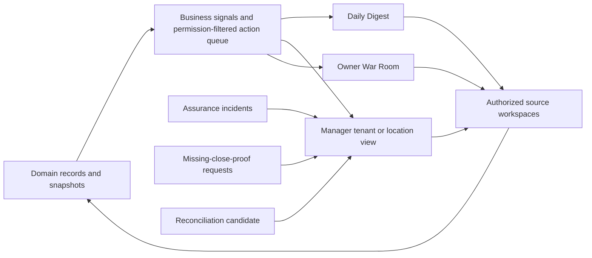

# Command Center action/source map

Status: source-inspected baseline and target integration design, 24 October 2026. No new source adapters, persistence, or commands implemented.

## Current data flow

The diagram describes existing read/handoff relationships, not a common persisted queue. Manager adds origins that are not automatically present in Digest/Owner. A shared layer must explicitly map them; identical counts across the three pages are not a current invariant.

## Signal family catalog

Defaults below come from [signal rules](../../../services/signals/business-signal-rules.service.ts) and [contracts](../../../services/signals/business-signal-contracts.ts). Actual facts can override destinations and add permissions. A declared signal type is not proof that a current snapshot emits it or that a live tenant has examples.

| Signal type | Default role / read requirement | Default source destination | Completion authority |
|---|---|---|---|
| cash_drawer_variance | manager / pos.cash.drawer.open | `/dashboard/finance/cash-drawer` | Drawer review and variance evidence; retain additional permission checks added by rule construction |
| open_payment_suspense | finance / payments.reconciliation.read | `/dashboard/finance/reconciliation` | Current suspense/reconciliation records |
| duplicate_provider_reference | finance / payments.reconciliation.read | `/dashboard/finance/reconciliation` | Provider-reference investigation and matching controls |
| refund_void_spike | manager / pos.transactions.read | `/dashboard/analytics` | Source POS/refund/void evidence; an analytic observation is not itself a resolved transaction |
| stockout_risk | stockkeeper / inventory.items.read | `/dashboard/inventory/items` | Authorized stock/replenishment/transfer workflows and current source evidence |
| dead_stock_cash_exposure | stockkeeper / inventory.items.read | `/dashboard/inventory/items` | Source inventory action and validated exposure update |
| inventory_loss_review | manager / inventory.levels.read | `/dashboard/inventory/loss-control` | Adjustment evidence, valuation and source approval attribution |
| purchase_order_receiving_delay | purchasing / purchases.orders.read | `/dashboard/purchase-orders` | PO/receiving evidence |
| payroll_exposure | payroll / payroll.command.read | `/dashboard/payroll` | Payroll aggregate forecast/payment/posting source; preserve additional permission checks and employee privacy |
| close_blocker | accountant / accounting.close.read | `/dashboard/accounting/close` | Findings, accepted evidence and current close proof |

The inspected snapshot builder emits suspense, stockout, inventory-loss, close, purchase-receiving and payroll families from relevant snapshots. Cash variance, duplicate references, refund/void and dead-stock defaults require producer tracing before claiming integrated live coverage.

## Origins and persistence decisions

| Origin / consumers | Current identity and evidence | Current lifecycle / time meaning | Access and target integration |
|---|---|---|---|
| SIGNAL / Digest, Manager, Owner | `sig_` and `act_` hashes of org/type/module/subject/dedupeScope; source hash/proof link where available | Queue reconstructed from signals; dueAt = min(signal expiry, now + 72h). Pure assign/resolve/dismiss helpers return objects/events, not DB writes | Source permission(s), tenant and module/source restrictions. Build persistent coordination only for gaps after occurrence identity review; never persist labels as keys |
| LOCATION SIGNAL / Manager location variant | Branch snapshot bundle keyed by authorized location; some subject IDs include location | Same signal queue machinery per branch; generic ActionItem itself has no dedicated locationId field | Query validates managed locations against resolved scope, based on Location.managerId. Preserve location identity explicitly in any future coordination adapter |
| ASSURANCE / Manager tenant | `assurance-${incident.id}`; source incident route and source hash | Existing WorkflowAssuranceIncident/Event persistence; assigned/resolved/reopened lifecycle. dueAt falls back to lastDetectedAt when no deadline | Protected source actions: assignment requires controls.manage; resolution uses currentSourceHash and fresh auth. Reuse source mutation; do not create a competing assignment |
| ACCOUNTANT_REQUEST / Manager tenant | `accountant-missing-proof:${requestId}`; request/finding/close run and response identity | Existing AccountantComment/CloseAssuranceFinding-backed requests and responses. Requested dueAt; submittedAt used by waiting-for-review adapter | accounting.close.read plus source recipient/actor rules and metadata redaction. Source response submission is not accepted proof or completed close |
| ACCOUNTANT_REQUEST failure / Manager tenant | Request-bound blocker ID or org-scoped source-unavailable ID | Generated time used for urgency; no true business deadline. Queue has maxItems 100 | Show source failure/coverage. No assignment to a fabricated missing record and no inference that a failed source has zero work |
| SOURCE_COMMAND reconciliation / Manager tenant | candidate.commandId, ReconciliationRun id/status/updatedAt/versionHash; provider currency and period | Source ready-for-sign-off projection; dueAt is periodEnd. Current UI opens Finance with reviewRun, rather than signing inline | payments.reconciliation.read/sign, module entitlement, independent actors, fresh auth and source revalidation. Preserve destination-owned signing |
| BRANCH DAILY CLOSE / contextual Manager journey | Existing location/business-date run, review and sign-off records | BranchDailyCloseRun/SignOff persistence; source revision and completion controls | Existing review/sign-off actions remain authoritative. Follow-up cannot turn branch sign-off into accounting-period close |
| OWNER BRIEF REVIEW / Owner | Current id includes organization; review fields null, client acknowledgment state | Acknowledgment lasts for current component visit, not a durable receipt | Future read receipt must bind org/actor/scope/period/evidence revision and remain separate from approval |
| AGENT BRIEF/PROPOSAL / optional Digest panel | Existing rollout/release-gated agent feature | Generating briefs or proposals may persist separate records; not generic follow-up completion | Reuse existing rollout and proposal controls. Do not enable AI to fulfill this integration or describe all Digest interactions as non-mutating |

## Source references and ownership

- Signals: [queue helper](../../../services/signals/action-queue.service.ts), [rules](../../../services/signals/business-signal-rules.service.ts), [snapshot scope](../../../services/snapshots/snapshot-utils.ts).
- Projections: [Digest service](../../../services/daily-habit/daily-habit-digest.service.ts), [Manager service](../../../services/manager-action-center/manager-action-center.service.ts), [location service](../../../services/manager-action-center/manager-location-action-center.service.ts), [Owner service](../../../services/owner-war-room/owner-war-room.service.ts).
- Assurance: [service](../../../services/assurance/assurance-incident.service.ts), [protected actions](../../../actions/assurance/workflow-assurance-incident.actions.ts).
- Missing proof: [queue service](../../../services/accounting/missing-close-evidence-request-queue.service.ts), [contract including maxItems](../../../services/accounting/missing-close-evidence-request-queue-contracts.ts).
- Reconciliation: [candidate contract](../../../services/reconciliation/payment-reconciliation-sign-off-command-state-contracts.ts), [candidate query](../../../services/reconciliation/payment-reconciliation-sign-off-command-state.service.ts), [current UI handoff](../../../components/manager-action-center/PaymentReconciliationSignOffCommand.tsx).
- Branch close: [sign-off service](../../../services/end-of-day-close/branch-daily-close-sign-off.service.ts), [completion service](../../../services/end-of-day-close/branch-daily-close-completion.service.ts).
- Notifications: [signal preference helper](../../../services/signals/signal-notification.service.ts). Delivery persistence/retry integration remains to be traced before Phase 6.
- Storage baseline: [schema](../../../prisma/schema.prisma). No generic BusinessSignal/ActionItem/ActionItemEvent model declaration found by the scoped name search; this is not proof that no alternative storage exists elsewhere.

## Planned shared Work & Follow-up contract (Phases 5–6)

Conceptual fields, not a chosen database schema: trusted organization/location scope; origin and source reference; occurrence identity; source revision; permitted destination; responsible role and authorized assignee; coordination state; deadline/follow-up meaning; source outcome/evidence; actor-attributed history; current access/coverage status.

1. Resolve source authority and permissions on the server for each read and mutation. Candidate validation must not depend on optional client-provided data.
2. Reuse source-owned assignment and transitions for assurance, close requests and guarded commands. Add only missing coordination storage for projected signals or brief receipts.
3. Keep three dimensions distinct: coordination (assigned/waiting), evidence availability (fresh/stale/unavailable), business outcome (source-confirmed). These are conceptual dimensions, not proposed replacements for domain enums.
4. Establish occurrence/recurrence semantics before persistence: same source detection must not duplicate work; a new business occurrence must not inherit a previous resolution.
5. Do not infer completion from disappearance, module denial, expired evidence, dismissed notification, reviewed brief, or source fetch failure.
6. Reauthorize and revalidate source revision before acting; handle concurrent updates, retries and partial failure through existing domain patterns.
7. Role-specific projections may differ. Personal Digest, team Manager and executive Owner summaries must expose only allowed data and explain scope/coverage differences.
8. Refresh source-confirmed outcomes after navigation/return. Stored coordination metadata never overwrites business records or bypasses approval.

## Time and comparison decision

Current snapshot normalization uses UTC day boundaries; Manager due-today grouping also uses UTC. Digest displays source periods as UTC and generated time with organization timezone. Preserve query semantics in Release A and label them explicitly. Any later organization-business-day change requires a domain decision and boundary tests, not a formatting-only change.

No timestamp from signal expiry, last detection, response submission, generation, or reconciliation period end may be relabeled as a contractual deadline. Historical comparisons require matching source, scope, currency/unit, definition and comparable periods. Otherwise show an observation or unavailable comparison.

## Phase 3 projection update — 24 October 2026

The inventory above records the Phase 0 baseline. Current Command Center adapters label SIGNAL time as source evidence expiry; if the source signal is missing, the expiry is unavailable. ASSURANCE without a deadline uses detection time; submitted ACCOUNTANT_REQUEST responses use submission time; source failure/invalid-evidence rows use generation time; reconciliation candidates use period end. None of these non-deadline dates now creates overdue/due-today work. Source-owned assurance/request deadlines remain intact. Generic ActionQueue helpers and all completion authorities are unchanged. See the [Phase 3 report](../phase-3-2026-10-24/README.md).

## Phase 4 coverage clarification — 24 October 2026

Manager's existing assurance source requests at most 25 rows before permission filtering. The adapter now reports available loaded count, that source limit and possible truncation when visible plus permission-filtered rows reach the cap. Read failure reports unavailable; it does not establish zero work. Missing coverage metadata remains unconfirmed. No query, permission predicate, incident identity, assignment/resolution authority or database changed.

Owner Command now renders every supplied authorized queue item; its former seven-item display cap is removed. Brief remains a preview. These disclosures describe loaded source coverage, not a guarantee that every organizational work item has been loaded. See the [Phase 4 report](../phase-4-2026-10-24/README.md).

## Phase 5 reuse decision — 24 October 2026

[Per-origin decisions](../phase-5-2026-10-24/SOURCE_REUSE_DECISIONS.md) retain each financial source's authority. Existing assurance assignment is hardened in place with current session and tenant/source-permission validation, expected revision, exact request replay, history and recoverable UI errors. Manager continues its source handoff; this does not create a fourth center or a generic completion path. Full location/module eligibility and real persistence verification remain open. Signal coordination and Owner durable receipts await their occurrence/storage contracts; no schema or database changes were executed.

## Phase 5 follow-through — 24 October 2026

Assurance assignment now reuses `evaluateModuleAccessInTx` in enforce/write mode for the definition module and narrower catalog destination module, with current grant dependencies and current actor/session checks on replay. Unknown/inconsistent module identity fails closed; only the existing `business-events` to `dashboard` alias is supported. No role wildcard bypasses entitlement.

[Occurrence/storage decisions](../phase-5-follow-through-2026-10-24/OCCURRENCE_AND_STORAGE_CONTRACT.md) keep source key, occurrence, evidence revision and command ID distinct. Assurance `occurrenceCount` is a detection counter, not a generic episode ID. [Location and notification handoff](../phase-5-follow-through-2026-10-24/LOCATION_AND_NOTIFICATION_HANDOFF.md) records remaining source-specific scope and transport gates. No schema, database or delivery worker was changed/executed by this continuation.

## Phase 5 location and database update — 24 October 2026

[Current disposable verification](../phase-5-database-2026-10-24/README.md) adds `assurance-assignment-scope.ts` to the source-owned assignment transaction. Registered POS cash-shortage incidents bind to the real same-tenant session, terminal and active/undeleted location; current location responsibility or existing tenant-wide authority is required independently for actor and assignee. The terminal's current-session pointer is not used for a historical closed shift. Explicit known registry aggregates require tenant-wide authority for both parties. Unknown/employee-bound sources are denied pending dedicated adapters. Client metadata never supplies authority.

The existing incident event receives scope kind/fingerprint. Source/terminal/location locks and all previous session, permission, module, revision and replay controls remain in the same transaction. No source business command or producer activation changed. Real PostgreSQL verifies assignment persistence/races/rollback and existing case/alert-row deduplication; this is not generic episode storage, a three-page integration test or notification transport certification. The user-authorized cluster used synthetic data and was stopped. The repository schema and existing application database were unchanged by this work.

## Phase 6 implemented coordination map — 24 October 2026

The [new source/scope map](../phase-6-integration-2026-10-24/SOURCE_AND_SCOPE_DECISIONS.md) defines seven adapters in `services/command-center/sources.ts`. Their parameterized coordination store and protected actions are shared by all three centers, including currently authorized locations. Existing source-owned assignment/approval/completion commands remain unchanged. Follow-up storage is additive, default-off and applied only to a fresh disposable database in this work.

Current-state families: suspense, stockout, overdue receiving, employee balance, all-retained-period close obligations and rolling 30-day UTC payroll proof. Inventory loss retains the normalized UTC report interval. Forecast reads actual payment proof and retains declaration-only bindings; loss binds exact completed-loss records as well as aggregate metrics. Missing records/permission/read failures never imply completion. See the linked map for permissions, source destinations, evidence caps and notification transport decisions.

Shared receipts cover the follow-up projection, not the Owner financial brief. Recipient notices use existing signal/quiet-hour decisions and are delivered in-app on a permitted visit. No financial source, global notification worker or external message transport was changed.
