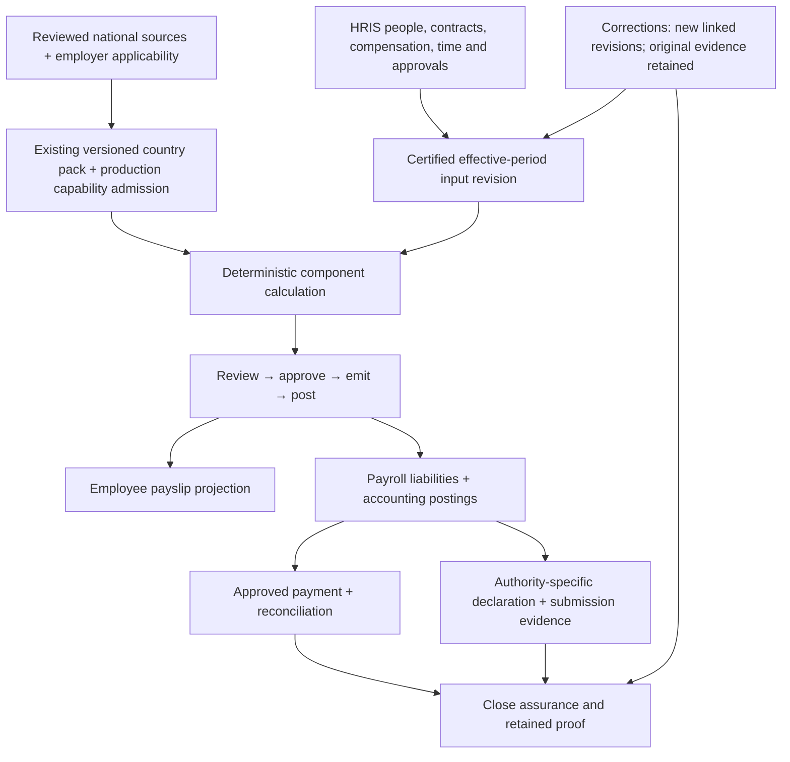

# Stoquify: Cameroon HRIS/payroll audit and product decisions

Date: 7 October 2026. Scope confirmed by the user: **private-sector SMEs with 10–250 employees**, Cameroon first. Monthly payroll is a provisional operating assumption, not a confirmed restriction. Research and planning only; no application, schema, plugin, production-data or deployment changes were made.

## Executive assessment

**Extend the existing HRIS and financial controls; complete statutory calculation and everyday operating journeys before regional rollout.** Stoquify already has employee/contract data, effective organization structures, time/leave models, payroll review/approval/emission/posting transitions, payment reconciliation, immutable evidence and country-pack provenance. A new HRIS, generic rule engine or suite of additional plugins would duplicate much of that investment.

Current source does not substantiate a fully operational Cameroon payroll release. The default country pack labels CNPS as draft and IRPP as requiring expert review. CNPS provenance prevents default calculation from being treated as approved. Important formula and input-path discrepancies remain behind that boundary. Other issues affect ordinary SMEs immediately: incomplete employee discovery above 50 records, capped manager-scope lookups, time corrections not consumed by certification, future lifecycle events changing current status, and incomplete document and operator journeys.

These are source-based findings and engineering recommendations. They are not claims that current deployed customers have suffered incorrect pay, a data breach or a legal violation. No production tenant or deployed database was inspected.

### Five highest-value changes

| Rank | Change | Why it comes first | Measurable acceptance |
|---|---|---|---|
| 1 | Make Cameroon production admission depend on complete, reviewed, applicable capabilities | A published pack header and a successful partial calculation must never imply authoritative payroll. Preserve existing blockers and close partial-promotion paths before enabling more rules | A CNPS-only promotion with unresolved applicable tax cannot emit, post or release live payroll; denial has a clear reason and no financial side effect |
| 2 | Correct the contribution/tax calculation contract and use identical code in fixtures and actual runs | Different bases, disconnected YTD inputs and shared rounding assumptions create financial risk that UI improvements cannot solve | Independently reviewed golden cases execute through both the calculator and full run, including above-ceiling, multi-run, same-day and correction cases |
| 3 | Make HR input truth effective-dated and transactionally reliable | Approved attendance corrections, leave balances and future employee transitions must produce the correct certified period inputs | Correction changes the intended next snapshot, future termination leaves today intact, simultaneous leave debits cannot overspend, and frozen evidence stays immutable |
| 4 | Complete the 10–250-person People and manager journeys | The directory currently reads 50 people and then searches locally; a manager target may be rejected after scope truncation | Employee 250 is searchable and reachable; authorized totals are correct; own/team/HR access remains distinct |
| 5 | Finish the statutory-output, payment and accounting evidence chain | Internal declaration drafts are not CNPS/DGI filings; a payment acknowledgement is not settlement | Every applicable component reconciles to the right authority, ledger liability, submission version and retained settlement/receipt proof |

Ranking considers financial/compliance exposure, prerequisite order, user friction and reuse. Rank 4 can run alongside statutory work because it has independent files. Production admission still precedes activation. Complete supported HR workflows and rendered validation are launch requirements. For original HR records, the pilot must explicitly choose integrated secure delivery or an approved external archive with controlled retrieval/retention; metadata alone is not document custody. Statutory payslip provision still needs an accepted delivery process.

## Evidence baseline and authority

- Inspected HEAD: `6f7f6741cabfdeff61989a40455d6f3ea37b33c9` plus the working tree. A scoped status check counted 337 modified tracked files; numerous untracked inherited files also exist. Do not treat this as a clean commit or stage the whole checkout.
- Current installed manifests: Next 15.5.18, React 19.2.6, TypeScript 5.8.3, Prisma 6.19.3, Better Auth 1.6.14, Tailwind 3.4.19. npm is the existing CI path; alternate lockfile parity remains unverified.
- [Selected source manifest](cameroon-audit-source-manifest-2026-10-07.json) records exact-byte SHA-256 hashes of 24 inspected source/config files for later comparison; it is not a whole-repository or deployed-artifact attestation.
- Local git and `origin/main` exist; `gh auth status` reports no authenticated GitHub host. This audit uses local artifacts; no branch, PR or remote required-check change was made.
- Entry rules: [WORKFLOW](WORKFLOW.md), [skill routing](skill-routing.md), [test lanes](test-lanes.md), [configuration implementation status](implementation-status-2026-10-07.md), [tooling baseline](tooling-baseline.json), [design master](../../design-system/stoquify/MASTER.md).
- Graphs were read before architecture conclusions: payroll action community 5; reconciliation community 73; HRIS approvals 41/55; self-service 80/114; People route 134. Current source, not graph age or counts, governs conclusions.

### Preserve existing programs

| Existing authority | Current interpretation | Action |
|---|---|---|
| [July HRIS realization roadmap](../HRIS-Payroll/STOQUIFY_HRIS_PAYROLL_REALIZATION_ROADMAP_2026-07-19.md) | Defines HRIS ownership and certified-input direction, but pending-model descriptions are older than current org/time schema | Reconcile statuses by current source; do not recreate existing models |
| [Trust Spine register](../HRIS-Payroll/payroll-trust-spine-execution/EXECUTION_REGISTER.md) | WP0–8 marked complete for internal engineering, with historical DB evidence | Retain lifecycle and controls; replay affected proof for the current change instead of claiming national statutory approval |
| [September payroll review](../plan-of-action/payroll-review-and-action-plan-2026-09-08.md), [HRIS review](../plan-of-action/hris-presence-review-and-action-plan-2026-09-08.md), [compliance review](../plan-of-action/compliance-country-packs-review-and-action-plan-2026-09-08.md) | Source reviews and scoped verification, not a full live release | This audit adds current, bounded findings and maps them back to the same programs |
| [Executable blueprint](../../plans/stoquify-cameroon-hris-payroll-blueprint-2026-10-07.md) | Implementation queue for this audit | One queue with dependencies and acceptance; not a replacement domain architecture |

Detailed supporting evidence: [payroll/code](cameroon-payroll-code-evidence-2026-10-07.md), [HRIS/UX](cameroon-hris-ux-evidence-2026-10-07.md), [security/verification](cameroon-security-verification-evidence-2026-10-07.md), [official legal sources](cameroon-legal-source-register-2026-10-07.md). File/line references in those notes refer to the inspected working tree.

## Gap register

P0 means block affected production rollout, not demonstrated exploitation. P1 means required for the supported pilot journey. P2 means subsequent consolidation/expansion. Confidence distinguishes source-confirmed behavior from runtime risk or missing acceptance.

| ID | Evidence and consequence | Disposition / priority | Dependency and uncertainty |
|---|---|---|---|
| G01 | `services/regulatory/country-packs/cameroon.ts:44–54`; `payroll-control.service.ts:878,3061,4006,7568`. Published header, draft CNPS, review-required IRPP; default provenance blocks, but partial promotion can retain blocked/zero tax evidence | Retain controls; complete explicit production admission / P0 | Approved applicability and live-vs-review mode; no deployed underwithholding asserted |
| G02 | `payroll-control.service.ts:5825–5842` caps all CNPS components; fixture runner `:748–778` uses supplied bases. Occupational-risk branch conflicts with the distinct base in official decree | Correct/shared component calculation / P0 before activation | S03/S01 and qualified compensation-base review; above-ceiling full-run regression needed |
| G03 | `payroll-control.service.ts:5843` omits supported evaluator YTD/adjustments; prior run query `:5702` excludes equal pay dates | Complete explicit tax context / P0 | Reviewer-approved annual/period policy; same-day order and corrections |
| G04 | `payroll-control.service.ts:1968,2029` binds rounding/year policy to accounting configuration | Separate statutory, ledger and payment policy / P0 | Approved rounding stages and tax-year definition; no global precision rewrite |
| G05 | `payroll-control.service.ts:5611–5632` selects ACTIVE employees and one latest ACTIVE overlapping contract | Complete period-eligible employment segments / P0 for leavers/retro | Existing readiness may reject cases; not proof every unsupported case silently calculates |
| G06 | `payroll-control.service.ts:9418,9453,9482` has internal declaration fallback and reuses aggregate amount per future authority config | Complete per-authority component/output mapping / P0 before filing | Official templates, dates and review; adding a config key alone is insufficient |
| G07 | `app/[locale]/(dashboard)/dashboard/people/page.tsx:37`, `services/payroll/employee.service.ts:512,578`; local table controls see only first50 | Fix authorized server pagination/search/counts / P0 for stated250 scope | Positive51/100/250 and tenant/location filters; current service cap100 also needs contract review |
| G08 | `services/hris/org.service.ts:18,216,239,253,262` truncates relationship scope before target lookup; profile caller `employee.service.ts:136–142` passes limit1. Directory facade `:113–121` omits asOf from authorization but retains it for data projection | Fix target lookup and consistent temporal authorization / P1 security-sensitive | A second valid report may be denied; historical authority mismatch needs negative tests. No live disclosure claimed |
| G09 | `services/hris/operational-time.service.ts:517,537,931–1001` stores correction values but certification consumes original rows | Complete approved correction → new input revision / P0 | Validate overtime and cross-period leave allocation too; source-traced, not live replay |
| G10 | `services/hris/leave-balance.service.ts:97,112,127` balance read, entry and audit lack a wrapping transaction on inspected action path | Add atomicity and concurrent-debit policy / P0 | Real PostgreSQL competing writes/audit-failure proof required |
| G11 | `services/hris/lifecycle.service.ts:705,731` applies target status without waiting for future effective date | Fix scheduled/as-of state contract / P0 | Assignment, auth and contract propagation; no observed access exploit |
| G12 | `services/hris/document-evidence.service.ts:397` deliberately refuses original downloads; self-service correction not configured | Complete secure original delivery/correction request / P1 | Storage, privacy/retention, scanner proof and server delivery; preserve fail-closed state |
| G13 | Targeted caller search found profile/lifecycle/time setup/import actions without corresponding operating callers; manager screen says authority not modeled despite resolver | Connect existing controls and derive truthful capability / P1 | Inventory alternative writers; narrow manager permission, not broad HR admin |
| G14 | No separate legal-employer dimension found in inspected payroll schema; some child relations are ID-only rather than composite tenant relations | Explicit one legal employer/tenant for first release; audit FK constraints / P0 admission, P1 hardening | Proposed scope choice requires product confirmation; test DB boundaries before migrations |
| G15 | Mandatory independent actors exist; neither commercial People packaging nor small-employer role onboarding is fully resolved | Complete role onboarding/entitlement policy / P1 | External checker acceptable with scoped membership; no shared login or silent SoD bypass |
| G16 | `metadata.hrisLifecycle`, compatibility payroll storage and 11k-line control service coexist with newer relational models | Selective migration/decomposition / P2 | Characterization tests and demonstrated writer conflict first; no big-bang rewrite |
| G17 | HRIS evidence HR-08: accrual/carry-over settings are stored, but targeted service search found no executing evaluator | Complete reviewed entitlement process / P1 | Tranche05b: approved manual postings with reconciliation or tested automatic accrual; configured JSON is not earned entitlement |

### Additional lifecycle coverage and pilot boundaries

| Area | Inspected evidence / remaining uncertainty | Disposition, pilot boundary and owned work |
|---|---|---|
| Cost centres | `prisma/schema.prisma:2754`, employee/lifecycle projections and `payroll-register.service.ts:1932` contain employee costCenter. `createPayrollLedgerPosting` constructs aggregate rule-based lines; no cost-centre dimension found in that inspected function | Retain employee label. Tranche09c freezes historical allocation in certified inputs and implements a reviewed accounting/report allocation if required. Until tested, pilot supports one recorded employee cost centre and aggregate ledger posting; do not market split analytical accounting |
| Allowances and benefits | `prisma/schema.prisma:3041,3085` provides earning/deduction/employer-charge definitions and approved effective-dated assignments; `payroll-control.service.ts:5641` consumes active overlapping assignments | Retain approved components. Tranche09a owns source-classified compensation and full-run fixtures. Existing component support does not prove every statutory benefit valuation |
| Recurring deductions, advances and loans | Bounded schema/service/action search found no distinct principal/disbursement/installment lifecycle. The LOAN test is a fixed deduction; `payroll-employee-balance.service.ts:1444` only admits posted correction cases. One-off consumption across ordinary/off-cycle runs remains unproven | Tranche09d requires an explicit supported-case contract. A generic deduction line must not be advertised as a loan ledger. Unsupported loan/advance cases require a reviewed external process or remain outside pilot acceptance |
| Notifications and operations | `payroll-control.service.ts:6889,7048,7307` emits outbox messages; `services/events/business-event-outbox.service.ts` retains attempts/locks; `services/assurance/assurance-alert-delivery.service.ts:18` checks transport readiness. Payroll-specific delivered reminders/escalations were not traced end to end | Retain outbox/alert infrastructure. Tranche14a owns payroll event-to-recipient mapping, privacy-safe content, retry/dead-letter recovery, missing-source/stale-rule/payment/filing alerts, on-call owner and manual fallback. No current delivery SLA claimed |
| Employee import | Existing HRIS migration pilot exposes dry-run readiness; operational-time import is separate | Tranche13c explicitly separates employee import preview/commit/replay/reconciliation from time import screens. No inferred production backfill or merge of conflicting employee identities |
| Statutory payslip delivery | `payslip-self-service.service.ts:36,900,947` is JSON-only and explicitly reports no approved PDF renderer. No separate production payslip renderer was found in the bounded payroll source search | Tranche11b owns template/order review, rendering and delivery/access evidence. Preserve archive features without calling them statutory delivery |

These are bounded source findings and explicit coverage limitations; every applicable missing behavior must be closed or excluded by an accepted pilot operating model before release.

For G02, a synthetic contributable amount of 1,000,000 and group-A rate in the inspected pack gives 13,125 on the capped branch versus 17,500 using the uncapped base. This isolates a code discrepancy; remuneration eligibility and the complete real-employer calculation still require review. Official support is Decree 2016/072 arts. 4 and 8 in the [DGI compilation](https://www.impots.cm/sites/default/files/publications/CODE%20GENERAL%20DES%20IMPOTS%202026%20%20VERSION%20FRANCAISE.pdf), PDF pp. 611–612. Default provenance blockers must remain while this is corrected.

## Requirements-to-evidence matrix

The [source register](cameroon-legal-source-register-2026-10-07.md) provides publication/effective-date evidence and retrieval limitations. The following are software acceptance requirements, not a substitute statutory schedule. Applicable national employment/tax/social rules, OHADA accounting, regional payment requirements and employer policy are separate layers.

| Requirement / source | Data and workflow contract | Test/evidence needed | Acceptance owner |
|---|---|---|---|
| R01 employer applicability / S01,S03,S05,S06 | Verified employer registration/classification, one legal employer, establishments, sector/agreement and pay calendar; supported/unsupported profile | Missing/contradictory profile blocks authoritative payroll; same tenant cannot silently aggregate different legal employers | Product + local payroll reviewer |
| R02 national deductions and charges / S01,S03 | Reviewed component catalogue, independent base/eligibility/cap/recipient policy, employee-versus-employer split | Golden boundary/negative cases through actual run; explicit not-applicable reasons, never missing-as-zero | Tax/payroll reviewer + engineer |
| R03 employment and benefits / S05,S06 | Effective contract, amendments, salary categories, termination/leave/absence inputs; sector rules have provenance | Joiner/leaver/mid-period/retro/off-cycle cases with approved expected results; unreviewed categories blocked | HR/labour reviewer |
| R04 withholding/year/rounding / S01 | Pinned tax calendar, compensation treatment, ordered prior runs, calculation and settlement units | Boundary amounts, same-day runs, year crossing, amendment correction and reproducible original history | Payroll reviewer |
| R05 time and leave / S05 | Schedule/policy assignment, approved correction deltas, dated accrual/debit ledger and certified revision | Concurrent leave debit, cross-period allocation, correction certification, duplicate import/replay | HR + DB QA |
| R06 payslip/payment evidence / S05 | Reviewed bilingual template, emitted version, own-employee access and retained delivery/payment proof | Field review against applicable order; unauthorized exports denied; disputed/failed delivery recoverable | Labour/payroll reviewer + UX |
| R07 declaration and settlement / S01,S04,S09 | Separate authority/version/period totals; due-date source; manual or verified connector submission; acknowledgement and payment evidence | Per-authority tie-out, amended submission, pending/rejected/accepted states, partial payment/reversal | Accountant + authority-process reviewer |
| R08 accounting and close / S07 | Component posting map, liability accounts, immutable payroll reference, close invalidation and retained evidence | Balanced postings and reconciliation; stale/revoked proof blocks close; correction does not overwrite original | Qualified accountant |
| R09 employee privacy / S08 | Record-class inventory, least privilege, processor/storage decisions, retention/hold/purge and rights workflow | Raw content delivery authorization, revocation, redaction, legal hold and deletion evidence | Privacy/legal owner + security |
| R10 payment integration / S10 | Regulated provider adapter, destination review, replay/authenticated callbacks, reconciliation | Sandbox or inspected fixtures distinguish acknowledgement from settlement; no fabricated live-provider proof | Payments/security owner |

Unresolved legal inputs include current payslip-format order, relevant collective agreements, overtime and termination rules, deduction limits, privacy commencement/implementation details, the pilot's exemptions/classification and current authority output specifications. They block the affected release claim, not unrelated research or reversible engineering preparation.

## Target architecture

Retain `services/regulatory/country-packs/` schemas, resolution, hashing, fixtures and review intake. Keep HRIS the logical people owner even while compatibility tables retain Payroll names. Retain the independent lifecycle and accounting posting kernel. Use narrowly extracted pure component functions only where necessary to eliminate fixture/run divergence; defer general control-service decomposition.

A country calculation contract should carry country/rule version, applicable employer profile, tax year and payroll period, input revision, compensation classifications, eligible prior runs, correction relationship, precision/rounding policy and provenance. It returns named components with base, rate/formula, employee/employer treatment, destination liability, explanation, rule reference and supported/not-applicable/blocked status. A blocked applicable component cannot become zero payable tax or an authoritative payslip.

Employer policies may select supported benefits/schedules and more favourable terms where reviewed; they cannot override statutory floors, disable mandatory charges or rewrite certified inputs. Employee facts select rules, not create ad hoc statutory exemptions. Calculation date, earned period, pay date and correction date need explicit semantics rather than one assumed date for all rules.

For the first release, recommend one legal employer per tenant, with multiple establishments if the current authority and filing model supports them. Multi-employer consolidated payroll inside a tenant is deferred until an explicit employer key and its authorization/reporting implications are designed. This is a product scope decision, not an assertion that tenant isolation alone proves legal-employer correctness.

### CEMAC readiness without premature rollout

The inspected registry contains Cameroon. Reuse workflow, actor controls, calculation interface, evidence envelope, UI patterns and provider abstractions. Independently research and review every national pack. An absent pack must produce an unsupported-country result, never fall back to Cameroon.

After Cameroon pilot acceptance, shortlist Gabon and Republic of the Congo for discovery if customer demand and qualified partners support them; this is a provisional product sequence, not researched market superiority. Keep Chad and Central African Republic in the same demand/readiness evaluation. Equatorial Guinea additionally requires explicit language and statutory-output localization discovery. No country has been nationally certified by this audit.

Choose the next country using signed pilot demand, available official texts, qualified reviewer, local employer/process knowledge, language/output readiness, provider access and test-environment availability. Weight these criteria with product leadership; do not invent country scores. Build one second-country adapter behind a disabled activation gate to prove separation before repeating it elsewhere.

## Operating journeys and modern UX

Keep the existing semantic tokens, brand, dashboard primitives and permission-driven actions. The goal is reliable task completion, with visual modernization serving that goal. Proposed persistent contracts: `design-system/stoquify/pages/hris-people.md`, `hris-time.md`, `payroll-run.md`, `payroll-declarations.md`, `employee-self-service.md`. These are future implementation artifacts, not new authorities already activated by this audit.

| Role / job | Proposed journey using current controls | Required truth, states and privacy |
|---|---|---|
| HR administrator | Employer setup → complete People directory → profile/contract/lifecycle request → independent approval → dated application | Show pending/future/current separately; profile completeness explains missing inputs; secure original documents only when delivery is implemented |
| Manager | Effective team → attendance/leave exceptions → scoped decision → confirmation | No broad HR permission to unblock a button; no salary/bank fields; explain expired delegation and out-of-scope records |
| Payroll preparer | Period readiness → fix sources → calculate review-only/authoritative preview → reconcile variances → submit | Show rule and input revision; distinguish unknown, zero, blocked and not applicable; stable employee totals across pages |
| Approver | Review change summary, exceptions, component totals and sources → step-up → approve current version | Material changes invalidate review; own preparation and stale version denied; no fabricated completion badge |
| Accountant/releaser | Post → reviewed payment destination → release → reconcile → authority declaration → close proof | Partial/uncertain payment, rejected filing and stale close proof have clear recovery; exported file does not imply accepted submission |
| Employee | Secure own profile/payslip → request correction → status/history | No direct edits to approved payroll truth; bilingual readable documents; denied/unlinked/archived states; shared-device download guidance |

French and English labels, errors and exports must be meaningfully reviewed, not merely present as translation keys. Use locale-aware navigation, tabular monetary alignment and explicit period/currency. Keep error summaries focusable, associate field errors, return focus after dialogs, and announce asynchronous results without exposing salary in global notifications. Verify keyboard, touch, zoom and small-screen task completion with rendered evidence.

Connectivity: allow recoverable non-sensitive drafts and idempotent import staging where appropriate. Avoid caching payslips, bank details or national identifiers in a generic offline store. Approval, payroll posting and payment release require fresh server state. When a response is lost, look up the retained command result before retrying; never invite a second disbursement.

Operational discovery must confirm employee device access, literacy/language, bank/mobile-money/cash use, staffing for independent checks, imported data quality and establishment geography. Existing go-to-market prospects are hypotheses, not confirmed customer conditions. Do not introduce facial recognition, biometric attendance, broad surveillance or an AI payroll decision-maker as a prerequisite.

## Durable ECC and UI/UX Pro Max operating plan

| Observed problem | Capability and persistent project adjustment | Owner / maintenance | Measure of benefit |
|---|---|---|---|
| Old plans describe models now implemented | ECC search-first + blueprint; reconcile existing status register with code/test/source references | Engineering lead per tranche | Fewer duplicated changes; every planned gap has a current source anchor |
| Fixture and run calculations diverge | ECC testing/verification guidance; shared calculator fixtures and requirement-to-test map | Payroll engineer + independent reviewer on each rule change | Reviewed golden cases agree in both paths; no missing applicable component |
| Authorization and lifecycle changes are high-risk | ECC security review with scoped denial matrix and transaction proof | Security/domain reviewer per affected PR | Cross-tenant/SoD/revocation cases passed by class; stale evidence clearly flagged |
| Generic commands can mutate databases | Existing command registry/test lanes; add inspected HRIS/payroll lane only after review | QA/platform per runner/config change | No inferred production target; skipped DB suites never counted as passes |
| Page contracts cover other modules, not these jobs | UIUX focused research plus HRIS/payroll page contracts and existing primitives | Design owner per workflow change | Task success, keyboard completion, error recovery and EN/FR parity |
| Statutory evidence can become stale | Source/version/effective-date ledger linked to fixtures and review intake | Qualified jurisdiction owner when law changes and before release | Every active rule has reproducible provenance and current approval |
| Tools can fail independently of the product | Existing maintenance and host recovery procedures; no mandatory new hook | Tooling owner on upgrades | Same task standards remain discoverable without plugin availability |

UIUX queries in this audit returned useful focusable-error-summary advice; other dialog/React-pagination matches were irrelevant or absent and were rejected. No generated palette or framework-upgrade recommendation was adopted. No new dependency/package registry search was needed because this audit recommends extending existing code, not installing a new engine. Public legal web research, local graph/code/skill discovery and local Git were used; authenticated GitHub and live connectors were not established.

For the first three real tasks, record accepted tool-assisted findings, rejected suggestions, rework, time spent and user task failures against a stated baseline. Do not claim a productivity percentage from test counts. Keep advice selective; the tools do not replace qualified statutory review or authority acknowledgement.

## Acceptance and release evidence

| Gate | Required evidence | Current status |
|---|---|---|
| Country applicability and golden calculation | Independent source/formula review, boundary and exemption matrix through actual run | OPEN; source research and discrepancies documented |
| Current unit/action behavior | Inspected bounded tests, named assertions and source identity | PASS for 3 suites / 17 existing mocked tests in this audit only; not the new regression cases |
| HR correctness and concurrency | Approved correction certification, future lifecycle, 250-person scope, concurrent leave, failed-audit rollback | OPEN; source findings need implementation/replay |
| PostgreSQL authority/immutability | Real cross-tenant persistence, competing transitions, replay, audit rollback and correction evidence | NOT RUN; prior engineering proof is historical |
| Payment/declaration/accounting | Component totals → liabilities → settlement → authority receipts → current close proof | NOT RUN end to end; existing modules retained |
| Migration/import/backfill | Explicit disposable target, dry run, mapping/duplicate review, idempotency, reconciliation and restore proof | NOT RUN; dry-run readiness is not import execution |
| Browser/accessibility | FR/EN role journeys, denied/blocked/partial states, 360/768/1280px, keyboard and screen-reader review | NOT RUN; inherited browser connectivity limitation remains |
| Privacy and recovery | Approved retention/hold policy, protected raw delivery, revocation, restore/export and incident runbook | OPEN |
| Operational alerting and support | Authorized recipients, delivered notices, retries/dead-letter recovery, payroll-day owner and manual escalation | NOT VERIFIED end to end; existing outbox and transports are retained; tranche14a owns acceptance |
| Performance | Representative 10/50/250-employee synthetic datasets and agreed concurrency | NOT BENCHMARKED. Proposed pilot targets: directory API p95 <1s; 250-person calculation <60s on specified environment, subject to measurement and product approval |
| Remote delivery | Clean-checkout CI and required checks bound to proposed commit | NOT RUN; gh unauthenticated |
| Local professional and employer acceptance | Qualified Cameroon payroll/accounting/labour review plus employer parallel-run reconciliation | NOT OBTAINED; required before authoritative pilot release |

Exact newly executed command and tests are in the [security note](cameroon-security-verification-evidence-2026-10-07.md). Prior configuration work's 123 pilot tests and 25 Python tests remain historical to that task; they were not silently counted as this audit's payroll certification. Hook trust/execution and remote CI remain distinct from installed/enabled ECC.

Recommend at least two employer-observed monthly cycles plus a correction/off-cycle exercise before widening rollout; this is a proposed quality gate, not a statutory minimum. Capture discrepancy resolution rather than a blanket percentage tolerance on statutory amounts. Any unexplained financial difference blocks expansion.

## Decision log and unresolved questions

| Decision | Status / consequence |
|---|---|
| Cameroon private-sector SMEs10–250 | CONFIRMED by user during audit |
| Monthly payroll first | PROVISIONAL; confirm pay cycles, workforce arrangements and sectors with pilot employer |
| One legal employer per tenant | RECOMMENDED first-release boundary; product confirmation required before implementation admission rules |
| Preserve HRIS logical ownership and financial kernel | RECOMMENDED based on substantial current source; no greenfield replacement |
| Manual validated statutory submission before API integration | RECOMMENDED when current official integration specs are unavailable; preserve receipts and version evidence |
| Full applicable statutory coverage before authoritative outputs | REQUIRED design invariant; define explicitly for emission/post/payment and affected declarations |
| Independent actors | RETAIN current controls; confirm actual staff/external reviewer assignments, no silent small-team exception |
| Privacy and sector agreements | OPEN professional evidence; do not fabricate certainty from source titles |
| Country expansion order | DEFER final choice until demand/partner/source readiness evidence exists |
| Platform-wide compliance claim | NOT SUPPORTED by this audit; use precise employer/period/capability scope |

The [blueprint](../../plans/stoquify-cameroon-hris-payroll-blueprint-2026-10-07.md) contains work-package dependencies, affected files, estimates, acceptance and rollback, and a complete first execution prompt. Implementation should begin with production-scope decisions and the bounded admission contract, while independently scoped directory work can follow without waiting for every legal research item.

## Independent plan review

An independent adversarial reviewer checked the requested deliverables, source qualifications and execution dependencies. Review prompted explicit ownership for leave entitlement execution, statutory payslip provision, cost-centre history, deductions/loans and delivered operational alerts. The revised plan also moves disposable database preparation before transactional acceptance, separates missing backend work from UI estimates, and permits a controlled external HR archive only as an explicit pilot decision. These corrections are incorporated; this is engineering plan review, not Cameroon professional or employer sign-off.

Closure review found no remaining high-priority omission or dependency cycle. Its two final wording corrections—05b as an explicit prerequisite for10, and the external-archive alternative for12a—were applied. Final artifact checks resolved all27 relative links across7 Markdown documents and matched all24 selected source hashes. These checks validate handoff consistency, not application behavior.
