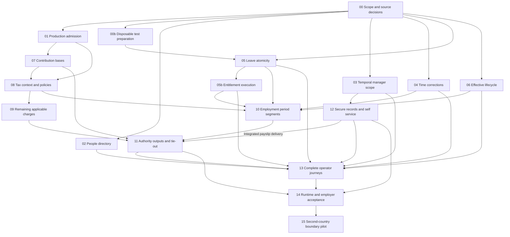

# Cameroon HRIS/payroll completion blueprint

Date: 7 October 2026. Status: execution started; the first bounded 00/01 admission tranche is implemented at engineering level, with release acceptance open. User-confirmed scope: Cameroon private-sector SMEs with 10–250 employees, monthly payroll and one legal employer per tenant. See the [execution register](../docs/ecc/cameroon-blueprint-execution-2026-10-07.md) for actual changes, evidence and remaining work. This blueprint implements findings from the [audit](../docs/ecc/cameroon-hris-payroll-audit-2026-10-07.md) and its code/security/UX/legal evidence notes.

## Authority and cold-start instructions

Read `AGENTS.md`, `docs/ecc/WORKFLOW.md`, `docs/ecc/test-lanes.md`, the audit and the chosen tranche before editing. Re-read its current sources; file line numbers and historical evidence may have moved. Read the existing [HRIS realization roadmap](../docs/HRIS-Payroll/STOQUIFY_HRIS_PAYROLL_REALIZATION_ROADMAP_2026-07-19.md) and [Trust Spine register](../docs/HRIS-Payroll/payroll-trust-spine-execution/EXECUTION_REGISTER.md). Reconcile this queue into those programs; do not reset their completed work or invent a competing architecture.

Known baseline: HEAD `6f7f6741cabfdeff61989a40455d6f3ea37b33c9` plus a large dirty tree, Next15/React19/Prisma6/Better Auth/Tailwind3. Preserve unrelated files. Git and origin/main are available; GitHub authentication is absent. Use explicit owned local diffs until authenticated PR work is possible. If branches are requested, use `codex/` names and explicit-file staging; never stage the entire working tree. No deployment or migration is implied by implementing a code tranche.

Each row below is a proposed review boundary. Where implementation discovery exceeds one coherent PR or five engineer-days, split it with its own entry/exit conditions before coding. The long UI and statutory catalogue tracks explicitly list their smaller PRs. Estimates are engineering effort for a repository-familiar engineer plus reviews; they exclude legal interpretation turnaround, data cleanup, infrastructure wait, provider onboarding and unrelated defects. Do not treat summed effort as a calendar promise.

Strongest available reasoning: statutory/authority/transaction design and independent adversarial review. Default capable model: bounded implementation and documentation after decisions are fixed. Use available Codex APIs and discovered skills, not assumed Claude slash commands.

## Dependency graph



Parallelism is conditional on file ownership. 02 and03 both touch employee/org read boundaries: separate implementation ownership or serialize integration. 04/05 share time/leave logic: separate files and coordinate transaction interfaces. 01/07/08/09/10/11 touch the payroll control service: serialize those edits; official-source preparation, fixtures and UI review may proceed independently. Do not run concurrent fixture resets against one database. Graph nodes09/11/12/13 include their lettered PRs; node completion requires all applicable PRs. The graph conservatively gates final13 completion on11/12;13a–c can begin after their stated local prerequisites. P15 is deferred until Cameroon acceptance.

## 00 — Freeze employer scope and approved-source worklist

**Context/owner/effort:** Product + qualified Cameroon payroll/accounting reviewer; 1–2 engineering days, external review additional. G01/G14/G15. Retain current country envelope and existing role controls. User confirmed10–250 private SMEs, monthly payroll and one legal employer per tenant. Actual pilot sector/agreement and professional approvals remain open.

**Owned deliverable:** Reconcile existing HRIS status register and add a small Cameroon applicability/decision record linked to `docs/ecc/cameroon-legal-source-register-2026-10-07.md`. Do not alter rates. Confirm or explicitly leave blocked one legal employer/tenant, initial sector/agreement, workforce categories, supported payment methods, actual independent actors, reviewer and pilot employer.

**Tasks/exit:** Map every proposed active component and supported scenario to primary source, applicability and missing professional decision. Retain UNKNOWN where unresolved. Record current source hashes only for retained actual files; never invent legal approval. Set a precise supported-case boundary and rejected-case explanation.

**Verify/rollback:** Read-only source/link/manifest checks; independent decision review. No DB command. Rollback: supersede the decision record with reasons, preserving history.

## 00b — Prepare isolated verification before transactional changes

**Context/owner/effort:** QA/platform; 1–2 days after00, before closing05/05b or any required database acceptance. Retained PostgreSQL runners already exist but may reset their target.

**Tasks/exit:** Identify an explicitly disposable local/container/test target and separate fixture namespaces, inspect each preparation/reset command, record source/schema/fixture provenance and restore/cleanup boundaries. Provide a safe bounded command for the chosen tranche. No production/shared target inferred from `.env`. If infrastructure is unavailable, code/unit preparation may continue but database-dependent acceptance stays open;14 replays the integrated system rather than first discovering this prerequisite.

**Verify/rollback:** Connection identity and isolation proof plus a small fixture creation/cleanup rehearsal in the approved test target. Rollback removes only verified task-owned fixtures/environment. No native plugin or production-data operation.

## 01 — Production admission distinct from partial calculation

**Execution update:** The guard and reviewed-release-parameter requirement are implemented; no actual Cameroon release approval exists. Exact successful replays retrieve retained outcomes without new effects; fresh effect-producing attempts recheck admission. See the execution register for mocked verification and remaining database/employer acceptance.

**Context/owner/effort:** Payroll + security/domain reviewer; 2–4 days after00. G01. Default CNPS provenance is blocked; promoting only it must not turn blocked IRPP into authoritative output.

**Files:** `services/regulatory/country-packs/{schemas,validation,resolve,cameroon}.ts` as needed; `services/payroll/payroll-control.service.ts`, capability/read-model helpers and focused tests. Reuse existing status/evidence fields before adding a persisted concept.

**Tasks/exit:** Define a single server-owned admission decision for applicable employer/period/operation. Review-only calculation remains visibly non-authoritative. All paths to emission, posting, payment release and statutory output enforce current admission, including direct actions and retries. Missing applicable components, expired evidence and stale input revisions deny promotion. Do not disable existing provenance checks or change default pack approval status.

**Verify/rollback:** Full-run mocked cases for default pack, CNPS-only promotion, approved complete synthetic pack, explicitly not-applicable component, stale evidence and replay. Real-DB financial-side-effect denial belongs to14 and blocks production activation. Rollback code only while keeping authoritative capability disabled; retain stored financial history.

## 02 — Complete authorized People pagination

**Context/owner/effort:** HRIS/frontend; 2–3 days after00. G07. Route loads50 records; service cap100 and local search cannot satisfy250.

**Files:** `app/[locale]/(dashboard)/dashboard/people/page.tsx`, `services/payroll/employee.service.ts`, HRIS employee facade/actions, `components/hris/HrisEmployeeDirectoryTable.tsx`, relevant table hooks. Coordinate API contract with03; avoid changing unrelated table consumers.

**Tasks/exit:** Server-side scoped search/filter/pagination, stable ordering, explicit full filtered count and page count. Preserve locale/filter links and load/error/filtered-empty states. Employee250 is reachable and searchable, and totals never imply omitted data is complete.

**Verify/rollback:** 0/1/50/51/100/250 fixtures, last-page search, filter changes, tenant/location boundaries and no salary fields to manager roles. FR/EN rendered keyboard/viewport proof after isolated app setup. Rollback scoped UI/service API together; do not mislabel truncated fallback as complete.

## 03 — Targeted and temporal manager authorization

**Context/owner/effort:** HRIS/IAM; 2–3 days after00; serialize shared facade changes with02. G08/G13. Targeted profile passes limit1 into a truncated relationship list; directory asOf is not forwarded to its scope resolver.

**Files:** `services/hris/org.service.ts`, `employee.service.ts`, `manager-self-service.service.ts`, scoped actions and tests.

**Tasks/exit:** Authorize the requested employee through an exact relationship query independent of directory limit. Apply one explicit asOf access policy consistently to authorization and historical projection. Review current-only location-manager fallback; do not grant broad `hris.people.manage` to line managers. Derive displayed capability from actual authority.

**Verify/rollback:** Second/101st/250th valid subordinate succeeds; unrelated/foreign target fails; pre-grant/post-expiry historical requests follow approved policy; delegation and revocation cases. Preserve deny-by-default on rollback; keep manager rollout limited if original defect would return.

## 04 — Apply approved attendance corrections to certified revisions

**Context/owner/effort:** HRIS/time engineer; 3–5 days after00. G09. Stored correction values currently have no identified certification consumer.

**Files:** `services/hris/operational-time.service.ts`, request panel, certification/readiness adapters and focused tests; schema only if an existing immutable source-revision mechanism cannot represent the correction.

**Tasks/exit:** Before/after correction inputs, reviewed application, incremented source revision and idempotent recertification. Invalidate affected readiness/approvals; frozen snapshots use linked adjustment paths. Verify approved overtime authorization and cross-period leave allocation rather than double-counting imported and requested time.

**Verify/rollback:** Import→request→approve→certify changes the intended minutes; denial/replay/changed-payload/frozen period remain controlled. Transactional source/event rollback proven in14. Rollback by disabling new correction promotion while retaining old evidence, not deleting certified records.

## 05 — Atomic leave ledger and audit

**Context/owner/effort:** HRIS/DB; 2–3 days after00; coordinate04. G10. Default action path separates balance read, entry creation and audit.

**Files:** `services/hris/leave-balance.service.ts`, action caller, operational-time approval transaction integration and tests.

**Tasks/exit:** One owned transaction boundary, per employee/policy concurrency strategy and bounded retry; preserve callers already inside a transaction. Immutable corrections and payload-bound replay. Audit failure cannot leave an unexplained debit. Different requests cannot spend the same balance concurrently.

**Verify/rollback:** Real PostgreSQL concurrent debits and fault injection are required for closure, not mocks alone. Safe unit tests may precede fixture availability. Rollback disables affected mutation path; never compensate silently by rewriting historical ledger rows.

## 05b — Make leave entitlement an operating process

**Context/owner/effort:** HRIS + local HR reviewer; 2–4 days after05/00b and policy decisions00. G17. Stored accrual/carry-over settings do not establish an executing policy engine.

**Files/deliverable:** Existing leave policy/ledger services and source/evidence contracts; bounded operator surface in13. Choose explicitly between reviewed manual entitlement postings with periodic reconciliation and a narrow automated accrual implementation for the pilot's approved policy. Do not imply automatic accrual if the manual model is selected.

**Verify/exit/rollback:** Opening balances, period accrual, service interruptions, carry-over/caps, termination settlement and duplicate period posting follow independently approved examples. Concurrent accrual/debit and audit rollback need the00b database fixture. Every posting records period/policy/source and review. Unsupported agreements block use. Rollback suspends new automated postings and uses the approved manual reconciliation process; do not delete entitlement history.

## 06 — Respect future lifecycle effective dates

**Context/owner/effort:** HRIS; 3–5 days after00. G11. Current apply path sets target status immediately.

**Files:** `services/hris/lifecycle.service.ts`, relevant profile/assignment/contract projection and action tests. Reuse existing scheduling/event infrastructure if the chosen contract needs a due transition.

**Tasks/exit:** Choose scheduled application or consistent as-of projections, then apply it throughout lifecycle reads and mutations. Approval date differs from effective date. Reconcile assignment/manager/contract and offboarding access ownership without removing frozen-payroll guards.

**Verify/rollback:** Tomorrow's suspension/termination does not change today's active state; today/backdated/conflicting/rehire/replay cases; due execution idempotent. Rollback preserves pending events and historical truth, with affected application blocked until reconciled.

## 07 — Shared contribution bases and occupational-risk correction

**Context/owner/effort:** Payroll + independent Cameroon reviewer; 3–4 days after01 and source acceptance00. G02. Do not activate the pack merely to run fixtures.

**Files:** `services/payroll/payroll-control.service.ts`, `payroll-country-pack-fixture-runner.ts`, existing country parameters and component-proof tests.

**Tasks/exit:** Explicit separate base/cap policies and common computation called by both fixtures and payroll run. Include approved remuneration inclusions/exclusions and evidenced sector/risk group. Preserve employee/employer component identity, provenance and ledger tie-out.

**Verify/rollback:** Below/at/above ceiling for risk groups and applicable regimes; synthetic 1m example exposes old mismatch. Both paths match independently reviewed expected results. Rollback keeps production capability inactive and versions new calculations; never mutate emitted history.

## 08 — Connect tax context and statutory period/rounding policy

**Context/owner/effort:** Payroll/domain; 4–5 days after01; integrate after07 in the shared control file. G03/G04. Existing evaluator supports YTD/adjustments but actual run omits them.

**Files:** payroll control/evaluator, source snapshot/YTD proof helpers, tax rule schema if necessary, focused evaluator and full-run tests.

**Tasks/exit:** Explicit approved year, prior eligible runs including deterministic same-day sequence, adjustments and correction treatment. Separate missing from zero. Pin statutory base/result/payment policies independently of accounting precision. Preserve original-rule history across amendments.

**Verify/rollback:** Multi-month and same-day off-cycle, boundary amounts, tenant non-calendar accounting year, year-crossing correction and missing-context failure through actual run. If formula interpretation is unresolved, wire/characterize context using synthetic rules but keep real statutory activation blocked. Rollback rule version and new-run admission, not finalized evidence.

## 09 — Complete the applicable Cameroon charge catalogue

**Context/owner/effort:** Payroll/tax owner; 6–10 days across **two separately reviewed PRs**, after08 and signed source decisions. G01/G03/G06. A CNPS+IRPP-only model does not establish complete obligations.

**PR09a:** Compensation classification, IRPP/CAC applicability and full-run golden coverage using the reviewed context; estimate3–5 days. **PR09b:** Reviewed CFC/FNE/RAV/TDL and employer-specific applicable components, exemptions, recipients and component breakdown; estimate3–5 days. Reuse existing component abstractions; no arbitrary expression language.

**Files:** existing Cameroon parameters, evaluator/component functions, fixture/scenario coverage, component proof/payslip projection. Each PR lists its exact component set and reviewer evidence.

**Verify/exit/rollback:** Each applicable obligation is approved, computed and reconciled, or blocks authoritative output. Every exemption is explainable. Tax boundary/benefit/expense/rounding cases execute through the real orchestrator. Reverting a rule version does not rewrite prior runs. Do not weaken01 for a partial PR.

**PR09c — Cost-centre contract (2–3 days, additional):** Retain current employee costCenter but pin its historical value/allocation in payroll inputs/register outputs. Trace the accounting posting dimension before claiming analytical allocation. Support the confirmed pilot allocation or explicitly restrict to aggregate ledger accounting; split cost allocation is a separately tested feature. Test transfer across periods and corrections without rewriting old allocation. Rollback new projection/mapping while preserving frozen snapshots. Owner: payroll/accounting.

**PR09d — Controlled recurring and one-off deductions (3–5 days for bounded manual-schedule integration, additional):** Existing approved rubriques are not a loan principal/installment ledger. Inventory actual employer loans/advances. Define source obligation, authorized deduction, remaining balance, installment/one-off identity, skipped/off-cycle/corrected run treatment and settlement reconciliation. Reuse a verified employee receivable ledger only if its correction-only constraints are deliberately extended; otherwise use a reviewed external balance schedule as the initial source and do not market native loan management. Test no duplicate one-off recovery, no over-recovery, legal deduction-limit decisions and immutable reversal. Full loan origination/disbursement servicing is separately sized if required by the pilot. Owner: payroll/controller, legal review for permitted deductions; rollback disables new deductions and retains obligation/evidence history.

## 10 — Effective employment segments and historical payroll eligibility

**Context/owner/effort:** HRIS/payroll; 4–5 days after04/05/05b/06/08, shared-file integration serialized. G05. Current ACTIVE-only, latest-one-contract query is insufficient evidence for all required histories.

**Files:** certified HRIS snapshot/contract readers and `calculatePayrollRun` employee/contract selection; immutable correction tests.

**Tasks/exit:** Construct supported effective segments for joiners/leavers and mid-period amendments; retain approved inputs/rule version for historical corrections. Explicitly reject unsupported scenarios. Define denominators, paid/unpaid leave and arrears via signed domain decisions rather than programmer guesses.

**Verify/rollback:** Leaver still owed salary, mid-period pay increase, suspension/reinstatement, arrears, overlapping invalid contracts and original/current-rule correction cases; expected component and net tie-outs. Rollback prevents new unsupported calculations, preserving old snapshots.

## 11 — Authority-specific declarations and accounting reconciliation

**Context/owner/effort:** Payroll/compliance/accounting; 4–5 days for initial validated manual-output tranche after07/09/10. G06. Current fallback is an internal review artifact; adding multiple authority configurations would repeat one total.

**Files:** `preparePayrollDeclarations` in payroll-control, `declaration-lifecycle.service.ts`, authority adapters, posting/component maps and output tests.

**Tasks/exit:** Derive each authority's totals from approved components. Pin current output format, due-date policy and amendment lineage. Deliver reviewed manual output and retained submission/payment/receipt evidence if an official API is unavailable. Preserve internal fallback labels for unsupported authorities; never auto-mark accepted.

**Verify/rollback:** Each charge appears once in correct liability/output; employee/employer totals, payments and close reconcile; amendments keep previous version; partial/rejected/duplicate submissions recover. Full live provider work is separately sized only when specs/access exist. Rollback disables new output version while retaining receipts and financial records.

**PR11b — Statutory payslip provision (2–4 additional days):** Separately own the applicable payslip-format order and reviewer-approved FR/EN template, retained immutable rendered artifact, accessible employee presentation and actual delivery/retrieval proof. Inspect existing export paths first; a watermarked JSON archive is not automatically the statutory document. Render from emitted snapshots and pin template/version. Test mandatory fields, amounts, amendment/archive labels, own/foreign employee denial, revoked grants, print layout and failed delivery retry. A controlled external provision process may be accepted for a bounded pilot only with explicit owner and evidence; electronic signatures or acknowledgement are not assumed legally equivalent without review. Depends on reviewed components/segments and03; integrated document delivery also depends on12a. Rollback new template/distribution while retaining prior artifacts and a reviewed provision process.

## 12 — Secure original documents and employee correction requests

**Context/owner/effort:** Security/storage/HRIS; 5–8 days across **two PRs**, after03 and approved privacy/storage decisions. G12. Metadata-only evidence currently denies raw delivery.

**PR12a (3–5 days):** Private object delivery with real content hash, scanning/quarantine result, safe MIME/size handling, short-lived authorization, retention/hold integration and audit. **PR12b (2–3 days):** Own-profile correction request with review/effective application; do not expose direct writes to approved records.

**Files:** existing media/storage boundary, `document-evidence.service.ts`, self-service service/actions/UI and focused tests. Reuse established protected storage before adding a provider.

**Verify/exit/rollback:** Foreign/same-tenant wrong employee, revoked/expired grant and quarantined object denied; authorized content opens; metadata status cannot impersonate actual scanner execution. Retention/hold and correction approval tested. Disable delivery/request capability on rollback; preserve lawful retained records and pending reviews.

**Pilot alternative for12a:** If integrated original-document delivery is excluded by an explicit pilot decision, defer its implementation and accept a reviewed external-archive operating model instead. Evidence must identify custody, authorized retrieval, revocation, retention/hold, recovery, accountable operator and employee access procedure; exercise the accepted process. Application raw-download capability stays unavailable and labelled accurately. This closes the bounded pilot dependency, not integrated-delivery implementation. The12→11 edge applies to integrated payslip delivery; any external statutory payslip provision still requires the separate11b legal/template/delivery acceptance.12b remains separately assessed.

## 13 — Finish practical HR/payroll operator journeys

**Context/owner/effort:** Frontend/HRIS/design; 8–12 days across **four narrow PRs**, after02–06; financial UI finalization follows11. G13/G15. Existing service actions and read models should be connected rather than rebuilt.

**PR13a:** Employer/role setup and org/assignment maintenance where writers are missing, with one-employer and independent-actor rules; backend authority must exist before UI. **PR13b:** People profile/contracts/lifecycle requests and truthful manager capability. **PR13c:** Time setup/import preview/error rows/replay/certification and employee import workflow where existing dry-run scaffolding lacks commit semantics. **PR13d:** Payroll readiness/review/declaration/self-service state normalization and FR/EN content. Screen changes alone are estimated2–3 days each. Missing org mutation contracts/writers are a separate13a-backend PR estimated3–5 days before13a. Employee import preview/commit/idempotency and reconciliation are a separate13c-backend PR estimated4–6 days before13c if not already implemented. These estimates are additional; do not disguise backend delivery as UI wiring.

**Files:** existing People/payroll routes, HRIS components/actions, current shared primitives and new scoped page contracts under `design-system/stoquify/pages/`. Resolve People commercial entitlement policy before wiring route/action gates. Backend mutations retain fresh auth and all applicable module controls.

**Verify/exit/rollback:** Full role-based jobs, honest counts, focusable errors, partial/blocked/denied/stale recovery, keyboard/mobile/EN-FR, safe imports and no broad manager permission. UIUX searches are evidence to assess, not style authority. Rollback each page/action slice together, with visible unavailable state instead of fictitious success.

## 14 — Current persistence, browser and employer acceptance

**Context/owner/effort:** QA/platform/security plus independent Cameroon professional and pilot employer; 5–8 engineering days after affected prior tranches, environment/parallel payroll cycles additional. No production migration is implicit.

**Files:** existing PostgreSQL and Playwright fixtures/runners, exact requirement-test register, release evidence and source hashes. Inventory tenant-composite constraints before deciding additive migrations; missing fixtures become separately owned prerequisites.

**Tasks/exit:** Disposable DB provisioned explicitly; current transitions, leave, input revisions, immutable corrections, related-resource isolation, payment replay/rollback and close freshness tested. Migration/import rehearsal reconciles every record without fabricated history. Render actual bilingual role journeys and exports with keyboard/assistive-technology evidence. Compare reviewed payroll and declarations for the pilot employer; resolve every unexplained difference. Restore/recovery and clean-checkout CI pass. Professional and employer decisions identify exact supported scope.

**Verification commands:** `node scripts/verify-agent-workflow-contract.js` first. Re-inspect dedicated `payroll:trust-spine:postgres`, immutability and UI-workflow PostgreSQL runners before invoking: some reset or migrate. No command using an inferred `.env` database is approved by this document. Record actual environment/target and test command at execution. Playwright configuration/startup/seed dependencies require the same review. A skipped suite is not PASS.

**Rollback:** Stop new employer/run activation, preserve already posted evidence, restore service using the reviewed operational plan; accounting corrections and migration rollback are separate controlled decisions. No blanket data deletion. Do not expand if one high-risk invariant remains failed.

**PR14a — Payroll operations and alert delivery (2–4 additional days, can prepare after01/04/11 interfaces stabilize):** Reuse business-event outbox and assurance notification transports. Map payroll/source-review/filing/payment events to actual authorized recipients and actionable deep links; keep salary/identifiers out of notification payloads. Verify dispatch, duplicate suppression, retry exhaustion, dead-letter ownership, recovery after worker outage and unconfigured-transport visibility. Monitor rejected/blocked runs, old rule evidence, stale approvals, failed submissions, unreconciled payments and delayed outbox processing with agreed thresholds. Document payroll-day owner, escalation and manual fallback, support access and redacted incident evidence. A toast or enqueued event is not delivered notification. Final14 requires this runbook and accepted delivery proof; rollback disables only defective channels with explicit manual escalation, preserving outbox history.

## 15 — Prove the country boundary with one subsequent jurisdiction

**Context/owner/effort:** Architecture + second-country reviewer; 3–5 engineering days for a disabled adapter contract demonstration only, after14. National research/implementation is separately estimated.

**Files:** existing country registry/schemas/resolver, a disabled new-country test pack and contract fixtures; keep Cameroon stable facade.

**Tasks/exit:** Select country by demand, sources, reviewer, provider and localization readiness. Prove shared workflow accepts independent statutory components and formats without CNPS/IRPP assumptions. Unsupported country fails explicitly. No copy-and-rename of Cameroon rates, no live activation until national review/pilot is complete.

**Verify/rollback:** Cameroon behavioral parity, absent/unreviewed/expired pack denial, different example component/year/output contracts. Remove/disable only new-country registration on rollback. Wider extraction is justified only by demonstrated second-country requirements.

## Verification commands and evidence policy

For ordinary local preparation, inspect command definitions and registry first, then run the bounded contract validator. Existing focused HRIS tests were run in this audit with:

```text
node node_modules/jest/bin/jest.js --config jest.payroll-trust-spine.config.cjs --runInBand --no-cache --roots services/hris/__tests__ actions/payroll/__tests__ --runTestsByPath services/hris/__tests__/org-effective-scope.service.test.ts services/hris/__tests__/document-evidence.service.test.ts actions/payroll/__tests__/payroll-payslip-self-service.actions.test.ts
```

They passed17 mocked tests. This is not a universal command for every tranche; inspect each additional test's imports/setup, choose exact paths and preserve exit codes. Do not change the command registry to label a broad runner safe without review. `npm run build`, `verify:ci`, migrations and seed/reset wrappers are not read-only audit steps.

Every tranche records source/diff identity, requirement IDs, tests performed, expected negative results, missing proof, reviewer and rollback. Passing mocked tests cannot close a required PostgreSQL/browser/professional gate.

## First bounded execution prompt

The initial instruction below is retained for traceability. Its bounded admission implementation has now been executed; consult the execution register before repeating work. Later tranches remain open.

```text
Implement tranche00 and prepare tranche01 of plans/stoquify-cameroon-hris-payroll-blueprint-2026-10-07.md. Start with AGENTS.md, docs/ecc/WORKFLOW.md, the audit and legal/source evidence. Preserve unrelated dirty work and do not run migrations, seed/reset, production calculations or payments.

Confirmed target: Cameroon private-sector SMEs with10–250 employees. Reconcile current HRIS/Trust Spine status with current source. Create a concise applicability/decision record listing confirmed facts, assumptions, unsupported scenarios and exact legal/professional approvals still missing. Do not fabricate reviewer signatures or convert an unresolved requirement into an exemption. Establish whether one legal employer per tenant and monthly payroll are accepted pilot constraints; keep dependent activation blocked if not established.

Trace all current country capability/provenance checks and all paths from review-only calculation to emission, posting, payment release and statutory output. Propose the smallest server-owned admission contract using existing fields, with exact owned files and tests. Preserve current default CNPS provenance blockers and IRPP review-required status.

Once the applicability contract is concrete, implement only the bounded tranche01 admission change that can be verified without a legal-policy guess. Add meaningful regressions proving that CNPS-only promotion with an unresolved applicable tax cannot create authoritative output; approved complete synthetic configurations and explicitly evidenced non-applicability follow their intended paths. Include direct action/retry/stale input cases. Use exact inspected test files, not generic build or CI wrappers.

Do not activate the actual Cameroon pack or claim production compliance. Report the exact changes, passed/failed/not-run evidence and remaining professional/database/browser gates. Stop at this tranche; do not silently proceed to formula, schema, document or UI redesign work.
```

## Plan mutation and registration

This queue is indexed in `plans/README.md` and points back to the existing domain registers. Before each tranche, mark it proposed/active/verified/blocked with evidence; only actual completion may advance it. Split a tranche when new dependencies or shared-file conflicts emerge; record the cause, affected requirement, new acceptance, cost/risk and dependency update. Do not delete unresolved findings, refresh fingerprints blindly or downgrade failed release conditions to fit a date. Professional/legal decisions and production activation require their actual evidence, not passage of time.

Independent adversarial review is recorded in the audit handoff before finalization. It is a review of this plan, not professional Cameroon legal or payroll sign-off.
