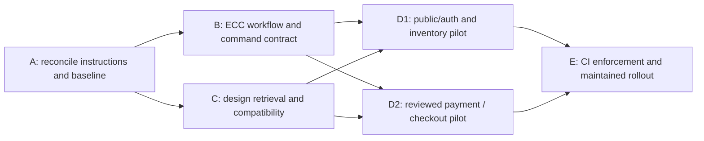

# Stoquify: durable Codex, ECC and UI/UX Pro Max configuration

Date: 7 October 2026. Status: audit and proposed implementation blueprint; configuration changes have not been applied.

Repository root: `E:/ohada saas/Focused projects/stoquify`. Paths below are relative to this root unless identified as user-level or ECC bundle paths. Inspection baseline: HEAD `6f7f6741cabfdeff61989a40455d6f3ea37b33c9`, plus the current working tree. An observed status snapshot contained 331 modified tracked files and 4,100 untracked entries. This is a working-tree assessment, not certification of that commit or a deployed release. Counts can change during concurrent work.

This report extends the existing `docs/ecc/stoquify-ecc-ui-ux-pro-max-assessment-2026-10-07.md`; it does not replace that assessment or the existing UI remediation roadmap. Only this Markdown document was created for this task. Application, database, plugin and design configuration were not changed.

## 1. Executive decision

**Adopt a balanced, repository-owned integration around the existing ECC installation and UI/UX Pro Max skill.** Keep the tools selective. Make the project’s business invariants, command safety, component contracts and evidence requirements discoverable and enforceable independently of either tool.

Stoquify already has substantial domain protection: fresh server authorization, scoped stock kernels, reviewed payment commands, replay protection, financial evidence and close invalidation. The principal configuration opportunity is to connect these controls to the assistant’s everyday workflow and CI without introducing conflicting instructions, unsafe generic commands or a second design system.

The first implementation slice should reconcile `AGENTS.md` and `CLAUDE.md`, inventory command side effects, and create a short project workflow entry point. Do this before enabling additional hooks or widening UI changes. There is no evidence that installing more skills will address the identified gaps.

| Option | Contents | Benefits | Cost and limits | Decision |
|---|---|---|---|---|
| Minimal | Correct instructions; manually select ECC skills and existing UI references | Fast, little maintenance | Mostly advisory; drift detection depends on reviewers | Useful first slice, insufficient permanent control |
| Balanced | Minimal plus portable routing, command registry, canonical design retrieval, targeted CI validation and three pilot journeys | Reproducible across sessions and developers; measurable value | Requires named owners and modest ongoing review | **Recommended** |
| Extensive | Broad skill loading, more connectors, extensive lifecycle automation and full UI migration | Potentially useful for a larger team after evidence | More trust decisions, context, execution time and conflicting advice; current CLI/browser compatibility gaps | Defer until pilots justify individual additions |

“Enterprise grade” here means demonstrated properties of the application and delivery process. A skill, hook, scan, screenshot or this report cannot establish production security, accessibility compliance, financial correctness or statutory certification on its own.

## 2. Baseline and evidence register

### 2.1 Installed stack and repository breadth

Versions were read from `package.json`, `package-lock.json` and installed package manifests, not inferred from semver ranges.

| Dependency | Declared | npm lock and installed version |
|---|---|---|
| Next.js | `^15.1.4` | 15.5.18 |
| React | `^19.1.1` | 19.2.6 |
| TypeScript | `^5` | 5.8.3 |
| Prisma | `^6.19.3` | 6.19.3 |
| Better Auth | `^1.6.14` | 1.6.14 |
| Tailwind CSS | `^3.4.1` | 3.4.19 |
| Playwright | `^1.61.1` | 1.61.1 |
| Jest | `^30.4.1` | 30.4.2 |

Current enumeration found 167 `app/**/page.tsx` files, 148 of those with dashboard in their path, 826 TSX files across app/components, 24 E2E spec files and 17 TypeScript E2E files importing axe-core. These are inventory counts, not route completeness, accessibility coverage or passing-test counts. No Express server architecture is asserted from the presence of middleware-related dependencies.

Both npm and pnpm lockfiles exist; CI uses `npm ci`. There is no packageManager declaration in the inspected package manifest. Recommend documenting npm as the current CI reproduction path, then separately deciding whether the pnpm artifacts remain supported. Do not delete either lockfile as incidental cleanup.

Graph inspection preceded architecture conclusions. `graph_components.json` contains 1,173 nodes, `graph_actions.json` 1,044 and `graph_app.json` 622, unlike the older counts in AGENTS. `POST_SLICE_438_GRAPH_REFRESH_2026-08-09.md` dates their refresh. Relevant discovery nodes include:

| Graph | Node | Community | Current source checked |
|---|---|---:|---|
| Components | `dashboard_dashboardroutestate_dashboardroutestate` | 158 | `components/dashboard/DashboardRouteState.tsx` |
| Actions | `inventory_inventoryactions_trustedinventorycontext` | 111 | `actions/inventory/inventoryActions.ts` |
| Actions | `inventory_inventorymovementactions_requireinventoryhistoryreadaccess` | 93 | `actions/inventory/inventoryMovementActions.ts` |
| Actions | `payroll_payroll_payment_reconciliation_actions_ts` | 73 | `actions/payroll/payroll-payment-reconciliation.actions.ts` |
| App | `home_page_landingpage` | 183 | `app/[locale]/(home)/page.tsx` |

Graphs are navigation aids. Their timestamps, changing file counts and current source changes prevent treating them as a complete current architecture map.

### 2.2 ECC state and Codex compatibility

ECC bundle root inspected: `C:/Users/J COMPUTER/.codex/plugins/cache/ecc/ecc/2.2.3`.

| Layer | Observed evidence | Interpretation |
|---|---|---|
| Package | `.codex-plugin/plugin.json` reports ECC 2.2.3 | Installed cache version known |
| Enablement | User `config.toml:107–108`: `[plugins."ecc@ecc"]`, `enabled = true` | Enabled setting present; not a successful lifecycle execution claim |
| Cache | Bundle `scripts/codex/check-plugin-cache.js` exited 0 | Skills directory, MCP config and two UI assets resolve; checker does not validate hook execution or every skill |
| Hooks | `hooks/codex-hooks.json` declares SessionStart; user `config.toml:223` has a `trusted_hash` for that entry | Trust record exists; correspondence to the current definition and successful execution not tested |
| CLI | `codex --version` reports 0.128.0; plugin and marketplace help inspected | Local CLI lacks documented list/add plugin lifecycle operations |
| Inventory commands | `codex plugin marketplace list --json` and `codex plugin list --available --json` reject `list` | configure-ecc’s prescribed full inventory cannot run through this CLI |
| Connector | Bundle `.mcp.json` declares `chrome-devtools-mcp@1.10.1`; tools exposed | Availability of the tool definition confirmed |
| Connector execution | Fresh `list_pages` failed because the Chrome profile is already in use | Browser connectivity not verified in this run; earlier assessment success does not supersede current failure |

Upstream ECC documentation describes the native plugin lifecycle for newer Codex versions and separates hook trust from plugin enablement. The local CLI’s actual help takes precedence for commands executed here. Desktop capabilities may differ from the PATH CLI; do not infer the desktop version from `codex --version`. [ECC native integration documentation](https://github.com/affaan-m/ECC/blob/main/.codex-plugin/README.md).

**Recommended configuration now:** retain the current installation, add repository-owned guidance during implementation, and keep hook changes out of the initial slice. A later tooling owner should verify the supported desktop lifecycle, PATH resolution and hook behavior. Any host update or hook trust change is a separate concrete action. No marketplace refresh, reinstall, trust edit or welcome claiming configuration success was performed.

### 2.3 Skill inventory and overlap

Recursive filesystem inventory covered six roots; targeted content review covered the relevant engineering/design skills. This is not a quality audit of every listed skill or a measurement of runtime context loading.

| Root | SKILL.md count |
|---|---:|
| User `.codex/skills` | 445 |
| User `.agents/skills` | 43 |
| Project `.agents/skills` | 11 |
| Project `.codex/skills` | 2 |
| Project `.claude/skills` | 2 |
| ECC 2.2.3 `skills` | 293 |
| Total | 796 |

Repeated frontmatter names: `caveman`, `design-system`, `neon`, `neon-postgres`. The Neon project .agents/.claude pairs are byte-identical real directories; the other repeated names differ. No other identical SKILL.md hashes were found across those roots. Seven-/30-day usage is **not measured**. ECC manifest promotional counts are not used as the inventory baseline.

| Candidate | Verdict | Proposed integration |
|---|---|---|
| ECC configure-ecc | Keep with compatibility preflight | Use the Codex branch; detect supported lifecycle before suggesting executable commands |
| ECC search-first | Keep with project routing | Search current code and graph first; resolve local skill paths and tools dynamically |
| ECC verification-loop | Adapt urgently | Replace generic build/Bash/coverage recipe with classified project commands |
| ECC security-review | Keep with domain supplement | Add tenant, entitlement, step-up, replay, maker-checker and financial evidence cases |
| ECC frontend/backend-patterns | Keep, opt-in | Review existing patterns; no automatic framework or architecture migration |
| ECC blueprint | Use methodology | Small phases, dependency graph, independent review; no assumption that `/blueprint` is a Codex command |
| Project UI/UX Pro Max | Keep and repair retrieval text | Search guidance, current-stack validation, canonical master adapter and scoped overrides |
| Project brand/design-system/design/ui-styling | Narrow and repair | Brand identity; token engineering; task routing; existing component styling respectively |
| AQStoqFlow UIUX/domain skills | Preserve useful invariants | Put portable invariant summaries/references in repository; do not rely only on one home directory |
| Duplicate Neon copies | Consolidation candidate | Decide cross-harness distribution needs before removing/synchronizing files |
| Two design-system skills | Qualify names | Use project skill for tokens; optional ECC checklist for review, no competing DESIGN.md authority |

### 2.4 Prioritized gap register

Priority means implementation order and potential impact, not an exploit severity rating.

| ID / priority | Verified evidence | Impact and proposed response |
|---|---|---|
| F01 / P1 | ECC `verification-loop/SKILL.md:26` calls build; `package.json:12` deploys migrations within build | Generic verification can mutate the target database. Establish a command registry and project-specific verification entry point first |
| F02 / P1 | `CLAUDE.md:78` describes NextAuth; `lib/auth.ts:5,47` uses Better Auth. CLAUDE build descriptions differ from package scripts | Stale guidance can drive incorrect changes. Align factual guidance and link shared workflow from both entry points |
| F03 / P1 | CLI 0.128.0 rejects configure-ecc list commands; connector profile collision | Do not promise automatic setup or browser checks. Separate host compatibility work from project adoption |
| F04 / P1 | `AGENTS.md:6,10,18` names missing graphify/test-gen/enterprise-error-handling-complete skill paths; :7,11,15,19 require an unavailable Task API | Replace impossible invocation instructions with capability discovery and explicit missing-dependency handling |
| F05 / P1 | `jest.config.ts:22–29` omits services from coverage collection; :12 uses jsdom; `jest.setup.ts:30` mocks Prisma | Critical service coverage can be invisible. Separate unit and real PostgreSQL evidence; inventory existing integration lanes before adding any |
| F06 / P1 | UI constitution and component registry exist; current globals use blue product brand; `docs/branding/brand-tokens.css:1` explicitly marks a different palette as proposal-only | Reconcile authority and keep proposal status visible. Do not regenerate/replace the current product palette |
| F07 / P2 | No root design-system master; UIUX `design_system.py:1096,1398` emits unscoped paths while actual persistence uses a slug | Future sessions may retrieve wrong files. Repair generated links and introduce one discovery adapter |
| F08 / P2 | Brand sync script :17–20 expects absent docs/brand-guidelines.md, assets/design-tokens files, and a .claude generator path | Do not enable this pipeline until adapted to current paths and token ownership |
| F09 / P2 | Project design skill :44–69 refers to absent Claude paths and AskUserQuestion; ui-styling recommends @theme while installed Tailwind is 3.4.19 | Use harness- and major-version-aware routing. No implicit Tailwind or component library upgrade |
| F10 / P2 | UIUX Next.js search result labels applicability as 16.2; installed Next.js is 15.5.18 | Verify API-specific advice against the installed major/version; preserve provenance |
| F11 / P2 | Two design-system skills, duplicate Neon copies, 796 files across roots | Qualify names; reduce duplicate workflow loading. Do not claim all files load each session |
| F12 / P2 | Dated graph/readiness reports and numerous local changes; prior roadmap counts differ materially | Attach source revision and scope to evidence. Historical PASS must not certify current changes |
| F13 / P2 | Both lockfiles exist, npm CI; E2E imports axe-core but package.json lacks a direct declaration | Decide supported package manager and make directly used test dependencies explicit in a scoped tooling PR |

The middleware’s in-memory rate limiter and production `unsafe-inline` CSP are additional **review candidates**, not demonstrated exploits (`middleware.ts:10,59`). Assess deployed proxy trust, centralized rate controls and nonce feasibility before a remediation plan. Secret environment files and customer records were not inspected for this audit; configuration output was limited to relevant non-secret metadata.

## 3. Representative application controls and user journeys

| Journey | Current implementation evidence | Configuration requirement |
|---|---|---|
| Sign in → organization → protected page | Better Auth configuration `lib/auth.ts:47`; live-session RBAC `lib/security/rbac.ts:90–191`; dashboard layout checks fresh context before shell creation | Authentication guidance must use current helpers; test revoked session, current permissions, active org and tenant mismatch |
| POS review → checkout → recovery | `actions/pos/checkout.actions.ts:9–28`; Serializable/lease control in `services/pos/checkout.service.ts:32,59`; composite sale identity and cart revision in `pos.service.ts:2210–2296`; schema unique key :4981 | Preserve pending/uncertain outcomes, replay identity, revalidation and recovery when simplifying checkout UI |
| Inventory correction → quantity/value → history | `services/inventory/inventory-stock-event.service.ts:408,538–564,816–862,909` binds version/availability, audit, event and close invalidation | Use the existing kernel; preserve conservation, period rules, idempotency and transaction ownership |
| Purchasing/AP → reviewed payment → evidence | `actions/purchasing/ap-control.actions.ts:75–114,199–220`; `payment-release.service.ts:18–77` enforces scoped locking, independent actors, revision and execution evidence | Stale preview, changed payload, requester/approver independence and duplicate execution checks; blocked legacy writers remain blocked |
| Payroll payment → reconciliation → close | `payment-reconciliation.service.ts:361,609–613,1435–1443,1541,1642–1666,1861` connects transaction, proof, balance and sensitive controls | Redaction, reviewed balance, replay, maker-checker and downstream close evidence required |
| Finance/accounting → current close proof | `services/accounting/close-assurance-current-proof.ts:30–68` distinguishes current export, stale evidence, failed controls and unresolved findings | Keep freshness/blocker semantics visible; historical certification is not current readiness |
| Failed reconciliation → retry → dead letter | Inbox worker :229,332,453,483–515 uses leases, ownership, bounded retry/dead letter; shared protect wrapper maps safe errors and correlation | Release evidence needs deployed worker operation, alert delivery and recovery drills as well as unit tests |
| Public discovery → onboarding | Current home page composes landing components; login/register use EnhancedLoginForm/BeautifulRegisterForm; separate v2 routes exist | Pilot both EN/FR, validation/recovery, keyboard and responsive behavior without assuming v2 replaces existing routes |
| Admin role/module → navigation/access | RBAC :249,364; `services/_shared/protect.ts:71–105`; dashboard layout module navigation snapshot | Navigation visibility is presentation. Authorization must remain in every server entry path |

`protect()` does not prove every handler is tenant safe: `tenantGuard: "handler-derived"` bypasses the generic tenant inspection, which checks known fields (`services/_shared/protect.ts:102,189–203`). Such handlers need scoped related-resource inspection. No bypass vulnerability was established here.

Existing tests worth routing to include:

- `lib/security/__tests__/rbac.test.ts`: revoked sessions, reassigned email, cross-tenant wildcard access.
- `services/pos/__tests__/checkout-lifecycle.service.test.ts`: interrupted checkout, compare-and-set loss, pending work and recovery.
- `services/inventory/__tests__/inventory-stock-event.service.test.ts`: closed periods, conflicting replay and value allocation.
- `services/purchasing/__tests__/payment-release-evidence.test.ts`: actor binding, altered terms, retained proof and duplicate execution.
- `services/payroll/__tests__/payroll-payment-reconciliation.service.test.ts`: reviewed balance, redaction, suspense and replay.
- `services/payments/__tests__/payment-reconciliation-inbox-worker.service.test.ts`: retries, payload normalization and lease theft.
- `components/dashboard/__tests__/DashboardRouteState.test.tsx`: localized recovery, loading status and landmark ownership.

These tests were inspected, not executed in this audit. Mocked transaction tests cannot demonstrate PostgreSQL lock behavior. `jest.payroll-trust-spine.config.cjs` is a bounded jsdom/unit runner that loads the Prisma-mocking setup, not a database-certification configuration. Inspect the dedicated `scripts/payroll-trust-spine-postgres-certification.js` runner and `jest.ui-workflow-postgres.config.cjs`, including their database preconditions and imports, before selecting a real-DB lane. Neither was executed in this audit.

## 4. Recommended ECC configuration and operating contract

### 4.1 Persistent ownership model

| Surface | Proposed owner / invocation | Inputs → output / verification | Maintenance and rollback |
|---|---|---|---|
| User native ECC install | Developer tooling owner; onboarding/version change | Installed manifest + host capabilities → compatibility record; native inventory where supported, read-only cache check otherwise | Monthly review, no unattended upgrades; restore prior supported plugin via host lifecycle |
| AGENTS.md + CLAUDE.md | Engineering lead; every session | Task type → shared project workflow and canonical sources; fresh-session test | Review on architecture/script changes; revert only task-owned documentation hunks |
| `docs/ecc/WORKFLOW.md` (new) | Engineering lead; every nontrivial task | Risk + changed surfaces → required domain evidence and verification lane | Keep concise, links instead of copied skill content; rollback prior version |
| `docs/ecc/skill-routing.md` (new) | Tooling/design leads; task classification | Qualified skill and source paths → selected guidance; path/version checks | Monthly and upgrade-triggered review; fallback to repository workflow if tool absent |
| `docs/ecc/command-registry.json` (new custom schema) | QA/platform; before executing checks | Script definitions + target environment → side-effect classification and allowed lane | Drift check whenever package scripts change; reject unknown safety rather than guessing |
| `docs/ecc/tooling-baseline.json` (new custom schema) | Tooling owner; onboarding/update | Versions, hashes, supported capabilities, provenance → reproducible inventory | No secrets/machine-specific credentials; refresh after reviewed upgrade |
| Existing CI plus proposed workflow-contract gate | QA/platform; PR/push | Command/instruction/design references → early failures with reason | Small deterministic check; revert broken new check without weakening existing financial gates |
| Existing domain skills and tests | Domain owner; sensitive changes | Business invariant → negative-path and runtime evidence | Keep specific financial knowledge portable; no generic replacement |
| ECC SessionStart hook | Tooling owner; separately reviewed session test | Trusted current definition → observed bootstrap output | Optional convenience; no security enforcement reliance; disable through supported host if failing |

Do not create another orchestration framework or copy the ECC cache into the repository. A short routing layer is sufficient. A new project skill is warranted only if the pilot demonstrates that the shared workflow is not reliably discoverable through AGENTS.

### 4.2 Concrete proposed excerpts

The following is **proposed AGENTS text**, not an applied change:

```text
For nontrivial work, read docs/ecc/WORKFLOW.md and select the smallest
relevant workflow from docs/ecc/skill-routing.md.
Before executing a package script, check its current definition and
docs/ecc/command-registry.json. Missing/stale entries are not safety proof.
Do not use generic npm run build as a read-only verification command.
Use current Better Auth/RBAC and trusted server tenant context.
For UI work, read design-system/stoquify/MASTER.md and any scoped page
override, then the referenced constitution, registry and current tokens.
Generic skill output is advisory; preserve established business controls.
Report inspected / executed / passed / failed / not-run evidence separately.
```

Custom command-registry example for a future validator; this is **not a Codex or ECC configuration schema**:

```json
{
  "schemaVersion": 1,
  "commands": {
    "build": {
      "invocation": "npm run build",
      "effects": ["report-write", "database-migration", "build-output"],
      "auditAllowed": false,
      "requires": ["explicit target database", "release context"]
    },
    "verify:ci": {
      "invocation": "npm run verify:ci",
      "effects": ["database-migration", "reports", "build-output", "tests"],
      "auditAllowed": false,
      "requires": ["isolated disposable database", "reviewed environment"]
    }
  }
}
```

Implementation must also store fingerprints of inspected command definitions and delegated executable files, including npm pre/post lifecycle hooks, shell helpers and configuration imports. Record environment-dependent branches and their required target/environment preconditions. The validator detects changed fingerprints and unclassified commands; it cannot infer all side effects or prove arbitrary code safe. Mismatch requires human reclassification and does not block normal read-only source inspection. Do not interpret an empty effects array as evidence that a newly added command is safe.

Classify commands into: static/read-only; isolated pure tests; generated build/report output; isolated database integration; migration/seed; release/deployment. `typecheck` uses incremental TypeScript by default and may write tsbuildinfo. `build:app` may clean stale output. `verify:repo` includes build and integration gates. E2E wrappers may migrate and seed. Record these facts explicitly.

### 4.3 Task routing

| Work | ECC contribution | Stoquify-specific evidence |
|---|---|---|
| Feature | search-first, scoped plan, relevant patterns, review | Existing component/service, domain invariants, representative successful and denied flow |
| Bug | Reproduction and targeted verification | Failing behavior before change, regression after; no unrelated cleanup |
| Auth/API/payment | security-review plus project controls | Trusted actor/tenant, related-resource scope, revoked/denied paths, idempotency and evidence |
| Database | Migration review and verification planning | Existing migration policy, isolated replay, transaction/concurrency evidence; no development DB inferred from a URL name |
| UI | UIUX focused query + existing frontend patterns | Master/component choice, all relevant states, EN/FR, keyboard, actual screenshots and business semantics |
| Release | verification-loop adapted to release context | Existing verify:release and domain gates in approved environment; current commit/artifact proof and independent domain sign-off |
| Tiny reversible edit | Existing local checks | No compulsory blueprint, full-suite cycle or broad skill loading |

Keep CI authoritative for deterministic merge checks. Agent instructions and hooks provide guidance, not a substitute for branch protection. Remote branch protection and latest CI results were not inspected because GitHub CLI is unauthenticated.

## 5. Durable UI/UX Pro Max configuration

### 5.1 One authority chain

Preserve the UI constitution at `docs/UI/UX/AQSTOQFLOW_UI_CONSTITUTION_2026-06-26.md`, its companion `docs/UI/UX/AQSTOQFLOW_UI_COMPONENT_REGISTRY_2026-06-26.md`, the broader `docs/product/user-experience/ui-registry.md`, and implemented semantic tokens. The current constitution specifies `.dashboard-landing-theme dark` and `--dash-*`; public and auth surfaces have defined variations. `app/globals.css:47,304–316` provides the current shared blue product-brand mapping. This does not replace existing gold/chestnut button variants documented by the registry and implemented in CSS. The separate green branding package is explicitly a proposal; it is not an instruction to recolor production.

Propose `design-system/stoquify/MASTER.md` as a **retrieval adapter**, linking the authoritative sources and summarizing their application. It should not duplicate all token values or become a second editable token source. Link to it from AGENTS and WORKFLOW. Resolve contradictions through a dated product/design decision; do not quietly declare whichever file was read last authoritative.

```text
User/task constraints and security/business invariants
  → project workflow and approved UI constitution
  → current component registry and implemented token mappings
  → approved page-specific deviations within those boundaries
  → generic ECC / UI/UX Pro Max advice
```

Page files: `design-system/stoquify/pages/public-auth.md`, `inventory.md`, `pos.md`, `ap-payment.md` initially. They should specify scope, canonical components, states, content examples, keyboard behavior, display-context requirements, evidence references, owner and review date. An override may refine density or layout; it cannot weaken permissions, alter business truth or replace the global brand without an approved decision.

### 5.2 Search and persistence behavior

Verified read-only commands on this Windows environment:

```powershell
python -B .agents/skills/ui-ux-pro-max/scripts/search.py 'form error recovery keyboard focus' --domain ux -n 2
python -B .agents/skills/ui-ux-pro-max/scripts/search.py 'server client components' --stack nextjs -n 1
```

UX search returned relevant recovery/focus guidance. The Next.js entry declares 16.2 applicability; validate specifics for installed 15.5.18. A non-persisting design-system query for enterprise inventory/accounting returned Financial Dashboard, but its pattern was Enterprise Gateway (marketing sections) and its colors differed from Stoquify. A narrower Financial Dashboard retry still returned that pattern. **No verified match for an operational page layout was established. Do not persist that output as the product standard.**

Local code supports `--persist`, explicit `--output-dir`, project-slug directories and non-overwrite publication (`scripts/design_system.py:972–1056`). This path was code-inspected, not exercised against a live master. Before persistence is used, fix the two generated unscoped references at :1096 and :1398 and test first creation, existing master, new page and existing page in a temporary directory. Do not use `--force` to overwrite prior decisions by default.

For Stoquify’s initial master, write the reviewed adapter from existing decisions. Use generated output only as candidate research. The local UIUX release version is unknown; capture a reviewed source/content hash and provenance instead of inventing a version from dataset dates.

### 5.3 Product-wide contract

| Concern | Adopt/reconcile with existing source | Pilot acceptance |
|---|---|---|
| Color and theme | Current `--product-*`, `--dash-*`, auth/public aliases, constitution | Same semantic meaning on pilot surfaces; no proposal palette substituted |
| Typography and numbers | Existing font/formatters; tabular numeric alignment where appropriate | Amount, currency, sign, period and freshness legible; no invented zero for unavailable data |
| Spacing, density, layout | Shared dashboard classes; touch POS can differ from dense finance tables | Readable at agreed mobile/tablet/desktop sizes; intentional table overflow is operable |
| Navigation | Current shell, localized routes, permission/module navigation | Task reachable; back/recovery works; hidden control never replaces server authorization |
| Forms | Existing form/Zod/shared controls | Labels, localized validation, focus recovery, loading and duplicate-submit behavior verified |
| Tables and charts | Existing table patterns and chart components | Scope, pagination, sort, empty vs filtered-empty, non-color cues and accessible alternatives |
| Icons and motion | Existing Lucide/shared patterns | Decorative icons hidden appropriately; named controls; reduced-motion behavior checked |
| Localization | EN/FR and server-owned display context | Long French labels, dates/time zones and money formatting verified on the same scenarios |
| Data trust | Domain read models and current-proof decisions | Partial/stale/blocked evidence cannot appear as success; corrective next action is clear |

State matrix for each pilot: loading, empty, filtered-empty, error with recovery, success, disabled with reason, permission denied, locked/unavailable module, stale/partial data and offline/reconnecting where supported. Preserve `DashboardRouteState`, `DashboardErrorState` and existing domain state adapters. Extend only for a proven missing state; do not add every state to every page.

Target WCAG 2.2 AA within a declared pilot scope, with automated checks plus keyboard and human assistive-technology review. This is a proposed target, not a conformance claim. Screen-reader, focus, contrast, zoom and touch behavior require actual rendered evidence. Do not impose a speculative full-app light theme while the authenticated constitution intentionally uses dark surfaces.

## 6. Verification performed and limits

| Check | Result | Meaning / limit |
|---|---|---|
| CLI version/help and configured plugin inventory commands | Version/help passed; both list commands failed | Verified compatibility mismatch; no setup mutation |
| ECC cache validator | Passed, exit 0 | Four manifest path references resolve, not every runtime capability |
| Relevant JSON graphs/manifests/lockfile reads | Passed | Structural evidence and exact versions; no behavioral proof |
| Six-root skill name/hash inventory | Completed | 796 files, four repeated names; targeted quality review only |
| UIUX domain and stack searches | Passed | Correct operation; Next 16.2 applicability warning remains |
| UIUX generator and narrower retry without persistence | Executed, persistence null | Candidate output unsuitable as canonical operational layout; no files persisted |
| Public color contract | **1 suite, 7 tests passed** | Static source assertions preserve shared token mappings, not rendered contrast or accessibility |
| Initial test invocation without narrowed roots | Interrupted before result | Root discovery was slow; no application failure inferred |
| Chrome DevTools list_pages | Failed: profile in use | No browser, visual or accessibility audit completed in this run |
| Local TCP availability on 3000/3001/3107 | Unavailable at probe time | No usable server established on these expected ports; other ports not exhaustively searched |
| Git/GitHub preflight | Remote/default ref present; gh 2.81.0 installed; gh unauthenticated | No PR/CI/branch-protection assertions |
| Full typecheck/lint/build/test/DB/CI/E2E | Not run | Audit scope; build/CI/E2E wrappers have writes/migrations/seeding; test evidence is deliberately bounded |

Exact successful isolated test invocation (does not load repository Jest setup/Next environment):

```powershell
node node_modules/jest/bin/jest.js --runInBand --no-cache --config '{"roots":["<rootDir>/scripts/__tests__"],"testEnvironment":"node","transform":{},"testMatch":["**/public-color-contract.test.js"],"watchman":false}'
```

No browser process was killed and no profile configuration was changed to bypass the collision. No server was started against an unknown database. Rendered public/auth and authenticated journeys remain implementation-pilot evidence requirements. Previous reports and previous test successes are explicitly historical.

## 7. Phased implementation blueprint

Estimates below are engineering effort, not elapsed-time promises. Assumptions: one engineer familiar with the repository, access to a design/domain reviewer, and a disposable PostgreSQL/browser environment for pilots. Tool approval and environment provisioning time are separate. A–C and E total approximately 7–12 engineer-days; D adds 4–8 days, excluding broad application defect remediation discovered by pilots.



B and C can proceed independently after A if shared AGENTS/package changes are serialized. B validates existing active references; proposed master/page references remain informational until C is accepted, then become required. D1 and D2 may proceed independently with explicit component ownership; serialize shared shell/token changes. These are suggested future work boundaries, not authorization for concurrent application edits now.

### A — Reconcile the baseline and entry instructions

Owner: engineering lead/tooling maintainer. Effort: 1–2 days. Dependency: none. Reasoning: high for resolving conflicts, normal for mechanical link fixes.

Evidence: F01–F04, F06, F11–F12. Files: `AGENTS.md`, `CLAUDE.md`, new `docs/ecc/WORKFLOW.md`, `skill-routing.md`, `tooling-baseline.json`; references to existing UI constitution/registry and prior roadmap. First PR should remain documentation/metadata only.

Tasks: snapshot task-owned baseline; correct auth/build facts; replace unavailable Task instructions; record absent skills with supported fallback; qualify duplicate names; designate existing UI authorities; record installed versions, CLI mismatch, hook trust/operation distinction and npm CI path. Do not copy all global skill text. During A, route directly to the existing constitution/registry; activate the master-file pointer only when C creates it, so intermediate instructions remain usable.

Acceptance: a fresh session can find the current auth, design and safe-verification entry points; every recommended file reference exists or is clearly marked proposed/unavailable; no generic read-only build instruction remains; old proposal documents are labeled without erasing history. Verify with scoped `rg`, path checks, manifest comparisons and `git diff --check -- AGENTS.md CLAUDE.md docs/ecc`.

Risk: overwriting concurrent documentation or changing intended architecture while correcting facts. Rollback: revert only this slice’s reviewed hunks. Stage explicit files/hunks; never stage the whole dirty tree. Remote PR work waits for usable GitHub authentication; local review remains possible.

Execution prompt:

> Implement Phase A of docs/ecc/stoquify-codex-ecc-uiux-configuration-blueprint-2026-10-07.md. Re-read current AGENTS, CLAUDE, package scripts, Better Auth/RBAC, UI constitution and component registry. Modify only the listed instruction/metadata files; create a concise portable workflow and qualified routing index. Correct factual drift and unsupported tool references. Record unresolved host capabilities without changing plugins, hooks, application code or databases. Preserve unrelated dirty changes. Validate links/current facts and report the exact diff and fresh-session discovery result.

### B — Establish the ECC workflow and command contract

Owner: QA/platform with security/domain reviewer. Effort: 2–3 days. Dependency: A. Split into registry/validator and verification-lane PRs if needed.

Files: new `docs/ecc/command-registry.json`, `docs/ecc/test-lanes.md`, `scripts/verify-agent-workflow-contract.js`, `scripts/__tests__/verify-agent-workflow-contract.test.js`; scoped updates to `WORKFLOW.md`, `package.json`, `.github/pull_request_template.md`; examine `jest.config.ts`, `jest.setup.ts`, existing PostgreSQL configs before a separate test-lane change.

Tasks: classify scripts and delegated side effects; fingerprint inspected commands; define auth/financial/UI risk triggers; add services to an appropriate coverage lane; separate mocked and real-DB results. Record exact inspected AP/POS/PostgreSQL runners, fixture prerequisites and invocation commands in `docs/ecc/test-lanes.md`; missing concurrency/recovery coverage becomes a separately sized prerequisite for D2. Add concise PR fields for affected invariants, current evidence and not-run checks. Adapt verification-loop instead of changing its cache. Preserve current release gates.

Acceptance: validator fails on changed inspected fingerprints or unclassified commands, broken active required references and conflicting canonical pointers; tests include intentional script mutation and missing-reference fixtures. It requires review of possible side effects rather than claiming semantic detection. Known build/migration wrappers cannot enter the audit lane. Required design-master validation activates only after C acceptance. Critical services are represented in coverage reporting, and DB evidence is never inferred from mocks. No arbitrary whole-repository 80% claim.

Validation: after implementation, run `node scripts/verify-agent-workflow-contract.js` and focused fixture tests; run existing targeted service suites only after import/setup side-effect inspection. Use explicit disposable DB configuration for real-DB validation in the later pilot. `npm run typecheck`/lint only where relevant to code changes and with generated-output behavior accounted for.

Risk: false positives or an unreviewed gate weakening existing checks. Rollback: revert new validator/registry integration; retain original domain/CI gates. Never bypass financial gates merely to meet this phase’s deadline.

Execution prompt:

> Implement Phase B of the 2026-10-07 ECC/UIUX blueprint after verifying Phase A. Inventory current package script call chains and existing test lanes. Add the repository-owned command registry and a small deterministic contract validator with negative fixtures. Route ECC verification through inspected commands. Address services coverage and unit/DB evidence separation in a reviewable separate diff if required. Do not run migrations/seeds against an inferred target or modify ECC cache/hooks. Preserve existing release gates; report passed, failed and not-run checks separately.

### C — Make design guidance persistent and compatible

Owner: design-system/frontend lead. Effort: 2–4 days. Dependency: A. Two small PRs: retrieval adapter, then verified skill/path repairs.

Files: new `design-system/stoquify/MASTER.md`, initial `pages/public-auth.md`, `pages/inventory.md`; scoped updates to UI constitution/registry only when resolving an actual documented conflict; `.agents/skills/ui-ux-pro-max/SKILL.md`, its `scripts/design_system.py` and existing tests; project design/brand/ui-styling guidance and brand sync script where inspected paths are wrong. Do not create a new token pipeline as an incidental repair.

Tasks: establish the master as an adapter to live tokens/components; document proposal status and page boundaries; repair generated scoped links; document Tailwind 3/Next 15 applicability; make design routing use project-relative paths and available question APIs. Brand sync remains disabled/unrecommended until its target contract is deliberately mapped.

Acceptance: fresh session identifies the same token/component choice; no new global palette; page override cannot supersede security/brand invariants; temporary-directory tests prove no-overwrite and correct slug paths. Search results record source/applicability and rejected matches. Existing 7-test color contract still passes.

Validation: `python -B .../scripts/search.py` focused queries; inspect existing Python test entry points before running relevant tests in temporary output roots; repeat the isolated color-contract command in section 6; review diffs for no production style changes in this foundation phase.

Risk: making the master an independently maintained duplicate or treating generic generation as approved design. Rollback: remove only new adapter/overrides and reverse routing links, restore prior skill changes; production tokens remain intact.

Execution prompt:

> Implement Phase C of the 2026-10-07 ECC/UIUX blueprint. Use the existing UI constitution, component registry and app/globals.css as evidence. Add a thin design-system/stoquify/MASTER.md adapter and scoped public-auth/inventory contracts. Repair the verified unscoped generated links and harness/version path guidance with focused tests. Preserve current product colors and no-overwrite behavior. Do not persist the previously rejected generated palette, upgrade Tailwind/Next, or rewrite the application. Validate fresh-session retrieval and unchanged source color contracts.

### D1 — Pilot public/auth and inventory experience

Owner: frontend engineer + designer/QA. Effort: 2–4 days. Dependencies: B, C and an isolated runnable environment.

Candidate existing surfaces: `components/auth/EnhancedLoginForm.tsx`, `BeautifulRegisterForm.tsx`, `components/inventory/loss/InventoryLossWorkbench.tsx`, `components/dashboard/DashboardRouteState.tsx` and their tests. Revalidate route/component ownership before editing; these are candidates, not instructions to change every file.

Tasks: record baseline review using established process; add focused UIUX/ECC review; deduplicate findings; implement only accepted pilot defects. Test EN/FR and representative mobile/desktop sizes, keyboard/focus recovery, zoom/overflow, reduced motion and loading/error/denied/stale states. Use existing E2E facilities and reviewed fixtures. Add perceptual screenshot assertions only where they offer stable value; a saved screenshot alone is not a regression test.

Acceptance: no new serious/critical automated accessibility findings within declared scope; full keyboard task completed; manual screen-reader result or an explicit unresolved limitation; preserved tenant/stock semantics; before/after evidence with viewport/locale/role/commit. Measure task success and errors without inventing business data.

Validation: targeted existing unit/E2E cases under isolated configuration; actual browser screenshots and interaction records. No production or personal-data fixtures. If environment is unavailable, complete code review but leave rendered acceptance open.

Risk: broad visual refactor or fixture writes against shared data. Rollback: page-scoped diff/feature boundary; keep existing server/domain controls.

Execution prompt:

> Execute Phase D1 of the 2026-10-07 ECC/UIUX blueprint after verifying B/C acceptance. Establish a disposable local environment and inspect test setup before running it. Review the current public/auth and inventory pilot journeys using the canonical master, focused UIUX searches and existing controls. Record baseline findings, implement only accepted defects, and capture EN/FR keyboard/responsive/state evidence. Preserve financial/tenant behavior. Report any unperformed rendered or assistive-technology check explicitly; do not declare platform-wide accessibility.

### D2 — Pilot reviewed payment and checkout integrity

Owner: financial/backend engineer + domain reviewer/QA. Effort: 2–4 days, assuming B identifies reusable AP/POS PostgreSQL concurrency and recovery fixtures. Missing fixtures or coverage are a separately estimated prerequisite, not included in that estimate. Dependencies: B, C, an accepted test-lane inventory and disposable PostgreSQL.

Files selected by evidence: AP reviewed payment actions/services/tests identified in section 3; POS checkout lifecycle equivalents; proposed `design-system/stoquify/pages/ap-payment.md` and `pos.md`. Avoid changing both service kernels merely to demonstrate tool use.

Tasks: run baseline domain review, then ECC security review with project invariants. Exercise duplicate same-payload, duplicate changed-payload, stale review, denied actor, cross-tenant resource, concurrent update, interrupted commit, retry/recovery and close freshness. Verify presentation of pending/blocked/stale states with UIUX guidance. Reuse existing PostgreSQL runners after inspection.

Acceptance: each mandatory invariant has a named test and evidence class; relevant real-DB concurrency/rollback cases pass in isolation; no privacy leak in failure evidence; current-proof display responds correctly to invalidation; generic guidance introduces no bypass. Independent domain reviewer accepts the pilot scope.

Validation: section 3 target suites plus inspected real-DB runner and browser cases. Unit evidence and database evidence reported separately. No test results from this audit are a substitute.

Risk: financial regression or scope expansion. Rollback: small reviewed PRs with existing release flags; reverse application/config changes through established release process. Database rollback is separately planned for any explicitly authorized schema change; no schema change is assumed here.

Execution prompt:

> Execute Phase D2 of the 2026-10-07 ECC/UIUX blueprint after B/C and isolated-DB prerequisites pass. Select the AP reviewed payment workflow and POS checkout/recovery as bounded pilots, reuse current domain controls and tests, and assess ECC’s additional valid findings. Verify actor/tenant authority, replay, reviewed revision, concurrency, rollback, proof privacy and close invalidation. Apply only supported scoped fixes and verify truthful UI pending/stale states. Obtain independent domain review evidence; never infer PostgreSQL correctness from mocked transactions.

### E — Enforce and maintain the proven configuration

Owner: engineering/QA leads, named domain and design reviewers. Effort: 2–3 days for initial integration; subsequent module rollout is separately sized. Dependencies: accepted D1/D2 results.

Files: `.github/workflows/ci.yml`, `.github/pull_request_template.md`, routing/registry/baseline docs, new `docs/ecc/maintenance.md`; consider `.github/CODEOWNERS` only after actual responsible teams are identified. No invented team handles.

Tasks: put the cheap contract validator before expensive gates; retain existing CI isolation; add only pilot-proven targeted checks. Ensure CI directly declares used test dependencies such as axe-core. Add stale evidence/override review rules. Configure remote required checks only after authenticated remote inspection and a reviewed branch policy. Document hook/connector recovery and native upgrade review; do not silently change the user’s host configuration.

Acceptance: intentional workflow/command/design-link drift fails CI; representative valid PR passes; a fresh checkout/session finds correct guidance; rollback drill works; PR evidence differentiates unit/DB/browser results; owner/cadence documented. Expand module by module only after baseline comparison shows value.

Validation: fixture failures and successful CI run on the actual proposed branch; branch-protection evidence where accessible; fresh-session walkthrough. Local tests alone cannot close remote enforcement acceptance.

Risk: slow/noisy CI, abandoned maintenance, all-or-nothing tool dependency. Rollback: disable only defective new gate through reviewed config and preserve existing product gates; repository standards remain usable without ECC/UIUX.

Execution prompt:

> Implement Phase E of the 2026-10-07 ECC/UIUX blueprint using accepted pilot evidence. Wire the small workflow contract gate into existing CI, retain all financial/security gates, make directly used test dependencies explicit, and add named ownership, upgrade/rollback and drift-review procedures. Validate both intentional failure and a successful branch run. Inspect remote required checks only with available authentication; record unresolved remote enforcement. Do not activate recurring automations or update native plugins without a separate requested action.

### Plan change protocol

Each implementation PR records baseline revision, touched files, evidence IDs, checks, and remaining acceptance items. A discovered blocker can split/reorder a phase only with a documented dependency/risk reason. No phase becomes complete solely because files were created. Scope additions need their own acceptance and rollback. Keep this blueprint as the index; append completion references rather than spawning conflicting replacement roadmaps.

## 8. Maintenance, metrics and decisions

| Trigger | Owner | Output | Enforcement |
|---|---|---|---|
| Every new session/task | Implementer | Selected workflow, current sources and risk level | AGENTS guidance; sampled reviewer checks |
| Package/script/instruction change | QA/tooling | Updated registry fingerprints and negative fixtures | Proposed deterministic CI gate |
| UI component/token/override change | Design/frontend owner | Updated mapped contract and scoped rendered evidence | Targeted tests + reviewer approval |
| Auth/financial/database change | Security/domain owner | Invariant matrix and appropriate runtime evidence | Existing domain gates + required review policy |
| Monthly tooling review | Tooling owner | Compatibility, duplication and unused-advice decisions | Documented review; automation only if later requested |
| ECC/UIUX upgrade | Tooling + design/QA | Source/version diff, small search/verification canary, hook trust review if definition changed | Manual native lifecycle and reviewed PR for project changes |
| Quarterly or major release | Engineering/domain leads | Fresh-session exercise, recovery evidence, stale-doc/graph review | Release checklist and retained evidence |

Initial maintenance planning allowance: 1–2 engineer-hours per month for the focused routing/baseline review, plus 1–3 hours per tool update for compatibility canaries; these are estimates to replace with pilot measurements, excluding product defect remediation. Broader inventories should be triggered by evidence of duplication/drift rather than loaded into every task.

Use the next three suitable changes as a pilot: public/auth recovery, inventory state clarity and a reviewed payment/checkout change. Maintain all existing checks. Record established-process findings first, then new tool-assisted findings; this supplies incremental evidence without claiming a controlled causal experiment.

Metrics: accepted unique defects found per review; duplicated/rejected suggestions; review time and rework; command misclassification incidents; missing/broken canonical links; critical branches with current unit and DB evidence; pilot task completion/errors; keyboard/state regressions; drift findings and time to repair. Baselines are currently unknown except the inventory/test observations in this report. Set numerical improvement targets after pilot measurement. Immediate proposed guardrails are zero unclassified migration commands in the audit lane and zero broken mandatory canonical links.

Unresolved decisions: supported package manager beyond npm CI; permanent engineering/design/domain owners; whether the separate branding proposal will ever supersede the current product decision; host lifecycle compatibility and hook execution; clean fixture/browser availability; remote branch protection; acceptable performance budgets based on measured journeys. These do not block Phase A.

The existing broad UI remediation roadmap remains the product-change backlog. This blueprint supplies the tool configuration and maintenance layer, and must link findings into that backlog rather than restating old P0 items as still-open facts. For example, current login/register source already contains error accessibility attributes that older reports called missing; rendered sufficiency still needs verification.

## 9. Source and review notes

Local evidence: named files/symbols/lines above, the installed configure-ecc, search-first, blueprint, stocktake, verification-loop and security-review instructions, UIUX search/generator implementation, current manifests/configs, and read-only targeted reviews. Line numbers refer to the inspected working tree and can shift.

External reference checked on 7 October 2026: [ECC native integration](https://github.com/affaan-m/ECC/blob/main/.codex-plugin/README.md). Upstream UI/UX Pro Max page fetch did not succeed; capabilities in this report are grounded in the local skill/code and executed searches, not an assumed upstream release.

Independent blueprint review completed. No critical defect was found. The identified unit-versus-database runner misclassification was corrected; B/C reference-enforcement sequencing, validator limits/lifecycle dependencies and D2 fixture prerequisites were clarified. The review also prompted exact UI registry references, preservation of gold/chestnut variants, and inclusion of the UIUX skill entry point in Phase C. This was a plan/source review, not independent runtime certification.
