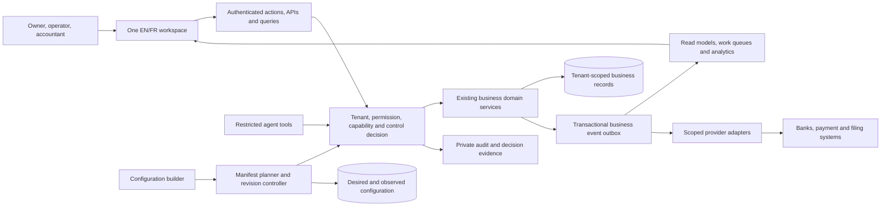

# Stoquify: one platform, configurable business capabilities

**Design proposal · 5 September 2026 · Astra · No production implementation or activation**

Stoquify should let an organization choose how it works, explain what those choices require, and compose a consistent workspace. A retailer can combine sales, stock, checkout and cash accountability. A service business can combine invoicing, finance and reports without a stock workflow. Both use the same identity, access controls, evidence and financial integrity where applicable.

The recommended architecture is an **incrementally strengthened modular monolith**: retain the current application and domain services, introduce explicit module contracts and a configuration planner, and make access decisions consistent across every entry point. Separate deployment becomes an option for specific operational workloads after measured need. An executable third-party plugin marketplace is a separate future product decision.

## Read this package

| Document | Question answered |
| --- | --- |
| [CURRENT_STATE](CURRENT_STATE.md) | What exists, what is inconsistent, and what was actually verified? |
| [MODULE_CATALOG](MODULE_CATALOG.md) | What can customers combine, and who owns each business record? |
| [CONTRACTS](CONTRACTS.md) | What must each module declare and obey? |
| [LIFECYCLE_AND_CONTROLS](LIFECYCLE_AND_CONTROLS.md) | How do activation, access, failure, suspension and retention work? |
| [EXPERIENCE](EXPERIENCE.md) | How does the administrator configure the system and the employee use it? |
| [IMPLEMENTATION_ROADMAP](IMPLEMENTATION_ROADMAP.md) | What should engineering deliver first, with what evidence? |
| [DECISIONS_NEEDED](DECISIONS_NEEDED.md) | What information must the owner supply, and where is it obtained? |
| [Interactive prototype](prototype/index.html) | Try five configurations, conflicts, impact preview, retry and role views. |

## 1. A vocabulary that prevents confusion

| Term | Meaning | Stoquify example |
| --- | --- | --- |
| Platform foundation | Shared services every tenant needs; not an optional business product. | Identity, organization context, policy decisions, configuration, audit, shell and localization. |
| Business domain | A boundary within which rules and authoritative records have one accountable owner. | Procurement owns supplier invoices and approval of supplier obligations. |
| Module | A versioned delivery and configuration unit exposing declared capabilities. | Purchasing and payables, or reconciliation. A domain can contain more than one module. |
| Capability | An outcome or operation the platform can provide and authorize. | Confirm a reconciliation match, issue an invoice, read a retained journal. |
| Add-on | An optional extension of an outcome that has an explicit dependency. | Advanced forecast analysis over permitted financial facts. |
| Integration/provider adapter | A translation boundary to an external system, with scoped credentials and delivery rules. | Bank statement ingestion or payment-provider settlement evidence. |
| Country pack | A reviewed, effective-dated set of jurisdiction rules and source evidence. | The verified payroll/fiscal rules needed for a selected country and activity. |
| Commercial package/subscription | An approved offer and its customer agreement, eligibility, limits and term. | A retail offer containing multiple capabilities. It does not grant an employee permission. |
| Tenant configuration | The organization's versioned desired capability selection and the observed result of preparing it. | Revision 8 requests reconciliation; revision 7 remains active during preparation. |
| User workspace/role view | An authorized person's presentation of available tasks and information. | Cashier workspace or an accountant's view of one authorized client. It is not a new module. |

Customer-facing product names may change; stable module and capability IDs must not. Preserve current slugs through an explicit adapter. The prototype has 20 proposed manifest entries, including two internal foundations and 18 selectable modules. The current repository has 19 canonical slugs. Those counts describe different models; the proposal consolidates dashboard/settings/administration into the foundation and adds explicit HRIS and assisted-work boundaries.

## 2. The smallest useful foundation

**Universal:** organization and verified actor context; known permissions and object scopes; policy evaluation; configuration/version history; private evidence references; audit; localization; navigation contribution rules; standard loading/error states; operational correlation and resource budgets. Administration tools remain permission-restricted even though their infrastructure is always present.

**Needed only for relevant operations:** financial posting, period locks and immutable source links; country-rule evaluation; stock valuation; employee confidentiality; provider connection management; offline replay. A tenant should not need an accounting workspace subscription to keep a sale's mandatory accounting controls. Include the underlying integrity capability in the relevant product. Price and show the specialist workspace separately where commercially appropriate.

`ledger_core` is a proposed logical boundary around existing accounting services, not a new ledger or an instruction to duplicate posting. Country controls required by an underlying activity are also included. The optional compliance workspace provides preparation, review and filing surfaces; disabling that workspace cannot waive required rules for another active activity.

## 3. Architecture choice and tradeoffs

| Choice | Fit with current code | Benefit | Cost/risk | Decision |
| --- | --- | --- | --- | --- |
| Modular monolith with enforced contracts | Existing Next.js actions, shared Prisma database, domain services and transactions. | Reuse controls and transactions; small migration steps; one operational system. | Boundaries need import rules, owner reviews and contract tests. | Start here. |
| Internal packages inside the same deployment | Useful when a stable interface is consumed across domains. | Compiler-visible public interfaces and dependency enforcement. | Moving unstable internals early creates churn and circular imports. | Extract only after the first journey proves the contract. |
| Selectively separated workers/services | Plausible for provider ingestion, scheduled exports, offline synchronization or expensive agent workloads. | Independent scaling and failure/resource isolation. | More identity propagation, distributed consistency, monitoring and recovery. | Separate a workload only with measured isolation, scaling or compliance need. |
| All modules separately deployed | No demonstrated need or team capacity evidence. | Independent releases in theory. | Distributed financial transactions and a large operating burden. | Defer. |

Business boundaries should follow domain language and ownership. Microsoft describes bounded contexts as distinct models with deliberate relationships. Choosing a modular monolith for Stoquify is our inference from its existing code and shared financial transactions, not a deployment requirement of that guidance. [Microsoft domain analysis](https://learn.microsoft.com/en-us/azure/architecture/microservices/model/domain-analysis)

### System context



### Proposed code organization

Keep existing `services/<domain>/` authoritative. Add a narrow layer under `services/modules/`:

```text
services/modules/
  module-control-contracts.ts          existing contracts, migrated compatibly
  module-catalog.service.ts            existing catalogue adapter
  module-entitlement.service.ts        current service, corrected incrementally
  manifests/                          proposed versioned module declarations
  configuration-planner.service.ts     proposed pure desired/impact planner
  configuration-revisions.service.ts   proposed persistence and concurrency
  provisioning.service.ts             proposed resumable step coordinator
  effective-access.service.ts          proposed shared operation decision
  module-health-read-model.service.ts  proposed desired/observed health
actions/modules/                       existing boundary; add scoped actions
components/modules/                    adapt builder to current UI primitives
config/sidebar.ts                      consume authorized contribution model
services/<domain>/public-contracts.ts  proposed stable domain API, as needed
```

These are proposed locations. This run created only the design directory. No new package manager, runtime framework or infrastructure vendor is required by the first phase.

## 4. Structural rules

1. Each authoritative record has one writing domain. Read models may project it; they do not create competing truth. Finance records settlement evidence, procurement owns supplier obligations, and accounting owns posted journals.
2. Shared organization, user and location identifiers are referenced rather than copied into independent identity systems. A party directory can share customer/supplier identity while each domain owns its commercial terms. Employee records remain in HRIS with narrower fields and permissions; “one platform” does not imply universal data visibility.
3. Commands invoke the owning domain. Synchronous calls that require atomic invariants share one supported transaction context. Optional projections and external providers use durable events. No provider network call sits inside a database transaction.
4. Dependency resolution happens before activation, but operation checks still validate current dependency capabilities. Reporting and AI retain each source's access restrictions.
5. A new module contributes a validated manifest, owner-controlled public interfaces, namespaced navigation, setup steps and focused tests. It cannot patch another module's tables or seize an existing route. CI detects unregistered surfaces and changed compatibility contracts.

## 5. Significant decisions and why they help

| ID | Observed problem | Recommended correction | Alternative / tradeoff | Evidence required |
| --- | --- | --- | --- | --- |
| A01 | Current catalogue, session hints, sidebar and guard behavior disagree. | One server-produced capability decision/read model; keep RBAC and domain checks distinct. | A single client enabled-list is simpler but cannot enforce operations. | Same scoped decision at page, API, action and export boundaries; no trust in client grants. |
| A02 | Empty legacy intent means broad access, then activation can narrow it unexpectedly. | Explicit legacy baseline and before/after access preview; migrated-empty differs from unknown. | Immediate blanket deny would break customers. | C01–C07 regressions resolved without widening access or silently removing prior rights. |
| A03 | Financial functions span multiple commercial modules. | Include integrity kernel with relevant activity; specialist workspaces remain configurable. | Requiring the whole finance suite is easier but creates unrelated cost/navigation. | Sale and payroll retain posting/period controls without the accounting UI being selected. |
| A04 | `requestedModules` cannot express grant validity, preparation or version history. | Add versioned desired configuration, grants, observed steps and audited transitions. | A larger JSON field is quick but obscures concurrent writes and provenance. | Crash/retry, expiry, stale revision and migration reconciliation tests. |
| A05 | Naive removal can interrupt payment, payroll or offline obligations. | Stop new work separately from completing existing obligations and retaining history. | Blocking all access is simpler but harms records and recovery. | Obligation inventory, narrow continuation permissions and private historical exports. |
| A06 | Static surface counts do not establish complete enforcement. | Expand operation registry to jobs, callbacks, public links, replay and tools; scoped rollout policy. | Global mode switch creates unmeasured breakage. | Explicit mapped entry points, negative tests and observed deny reasons for the pilot journey. |
| A07 | Customer products can inherit internal terminology and fragmented screens. | Outcome recipes, consistent shell and role work queues; one route owner per contribution. | Separate mini-app menus are easy initially but repeat navigation and forms. | Two contrasting customer journeys, keyboard/mobile use and EN/FR comprehension. |
| A08 | Approval blueprint and local simulator do not establish authority. | Integrate the existing native register design only after establishment and verification; reuse evidence references. | Continue a genuinely recognized external register if available. | Actual scoped decision, authority, signing event, version binding and revocation state. |

## 6. Useful innovations

| Innovation | Customer value | Relative engineering cost | Timing |
| --- | --- | --- | --- |
| Outcome recipes | “Run my shop” resolves understandable dependencies without a technical questionnaire. | Low once manifests are accurate. | Initial builder; five examples demonstrated. |
| Before/after change preview | Shows added rights, lost working capabilities, retained records and unresolved commercial terms. | Medium; requires trustworthy baseline and operation mapping. | First implementation slice. |
| Dependency-guided setup | Gives each missing setup item a responsible person and a next action. | Medium; country/provider checks need evidence contracts. | Initial pilot for reconciliation; other domains later. |
| One scoped work queue | Brings exceptions and next actions together without copying business ownership. | Medium to high; authorization and freshness must remain per source. | Extend existing queues after the first journey. |
| Configuration drift explanation | Explains “selected but not ready” or “provider subscription changed” before it becomes a support incident. | Medium; observed steps, events and health are prerequisites. | Later operational phase. |

## 7. Readiness statement

The isolated model passes 52 checks and the prototype passes 19 browser checks; see the evidence records and their limits. The design is ready for implementation review. It does not close X1, establish an approval register, certify accessibility/security, prove live route latency or activate a pilot. The first practical delivery is a trustworthy reconciliation configuration preview that preserves legacy access, followed by its narrow, verified activation path.
