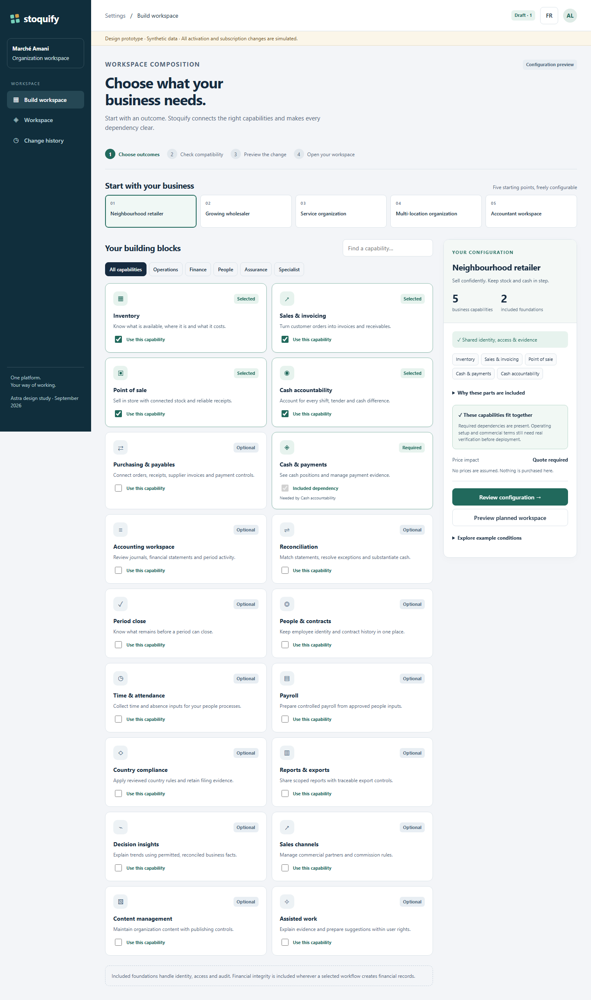
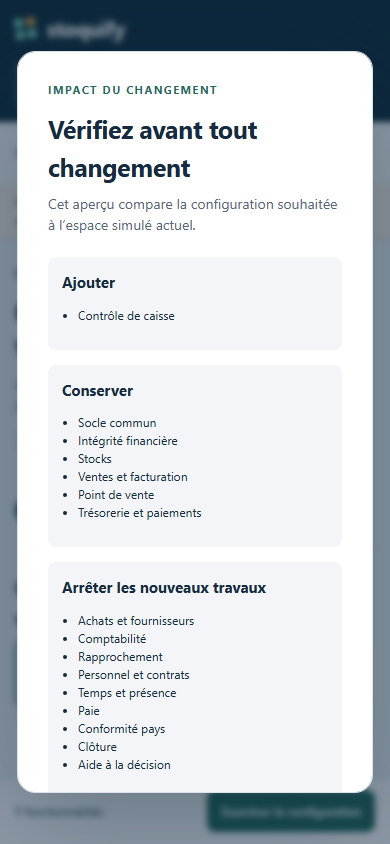
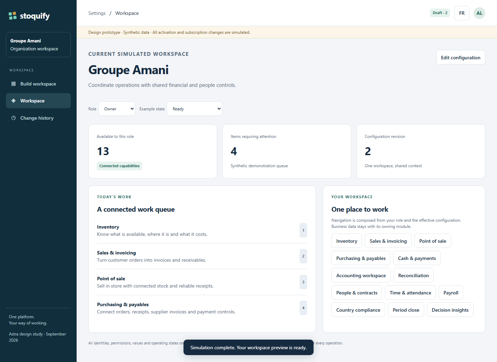

# One configuration experience and one everyday workspace

The administrator chooses outcomes and reviews changes. The employee sees permitted work in a stable shell. Neither needs to understand internal packages, database ownership or event infrastructure.

Open [the isolated prototype](prototype/index.html) in a browser. It uses synthetic organizations and records, has no backend calls, and keeps state only in memory. Reloading resets the simulation. All prices require a real quote; no purchase, real subscription update, production activation or approval takes place.

## Try two contrasting businesses

**Retailer:** select “Neighbourhood retailer.” Stock, sales, POS and cash accountability are selected; cash/payment support and internal foundations are explained. Open “Review configuration” to see additions, existing capabilities kept and capabilities removed from new work. Simulate activation to see the composed workspace. Choose Operator to see a narrower daily view.

**Service business:** select “Service organization.” It combines sales/invoicing, finance, accounting and reports. Inventory and POS remain unselected. Preview the workspace and compare the available tasks. This is the same platform with a different work configuration.

The five recipe names and organizations are fictional. Switching a recipe changes the illustrative business profile, while the observed simulation remains the comparison baseline until activation. It does not switch a real tenant. The prototype deliberately retains a previous simulated revision so additions and removals can be examined.

## Demonstrate a conflict, missing setup and recovery

1. In the builder, open **Explore example conditions** and choose the external ledger authority. Review is blocked because two authorities would own posting. “Keep the built-in ledger” resolves that illustrative conflict. A non-authoritative external export is a different future adapter design.
2. Choose **Multi-location organization**. Missing country/operating setup blocks simulated activation. “Use completed setup in this demo” supplies synthetic prerequisites. This checkbox does not approve a country pack or replace a real decision.
3. Turn off simulated commercial eligibility. The chosen configuration remains visible with an eligibility issue; no purchase occurs.
4. Enable **Simulate a provisioning failure**, review, and simulate activation. Preparation fails without changing the observed configuration. Retry completes the same draft. Open **Change history**, then reopen the earlier configuration as a new draft; history remains intact.
5. In Workspace, switch among loading, no activity, denied, unavailable, partial data and query-failed examples. A failed query is never labelled as an empty successful dataset. Change EN/FR and try the mobile review shortcut.

## Annotated wireframes

### Configuration screen

```text
┌─────────────────┬──────────────────────────────────────────────────────┐
│ 1 Organization  │ 2 Context / revision / language                     │
│                 ├──────────────────────────────────────────────────────┤
│ Build workspace │ 3 Outcome heading and four-step journey             │
│ Workspace       │ 4 Retail / wholesale / services / multi-site /       │
│ Change history  │   accountant starting points                        │
│                 ├────────────────────────────────┬─────────────────────┤
│                 │ 5 Search + business categories  │ 7 Desired summary   │
│                 │ 6 Capability cards             │ Required parts why  │
│                 │   outcome / selected / required│ Compatibility       │
│                 │   understandable dependency    │ Price consequences  │
│                 │                                │ 8 Review / preview  │
└─────────────────┴────────────────────────────────┴─────────────────────┘
```

1. The organization context is stable and conspicuous; client switching in production must refresh scope. Navigation names belong to the platform shell.
2. Revision and language provide context. The prototype's amber banner explicitly identifies simulated behavior.
3. The process is choose → check → preview → work. Production step status follows actual revision state; the prototype's builder step strip is illustrative.
4. Recipes are editable starting points, not separate applications or irrevocable subscriptions.
5. Search matches localized module names/outcomes. Filters use business categories, not service names.
6. A required dependency is visibly selected and explained. Deselect the dependent outcome to remove the requirement; disabled controls alone must never be the only explanation.
7. The summary distinguishes selectable capabilities and included foundations. Compatibility issues have practical next actions and a named underlying condition.
8. Review compares desired with observed. On small screens, a fixed review shortcut avoids scrolling past all catalogue cards. Unresolved conditions navigate to the explanation.



### Impact and activation

```text
┌─────────────────────────────────────────────────────────────┐
│ 1 Review before anything changes                            │
│ 2 Add                 3 Keep             4 Stop new work     │
│ selected outcomes     existing rights    removed capability  │
│                                                             │
│ 5 Records retained / affected workflows / conditions         │
│ 6 Actual price or quote-required / applicable approval       │
│ 7 Validation → prepare → verify → activate                   │
│                                      Back   Confirm change  │
└─────────────────────────────────────────────────────────────┘
```

The prototype shows additions, kept capabilities, removed new-work capabilities, retention explanation and simulation progress. Production adds actual object/obligation counts, costs, eligible grant intervals, required approver evidence and source revision freshness. A preview must show **both** gains and losses; this directly addresses current-code probe C07. No invitation, purchase or approval is triggered by preview.



### Everyday workspace

```text
┌─────────────────┬──────────────────────────────────────────────┐
│ Organization    │ 1 Authorized role and business context       │
│ My work         ├──────────────────────────────────────────────┤
│ Sales / Finance │ 2 Relevant indicators, each with freshness   │
│ ...only relevant│ 3 Cross-domain work queue │ 4 Useful actions │
│ destinations    │ source / owner / next step│ scoped navigation│
└─────────────────┴──────────────────────────────────────────────┘
```

The production employee shell does not expose configuration controls unless the person manages configuration. In this demonstration, builder and history remain accessible so the reviewer can explore the design; the role selector only filters synthetic workspace capabilities. It is **not production authorization**.



## Navigation, search and shared screen rules

Retain the existing shell, EN/FR messages, form primitives and canonical table patterns where suitable. The isolated HTML prototype approximates their conventions without importing live application code. Production implementation should use the repository's established components rather than create a second design system.

Every module contributes namespaced destinations to agreed business slots: Work, Operations, Finance, People, Assurance and Administration. One owner controls each route and canonical term. A supplier invoice appears in a procurement-owned view with contextual finance/reconciliation links, not three competing edit forms. Preserve current route adapters and stable deep links during migration.

Global search and a command palette should search **authorized** objects/actions through owner query contracts. Results carry organization, object type and last-updated context. Do not fetch forbidden objects and hide them afterward. A cashier receives “Open shift” or “Find receipt”; an accountant receives scoped journal/exception actions. Selecting a search result rechecks permission before opening the record. Unified search is specified here, but not implemented in this prototype beyond catalogue search.

Cross-module work items share title, owning record/reference, responsible role, due/age, severity, freshness and one primary action. They do not copy records or let the queue write directly into another domain. Deduplicate an exception by its authoritative source identity; a payment and its reconciliation exception may be related but are not the same record.

## State and content contract

| State | User message / action | Must not imply |
| --- | --- | --- |
| Loading | Identify the requested view; retain safe layout and announce progress. | That balances or counts are zero. |
| Empty | “No activity in this period”; show current scope/filters. | A failed source query succeeded. |
| Denied | Explain needed role/action and responsible owner without disclosing restricted data. | That buying the module grants the individual permission. |
| Unavailable | Identify missing selection, eligibility, dependency or setup with next action. | Generic “system error” for every restriction. |
| Partial | Show verified subset/last known values, timestamp and missing sources. | Complete/current financial truth. |
| Error | Explain failed retrieval, correlation reference and retry/support action. | A successful empty result or completed transaction. |

EN/FR labels and messages should have stable keys and domain-reviewed terminology. Locale affects formatting and language, not record identities, accounting precision or event schema. Country/legal context is distinct from UI language. Use exact currency and date/timezone context for financial decisions.

## Keyboard, mobile and accessibility acceptance

The prototype supplies a skip link, semantic headings/main/nav, labelled native controls, visible focus, live status announcements and a native modal with explicit Tab wrapping. The modal initially focuses its heading; Escape cancels before preparation, and focus returns to the initiating control. During simulated work, cancellation is withheld until a stable state is reached. Production must define real cancellation semantics rather than merely disable a button.

Cards and recipes use native buttons/checkboxes rather than custom inaccessible widgets. Selected/required states have text, not color alone. Mobile is a single-column flow with a persistent review action. At 390px, both languages have no horizontal overflow in the checked builder; the modal remains within the viewport and scrolls internally for long content.

Before production: verify 320px reflow and zoom, contrast/forced-colors, full keyboard ordering, screen-reader name/role/state and error announcements, focus after async failures, minimum target sizing under the adopted accessibility standard, translated content expansion, and touch/keyboard interaction with actual shared components. The 19 headless Chromium checks and visual inspection do not constitute WCAG or screen-reader certification.

## Demonstrator boundaries and evidence

Implemented: five presets, localized catalogue/filter/search, dependency resolution, conflict/setup/eligibility examples, impact modal, simulated preparation/failure/retry, role views, seven query states, history/draft recovery, mobile layout and keyboard behavior.

Simulated or absent: authentication, backend policy resolution, actual prices, provider calls, approved country packs, live activation, durable history, real business obligations, data exports, global object search, measured financial latency and cross-client aggregation. The standalone policy model validates illustrative operation inputs; the workspace view uses synthetic role filtering and does not call live guards.

Results: [52 model checks](evidence/model-verification.json), [19 browser checks](evidence/browser-verification.json), source probes and screenshots in `evidence/`. Earlier browser iterations corrected two test assumptions about markup/whitespace and improved modal keyboard focus. The final verified files and results are recorded in the final artifact manifest.
