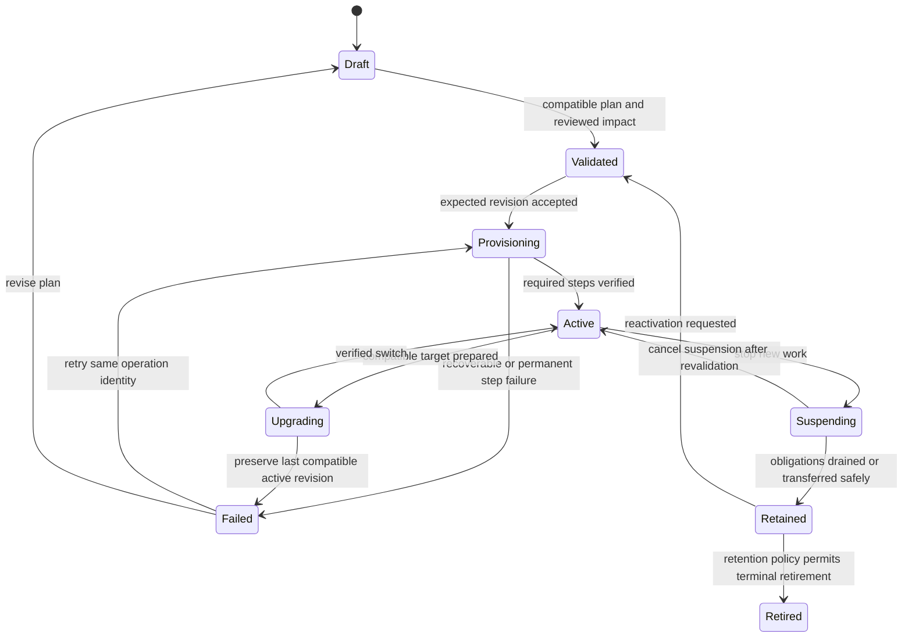
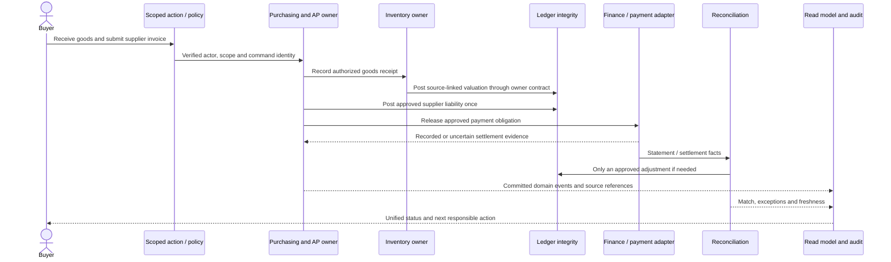
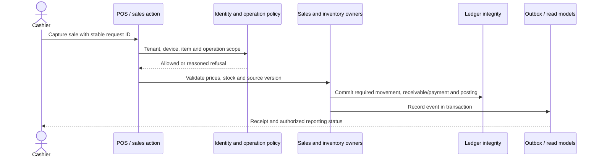
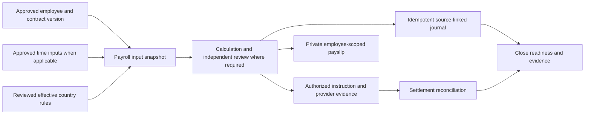
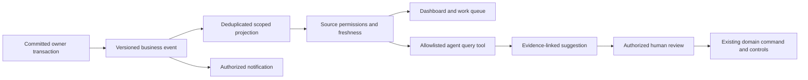

# Configuration lifecycle, access and dependable workflows

**Target design.** The current activation service has only part of this behavior. The prototype demonstrates selected states with synthetic data; it does not exercise real domain transactions, payments or approval issuance.

## Separate the facts that determine availability

| Fact | Authority | Example |
| --- | --- | --- |
| Code available | Verified deployed registry/build | Reconciliation code and compatible schema exist. |
| Commercially eligible | Resolved current grant/subscription evidence | Organization has an active reconciliation grant. |
| Selected | Desired tenant configuration revision | Administrator requested reconciliation. |
| Setup complete | Versioned provisioning and business prerequisites | Account/source mapping is verified. |
| Operationally ready | Current health and obligation state | Statement source and necessary write services are available. |
| Actor permitted | Live server identity, tenant/object scope, known permissions and domain controls | This accountant may read this account; only an authorized reviewer may confirm this match. |

Desired revision N may be validated while active observed revision N−1 remains in use. A failed preparation must not silently mark desired N active or remove N−1. “Selected,” “licensed,” “prepared,” “healthy” and “authorized” are separate fields with separate sources.

For a new business operation, evaluate existing organization + live actor/service identity + tenant/object scope + known permission + available code + applicable grant + selected capability + compatible effective dependencies + required setup + runtime requirements + domain controls. Include fresh authentication, separation of duties, account/location scope and country rules where the operation warrants them. A navigation entry only reflects this policy; it cannot replace it.

Historical reading is a deliberately separate capability. A known retained record may remain readable/exportable after commercial deactivation under the organization's adopted retention policy, but still requires a live authorized identity, original tenant/object scope, field redaction, private artifact access and any security revocation. It must not grant new writes or bypass a security suspension. An unknown/missing tenant or ambiguous entitlement history cannot obtain legacy defaults.

## Apply the same policy across surfaces

| Surface | Required enforcement point |
| --- | --- |
| Page/layout | Server-derived read capability before fetching protected data; scoped denied/unavailable state. |
| Server action | Known operation permission, tenant/object guards and current configuration; owner service rechecks invariants. |
| API | Same operation decision, status/reason mapping and private cache semantics. Client headers/body never establish tenant authority. |
| Job/export | Dedicated service or delegated identity, scoped object selection and current permission/configuration checks at execution and before an irreversible effect. Export delivery is separately private/expiring. |
| Public share link | Explicit signed/granted share capability bound to organization, record, fields, purpose and expiry. No broad inherited public module access. Revalidate revocation. |
| Provider callback | Authenticate provider, resolve tenant by trusted connection, deduplicate and execute narrowly authorized settlement/reconciliation handling. Payment received before deactivation may still need recording. |
| Offline replay | Bind device, tenant, captured intent, sequence and original command identity; validate replay/country/fiscal constraints. Hold invalid work for review rather than discarding captured facts. |
| Agent tool | Known allowlisted tool, trusted structured inputs, user/service scope and domain policy. Enabling assistance does not authorize every business module. |

Code availability, health and compatibility decisions must be explainable without leaking another tenant's existence. Protect known sensitive artifacts, especially payroll and financial exports, through private storage and authorization at delivery. Reuse the current guard architecture while correcting its inconsistent mode metadata and legacy defaults.

## Lifecycle and concurrency

**Draft and preview:** automatically compute dependency closure, additions, removals, retained capabilities, affected workflows, obligation counts and unresolved commercial/setup conditions. Preserve the exact baseline and source revisions used for preview. If they change, mark preview stale and recompute before submission.

**Validation and authorization:** a routine reversible, already-eligible selection can use existing administrator authority. Payment terms, statutory activation, a security-policy change or a materially risky deactivation uses the applicable real policy/approver. Prepare the complete review packet automatically. Do not impose a new manual approval merely because an internal dependency was added.

**Provisioning:** acquire a short lease for `(organization, revision, module, step)`, verify its input digest and perform an idempotent step. Persist status and evidence before acknowledging completion. Retry a safe unfinished step; do not repeat a successful external purchase. Failed steps preserve the last active configuration. A security revocation is immediate even while other provisioning remains in flight.

**Concurrent administrators:** save with an expected revision. A second write to an outdated revision receives a conflict and a new comparison, not last-writer-wins. Atomically switch the active revision only if the expected parent still matches and required steps are complete. Repeated requests with the same key and payload return the original outcome; reused keys with different payloads fail.

**Upgrade:** pin manifest, schema and public contract compatibility. Deploy compatible code/schema before tenant preparation. Shadow/reconcile projections, then switch at a controlled boundary. Long-running jobs retain a declared contract version but must recheck current authority. Reject stale writes if their migration/precondition is no longer valid. Incompatible versions need an explicit migration/rollback design, not a semantic-version label alone.

**Suspension/deactivation:** first stop admission of new work. Classify existing obligations and grant narrow continuation operations where policy permits. Final retained state is unavailable while unresolved obligations require the removed capability. Deactivating a dependency previews all dependent outcomes. No automatic cascading deletion or silent deactivation of dependents is permitted.

**Retirement:** terminal retirement is separate from unsubscription. It can revoke new operation contracts but cannot delete records still under required retention or legal hold. Deletion/anonymization, if later applicable, is an independent authorized records workflow. This design invents no jurisdictional retention period.

## Obligations, payment failure and recovery

| Situation | Safe behavior | What remains accessible |
| --- | --- | --- |
| Open supplier invoice/payment | Stop creating new obligations if suspended; complete/reconcile already approved settlement through scoped continuation controls. | Invoice, approval, payment evidence and authorized retained exports. |
| Payroll run approved or payment sent | Preserve immutable snapshot; reconcile uncertain payment status before another instruction. | Authorized payroll history/payslips with existing employee-field scopes. |
| Offline sales captured | Retain capture and device sequence; accept only valid fiscal replay, otherwise hold for review. Do not erase or fabricate a fresh sale. | Capture evidence and authorized exceptions; final accounting only through a valid replay. |
| Unresolved inventory movement/transfer | Preserve movements and cost source; reconcile stock/ledger effects and pending transfer obligations before final deactivation. | Historical movements and valuation evidence. |
| Period close completed | Keep close evidence and immutable period record. New authoritative corrections invalidate relevant readiness evidence and use established correction controls. | Authorized close pack and its revision history. |
| Subscription payment failed | Record commercial state; apply only an adopted grace/new-work policy. Do not infer a security breach or erase business records. | Retained history under active identity and records policy. Numeric grace period is an owner decision. |
| Security suspension/revocation | Revoke prohibited operations immediately, including retained access where required; preserve evidence privately. | Only separately authorized incident/records roles. |
| Provider timeout | Mark uncertain, query provider using the same operation reference, reconcile before retry. | Current known status and honest uncertainty, not a false success/empty result. |
| Projection/analytics outage | Authoritative writes can continue only if that projection is optional. Display dated partial information where permitted. | Last validated view with timestamp and missing-source explanation. |

Rollback restores a compatible active configuration revision and disables new writes to failed features. It does not roll back a bank payment, delete a posted journal or erase an audit record. Use business reversals/compensation for irreversible effects. Restore rehearsal, point-in-time recovery capability and source-to-ledger reconciliation are operational evidence needed before a relevant pilot, not claims established by this prototype.

## Workflow 1: purchase through cash proof

Current anchors: [AP control service](<E:/ohada saas/Focused projects/stoquify/services/purchasing/ap-control.service.ts>), [posting service](<E:/ohada saas/Focused projects/stoquify/services/accounting/posting.service.ts>), [business outbox](<E:/ohada saas/Focused projects/stoquify/services/events/business-event-outbox.service.ts>). The target below adapts their ownership; it is not a newly implemented distributed workflow.

Goods receipt and corresponding mandatory valuation/posting effects use a defined atomic local command boundary; supplier invoicing and subsequent payment are distinct business steps, each with its own transaction/idempotency identity. Service acceptance bypasses stock and must not invent inventory movements. Three-way matching and approval remain in AP. The work queue links the same supplier invoice, receipt, payment and match identities, eliminating duplicated manually created records.

## Workflow 2: sale/POS through reporting

Immediate tender and credit sale differ; finance owns settlement evidence and sales owns receivable origin. A duplicate sale/replay must resolve to the original business result. Cost-of-goods reporting reads immutable valuation/posting sources, not today's mutable item cost; that correction is carried from the earlier Astra review. Offline capture is an intermediate recorded fact, not a claim that all accounting/fiscal effects already succeeded. [Current offline service](<E:/ohada saas/Focused projects/stoquify/services/pos/offline-sync.service.ts>)

## Workflow 3: employee inputs through payroll and close

The payroll owner consumes approved source versions, freezes the run and records approval separately from execution. Paying does not recalculate the run against later employee values. Missing employee/country evidence blocks calculation/approval where required; an unavailable optional attendance module is acceptable only for a validated non-time-input payroll profile. A provider outage holds the payment stage, not the fact that an approved run exists. Close receives current posted/payment evidence and invalidates readiness if a relevant authoritative correction occurs. [Current payroll controls](<E:/ohada saas/Focused projects/stoquify/services/payroll/payroll-control.service.ts>)

## Workflow 4: business events through insights and assistance

Projection subscriptions specify event/version and organization scope. Notifications disclose only fields their recipient may see. Agent input text is untrusted; it cannot supply authoritative permissions, approval evidence or tool routing. The initial module supports explanations and suggestions. Any later write-capable agent must pass the same permission, domain approval and release policies as the corresponding human operation. Preserve current policy checks and address resource cancellation separately from a timeout response. [Current agent policy](<E:/ohada saas/Focused projects/stoquify/services/agents/agent-policy.service.ts>)

## Absence and failure matrix

| Workflow | Related module absent | Inactive/suspended | Temporarily unavailable | Upgrade in progress |
| --- | --- | --- | --- | --- |
| Purchase to reconciliation | Service buying can omit inventory; goods receipt cannot. Optional reconciliation absence leaves proof work explicit, not falsely complete. | New dependent commands stop; approved payment/receipt obligations require scoped completion or a held exception. | Hold required stock/posting/payment stage; optional views show partial status and retry. | Pin valid contract/source versions; drain or hold affected stages; no duplicate obligation creation. |
| Sale/POS to reporting | Service invoicing can omit inventory/POS; goods checkout cannot. Reporting UI is optional, accounting integrity is not. | Stop new checkout; retain receipts and handle valid captured replay as an obligation. | Required stock/ledger failure prevents online commit; offline uses its separately approved capture contract. Optional analytics can lag. | Preserve supported offline schema and request identity; incompatible replay is held for review. |
| Payroll to close | HRIS and required country/ledger capabilities mandatory; presence conditional; finance execution adapter required for actual payments. | Stop new runs; retain and reconcile approved runs/payments under narrow continuation rules. | Hold dependent stage; never represent failed payroll data retrieval as zero employees or zero pay. | Pin run/rule versions; never recalculate approved history implicitly; test existing payslip/close links. |
| Events to analytics/agents | Unselected consumer performs no work; events remain under retention policy for permitted later rebuild. | Stop new consumer work; revoke tools and sensitive cache scope. | Retry with bounds, expose lag and dead letters; no success-shaped empty metrics. | Support declared event versions/upcasters and checkpoint replay; recheck authority before delivery. |

## Governance and operational evidence

The native approval register remains a blueprint with operating guidance; a local provider simulator also exists. Neither establishes real authority. Reuse the existing register design for verified appointments, exact decision revisions, fresh-auth signing events, record IDs, permanent reviewer-accessible URIs and revocation. The provider automation delegation policy (`STOQ-X1-POL-004`) is distinct from a native human decision; do not manufacture provider references for one.

A source-record URI resolves to the authenticated record and verification evidence, not merely a public PDF path. Content hashes bind the signed version; they do not prove who signed. Routine module drafts can proceed while establishment is pending. X1 needs real scoped decisions plus current technical evidence that satisfies the agreed contract; this design's simulated checkboxes cannot supply either.

Operations should expose desired/observed revision, pending/failed setup, per-source freshness, event lag, deduplication outcomes and safe reason codes. Budget long exports, provider work and agent runs per organization; address the earlier process-local limiter and silent-log findings before relying on multi-instance fairness or alerts. Store credentials through the configured secret/workload identity path. Backups and restore tests must cover business state, configuration history, evidence objects and event checkpoints coherently.

Internal modules are reviewed application code with controlled imports and a common deployment trust boundary. A future third-party executable extension requires separate isolation, capability-scoped identity, network/filesystem restrictions, signed distribution, quotas, revocation and incident ownership. A marketplace UI alone provides none of those guarantees.
