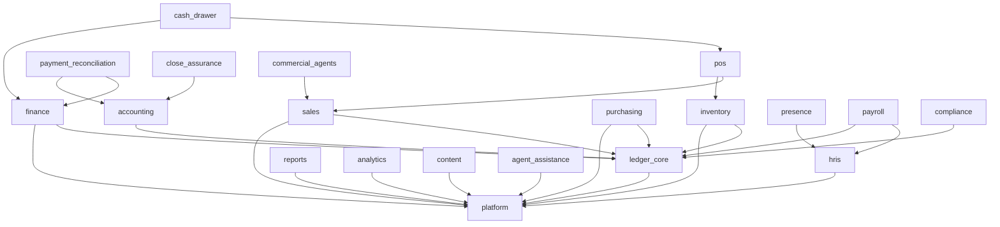

# Modules, ownership and customer configurations

All entries below describe the **target design**. The executable sample manifests are in [module-manifests.json](evidence/module-manifests.json). Their `1.0.0` versions, conceptual entity names, new permission names, prototype routes and meters are illustrative contract examples, not released products, current Prisma model names, approved offers or callable endpoints.

The 20 entries comprise two included internal foundations and 18 selectable modules. Production migration retains the 19 existing canonical slugs through a mapping; three current core slugs map to `platform`, and HRIS and assisted work gain explicit boundaries. A selectable module may be bundled without separate pricing. Internal dependencies must not become surprise purchases.

## Ownership catalogue

| ID / domain owner | Outcome and authoritative responsibility | Required modules in example | Optional or conditional relationship | Legacy mapping |
| --- | --- | --- | --- | --- |
| `platform` / Platform | One organization context, identity references, configuration revisions, authorization infrastructure and audit. Existing IAM remains authoritative. | None; universal. | Private artifact/notification infrastructure activated where needed. | dashboard, settings, administration |
| `ledger_core` / Accounting | Balanced journals, source-posting links, reversals and period locks. Never duplicates existing posting services. | platform | Country-rule engine required for the underlying activity. | New logical boundary within existing accounting. |
| `inventory` / Inventory | Item/stock movements and valuation evidence; authoritative quantities by location. | platform, ledger_core | Procurement produces authorized receipt requests; POS/sales consume inventory commands. | inventory |
| `sales` / Revenue | Sales orders, invoices and receivable-origin facts. Settlement evidence is supplied by finance. | platform, ledger_core | Inventory required only for goods fulfillment. Service invoices remain valid without stock. | sales |
| `pos` / Revenue | Retail checkout, shift/sale capture and offline synchronization envelope. | sales, inventory | Example is goods retail; a service-only checkout profile requires its own validated contract. | pos |
| `cash_drawer` / Finance | Cash shift accountability and tender differences. Does not own the general ledger. | pos, finance | Required only where cash-shift operation is selected. | cash_drawer |
| `purchasing` / Procurement | Orders, supplier invoices, matching/approval and authorized supplier-payment obligations. | platform, ledger_core | Goods receipt requires inventory; service acceptance does not. Execution/evidence of settlement uses finance/payment adapter. | purchasing |
| `finance` / Finance | Cash accounts, payment transactions and settlement evidence. Reads AP/AR obligations through their owners. | platform, ledger_core | Provider adapters require actual scoped connections; reconciliation is an extension. | finance |
| `accounting` / Accounting | Journal review, adjustments through ledger commands, trial balance and financial statements. | ledger_core | Close adds review workflow. Workspace does not become a second journal writer. | accounting |
| `payment_reconciliation` / Finance | Matching, exceptions, suspense resolution and sign-off records. | finance, accounting | Bank/import adapter required for the chosen evidence source. Preserve current dependencies initially. | payment_reconciliation |
| `close_assurance` / Accounting | Period-readiness review, source evidence and close decisions. | accounting | Reconciliation required where a period includes accounts demanding it; otherwise conditional with recorded applicability. | close_assurance |
| `hris` / People | Employee identity, contracts and employment-history source truth; narrow private fields. | platform | User accounts link to employees without exposing employee records to every user administrator. | New module ID over existing HRIS services. |
| `presence` / People | Attendance, leave and approved time inputs. | hris | Payroll consumes approved inputs when time-based compensation applies. | presence |
| `payroll` / People | Versioned runs, approved calculation snapshots, payslips and payroll-payment instructions. | hris, ledger_core | Presence optional for fixed-input models; payment execution needs finance/approved adapter; country rules and responsible owner mandatory. | payroll |
| `compliance` / Compliance | Declaration preparation, fiscal evidence and filing lifecycle. | ledger_core | Country pack and filing adapter specific to operation; required legal controls of other modules remain included independently. | compliance |
| `reports` / Data | Report definitions, controlled export requests and presentation. Owns no duplicate business ledger. | platform | Every report declares source capabilities, permissions, fields and freshness. | reports |
| `analytics` / Data | Versioned metric definitions and rebuildable projections. Business sources remain authoritative. | platform | Reports optional; a metric requires each of its declared source queries and access scopes. | analytics |
| `commercial_agents` / Revenue | Sales-channel agreements, attribution and commission approvals. | sales | Settlement invokes finance and ledger; these are human commercial partners, distinct from AI agents. | commercial_agents |
| `content` / Growth | Editorial records and publishing lifecycle. | platform | Public publishing is explicit; business records never become public through this module. | content |
| `agent_assistance` / AI | Run/tool audit and bounded suggestions derived from authorized evidence. | platform | Every invoked source capability and agent policy must allow the operation; read-only business assistance initially. | New module ID over existing agent services. |

Each example manifest declares an owner, dependencies, owned logical data, a representative command/query/event, scoped permissions, provisioning policy, health indicators, retention and reactivation behavior. Foundations have infrastructure interfaces even where they have no navigation or price. These representative interfaces are not an exhaustive domain API. A production manifest must enumerate every exposed surface and operation before pilot enforcement.

## Required dependency diagram

Arrows mean “requires.” These are the example module-level edges; operation-specific conditions below are additional.

The prototype checks module-level edges and a small set of setup prerequisites. It does not implement every conditional business rule. In production, selling a stock item requires `inventory.reserve/move` even if a service-only sales configuration was valid earlier. A financial metric does not become visible merely because analytics is selected. These conditions belong to the manifest's capability/operation contract and the domain service's invariant checks.

## Shared data without shared ownership confusion

| Shared reference | Authoritative owner | How other modules use it |
| --- | --- | --- |
| Organization, entity, location | Platform organization domain | Server-derived scoped IDs; cross-organization references rejected. |
| Verified user and role | Existing IAM | Actor identity and known permission decisions; employee details are separate. |
| Business party identity | Existing customer/supplier owner adapted to a deliberate directory contract | Preserve stable IDs; domain-specific credit, payable and tax terms remain domain-owned. Do not merge existing tables speculatively. |
| Item and location stock | Inventory | Sales/POS request authorized movements; purchasing supplies receipt evidence. |
| Employee and contract | HRIS | Payroll consumes approved snapshots; reports receive only permitted fields. |
| Journal and accounting source link | Ledger integrity services | Domains request idempotent posting; accounting UI and reports query it. |
| Payment settlement | Finance | AP/AR/payroll link obligations to settlements; reconciliation substantiates rather than re-creates payment truth. |
| Country rules/version | Regulatory country-pack service | Effective dated rules and evidence hashes pinned to relevant source documents. |

## Customer configurations

These examples have no assumed prices, real customers, licensed entitlements or approved country scope. Resolved manifests and ordering are captured in [configuration-examples.json](evidence/configuration-examples.json).

### 1. Neighbourhood retailer — Marché Amani

**Outcome:** sell goods, keep stock accurate and reconcile a cashier's shift. Select inventory, sales, POS and cash accountability. Finance is included by the cash-accountability dependency. The platform and financial integrity are included foundations. The user sees five business capabilities rather than internal services.

**Operating conditions:** a real stock location, tender configuration, controlled opening balances and applicable receipt/country setup. Cashier permissions do not grant journal administration. Offline capture requires a separately verified device/replay profile.

**Optional extensions and growth:** purchasing when supplier orders become material; reconciliation when statement-based cash proof is needed; accounting/close workspace when formal review expands; multi-location operations after scoped stock and transfer evidence. Removing POS stops new checkout but retains receipts and queued obligations under the lifecycle policy.

### 2. Growing wholesaler — Amani Distribution

**Outcome:** connect purchasing, stock, customer credit, supplier obligations and cash proof. Select inventory, sales, purchasing, finance, accounting and reconciliation. Platform and ledger integrity are required foundations.

**Operating conditions:** validated goods receipts, payable approval, customer/supplier scope and source-linked settlements. Payment approval and execution retain existing maker/checker boundaries. A bank connection is an adapter with separate credential and evidence prerequisites.

**Optional extensions and growth:** controlled close, analytics and commercial-agent commission workflows; multiple locations after transfer ownership/reconciliation is established. Import volumes may justify a dedicated worker, not a separate deployment of every module.

### 3. Service organization — Atelier Conseil

**Outcome:** invoice services, track receipts, review journals and share authorized reports. Select sales, finance, accounting and reports. Platform and ledger integrity are included. Inventory, POS, purchasing and payroll are absent from the everyday workspace.

**Operating conditions:** service invoices cannot invoke goods fulfillment without adding inventory. Reports still require the relevant invoice/cash/journal permissions. Country rules required for invoicing remain effective regardless of whether the compliance workspace is selected.

**Optional extensions and growth:** reconciliation for bank evidence, purchasing for service suppliers, HRIS/payroll for employees. Selecting payroll brings its real source-data and country prerequisites; it does not silently create employees, accept payroll inputs or buy a subscription.

### 4. Multi-location organization — Groupe Amani

**Outcome:** coordinate locations, procurement, people and financial close. Select inventory, sales, POS, purchasing, finance, accounting, reconciliation, HRIS, presence, payroll, compliance, close and analytics. Cash accountability is an explicit extension where cash shifts apply. Platform and ledger integrity are included.

**Operating conditions:** entity/location scopes, reviewed country packs, approved payroll inputs, explicit inter-entity and transfer rules, named operational owners and reliable event/recovery processes. Cross-location visibility is not permission to cross legal entities. The prototype initially blocks this configuration on missing setup; its checkbox is synthetic only.

**Expansion:** add countries only with applicable reviewed rules and migration evidence; add capacity through measured worker isolation and scoped quotas. A new location should not require duplicating the organization identity, ledger or catalogue.

### 5. Accountant workspace — Cabinet Horizon, Client A

**Outcome:** review a client's journals, closing readiness and reports. Example tenant capabilities are accounting, close and reports, plus required foundations. The accountant accesses them through an existing invitation/authority relationship and object scopes.

**Operating conditions:** client switching refreshes server-derived context and clears scoped caches. A client must have the relevant capabilities and grant the accountant the relevant permissions. A future cross-client summary must derive each cell through its own client authorization and must not expose another client's records or identifiers. This design demonstrates one client at a time.

**Expansion:** client-approved reconciliation and financial review, with explicit revocation and retained evidence. “Accountant” is a role view, not a twentieth-first module or an entitlement bypass.

## Packaging and lifecycle principles

Package versions reference capabilities and compatible module versions; subscriptions provide commercial eligibility for a defined term. Tenant administrators select a configuration within that eligibility, while each person's access remains separately authorized. Required dependencies are shown in the quote/impact preview, including any commercial consequences, before acceptance. No automatic purchase or acceptance of terms is implied by dependency resolution.

Possible meters include active POS terminals, processed payroll employees, organization-level features and bounded export/agent usage. These are illustrative units, not prices or approved billing definitions. A production meter needs a precise event source, tenant scope, deduplication rule, billing period and dispute process. Do not meter internal retries or count the same capability twice because it belongs to two packages. Shared grants must remain active when one package ends but another valid agreement still covers them.

Trials are explicit grants with dates, scope and limits. Expiry changes new-work eligibility according to an adopted policy; it does not erase invoices or payroll history. Upgrades use a reviewed quote and a new desired revision. Deactivation drains obligations, retains scoped records and supports reactivation after current compatibility/setup checks. Domain-specific obligations and retention are detailed in [LIFECYCLE_AND_CONTROLS](LIFECYCLE_AND_CONTROLS.md).
