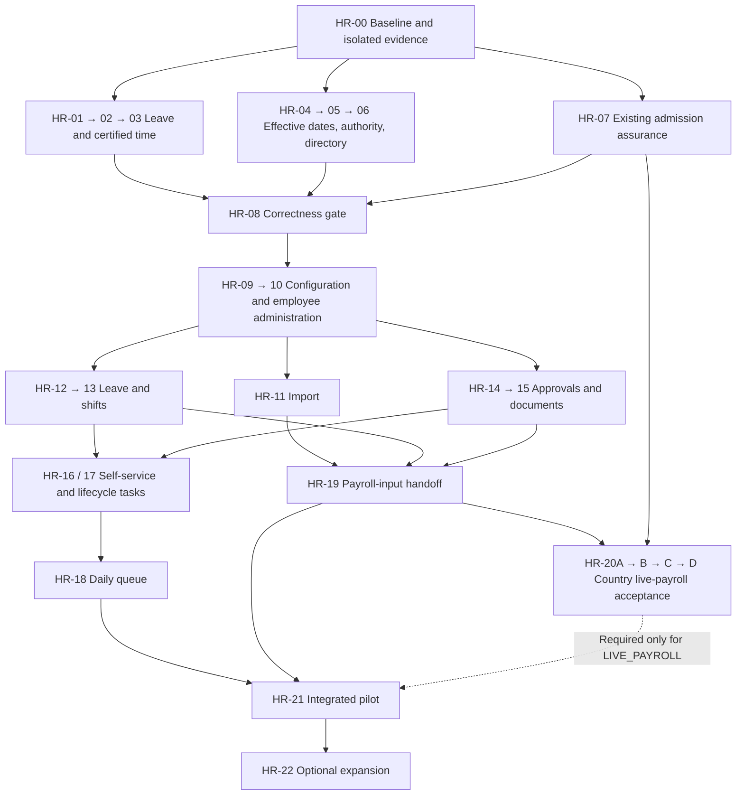

# HRIS implementation plan and ordered execution prompts

**Prepared:** 24 October 2026. **Audience:** product owner, HR operations, engineering, QA and country payroll reviewers. **Target:** 1–200 employees, OHADA zone, office and shift work, general-purpose HR. **Status:** PLANNED — no implementation prompt in this package has been executed.

The recommended sequence is to repair the correctness boundaries, verify them, complete daily HR workflows, and then pilot the selected operating mode. Keep the existing employee, payroll, approval and evidence foundations. The plan does not call for a replacement HRIS.

This package contains **26 bounded execution prompts**, their dependency graph, acceptance criteria, ownership, relative effort, evidence requirements and rollback conditions. The first nine prompts establish and verify the critical correctness baseline. [Shared execution contract](EXECUTION_CONTRACT.md) · [Planning manifest](plan.json) · [Source assessment](../hris-assessment-ohada-1-200-2026-10-24.md)

## 1. Evidence and decisions that govern execution

The assessment baseline is commit `9ab93a2a1d81e37ef7e0b10357885b48a3bc5886` plus inherited local modifications. This is a source-informed follow-up plan, not an assertion that defects remain unchanged on a future branch. Reproduce each finding at execution time. The assessment recorded source inspection, 27 passing mocked tests and limited local superadmin browser checks. It did not establish real-database concurrency correctness, full role-based journeys, mobile accessibility, country compliance or production readiness.

The product target is wider than the current technical payroll envelope. Preserve Cameroon/monthly/single-employer admission until a deliberately reviewed expansion passes its own gate. An OHADA market target is not a uniform employment or payroll ruleset. Country-specific legal conclusions must be checked with current authoritative evidence and qualified review in the country lane.

**Two delivery modes:**
- **HR_CORE_WITH_HANDOFF:** employee administration, schedules, time/leave, approvals, documents, self-service, lifecycle tasks, daily work queue and a versioned payroll-input package. Automated payroll effects remain restricted by existing admission. The pilot does not wait for every future country's payroll engine.
- **LIVE_PAYROLL:** everything in the core mode plus HR-20A–D for the exact country/employer/frequency/period, followed by HR-21 acceptance. A prepared export, draft pack or passing unit suite cannot enable this mode.

No exact launch country, pilot employer, attendance source, payroll recipient, legal-employer structure or reviewer identities have been provided. These decisions are required at their dependent slices, not before generic correctness repairs.

## 2. Critical correctness work first

| Prompt | Assessment connection | First decisive acceptance example |
|---|---|---|
| [HR-01](prompts/HR-01.md) | F02/E05/E07 | With 480 minutes available, two concurrent independent 360-minute debits cannot both commit; the resulting ledger and response agree. |
| [HR-02](prompts/HR-02.md) | F01/E06 | A synthetic 360→480 minute approved correction produces 480 in the correct new certified revision; pending/rejected corrections produce no change. |
| [HR-03](prompts/HR-03.md) | F01/F02/E06/E07 | For a synthetic two-period leave request totaling 960 scheduled minutes, allocations of 480 and 480 sum to 960; boundary replays do not add minutes. |
| [HR-04](prompts/HR-04.md) | F03/E04 | Approving/applying a termination effective tomorrow leaves today's status and eligible period data unchanged. |
| [HR-05](prompts/HR-05.md) | F04/E03/E10 | The second, 51st and 200th authorized report are accessible regardless of page size/order. |
| [HR-06](prompts/HR-06.md) | F04/E02 | Datasets of 0/1/50/51/100/200 return correct scoped counts; the last employee is directly searchable. |
| [HR-07](prompts/HR-07.md) | F05/E12 | Every inventoried new-effect path denies unsupported evidence before ledger/payslip/payment/queue/provider effects. |

[HR-00](prompts/HR-00.md) first reconciles the current baseline, transaction owners and isolated verification environment. [HR-08](prompts/HR-08.md) then closes the aggregate correctness gate. HR-07 verifies an **existing** production-admission implementation; it does not commission a duplicate gate. Historical internal engineering completion and new release acceptance are different claims.

## 3. Ordered backlog and hard dependencies

Follow the listed order by default. Dependencies are direct prerequisites for verified integration/rollout; transitive prerequisites also apply. The list allows safe discovery or unit preparation if a test environment is unavailable, but not a false VERIFIED status. Execute only the selected prompt unless a larger sequence is explicitly requested.

Effort bands are relative implementation/review scope, not calendar promises: **S** bounded preparation or small change; **M** one domain/flow; **L** multiple coherent child slices or external review. M–L signals uncertainty to resolve during inspection. Large prompts must be split into named child slices with their own entry/exit evidence before coding. Re-estimate after HR-00 and the first accepted correctness changes; no delivery dates are justified yet.

| Order / prompt | Intended outcome | Direct dependencies | Relative effort |
|---|---|---|---|
| [HR-00](prompts/HR-00.md) | Reconcile baseline and prepare isolated verification | None | S |
| [HR-01](prompts/HR-01.md) | Make leave ledger and audit atomic under concurrent debits | HR-00 | M |
| [HR-02](prompts/HR-02.md) | Connect approved attendance corrections to certified revisions | HR-01 | M–L |
| [HR-03](prompts/HR-03.md) | Allocate leave and overtime to the correct work periods | HR-01, HR-02 | M |
| [HR-04](prompts/HR-04.md) | Apply employment changes at their effective time | HR-00 | M–L |
| [HR-05](prompts/HR-05.md) | Make manager authorization exact and temporally consistent | HR-04 | M |
| [HR-06](prompts/HR-06.md) | Deliver complete server-side People discovery | HR-05 | M |
| [HR-07](prompts/HR-07.md) | Verify existing payroll admission across all effect boundaries | HR-00 | M |
| [HR-08](prompts/HR-08.md) | Close the critical correctness gate | HR-01, HR-02, HR-03, HR-04, HR-05, HR-06, HR-07 | M |
| [HR-09](prompts/HR-09.md) | Make organization, policies and reviewer setup operable | HR-08 | M |
| [HR-10](prompts/HR-10.md) | Complete guided employee, contract and compensation administration | HR-09 | L |
| [HR-11](prompts/HR-11.md) | Deliver safe employee import and reconciliation | HR-10 | M |
| [HR-12](prompts/HR-12.md) | Make leave entitlements and balances operational | HR-10, HR-01, HR-03 | M–L |
| [HR-13](prompts/HR-13.md) | Deliver office and shift scheduling with attendance closure | HR-10, HR-12, HR-02, HR-03 | L |
| [HR-14](prompts/HR-14.md) | Replace evidence-hash entry with usable controlled approvals | HR-10, HR-12 | M |
| [HR-15](prompts/HR-15.md) | Deliver secure employee documents and expiry handling | HR-10, HR-14 | L |
| [HR-16](prompts/HR-16.md) | Complete employee self-service and personal-data correction cases | HR-12, HR-13, HR-14, HR-15 | L |
| [HR-17](prompts/HR-17.md) | Make onboarding and offboarding tasks accountable | HR-04, HR-10, HR-14, HR-15 | M–L |
| [HR-18](prompts/HR-18.md) | Build the daily HR work queue and trustworthy operating metrics | HR-13, HR-14, HR-16, HR-17 | M |
| [HR-19](prompts/HR-19.md) | Complete payroll-input readiness and external handoff | HR-08, HR-11, HR-12, HR-13, HR-14 | M–L |
| [HR-20A](prompts/HR-20A.md) | Establish the first live-payroll country's approved rule contract | HR-07, HR-19 | L |
| [HR-20B](prompts/HR-20B.md) | Close contribution, tax, rounding and year-to-date computation gaps | HR-20A | L |
| [HR-20C](prompts/HR-20C.md) | Close employment-segment and proration computation gaps | HR-20B, HR-03, HR-04 | M–L |
| [HR-20D](prompts/HR-20D.md) | Validate declarations, settlement evidence and accounting tie-out | HR-20C | L |
| [HR-21](prompts/HR-21.md) | Run the integrated core-HR pilot and make the launch decision | HR-11, HR-16, HR-17, HR-18, HR-19 | L |
| [HR-22](prompts/HR-22.md) | Qualify each additional country or advanced capability | HR-21 | M per discovery; implementation estimated separately |

For **core HR**, execute HR-00 through HR-19, then HR-21. Skip HR-20A–D unless live payroll is selected. HR-22 is optional expansion after the pilot. For **live payroll**, execute HR-20A–D before HR-21. The conditional prerequisite is recorded in the manifest as well as the pilot prompt.

## 4. Dependency map and delivery gates

The diagram groups work for readability; the dependency table and manifest are authoritative for exact edges. Branches describe logical dependencies, not an instruction to run agents or mutate shared files concurrently.

| Gate | Evidence needed | Allowed next outcome |
|---|---|---|
| Baseline ready: HR-00 | Current reproduction/writer map; reviewed commands; identified isolated target, with authorization before provisioning | Bounded fixes and appropriate tests |
| Correctness accepted: HR-08 | HR-01–07 acceptance, real-database concurrency/rollback, affected role/browser evidence | New everyday HR workflows built on the repaired contracts |
| Core operating candidate: HR-19 plus HR-11/16/17/18 | Complete workflows and reconciled input handoff | HR-21 core pilot |
| Country payroll candidate: HR-20D | Qualified rule contract, deterministic calculations, segments, output/settlement/accounting evidence | HR-21 live-payroll pilot for exact envelope |
| Pilot accepted: HR-21 | Current end-to-end role acceptance, recovery, training, migration reconciliation and accountable decision | Separately authorized named rollout |
| Expansion qualified: HR-22 | Specific demand, policy/country review and bounded acceptance scope | New scoped implementation and renewed gate |

## 5. How to run a prompt

1. Open the linked prompt and the shared execution contract.
2. Confirm its dependencies and unresolved decisions against current evidence.
3. Submit the prompt to the implementation session. It contains the mission, known baseline, evidence paths, ordered tasks, acceptance IDs, verification, data/release controls and exact evidence output locations.
4. Execute one bounded slice; retain the current repository architecture and unrelated edits.
5. Append evidence/status to the existing execution document, then choose the next eligible slice.

A short launch instruction is:

> Execute HR-01 from docs/payroll-HRIS/implementation-2026-10-24/prompts/HR-01.md under its shared execution contract. Confirm HR-00 entry evidence, reproduce the current defect, implement only the bounded fix, run the reviewed verification lanes, and save the acceptance evidence. Do not mark database concurrency acceptance complete from mocked tests.

Use [HR-00](prompts/HR-00.md) as the actual starting prompt; the HR-01 example illustrates launching a subsequent slice. These are implementation prompts for future execution, not evidence that work has already occurred.

## 6. Ownership and sequencing safeguards

Each prompt names its accountable delivery role; an actual person/team must be assigned during execution. The product owner owns scope and pilot outcomes; the HR operator owns workflow acceptance; engineering owns service/data correctness; QA owns evidence quality; qualified country reviewers own statutory interpretations; the release owner owns activation.

Maintain one active slice by default. Particular shared-file sequences are:
- Leave ledger/operational time: HR-01 → HR-02 → HR-03, later HR-12/13/19.
- Employee/org/read models: HR-04 → HR-05 → HR-06, later HR-09/10/16/18.
- Approval contracts/UI: HR-14 before document and self-service completion.
- Payroll admission/calculation/effects: HR-07 before the conditional country lane.

When a slice reveals a new critical correctness defect, record it, narrow the affected operations and insert a dependency with a bounded prompt. Do not conceal it in a cosmetic task or widen the current change into a platform rewrite. Update the plan only with traceable rationale.

The existing [October execution document](../../ecc/cameroon-blueprint-execution-2026-10-07.md) receives future dated follow-up status/evidence. This package's [plan.json](plan.json) records planned scope/dependencies only. It is not another authoritative execution register. Preserve the historical [Trust Spine completion register](../../HRIS-Payroll/payroll-trust-spine-execution/EXECUTION_REGISTER.md).

## 7. Crosswalk to the earlier program

| Earlier blueprint tranche | Follow-up prompts | Treatment |
|---|---|---|
| 00 / 00b scope and test environment | HR-00 | Refresh current baseline and evidence access |
| 01 production admission | HR-07 | Verify existing implementation and close actual remaining gaps |
| 02 directory / 03 manager authority | HR-05/06/09/11 | Exact scope, complete discovery, usable setup/import |
| 04 corrections / 05 ledger / 05b entitlement | HR-01/02/03/12/13/19 | Correctness first, then operating flow |
| 06 effective employment | HR-04/10/17 | Scheduled facts, authoring and accountable lifecycle tasks |
| 07–10 bases/tax/charges/segments | HR-20A/B/C | Conditional reviewed country work; reproduce current gaps |
| 11 authority output/tie-out | HR-19/20D | Separate generic input handoff from statutory output acceptance |
| 12 documents/self-service / 13 operator UX | HR-14/15/16/18 | Complete usable, scoped daily workflows |
| 14 integrated acceptance / 15 next country | HR-21/22 | Explicit delivery mode and per-country expansion |

Use the [canonical blueprint in plans](../../../plans/stoquify-cameroon-hris-payroll-blueprint-2026-10-07.md). Older scope of 10–250 employees is superseded by the user's 1–200 product target; proven technical controls and statutory restrictions are retained.

## 8. Practical success measures

Measure the current baseline during HR-00/21 rather than inventing savings:
- **Correctness:** zero overspent balances from allowed concurrent operations; zero duplicate ledger/provider effects in tested retries; complete revision lineage.
- **Discovery:** all authorized 200 employees searchable with truthful scoped counts.
- **Usability:** pilot HR can complete every mandatory supported journey without database edits or developer intervention.
- **Workforce closure:** unresolved material attendance exceptions block certification; resolved cases produce reconciled current inputs.
- **Service:** each case/task has an owner, state and next action; establish pilot response-time targets after observing workload.
- **Adoption/value:** compare measured time to onboard, close attendance, prepare payroll inputs and answer employee requests before/after the pilot.
- **Operations:** tested recovery instructions, named support owner and no false successful status during failures.

These are acceptance outcomes and measurement proposals, not claimed business improvements. Defer recruitment suites, advanced performance/training, predictive employee scoring, biometric attendance and broad regional payroll until core evidence and customer demand justify them.

## 9. Package validation and limits

The workflow-contract check passed during preparation; it reported 196 unclassified scripts, which still need side-effect review before use. The earlier assessment's four suites/27 mocked tests were not rerun for this document-only planning step.

The package's dependency graph, conditional pilot gate, required prompt sections, repository evidence paths and local links are checked separately and recorded in VALIDATION.md. No application/database/browser implementation acceptance is created by this plan. No application code, schema, live HR records or existing execution statuses are changed.
