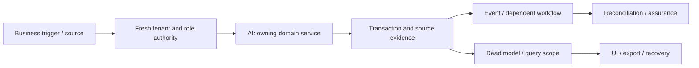

# AI, command agents and proposal governance: review and plan of action

**Prepared:** 8 September 2026. **Package:** AI. **Status:** SOURCE_REVIEW_AND_FOCUSED_VERIFICATION; implementation not started by this run.

## 1. Assessment and scope

This is a source review and focused local verification, not a full runtime certification. Database clients in the selected tests are mocked or injected. No deployed database, authenticated browser, live provider, production telemetry, restore rehearsal or qualified statutory approval was inspected in this run. Unexecuted scenarios below are acceptance requirements, not test results. No application code, migration, business record or deployment is changed by this report.

**Accountable roles:** Agent engineering, domain owner and independent assurance. **Catalog coverage:** Cross-module workflow; not a standalone catalog promise.

**Selected verification:** 13 passed, 0 failed in the selected suite. [Test source](<E:/ohada saas/Focused projects/stoquify/services/ai/__tests__/copilot-proposal.service.test.ts>). No additional defect was confirmed in the selected slice; that is not evidence that the complete module is correct.

The highest-risk review questions are definitions and deterministic rules are not proof of autonomous AI functionality; bind proposals to current run/source facts and reject invented permissions or routes; test denial, untrusted content isolation, suspension and cost boundaries.

## 2. Source and architecture map

The source inventory contains 65 matching files, including tests and supporting files. 5 sources were hashed and indexed for targeted review. Prefix inventory counts are discovery aids, not reviewed-file counts. The full list and source hashes are in [the source manifest](<E:/ohada saas/Focused projects/stoquify/what-next/platform-module-audit/2026-09-08-run-01/source-manifest.json>).

| Layer | Current source/navigation anchor | Evidence boundary |
|---|---|---|
| services | [services/ai/copilot-proposal.service.ts](<E:/ohada saas/Focused projects/stoquify/services/ai/copilot-proposal.service.ts:1>) | 493 lines; SHA-256 37e34c4f1b84… |
| components | [components/copilot/CopilotProposalControls.tsx](<E:/ohada saas/Focused projects/stoquify/components/copilot/CopilotProposalControls.tsx:3>) | 202 lines; SHA-256 6c95df1a1cfb… |
| actions | [actions/ai/copilot-proposal.actions.ts](<E:/ohada saas/Focused projects/stoquify/actions/ai/copilot-proposal.actions.ts:3>) | 137 lines; SHA-256 66baa4a61a59… |
| actions | [actions/agents/command-agent.actions.ts](<E:/ohada saas/Focused projects/stoquify/actions/agents/command-agent.actions.ts:3>) | 151 lines; SHA-256 fc7604273544… |
| components | [components/agents/AgentCommandPanel.tsx](<E:/ohada saas/Focused projects/stoquify/components/agents/AgentCommandPanel.tsx:3>) | 511 lines; SHA-256 38426c53fbbe… |

Route/API paths must be expanded from callers; absence from the selected prefix inventory is not a declaration that none exist.

### Data declarations

| Schema model | Selected declared storage/relationship facts |
|---|---|
| [AgentDefinition](<E:/ohada saas/Focused projects/stoquify/prisma/schema.prisma:9449>) | @@index([ownerModuleSlug, status]); @@map("agent_definitions") |
| [AgentToolDefinition](<E:/ohada saas/Focused projects/stoquify/prisma/schema.prisma:9488>) | @@index([moduleSlug, status]); @@map("agent_tool_definitions") |
| [AgentRun](<E:/ohada saas/Focused projects/stoquify/prisma/schema.prisma:9508>) | organization      Organization     @relation(fields: [organizationId], references: [id], onDelete: Cascade); agentDefinition   AgentDefinition? @relation(fields: [agentDefinitionId], references: [id], onDelete: SetNull); @@unique([organizationId, actorId, agentKey, correlationId]) |
| [AgentStep](<E:/ohada saas/Focused projects/stoquify/prisma/schema.prisma:9552>) | run         AgentRun        @relation(fields: [runId], references: [id], onDelete: Cascade); @@unique([runId, stepNumber]); @@unique([id, runId]) |
| [AgentEvidenceLink](<E:/ohada saas/Focused projects/stoquify/prisma/schema.prisma:9576>) | run            AgentRun               @relation(fields: [runId], references: [id], onDelete: Cascade); step           AgentStep?             @relation(fields: [stepId, runId], references: [id, runId], onDelete: Cascade); @@index([runId]) |
| [AgentCostLedger](<E:/ohada saas/Focused projects/stoquify/prisma/schema.prisma:9622>) | run              AgentRun     @relation(fields: [runId, organizationId], references: [id, organizationId], onDelete: Cascade); organization     Organization @relation(fields: [organizationId], references: [id], onDelete: Cascade); estimatedCost    Decimal      @default(0) @db.Decimal(19, 6) |
| [AgentPolicyIncident](<E:/ohada saas/Focused projects/stoquify/prisma/schema.prisma:9643>) | run            AgentRun?                   @relation(fields: [runId, organizationId], references: [id, organizationId], onDelete: Cascade); organization   Organization                @relation(fields: [organizationId], references: [id], onDelete: Cascade); @@index([runId]) |
| [AiActionProposal](<E:/ohada saas/Focused projects/stoquify/prisma/schema.prisma:9674>) | organization       Organization           @relation(fields: [organizationId], references: [id], onDelete: Cascade); run                AgentRun               @relation(fields: [runId, organizationId], references: [id, organizationId], onDelete: Cascade); @@unique([organizationId, idempotencyKey]) |
| [AgentActivationPackage](<E:/ohada saas/Focused projects/stoquify/prisma/schema.prisma:9777>) | organization        Organization         @relation(fields: [organizationId], references: [id], onDelete: Cascade); @@unique([environment, agentKey, releaseVersion]); @@index([organizationId, agentKey, state]) |

These are schema declarations. Exact migration application, actual constraints/indexes, row populations, query plans and direct-write bypasses remain unverified. See the platform package for migration/restore ownership.

### Workflow trace and handoffs

The diagram is the review boundary and required end-to-end trace. Source links and selected tests substantiate only the portions described in this report; it does not claim every edge was exercised.

| Workflow | Expected outcome | Evidence disposition |
|---|---|---|
| AI-FLOW-1 | Resolve tenant/role/release context before allowed tools run | Source navigation and selected mocked/injected assertions only; full end-to-end scenario remains unverified |
| AI-FLOW-2 | Generate evidence-linked output with redaction, provenance and feedback | Source navigation and selected mocked/injected assertions only; full end-to-end scenario remains unverified |
| AI-FLOW-3 | Record proposal decisions without granting financial execution authority | Source navigation and selected mocked/injected assertions only; full end-to-end scenario remains unverified |

**Integration contracts:** [IAM — Identity, tenant access, settings and administration](identity-settings-admin-review-and-action-plan-2026-09-08.md); [MOD — Module lifecycle, packaging and billing boundaries](module-lifecycle-billing-review-and-action-plan-2026-09-08.md); [EVT — Events, recovery, migrations and platform operations](events-platform-reliability-review-and-action-plan-2026-09-08.md); [ANA — Dashboards, analytics, command views and reports](dashboards-analytics-reports-review-and-action-plan-2026-09-08.md). These identify validation/ownership interfaces, not permission to duplicate their implementations. Accounting remains owned by [the existing accounting roadmap](accounting-correction-execution-roadmap-2026-09-08.md).

**Graph navigation:** graph_actions.json node `agents_command_agent_actions_ts`, community 105 (L1); graph_actions.json node `agents_command_agent_actions_runcommandagentaction`, community 105 (L144); graph_components.json node `agents_agentcommandpanel_tsx`, community 72 (L1); graph_components.json node `agents_agentcommandpanel_generate`, community 72 (L120). Graph extracts predate this review and are not runtime proof.

## 3. Controls to preserve

The following assertions passed against mocks/injected clients in this run. Preserve their contracts while extending validation; test names are not broader certification claims.

- copilot proposal service creates an idempotent evidence-bound proposal without execution authority.
- copilot proposal service blocks and audits a request for autonomous posting.
- copilot proposal service blocks and audits an unsafe French authority-submission request.
- copilot proposal service rejects cross-tenant or foreign-actor run references.

## 4. Findings, limitations and risks

No new confirmed defect is assigned in the sampled evidence. The following scenarios remain material verification requirements; they must not be reclassified as observed incidents or accepted controls without tests.

### Additional module scenarios still requiring verification

- **AI-VERIFY-1:** Definitions and deterministic rules are not proof of autonomous AI functionality. Owner: Agent engineering, domain owner and independent assurance. Status: UNVERIFIED. Evidence required: a synthetic failure/success pair and source-to-result tie-out.
- **AI-VERIFY-2:** Bind proposals to current run/source facts and reject invented permissions or routes. Owner: Agent engineering, domain owner and independent assurance. Status: UNVERIFIED. Evidence required: a synthetic failure/success pair and source-to-result tie-out.
- **AI-VERIFY-3:** Test denial, untrusted content isolation, suspension and cost boundaries. Owner: Agent engineering, domain owner and independent assurance. Status: UNVERIFIED. Evidence required: a synthetic failure/success pair and source-to-result tie-out.

## 5. Layer and reviewer dispositions

| Lens | Current disposition and remaining proof |
|---|---|
| Architecture, backend and integrations | Sources/call boundaries inventoried; selected service assertions above. Trace alternate entry points and every handoff before whole-domain approval. |
| Database, migration and integrity | Named schema models indexed. Deployment, tenant-consistent foreign keys, locking, rollback, scale and backfill/restore not verified. |
| IAM, privacy, fraud and controls | Apply direct denied-no-read/no-write, role revocation, maker-checker and export redaction tests. A server guard or hidden button alone is insufficient. |
| Frontend, queries and design system | Client/action entry above inspected statically where present; cache identity, mutation effects and source truth must be traced into actual screens. |
| UX, accessibility, EN/FR and content | Authenticated role tasks, keyboard/focus, mobile and localized state behavior not executed; no accessibility claim. |
| Product and business process | Three explicit workflows and supported-scope decisions above; measure task completion and support burden before redesign. |
| Accounting and financial controls | Source/amount/quantity/period/currency tie-outs and correction ownership apply; reuse ACC/ACR controls. |
| Statutory and country review | No new statutory interpretation is made. Escalate any discovered country-specific output to CMP/qualified review. |
| QA and release | 13 passed, 0 failed in the selected suite. linked test source. Unit results do not replace integrated evidence. |
| SRE, performance and cost | No latency/load/restore measurements; establish bounded reads, worker age/error metrics, alerts, retries and support ownership before rollout. |
| AI and agent authority | Applicable directly; verify release, tools, evidence, redaction and non-execution boundaries. |
| Packaging, billing and operations | Confirm actual catalog/entitlement scope and mandatory retained obligations. Provider billing, adoption and customer outcomes are unverified. |

## 6. Ordered execution plan

### PM-AI-01 — Bind current scope, owners and candidate

**Status:** READY. **Owner:** Agent engineering, domain owner and independent assurance. **Effort:** 1–2 reviewer days.

**Deliverable:** Confirm every listed workflow, supported variant and relevant prior ACC/ACR or STQ-RM item; hash current sources, map entry points and name a domain reviewer.

**Acceptance:** All material paths have active/legacy/deferred status; no existing change is overwritten.

**Prerequisite:** Candidate/owner availability; existing historical evidence is a lead.. 

### PM-AI-02 — Reproduce priority risks and freeze contracts

**Status:** PLANNED. **Owner:** Agent engineering, domain owner and independent assurance. **Effort:** 2–4 reviewer/QA days; isolated environments may extend elapsed time.

**Deliverable:** Definitions and deterministic rules are not proof of autonomous AI functionality; Bind proposals to current run/source facts and reject invented permissions or routes; Test denial, untrusted content isolation, suspension and cost boundaries. Reproduce all linked findings before prescribing data repair.

**Acceptance:** A scenario ledger records expected/observed behavior, source IDs, denied side effects and remaining blockers.

**Prerequisite:** PM-AI-01. 

### PM-AI-03 — Implement verified corrections and investigate affected data

**Status:** CONDITIONAL_ON_CONFIRMED_FINDINGS. **Owner:** Agent engineering, domain owner and independent assurance. **Effort:** Use linked finding estimates; otherwise estimate after diagnosis.

**Deliverable:** Correct the smallest owning boundary; preserve domain history, shared controls and public contracts. Investigate historical impact separately and design reversible repair only if needed.

**Acceptance:** Focused regression, cross-module tie-out and review prove the correction; no speculative implementation or silent historical rewrite.

**Prerequisite:** PM-AI-02. If no defect is confirmed, record a reviewed no-change disposition; this satisfies the decision step without speculative work.

### PM-AI-04 — Verify integrated release and controlled rollout

**Status:** PLANNED. **Owner:** Agent engineering, domain owner and independent assurance. **Effort:** 2–3 reviewer/QA days plus the real operational cycle.

**Deliverable:** Run isolated DB failure/concurrency scenarios, authenticated role/locale/cache tests, representative performance/export checks and recovery rehearsal. Pilot the agreed supported scope.

**Acceptance:** No unexplained material mismatch, unauthorized effect or stale evidence claim; domain reviewer and operations owner accept scoped results.

**Prerequisite:** PM-AI-03. 

Existing accounting and enterprise roadmap estimates must be deduplicated: PM findings linked to ACC/ACR or STQ-RM reuse the owning task. Reviewer-day estimates here are not engineering effort for a complete rewrite and must not be summed with the accounting roadmap as if independent.

## 7. Data correction, rollout and completion

Investigate exposure using source IDs, time/currency scope, counts and reconciled totals before proposing any repair. Preserve original records, hashes and exports; use reviewed corrective transactions or versioned migration only where necessary. Rehearse backup/restore and rollback in a disposable environment. Code correction and historical reconciliation are separate acceptance items. A query/display issue alone does not justify rewriting financial history.

Start with an agreed eligible pilot and observe a complete relevant cycle (sale/refund/shift; receiving/invoice/payment; payroll period; or close). Stop expansion on unauthorized effects, unexplained material mismatches, duplicate effects or stale proof. Record incident owner, recovery route and the data needed for investigation. No pilot or release is authorized or completed by this document.

Completion requires disposition for every workflow, current-source evidence for each significant claim, tested or explicit blocked failure scenarios, domain-reviewed corrective work and an understood operational handoff. [The tailored audit prompt](ai-agent-governance-audit-execution-prompt-2026-09-08.md) provides the full repeatable execution brief.

## 8. Evidence and provenance

Commit: `a05a41ef66cd5d98fd69ae3df18225795f912232`; branch: `codex/migration-control-plane-release-2026-08-29`. Initial capture: 2026-09-08T14:41:48.494Z. Dirty workspace preserved; claims bind to file hashes, not clean HEAD. Unit command: 2026-09-08T14:43:08.844Z to 2026-09-08T14:44:14.458Z; exit 1. See [exact command](<E:/ohada saas/Focused projects/stoquify/what-next/platform-module-audit/2026-09-08-run-01/focused-command.json>), [assertion results](<E:/ohada saas/Focused projects/stoquify/what-next/platform-module-audit/2026-09-08-run-01/focused-tests.json>), [test log](<E:/ohada saas/Focused projects/stoquify/what-next/platform-module-audit/2026-09-08-run-01/focused-tests.log>) and [shared evidence index](platform-module-evidence-index-2026-09-08.md). Historical reports were used for navigation and work deduplication; their earlier pass counts are not included in this run.
