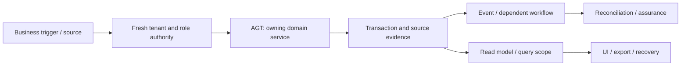

# Commercial agents and revenue channels: review and plan of action

**Prepared:** 8 September 2026. **Package:** AGT. **Status:** SOURCE_REVIEW_AND_FOCUSED_VERIFICATION; implementation not started by this run.

## 1. Assessment and scope

This is a source review and focused local verification, not a full runtime certification. Database clients in the selected tests are mocked or injected. No deployed database, authenticated browser, live provider, production telemetry, restore rehearsal or qualified statutory approval was inspected in this run. Unexecuted scenarios below are acceptance requirements, not test results. No application code, migration, business record or deployment is changed by this report.

**Accountable roles:** Commercial product owner and platform engineering. **Catalog coverage:** commercial_agents

**Selected verification:** No dedicated runtime/unit suite selected for this capability; availability and workflow validation remain open. This package owns or consumes PM-SCOPE-001.

The highest-risk review questions are a catalog entry does not establish recruitment or payout functionality; do not turn inferred referrals into commission liabilities; prefer an explicit availability decision over speculative engine development.

## 2. Source and architecture map

The source inventory contains 1 matching files, including tests and supporting files. 2 sources were hashed and indexed for targeted review. Prefix inventory counts are discovery aids, not reviewed-file counts. The full list and source hashes are in [the source manifest](<E:/ohada saas/Focused projects/stoquify/what-next/platform-module-audit/2026-09-08-run-01/source-manifest.json>).

| Layer | Current source/navigation anchor | Evidence boundary |
|---|---|---|
| services | [services/modules/module-catalog.service.ts](<E:/ohada saas/Focused projects/stoquify/services/modules/module-catalog.service.ts:1>) | 383 lines; SHA-256 185666fd2ddf… |
| config | [config/sidebar.ts](<E:/ohada saas/Focused projects/stoquify/config/sidebar.ts:1>) | 487 lines; SHA-256 beeb3d9dde82… |

Route/API paths must be expanded from callers; absence from the selected prefix inventory is not a declaration that none exist.

### Data declarations

| Schema model | Selected declared storage/relationship facts |
|---|---|
| No domain model established | Catalog scope must be resolved before inventing a data lifecycle. |

These are schema declarations. Exact migration application, actual constraints/indexes, row populations, query plans and direct-write bypasses remain unverified. See the platform package for migration/restore ownership.

### Workflow trace and handoffs

The diagram is the review boundary and required end-to-end trace. Source links and selected tests substantiate only the portions described in this report; it does not claim every edge was exercised.

| Workflow | Expected outcome | Evidence disposition |
|---|---|---|
| AGT-FLOW-1 | Reconcile catalog promises with current routes, models and services | Source navigation and availability discovery only; full end-to-end scenario remains unverified |
| AGT-FLOW-2 | Decide supported versus deferred recruitment, territory, commission and payout scope | Source navigation and availability discovery only; full end-to-end scenario remains unverified |
| AGT-FLOW-3 | Define attribution and liability ownership before any commission automation | Source navigation and availability discovery only; full end-to-end scenario remains unverified |

**Integration contracts:** [MOD — Module lifecycle, packaging and billing boundaries](module-lifecycle-billing-review-and-action-plan-2026-09-08.md); [COM — Notifications, collaboration and referral outcomes](communications-referrals-review-and-action-plan-2026-09-08.md); [PAY — Providers, statements, matching and suspense](payments-reconciliation-review-and-action-plan-2026-09-08.md). These identify validation/ownership interfaces, not permission to duplicate their implementations. Accounting remains owned by [the existing accounting roadmap](accounting-correction-execution-roadmap-2026-09-08.md).

**Graph navigation:** No matching node selected; current source inventory is authoritative.. Graph extracts predate this review and are not runtime proof.

## 3. Controls to preserve

The current catalog/source distinction should be preserved: document actual implementation and internal/deferred scope before adding functionality. No complete runtime strength is claimed for this package.

## 4. Findings, limitations and risks

### PM-SCOPE-001 — Catalog entries and actual workflow evidence need reconciliation

**CAPABILITY_EVIDENCE_GAP · P2.** Confidence: High for catalog/search result; runtime/deployment scope unverified. Likelihood: Depends on which catalog promises reach users; not measured.

**Evidence:** [services/modules/module-catalog.service.ts:243](<E:/ohada saas/Focused projects/stoquify/services/modules/module-catalog.service.ts:243>); [line 171](<E:/ohada saas/Focused projects/stoquify/services/modules/module-catalog.service.ts:171>); [line 255](<E:/ohada saas/Focused projects/stoquify/services/modules/module-catalog.service.ts:255>).

**Trigger:** A buyer or operator treats catalog status and route prefixes as proof of a complete workflow.

**Expected:** Every offered capability maps to a connected owner, route, data lifecycle and evidence-supported scope; aliases and deferred features are explicit.

**Observed:** Commercial Agents is available, Presence is available and Content is internal in the catalog. Exact path-name discovery found no presence/commercial-agents/blogs implementation family; HRIS attendance and public landing surfaces do exist elsewhere. This is a search result, not proof of complete absence.

**Cause / uncertainty:** Declared catalog scope and implementation naming/availability have not been reconciled in this review.

**Consequences:** False expectations, failed onboarding and entitlement confusion can damage trust. Commission liability or payroll scope must not be inferred from a catalog row.

**Existing mitigation:** Content is already marked internal; HRIS provides related workforce/time capability.

**Correction:** Trace aliases and deployment flags, then document supported scope or restrict misleading availability. Do not build speculative CMS/commission systems as part of hardening.

**Acceptance:** Every advertised catalog row has a verified destination and owner, or an explicit unavailable/internal disposition reflected in UI and commercial material.

**Owner / estimate:** Module platform and commercial product owners; 1–2 days of discovery; approved product changes separately estimated. Estimates are planning judgments, not booked capacity.

**Data and rollout:** No business-record changes; preserve existing grants and obligations when correcting availability.

**Related earlier work:** No earlier work ID assigned.

### Additional module scenarios still requiring verification

- **AGT-VERIFY-1:** A catalog entry does not establish recruitment or payout functionality. Owner: Commercial product owner and platform engineering. Status: UNVERIFIED. Evidence required: a synthetic failure/success pair and source-to-result tie-out.
- **AGT-VERIFY-2:** Do not turn inferred referrals into commission liabilities. Owner: Commercial product owner and platform engineering. Status: UNVERIFIED. Evidence required: a synthetic failure/success pair and source-to-result tie-out.
- **AGT-VERIFY-3:** Prefer an explicit availability decision over speculative engine development. Owner: Commercial product owner and platform engineering. Status: UNVERIFIED. Evidence required: a synthetic failure/success pair and source-to-result tie-out.

## 5. Layer and reviewer dispositions

| Lens | Current disposition and remaining proof |
|---|---|
| Architecture, backend and integrations | Sources/call boundaries inventoried; selected service assertions above. Trace alternate entry points and every handoff before whole-domain approval. |
| Database, migration and integrity | Named schema models indexed. Deployment, tenant-consistent foreign keys, locking, rollback, scale and backfill/restore not verified. |
| IAM, privacy, fraud and controls | Apply direct denied-no-read/no-write, role revocation, maker-checker and export redaction tests. A server guard or hidden button alone is insufficient. |
| Frontend, queries and design system | Client/action entry above inspected statically where present; cache identity, mutation effects and source truth must be traced into actual screens. |
| UX, accessibility, EN/FR and content | Authenticated role tasks, keyboard/focus, mobile and localized state behavior not executed; no accessibility claim. |
| Product and business process | Three explicit workflows and supported-scope decisions above; measure task completion and support burden before redesign. |
| Accounting and financial controls | Direct posting calculation is not applicable to this package; authority, claims and downstream financial effects remain in scope. |
| Statutory and country review | No new statutory interpretation is made. Escalate any discovered country-specific output to CMP/qualified review. |
| QA and release | No dedicated runtime/unit suite selected for this capability; availability and workflow validation remain open. Unit results do not replace integrated evidence. |
| SRE, performance and cost | No latency/load/restore measurements; establish bounded reads, worker age/error metrics, alerts, retries and support ownership before rollout. |
| AI and agent authority | AI model behavior is not applicable unless a connected agent consumes this module; review that access contract without adding AI features. |
| Packaging, billing and operations | Confirm actual catalog/entitlement scope and mandatory retained obligations. Provider billing, adoption and customer outcomes are unverified. |

## 6. Ordered execution plan

### PM-AGT-01 — Bind current scope, owners and candidate

**Status:** READY. **Owner:** Commercial product owner and platform engineering. **Effort:** 1–2 reviewer days.

**Deliverable:** Confirm every listed workflow, supported variant and relevant prior ACC/ACR or STQ-RM item; hash current sources, map entry points and name a domain reviewer.

**Acceptance:** All material paths have active/legacy/deferred status; no existing change is overwritten.

**Prerequisite:** Candidate/owner availability; existing historical evidence is a lead.. 

### PM-AGT-02 — Reproduce priority risks and freeze contracts

**Status:** PLANNED. **Owner:** Commercial product owner and platform engineering. **Effort:** 2–4 reviewer/QA days; isolated environments may extend elapsed time.

**Deliverable:** A catalog entry does not establish recruitment or payout functionality; Do not turn inferred referrals into commission liabilities; Prefer an explicit availability decision over speculative engine development. Reproduce all linked findings before prescribing data repair.

**Acceptance:** A scenario ledger records expected/observed behavior, source IDs, denied side effects and remaining blockers.

**Prerequisite:** PM-AGT-01. 

### PM-AGT-03 — Implement verified corrections and investigate affected data

**Status:** CONDITIONAL_ON_CONFIRMED_FINDINGS. **Owner:** Commercial product owner and platform engineering. **Effort:** Use linked finding estimates; otherwise estimate after diagnosis.

**Deliverable:** Correct the smallest owning boundary; preserve domain history, shared controls and public contracts. Investigate historical impact separately and design reversible repair only if needed.

**Acceptance:** Focused regression, cross-module tie-out and review prove the correction; no speculative implementation or silent historical rewrite.

**Prerequisite:** PM-AGT-02. If no defect is confirmed, record a reviewed no-change disposition; this satisfies the decision step without speculative work.

### PM-AGT-04 — Verify integrated release and controlled rollout

**Status:** PLANNED. **Owner:** Commercial product owner and platform engineering. **Effort:** 2–3 reviewer/QA days plus the real operational cycle.

**Deliverable:** Run isolated DB failure/concurrency scenarios, authenticated role/locale/cache tests, representative performance/export checks and recovery rehearsal. Pilot the agreed supported scope.

**Acceptance:** No unexplained material mismatch, unauthorized effect or stale evidence claim; domain reviewer and operations owner accept scoped results.

**Prerequisite:** PM-AGT-03. 

Existing accounting and enterprise roadmap estimates must be deduplicated: PM findings linked to ACC/ACR or STQ-RM reuse the owning task. Reviewer-day estimates here are not engineering effort for a complete rewrite and must not be summed with the accounting roadmap as if independent.

## 7. Data correction, rollout and completion

Investigate exposure using source IDs, time/currency scope, counts and reconciled totals before proposing any repair. Preserve original records, hashes and exports; use reviewed corrective transactions or versioned migration only where necessary. Rehearse backup/restore and rollback in a disposable environment. Code correction and historical reconciliation are separate acceptance items. A query/display issue alone does not justify rewriting financial history.

Start with an agreed eligible pilot and observe a complete relevant cycle (sale/refund/shift; receiving/invoice/payment; payroll period; or close). Stop expansion on unauthorized effects, unexplained material mismatches, duplicate effects or stale proof. Record incident owner, recovery route and the data needed for investigation. No pilot or release is authorized or completed by this document.

Completion requires disposition for every workflow, current-source evidence for each significant claim, tested or explicit blocked failure scenarios, domain-reviewed corrective work and an understood operational handoff. [The tailored audit prompt](commercial-agents-audit-execution-prompt-2026-09-08.md) provides the full repeatable execution brief.

## 8. Evidence and provenance

Commit: `a05a41ef66cd5d98fd69ae3df18225795f912232`; branch: `codex/migration-control-plane-release-2026-08-29`. Initial capture: 2026-09-08T14:41:48.494Z. Dirty workspace preserved; claims bind to file hashes, not clean HEAD. Unit command: 2026-09-08T14:43:08.844Z to 2026-09-08T14:44:14.458Z; exit 1. See [exact command](<E:/ohada saas/Focused projects/stoquify/what-next/platform-module-audit/2026-09-08-run-01/focused-command.json>), [assertion results](<E:/ohada saas/Focused projects/stoquify/what-next/platform-module-audit/2026-09-08-run-01/focused-tests.json>), [test log](<E:/ohada saas/Focused projects/stoquify/what-next/platform-module-audit/2026-09-08-run-01/focused-tests.log>) and [shared evidence index](platform-module-evidence-index-2026-09-08.md). Historical reports were used for navigation and work deduplication; their earlier pass counts are not included in this run.
