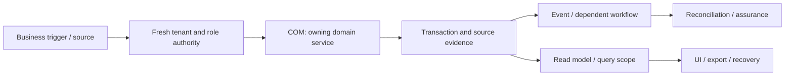

# Notifications, collaboration and referral outcomes: review and plan of action

**Prepared:** 8 September 2026. **Package:** COM. **Status:** SOURCE_REVIEW_AND_FOCUSED_VERIFICATION; implementation not started by this run.

## 1. Assessment and scope

This is a source review and focused local verification, not a full runtime certification. Database clients in the selected tests are mocked or injected. No deployed database, authenticated browser, live provider, production telemetry, restore rehearsal or qualified statutory approval was inspected in this run. Unexecuted scenarios below are acceptance requirements, not test results. No application code, migration, business record or deployment is changed by this report.

**Accountable roles:** Integration engineering, support and growth operations. **Catalog coverage:** Cross-module workflow; not a standalone catalog promise.

**Selected verification:** 12 passed, 0 failed in the selected suite. [Test source](<E:/ohada saas/Focused projects/stoquify/services/communication/__tests__/customer-statement-delivery-worker.service.test.ts>). No additional defect was confirmed in the selected slice; that is not evidence that the complete module is correct.

The highest-risk review questions are an outbox record does not prove delivery or reading; test stale-worker completion and accepted-but-timeout provider outcomes; all-time registration attribution is not retained customer activity.

## 2. Source and architecture map

The source inventory contains 29 matching files, including tests and supporting files. 5 sources were hashed and indexed for targeted review. Prefix inventory counts are discovery aids, not reviewed-file counts. The full list and source hashes are in [the source manifest](<E:/ohada saas/Focused projects/stoquify/what-next/platform-module-audit/2026-09-08-run-01/source-manifest.json>).

| Layer | Current source/navigation anchor | Evidence boundary |
|---|---|---|
| services | [services/communication/customer-statement-delivery-worker.service.ts](<E:/ohada saas/Focused projects/stoquify/services/communication/customer-statement-delivery-worker.service.ts:1>) | 432 lines; SHA-256 038af645c4be… |
| components | [components/notifications/NotificationProvider.tsx](<E:/ohada saas/Focused projects/stoquify/components/notifications/NotificationProvider.tsx:3>) | 937 lines; SHA-256 b047600c7eb7… |
| actions | [actions/referrals/referral-funnel.actions.ts](<E:/ohada saas/Focused projects/stoquify/actions/referrals/referral-funnel.actions.ts:3>) | 23 lines; SHA-256 caa283e3e7aa… |
| components | [components/referrals/ReferralFunnelDashboard.tsx](<E:/ohada saas/Focused projects/stoquify/components/referrals/ReferralFunnelDashboard.tsx:1>) | 229 lines; SHA-256 51c3f3243a60… |
| components | [components/notifications/NotificationSystem.tsx](<E:/ohada saas/Focused projects/stoquify/components/notifications/NotificationSystem.tsx:3>) | 528 lines; SHA-256 a4e08da82556… |

Route/API paths must be expanded from callers; absence from the selected prefix inventory is not a declaration that none exist.

### Data declarations

| Schema model | Selected declared storage/relationship facts |
|---|---|
| [BusinessEventOutbox](<E:/ohada saas/Focused projects/stoquify/prisma/schema.prisma:8083>) | organization   Organization @relation(fields: [organizationId], references: [id], onDelete: Cascade); businessEvent   BusinessEvent @relation(fields: [businessEventId], references: [id], onDelete: Cascade); @@unique([organizationId, channel, idempotencyKey]) |
| [CustomerStatementDelivery](<E:/ohada saas/Focused projects/stoquify/prisma/schema.prisma:6819>) | organization   Organization @relation(fields: [organizationId], references: [id], onDelete: Restrict); statementSnapshot   CustomerStatementSnapshot @relation(fields: [organizationId, statementSnapshotId], references: [organizationId, id], onDelete: Restrict); token   CustomerStatementAccessToken @relation(fields: [organizationId, tokenId], references: [organizationId, id], onDelete: Restrict) |
| [CustomerStatementDeliveryState](<E:/ohada saas/Focused projects/stoquify/prisma/schema.prisma:6862>) | organization   Organization @relation(fields: [organizationId], references: [id], onDelete: Restrict); delivery   CustomerStatementDelivery @relation(fields: [organizationId, deliveryId], references: [organizationId, id], onDelete: Restrict); @@unique([organizationId, deliveryId, version]) |
| [AccountantClientInvite](<E:/ohada saas/Focused projects/stoquify/prisma/schema.prisma:6742>) | organization   Organization @relation(fields: [organizationId], references: [id], onDelete: Restrict); attribution   ReferralAttribution @relation(fields: [organizationId, attributionId], references: [organizationId, id], onDelete: Restrict); @@unique([organizationId, id]) |
| [ReferralAttribution](<E:/ohada saas/Focused projects/stoquify/prisma/schema.prisma:6682>) | organization   Organization @relation(fields: [organizationId], references: [id], onDelete: Restrict); statementSnapshot   CustomerStatementSnapshot? @relation(fields: [organizationId, statementSnapshotId], references: [organizationId, id], onDelete: Restrict); @@unique([organizationId, id]) |
| [ReferralAttributionEvent](<E:/ohada saas/Focused projects/stoquify/prisma/schema.prisma:6713>) | organization   Organization @relation("ReferralAttributionSourceOrganization", fields: [organizationId], references: [id], onDelete: Restrict); attribution   ReferralAttribution @relation(fields: [organizationId, attributionId], references: [organizationId, id], onDelete: Restrict); targetOrganization   Organization? @relation("ReferralAttributionTargetOrganization", fields: [targetOrganizationId], references: [id], onDelete: Restrict) |

These are schema declarations. Exact migration application, actual constraints/indexes, row populations, query plans and direct-write bypasses remain unverified. See the platform package for migration/restore ownership.

### Workflow trace and handoffs

The diagram is the review boundary and required end-to-end trace. Source links and selected tests substantiate only the portions described in this report; it does not claim every edge was exercised.

| Workflow | Expected outcome | Evidence disposition |
|---|---|---|
| COM-FLOW-1 | Queue consented scoped receipt/statement/invitation delivery | Source navigation and selected mocked/injected assertions only; full end-to-end scenario remains unverified |
| COM-FLOW-2 | Lease work, handle uncertain outcomes and honor token revocation | Source navigation and selected mocked/injected assertions only; full end-to-end scenario remains unverified |
| COM-FLOW-3 | Distinguish local toast, durable delivery, attribution and repeated business outcomes | Source navigation and selected mocked/injected assertions only; full end-to-end scenario remains unverified |

**Integration contracts:** [IAM — Identity, tenant access, settings and administration](identity-settings-admin-review-and-action-plan-2026-09-08.md); [EVT — Events, recovery, migrations and platform operations](events-platform-reliability-review-and-action-plan-2026-09-08.md). These identify validation/ownership interfaces, not permission to duplicate their implementations. Accounting remains owned by [the existing accounting roadmap](accounting-correction-execution-roadmap-2026-09-08.md).

**Graph navigation:** graph_components.json node `notifications_notificationprovider_tsx`, community 3 (L1); graph_components.json node `notifications_notificationprovider_safereadboolean`, community 3 (L72). Graph extracts predate this review and are not runtime proof.

## 3. Controls to preserve

The following assertions passed against mocks/injected clients in this run. Preserve their contracts while extending validation; test names are not broader certification claims.

- customer statement delivery worker claims only actionable delivery outbox rows by compare-and-set.
- customer statement delivery worker revalidates sealed evidence and appends SENT state after provider acceptance.
- customer statement delivery worker fails the lease closed before provider access when envelope integrity drifts.
- customer statement delivery worker rejects a missing tenant before reading or claiming work.

## 4. Findings, limitations and risks

No new confirmed defect is assigned in the sampled evidence. The following scenarios remain material verification requirements; they must not be reclassified as observed incidents or accepted controls without tests.

### Additional module scenarios still requiring verification

- **COM-VERIFY-1:** An outbox record does not prove delivery or reading. Owner: Integration engineering, support and growth operations. Status: UNVERIFIED. Evidence required: a synthetic failure/success pair and source-to-result tie-out.
- **COM-VERIFY-2:** Test stale-worker completion and accepted-but-timeout provider outcomes. Owner: Integration engineering, support and growth operations. Status: UNVERIFIED. Evidence required: a synthetic failure/success pair and source-to-result tie-out.
- **COM-VERIFY-3:** All-time registration attribution is not retained customer activity. Owner: Integration engineering, support and growth operations. Status: UNVERIFIED. Evidence required: a synthetic failure/success pair and source-to-result tie-out.

## 5. Layer and reviewer dispositions

| Lens | Current disposition and remaining proof |
|---|---|
| Architecture, backend and integrations | Sources/call boundaries inventoried; selected service assertions above. Trace alternate entry points and every handoff before whole-domain approval. |
| Database, migration and integrity | Named schema models indexed. Deployment, tenant-consistent foreign keys, locking, rollback, scale and backfill/restore not verified. |
| IAM, privacy, fraud and controls | Apply direct denied-no-read/no-write, role revocation, maker-checker and export redaction tests. A server guard or hidden button alone is insufficient. |
| Frontend, queries and design system | Client/action entry above inspected statically where present; cache identity, mutation effects and source truth must be traced into actual screens. |
| UX, accessibility, EN/FR and content | Authenticated role tasks, keyboard/focus, mobile and localized state behavior not executed; no accessibility claim. |
| Product and business process | Three explicit workflows and supported-scope decisions above; measure task completion and support burden before redesign. |
| Accounting and financial controls | Direct posting calculation is not applicable to this package; authority, claims and downstream financial effects remain in scope. |
| Statutory and country review | No new statutory interpretation is made. Escalate any discovered country-specific output to CMP/qualified review. |
| QA and release | 12 passed, 0 failed in the selected suite. linked test source. Unit results do not replace integrated evidence. |
| SRE, performance and cost | No latency/load/restore measurements; establish bounded reads, worker age/error metrics, alerts, retries and support ownership before rollout. |
| AI and agent authority | AI model behavior is not applicable unless a connected agent consumes this module; review that access contract without adding AI features. |
| Packaging, billing and operations | Confirm actual catalog/entitlement scope and mandatory retained obligations. Provider billing, adoption and customer outcomes are unverified. |

## 6. Ordered execution plan

### PM-COM-01 — Bind current scope, owners and candidate

**Status:** READY. **Owner:** Integration engineering, support and growth operations. **Effort:** 1–2 reviewer days.

**Deliverable:** Confirm every listed workflow, supported variant and relevant prior ACC/ACR or STQ-RM item; hash current sources, map entry points and name a domain reviewer.

**Acceptance:** All material paths have active/legacy/deferred status; no existing change is overwritten.

**Prerequisite:** Candidate/owner availability; existing historical evidence is a lead.. 

### PM-COM-02 — Reproduce priority risks and freeze contracts

**Status:** PLANNED. **Owner:** Integration engineering, support and growth operations. **Effort:** 2–4 reviewer/QA days; isolated environments may extend elapsed time.

**Deliverable:** An outbox record does not prove delivery or reading; Test stale-worker completion and accepted-but-timeout provider outcomes; All-time registration attribution is not retained customer activity. Reproduce all linked findings before prescribing data repair.

**Acceptance:** A scenario ledger records expected/observed behavior, source IDs, denied side effects and remaining blockers.

**Prerequisite:** PM-COM-01. 

### PM-COM-03 — Implement verified corrections and investigate affected data

**Status:** CONDITIONAL_ON_CONFIRMED_FINDINGS. **Owner:** Integration engineering, support and growth operations. **Effort:** Use linked finding estimates; otherwise estimate after diagnosis.

**Deliverable:** Correct the smallest owning boundary; preserve domain history, shared controls and public contracts. Investigate historical impact separately and design reversible repair only if needed.

**Acceptance:** Focused regression, cross-module tie-out and review prove the correction; no speculative implementation or silent historical rewrite.

**Prerequisite:** PM-COM-02. If no defect is confirmed, record a reviewed no-change disposition; this satisfies the decision step without speculative work.

### PM-COM-04 — Verify integrated release and controlled rollout

**Status:** PLANNED. **Owner:** Integration engineering, support and growth operations. **Effort:** 2–3 reviewer/QA days plus the real operational cycle.

**Deliverable:** Run isolated DB failure/concurrency scenarios, authenticated role/locale/cache tests, representative performance/export checks and recovery rehearsal. Pilot the agreed supported scope.

**Acceptance:** No unexplained material mismatch, unauthorized effect or stale evidence claim; domain reviewer and operations owner accept scoped results.

**Prerequisite:** PM-COM-03. 

Existing accounting and enterprise roadmap estimates must be deduplicated: PM findings linked to ACC/ACR or STQ-RM reuse the owning task. Reviewer-day estimates here are not engineering effort for a complete rewrite and must not be summed with the accounting roadmap as if independent.

## 7. Data correction, rollout and completion

Investigate exposure using source IDs, time/currency scope, counts and reconciled totals before proposing any repair. Preserve original records, hashes and exports; use reviewed corrective transactions or versioned migration only where necessary. Rehearse backup/restore and rollback in a disposable environment. Code correction and historical reconciliation are separate acceptance items. A query/display issue alone does not justify rewriting financial history.

Start with an agreed eligible pilot and observe a complete relevant cycle (sale/refund/shift; receiving/invoice/payment; payroll period; or close). Stop expansion on unauthorized effects, unexplained material mismatches, duplicate effects or stale proof. Record incident owner, recovery route and the data needed for investigation. No pilot or release is authorized or completed by this document.

Completion requires disposition for every workflow, current-source evidence for each significant claim, tested or explicit blocked failure scenarios, domain-reviewed corrective work and an understood operational handoff. [The tailored audit prompt](communications-referrals-audit-execution-prompt-2026-09-08.md) provides the full repeatable execution brief.

## 8. Evidence and provenance

Commit: `a05a41ef66cd5d98fd69ae3df18225795f912232`; branch: `codex/migration-control-plane-release-2026-08-29`. Initial capture: 2026-09-08T14:41:48.494Z. Dirty workspace preserved; claims bind to file hashes, not clean HEAD. Unit command: 2026-09-08T14:43:08.844Z to 2026-09-08T14:44:14.458Z; exit 1. See [exact command](<E:/ohada saas/Focused projects/stoquify/what-next/platform-module-audit/2026-09-08-run-01/focused-command.json>), [assertion results](<E:/ohada saas/Focused projects/stoquify/what-next/platform-module-audit/2026-09-08-run-01/focused-tests.json>), [test log](<E:/ohada saas/Focused projects/stoquify/what-next/platform-module-audit/2026-09-08-run-01/focused-tests.log>) and [shared evidence index](platform-module-evidence-index-2026-09-08.md). Historical reports were used for navigation and work deduplication; their earlier pass counts are not included in this run.
