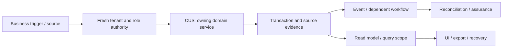

# Customers, receivables, statements and settlement: review and plan of action

**Prepared:** 8 September 2026. **Package:** CUS. **Status:** SOURCE_REVIEW_AND_FOCUSED_VERIFICATION; implementation not started by this run.

## 1. Assessment and scope

This is a source review and focused local verification, not a full runtime certification. Database clients in the selected tests are mocked or injected. No deployed database, authenticated browser, live provider, production telemetry, restore rehearsal or qualified statutory approval was inspected in this run. Unexecuted scenarios below are acceptance requirements, not test results. No application code, migration, business record or deployment is changed by this report.

**Accountable roles:** Receivables engineering and credit controller. **Catalog coverage:** Cross-module workflow; not a standalone catalog promise.

**Selected verification:** 6 passed, 0 failed in the selected suite. [Test source](<E:/ohada saas/Focused projects/stoquify/services/accounting/__tests__/customer-statement-access.service.test.ts>). No additional defect was confirmed in the selected slice; that is not evidence that the complete module is correct.

The highest-risk review questions are recipient access is bounded to the statement workflow; test duplicate/over-allocation, revoked tokens and tenant switch; distinguish snapshot amount from current outstanding after later payments.

## 2. Source and architecture map

The source inventory contains 55 matching files, including tests and supporting files. 7 sources were hashed and indexed for targeted review. Prefix inventory counts are discovery aids, not reviewed-file counts. The full list and source hashes are in [the source manifest](<E:/ohada saas/Focused projects/stoquify/what-next/platform-module-audit/2026-09-08-run-01/source-manifest.json>).

| Layer | Current source/navigation anchor | Evidence boundary |
|---|---|---|
| services | [services/accounting/customer-settlement.service.ts](<E:/ohada saas/Focused projects/stoquify/services/accounting/customer-settlement.service.ts:1>) | 1171 lines; SHA-256 607321e7d554… |
| hooks | [hooks/useCustomerQueries.ts](<E:/ohada saas/Focused projects/stoquify/hooks/useCustomerQueries.ts:3>) | 123 lines; SHA-256 8176b8874bec… |
| actions | [actions/finance/customer-settlement.actions.ts](<E:/ohada saas/Focused projects/stoquify/actions/finance/customer-settlement.actions.ts:3>) | 93 lines; SHA-256 2b343e659e5e… |
| actions | [actions/customers/customerActions.ts](<E:/ohada saas/Focused projects/stoquify/actions/customers/customerActions.ts:3>) | 139 lines; SHA-256 6c4a7f73c746… |
| hooks | [hooks/useCustomerManagement.ts](<E:/ohada saas/Focused projects/stoquify/hooks/useCustomerManagement.ts:3>) | 279 lines; SHA-256 788453d8630a… |
| components | [components/customers/CustomerStatementWorkflow.tsx](<E:/ohada saas/Focused projects/stoquify/components/customers/CustomerStatementWorkflow.tsx:3>) | 459 lines; SHA-256 f2aa193b0e12… |
| components | [components/customers/CustomerStatementResponses.tsx](<E:/ohada saas/Focused projects/stoquify/components/customers/CustomerStatementResponses.tsx:3>) | 176 lines; SHA-256 27ebf45aadc2… |

Connected route/API filenames in the inventory: [app/customer-statement/[statementId]/page.tsx](<E:/ohada saas/Focused projects/stoquify/app/customer-statement/[statementId]/page.tsx>).

### Data declarations

| Schema model | Selected declared storage/relationship facts |
|---|---|
| [Customer](<E:/ohada saas/Focused projects/stoquify/prisma/schema.prisma:1137>) | creditLimit  Decimal? @db.Decimal(14, 2); currentBalance Decimal @default(0) @db.Decimal(14, 2); organization   Organization @relation(fields: [organizationId], references: [id], onDelete: Cascade) |
| [CustomerLocation](<E:/ohada saas/Focused projects/stoquify/prisma/schema.prisma:1186>) | organization Organization @relation(fields: [organizationId], references: [id], onDelete: Cascade); customer     Customer     @relation(fields: [organizationId, customerId], references: [organizationId, id], onDelete: Cascade); location     Location     @relation(fields: [organizationId, locationId], references: [organizationId, id], onDelete: Cascade) |
| [CustomerReceivableDocument](<E:/ohada saas/Focused projects/stoquify/prisma/schema.prisma:6283>) | organization   Organization @relation(fields: [organizationId], references: [id], onDelete: Restrict); customer   Customer @relation(fields: [customerId], references: [id], onDelete: Restrict); sourceSalesOrder   SalesOrder @relation(fields: [sourceSalesOrderId], references: [id], onDelete: Restrict) |
| [CustomerLedgerEntry](<E:/ohada saas/Focused projects/stoquify/prisma/schema.prisma:6238>) | customer   Customer @relation(fields: [customerId], references: [id], onDelete: Cascade); debit        Decimal @default(0) @db.Decimal(14, 2); credit       Decimal @default(0) @db.Decimal(14, 2) |
| [CustomerStatementSnapshot](<E:/ohada saas/Focused projects/stoquify/prisma/schema.prisma:6390>) | organization   Organization @relation(fields: [organizationId], references: [id], onDelete: Restrict); customer   Customer @relation(fields: [customerId], references: [id], onDelete: Restrict); openingBalance Decimal @db.Decimal(14, 2) |
| [CustomerSettlement](<E:/ohada saas/Focused projects/stoquify/prisma/schema.prisma:6895>) | organization   Organization @relation(fields: [organizationId], references: [id], onDelete: Cascade); customer   Customer @relation(fields: [customerId], references: [id], onDelete: Restrict); amount           Decimal                  @db.Decimal(14, 2) |
| [CustomerSettlementAllocation](<E:/ohada saas/Focused projects/stoquify/prisma/schema.prisma:6957>) | organization   Organization @relation(fields: [organizationId], references: [id], onDelete: Cascade); customerSettlement   CustomerSettlement @relation(fields: [customerSettlementId], references: [id], onDelete: Cascade); salesOrder   SalesOrder @relation(fields: [salesOrderId], references: [id], onDelete: Restrict) |
| [CustomerStatementAccessToken](<E:/ohada saas/Focused projects/stoquify/prisma/schema.prisma:6492>) | organization   Organization @relation(fields: [organizationId], references: [id], onDelete: Restrict); statementSnapshot   CustomerStatementSnapshot @relation(fields: [organizationId, statementSnapshotId], references: [organizationId, id], onDelete: Restrict); referralAttribution   ReferralAttribution? @relation(fields: [organizationId, referralAttributionId], references: [organizationId, id], onDelete: Restrict) |

These are schema declarations. Exact migration application, actual constraints/indexes, row populations, query plans and direct-write bypasses remain unverified. See the platform package for migration/restore ownership.

### Workflow trace and handoffs

The diagram is the review boundary and required end-to-end trace. Source links and selected tests substantiate only the portions described in this report; it does not claim every edge was exercised.

| Workflow | Expected outcome | Evidence disposition |
|---|---|---|
| CUS-FLOW-1 | Change customer identity without destroying historical financial references | Source navigation and selected mocked/injected assertions only; full end-to-end scenario remains unverified |
| CUS-FLOW-2 | Issue a statement snapshot, grant scoped access and handle disputes or responses | Source navigation and selected mocked/injected assertions only; full end-to-end scenario remains unverified |
| CUS-FLOW-3 | Allocate and reverse settlements with reproducible outstanding balances | Source navigation and selected mocked/injected assertions only; full end-to-end scenario remains unverified |

**Integration contracts:** [IAM — Identity, tenant access, settings and administration](identity-settings-admin-review-and-action-plan-2026-09-08.md); [PAY — Providers, statements, matching and suspense](payments-reconciliation-review-and-action-plan-2026-09-08.md); [COM — Notifications, collaboration and referral outcomes](communications-referrals-review-and-action-plan-2026-09-08.md); [EVT — Events, recovery, migrations and platform operations](events-platform-reliability-review-and-action-plan-2026-09-08.md). These identify validation/ownership interfaces, not permission to duplicate their implementations. Accounting remains owned by [the existing accounting roadmap](accounting-correction-execution-roadmap-2026-09-08.md).

**Graph navigation:** graph_actions.json node `customers_customeractions_ts`, community 3 (L1); graph_actions.json node `customers_customeractions_assertsuccess`, community 3 (L19); graph_components.json node `customers_customerstatementworkflow_tsx`, community 21 (L1); graph_components.json node `customers_customerstatementworkflow_commandkey`, community 21 (L23); graph_hooks.json node `usecustomermanagement_ts`, community 18 (L1); graph_hooks.json node `hooks_usecustomermanagement_invalidatecustomerqueries`, community 18 (L53). Graph extracts predate this review and are not runtime proof.

## 3. Controls to preserve

The following assertions passed against mocks/injected clients in this run. Preserve their contracts while extending validation; test names are not broader certification claims.

- customer statement access service issues a hash-registered content-bound token with constraint-compatible metadata (0).
- customer statement access service issues a hash-registered content-bound token with constraint-compatible metadata (1).
- customer statement access service issues a hash-registered content-bound token with constraint-compatible metadata (2).
- customer statement access service returns a redacted view and appends only hashed request/access evidence.

## 4. Findings, limitations and risks

No new confirmed defect is assigned in the sampled evidence. The following scenarios remain material verification requirements; they must not be reclassified as observed incidents or accepted controls without tests.

### Additional module scenarios still requiring verification

- **CUS-VERIFY-1:** Recipient access is bounded to the statement workflow. Owner: Receivables engineering and credit controller. Status: UNVERIFIED. Evidence required: a synthetic failure/success pair and source-to-result tie-out.
- **CUS-VERIFY-2:** Test duplicate/over-allocation, revoked tokens and tenant switch. Owner: Receivables engineering and credit controller. Status: UNVERIFIED. Evidence required: a synthetic failure/success pair and source-to-result tie-out.
- **CUS-VERIFY-3:** Distinguish snapshot amount from current outstanding after later payments. Owner: Receivables engineering and credit controller. Status: UNVERIFIED. Evidence required: a synthetic failure/success pair and source-to-result tie-out.

## 5. Layer and reviewer dispositions

| Lens | Current disposition and remaining proof |
|---|---|
| Architecture, backend and integrations | Sources/call boundaries inventoried; selected service assertions above. Trace alternate entry points and every handoff before whole-domain approval. |
| Database, migration and integrity | Named schema models indexed. Deployment, tenant-consistent foreign keys, locking, rollback, scale and backfill/restore not verified. |
| IAM, privacy, fraud and controls | Apply direct denied-no-read/no-write, role revocation, maker-checker and export redaction tests. A server guard or hidden button alone is insufficient. |
| Frontend, queries and design system | Client/action entry above inspected statically where present; cache identity, mutation effects and source truth must be traced into actual screens. |
| UX, accessibility, EN/FR and content | Authenticated role tasks, keyboard/focus, mobile and localized state behavior not executed; no accessibility claim. |
| Product and business process | Three explicit workflows and supported-scope decisions above; measure task completion and support burden before redesign. |
| Accounting and financial controls | Source/amount/quantity/period/currency tie-outs and correction ownership apply; reuse ACC/ACR controls. |
| Statutory and country review | No new statutory interpretation is made. Escalate any discovered country-specific output to CMP/qualified review. |
| QA and release | 6 passed, 0 failed in the selected suite. linked test source. Unit results do not replace integrated evidence. |
| SRE, performance and cost | No latency/load/restore measurements; establish bounded reads, worker age/error metrics, alerts, retries and support ownership before rollout. |
| AI and agent authority | AI model behavior is not applicable unless a connected agent consumes this module; review that access contract without adding AI features. |
| Packaging, billing and operations | Confirm actual catalog/entitlement scope and mandatory retained obligations. Provider billing, adoption and customer outcomes are unverified. |

## 6. Ordered execution plan

### PM-CUS-01 — Bind current scope, owners and candidate

**Status:** READY. **Owner:** Receivables engineering and credit controller. **Effort:** 1–2 reviewer days.

**Deliverable:** Confirm every listed workflow, supported variant and relevant prior ACC/ACR or STQ-RM item; hash current sources, map entry points and name a domain reviewer.

**Acceptance:** All material paths have active/legacy/deferred status; no existing change is overwritten.

**Prerequisite:** Candidate/owner availability; existing historical evidence is a lead.. 

### PM-CUS-02 — Reproduce priority risks and freeze contracts

**Status:** PLANNED. **Owner:** Receivables engineering and credit controller. **Effort:** 2–4 reviewer/QA days; isolated environments may extend elapsed time.

**Deliverable:** Recipient access is bounded to the statement workflow; Test duplicate/over-allocation, revoked tokens and tenant switch; Distinguish snapshot amount from current outstanding after later payments. Reproduce all linked findings before prescribing data repair.

**Acceptance:** A scenario ledger records expected/observed behavior, source IDs, denied side effects and remaining blockers.

**Prerequisite:** PM-CUS-01. 

### PM-CUS-03 — Implement verified corrections and investigate affected data

**Status:** CONDITIONAL_ON_CONFIRMED_FINDINGS. **Owner:** Receivables engineering and credit controller. **Effort:** Use linked finding estimates; otherwise estimate after diagnosis.

**Deliverable:** Correct the smallest owning boundary; preserve domain history, shared controls and public contracts. Investigate historical impact separately and design reversible repair only if needed.

**Acceptance:** Focused regression, cross-module tie-out and review prove the correction; no speculative implementation or silent historical rewrite.

**Prerequisite:** PM-CUS-02. If no defect is confirmed, record a reviewed no-change disposition; this satisfies the decision step without speculative work.

### PM-CUS-04 — Verify integrated release and controlled rollout

**Status:** PLANNED. **Owner:** Receivables engineering and credit controller. **Effort:** 2–3 reviewer/QA days plus the real operational cycle.

**Deliverable:** Run isolated DB failure/concurrency scenarios, authenticated role/locale/cache tests, representative performance/export checks and recovery rehearsal. Pilot the agreed supported scope.

**Acceptance:** No unexplained material mismatch, unauthorized effect or stale evidence claim; domain reviewer and operations owner accept scoped results.

**Prerequisite:** PM-CUS-03. 

Existing accounting and enterprise roadmap estimates must be deduplicated: PM findings linked to ACC/ACR or STQ-RM reuse the owning task. Reviewer-day estimates here are not engineering effort for a complete rewrite and must not be summed with the accounting roadmap as if independent.

## 7. Data correction, rollout and completion

Investigate exposure using source IDs, time/currency scope, counts and reconciled totals before proposing any repair. Preserve original records, hashes and exports; use reviewed corrective transactions or versioned migration only where necessary. Rehearse backup/restore and rollback in a disposable environment. Code correction and historical reconciliation are separate acceptance items. A query/display issue alone does not justify rewriting financial history.

Start with an agreed eligible pilot and observe a complete relevant cycle (sale/refund/shift; receiving/invoice/payment; payroll period; or close). Stop expansion on unauthorized effects, unexplained material mismatches, duplicate effects or stale proof. Record incident owner, recovery route and the data needed for investigation. No pilot or release is authorized or completed by this document.

Completion requires disposition for every workflow, current-source evidence for each significant claim, tested or explicit blocked failure scenarios, domain-reviewed corrective work and an understood operational handoff. [The tailored audit prompt](customers-receivables-audit-execution-prompt-2026-09-08.md) provides the full repeatable execution brief.

## 8. Evidence and provenance

Commit: `a05a41ef66cd5d98fd69ae3df18225795f912232`; branch: `codex/migration-control-plane-release-2026-08-29`. Initial capture: 2026-09-08T14:41:48.494Z. Dirty workspace preserved; claims bind to file hashes, not clean HEAD. Unit command: 2026-09-08T14:43:08.844Z to 2026-09-08T14:44:14.458Z; exit 1. See [exact command](<E:/ohada saas/Focused projects/stoquify/what-next/platform-module-audit/2026-09-08-run-01/focused-command.json>), [assertion results](<E:/ohada saas/Focused projects/stoquify/what-next/platform-module-audit/2026-09-08-run-01/focused-tests.json>), [test log](<E:/ohada saas/Focused projects/stoquify/what-next/platform-module-audit/2026-09-08-run-01/focused-tests.log>) and [shared evidence index](platform-module-evidence-index-2026-09-08.md). Historical reports were used for navigation and work deduplication; their earlier pass counts are not included in this run.
