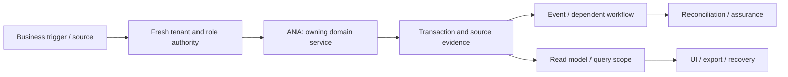

# Dashboards, analytics, command views and reports: review and plan of action

**Prepared:** 8 September 2026. **Package:** ANA. **Status:** SOURCE_REVIEW_AND_FOCUSED_VERIFICATION; implementation not started by this run.

## 1. Assessment and scope

This is a source review and focused local verification, not a full runtime certification. Database clients in the selected tests are mocked or injected. No deployed database, authenticated browser, live provider, production telemetry, restore rehearsal or qualified statutory approval was inspected in this run. Unexecuted scenarios below are acceptance requirements, not test results. No application code, migration, business record or deployment is changed by this report.

**Accountable roles:** Data engineering, product and metric owners. **Catalog coverage:** dashboard, analytics, reports

**Selected verification:** 1 passed, 0 failed in the selected suite. [Test source](<E:/ohada saas/Focused projects/stoquify/services/analytics/__tests__/business-pulse.service.test.ts>). This package owns or consumes PM-FIN-001, PM-ANA-001.

The highest-risk review questions are exclude drafts/cancellations according to the recognition policy; remove fixed-currency and server-local-time assumptions from tenant reporting; measure large-tenant query performance and task outcomes before adding dashboards.

## 2. Source and architecture map

The source inventory contains 79 matching files, including tests and supporting files. 6 sources were hashed and indexed for targeted review. Prefix inventory counts are discovery aids, not reviewed-file counts. The full list and source hashes are in [the source manifest](<E:/ohada saas/Focused projects/stoquify/what-next/platform-module-audit/2026-09-08-run-01/source-manifest.json>).

| Layer | Current source/navigation anchor | Evidence boundary |
|---|---|---|
| services | [services/analytics/sales-analytics.service.ts](<E:/ohada saas/Focused projects/stoquify/services/analytics/sales-analytics.service.ts:1>) | 1228 lines; SHA-256 16042faff16c… |
| hooks | [hooks/analytics/useDailySalesReport.ts](<E:/ohada saas/Focused projects/stoquify/hooks/analytics/useDailySalesReport.ts:2>) | 18 lines; SHA-256 d67dac61ef9e… |
| actions | [actions/analytics/getSalesAnalytics.ts](<E:/ohada saas/Focused projects/stoquify/actions/analytics/getSalesAnalytics.ts:3>) | 94 lines; SHA-256 b64a67468e17… |
| actions | [actions/analytics/get-sales-analytics.ts](<E:/ohada saas/Focused projects/stoquify/actions/analytics/get-sales-analytics.ts:3>) | 4 lines; SHA-256 0c82e9473e15… |
| components | [components/daily-habit/DailyHabitDigestDashboard.tsx](<E:/ohada saas/Focused projects/stoquify/components/daily-habit/DailyHabitDigestDashboard.tsx:3>) | 288 lines; SHA-256 b30b3f5a1c46… |
| components | [components/analytics/dashboard/top-products-card.tsx](<E:/ohada saas/Focused projects/stoquify/components/analytics/dashboard/top-products-card.tsx:3>) | 70 lines; SHA-256 434b2434eb4f… |

Route/API paths must be expanded from callers; absence from the selected prefix inventory is not a declaration that none exist.

### Data declarations

| Schema model | Selected declared storage/relationship facts |
|---|---|
| [SalesOrder](<E:/ohada saas/Focused projects/stoquify/prisma/schema.prisma:4018>) | subtotal     Decimal @default(0) @db.Decimal(14, 2); taxAmount    Decimal @default(0) @db.Decimal(14, 2); shippingCost Decimal @default(0) @db.Decimal(14, 2) |
| [DailySalesReport](<E:/ohada saas/Focused projects/stoquify/prisma/schema.prisma:4359>) | totalRevenue            Decimal @db.Decimal(14, 2); totalCost               Decimal @db.Decimal(14, 2); grossProfit             Decimal @db.Decimal(14, 2) |
| [DailySalesReportItem](<E:/ohada saas/Focused projects/stoquify/prisma/schema.prisma:4406>) | costPrice    Decimal @db.Decimal(12, 2); sellingPrice Decimal @db.Decimal(12, 2); startingQuantity Decimal @db.Decimal(12, 3) |
| [Payment](<E:/ohada saas/Focused projects/stoquify/prisma/schema.prisma:5252>) | amount        Decimal       @db.Decimal(14, 2); cashTendered Decimal? @db.Decimal(14, 2); changeGiven  Decimal? @db.Decimal(14, 2) |
| [InventoryLevel](<E:/ohada saas/Focused projects/stoquify/prisma/schema.prisma:888>) | item       Item     @relation(fields: [itemId], references: [id], onDelete: Cascade); location   Location @relation(fields: [locationId], references: [id], onDelete: Cascade); quantityOnHand    Decimal @default(0) @db.Decimal(12, 3) |

These are schema declarations. Exact migration application, actual constraints/indexes, row populations, query plans and direct-write bypasses remain unverified. See the platform package for migration/restore ownership.

### Workflow trace and handoffs

The diagram is the review boundary and required end-to-end trace. Source links and selected tests substantiate only the portions described in this report; it does not claim every edge was exercised.

| Workflow | Expected outcome | Evidence disposition |
|---|---|---|
| ANA-FLOW-1 | Derive KPIs from authoritative event populations and explicit tenant/time/currency scope | Source navigation and selected mocked/injected assertions only; full end-to-end scenario remains unverified |
| ANA-FLOW-2 | Compose role-specific daily priorities with freshness and source links | Source navigation and selected mocked/injected assertions only; full end-to-end scenario remains unverified |
| ANA-FLOW-3 | Export identical report populations and reconcile operational versus accounting measures | Source navigation and selected mocked/injected assertions only; full end-to-end scenario remains unverified |

**Integration contracts:** [IAM — Identity, tenant access, settings and administration](identity-settings-admin-review-and-action-plan-2026-09-08.md); [MOD — Module lifecycle, packaging and billing boundaries](module-lifecycle-billing-review-and-action-plan-2026-09-08.md); [FIN — Finance, cash drawers, expenses and treasury](finance-cash-treasury-review-and-action-plan-2026-09-08.md); [SAL — Sales orders, reservations, delivery and billing](sales-fulfillment-review-and-action-plan-2026-09-08.md); [INV — Inventory, transfers, counts and valuation](inventory-valuation-review-and-action-plan-2026-09-08.md); [EVT — Events, recovery, migrations and platform operations](events-platform-reliability-review-and-action-plan-2026-09-08.md). These identify validation/ownership interfaces, not permission to duplicate their implementations. Accounting remains owned by [the existing accounting roadmap](accounting-correction-execution-roadmap-2026-09-08.md).

**Graph navigation:** graph_actions.json node `analytics_get_sales_analytics_ts`, community 61 (L1); graph_actions.json node `analytics_getsalesanalytics_ts`, community 12 (L1); graph_components.json node `analytics_dashboard_top_products_card_tsx`, community 205 (L1); graph_components.json node `daily_habit_dailyhabitdigestdashboard_tsx`, community 156 (L1). Graph extracts predate this review and are not runtime proof.

## 3. Controls to preserve

The following assertions passed against mocks/injected clients in this run. Preserve their contracts while extending validation; test names are not broader certification claims.

- business pulse command read-model composition composes BI command data from analytics service summary values.

## 4. Findings, limitations and risks

### PM-FIN-001 — Finance summary aggregates are bounded by display-oriented row caps

**CONFIRMED_SOURCE_DEFECT · P1.** Confidence: High for source behavior; affected tenant population unmeasured. Likelihood: Conditional on population exceeding the caps; prevalence unknown.

**Evidence:** [services/finance/finance-dashboard.service.ts:568](<E:/ohada saas/Focused projects/stoquify/services/finance/finance-dashboard.service.ts:568>); [line 697](<E:/ohada saas/Focused projects/stoquify/services/finance/finance-dashboard.service.ts:697>); [line 742](<E:/ohada saas/Focused projects/stoquify/services/finance/finance-dashboard.service.ts:742>); [line 766](<E:/ohada saas/Focused projects/stoquify/services/finance/finance-dashboard.service.ts:766>).

**Trigger:** More than 250 eligible orders or 100 active counterparties in the requested scope.

**Expected:** Summary totals and counts represent the complete declared population; paginated detail rows have an independent query.

**Observed:** The service fetches capped order/customer/supplier sets and derives revenue and receivable/payable summary values from those arrays. The selected finance test covers payroll forecast proof, not overflow populations.

**Cause / uncertainty:** Summary computation and display data reuse the same bounded read arrays.

**Consequences:** Cash planning, aging, working capital and profitability can omit obligations or revenue and lead operators to incorrect decisions. No monetary loss or production incident was measured.

**Existing mitigation:** Organization filters and some explicit payroll proof states exist; they do not restore omitted rows.

**Correction:** Use scoped decimal database aggregates and separate detail pagination; bind totals to a consistent snapshot and explicit operational/accounting basis.

**Acceptance:** Fixtures with 251 orders and 101 customers/suppliers retain complete totals; pagination does not alter KPIs; export and detail reconcile.

**Owner / estimate:** Finance/data engineering with treasury controller; 3–6 engineering days after the metric contract; production data investigation separately sized. Estimates are planning judgments, not booked capacity.

**Data and rollout:** Recompute impacted views and identify exported/relied-upon reports; do not manufacture journal corrections for a read-model defect.

**Related earlier work:** ACC-014, ACR-21

### PM-ANA-001 — Business Pulse includes draft orders and defaults the displayed currency to XAF

**CONFIRMED_SOURCE_DEFECT · P1.** Confidence: High for query/composition path. Likelihood: Conditional on draft/non-XAF/time-boundary usage; observed tenant frequency unknown.

**Evidence:** [services/analytics/sales-analytics.service.ts:165](<E:/ohada saas/Focused projects/stoquify/services/analytics/sales-analytics.service.ts:165>); [line 143](<E:/ohada saas/Focused projects/stoquify/services/analytics/sales-analytics.service.ts:143>); [line 631](<E:/ohada saas/Focused projects/stoquify/services/analytics/sales-analytics.service.ts:631>); [line 647](<E:/ohada saas/Focused projects/stoquify/services/analytics/sales-analytics.service.ts:647>).

**Trigger:** An eligible location contains a draft order, or a non-XAF organization opens Business Pulse.

**Expected:** Recognized sales, currency and business-day boundaries come from reviewed tenant/source policy; drafts are not described as completed sales.

**Observed:** The sales read excludes only CANCELLED, sums the remaining order totals, and the runtime Business Pulse caller omits currency when composing output; composition defaults to XAF. Date boundaries also use server-local start/end-of-day helpers.

**Cause / uncertainty:** Generic order aggregation is reused for an authoritative-sounding sales KPI and runtime context is incomplete.

**Consequences:** Operators may treat unfinalized demand as revenue or read the wrong currency, propagating incorrect signals into priorities and management decisions.

**Existing mitigation:** A blocked-state composer and composition test exist; the selected test supplies precomputed summary values and does not exercise source population or tenant currency resolution.

**Correction:** Reuse the existing analytical context work; define recognized event/returns/cutoff policy, resolve tenant currency and add source-to-UI fixtures.

**Acceptance:** Completed 100 plus draft 900 yields recognized sales 100 under the agreed policy; non-XAF and local-midnight fixtures retain correct labels and periods.

**Owner / estimate:** Analytics engineering and metric owner; 3–6 engineering days after policy agreement. Estimates are planning judgments, not booked capacity.

**Data and rollout:** Review affected dashboards/exports and downstream signals; retain source transactions unchanged.

**Related earlier work:** STQ-RM-001, historical F1

### Additional module scenarios still requiring verification

- **ANA-VERIFY-1:** Exclude drafts/cancellations according to the recognition policy. Owner: Data engineering, product and metric owners. Status: UNVERIFIED. Evidence required: a synthetic failure/success pair and source-to-result tie-out.
- **ANA-VERIFY-2:** Remove fixed-currency and server-local-time assumptions from tenant reporting. Owner: Data engineering, product and metric owners. Status: UNVERIFIED. Evidence required: a synthetic failure/success pair and source-to-result tie-out.
- **ANA-VERIFY-3:** Measure large-tenant query performance and task outcomes before adding dashboards. Owner: Data engineering, product and metric owners. Status: UNVERIFIED. Evidence required: a synthetic failure/success pair and source-to-result tie-out.

## 5. Layer and reviewer dispositions

| Lens | Current disposition and remaining proof |
|---|---|
| Architecture, backend and integrations | Sources/call boundaries inventoried; selected service assertions above. Trace alternate entry points and every handoff before whole-domain approval. |
| Database, migration and integrity | Named schema models indexed. Deployment, tenant-consistent foreign keys, locking, rollback, scale and backfill/restore not verified. |
| IAM, privacy, fraud and controls | Apply direct denied-no-read/no-write, role revocation, maker-checker and export redaction tests. A server guard or hidden button alone is insufficient. |
| Frontend, queries and design system | Client/action entry above inspected statically where present; cache identity, mutation effects and source truth must be traced into actual screens. |
| UX, accessibility, EN/FR and content | Authenticated role tasks, keyboard/focus, mobile and localized state behavior not executed; no accessibility claim. |
| Product and business process | Three explicit workflows and supported-scope decisions above; measure task completion and support burden before redesign. |
| Accounting and financial controls | Source/amount/quantity/period/currency tie-outs and correction ownership apply; reuse ACC/ACR controls. |
| Statutory and country review | No new statutory interpretation is made. Escalate any discovered country-specific output to CMP/qualified review. |
| QA and release | 1 passed, 0 failed in the selected suite. linked test source. Unit results do not replace integrated evidence. |
| SRE, performance and cost | No latency/load/restore measurements; establish bounded reads, worker age/error metrics, alerts, retries and support ownership before rollout. |
| AI and agent authority | AI model behavior is not applicable unless a connected agent consumes this module; review that access contract without adding AI features. |
| Packaging, billing and operations | Confirm actual catalog/entitlement scope and mandatory retained obligations. Provider billing, adoption and customer outcomes are unverified. |

## 6. Ordered execution plan

### PM-ANA-01 — Bind current scope, owners and candidate

**Status:** READY. **Owner:** Data engineering, product and metric owners. **Effort:** 1–2 reviewer days.

**Deliverable:** Confirm every listed workflow, supported variant and relevant prior ACC/ACR or STQ-RM item; hash current sources, map entry points and name a domain reviewer.

**Acceptance:** All material paths have active/legacy/deferred status; no existing change is overwritten.

**Prerequisite:** Candidate/owner availability; existing historical evidence is a lead.. 

### PM-ANA-02 — Reproduce priority risks and freeze contracts

**Status:** PLANNED. **Owner:** Data engineering, product and metric owners. **Effort:** 2–4 reviewer/QA days; isolated environments may extend elapsed time.

**Deliverable:** Exclude drafts/cancellations according to the recognition policy; Remove fixed-currency and server-local-time assumptions from tenant reporting; Measure large-tenant query performance and task outcomes before adding dashboards. Reproduce all linked findings before prescribing data repair.

**Acceptance:** A scenario ledger records expected/observed behavior, source IDs, denied side effects and remaining blockers.

**Prerequisite:** PM-ANA-01. 

### PM-ANA-03 — Implement verified corrections and investigate affected data

**Status:** CONDITIONAL_ON_CONFIRMED_FINDINGS. **Owner:** Data engineering, product and metric owners. **Effort:** Use linked finding estimates; otherwise estimate after diagnosis.

**Deliverable:** Correct the smallest owning boundary; preserve domain history, shared controls and public contracts. Investigate historical impact separately and design reversible repair only if needed.

**Acceptance:** Focused regression, cross-module tie-out and review prove the correction; no speculative implementation or silent historical rewrite.

**Prerequisite:** PM-ANA-02. If no defect is confirmed, record a reviewed no-change disposition; this satisfies the decision step without speculative work.

### PM-ANA-04 — Verify integrated release and controlled rollout

**Status:** PLANNED. **Owner:** Data engineering, product and metric owners. **Effort:** 2–3 reviewer/QA days plus the real operational cycle.

**Deliverable:** Run isolated DB failure/concurrency scenarios, authenticated role/locale/cache tests, representative performance/export checks and recovery rehearsal. Pilot the agreed supported scope.

**Acceptance:** No unexplained material mismatch, unauthorized effect or stale evidence claim; domain reviewer and operations owner accept scoped results.

**Prerequisite:** PM-ANA-03. 

Existing accounting and enterprise roadmap estimates must be deduplicated: PM findings linked to ACC/ACR or STQ-RM reuse the owning task. Reviewer-day estimates here are not engineering effort for a complete rewrite and must not be summed with the accounting roadmap as if independent.

## 7. Data correction, rollout and completion

Investigate exposure using source IDs, time/currency scope, counts and reconciled totals before proposing any repair. Preserve original records, hashes and exports; use reviewed corrective transactions or versioned migration only where necessary. Rehearse backup/restore and rollback in a disposable environment. Code correction and historical reconciliation are separate acceptance items. A query/display issue alone does not justify rewriting financial history.

Start with an agreed eligible pilot and observe a complete relevant cycle (sale/refund/shift; receiving/invoice/payment; payroll period; or close). Stop expansion on unauthorized effects, unexplained material mismatches, duplicate effects or stale proof. Record incident owner, recovery route and the data needed for investigation. No pilot or release is authorized or completed by this document.

Completion requires disposition for every workflow, current-source evidence for each significant claim, tested or explicit blocked failure scenarios, domain-reviewed corrective work and an understood operational handoff. [The tailored audit prompt](dashboards-analytics-reports-audit-execution-prompt-2026-09-08.md) provides the full repeatable execution brief.

## 8. Evidence and provenance

Commit: `a05a41ef66cd5d98fd69ae3df18225795f912232`; branch: `codex/migration-control-plane-release-2026-08-29`. Initial capture: 2026-09-08T14:41:48.494Z. Dirty workspace preserved; claims bind to file hashes, not clean HEAD. Unit command: 2026-09-08T14:43:08.844Z to 2026-09-08T14:44:14.458Z; exit 1. See [exact command](<E:/ohada saas/Focused projects/stoquify/what-next/platform-module-audit/2026-09-08-run-01/focused-command.json>), [assertion results](<E:/ohada saas/Focused projects/stoquify/what-next/platform-module-audit/2026-09-08-run-01/focused-tests.json>), [test log](<E:/ohada saas/Focused projects/stoquify/what-next/platform-module-audit/2026-09-08-run-01/focused-tests.log>) and [shared evidence index](platform-module-evidence-index-2026-09-08.md). Historical reports were used for navigation and work deduplication; their earlier pass counts are not included in this run.
