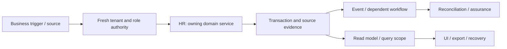

# HRIS, presence, contracts and self-service: review and plan of action

**Prepared:** 8 September 2026. **Package:** HR. **Status:** SOURCE_REVIEW_AND_FOCUSED_VERIFICATION; implementation not started by this run.

## 1. Assessment and scope

This is a source review and focused local verification, not a full runtime certification. Database clients in the selected tests are mocked or injected. No deployed database, authenticated browser, live provider, production telemetry, restore rehearsal or qualified statutory approval was inspected in this run. Unexecuted scenarios below are acceptance requirements, not test results. No application code, migration, business record or deployment is changed by this report.

**Accountable roles:** People engineering, HR operations and privacy reviewer. **Catalog coverage:** presence

**Selected verification:** 3 passed, 0 failed in the selected suite. [Test source](<E:/ohada saas/Focused projects/stoquify/services/hris/__tests__/approval-inbox.service.test.ts>). This package owns or consumes PM-HR-001, PM-SCOPE-001.

The highest-risk review questions are manager scope must honor effective dates and delegation; bind approvals to readable source evidence; users should not invent hashes; reconcile attendance revisions before payroll input certification.

## 2. Source and architecture map

The source inventory contains 75 matching files, including tests and supporting files. 6 sources were hashed and indexed for targeted review. Prefix inventory counts are discovery aids, not reviewed-file counts. The full list and source hashes are in [the source manifest](<E:/ohada saas/Focused projects/stoquify/what-next/platform-module-audit/2026-09-08-run-01/source-manifest.json>).

| Layer | Current source/navigation anchor | Evidence boundary |
|---|---|---|
| services | [services/hris/approval-inbox.service.ts](<E:/ohada saas/Focused projects/stoquify/services/hris/approval-inbox.service.ts:1>) | 737 lines; SHA-256 ced2a246489a… |
| components | [components/hris/HrisApprovalInbox.tsx](<E:/ohada saas/Focused projects/stoquify/components/hris/HrisApprovalInbox.tsx:3>) | 396 lines; SHA-256 29b4512aa0e2… |
| actions | [actions/hris/time-leave.actions.ts](<E:/ohada saas/Focused projects/stoquify/actions/hris/time-leave.actions.ts:3>) | 143 lines; SHA-256 79ff6f1b3934… |
| actions | [actions/hris/payment-destination.actions.ts](<E:/ohada saas/Focused projects/stoquify/actions/hris/payment-destination.actions.ts:3>) | 199 lines; SHA-256 8d4610d0da0e… |
| components | [components/hris/HrisOperationalTimeRequestPanel.tsx](<E:/ohada saas/Focused projects/stoquify/components/hris/HrisOperationalTimeRequestPanel.tsx:3>) | 177 lines; SHA-256 e5c208d3f763… |
| components | [components/hris/HrisOperationalTimeApprovalPanel.tsx](<E:/ohada saas/Focused projects/stoquify/components/hris/HrisOperationalTimeApprovalPanel.tsx:3>) | 110 lines; SHA-256 45a62457822d… |

Connected route/API filenames in the inventory: [app/[locale]/(dashboard)/dashboard/people/[employeeId]/page.tsx](<E:/ohada saas/Focused projects/stoquify/app/[locale]/(dashboard)/dashboard/people/[employeeId]/page.tsx>); [app/[locale]/(dashboard)/dashboard/people/team/page.tsx](<E:/ohada saas/Focused projects/stoquify/app/[locale]/(dashboard)/dashboard/people/team/page.tsx>); [app/[locale]/(dashboard)/dashboard/people/page.tsx](<E:/ohada saas/Focused projects/stoquify/app/[locale]/(dashboard)/dashboard/people/page.tsx>); [app/[locale]/(dashboard)/dashboard/people/me/page.tsx](<E:/ohada saas/Focused projects/stoquify/app/[locale]/(dashboard)/dashboard/people/me/page.tsx>); [app/[locale]/(dashboard)/dashboard/people/history/page.tsx](<E:/ohada saas/Focused projects/stoquify/app/[locale]/(dashboard)/dashboard/people/history/page.tsx>); [app/[locale]/(dashboard)/dashboard/people/approvals/page.tsx](<E:/ohada saas/Focused projects/stoquify/app/[locale]/(dashboard)/dashboard/people/approvals/page.tsx>).

### Data declarations

| Schema model | Selected declared storage/relationship facts |
|---|---|
| [PayrollEmployee](<E:/ohada saas/Focused projects/stoquify/prisma/schema.prisma:2651>) | organization   Organization @relation(fields: [organizationId], references: [id], onDelete: Cascade); @@unique([organizationId, employeeNumber]); @@unique([organizationId, userId]) |
| [HrisOrgUnit](<E:/ohada saas/Focused projects/stoquify/prisma/schema.prisma:2733>) | organization   Organization               @relation(fields: [organizationId], references: [id], onDelete: Cascade); parent         HrisOrgUnit?               @relation("HrisOrgUnitHierarchy", fields: [organizationId, parentId], references: [organizationId, id], onDelete: Restrict); @@unique([organizationId, code]) |
| [HrisEmploymentAssignment](<E:/ohada saas/Focused projects/stoquify/prisma/schema.prisma:2799>) | organization         Organization                   @relation(fields: [organizationId], references: [id], onDelete: Cascade); employee             PayrollEmployee                @relation(fields: [organizationId, employeeId], references: [organizationId, id], onDelete: Restrict); position             HrisPosition                   @relation(fields: [organizationId, positionId], references: [organizationId, id], onDelete: Restrict) |
| [HrisReportingRelationship](<E:/ohada saas/Focused projects/stoquify/prisma/schema.prisma:2837>) | organization              Organization                    @relation(fields: [organizationId], references: [id], onDelete: Cascade); managerEmployee           PayrollEmployee                 @relation("HrisReportingManager", fields: [organizationId, managerEmployeeId], references: [organizationId, id], onDelete: Restrict); managerAssignment         HrisEmploymentAssignment        @relation("HrisReportingManagerAssignment", fields: [organizationId, managerAssignmentId], references: [organizationId, id], onDelete: Restrict) |
| [PayrollContract](<E:/ohada saas/Focused projects/stoquify/prisma/schema.prisma:2915>) | organization   Organization @relation(fields: [organizationId], references: [id], onDelete: Cascade); employee   PayrollEmployee @relation(fields: [employeeId], references: [id], onDelete: Restrict); baseSalary    Decimal   @db.Decimal(14, 2) |
| [PayrollSalaryChangeRequest](<E:/ohada saas/Focused projects/stoquify/prisma/schema.prisma:3036>) | organization   Organization @relation(fields: [organizationId], references: [id], onDelete: Cascade); employee   PayrollEmployee @relation(fields: [employeeId], references: [id], onDelete: Restrict); sourceContract   PayrollContract @relation("SalaryChangeSourceContract", fields: [sourceContractId], references: [id], onDelete: Restrict) |
| [PayrollPaymentDestinationChangeRequest](<E:/ohada saas/Focused projects/stoquify/prisma/schema.prisma:3091>) | organization   Organization @relation(fields: [organizationId], references: [id], onDelete: Cascade); employee   PayrollEmployee @relation(fields: [employeeId], references: [id], onDelete: Restrict); @@index([organizationId, employeeId, status, requestedAt], map: "pay_dest_change_employee_status_idx") |
| [HrisTimeRequest](<E:/ohada saas/Focused projects/stoquify/prisma/schema.prisma:3388>) | organization           Organization          @relation(fields: [organizationId], references: [id], onDelete: Cascade); employee               PayrollEmployee       @relation(fields: [employeeId], references: [id], onDelete: Restrict); leavePolicy            HrisLeavePolicy?      @relation(fields: [leavePolicyId], references: [id], onDelete: Restrict) |
| [HrisTimeEntry](<E:/ohada saas/Focused projects/stoquify/prisma/schema.prisma:3452>) | organization     Organization            @relation(fields: [organizationId], references: [id], onDelete: Cascade); importBatch      HrisTimeImportBatch     @relation(fields: [importBatchId], references: [id], onDelete: Restrict); employee         PayrollEmployee         @relation(fields: [employeeId], references: [id], onDelete: Restrict) |
| [HrisLeaveBalanceEntry](<E:/ohada saas/Focused projects/stoquify/prisma/schema.prisma:3364>) | organization   Organization    @relation(fields: [organizationId], references: [id], onDelete: Cascade); employee       PayrollEmployee @relation(fields: [employeeId], references: [id], onDelete: Restrict); leavePolicy    HrisLeavePolicy @relation(fields: [leavePolicyId], references: [id], onDelete: Restrict) |

These are schema declarations. Exact migration application, actual constraints/indexes, row populations, query plans and direct-write bypasses remain unverified. See the platform package for migration/restore ownership.

### Workflow trace and handoffs

The diagram is the review boundary and required end-to-end trace. Source links and selected tests substantiate only the portions described in this report; it does not claim every edge was exercised.

| Workflow | Expected outcome | Evidence disposition |
|---|---|---|
| HR-FLOW-1 | Maintain employee identity and effective-dated manager/delegation scope | Source navigation and selected mocked/injected assertions only; full end-to-end scenario remains unverified |
| HR-FLOW-2 | Independently approve contract, compensation and payment-destination changes | Source navigation and selected mocked/injected assertions only; full end-to-end scenario remains unverified |
| HR-FLOW-3 | Correct time/leave and provide scoped employee/manager self-service | Source navigation and selected mocked/injected assertions only; full end-to-end scenario remains unverified |

**Integration contracts:** [IAM — Identity, tenant access, settings and administration](identity-settings-admin-review-and-action-plan-2026-09-08.md); [MOD — Module lifecycle, packaging and billing boundaries](module-lifecycle-billing-review-and-action-plan-2026-09-08.md); [EVT — Events, recovery, migrations and platform operations](events-platform-reliability-review-and-action-plan-2026-09-08.md). These identify validation/ownership interfaces, not permission to duplicate their implementations. Accounting remains owned by [the existing accounting roadmap](accounting-correction-execution-roadmap-2026-09-08.md).

**Graph navigation:** graph_actions.json node `hris_payment_destination_actions_ts`, community 16 (L1); graph_actions.json node `hris_payment_destination_actions_asrecord`, community 16 (L33); graph_components.json node `hris_hrisapprovalinbox_tsx`, community 55 (L1); graph_components.json node `hris_hrisapprovalinbox_actionicon`, community 55 (L43). Graph extracts predate this review and are not runtime proof.

## 3. Controls to preserve

The following assertions passed against mocks/injected clients in this run. Preserve their contracts while extending validation; test names are not broader certification claims.

- HRIS approval inbox service enforces the domain segregation-of-duties matrix.
- HRIS approval inbox service aggregates scoped pending blockers without authority, salary, payment, or document values.
- HRIS approval inbox service returns a ready empty state for a scoped manager with no pending work.

## 4. Findings, limitations and risks

### PM-HR-001 — HR approval requires a technical evidence-hash field

**CONFIRMED_SOURCE_UX_GAP · P2.** Confidence: High for current field; user failure rate unmeasured. Likelihood: The field is present; frequency and severity of real user friction require task observation.

**Evidence:** [components/hris/HrisApprovalInbox.tsx:353](<E:/ohada saas/Focused projects/stoquify/components/hris/HrisApprovalInbox.tsx:353>); [services/hris/approval-inbox.service.ts:68](<E:/ohada saas/Focused projects/stoquify/services/hris/approval-inbox.service.ts:68>).

**Trigger:** An HR approver reviews an item through the approval inbox.

**Expected:** The approver reviews understandable source facts; the server binds the exact revision and proof digest.

**Observed:** The current UI presents an Approval evidence hash input. The API accepts evidence data as part of approval; selected tests establish parts of the separation-of-duties and redaction contract, not usability of producing a hash.

**Cause / uncertainty:** An implementation-level proof representation is exposed as an operator input.

**Consequences:** Users may abandon the flow, copy an unrelated hash or require developer assistance. This is a usability/control-quality exposure, not demonstrated approval forgery.

**Existing mitigation:** Domain decision eligibility and scoped/redacted inbox tests pass.

**Correction:** Resolve evidence server-side and show source revision, differences, decision reason and receipt while retaining maker-checker rules.

**Acceptance:** An HR user completes approval without manually generating hashes; changed evidence rejects stale approval; unauthorized/self-approval fixtures remain denied.

**Owner / estimate:** People frontend/domain engineering and HR controller; 2–4 engineering days, plus observed task validation. Estimates are planning judgments, not booked capacity.

**Data and rollout:** No automatic historical approval rewrite; investigate questionable old evidence only if independently identified.

**Related earlier work:** STQ-RM-007, historical F4

### PM-SCOPE-001 — Catalog entries and actual workflow evidence need reconciliation

**CAPABILITY_EVIDENCE_GAP · P2.** Confidence: High for catalog/search result; runtime/deployment scope unverified. Likelihood: Depends on which catalog promises reach users; not measured.

**Evidence:** [services/modules/module-catalog.service.ts:243](<E:/ohada saas/Focused projects/stoquify/services/modules/module-catalog.service.ts:243>); [line 171](<E:/ohada saas/Focused projects/stoquify/services/modules/module-catalog.service.ts:171>); [line 255](<E:/ohada saas/Focused projects/stoquify/services/modules/module-catalog.service.ts:255>).

**Trigger:** A buyer or operator treats catalog status and route prefixes as proof of a complete workflow.

**Expected:** Every offered capability maps to a connected owner, route, data lifecycle and evidence-supported scope; aliases and deferred features are explicit.

**Observed:** Commercial Agents is available, Presence is available and Content is internal in the catalog. Exact path-name discovery found no presence/commercial-agents/blogs implementation family; HRIS attendance and public landing surfaces do exist elsewhere. This is a search result, not proof of complete absence.

**Cause / uncertainty:** Declared catalog scope and implementation naming/availability have not been reconciled in this review.

**Consequences:** False expectations, failed onboarding and entitlement confusion can damage trust. Commission liability or payroll scope must not be inferred from a catalog row.

**Existing mitigation:** Content is already marked internal; HRIS provides related workforce/time capability.

**Correction:** Trace aliases and deployment flags, then document supported scope or restrict misleading availability. Do not build speculative CMS/commission systems as part of hardening.

**Acceptance:** Every advertised catalog row has a verified destination and owner, or an explicit unavailable/internal disposition reflected in UI and commercial material.

**Owner / estimate:** Module platform and commercial product owners; 1–2 days of discovery; approved product changes separately estimated. Estimates are planning judgments, not booked capacity.

**Data and rollout:** No business-record changes; preserve existing grants and obligations when correcting availability.

**Related earlier work:** No earlier work ID assigned.

### Additional module scenarios still requiring verification

- **HR-VERIFY-1:** Manager scope must honor effective dates and delegation. Owner: People engineering, HR operations and privacy reviewer. Status: UNVERIFIED. Evidence required: a synthetic failure/success pair and source-to-result tie-out.
- **HR-VERIFY-2:** Bind approvals to readable source evidence; users should not invent hashes. Owner: People engineering, HR operations and privacy reviewer. Status: UNVERIFIED. Evidence required: a synthetic failure/success pair and source-to-result tie-out.
- **HR-VERIFY-3:** Reconcile attendance revisions before payroll input certification. Owner: People engineering, HR operations and privacy reviewer. Status: UNVERIFIED. Evidence required: a synthetic failure/success pair and source-to-result tie-out.

## 5. Layer and reviewer dispositions

| Lens | Current disposition and remaining proof |
|---|---|
| Architecture, backend and integrations | Sources/call boundaries inventoried; selected service assertions above. Trace alternate entry points and every handoff before whole-domain approval. |
| Database, migration and integrity | Named schema models indexed. Deployment, tenant-consistent foreign keys, locking, rollback, scale and backfill/restore not verified. |
| IAM, privacy, fraud and controls | Apply direct denied-no-read/no-write, role revocation, maker-checker and export redaction tests. A server guard or hidden button alone is insufficient. |
| Frontend, queries and design system | Client/action entry above inspected statically where present; cache identity, mutation effects and source truth must be traced into actual screens. |
| UX, accessibility, EN/FR and content | Authenticated role tasks, keyboard/focus, mobile and localized state behavior not executed; no accessibility claim. |
| Product and business process | Three explicit workflows and supported-scope decisions above; measure task completion and support burden before redesign. |
| Accounting and financial controls | Source/amount/quantity/period/currency tie-outs and correction ownership apply; reuse ACC/ACR controls. |
| Statutory and country review | No new statutory interpretation is made. Escalate any discovered country-specific output to CMP/qualified review. |
| QA and release | 3 passed, 0 failed in the selected suite. linked test source. Unit results do not replace integrated evidence. |
| SRE, performance and cost | No latency/load/restore measurements; establish bounded reads, worker age/error metrics, alerts, retries and support ownership before rollout. |
| AI and agent authority | AI model behavior is not applicable unless a connected agent consumes this module; review that access contract without adding AI features. |
| Packaging, billing and operations | Confirm actual catalog/entitlement scope and mandatory retained obligations. Provider billing, adoption and customer outcomes are unverified. |

## 6. Ordered execution plan

### PM-HR-01 — Bind current scope, owners and candidate

**Status:** READY. **Owner:** People engineering, HR operations and privacy reviewer. **Effort:** 1–2 reviewer days.

**Deliverable:** Confirm every listed workflow, supported variant and relevant prior ACC/ACR or STQ-RM item; hash current sources, map entry points and name a domain reviewer.

**Acceptance:** All material paths have active/legacy/deferred status; no existing change is overwritten.

**Prerequisite:** Candidate/owner availability; existing historical evidence is a lead.. 

### PM-HR-02 — Reproduce priority risks and freeze contracts

**Status:** PLANNED. **Owner:** People engineering, HR operations and privacy reviewer. **Effort:** 2–4 reviewer/QA days; isolated environments may extend elapsed time.

**Deliverable:** Manager scope must honor effective dates and delegation; Bind approvals to readable source evidence; users should not invent hashes; Reconcile attendance revisions before payroll input certification. Reproduce all linked findings before prescribing data repair.

**Acceptance:** A scenario ledger records expected/observed behavior, source IDs, denied side effects and remaining blockers.

**Prerequisite:** PM-HR-01. 

### PM-HR-03 — Implement verified corrections and investigate affected data

**Status:** CONDITIONAL_ON_CONFIRMED_FINDINGS. **Owner:** People engineering, HR operations and privacy reviewer. **Effort:** Use linked finding estimates; otherwise estimate after diagnosis.

**Deliverable:** Correct the smallest owning boundary; preserve domain history, shared controls and public contracts. Investigate historical impact separately and design reversible repair only if needed.

**Acceptance:** Focused regression, cross-module tie-out and review prove the correction; no speculative implementation or silent historical rewrite.

**Prerequisite:** PM-HR-02. If no defect is confirmed, record a reviewed no-change disposition; this satisfies the decision step without speculative work.

### PM-HR-04 — Verify integrated release and controlled rollout

**Status:** PLANNED. **Owner:** People engineering, HR operations and privacy reviewer. **Effort:** 2–3 reviewer/QA days plus the real operational cycle.

**Deliverable:** Run isolated DB failure/concurrency scenarios, authenticated role/locale/cache tests, representative performance/export checks and recovery rehearsal. Pilot the agreed supported scope.

**Acceptance:** No unexplained material mismatch, unauthorized effect or stale evidence claim; domain reviewer and operations owner accept scoped results.

**Prerequisite:** PM-HR-03. 

Existing accounting and enterprise roadmap estimates must be deduplicated: PM findings linked to ACC/ACR or STQ-RM reuse the owning task. Reviewer-day estimates here are not engineering effort for a complete rewrite and must not be summed with the accounting roadmap as if independent.

## 7. Data correction, rollout and completion

Investigate exposure using source IDs, time/currency scope, counts and reconciled totals before proposing any repair. Preserve original records, hashes and exports; use reviewed corrective transactions or versioned migration only where necessary. Rehearse backup/restore and rollback in a disposable environment. Code correction and historical reconciliation are separate acceptance items. A query/display issue alone does not justify rewriting financial history.

Start with an agreed eligible pilot and observe a complete relevant cycle (sale/refund/shift; receiving/invoice/payment; payroll period; or close). Stop expansion on unauthorized effects, unexplained material mismatches, duplicate effects or stale proof. Record incident owner, recovery route and the data needed for investigation. No pilot or release is authorized or completed by this document.

Completion requires disposition for every workflow, current-source evidence for each significant claim, tested or explicit blocked failure scenarios, domain-reviewed corrective work and an understood operational handoff. [The tailored audit prompt](hris-presence-audit-execution-prompt-2026-09-08.md) provides the full repeatable execution brief.

## 8. Evidence and provenance

Commit: `a05a41ef66cd5d98fd69ae3df18225795f912232`; branch: `codex/migration-control-plane-release-2026-08-29`. Initial capture: 2026-09-08T14:41:48.494Z. Dirty workspace preserved; claims bind to file hashes, not clean HEAD. Unit command: 2026-09-08T14:43:08.844Z to 2026-09-08T14:44:14.458Z; exit 1. See [exact command](<E:/ohada saas/Focused projects/stoquify/what-next/platform-module-audit/2026-09-08-run-01/focused-command.json>), [assertion results](<E:/ohada saas/Focused projects/stoquify/what-next/platform-module-audit/2026-09-08-run-01/focused-tests.json>), [test log](<E:/ohada saas/Focused projects/stoquify/what-next/platform-module-audit/2026-09-08-run-01/focused-tests.log>) and [shared evidence index](platform-module-evidence-index-2026-09-08.md). Historical reports were used for navigation and work deduplication; their earlier pass counts are not included in this run.
