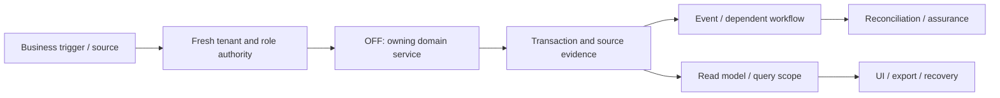

# Offline POS devices, sync and replay: review and plan of action

**Prepared:** 8 September 2026. **Package:** OFF. **Status:** SOURCE_REVIEW_AND_FOCUSED_VERIFICATION; implementation not started by this run.

## 1. Assessment and scope

This is a source review and focused local verification, not a full runtime certification. Database clients in the selected tests are mocked or injected. No deployed database, authenticated browser, live provider, production telemetry, restore rehearsal or qualified statutory approval was inspected in this run. Unexecuted scenarios below are acceptance requirements, not test results. No application code, migration, business record or deployment is changed by this report.

**Accountable roles:** POS integration engineering and store operations. **Catalog coverage:** Cross-module workflow; not a standalone catalog promise.

**Selected verification:** 22 passed, 0 failed in the selected suite. [Test source](<E:/ohada saas/Focused projects/stoquify/services/pos/__tests__/offline-sync.service.test.ts>). This package owns or consumes PM-CACHE-001.

The highest-risk review questions are test revoked keys, wrong device, sequence gaps and tenant mismatch; crash after sale commit, lose the receipt response, then reconnect and replay; make offline stock/payment limits explicit.

## 2. Source and architecture map

The source inventory contains 4 matching files, including tests and supporting files. 3 sources were hashed and indexed for targeted review. Prefix inventory counts are discovery aids, not reviewed-file counts. The full list and source hashes are in [the source manifest](<E:/ohada saas/Focused projects/stoquify/what-next/platform-module-audit/2026-09-08-run-01/source-manifest.json>).

| Layer | Current source/navigation anchor | Evidence boundary |
|---|---|---|
| services | [services/pos/offline-sync.service.ts](<E:/ohada saas/Focused projects/stoquify/services/pos/offline-sync.service.ts:1>) | 2030 lines; SHA-256 1f145c236c44… |
| hooks | [hooks/posHooks/useOfflineSync.ts](<E:/ohada saas/Focused projects/stoquify/hooks/posHooks/useOfflineSync.ts:3>) | 261 lines; SHA-256 8b65be2c6fd4… |
| components | [components/pos/offline/OfflineSyncStatusStrip.tsx](<E:/ohada saas/Focused projects/stoquify/components/pos/offline/OfflineSyncStatusStrip.tsx:3>) | 182 lines; SHA-256 74f65e1bd6ea… |

Route/API paths must be expanded from callers; absence from the selected prefix inventory is not a declaration that none exist.

### Data declarations

| Schema model | Selected declared storage/relationship facts |
|---|---|
| [POSOfflineDevice](<E:/ohada saas/Focused projects/stoquify/prisma/schema.prisma:4943>) | organization   Organization @relation(fields: [organizationId], references: [id], onDelete: Cascade); location   Location @relation(fields: [locationId], references: [id], onDelete: Restrict); terminal   POSStation @relation(fields: [terminalId], references: [id], onDelete: Restrict) |
| [POSOfflineSyncBatch](<E:/ohada saas/Focused projects/stoquify/prisma/schema.prisma:4993>) | organization   Organization @relation(fields: [organizationId], references: [id], onDelete: Cascade); device   POSOfflineDevice @relation(fields: [deviceId], references: [id], onDelete: Restrict); @@index([organizationId, status, receivedAt]) |
| [POSOfflineEvent](<E:/ohada saas/Focused projects/stoquify/prisma/schema.prisma:5031>) | organization   Organization @relation(fields: [organizationId], references: [id], onDelete: Cascade); device   POSOfflineDevice @relation(fields: [deviceId], references: [id], onDelete: Restrict); terminal   POSStation @relation(fields: [terminalId], references: [id], onDelete: Restrict) |
| [POSOfflineSyncConflict](<E:/ohada saas/Focused projects/stoquify/prisma/schema.prisma:5094>) | organization   Organization @relation(fields: [organizationId], references: [id], onDelete: Cascade); device   POSOfflineDevice @relation(fields: [deviceId], references: [id], onDelete: Restrict); event   POSOfflineEvent? @relation(fields: [eventId], references: [id], onDelete: SetNull) |
| [POSOfflineSyncCertificate](<E:/ohada saas/Focused projects/stoquify/prisma/schema.prisma:5136>) | organization   Organization @relation(fields: [organizationId], references: [id], onDelete: Cascade); device   POSOfflineDevice @relation(fields: [deviceId], references: [id], onDelete: Restrict); terminal   POSStation @relation(fields: [terminalId], references: [id], onDelete: Restrict) |

These are schema declarations. Exact migration application, actual constraints/indexes, row populations, query plans and direct-write bypasses remain unverified. See the platform package for migration/restore ownership.

### Workflow trace and handoffs

The diagram is the review boundary and required end-to-end trace. Source links and selected tests substantiate only the portions described in this report; it does not claim every edge was exercised.

| Workflow | Expected outcome | Evidence disposition |
|---|---|---|
| OFF-FLOW-1 | Enroll and revoke devices with station, tenant and signing-key scope | Source navigation and selected mocked/injected assertions only; full end-to-end scenario remains unverified |
| OFF-FLOW-2 | Capture signed envelopes with sequence/hash continuity and visible pending state | Source navigation and selected mocked/injected assertions only; full end-to-end scenario remains unverified |
| OFF-FLOW-3 | Replay through canonical sale commit and route conflicts to a recoverable queue | Source navigation and selected mocked/injected assertions only; full end-to-end scenario remains unverified |

**Integration contracts:** [POS — POS sales, refunds and shifts](pos-sales-review-and-action-plan-2026-09-08.md); [EVT — Events, recovery, migrations and platform operations](events-platform-reliability-review-and-action-plan-2026-09-08.md); [IAM — Identity, tenant access, settings and administration](identity-settings-admin-review-and-action-plan-2026-09-08.md); [MOD — Module lifecycle, packaging and billing boundaries](module-lifecycle-billing-review-and-action-plan-2026-09-08.md). These identify validation/ownership interfaces, not permission to duplicate their implementations. Accounting remains owned by [the existing accounting roadmap](accounting-correction-execution-roadmap-2026-09-08.md).

**Graph navigation:** graph_components.json node `pos_offline_offlinesyncstatusstrip_tsx`, community 191 (L1); graph_components.json node `offline_offlinesyncstatusstrip_formatasof`, community 191 (L55); graph_hooks.json node `poshooks_useofflinesync_ts`, community 20 (L1); graph_hooks.json node `poshooks_useofflinesync_useofflinesyncdashboard`, community 20 (L87). Graph extracts predate this review and are not runtime proof.

## 3. Controls to preserve

The following assertions passed against mocks/injected clients in this run. Preserve their contracts while extending validation; test names are not broader certification claims.

- offline POS sync service records an accepted offline event as pending replay without touching POS sale truth.
- offline POS sync service rejects an idempotency key reused with a different payload hash.
- offline POS sync service treats duplicate replay with the same payload as idempotent.
- offline POS sync service quarantines a device sequence gap.

## 4. Findings, limitations and risks

### PM-CACHE-001 — Several sensitive query families omit tenant or actor identity

**CREDIBLE_RISK_REQUIRES_RUNTIME_VALIDATION · P1.** Confidence: High for missing key dimensions; cross-session disclosure not demonstrated. Likelihood: Depends on client lifetime and identity-transition behavior; unmeasured.

**Evidence:** [hooks/payments/usePaymentReconciliationDashboard.ts:19](<E:/ohada saas/Focused projects/stoquify/hooks/payments/usePaymentReconciliationDashboard.ts:19>); [hooks/payroll/usePayrollWorkbench.ts:16](<E:/ohada saas/Focused projects/stoquify/hooks/payroll/usePayrollWorkbench.ts:16>); [hooks/finance/useFinanceDashboard.ts:7](<E:/ohada saas/Focused projects/stoquify/hooks/finance/useFinanceDashboard.ts:7>); [hooks/posHooks/useOfflineSync.ts:75](<E:/ohada saas/Focused projects/stoquify/hooks/posHooks/useOfflineSync.ts:75>); [lib/providers/query-provider.tsx:14](<E:/ohada saas/Focused projects/stoquify/lib/providers/query-provider.tsx:14>).

**Trigger:** Organization, actor, permissions or entitlements change while the QueryClient survives.

**Expected:** Scope-changing transitions cannot render old protected results; result-changing scope belongs in cache identity with cancellation/removal where necessary.

**Observed:** Payment and payroll keys use fixed prefixes (and limits/IDs); finance/offline keys include filters but no explicit tenant/actor. QueryProvider creates one client with useState. This review did not execute every identity-change path or establish whether navigation remounts/clears it.

**Cause / uncertainty:** Server-inferred authority is not represented explicitly in these client keys.

**Consequences:** Stale financial or personnel data may be shown in the wrong context if the client survives. Severity justifies early validation, but this is not a confirmed disclosure incident.

**Existing mitigation:** Server actions retain authorization and some keys have location/run filters; full reloads could clear caches but are not a complete demonstrated contract.

**Correction:** Trace every switch/logout/revocation path, then centralize scoped keys and query cancellation/removal; avoid retaining previous protected data across authority changes.

**Acceptance:** Same-browser two-tenant/actor tests show no old values during loading, errors or revocation; all impacted views refresh after writes.

**Owner / estimate:** Shared frontend/IAM owner plus affected module owners; 2–3 days to validate; 3–7 engineering days if shared lifecycle correction is required. Estimates are planning judgments, not booked capacity.

**Data and rollout:** No data mutation required; assess exposure only if runtime reproduction identifies it.

**Related earlier work:** ACC-010, ACR-22

### Additional module scenarios still requiring verification

- **OFF-VERIFY-1:** Test revoked keys, wrong device, sequence gaps and tenant mismatch. Owner: POS integration engineering and store operations. Status: UNVERIFIED. Evidence required: a synthetic failure/success pair and source-to-result tie-out.
- **OFF-VERIFY-2:** Crash after sale commit, lose the receipt response, then reconnect and replay. Owner: POS integration engineering and store operations. Status: UNVERIFIED. Evidence required: a synthetic failure/success pair and source-to-result tie-out.
- **OFF-VERIFY-3:** Make offline stock/payment limits explicit. Owner: POS integration engineering and store operations. Status: UNVERIFIED. Evidence required: a synthetic failure/success pair and source-to-result tie-out.

## 5. Layer and reviewer dispositions

| Lens | Current disposition and remaining proof |
|---|---|
| Architecture, backend and integrations | Sources/call boundaries inventoried; selected service assertions above. Trace alternate entry points and every handoff before whole-domain approval. |
| Database, migration and integrity | Named schema models indexed. Deployment, tenant-consistent foreign keys, locking, rollback, scale and backfill/restore not verified. |
| IAM, privacy, fraud and controls | Apply direct denied-no-read/no-write, role revocation, maker-checker and export redaction tests. A server guard or hidden button alone is insufficient. |
| Frontend, queries and design system | Client/action entry above inspected statically where present; cache identity, mutation effects and source truth must be traced into actual screens. |
| UX, accessibility, EN/FR and content | Authenticated role tasks, keyboard/focus, mobile and localized state behavior not executed; no accessibility claim. |
| Product and business process | Three explicit workflows and supported-scope decisions above; measure task completion and support burden before redesign. |
| Accounting and financial controls | Source/amount/quantity/period/currency tie-outs and correction ownership apply; reuse ACC/ACR controls. |
| Statutory and country review | No new statutory interpretation is made. Escalate any discovered country-specific output to CMP/qualified review. |
| QA and release | 22 passed, 0 failed in the selected suite. linked test source. Unit results do not replace integrated evidence. |
| SRE, performance and cost | No latency/load/restore measurements; establish bounded reads, worker age/error metrics, alerts, retries and support ownership before rollout. |
| AI and agent authority | AI model behavior is not applicable unless a connected agent consumes this module; review that access contract without adding AI features. |
| Packaging, billing and operations | Confirm actual catalog/entitlement scope and mandatory retained obligations. Provider billing, adoption and customer outcomes are unverified. |

## 6. Ordered execution plan

### PM-OFF-01 — Bind current scope, owners and candidate

**Status:** READY. **Owner:** POS integration engineering and store operations. **Effort:** 1–2 reviewer days.

**Deliverable:** Confirm every listed workflow, supported variant and relevant prior ACC/ACR or STQ-RM item; hash current sources, map entry points and name a domain reviewer.

**Acceptance:** All material paths have active/legacy/deferred status; no existing change is overwritten.

**Prerequisite:** Candidate/owner availability; existing historical evidence is a lead.. 

### PM-OFF-02 — Reproduce priority risks and freeze contracts

**Status:** PLANNED. **Owner:** POS integration engineering and store operations. **Effort:** 2–4 reviewer/QA days; isolated environments may extend elapsed time.

**Deliverable:** Test revoked keys, wrong device, sequence gaps and tenant mismatch; Crash after sale commit, lose the receipt response, then reconnect and replay; Make offline stock/payment limits explicit. Reproduce all linked findings before prescribing data repair.

**Acceptance:** A scenario ledger records expected/observed behavior, source IDs, denied side effects and remaining blockers.

**Prerequisite:** PM-OFF-01. 

### PM-OFF-03 — Implement verified corrections and investigate affected data

**Status:** CONDITIONAL_ON_CONFIRMED_FINDINGS. **Owner:** POS integration engineering and store operations. **Effort:** Use linked finding estimates; otherwise estimate after diagnosis.

**Deliverable:** Correct the smallest owning boundary; preserve domain history, shared controls and public contracts. Investigate historical impact separately and design reversible repair only if needed.

**Acceptance:** Focused regression, cross-module tie-out and review prove the correction; no speculative implementation or silent historical rewrite.

**Prerequisite:** PM-OFF-02. If no defect is confirmed, record a reviewed no-change disposition; this satisfies the decision step without speculative work.

### PM-OFF-04 — Verify integrated release and controlled rollout

**Status:** PLANNED. **Owner:** POS integration engineering and store operations. **Effort:** 2–3 reviewer/QA days plus the real operational cycle.

**Deliverable:** Run isolated DB failure/concurrency scenarios, authenticated role/locale/cache tests, representative performance/export checks and recovery rehearsal. Pilot the agreed supported scope.

**Acceptance:** No unexplained material mismatch, unauthorized effect or stale evidence claim; domain reviewer and operations owner accept scoped results.

**Prerequisite:** PM-OFF-03. 

Existing accounting and enterprise roadmap estimates must be deduplicated: PM findings linked to ACC/ACR or STQ-RM reuse the owning task. Reviewer-day estimates here are not engineering effort for a complete rewrite and must not be summed with the accounting roadmap as if independent.

## 7. Data correction, rollout and completion

Investigate exposure using source IDs, time/currency scope, counts and reconciled totals before proposing any repair. Preserve original records, hashes and exports; use reviewed corrective transactions or versioned migration only where necessary. Rehearse backup/restore and rollback in a disposable environment. Code correction and historical reconciliation are separate acceptance items. A query/display issue alone does not justify rewriting financial history.

Start with an agreed eligible pilot and observe a complete relevant cycle (sale/refund/shift; receiving/invoice/payment; payroll period; or close). Stop expansion on unauthorized effects, unexplained material mismatches, duplicate effects or stale proof. Record incident owner, recovery route and the data needed for investigation. No pilot or release is authorized or completed by this document.

Completion requires disposition for every workflow, current-source evidence for each significant claim, tested or explicit blocked failure scenarios, domain-reviewed corrective work and an understood operational handoff. [The tailored audit prompt](offline-pos-audit-execution-prompt-2026-09-08.md) provides the full repeatable execution brief.

## 8. Evidence and provenance

Commit: `a05a41ef66cd5d98fd69ae3df18225795f912232`; branch: `codex/migration-control-plane-release-2026-08-29`. Initial capture: 2026-09-08T14:41:48.494Z. Dirty workspace preserved; claims bind to file hashes, not clean HEAD. Unit command: 2026-09-08T14:43:08.844Z to 2026-09-08T14:44:14.458Z; exit 1. See [exact command](<E:/ohada saas/Focused projects/stoquify/what-next/platform-module-audit/2026-09-08-run-01/focused-command.json>), [assertion results](<E:/ohada saas/Focused projects/stoquify/what-next/platform-module-audit/2026-09-08-run-01/focused-tests.json>), [test log](<E:/ohada saas/Focused projects/stoquify/what-next/platform-module-audit/2026-09-08-run-01/focused-tests.log>) and [shared evidence index](platform-module-evidence-index-2026-09-08.md). Historical reports were used for navigation and work deduplication; their earlier pass counts are not included in this run.
