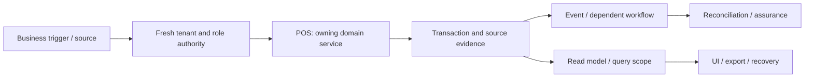

# POS sales, refunds and shifts: review and plan of action

**Prepared:** 8 September 2026. **Package:** POS. **Status:** SOURCE_REVIEW_AND_FOCUSED_VERIFICATION; implementation not started by this run.

## 1. Assessment and scope

This is a source review and focused local verification, not a full runtime certification. Database clients in the selected tests are mocked or injected. No deployed database, authenticated browser, live provider, production telemetry, restore rehearsal or qualified statutory approval was inspected in this run. Unexecuted scenarios below are acceptance requirements, not test results. No application code, migration, business record or deployment is changed by this report.

**Accountable roles:** Revenue engineering and store operations. **Catalog coverage:** pos

**Selected verification:** 35 passed, 0 failed in the selected suite. [Test source](<E:/ohada saas/Focused projects/stoquify/services/pos/__tests__/pos.service.test.ts>). This package owns or consumes PM-INV-001.

The highest-risk review questions are a declared electronic tender is not settled provider money; prove simultaneous refund and duplicate commit cannot create extra effects; preserve currency precision through fiscal receipt.

## 2. Source and architecture map

The source inventory contains 61 matching files, including tests and supporting files. 7 sources were hashed and indexed for targeted review. Prefix inventory counts are discovery aids, not reviewed-file counts. The full list and source hashes are in [the source manifest](<E:/ohada saas/Focused projects/stoquify/what-next/platform-module-audit/2026-09-08-run-01/source-manifest.json>).

| Layer | Current source/navigation anchor | Evidence boundary |
|---|---|---|
| services | [services/pos/pos.service.ts](<E:/ohada saas/Focused projects/stoquify/services/pos/pos.service.ts:1>) | 3655 lines; SHA-256 3cfb6db6e51a… |
| hooks | [hooks/posHooks/usePosOperations.ts](<E:/ohada saas/Focused projects/stoquify/hooks/posHooks/usePosOperations.ts:3>) | 240 lines; SHA-256 dede42f7243e… |
| actions | [actions/pos/terminal-management.actions.ts](<E:/ohada saas/Focused projects/stoquify/actions/pos/terminal-management.actions.ts:3>) | 274 lines; SHA-256 537b08e5050c… |
| actions | [actions/pos/tender.actions.ts](<E:/ohada saas/Focused projects/stoquify/actions/pos/tender.actions.ts:3>) | 103 lines; SHA-256 ea89bafdc435… |
| hooks | [hooks/posHooks/useTerminalManagement.ts](<E:/ohada saas/Focused projects/stoquify/hooks/posHooks/useTerminalManagement.ts:3>) | 147 lines; SHA-256 b3b87955f8f5… |
| components | [components/pos/TerminalManagementDashboard.tsx](<E:/ohada saas/Focused projects/stoquify/components/pos/TerminalManagementDashboard.tsx:3>) | 1148 lines; SHA-256 834a8682dc7d… |
| components | [components/pos/ReceiptTokenHistoryPanel.tsx](<E:/ohada saas/Focused projects/stoquify/components/pos/ReceiptTokenHistoryPanel.tsx:3>) | 233 lines; SHA-256 f4251f68e357… |

Route/API paths must be expanded from callers; absence from the selected prefix inventory is not a declaration that none exist.

### Data declarations

| Schema model | Selected declared storage/relationship facts |
|---|---|
| [POSStation](<E:/ohada saas/Focused projects/stoquify/prisma/schema.prisma:4738>) | @@unique([organizationId, terminalNumber]); @@index([locationId]); @@index([organizationId]) |
| [POSSession](<E:/ohada saas/Focused projects/stoquify/prisma/schema.prisma:4772>) | openingBalance  Decimal  @default(0) @db.Decimal(14, 2); closingBalance  Decimal? @db.Decimal(14, 2); expectedBalance Decimal? @db.Decimal(14, 2) |
| [POSCommitResult](<E:/ohada saas/Focused projects/stoquify/prisma/schema.prisma:4839>) | organization   Organization @relation(fields: [organizationId], references: [id], onDelete: Restrict); location   Location @relation(fields: [locationId], references: [id], onDelete: Restrict); terminal   POSStation @relation(fields: [terminalId], references: [id], onDelete: Restrict) |
| [SalesOrder](<E:/ohada saas/Focused projects/stoquify/prisma/schema.prisma:4018>) | subtotal     Decimal @default(0) @db.Decimal(14, 2); taxAmount    Decimal @default(0) @db.Decimal(14, 2); shippingCost Decimal @default(0) @db.Decimal(14, 2) |
| [Payment](<E:/ohada saas/Focused projects/stoquify/prisma/schema.prisma:5252>) | amount        Decimal       @db.Decimal(14, 2); cashTendered Decimal? @db.Decimal(14, 2); changeGiven  Decimal? @db.Decimal(14, 2) |
| [PaymentRefund](<E:/ohada saas/Focused projects/stoquify/prisma/schema.prisma:5348>) | amount       Decimal      @db.Decimal(14, 2); @@unique([organizationId, refundNumber]); @@index([paymentId]) |

These are schema declarations. Exact migration application, actual constraints/indexes, row populations, query plans and direct-write bypasses remain unverified. See the platform package for migration/restore ownership.

### Workflow trace and handoffs

The diagram is the review boundary and required end-to-end trace. Source links and selected tests substantiate only the portions described in this report; it does not claim every edge was exercised.

| Workflow | Expected outcome | Evidence disposition |
|---|---|---|
| POS-FLOW-1 | Commit cash, credit and split-tender sales with correct tax, change, stock and source posting | Source navigation and selected mocked/injected assertions only; full end-to-end scenario remains unverified |
| POS-FLOW-2 | Refund or void eligible original quantities and amounts while retaining evidence | Source navigation and selected mocked/injected assertions only; full end-to-end scenario remains unverified |
| POS-FLOW-3 | Close a shift by reconciling opening float, movements, counted cash and variance | Source navigation and selected mocked/injected assertions only; full end-to-end scenario remains unverified |

**Integration contracts:** [IAM — Identity, tenant access, settings and administration](identity-settings-admin-review-and-action-plan-2026-09-08.md); [MOD — Module lifecycle, packaging and billing boundaries](module-lifecycle-billing-review-and-action-plan-2026-09-08.md); [EVT — Events, recovery, migrations and platform operations](events-platform-reliability-review-and-action-plan-2026-09-08.md); [INV — Inventory, transfers, counts and valuation](inventory-valuation-review-and-action-plan-2026-09-08.md); [PAY — Providers, statements, matching and suspense](payments-reconciliation-review-and-action-plan-2026-09-08.md). These identify validation/ownership interfaces, not permission to duplicate their implementations. Accounting remains owned by [the existing accounting roadmap](accounting-correction-execution-roadmap-2026-09-08.md).

**Graph navigation:** graph_actions.json node `pos_tender_actions_ts`, community 133 (L1); graph_actions.json node `pos_tender_actions_revalidatepossaletags`, community 133 (L20); graph_components.json node `pos_terminalmanagementdashboard_tsx`, community 56 (L1); graph_components.json node `pos_terminalmanagementdashboard_getdefaultform`, community 56 (L278); graph_hooks.json node `poshooks_useposoperations_ts`, community 1 (L1); graph_hooks.json node `poshooks_useposoperations_useposlocations`, community 1 (L44). Graph extracts predate this review and are not runtime proof.

## 3. Controls to preserve

The following assertions passed against mocks/injected clients in this run. Preserve their contracts while extending validation; test names are not broader certification claims.

- commitPOSSale accounting wiring posts the completed sale and captured POS payment inside the same transaction.
- commitPOSSale accounting wiring denies a new commit before any sale, payment, stock or ledger effect.
- commitPOSSale accounting wiring returns the immutable original result for an identical client commit retry even after admission stops.
- commitPOSSale accounting wiring recovers a PostgreSQL unique-claim race as an exact replay.

## 4. Findings, limitations and risks

### PM-INV-001 — Inventory idempotency-conflict test fails while recording anomaly evidence

**CONFIRMED_VERIFICATION_FAILURE · P1.** Confidence: High for failing test; deployed defect not established. Likelihood: Reproduced in the local fixture; deployed frequency unknown.

**Evidence:** [services/inventory/__tests__/inventory-stock-event.service.test.ts:431](<E:/ohada saas/Focused projects/stoquify/services/inventory/__tests__/inventory-stock-event.service.test.ts:431>); [services/events/business-event-anomaly.service.ts:119](<E:/ohada saas/Focused projects/stoquify/services/events/business-event-anomaly.service.ts:119>); [services/inventory/inventory-stock-event.service.ts:692](<E:/ohada saas/Focused projects/stoquify/services/inventory/inventory-stock-event.service.ts:692>).

**Trigger:** The focused test reuses a stock event key with a different payload hash.

**Expected:** A conflicting replay is rejected without stock mutation, and durable conflict evidence survives the required transaction outcome.

**Observed:** Expected an idempotency-key conflict; received Business-event conflict evidence could not be recorded. The later assertions about stock mutation are not reached after the failed expectation.

**Cause / uncertainty:** Unresolved interaction between the fixture evidence client and the current anomaly-recording contract.

**Consequences:** The current verification packet cannot prove this financial/stock retry boundary. A stale test mock is plausible; a real evidence failure must be ruled out.

**Existing mitigation:** The operation rejects in the observed test; other stock and outbox checks pass. Rejection alone does not establish complete evidence retention.

**Correction:** Inspect injected versus independent evidence clients, update obsolete fixtures only if confirmed, and add an isolated PostgreSQL replay/rollback scenario before changing runtime logic.

**Acceptance:** Identical replay is idempotent; changed payload returns the intended safe conflict; quantities/ledger effects stay unchanged and the required conflict evidence is queryable after rollback.

**Owner / estimate:** Inventory and event-platform engineering; 1–2 engineering days for diagnosis; any runtime fix and DB validation sized after reproduction. Estimates are planning judgments, not booked capacity.

**Data and rollout:** No stock backfill justified by this test alone. If a real defect is confirmed, investigate source IDs and quantities before authorizing repair.

**Related earlier work:** ACC-015

### Additional module scenarios still requiring verification

- **POS-VERIFY-1:** A declared electronic tender is not settled provider money. Owner: Revenue engineering and store operations. Status: UNVERIFIED. Evidence required: a synthetic failure/success pair and source-to-result tie-out.
- **POS-VERIFY-2:** Prove simultaneous refund and duplicate commit cannot create extra effects. Owner: Revenue engineering and store operations. Status: UNVERIFIED. Evidence required: a synthetic failure/success pair and source-to-result tie-out.
- **POS-VERIFY-3:** Preserve currency precision through fiscal receipt. Owner: Revenue engineering and store operations. Status: UNVERIFIED. Evidence required: a synthetic failure/success pair and source-to-result tie-out.

## 5. Layer and reviewer dispositions

| Lens | Current disposition and remaining proof |
|---|---|
| Architecture, backend and integrations | Sources/call boundaries inventoried; selected service assertions above. Trace alternate entry points and every handoff before whole-domain approval. |
| Database, migration and integrity | Named schema models indexed. Deployment, tenant-consistent foreign keys, locking, rollback, scale and backfill/restore not verified. |
| IAM, privacy, fraud and controls | Apply direct denied-no-read/no-write, role revocation, maker-checker and export redaction tests. A server guard or hidden button alone is insufficient. |
| Frontend, queries and design system | Client/action entry above inspected statically where present; cache identity, mutation effects and source truth must be traced into actual screens. |
| UX, accessibility, EN/FR and content | Authenticated role tasks, keyboard/focus, mobile and localized state behavior not executed; no accessibility claim. |
| Product and business process | Three explicit workflows and supported-scope decisions above; measure task completion and support burden before redesign. |
| Accounting and financial controls | Source/amount/quantity/period/currency tie-outs and correction ownership apply; reuse ACC/ACR controls. |
| Statutory and country review | No new statutory interpretation is made. Escalate any discovered country-specific output to CMP/qualified review. |
| QA and release | 35 passed, 0 failed in the selected suite. linked test source. Unit results do not replace integrated evidence. |
| SRE, performance and cost | No latency/load/restore measurements; establish bounded reads, worker age/error metrics, alerts, retries and support ownership before rollout. |
| AI and agent authority | AI model behavior is not applicable unless a connected agent consumes this module; review that access contract without adding AI features. |
| Packaging, billing and operations | Confirm actual catalog/entitlement scope and mandatory retained obligations. Provider billing, adoption and customer outcomes are unverified. |

## 6. Ordered execution plan

### PM-POS-01 — Bind current scope, owners and candidate

**Status:** READY. **Owner:** Revenue engineering and store operations. **Effort:** 1–2 reviewer days.

**Deliverable:** Confirm every listed workflow, supported variant and relevant prior ACC/ACR or STQ-RM item; hash current sources, map entry points and name a domain reviewer.

**Acceptance:** All material paths have active/legacy/deferred status; no existing change is overwritten.

**Prerequisite:** Candidate/owner availability; existing historical evidence is a lead.. 

### PM-POS-02 — Reproduce priority risks and freeze contracts

**Status:** PLANNED. **Owner:** Revenue engineering and store operations. **Effort:** 2–4 reviewer/QA days; isolated environments may extend elapsed time.

**Deliverable:** A declared electronic tender is not settled provider money; Prove simultaneous refund and duplicate commit cannot create extra effects; Preserve currency precision through fiscal receipt. Reproduce all linked findings before prescribing data repair.

**Acceptance:** A scenario ledger records expected/observed behavior, source IDs, denied side effects and remaining blockers.

**Prerequisite:** PM-POS-01. 

### PM-POS-03 — Implement verified corrections and investigate affected data

**Status:** CONDITIONAL_ON_CONFIRMED_FINDINGS. **Owner:** Revenue engineering and store operations. **Effort:** Use linked finding estimates; otherwise estimate after diagnosis.

**Deliverable:** Correct the smallest owning boundary; preserve domain history, shared controls and public contracts. Investigate historical impact separately and design reversible repair only if needed.

**Acceptance:** Focused regression, cross-module tie-out and review prove the correction; no speculative implementation or silent historical rewrite.

**Prerequisite:** PM-POS-02. If no defect is confirmed, record a reviewed no-change disposition; this satisfies the decision step without speculative work.

### PM-POS-04 — Verify integrated release and controlled rollout

**Status:** PLANNED. **Owner:** Revenue engineering and store operations. **Effort:** 2–3 reviewer/QA days plus the real operational cycle.

**Deliverable:** Run isolated DB failure/concurrency scenarios, authenticated role/locale/cache tests, representative performance/export checks and recovery rehearsal. Pilot the agreed supported scope.

**Acceptance:** No unexplained material mismatch, unauthorized effect or stale evidence claim; domain reviewer and operations owner accept scoped results.

**Prerequisite:** PM-POS-03. 

Existing accounting and enterprise roadmap estimates must be deduplicated: PM findings linked to ACC/ACR or STQ-RM reuse the owning task. Reviewer-day estimates here are not engineering effort for a complete rewrite and must not be summed with the accounting roadmap as if independent.

## 7. Data correction, rollout and completion

Investigate exposure using source IDs, time/currency scope, counts and reconciled totals before proposing any repair. Preserve original records, hashes and exports; use reviewed corrective transactions or versioned migration only where necessary. Rehearse backup/restore and rollback in a disposable environment. Code correction and historical reconciliation are separate acceptance items. A query/display issue alone does not justify rewriting financial history.

Start with an agreed eligible pilot and observe a complete relevant cycle (sale/refund/shift; receiving/invoice/payment; payroll period; or close). Stop expansion on unauthorized effects, unexplained material mismatches, duplicate effects or stale proof. Record incident owner, recovery route and the data needed for investigation. No pilot or release is authorized or completed by this document.

Completion requires disposition for every workflow, current-source evidence for each significant claim, tested or explicit blocked failure scenarios, domain-reviewed corrective work and an understood operational handoff. [The tailored audit prompt](pos-sales-audit-execution-prompt-2026-09-08.md) provides the full repeatable execution brief.

## 8. Evidence and provenance

Commit: `a05a41ef66cd5d98fd69ae3df18225795f912232`; branch: `codex/migration-control-plane-release-2026-08-29`. Initial capture: 2026-09-08T14:41:48.494Z. Dirty workspace preserved; claims bind to file hashes, not clean HEAD. Unit command: 2026-09-08T14:43:08.844Z to 2026-09-08T14:44:14.458Z; exit 1. See [exact command](<E:/ohada saas/Focused projects/stoquify/what-next/platform-module-audit/2026-09-08-run-01/focused-command.json>), [assertion results](<E:/ohada saas/Focused projects/stoquify/what-next/platform-module-audit/2026-09-08-run-01/focused-tests.json>), [test log](<E:/ohada saas/Focused projects/stoquify/what-next/platform-module-audit/2026-09-08-run-01/focused-tests.log>) and [shared evidence index](platform-module-evidence-index-2026-09-08.md). Historical reports were used for navigation and work deduplication; their earlier pass counts are not included in this run.
