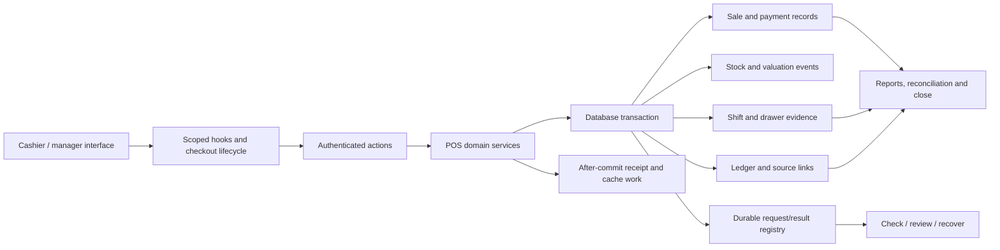

# POS workflow and architecture

The full current-source trace, support classifications, persona-permission mapping, graph node references, and every reviewer disposition are in [architecture review](evidence/architecture-review.md). [Route inventory](evidence/route-inventory.json) enumerates 13 localized page patterns / 26 English and French targets, plus receipt/media APIs. A new public receipt page is reviewed separately during this run.

## Operational journeys

| Journey / actor | Prerequisites and authority | Approval / effect / outcome | Failure and recovery |
| --- | --- | --- | --- |
| Configure terminal / authorized manager | Organization/location and `pos.session.start`; revision-aware service | Create/update/archive configuration; audit preserved | Active shift/drawer, historical location movement or stale revision rejects unsafe edits. |
| Open shift / cashier | Active terminal, permission and module admission, opening balance | Server binds actor, terminal, session and opening drawer event | Existing active session or mismatched location is rejected. |
| Browse/scan/cart / cashier | Current location and lease; server catalog and stock | Server prices/taxes, add/update/remove draft lines | Keep failed input; resume after stale price/stock changes. No cashier arbitrary-price/discount setter verified. |
| Select customer / cashier | Scoped compatible active customer | Walk-in or identified sale association | Location mismatch rejected. Credit display does not make on-account checkout available. |
| Tender / cashier | Reviewed cart, valid cash amounts | Exact cash, cash splits, change and due previews; authoritative commit totals | Short/invalid tender blocks Charge with explanation. Current cashier method list is CASH. |
| Submit/recover / cashier | Durable request identity, revision and verified ownership | Atomic sale and integration evidence; registry records outcome | Duplicate, late/lost response and changed-cart paths preserve request and evidence. |
| Park/resume / cashier | Current ownership, no incompatible pending/offline state | Service changes active/parked cart with revalidation | No assumed cross-cashier transfer or manual lock override. |
| Receipt / cashier, customer, authorized revoker | Recorded sale; scoped management access or registered public bearer token | Safe receipt presentation, print from browser, revocation/history | Delivery failure does not undo sale. Checkout still exposes NONE; unsupported provider channels remain unavailable. |
| Refund/void / specifically authorized operator | Actual refund/void permission and fresh authentication; supported payment rail | Compensating stock, ledger, payment and drawer records | No complete cashier refund/partial-return UI verified. Unsupported provider reversal must fail without changing recorded money. |
| Count/close / session operator | Counted balance, variance reason if needed; no unresolved offline/recovery blocker | Close evidence, drawer journal and Z-report/accounting linkage | Concurrency and evidence failure must roll back; closed shift cannot reopen. |
| Offline review / controls-authorized manager | Scoped enrolled device/queue/policy/hash-chain evidence | Review/acknowledge or supported resolution with audit | No complete cashier enrollment/capture/flush UI verified; provisional capture is not a posted sale. |
| Finance/audit/support | Assigned read/export/reconciliation/close capabilities | Source-linked history, settlement, stock-to-cash and close reports | Same-scope errors are explicit; no previous tenant's drawer report displayed. |

## Domain boundaries and product limits

Purchasing/AP enters through upstream stock/valuation and downstream snapshots; HR/payroll has no direct POS mutation dependency. No AI model authorizes or executes POS payments in the inspected path. Country rules and statutory certification remain expert-reviewed external prerequisites, not labels inferred from a successful test.

The design preserves service-owned rules and existing contracts. The focused structural changes address ownership sequencing, scoped reads, after-commit cache handling and receipt presentation rather than replacing the framework or reformatting unrelated code.

## Verified environment and journey scope

The required `ledger_posting_batches.postingCycle` schema is now present on the specifically authorized local application database `stoquify_replay_next_20260830`. The [application migration result](evidence/application-migration-result.json) verifies its column/default, validated check, replacement unique index, preserved unrelated schema and matching migration history. This resolves that environment prerequisite without establishing a new sale outcome.

The accountant's French drawer journey has browser evidence for completed rendering, a location filter narrowing 13 drawers to one, a localized no-session state, keyboard period selection of “7 derniers jours”, session expansion and links retaining `/fr`. The expanded open session now distinguishes its unavailable final balance from a recorded numeric balance. English drawer rendering was also observed. These were read-only observations at the available viewport; the authorized cashier journey, broader responsive coverage and hardware workflows are not implied. See the [browser follow-up](evidence/browser-completion-2026-09-24.md) and [verification matrix](verification-matrix.md) for the current account-handoff and source-validation limits.
