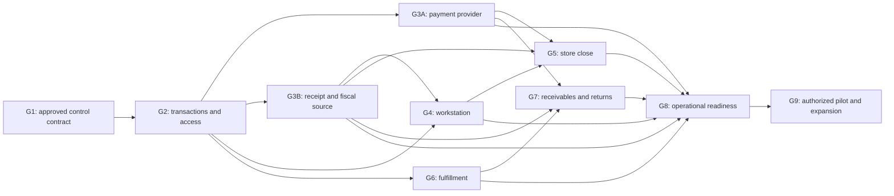

# Current-source preflight and review coverage

This review separates fresh source inspection from the prior run's runtime evidence. No later business gate is approved by this document. The frozen August program is preserved, but several implementation descriptions have been superseded by September source and tests.

## G2 work-package reconciliation

| Package | Current evidence and remaining acceptance work |
|---|---|
| M2-A01 | Durable commit-result registry exists; prior real PostgreSQL registry tests passed. Bind a fresh candidate and retain exact request/actor/scope proof. |
| M2-A02 | Completion reads retain the original request hash and actor/session/location scope. Prior replay tests are evidence of that slice, not all cart commands. |
| M2-A03 | Payload conflicts and recovery reads are explicit in `services/pos/pos.service.ts`; retain mismatch and cross-scope negative tests. |
| M2-A04 | Commit result recovery survives response/hydration faults in prior tests. Unknown result must never mean safe to create another request. |
| M2-A05 | Current lifecycle migration has a scoped draft index, but the inspected index is not a UNIQUE active-draft/line constraint. Reconcile permitted parked drafts and line identity before defining any additive invariant migration. No migration is proposed as already approved. |
| M2-A06 | `SalesOrder.version` and `services/pos/cart-revision.ts` exist; the August NOT_IMPLEMENTED label is stale. Complete per-command replay and stale-write acceptance, not merely commit revision checking. |
| M2-A07 | Commit/recovery code returns explicit CART_CHANGED and CART_REVIEW_REQUIRED results. Prove the full edit-command typed stale-result matrix separately. |
| M2-A08 | Current add/update functions reject insufficient location stock with `BusinessRuleError`; inspected paths do not silently clamp. The old failed-runtime description is stale. Verify UI conflict presentation and concurrent availability before granting full acceptance. |
| M2-A09 | Prior 21 PostgreSQL cases include two full financial-kernel cases for duplicate completion and late rollback/retry. They do not replace the full duplicate scan/cart/reservation/stock matrix. |
| M2-B01 | Current cart writes enforce service-owned module decisions; route and read surfaces have their own helpers. One universal surface descriptor is not established by these separate controls. |
| M2-B02 | `cart-write-access.ts` evaluates writable entitlement inside the serializable transaction. Retain current entitlement-revocation/read/write dependency evidence. |
| M2-B03 | The retained IAB tab still displays OPERATE_POS permission denial. Existing authorized cashier login and least-privilege browser proof remain pending. |
| M2-B04 | Current history location corrections and scoped read tests are recorded in the prior review. Complete the tenant/location/terminal negative matrix for the chosen candidate. |
| M2-B05 | Fresh-auth and source-linked full-sale correction tests exist; partial returns and complete materiality/maker-checker coverage remain unproven. |
| M2-B06 | Receipt redaction/security corrections and tests exist; a full cashier DTO/privacy/export matrix is still a separate requirement. |
| M2-B07 | Local receipt-token configuration checks are not production-secret proof. Require managed configuration/rotation evidence without exposing secrets. |
| M2-B08 | API/action tests and permission catalogs supply partial coverage; verify all enabled read/export/offline/receipt routes against actual capability scope. |
| M2-B09 | Prior unit, action, component and PostgreSQL counts remain recorded by suite and evidence class. Fresh gate-tool regressions in this run do not inflate runtime coverage. |

Source inspected: `services/pos/pos.service.ts` (cart add/update, serializable edit wrapper, editable-cart ownership, completion and recovery revision checks), `services/pos/cart-write-access.ts`, `services/pos/cart-revision.ts`, `services/pos/pos.schemas.ts`, `prisma/schema.prisma` and `prisma/migrations/20260920060000_pos_checkout_lifecycle/migration.sql`. Source presence is not an integration-test pass.

The prior route inventory records four direct operational patterns (POS, terminals, drawer and payment history) plus nine downstream patterns, each localized EN/FR. These are 26 source targets, not 26 browser passes. Public marketing routes are outside this gate-closure run.

## Dependency order

## Review responsibilities

| Lens | Finding or disposition |
|---|---|
| Enterprise/platform architecture | Preserve one financial finalizer and stock kernel. Gate tooling may progress independently; later business activation remains dependency-controlled. |
| Backend/integration | Stale declared program statuses and marker-based scans could misstate readiness. Fix the verifier without changing server-owned financial truth. |
| Database/migration | Application postingCycle migration is already recorded complete with exact hash/history checks. No database was mutated in this run. Fixture guards must reject application targets before clients write. |
| Security/IAM/privacy | Cryptographically verify approval attestations against independently provisioned trust; the signed issuer still establishes real identity and authority. Existing cashier access must not be widened for testing. |
| Frontend/design system | Preserve full-height checkout and explicit recovery/prerequisite messaging. No cosmetic change is justified by this gate-tool slice. |
| Workflow/accessibility/localization | Prior French drawer filter/keyboard checks remain bounded evidence; actual cashier, screen-reader, physical-device and viewport coverage remain distinct. |
| Product/business process | Cash-only development scope and unsupported capabilities remain explicit. Eleven decision packets expose alternatives and practical impacts for accountable owners. |
| Quality/release assurance | Reproduce bypasses before fixes, preserve negative tests, bind evidence to scope/source and report blocked gates truthfully. |
| SRE/DevSecOps/performance | Isolated build output must be inspected correctly and retained safely. Load, recovery, secret rotation and incident drills still require a named production-like environment and owners. |
| SaaS/product operations | Preserve entitlement boundaries and support scope; pricing/billing changes are not applicable because no packaging or commercial behavior changes. |
| POS/offline consistency | Retained request identity, lease/authority and late-response protections from the previous review are preserved; offline activation remains disabled under the contract. |
| Inventory/fulfillment | Audit every flagged callsite; guard and narrowly classify actual fixtures. Inventory policy approval and full reservation/fulfillment acceptance are independent of static boundary passage. |
| Payments/treasury | Provider activation and real settlement evidence remain unavailable; prepare sandbox and reconciliation procedures without claiming synthetic callbacks are provider proof. |
| Accounting/close/controls | Prior cash/ledger rollback tests are useful, while full store-day and delivery-invoice acceptance remains broader than immediate POS completion. |
| Statutory/country-pack | Qualified Cameroon review and independent checking remain external requirements. No legal or fiscal certification is claimed. |
| Audit/records/data quality | Preserve original failures, prior scope limits, exact hashes and unaltered business approval registers. New reports identify proposals explicitly. |
| API/events/integration | Treat immutable source links and event consequences as transaction evidence; gate tests cannot establish every downstream delivery path. |
| Training/support/rollout | Provide review packets, staged entry/stop/rollback criteria and named-role handoffs; actual owner identities have not been supplied. |
| Analytics/metric governance | No analytics definitions change. Report actual test/gate counts without counting reruns or source markers as independent runtime proof. |
| Purchasing/AP | Only the previously exempt supplier fixture's isolation is affected; AP policy/runtime workflow is outside scope. |
| HR/payroll | Not applicable: no employee/payroll workflows, statutory calculations or privacy boundaries change. |
| AI/agent governance | Prevent this review from self-approving business policy or trusting its ephemeral test keys. No model or copilot feature changes. |

Graph evidence: `graphify-out/GRAPH_REPORT_actions.md`, community 67, links `getPOSCatalogAction`, `getPOSLocationsAction`, `getPOSTerminalsAction` and `observePOSCatalogModuleAccess`. Its August manifest is historical discovery context; current source was inspected before using it. The June payment workflow innovation report comes from an older workspace and explicitly recorded observe-mode checks, so it is not fresh release proof here.
