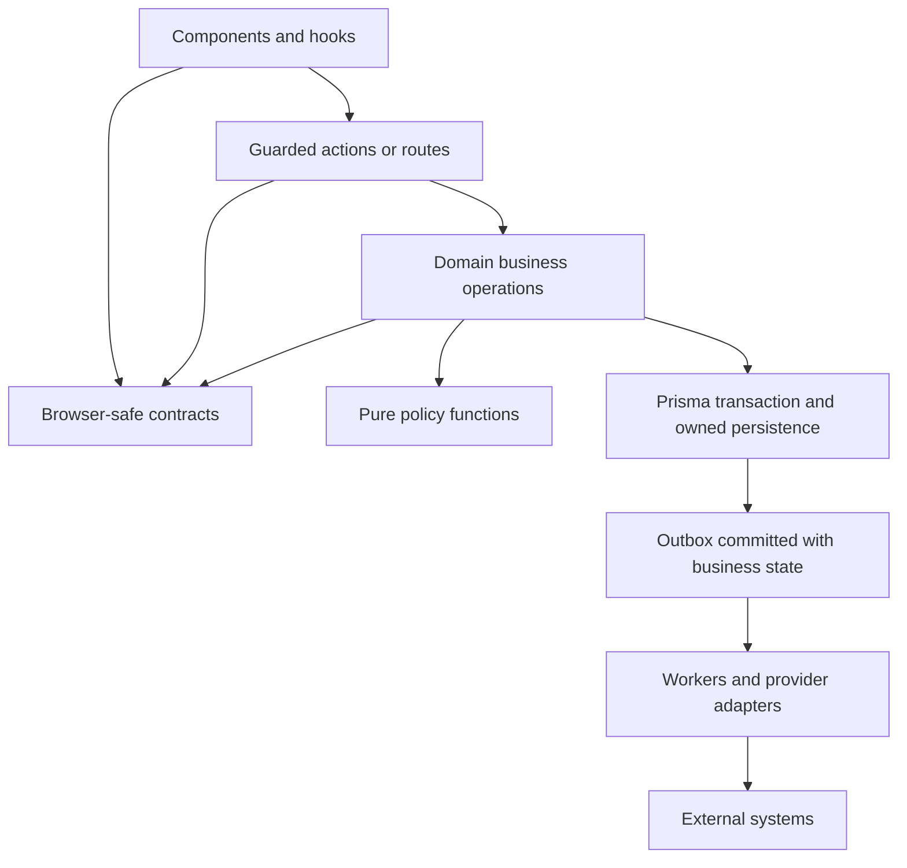

# Stoquify engineering approach review

**Recommendation: evolve the existing codebase as a domain-oriented modular monolith, using explicit business operations, selective domain-driven design, pure policy functions, and framework-neutral contracts. Retain the current Next.js/TypeScript/Prisma foundation.**

The highest-value work is to make existing good practices easier to follow and enforce. Stoquify already has transactional financial operations, service-owned reads, scoped browser caches, an outbox, and provider/country-pack adapters. A platform rewrite would put those controls at risk without a demonstrated operational benefit.

Assessment date: **2026-09-24**. Repository: `E:/ohada saas/Focused projects/stoquify`. Observed HEAD: `a05a41ef66cd5d98fd69ae3df18225795f912232`. Findings describe the **dirty working tree**, including uncommitted work, rather than that commit alone. Initial `git diff --stat` reported 631 changed tracked files, 30,995 insertions and 24,877 deletions; many additional files were untracked. This report does not attribute those changes to this assessment.

**Verification:** 123 tests passed across six selected suites; TypeScript completed successfully; the service-boundary scanner reported zero active violations within its configured scope. These results support the sampled behavior, not a whole-product readiness claim.

## 1. What the evidence says

| Finding | Observed evidence | Engineering implication |
|---|---|---|
| **F1 — The service architecture is already established.** | ADR-0001 assigns business logic to services. The current protected POS action validates input, derives actor/tenant identity and delegates. The boundary gate passes. [ADR][E02], [action][E04], [guard][E03]. | Preserve this direction and improve operation-level organization inside domains. There is no evidence-based reason to replace server actions with a new API framework. |
| **F2 — Important controls depend on a shared transaction.** | POS commit checks a stored idempotent result, tenant/actor/cart scope and module admission; records financial effects, audit, business events and outbox work; runs at Serializable isolation. The schema enforces tenant/terminal/commit uniqueness. [commit][E05], [events][E06], [transaction][E07], [schema][E08]. | Keep the financial unit of work explicit. Moving these participants into independent services would introduce distributed consistency work. |
| **F3 — Responsibility concentration is a maintenance hotspot.** | The sampled source inventory counted 10,975 line segments in payroll-control, 9,075 in the POS activation preflight, 4,383 in close-assurance, 3,938 in AP control and 3,858 in pos.service. Offline admission contains policy decisions inside a persistence loop. [policy block][E16], [payroll example][E26]. | Split by reasons to change and test seams. File size is a navigation signal, not proof of defects or a target for arbitrary line reduction. |
| **F4 — Passing TypeScript does not establish complete coverage.** | Strict mode is enabled, but the configuration has substantial exclusions. A compiler-API inspection found 1,775 root files and 4,726 effective files, including dependencies. The three sampled POS services and cash-history hook were included; the existing POS test was absent; some actions/payroll files were included despite that directory's exclusion. The excluded legacy OrderPaymentClient path no longer exists, so its absence is not a coverage defect. Jest's collectCoverageFrom omits services. [TypeScript config][E19], [Jest config][E20]. | Publish effective compiler coverage and include service coverage deliberately. Do not claim every excluded path is absent: imports can bring it back into the program. |
| **F5 — Shared contracts sometimes belong to the wrong layer.** | finance-statement-export.service imports runtime schemas, export thresholds and table contracts from components/DataTableComponents. Several history hooks import their filter type from a JSX shell. [export service][E21], [table contract][E35], [hook][E22]. | Give shared wire/business contracts a neutral owner. The inspected table contract is headless TypeScript; this is an ownership/dependency issue, not evidence that React is bundled into the service. |
| **F6 — Documentation and error contracts have drifted.** | The accepted ADR demonstrates a callback ordered `(ctx, raw)`; protect actually invokes `(input, ctx)`. The ADR assumes validated service inputs, while sampled public service operations parse their own inputs. Offline actions derive some machine codes by searching error text. [ADR][E02], [guard][E03], [offline action][E13]. | Update the executable example and document public service validation. Gradually replace message inspection with typed codes while preserving consumer compatibility. |
| **F7 — Local checks and release authorization are separate.** | The default build invokes a migration deployment step; verify:ci also deploys migrations. The saved enterprise release register says BLOCKED and includes external configuration, operational and evidence dependencies. [scripts][E01], [CI][E31], [release register][E32]. | Keep safe local verification distinct from isolated database/release jobs. Existing release evidence was read as historical context, not rerun or independently certified here. |

Inventory method: recursively count `.ts/.tsx/.js/.jsx` under actions, app, services, components, hooks, lib, types and config, excluding graphify-out, __tests__, node_modules, .next, and test/spec filenames. The observed inventory contained **1,594 files and 383,063 newline-separated segments**, including blanks/comments and a trailing empty segment where present. This excludes other roots and is not an application complexity score.

### Graph and prior-report evidence

The five requested root graphs parsed successfully: components 1,173 nodes; actions 1,044; app 622; hooks 308; types 72. Their reports are dated August 9. The source-location metadata is stale for consequential flows:

- Service node `pos_pos_service_commitpossale`, community **20**, records line 1725; the current function starts at 2210.
- `pos_offline_sync_service_ingestofflinesyncbatch`, community **20**, records 1850; current start is 1955.
- `pos_cash_payment_history_service_readcashpaymenthistory`, community **12**, and hook node `usecashpaymenthistoryworkbench_ts`, community **7**, helped locate the read path.
- Action node `pos_sync_actions_syncofflineeventsaction`, community **28**, identifies the offline entry point.
- The graph edge from replayPendingOfflineSaleEnvelope to commitPOSSale is labelled INFERRED. Current source confirms that call at line 1365.
- The graph's tender/sync manifest hashes differ from current file hashes. Reported community totals also differ between the refresh summary and individual reports; no architectural conclusion depends on those totals.

Graphs were used for navigation and checked against source. They were not regenerated. The prior codebase-rewrite report describes useful cash-history improvements and explicitly records unfinished build/browser/database work. Current cash-history source and focused tests corroborate the improvements; its previous production/build findings remain historical, unverified here. The June finance smoke note was also inspected as historical context. [Earlier report][E33], [graph refresh][E36], [smoke note][E37].

## 2. Three traced workflows

### A. Financial write: commit a POS sale

1. **Entry and authority:** commitPOSSaleAction uses protect with pos.use and an enforced POS module gate. protect performs permission checking, optional module checking, trusted tenant input checks and safe error conversion. The action replaces tenant/actor fields with server-derived values. [E03], [E04]
2. **Validation and preparation:** the action parses sale/checkout input and prepares checkout; commitPOSSale parses the sale schema again because the service also has non-browser callers. [E04], [E05]
3. **Business decision and persistence:** the transaction first reads the original result by organization, terminal and client commit ID. New work checks checkout ownership, current tender authority, module admission, draft sale scope, cart revision and current state. Preserve the distinction between returning an existing result and admitting new work. [E05], [E30]
4. **Financial effects:** sale/payment posting, stock effects, audit and event/outbox writes participate in the commit workflow. The commit registry transitions with a guarded update; Serializable transactions and bounded conflict recovery protect competing attempts. [E06], [E07]
5. **After commit:** receipt/fiscalization work has explicit pending/recovery semantics. The action revalidates cache tags after the service returns. A receipt problem must not invite a second financial commit. [E04], [E06]
6. **Tests:** the selected service suite passed **52 tests**, including duplicate retry, changed payload, concurrent claim, posting failure, drawer compare-and-swap and receipt recovery cases. The action suite passed **10**. Prisma/accounting collaborators are mocked; this does not prove real PostgreSQL concurrency or end-to-end authorization.

**Preserve:** the transaction boundary, uniqueness constraint, request/result hashes, original-result recovery and explicit pending fiscal state.

### B. Tenant-scoped UI read: cash/payment history

1. The page uses the finance route-access wrapper and renders CashPaymentHistoryWorkbench. [route][E38]
2. The hook gates reads on resolved permissions and keys its query by actor, organization, sorted permissions and filters. It rejects mismatched server scope and binds export state to the initiating authority. [E11]
3. The action parses filters, requires an allowed permission, enforces cash_drawer and payment_reconciliation modules and selects own/manager access from trusted permissions. Export preparation requires fresh authentication. [E09]
4. The read service verifies the organization, binds cursor identity to tenant/filters, scopes both data lanes, limits fetched rows and calculates summaries through grouped decimal sums. Redaction and serialization are server-owned. [E10]
5. The component supplies localized loading, empty, no-results, error and recovery labels to a shared table shell. [E12]
6. The service suite passed **10 tests** and the browser-hook suite **8**, including tenant/actor/permission changes, foreign responses, late export results, decimal totals and foreign cursors. No authenticated browser or screen-reader session was run.

**Preserve:** this flow as a reference implementation. Clarify metric semantics: cash/payment event counts and money movement categories are not interchangeable with unique sales or revenue.

### C. Offline ingestion and replay

1. syncOfflineEventsAction derives tenant/actor identity through protect and delegates to ingestOfflineSyncBatch. The service parses a batch bounded to 250 events and rejects repeated keys within that batch. [E13], [E39]
2. The ingestion transaction verifies terminal/location, active cashier requirements and enrolled device scope. It checks stored idempotency/sequence evidence and evaluates policy expiry, reference snapshots, signature, sequence and hash chain. [E15], [E16]
3. Accepted events and conflicts carry explicit persisted states and business-event/outbox evidence. Schema uniqueness covers tenant/device/sequence, tenant/idempotency key and tenant/device/hash. [E17]
4. Replay checks deployment authorization, persisted status, active device, payload hash and request scope. It calls the normal commitPOSSale operation, then requires receipt/posting evidence before acknowledging completion. [E14]
5. The outbox service provides tenant-scoped claims, attempt limits, leases and retry scheduling. Scheduler execution and delivery SLOs were not verified. [E18]
6. **34 service tests and 9 action tests passed**, covering duplicates, conflicting payloads, revoked devices, bad signatures, gaps/forks, failed finalization and lost acknowledgement prerequisites.

**Unresolved policy question:** unlike tender actions, the sampled offline action wrappers do not declare a module option. Replay reaches POS admission through commitPOSSale, but the intended entitlement policy for ingestion and recovery needs an explicit decision and tests. This review does not establish an authorization exploit or propose silently blocking recovery.

**Preserve:** accepted offline capture is not completed financial truth. Replay currently has an explicit deployment gate; this assessment does not enable it.

## 3. Why this combination fits

| Approach | Fit and benefits | Cost, limits and decision |
|---|---|---|
| Strengthen existing conventions | Lowest migration risk; builds on the passing service boundary and current toolchain. | Necessary foundation, but does not by itself reduce responsibility concentration. Adopt immediately. |
| **Domain-oriented modular monolith** | Fits shared financial transactions and existing domain folders; keeps debugging and operations local while clarifying ownership. | Requires import rules and module contracts. Recommended deployment/application structure. |
| Business-operation/vertical slices inside domains | Aligns changes such as sale commit, offline acceptance or invoice approval with their tests and contracts. | Avoid duplicating shared invariants between slices. Adopt incrementally; no mass folder move. |
| Selective DDD and pure policies | Useful for financial states, approvals, replay decisions and country-pack provenance. Pure decisions can be tested without a database. | Domain vocabulary and explicit inputs cost effort. Use simple services for straightforward catalog maintenance; do not create aggregates for every table. |
| Ports/adapters at external boundaries | Existing payment and regulatory adapters demonstrate useful substitution and contract testing. [E23], [E29] | Keep interfaces where external variation or failure exists. Universal repository wrappers would obscure Prisma transaction semantics without demonstrated benefit. |
| Separate read/write models using one database | Already fits optimized cash-history DTOs and rich financial writes. | Maintain explicit consistency semantics. No new broker, event store or second database is needed for this separation. |
| Microservices or pervasive event sourcing | Could help independently owned, independently scaling workloads later. | No production workload evidence here justifies network boundaries, distributed transactions, reconciliation overhead or event-versioning expansion. Defer. |

This is an inference from repository evidence, not an industry certification. Microsoft's CQRS guidance explicitly permits separate models in one datastore and cautions against applying it to simple CRUD. That supports selective separation here. [Microsoft CQRS guidance](https://learn.microsoft.com/en-us/azure/architecture/patterns/cqrs)

Revisit deployment boundaries only when measured load, independent availability requirements or demonstrated team-release contention justify them, and when the candidate domain can own its data without breaking the financial unit of work. Outbox-backed fiscalization/export workers are more plausible early scaling candidates than splitting sale, stock and ledger posting.

## 4. Proposed organization and dependency rules

Keep current framework entry points and domain folders. The following is a direction for touched code, not a move plan:

```text
app/...                           route composition and access
actions/pos/...                   protected transport adapters
services/pos/
  pos.service.ts                  existing compatible entry points
  offline-sync.service.ts         existing orchestration and persistence
  offline-event-policy.ts         proposed pure admission decision
  cash-payment-history.service.ts existing scoped read model
  *.schemas.ts                   runtime boundary validation
  *.contracts.ts                 browser-safe public DTOs where needed
  __tests__/                     policy, service and contract tests
services/accounting/
  finance-export.contracts.ts     proposed neutral export schemas/contracts
services/regulatory/
  ports/ and adapters/           retain the existing explicit boundary
components/finance/...           rendering, interaction and display state
hooks/...                        scoped queries and view coordination
prisma/...                       persistence schema and migrations
```



An arrow means an allowed dependency; the outbox/worker edge also describes delivery flow. Pure policy code must not reach into the database, UI or request/session APIs. Cross-domain operations use explicit owned functions and a shared transaction where required. Do not replace a required atomic call with an asynchronous event.

Mapping the offline workflow: retain action authority, schemas, transaction start, reads, duplicate checks, signature handling, writes and replay in their current owners. Extract only the admission decision block into a typed policy. That creates a test seam without another persistence layer or deployment unit.

## 5. Standards with a reason and a check

| Standard | Evidence and problem addressed | Tradeoff and verification |
|---|---|---|
| **Ownership before folder rearrangement.** Give each operation and shared contract one accountable domain. | F3/F5; export contracts currently originate in components. | Small contract inventory/ADR cost. Check value imports, type imports and approved cross-domain calls separately. |
| **Thin adapters; explicit operation inputs.** Derive authority at entry, parse untrusted data, retain public-service validation where other callers exist. | F1/F6 and offline calling POS directly. | Some intentional repeated validation. Test direct service calls and transport calls; keep the current guard signature in examples. |
| **Pure policies for complex decisions.** Prefer named functions and immutable result objects; use classes for stateful adapters or clear lifecycle needs. | Offline policy block; the existing HMAC adapter is a reasonable class. | Extra seam only where useful. Policy tests require neither DB nor session mocks; preserve decision precedence. |
| **Strict, honest typing.** Use unknown at external boundaries, schema-derived types and explicit DTOs; avoid casts that substitute for validation. | Strict config, excluded tests and offline action payload casts. | Fix coverage incrementally. Track effective inclusion and create a focused test typecheck before claiming test type safety. |
| **Meaningful naming and small public surfaces.** Use business verbs such as commit, approve, reconcile and replay; match existing naming on touched files. | Existing POS/close APIs are already business-oriented. | No bulk renaming. Review contracts and a scoped formatter check; file length is a review signal, not a build failure. |
| **One financial unit of work.** Pass the transaction client through owned operations; use decimal arithmetic, tenant-scoped uniqueness and explicit concurrency claims. | F2 and schema constraints. | Longer transactions need measurement. Verify competing requests and rollback with an isolated PostgreSQL harness before rollout. |
| **Explicit money on the wire.** Preserve decimal arithmetic and use documented currency/precision serialization for new contracts. | Cash history emits decimal strings; POS result fields also convert to numbers. | Do not silently change existing result formats or two-decimal conventions. Version any incompatible change and test large/rounding-boundary values. |
| **Authority survives every entry point.** Guard tenant, actor, permission, entitlement and sensitive-action freshness; distinguish new-work stoppage from retained-obligation recovery. | protect, POS admission and the offline entitlement question. | Avoid generic guards that block legitimate recovery. Negative tests must cover cross-tenant, revoked permission and stop/recovery scenarios. |
| **One owner for browser state.** Keep server data in the query layer, navigable filters in the URL and transient interaction state local. Bind cached data and late responses to authority. | Cash-history hook and its eight scope tests. | More precise cache keys and state modelling. Verify account switch, permission refresh, cancellation, empty/error states and export completion. |
| **Typed errors and correlation.** Keep safe messages separate from machine codes; preserve action-response compatibility. | protect correlation/sanitization and offline message searching. | Transitional mappings may remain. Test stable codes and redaction; never encode branching solely in localized message text. |
| **Reliable external effects.** Preserve transactional outbox, bounded retry/lease behavior and idempotent consumers. | POS finalization and outbox service. | At-least-once delivery requires duplicate handling. Test retry, crash-after-send and dead-letter recovery in isolated infrastructure. |
| **Versioned trust evidence.** Keep country-pack provenance, approval actors, source hashes and close evidence linked to the decision. | Regulatory port, HRIS readiness, payroll coverage and close waiver control. | Requires qualified domain review. Retain immutable evidence and test stale/absent provenance; no automatic compliance claim. |
| **Checks proportional to risk.** Keep the existing boundary gate and add narrowly targeted dependency checks. Include business services in coverage reporting. | F4/F7; current gate is useful but not an inter-service dependency verifier. | Keep local feedback fast and DB/browser jobs isolated. Measure coverage of invariants and adverse paths, not just a global percentage. |
| **Observe before scaling.** Trace operation latency, transaction retries, outbox age/failure, query duration/row counts and recovery outcomes. | Expensive workflows and existing leased outbox. | Telemetry has cost and privacy constraints. Benchmark representative tenant sizes; define SLOs from actual workload and business deadlines. |

React's state guidance supports avoiding redundant state and representing related state consistently. The cash-history implementation is a useful local example, not a reason to add a global state manager. [React state guidance](https://react.dev/learn/choosing-the-state-structure)

AWS describes why an outbox should commit with business data and why consumers must tolerate duplicate delivery. Preserve those properties; the presence of an outbox alone does not prove delivery reliability. [AWS outbox guidance](https://docs.aws.amazon.com/prescriptive-guidance/latest/cloud-design-patterns/transactional-outbox.html)

## 6. Two illustrative, unexecuted examples

These sketches are not production patches. Omitted branches must be retained during implementation.

**Business operation: offline admission policy.** Current shape, abbreviated from [E16]:

```ts
let conflictType: string | null = null
let conflictMessage: string | null = null
let conflictExpectedHash: string | null = null
let conflictActualHash: string | null = null

if (device.policyExpiresAt && device.policyExpiresAt <= new Date()) {
  conflictType = "OFFLINE_POLICY_EXPIRED"
  conflictMessage = "Offline device policy expired before this event reached the server."
}
// More ordered policy, snapshot, signature, sequence and hash checks...
// The same function then creates the persisted event and conflict evidence.
```

Proposed shape:

```ts
type AdmissionDecision =
  | { kind: "accept" }
  | {
      kind: "conflict"
      code: OfflineConflictType
      message: string
      expectedHash: string | null
      actualHash: string | null
    }

// Inside the existing transaction, after scoped reads and duplicate checks:
const decision = evaluateOfflineAdmission(
  policyInputFromTrustedRecords(device, event, expectedSequence, highWaterHash),
  new Date(),
)

// Existing persistence uses the complete decision without separate mutable flags.
await persistUsingExistingTransaction(tx, decision)
```

The proposed function names are illustrative. Preserve the current exact validation order and messages. Signature verification must use the enrolled server-side key, remain lazy in the same ordered branch, and never trust a client-supplied “verified” flag. Pass the clock at the existing per-event decision point, not once for the whole batch. Duplicate detection, optimistic claims, schema constraints and transaction semantics remain outside this extraction.

**Benefit:** every rule and precedence combination can be tested directly; database fixture setup is needed only to verify orchestration. This is a correctness/testability improvement, with no promised throughput gain.

**Frontend/service boundary: neutral export contracts.** Current dependency from [E21]:

```ts
// Server export service
import {
  financeStatementExportManifestSchema,
  FINANCE_ASYNC_EXPORT_THRESHOLD,
  financeStatementTableContracts,
} from "@/components/DataTableComponents/finance-accounting-contracts"
```

Proposed dependency:

```ts
// Server export service
import {
  financeStatementExportManifestSchema,
  FINANCE_ASYNC_EXPORT_THRESHOLD,
} from "@/services/accounting/finance-export.contracts"

// UI adapter consumes the same neutral wire schema.
// Column labels, widths and presentation remain in components/.
import {
  financeStatementExportManifestSchema,
} from "@/services/accounting/finance-export.contracts"
```

Place export authorization/read-model metadata in a neutral domain contract too when both sides require it; do not drop it during the move. Preserve schema identities, serialized shapes and server authorization. Initially re-export from the old contract file for compatibility and remove that bridge only after consumer migration.

**Benefit:** presentation changes no longer own server export rules. This does not require a second copy of the schema or a generic repository abstraction.

## 7. Incremental adoption plan

Effort ranges are planning estimates for one engineer familiar with the code and an available reviewer. They exclude unexpected runtime defects, external approvals and release environment setup.

| Stage | Scope, prerequisites and owner | Estimate | Exit criteria and rollback |
|---|---|---:|---|
| **0 — Make the current standard executable** | Engineering lead: update ADR callback/validation examples; inventory public contracts; document npm as the current CI path and decide authoritative lockfile/runtime policy; add accurate service/test coverage reporting. Confirm effective file inclusion first. | 1–3 engineer-days | Examples match source; every exclusion has a known reason/owner; source/test checks have explicit scope. Documentation/config PRs can be reverted independently; do not remove exclusions wholesale. |
| **1 — Offline admission pilot** | POS owner + controls reviewer: characterize the current policy block before extraction. Touch only offline-sync.service, a proposed offline-event-policy module, focused policy tests and necessary existing offline tests. | 2–4 days | Identical decisions/messages/hashes/ordering, no new DB or session dependency in the policy, all selected regression tests pass, zero new boundary violations. Revert the extraction as one patch; no schema/data rollback. |
| **2 — Prove and extend the pattern** | QA/platform: independently review pilot diff, then extract the finance export contract ownership in a separate change. Add an AST-aware rule for new forbidden value dependencies and a small reviewed exception register. | 2–5 days | No server export value-import from UI-owned contract files; schemas and exports unchanged; affected export/UI tests pass. Keep compatible re-exports until migration completes. |
| **3 — Reduce costly domain concentration** | Payroll, AP and close owners: select one frequently changed business operation at a time using change history/incidents, not size alone. Establish behavior and DB evidence first. | Estimate per operation after discovery | Smaller reviewed change surface; unchanged financial outputs, permissions and evidence. Preserve public entry points; no mass move. |
| **4 — Conditional operational scaling** | SRE + domain owner: measure worker saturation, database plans/locks, p95/p99 latency, backlogs and release contention. | No credible estimate yet | Scale the measured bottleneck. New services/read stores require ownership, failure, replay and rollback plans before implementation. |

Pilot acceptance cases must include expiration immediately before/at/after the decision time, policy/source snapshot mismatch, invalid signature, sequence gap, previous-hash mismatch, entry-hash mismatch, accepted input and multiple simultaneous failures with unchanged precedence. Existing duplicate/revocation/replay/acknowledgement tests must remain intact. Do not enable disabled offline operation as part of the pilot.

Proposed engineering measures:

- **Correctness:** zero changed financial/replay outcomes in the pilot characterization corpus; complete negative-case coverage for its documented invariants.
- **Boundary quality:** maintain zero active violations in the existing scan; zero new unreviewed domain-to-UI value imports.
- **Type honesty:** record effective compiler inclusion and separately report tests; grow coverage of active code without hiding failures in new exclusions.
- **Maintainability:** compare files/modules a representative change must touch and reviewer understanding before/after; avoid an arbitrary code-reduction percentage.
- **Performance:** establish a representative baseline before claiming improvements. For the policy extraction, verify unchanged DB call count and no new I/O. Later require agreed latency/query-cost budgets.
- **Operations:** define and measure outbox age, delivery failure, recovery time and transaction conflict rate against product-specific SLOs.

To manage existing debt, keep rules that already pass in fail mode. For a new dependency rule only, inventory current findings, review and assign each exception, block new violations, and remove exceptions as consumers migrate. Do not refresh baselines automatically to turn failures green.

## 8. Verification record and practical limits

Saved raw evidence is in [the evidence folder](<E:/ohada saas/Focused projects/stoquify/what-next/stoquify-engineering-approach-evidence>).

| Check | Result | Meaning and limit |
|---|---|---|
| git status --short; git diff --stat | Completed; extensive pre-existing tracked/untracked work. Git emitted global-ignore permission and line-ending warnings. | Assessment of current working files. No commit, reset, cleanup or application refactor was performed. |
| npm run typecheck -- --incremental false | Exit 0. npm's displayed effective command was `tsc --noEmit --pretty false`. | Typecheck passed under the current config. The extra flag was not forwarded, so suppression of incremental cache output is not claimed. |
| Compiler-API program inspection | 1,775 roots; 4,726 effective source files; no config parse errors. | Membership checked for named targets, not a whole exclusion-to-route reachability audit. |
| Direct Jest command below | **6 suites / 123 tests passed, exit 0**, 21.384 seconds reported by Jest. | Mocked service/action/hook tests; no real database, provider or authenticated-browser proof. |
| service-boundary gate, fail mode | **0 active violations; 17 allowed test/mock/service findings**, exit 0. | Scans app/actions/components/hooks using its implemented detection rules. “17 callsites” is matched evidence, not the number of files scanned. Does not certify all service-to-service dependencies. |
| Graph inspection | Five root graphs parsed; targeted node/edge checks found stale locations/hashes. | Architecture navigation only. |
| Build, verify:ci, aggregate policy gates, migrations, seeds, release activation | **Not run.** | These chains include migrations, report rewrites, DB checks or broad release operations. Their results are not inferred from local tests. |
| Browser/accessibility/performance/provider/database integration | **Not run.** | No runtime capacity, WCAG, statutory or production security certification. |

Final test command:

```powershell
node node_modules/jest/bin/jest.js --runInBand --watch=false --coverage=false --runTestsByPath services/pos/__tests__/pos.service.test.ts services/pos/__tests__/offline-sync.service.test.ts services/pos/__tests__/cash-payment-history.service.test.ts actions/pos/__tests__/tender.actions.test.ts actions/pos/__tests__/sync.actions.test.ts hooks/__tests__/useCashPaymentHistoryWorkbench.scope.test.tsx --json --outputFile=what-next/stoquify-engineering-approach-evidence/focused-tests-direct.json
node scripts/service-boundary-gate.js --mode fail --json-out what-next/stoquify-engineering-approach-evidence/service-boundary.json
```

The first npm-mediated test run also passed 123 tests but omitted the requested flags and reported a worker shutdown warning. The direct serial run resolved the verification ambiguity and exited cleanly; the first warning was not diagnosed as an application defect. Early log-write attempts were denied by the filesystem sandbox before checks started. Approved report-only filesystem access enabled the successful runs; those denied attempts are not counted as checks.

TypeScript exclusions affect root discovery and can still be overridden by imports. This matches both the observed actions/payroll inclusion and official documentation. [TypeScript exclude semantics](https://www.typescriptlang.org/tsconfig/exclude.html)

## 9. Reviewer coverage

These are review lenses applied in this assessment, not claims that separate human experts certified the result.

| Reviewer/lens | Finding and boundary |
|---|---|
| Enterprise/platform architect | Service ownership is established; module contracts and operation boundaries should be clarified. F1–F3. |
| Backend/domain/distributed systems | Preserve transactional commit, original-result recovery and replay semantics. Workflow A/C. |
| Database/migration engineer | Tenant-scoped uniqueness and Decimal fields are visible in schema. Real DB race behavior and migration/rollback execution were not tested. [E08], [E17] |
| Application security/IAM/privacy/abuse | protect and scoped reads provide explicit controls. Offline entitlement semantics need review; mocked actions do not establish live authentication. [E03], [E13] |
| Frontend/design systems | Cash history demonstrates scoped query state and shared table rendering; contract ownership needs repair. F5, workflow B. |
| Workflow UX/accessibility/localization | Recovery and EN/FR labels are present; keyboard, screen-reader and real journey behavior remain unverified. [E12] |
| Product/business-process strategist | Preserve the distinction between captured, committed, posted, reconciled and authoritative evidence. Measure recovery success and change cost. Workflows A–C. |
| Quality/release assurance | 123 focused tests passed; service coverage collection and test type coverage need explicit ownership. F4/F7. |
| SRE/DevSecOps/performance/cost | Outbox claims/retries exist; deployment, scheduler, throughput, restore and alert operation were not exercised. [E18], [E32] |
| SaaS packaging/billing/growth/customer success | POS action entitlement and persisted new-work admission are distinct controls. Preserve recovery after admission stops. Billing economics/adoption effectiveness were not audited. [E04], [E30] |
| Finance/accounting/treasury/internal controls | Sale/payment posting and decimal read summaries are represented; tests preserve financial behavior. No independent ledger audit. [E05], [E10] |
| OHADA/statutory/tax/payroll/labor/privacy | Regulatory contract carries version, legal reference, effective dates and verification provenance. Review its enforcement independently before statutory use; no legal conclusions here. [E23], [E26] |
| Audit/evidence/records/data quality | Hashed commit outcomes, event evidence and cursor identity should survive refactoring. Retention policies and deployed immutability were not evaluated. [E08], [E10], [E17] |
| POS/inventory/offline consistency | Offline replay reuses POS commit; preserve quarantine, duplicate handling and completion evidence. Workflow C. |
| Purchasing/AP/supplier/fraud | Supplier invoice preparation requires an authenticated maker and rejects matching creator/approver IDs. The large AP service is a later candidate for operation-level extraction. [E24] |
| HRIS/payroll/compensation/self-service | Readiness contract links identity, contract, compensation, payment destination and attendance proof. Salary correctness and employee self-service privacy were not comprehensively tested. [E25] |
| Payments/mobile money/reconciliation | HMAC adapter checks timestamp/signature; history redacts provider references. Live providers, settlements and reconciliation completeness remain outside this sample. [E29], [E10] |
| Accounting close/reporting/accountant portal | Waiver approval requires fresh control context and separates requester from approver, with audit/event writes. Accountant portal journeys were not exercised. [E27] |
| Analytics/BI/metric governance | Grouped history summaries are a good read-model pattern. Define event-count versus business-transaction semantics before reusing metrics. [E10] |
| AI agents/model risk/human control | Command agent checks rollout and release authorization before scoped run handling. Model evaluation, injection resilience, approval paths and operating cost were not exercised. [E28] |
| API/webhook/events/import-export boundary | Keep guarded adapters, provider verification and transactionally persisted outbox work. Shared export contracts need neutral ownership. [E18], [E21], [E29] |
| Change management/docs/support/rollout | Repair the stale ADR example; pilot one behavior-preserving change with rollback. Preserve the existing release blocker register and operator recovery states. F6/F7. |

Unknowns requiring future evidence: production request/data volumes and latency; active-route ownership of excluded legacy code; intended offline ingestion entitlement/recovery policy; complete runtime dependency cycles; provider delivery behavior; database race/restore evidence; actual accessibility and bilingual workflow usability; current external release approvals and statutory expert review.

## 10. Optional follow-up prompts

**Implement the bounded pilot**

“Use what-next/stoquify-engineering-approach-review.md as the design brief. Reinspect the current working tree and characterize services/pos/offline-sync.service.ts admission decisions before editing. Extract only its ordered per-event policy/snapshot/signature/sequence/hash decision into a pure, typed policy module. Preserve scoped reads, lazy signature checking, per-event clock timing, messages, duplicate handling, hashes, transactions, persisted states, deployment gates and replay behavior. Add focused precedence/boundary tests, run the six reviewed regression suites and the relevant type/boundary checks, and save evidence. Do not enable offline replay, change schemas, move unrelated code or overwrite concurrent work.”

**Evaluate the pilot and add justified engineering checks**

“Independently review the offline admission pilot against the recorded pre-change behavior and current source. Verify all decision branches, precedence, timing, signature authority, dependency direction and financial/replay invariants. Measure the test setup and change surface. Add only justified scoped checks that reject new violations without weakening existing gates; report compiler/test coverage honestly. Reinspect the finance export contract dependency and propose its smallest compatibility-preserving extraction as a separate change. Save findings, exact commands and unresolved blockers.”

## Source references

All repository links refer to inspected working-tree files. Line anchors may move with concurrent or later edits.

[E01]: <E:/ohada saas/Focused projects/stoquify/package.json:12>
[E02]: <E:/ohada saas/Focused projects/stoquify/docs/architecture/decisions/0001-actions-vs-services.md:16>
[E03]: <E:/ohada saas/Focused projects/stoquify/services/_shared/protect.ts:55>
[E04]: <E:/ohada saas/Focused projects/stoquify/actions/pos/tender.actions.ts:35>
[E05]: <E:/ohada saas/Focused projects/stoquify/services/pos/pos.service.ts:2210>
[E06]: <E:/ohada saas/Focused projects/stoquify/services/pos/pos.service.ts:2790>
[E07]: <E:/ohada saas/Focused projects/stoquify/services/pos/pos.service.ts:2932>
[E08]: <E:/ohada saas/Focused projects/stoquify/prisma/schema.prisma:4886>
[E09]: <E:/ohada saas/Focused projects/stoquify/actions/pos/cash-payment-history.actions.ts:69>
[E10]: <E:/ohada saas/Focused projects/stoquify/services/pos/cash-payment-history.service.ts:296>
[E11]: <E:/ohada saas/Focused projects/stoquify/hooks/useCashPaymentHistoryWorkbench.ts:92>
[E12]: <E:/ohada saas/Focused projects/stoquify/components/finance/CashPaymentHistoryWorkbench.tsx:85>
[E13]: <E:/ohada saas/Focused projects/stoquify/actions/pos/sync.actions.ts:34>
[E14]: <E:/ohada saas/Focused projects/stoquify/services/pos/offline-sync.service.ts:1275>
[E15]: <E:/ohada saas/Focused projects/stoquify/services/pos/offline-sync.service.ts:1446>
[E16]: <E:/ohada saas/Focused projects/stoquify/services/pos/offline-sync.service.ts:1667>
[E17]: <E:/ohada saas/Focused projects/stoquify/prisma/schema.prisma:5078>
[E18]: <E:/ohada saas/Focused projects/stoquify/services/events/business-event-outbox.service.ts:112>
[E19]: <E:/ohada saas/Focused projects/stoquify/tsconfig.json:50>
[E20]: <E:/ohada saas/Focused projects/stoquify/jest.config.ts:22>
[E21]: <E:/ohada saas/Focused projects/stoquify/services/accounting/finance-statement-export.service.ts:23>
[E22]: <E:/ohada saas/Focused projects/stoquify/hooks/useCashPaymentHistoryWorkbench.ts:12>
[E23]: <E:/ohada saas/Focused projects/stoquify/services/regulatory/ports/regulatory-capability.port.ts:24>
[E24]: <E:/ohada saas/Focused projects/stoquify/services/purchasing/ap-control.service.ts:1714>
[E25]: <E:/ohada saas/Focused projects/stoquify/services/hris/payroll-readiness-contract.ts:9>
[E26]: <E:/ohada saas/Focused projects/stoquify/services/payroll/payroll-control.service.ts:658>
[E27]: <E:/ohada saas/Focused projects/stoquify/services/accounting/close-assurance.service.ts:4239>
[E28]: <E:/ohada saas/Focused projects/stoquify/services/agents/command-agent.service.ts:63>
[E29]: <E:/ohada saas/Focused projects/stoquify/services/payments/adapters/mobile-money-hmac.adapter.ts:115>
[E30]: <E:/ohada saas/Focused projects/stoquify/services/modules/module-admission.service.ts:61>
[E31]: <E:/ohada saas/Focused projects/stoquify/.github/workflows/ci.yml:50>
[E32]: <E:/ohada saas/Focused projects/stoquify/what-next/enterprise-release-blocker-status.md:4>
[E33]: <E:/ohada saas/Focused projects/stoquify/what-next/codebase-rewrite/final-report.md:15>
[E34]: <E:/ohada saas/Focused projects/stoquify/.eslintrc.json:1>
[E35]: <E:/ohada saas/Focused projects/stoquify/components/DataTableComponents/finance-accounting-contracts.ts:17>
[E36]: <E:/ohada saas/Focused projects/stoquify/graphify-out/POST_SLICE_438_GRAPH_REFRESH_2026-08-09.md:11>
[E37]: <E:/ohada saas/Focused projects/stoquify/innovation/FINANCE_COMMAND_SURFACES_SMOKE_RERUN_NOTE_2026-06-26.md:5>
[E38]: <E:/ohada saas/Focused projects/stoquify/app/[locale]/(dashboard)/dashboard/finance/cash-payment-history/page.tsx:19>
[E39]: <E:/ohada saas/Focused projects/stoquify/services/pos/offline-sync.schemas.ts:68>
