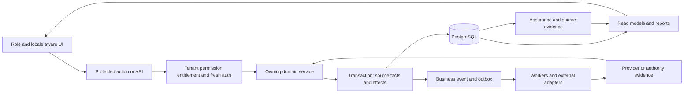
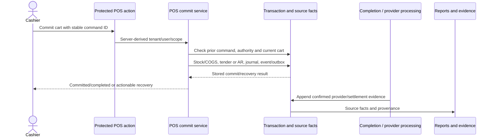
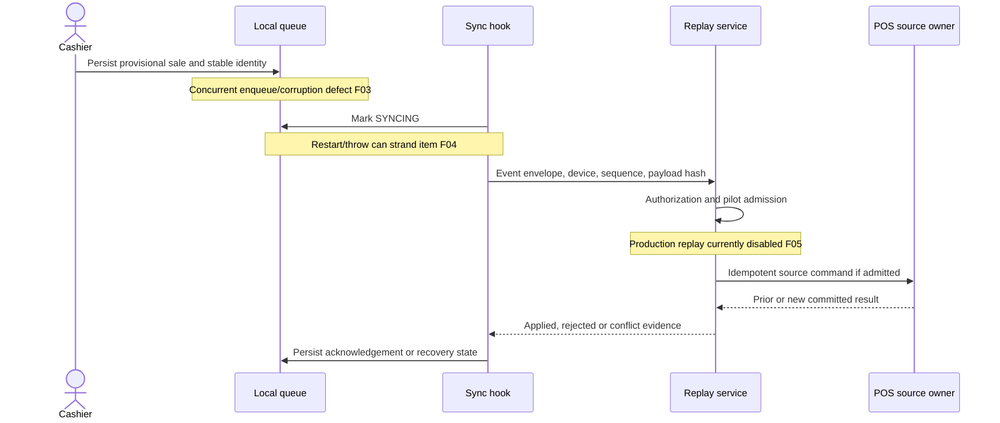
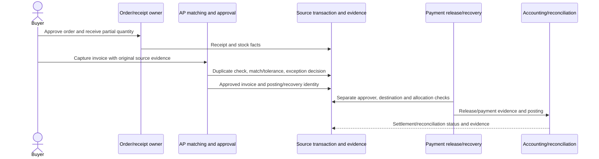
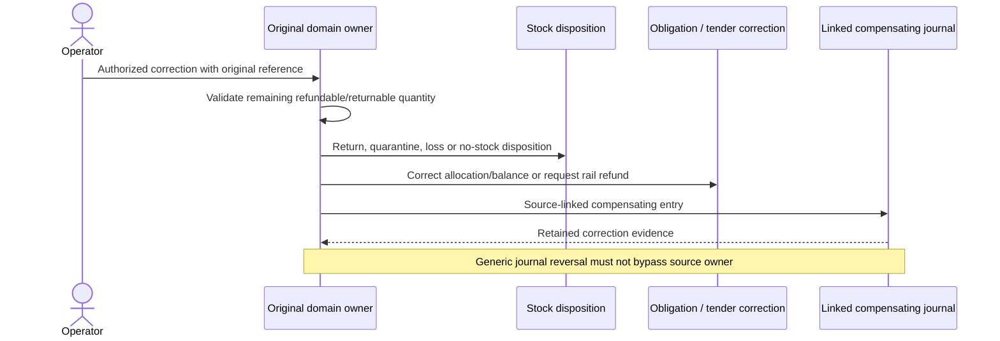
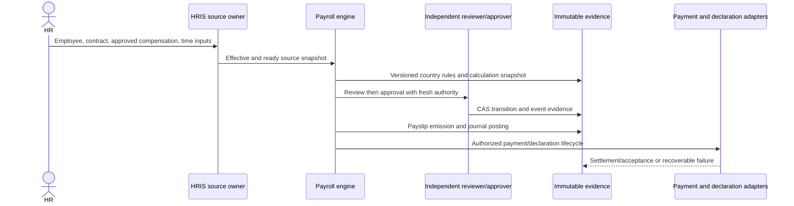
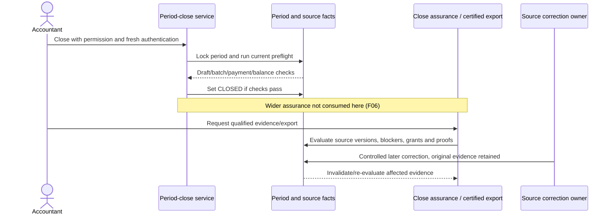

# Architecture and end-to-end workflow assessment

## Architecture observed

Stoquify is a modular Next.js application with server actions/API boundaries, domain services, Prisma/PostgreSQL persistence, event/outbox processing, evidence/assurance services and separate operational/financial read models. The correct unit of verification is the complete source-owned business transition, including its corrective path. A model, route or a successful journal insert alone is insufficient.

Graph navigation was used as requested: graph_actions contains node analytics_financial_analytics_getfinancialmetrics in community 70 and analytics_financial_reports_getfinancialsummaryreport in community 60. The loaded actions graph has 1,044 nodes/1,284 edges, differing from older AGENTS.md counts. Graphs reflect an older snapshot; current source, not those communities, established the relationships below. [verification/graph-navigation.json](<E:/ohada saas/Focused projects/stoquify/what-next/platform-correctness-audit/2026-09-30-run-01/verification/graph-navigation.json>) preserves samples/counts for all five graph files.

## 1. Online sale → money/stock → accounting/reporting

Authority enters through POS actions and the current cashier/terminal/location/session. [services/pos/pos.service.ts:2210](<E:/ohada saas/Focused projects/stoquify/services/pos/pos.service.ts:2210>) derives a request hash and first looks up organization+terminal+clientCommitId, validating same-payload replay. It rechecks tender write access, module new-work admission, checkout lease where present, draft sale ownership and scope. Stock/COGS, provider-backed tender or customer receivable, journal posting and business event/outbox are connected in the owning transaction; stored commit results distinguish committed versus completed recovery.

Money, fulfillment and sale status are separate facts. Electronic tender must have authoritative provider evidence, not just client success; see [services/payments/pos-electronic-tender-authority.service.ts:1](<E:/ohada saas/Focused projects/stoquify/services/payments/pos-electronic-tender-authority.service.ts:1>). Store-credit tender explicitly remains unavailable until its authoritative instrument ledger exists. Receipt/fiscal delivery support is also explicitly constrained. Split/partial tender and credit paths must preserve one final obligation, not double-count receipt and receivable.

**Verified:** current service/denial/idempotency unit cohort; local posted POS sale/payment batches. **Open:** actual PostgreSQL competing cashier execution, browser commit ambiguity and real-provider completion. **Known fault:** F02 allows a separate generic journal reversal to break source consistency; F01 affects base-currency reporting.

## 2. Offline sale → local durability → replay/conflict

[hooks/posHooks/useOfflineSync.ts:1](<E:/ohada saas/Focused projects/stoquify/hooks/posHooks/useOfflineSync.ts:1>) calls the local queue and server replay/review boundary. The queue retains hashes/sequences and exposes pending/conflict state, but F03/F04 demonstrate that its persistence/restart algorithm is not robust. [services/pos/offline-sync.service.ts:1268](<E:/ohada saas/Focused projects/stoquify/services/pos/offline-sync.service.ts:1268>) deliberately denies replay outside the test-authorized pilot.

Device revocation, stale permissions, altered payloads, duplicate/reordered delivery and resolution authorization must be verified against server truth. A queue hash is an integrity aid, not encryption or an authorization grant. Offline local data protection, tenant/session handover, browser eviction/quota, clock skew and multi-device stock conflicts remain unproven. No offline HRIS, payroll, AP, bank settlement or professional-close workflow was established; do not imply that offline POS scaffolding covers those domains.

## 3. Purchase order → receipt → AP → payment

Purchase-order services own order/receipt transitions; [services/purchasing/ap-control.service.ts:1](<E:/ohada saas/Focused projects/stoquify/services/purchasing/ap-control.service.ts:1>) and specialized preparation/approval/release/recovery services own AP. The schema distinguishes invoice matching and match exceptions, payment request/approval/release, allocation, and posting evidence. Supplier/PO locks, duplicate fingerprints, source revisions and maker-checker support controlled workflows.

**Verified:** unit suite, structural gate and consistent tenant/supplier/currency across 24 local allocations. **Limit:** all sampled invoices/payments are DRAFT; final AP→GL and settlement tie-outs have no live denominator. A provider release, a payment record and a settled supplier balance must remain distinct. Landed-cost allocation, full lot/serial/expiry and conversion workflows were not demonstrated merely because supporting fields exist.

## 4. Return/refund/credit → compensating facts

[services/purchasing/purchase-return-credit.service.ts:1](<E:/ohada saas/Focused projects/stoquify/services/purchasing/purchase-return-credit.service.ts:1>) and [services/purchasing/purchase-correction-ledger.service.ts:1](<E:/ohada saas/Focused projects/stoquify/services/purchasing/purchase-correction-ledger.service.ts:1>) separate purchase-return/credit facts from original receipt/order facts. POS return/refund/void paths have source-owned stock and payment handling. Accounting customer settlement/suspense already receive explicit generic-reversal protection; other sources do not (F02).

Duplicate corrections, partial returns, refund-before-provider-confirmation, closed periods and mixed return dispositions need isolated end-to-end proof. The desired cross-domain correction contract is explicit above; not every arrow has been executed against a real provider/database during this audit.

## 5. Employee onboarding → payroll → payment/declaration

HRIS owns employment source truth while existing PayrollEmployee/PayrollContract storage is retained for compatibility. Effective organization/manager scope, compensation approval, document retention/legal-hold/scan evidence, attendance/leave and input readiness precede frozen payroll snapshots. [services/payroll/payroll-control.service.ts:5349](<E:/ohada saas/Focused projects/stoquify/services/payroll/payroll-control.service.ts:5349>) implements calculation, review, approval, payslip emission and posting as separate transitions with evidence/version checks.

Service and migration evidence supports historical reproducibility better than live recalculation from mutable employee records. Actual final-cycle proof is absent in the local sample: every run is DRAFT. Correct arithmetic on those rows does not establish statutory eligibility, emitted payroll, settlement or declared obligations. Qualified country/version approval is a separate gate (F11). The manager fallback is current-only; do not treat it as historical reporting/delegation evidence. Employee detail must remain redacted from general BI/support output.

## 6. Period close → assurance → reporting → later correction

[services/accounting/periods.service.ts:349](<E:/ohada saas/Focused projects/stoquify/services/accounting/periods.service.ts:349>) takes an exclusive period row lock. Transactional posting obtains a shared lock through getOpenPeriodForDate. That improves ordering versus earlier audits. However, the current close preflight is narrower than the complete assurance model (F06).

A CLOSED period, balanced trial balance, signed reconciliation and certified export are distinct states. Source completeness must include stock, AP/AR, payroll, taxes, clearing and all admitted producers. Later changes must invalidate the right versioned close/export evidence, not rewrite history.

## Cross-cutting workflow and UX observations

Route families exist for accounting, payroll, HRIS, POS, purchases, analytics, reconciliation and manager/accountant workspaces. App and component code provides role/module-denied, loading, error, stale, partial and recovery states. BI contracts also represent redacted and unavailable values. Supplementary action/component tests passed; these are not live usability/accessibility evidence. The attempted local browser entry point was unavailable.

Material support/UX questions for the next runtime audit: Can a cashier distinguish committed-but-not-completed from rejected? Can AP resume a failed posting without duplicate payment? Can the accountant see lock-only versus evidence-complete close? Can employees use EN/FR self-service on mobile with keyboard/screen reader? Can support diagnose failed delivery/worker leases without seeing protected payroll content?

Packaging should expose those supported boundaries. Module admission uses shared locks and a stop-new-work policy that preserves permitted completion; billing/grants must not strand existing financial obligations. [services/modules/module-admission.service.ts:1](<E:/ohada saas/Focused projects/stoquify/services/modules/module-admission.service.ts:1>). Agent tool policy is read-only and permission-scoped in the inspected path: [services/agents/agent-policy.service.ts:1](<E:/ohada saas/Focused projects/stoquify/services/agents/agent-policy.service.ts:1>). Worker recovery exists in [services/events/business-event-outbox.service.ts:1](<E:/ohada saas/Focused projects/stoquify/services/events/business-event-outbox.service.ts:1>), but deployment schedules, alerts, saturation and retry latency were not observed.

## Remaining verification matrix

| Scenario | Required proof | Current status |
|---|---|---|
| Two cashiers buy last unit | Disposable PostgreSQL concurrent commands; one stock winner, no orphan money/journal | Unit/static design only |
| Duplicate sale/provider callback and changed payload | One source effect; changed payload rejected; callback attribution retained | Unit evidence; provider sandbox absent |
| Offline restart, corruption, multiple tabs, revoked device | Durable record conservation and authoritative reconciliation | Reproduced local failures; full browser/device test outstanding |
| Partial receipt/invoice/payment and correction | Stock, AP, allocation and journal tie out after each transition | Unit evidence; no finalized local AP sample |
| Payroll source changes after snapshot; approval races | Historical output stable; one transition winner; no partial event/outbox | Unit/trigger evidence; actual concurrency not run |
| Close versus source commit/correction | Consistent cutoff and stale evidence invalidation | Lock design inspected; full multi-producer DB race unverified |
| Unauthorized tenant/role/delegated/expired-grant access | Request-level denial and no private data leakage | Selected service/action tests; complete adversarial matrix absent |
| Current fresh migration/upgrade/restore | 87 migrations plus functional identity/source/ledger recovery | Metadata parity only; older 80-migration restore evidence |
| Report large data, pagination, currencies, late corrections | Independent totals, stable cutoffs and bounded latency | Currency defects reproduced; load/pagination system proof absent |
