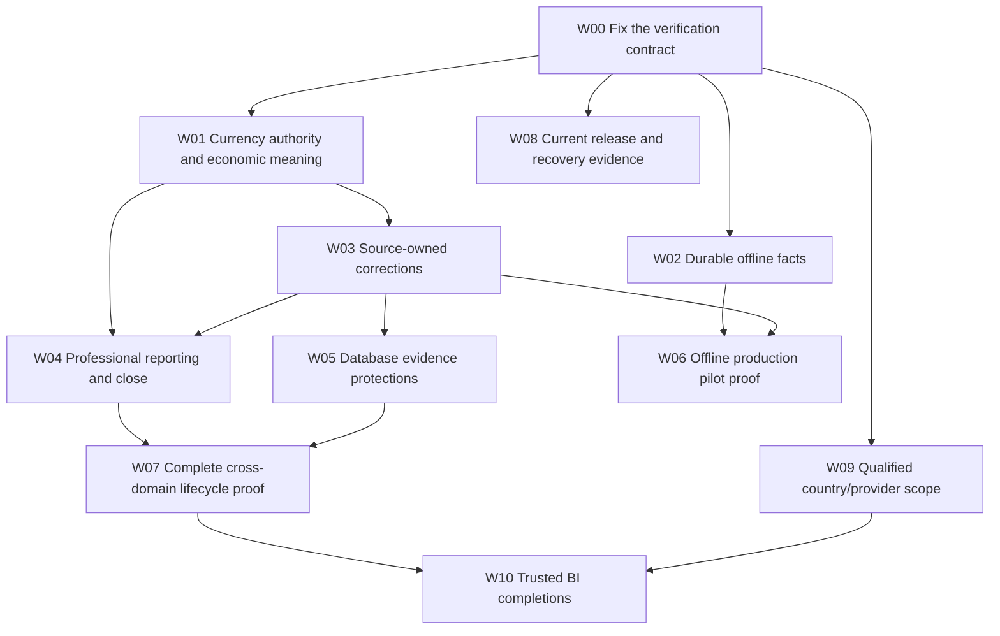

# Dependency-ordered remediation roadmap

This is an implementation plan, not approval to mutate the system in this audit. No estimates or completion percentages are invented. Work packages have explicit dependencies and acceptance evidence. Keep corrective work narrow; existing domain-owner and evidence infrastructure should be reused.

| Package | Outcome and owner | Dependencies | Required acceptance / migration considerations |
|---|---|---|---|
| W00 — verification baseline | QA/domain owners triage the initial 23 failing assertions against the later rechecks, two blocked structural gates and exact-runner startup; preserve correct fail-closed semantics. | None | Reproduce exact repository config in an isolated environment. Fix stale mocks/contracts and brittle checks with behavior evidence. Do not disable statutory gates or overwrite historic reports. Typecheck must complete. |
| W01 — currency authority | Accounting engineer + accountant unify immutable nominal/base/rate/rounding policy; block uncontrolled locked-currency edits. F01/F07. | Agreed currency transition policy | Independent mixed-currency posting/report/reversal fixtures; historical scan and accountant-reviewed correction plan. Old amounts cannot be relabeled by settings update. |
| W02 — offline fact conservation | Offline lead makes enqueue and restart recovery transactional. F03/F04. | Stable event IDs and queue migration design | Same-tab/multi-tab concurrency, quota/corruption, device restart and lost-response tests preserve every acknowledged sale exactly once. Existing queue migration retains identities/hashes and recovery quarantine. |
| W03 — source-owned correction | Accounting plus POS/AP/inventory/payroll owners define and enforce reversal eligibility. F02. | W01 for FX-safe compensations | Generic source-owned reversal denied; correct owner reverses all appropriate obligations, stock and journal effects once. Review historical generic reversals without mutating originals. |
| W04 — reporting and professional close | Finance/accounting + UX resolve F06/F08/F09. | W01/W03 | Opening/movement/closing tie-outs; partial fiscal bounds; shared/exclusive concurrency proof; complete source-readiness contract; explicit lock-only vs qualified-close UX and evidence invalidation. |
| W05 — DB evidence defense | DB/AppSec/accounting inventory writers and introduce scoped immutable posted evidence and tenant-consistent references. F10. | W03 | On disposable PostgreSQL, adversarial illegal writes fail, approved draft/post/correction paths pass; safe migration, orphan scan and upgrade/restore proof. Do not deploy blanket triggers first. |
| W06 — offline controlled rollout | Product/offline/release leads complete F05 after data durability is fixed. | W02/W03 and applicable country/provider evidence | Authorized device replay, revocation, reordering, uncertain tender, fiscal failures and conflicts tested on real browsers/devices and disposable DB. Product/support boundaries and rollback documented. |
| W07 — finalized domain proofs | Domain owners + QA execute PO→receipt→invoice→payment→reconciliation→GL and HRIS→payroll→payment/declaration→GL. | W03–W05 | Non-draft fixtures with independent subledger/stock/cash/payroll/GL totals, failure injection, duplicates, concurrency, corrections and cutoff checks. No seeded draft state accepted as proof of completion. |
| W08 — operational release proof | SRE/security/support update current runbooks and demonstrate restore/worker/observability/UI operation. F14. | W00/current release | Fresh and upgrade replay of all 87 migrations; current restore with login and business invariants; measured RPO/RTO; worker scheduling, alerts, dead-letter recovery, load/cost evidence; browser EN/FR, keyboard, screen reader and mobile proof. |
| W09 — qualified country/provider scope | Country-pack owner + independent accountant/payroll/tax expert + integrations qualify exact supported versions. F11. | Official sources, review/adapter access | Refreshed 2026 provenance; reviewed golden cases; CNPS/IRPP/e-invoice support assessed separately; real provider/authority acceptance proof; historical rule versions retained. |
| W10 — essential BI completion | BI/data + finance/product implement selected K01–K17 contracts, prioritizing actual decisions. F12. | Correct source/close and applicable W07/W09 | Each metric has grain/currency/cutoff/corrections/freshness/permission/drill-through/tie-out contract. Missing values remain explicit. Backfill derived snapshots from corrected facts with versions. |
| W11 — optional extensions | Product validates need for replenishment forecasts, budgets, assets or cohorts before engineering. | W10 + user research | A named decision/customer, reliable source data, bounded MVP and evaluation exist. Do not create manufacturing/consolidation solely because legacy tables or generic ERP expectations suggest it. |

## Immediate release-boundary recommendations

- Keep production offline replay disabled until W02/W06 prove data conservation. Label the current capability accurately.
- Do not rely on mixed-currency statements or locked-setting mutability for professional financial decisions until W01.
- Keep country capabilities that require expert review blocked; pack PUBLISHED is not blanket qualification.
- Retain source/certified-export checks while reconciling W00 gate drift; no control weakening to achieve green output.

## Completion evidence required

The next release dossier should tie an exact commit and migration history to current tests, database concurrency evidence, qualified country/provider versions, authenticated user journeys, restored recovery state and operational ownership. Tests and screenshots must identify environment/role/scope without secrets or employee/customer data. Each remaining blocker must have an owner and bounded operating restriction. This audit itself does not alter the release state.
