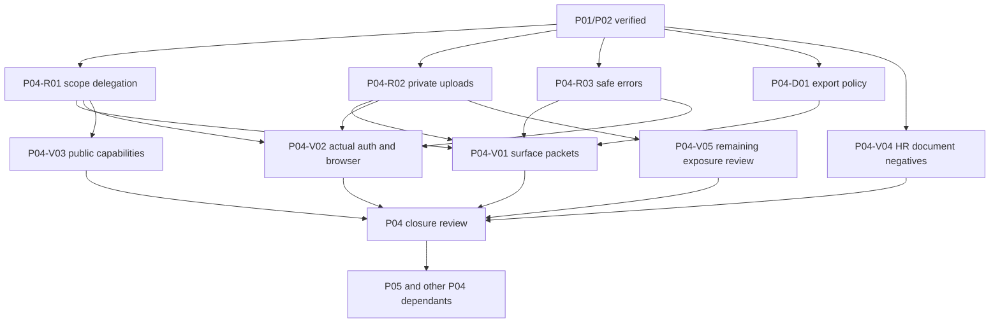

# P04 repair and qualification sequence

All children below are planned; no application repair was executed. Detailed tasks, acceptance, owners and recovery requirements are in [repair-and-qualification-packages.json](repair-and-qualification-packages.json).

| Package | Owner | Dependency / next boundary |
|---|---|---|
| R02 Private upload alternate path | Media/storage + security | Recommended first repair. Preserve asset/reference mapping; both URLs must deny unauthorized bytes and retain valid access. |
| R01 Reserved-code delegation | Roles/operating-access + security | Parallel with R02. Cover creation/update/assignment/invite/access-request scope ceilings; preserve legitimate administration. |
| R03 Item error responses | Inventory actions + security | Parallel bounded single-file family. Two proven reads and seven additional catches; use existing safe response contract. |
| D01 Report export visibility | Product/accounting/security | External business decision. Decide before V01 accepts ambiguous artifact visibility. |
| V01 Remaining surfaces | Security lead + domain owners | Umbrella tranche: split into one-family authority packets before execution. Final acceptance follows R01–R03 and D01. |
| V02 Actual auth/provider/browser | Auth/security + QA | Current sealed candidate after R01–R03; actual signed sessions and stale UI denial. |
| V03 Capability/referral lifecycle | Security + domain owners | Token-contract packets; final grant-path acceptance follows R01. |
| V04 HR document boundaries | HR/privacy + QA | Can qualify independently with fresh DB and fake storage; hosted P16 obligation remains. |
| V05 Dependencies/data exposure | Security + platform/data | Complete review; artifact private-content acceptance follows R02. |

Read-only mapping can run before the final dependencies above. Every source change invalidates affected evidence. Do not roll back to weaker authorization, restore public private-data exposure, delete original assets or rewrite production role assignments as an incidental repair.
