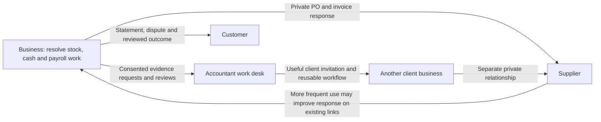

# Stoquify: product defects, competitive opportunities, and a credible path to network effects

Audit date: **6 September 2026**  
Workspace: `E:\ohada saas\Focused projects\stoquify`  
Branch: `codex/migration-control-plane-release-2026-08-29`  
HEAD: `a05a41ef66cd5d98fd69ae3df18225795f912232`  
Assignment: repository audit and competitive product strategy; no application changes or production operations.

## Decision

**Stoquify's strongest opportunity is to become the shared place where a business, its accountant, and its trading partners resolve operational work with trustworthy evidence.** Its existing accounting, inventory, payroll, access, and collaboration foundations make this plausible. Adding more overview screens would contribute less than completing those workflows.

The immediate obstacle is trust in the everyday experience. This audit reproduced a sales-reporting error: a completed sale of 100 plus an unfinished cart of 900 produces reported sales of 1,000. It also reproduced an analytics route wrapper invoking its data callback without a module-entitlement decision. These are bounded source-level findings, not claims about exploitation on a deployed system.

The first three product investments should be **O1 accountant–client work desk, O2 one role-aware daily resolution queue, and O3 payment-to-ledger reconciliation with proof**. Correct F1/F2 before exposing their metrics or charging for access. Close F3 before making country-specific payroll automation claims. Supplier collaboration is the next network experiment, after reliable delivery and repeat participation are demonstrated.

There is **no evidence in this audit of an achieved network effect, product-market fit, customer retention, or willingness to pay**. The report proposes experiments to establish those facts. A portal, an invitation, and an expanding customer count do not by themselves establish a network effect.

## 1. Method, scope, and evidence limits

The supplied prompt and root AGENTS.md were read. No additional AGENTS.md files were returned within the inspected source directories. The working tree already contained **188 modified tracked files and 205 untracked entries** before this audit's artifacts; these are status entries, not a count of every file beneath untracked directories. Findings concern the current working tree, not HEAD alone. Existing user changes were preserved.

Final status comparison also detected concurrent changes outside this audit in `components/analytics/CompleteIntegratedDailySalesDashboard.tsx` and new analytics test directories under actions/components. This audit did not make those changes. The three files used in the isolated defect reproductions were rehashed at completion and remained unchanged. This report is therefore a bounded working-tree audit, not a frozen release-candidate assessment.

Discovery covered routes, server actions, domain services, UI components, hooks, permission/module contracts, Prisma models, focused tests, and recent planning/readiness reports. The five canonical Graphify JSON files were parsed, along with the service graph. Their role was navigation; current source and fresh verification take precedence.

Evidence labels used below:

- **Reproduced:** current source executed with synthetic dependencies and an explicit scenario.
- **Source-confirmed:** a behavior or omission traced through current source; no deployed execution claim.
- **Inferred:** likely user or commercial consequence; requires observation.
- **Hypothesis:** proposed demand, differentiation, retention, or network outcome requiring a pilot.

Twelve existing test suites passed: **96 tests, zero failures**. A fresh static statutory gate produced **11/12 ready, one blocker: qualified source-artifact expert approval**. Passing tests establish only the invariants they exercise. They do not negate the reporting defect or establish production readiness. See [test results][V1], [isolated reproductions][V2], and [fresh statutory gate][V3].

No live customer database, authenticated browser, screen reader, provider account, payroll authority, or production deployment was exercised. Consequently, deployed country coverage, delivery reliability, data volumes, accessibility, performance, unit economics, and customer adoption remain unverified. No private credentials or customer records were copied into this report.

### Working segment and geography

The initial product hypothesis is a Cameroon trading/distribution or retail SME with multiple operational roles, roughly 10–100 employees and 1–5 locations, supported by an internal or external accountant. These sizes are **pilot-design assumptions**, not observed customers. Inventory-heavy firms offer a frequent sales–stock–cash loop; payroll-only firms need a different onboarding and value cadence.

Cameroon is the only entry in the examined **static regulatory registry** [R7]. The fresh gate concerns its CNPS evidence. Generic persisted country-pack support also exists; this audit did not query a live database, so it cannot enumerate deployed packs. Cameroon is therefore the strongest repository-backed initial geography, not a claim of approved production support. Senegal and Côte d'Ivoire are possible later research markets, each requiring its own payroll, tax, payment, language, and support validation. OHADA accounting scope must not be conflated with a uniform payroll or tax regime.

### Reconciliation with previous reports

The [29 August network strategy][P1] and [30 August roadmap][P2] already recommend cash, reconciliation, and accountant collaboration. This report preserves their useful direction and checks current source instead of treating all previous risk-register entries as current defects.

In particular, **durable managed module configuration and grants now exist** [R5]. The correct finding is incomplete enforcement on specific analytics surfaces, not absence of an entitlement system. Likewise, employee self-service, operational time requests, missing-close-evidence requests/responses, customer statements, accountant invitations, and supplier acknowledgements already exist. They are foundations to improve, not ten wholly missing features.

## 2. Current capability map and workflow traces

“Implemented” below means a connected source implementation was found. It does not mean independently verified production operation.

| Capability | Classification | Evidence and practical boundary |
|---|---|---|
| POS sale → stock → accounting | Implemented; production execution unverified | `commitPOSSale` claims/finalizes the sale, calls inventory posting, posts sale/payment journals in the transaction, and records the business event [R10]. |
| Offline POS synchronization | Implemented controls; field operation unverified | Device/event sequencing and replay call the authoritative sale service; selected offline tests pass [R11], [V1]. The earlier static readiness report was 16/16, not a field-connectivity or fiscal-device certificate. |
| Purchasing → receiving → AP | Implemented | Receiving uses optimistic quantity claims and invokes inventory receipt posting only after accepted inspection; AP validates invoice/receipt evidence and has controlled payment release [R12], [R13]. |
| Payment ingestion/reconciliation | Implemented foundation; live rails unverified | Statement/provider adapters, inbox worker, matching, suspense, sign-off, and workbench services exist [R14], [R15]. A generic HMAC adapter is not proof of a functioning integration with a named operator. |
| HRIS → payroll | Implemented source chain; local production approval partial | Identity, contracts, compensation, time/leave, approved payment destinations, readiness export, freeze/calculate/approve/post, payslips, payment evidence, and declarations are represented [R16]–[R19]. F3 blocks a broader automation claim. |
| Employee/manager self-service | Implemented; user completion unverified | The service composes the employee's own profile, time, attendance, payment-destination status, and limited document evidence [R18]. Some approval UX still exposes technical hashes [R20]. |
| Close assurance/accountant collaboration | Implemented; delivery and adoption unverified | Expiring/revocable grants, a client portfolio, close review, and missing-evidence request/response/review contracts exist [R21]–[R23]. |
| Customer statement participation | Implemented foundation | Immutable statement snapshots, restricted access, recipient actions, delivery state, consent evidence, and attribution exist [R24], [R25]. No live delivery was tested. |
| Supplier PO participation | Partial completion | Invite token → copyable link → proposal → buyer decision exists. The invite event contains no delivery outbox messages [R26], [R27]. |
| Referral reporting | Implemented narrow metric; partial growth evidence | Tenant-only aggregates report all-time issued links, clicks, conversions, and invite activations [R28]. Conversion is recorded at organization registration [R29], not retained productive use. |
| Role-aware daily work | Implemented but fragmented entry points | Daily Digest, Manager Action Center, Owner War Room, Dashboard, and Business Pulse are exposed through the shell [R9], [R30], [R31]. Duplication of user value is an inference pending usability evidence. |
| Financial analytics correctness | Defective in examined sales path | Draft orders enter sales totals; currency/time defaults can misrepresent regional meaning [R1], [R2], [V2]. |
| Managed module access | Implemented infrastructure; enforcement partial | Persisted grants and enforced navigation exist; analytics wrapper lacks the equivalent guard [R3]–[R6]. |
| Governed master-data onboarding | Implemented foundation | CSV mapping, staging, validation, risk classification, approval, and commit support exist [R32]. Full accounting/payroll migration equivalence was not established. |
| General 13-week cash scenarios | No complete implementation located | Existing Cash Command includes payroll forecast signals; no complete general scenario/actual-versus-forecast lifecycle was found in the inspected services [R33]. |
| Cash-aware replenishment across locations | Partial foundation | Inventory has availability/reorder data, transfers, and stock-to-cash signals [R34], [R35]. No complete demand/lead-time/cash-budget planning workflow was found in the inspected services. |
| Public marketplace/cross-company benchmarking | No implementation established | Existing tenant-owned supplier/customer records are not a shared verified identity, discovery, moderation, or consented benchmarking system. Treat these as later proposals. |

The five workflow traces are:

1. **Cashier:** draft cart → `commitPOSSale` → inventory stock issue → `postSale`/`postPayment` → recorded event → provider/reconciliation evidence where applicable. The core posting chain is stronger than the analytics projection of that chain.
2. **Buyer:** PO → `receiveItems` → inspection/quantity claim → inventory receipt → `postSupplierInvoice` → controlled supplier payment → payment exception/reconciliation. Supplier proposals remain requests, not authoritative stock or ledger changes.
3. **HR/payroll operator:** HRIS employee/approved contract/compensation/time → readiness export → frozen attendance → calculation/review/approval → posting/payslips → payment settlement and declaration evidence. Human country review and real provider proof remain separate requirements.
4. **Manager:** source snapshots → Daily Digest/Manager Action Center → authoritative exception workbench → close request/response/review. Existing source ownership should survive UX consolidation.
5. **Accountant/owner/employee:** consented accountant grant and portfolio; owner/manager role-filtered operating surfaces; employee-scoped self-service. These permissions are intentionally different and must not be flattened into one universal data view.

### Graph references

The parsed canonical graphs contain components 1,173 nodes; actions 1,044; app 622; hooks 308; types 72. Examples relevant to this audit:

| Graph | Node/community | Interpretation checked against source |
|---|---|---|
| Services | `analytics_sales_analytics_service_getbusinesspulsecommandreadmodel`, community 24 | Business Pulse composition belongs with its sales read model; F1 is a source projection defect. |
| Services | `accounting_accountant_access_service_getaccountantportfolio`, community 1 | Portfolio depends on accounting access authority; O1 must preserve consent checks. |
| Components | `accounting_accountantportfolio_tsx`, community 140 | Existing portfolio UI is an extension point, not a new portal proposal. |
| Components | `daily_habit_dailyhabitdigestdashboard_tsx`, community 156 | Existing digest should host O2 instead of adding another dashboard. |
| Actions | `accounting_accountant_access_actions_getaccountantportfolioaction`, community 58 | The portfolio has an existing action boundary. |
| App | `accountant_portfolio_page_accountantportfoliopage`, community 75 | An existing route can deliver O1. |
| Hooks | `payments_usepaymentreconciliationworkbench_usepaymentreconciliationworkbench`, community 40 | Reconciliation has a workflow-specific client/server connection to reuse. |
| Types | 72 nodes inspected; no matching standalone payroll/portal node in the sampled search | Many contracts live with services; graph absence is not feature absence. |

Graph source locations are dated navigation hints; report links below reference current files.

## 3. Competitive context

All web sources were accessed on **6 September 2026**. Product claims were taken from primary vendor pages/documentation. No competitor trial or customer reference call was performed; advertised compliance and reliability are **vendor claims**, not this audit's certification. Undisclosed capabilities remain unknown.

| Alternative | Relevant workflow and local position | Collaboration, onboarding, integrations, offline | Pricing/packaging evidence and implication |
|---|---|---|---|
| **Odoo** | Broad ERP/accounting and POS alternative. Official fiscal-localization documentation lists Cameroon and other regional jurisdictions; payroll localization is separately documented [S1]. | Official POS source describes online/offline operation [S2]. Exact country payroll, operator integration, and implementation experience require a country/version-specific demo. | Current pricing pages could not be retrieved reliably, so no current amount is quoted. Competing merely on “all-in-one” or offline POS is insufficient. |
| **Sage 100 + ECF/Paie ecosystem** | Commercial/accounting suite; official 2026 ECF documentation includes OHADA and Sage 100 compatibility [S3], [S4]. | Sage's suite page describes shared documents, remote access, receiving and stock workflows. Payroll product page describes employee-related companion services and partner support [S4], [S5]. Country-specific payroll coverage remains to be confirmed. | The export catalog identifies an ECF OHADA product reference [S6]; it is not a complete local deployment quotation. Include implementation, hosting, support, and local payroll configuration in a buyer comparison. |
| **ECOHADA** | Regional accounting and ERP alternative. The current download page advertises SYSCOHADA/SYSCEBNL accounting and fiscal statements, with current 2026 builds [S7]. | Downloadable software, portability, and modest resource requirements are stated. Current collaboration, integration, and offline workflow guarantees were not established from this page. | Download availability is not proof that every edition/support service is free. Commercial total cost requires verification. This is a credible incumbent workflow to migrate from. |
| **Omamori** | Direct Cameroon-focused suite competitor advertising accounting, payroll, sales, stock, treasury, DSF, and social declarations [S8]. | Advertises local onboarding, Android/offline sync, and mobile-money collection/payroll. These are untested vendor claims. | Published Solo **15,000 FCFA/month, one user** and Équipe **25,000 FCFA/month, up to five users** create a concrete price/value comparison. Confirm tax, support, payment fees, and scope before treating prices as comparable. |
| **Workpay** | Specialist alternative for HR/payroll; advertises payroll, employee self-service, and salary disbursement [S9]. Its Senegal EOR page establishes a marketed local service offering, not automatic equivalence with self-serve software coverage [S10]. | Mobile/web employee access and bank/wallet payment claims raise the convenience baseline. HR product materials describe leave approvals [S11]. | Quote-based tiers distinguish software and outsourced operations [S12]. Country-specific payroll software availability and service responsibilities need a demo/quotation. |
| **Julaya** | Payments substitute and potential partner, rather than a full ERP. Country tabs cover Côte d'Ivoire, Senegal, Benin, and Togo [S13]. | Advertises batch transfers, supplier invoicing, approval levels, tracking, and accounting exports. These workflows compete with manual finance operations inside an ERP. | Published payment fees vary by rail/volume; the visible mobile-money transfer band is **0.5–1.5% TTC**. Verify country/operator terms. This does not establish Cameroon availability or integration authorization. |
| **Spreadsheets + accountant + calls/messages** | Working substitute hypothesis for the pilot: familiar data entry plus trusted human interpretation. No prevalence estimate is claimed. | Flexible sharing and human exception handling, with reconciliation/version-control costs to measure during interviews. | Include accountant time, duplicate entry, errors, and migration effort; license cost alone is an inadequate comparison. |

**Expected capabilities:** correct finalized-sales reporting; usable imports/exports; traceable stock and accounting; employee self-service; country-specific payroll support; completed receiving/payment/close tasks; role access; recoverable connectivity behavior. Multiple competitors already advertise much of this.

**Credible differentiation hypothesis:** reduce the time from an operational exception to a reviewed, traceable resolution across owner, employee, accountant, customer, and supplier. Demonstrate that the stock, cash, payroll, and close views refer to the same event and its evidence. Public competitor pages did not establish that Stoquify uniquely provides this; validate the advantage in task-based comparisons.

**What not to mistake for differentiation:** another generic dashboard, an ungrounded AI assistant, nominal OHADA support, a payslip viewer, invitations alone, or offline POS alone.

## 4. Five highest-priority problems

### F1 — Sales analytics can count unfinished work as earned sales

**Classification:** correctness; high priority. **Confidence:** reproduced for draft inclusion; source-confirmed for currency/time defaults; business impact inferred.

`getSalesAnalyticsReadModel` selects all orders except `CANCELLED` and sums their totals [R1]. POS creates `DRAFT` orders and recalculates their monetary totals before commitment [R2]. Business Pulse consumes this read model, then describes amounts as trusted sales. The isolated current-source reproduction returned **1,000 and two transactions**, where the fixture contained **one completed 100 sale and one uncompleted 900 cart**. A cancelled 700 order was correctly excluded [V2].

The same projection family defaults to XAF and derives periods using the server's local day. Its production wrapper supplies neither tenant currency nor timezone [R1]. Under a UTC host, the reproduced day starts at `2026-09-06T00:00Z`, while the intended Douala day starts one hour earlier. An XOF tenant would also inherit an incorrect currency label from this path. No deployed non-XAF tenant was inspected.

**Consequence:** owners can infer false revenue, growth, and cashier productivity; later reconciliation screens may contradict the overview. The ledger need not be wrong for this to damage trust.

**Decision:** fix. Define each metric's recognized/finalized event, cancellation/return treatment, effective timestamp, currency, timezone, and location scope. Reuse the authoritative sale/payment/return facts; a blanket `COMPLETED` filter alone is not a complete accounting policy for every sales channel.

**Minimum intervention and acceptance:** correct this read model and its callers before adding forecasts or more KPIs. A completed 100 sale plus draft 900 cart must report 100 finalized POS sales and one finalized transaction; explicit gross/net return fixtures and cross-midnight tenant-day cases must agree with their source evidence. Monetary totals should preserve decimal precision until presentation. Owner: analytics/domain engineering plus accounting reviewer. Preserve historic records; this is a projection correction.

### F2 — Hiding a module in navigation does not enforce its analytics route

**Classification:** commercial authorization/packaging correctness; high priority. **Confidence:** source-confirmed and wrapper-level reproduction.

Managed configuration/grants and enforced navigation now exist [R5], [R6]. However, `withAnalyticsSurfaceAccess` calls RBAC checks and invokes `onAllowed` without a module check; the catalog also specifies no concrete analytics entitlement [R3], [R4]. The main analytics page then loads its service. Dashboard layout supplies a navigation snapshot but does not turn it into a route guard.

In an isolated run, an RBAC-authorized synthetic context representing analytics disabled still reached `onAllowed` [V2]. This is a wrapper-level test with mocked RBAC, not a deployed exploit or proof of cross-tenant access. The service remains organization-scoped in the inspected path.

**Consequence:** a customer can have a hidden/disabled module yet reach the analytics data path through a direct route, undermining plan changes and trust in access settings. The default observe mode elsewhere is additional context, not evidence that all routes are unguarded.

**Decision:** fix the identified surfaces using existing durable authority. Do not globally flip every observe-mode surface without an inventory of intended access, read-only retention, and grace-period policy.

**Minimum intervention and acceptance:** bind catalog entries to module slugs; apply the existing guard before service reads, including actions/exports feeding the same feature. Verify enabled, absent, disabled, expired, read-only, and wildcard-RBAC cases for the three analytics routes. A denied decision must produce zero downstream reads. Existing managed-grant negative tests should remain green. Owner: platform/access team.

### F3 — Country payroll/statutory automation remains unfinished at the evidence boundary

**Classification:** product completion/localization; release-critical for affected automation. **Confidence:** fresh gate result and source-confirmed scope.

The examined static country registry contains CM [R7]. The fresh production-readiness gate reports **11/12**, with **expert approval incomplete**, runtime CNPS **SUPPORTED_DRAFT / SOURCE_CHECKED**, and authoritative promotion false [V3]. Tax evaluation explicitly supports a blocked-requires-review outcome [R8]. This is appropriate fail-closed behavior, not a defect to bypass.

**Consequence:** a buyer seeking a fully usable, locally supported payroll cycle cannot treat the existence of payroll screens or adapters as proof of supported filing/payment automation. Wider country marketing would outrun the inspected evidence. A database may contain additional packs; this audit did not enumerate it.

**Decision:** complete a deliberately bounded country/use-case release; defer broader promises. Retain readiness gates and manual evidence workflows where valid.

**Minimum intervention and acceptance:** finish qualified review of the exact Cameroon pack and effective dates, resolve review findings, and rehearse one supported employer profile through two payroll cycles. Tie employee inputs, expected calculations, payslips, posting, payment settlement, and declaration receipts to the same reviewed version. Automate submission only for independently proven channels. Set clear unsupported-case messages. Owner: payroll lead with qualified country reviewer, QA, and customer support. No legal approval was granted by this audit.

### F4 — Too many overlapping starting points, with technical evidence handling in ordinary HR work

**Classification:** usability/unnecessary complexity; simplification candidate. **Confidence:** source-confirmed surfaces and form requirement; value duplication and abandonment are hypotheses.

The sidebar exposes Dashboard, Analytics, Daily Digest, Manager Action Center, and Owner War Room as operating entry points [R9]. Existing Daily Digest already loads organization currency and role-filtered workspace data [R30]; rebuilding another executive home would duplicate useful infrastructure. In HR, the general approval inbox requires a manually entered **“Approval evidence hash”** before approval [R20]. Specialized operational-time panels already calculate evidence internally, illustrating inconsistent product ergonomics.

**Consequence:** a user must learn which starting point is authoritative and may need technical assistance to complete a routine approval. No usage data proves any screen is unused.

**Decision:** consolidate navigation and simplify evidence capture. Keep owner/manager role distinctions and preserve specialist workflows. Treat generic overview entries as retirement candidates only after role-based task testing.

**Minimum intervention and acceptance:** designate one role-aware landing route using Daily Digest; route its tasks to authoritative workbenches. Replace hash entry with document selection/upload or an approved decision flow that generates and binds evidence server-side. Preserve provenance, reviewer identity, and segregation of duties. Pilot five users per priority role: at least 80% should find the next required task and complete a representative approval without explanation of a hash. Use median task time against baseline; do not remove routes if specialist task success worsens. If retiring duplicate navigation, retain links/redirects, source services, history, exports, and role permissions. Owner: product/design plus domain teams.

### F5 — External participation has working primitives but incomplete delivery and value measurement

**Classification:** workflow completion and growth measurement; high product priority. **Confidence:** source-confirmed; live operating reliability unverified.

Supplier invitations issue tokens and return a URL; the UI provides **Copy link** [R26], [R27]. The invite event declares `outboxMessages: []`. Manual sharing is a legitimate supported path, but the inspected flow does not prove automatic delivery, reminder handling, or a delivery receipt. Customer statements and accountant invitations have richer delivery foundations; their actual operation was not tested here.

Referral reporting is **ALL_TIME**, loads attribution events into memory, and counts links/clicks/conversions [R28]. The conversion producer records **ORGANIZATION_REGISTRATION** [R29]. It cannot by itself establish successful onboarding, a completed first task, retained use, or increased value for existing participants. All-time retrieval may become costly at volume; no benchmark was performed.

**Consequence:** the team can mistake links and signups for a working recommendation engine while counterparties still rely on manual follow-up. This is a completion gap, not evidence that no collaboration exists.

**Decision:** finish the smallest invitation→useful response→reviewed outcome loop and instrument it. Defer an open marketplace and paid referral incentives.

**Minimum intervention and acceptance:** preserve manual sharing, add consented transactional delivery/retry/revocation and safe status for one channel, then measure delivered invitation, unique human engagement, first completed task, repeat participation, and retained new organization separately. A supplier must acknowledge without creating an account; a buyer must review the proposal without external changes mutating PO/stock/AP truth. Initially require at least ten real repeated collaborations, no unauthorized disclosure, and outcome evidence on every accepted response. Owner: collaboration/integrations plus growth operations. This audit sent no invitations.

## 5. Ten ranked functionality opportunities

Scores are **directional hypotheses**, not ROI forecasts. Columns: pain/outcome 25%, frequency/retention 20%, differentiation 20%, network/referral 15%, revenue/adoption 10%, feasibility 10%; each dimension 1–5. The total is the weighted average on a 1–5 scale. Confidence concerns the combined product recommendation; source foundations often have stronger evidence than market demand.

Effort is an initial **engineer-week range for a bounded useful release**, after prerequisites, excluding uncertain external review/contract delays. It is not elapsed time or a commitment.

| Rank | ID / functionality | Pain | Frequency | Difference | Network/referral | Adoption | Feasible | Score / 5 | Effort | Confidence |
|---:|---|---:|---:|---:|---:|---:|---:|---:|---|---|
| 1 | O1 Accountant–client work desk | 5 | 4 | 4 | 5 | 5 | 4 | **4.50** | 4–6 | Medium |
| 2 | O2 One role-aware daily resolution queue | 5 | 5 | 4 | 2 | 4 | 5 | **4.25** | 3–5 | Medium |
| 3 | O3 Payment-to-ledger reconciliation with proof | 5 | 5 | 4 | 2 | 5 | 4 | **4.25** | 5–8 | Medium |
| 4 | O4 Supplier order-to-invoice collaboration | 5 | 4 | 4 | 4 | 4 | 3 | **4.15** | 5–8 | Medium |
| 5 | O6 Receivables and customer statement resolution | 5 | 4 | 3 | 4 | 4 | 4 | **4.05** | 3–5 | Medium |
| 6 | O7 Country-reviewed payroll completion | 5 | 3 | 4 | 2 | 5 | 3 | **3.75** | 6–10 | Medium |
| 7 | O5 13-week cash and obligation forecast | 5 | 4 | 4 | 1 | 4 | 3 | **3.70** | 4–6 | Low–medium |
| 8 | O8 Cash-aware replenishment and stock transfers | 5 | 5 | 3 | 1 | 4 | 3 | **3.70** | 4–6 | Low–medium |
| 9 | O10 Guided migration with opening-balance proof | 5 | 2 | 3 | 3 | 5 | 4 | **3.60** | 4–6 | Low–medium |
| 10 | O9 Mobile employee and manager self-service | 4 | 4 | 3 | 2 | 4 | 4 | **3.50** | 3–5 | Medium |

Rationale: O1/O4 can connect organizations, whereas O2/O3 primarily improve repeat value. O3 receives a stronger adoption score than O2 because payment reconciliation provides a concrete financial buyer outcome. O5/O8 depend on source quality and uncertain planning behavior; O10 is valuable but infrequent. O7's monthly cadence lowers its score, **not its necessity** for a payroll launch. F1–F3 are prerequisites regardless of score. A one-point scoring change can move close-ranked items; validate before allocating a large program.

### O1 — Accountant–client work desk

**User/job and experience:** an accountant serving several SMEs repeatedly requests missing documents and decides which client needs help first. Instead of chasing files across messages, open the existing portfolio, select a client blocker, issue a specific evidence request, and review the response against the close finding. The owner sees the same request with its due date and permitted action.

**Foundation and first release:** extend consented access, portfolio, and existing missing-evidence request/response/review contracts [R21]–[R23]. Add due-date prioritization, assignment, response status, and a handoff summary; do not invent a new ledger, portal, or request system. Prerequisites: F2-equivalent guards, consent/revocation, reviewed delivery. Later: agreed firm-level workflows and advisory service packages.

**Competitive reason to choose/stay/recommend:** Sage already markets collaboration and partner support [S4], [S5]. The differentiation hypothesis is a short path from a specific stock/cash/payroll exception to a reviewed client response, reusing operational evidence. The recommendation moment is “we closed the missing-document list without chasing spreadsheets.” Accountants can invite clients; owners can invite their existing accountant.

**Network mechanism:** cross-organization accountant–client links. Each extra client may increase a firm's incentive to work in the shared desk; standardized work can free capacity for existing clients. An added firm benefits businesses only if it increases available service or expertise. This is a **conditional two-sided effect**, not proven by portfolio size. Single-client collaboration must already be useful. Keep every client grant independent; never sum currencies or expose another client's records.

**Economics/validation:** 4–6 engineer-weeks; account/firm support and document retention are recurring costs. Test a firm subscription or client bundle while keeping recipient responses easy to access. Pilot three firms/five clients each. Seek ≥25% reduction in median evidence-request resolution time and repeat firm use over four weeks. Counter-metric: support minutes and unauthorized/expired access. Reconsider expansion if faster resolution does not persist after onboarding assistance ends.

### O2 — One role-aware daily resolution queue

**User/job and experience:** owners and managers decide what requires attention now. Replace navigation across overview screens with the existing Daily Digest showing the top unresolved tasks, accountable owner, due time, financial consequence, evidence freshness, and an authorized next action. Resolving the task updates its source workflow and clears it from the queue.

**Foundation and first release:** reuse Daily Digest, Manager Action Center, source snapshots, and action-queue services [R30], [R31], [R33]. Consolidate entry points rather than write another dashboard. Start with three task types: payment discrepancy, receiving/stock problem, and missing close evidence. Add payroll-readiness tasks after F3. Technical evidence collection belongs behind the user action, preserving audit records.

**Competitive reason:** broad ERP dashboards are parity. Faster task completion and consistent source truth are the differentiator to test. Users choose it for a useful morning checklist, stay for shared work ownership, and recommend it after an exception is resolved without calls. Team invitations support internal collaboration; **there is no automatic cross-company network effect**.

**Economics/validation:** 3–5 engineer-weeks; use core packaging so essential error resolution is not gated behind premium analytics. Costs are query fan-out, notifications, and support for stale tasks. Five owners/five managers perform the same tasks before and after the pilot. Seek ≥20% lower median completion time and ≥80% unassisted success. Counter-metrics: false urgency, duplicated tasks, notification opt-outs, and p75 page response. Reconsider new task types if task completion does not improve; logins alone are not success.

### O3 — Payment-to-ledger reconciliation with proof

**User/job and experience:** finance teams match mobile money, bank, cash, refunds, fees, and ledger entries daily. Instead of comparing messages and spreadsheets, import or receive a supported provider statement, review suggested matches with source evidence, resolve exceptions, and finish a reconciled period with an exportable proof trail.

**Foundation and first release:** extend existing provider ingestion, generic HMAC adapter, matching/suspense, sign-off, payment workbench, POS posting, and payroll settlement bridges [R10], [R14], [R15], [R19]. Pick one country and one statement format/provider lane. Start with user-uploaded statements when live API evidence is unavailable. F1/F2 and robust duplicate/replay/fee handling are prerequisites. Later add measured demand-driven rails.

**Competitive reason:** Julaya already markets payment operations, tracking, and accounting exports [S13]. Stoquify's hypothesis is a shorter proof path from an external settlement to the exact sale, stock event, supplier payment, or payroll obligation. Buyers choose it to reduce reconciliation work and stay because every day's transactions need closure. Recommend after recovering an unmatched payment or closing a discrepancy with evidence; unresolved exposure must never be labeled proven loss.

**Network:** primarily retention and integration value. Connecting more providers is coverage, not automatically a participant network effect. An accountant invited to review an exception can initiate O1's separate collaboration loop.

**Economics/validation:** 5–8 engineer-weeks plus provider lead time; integration monitoring, statement storage, support, and provider fees persist. Price a finance/reconciliation add-on transparently, without custody or autonomous payment authority. Reconcile anonymized/test statements first, then a consented cohort. Seek ≥30% lower operator minutes per reconciled period. Counter-metric: false accepted matches; any unexplained mismatch blocks expansion. Reconsider a rail if saved labor cannot justify support and provider cost.

### O4 — Supplier order-to-invoice collaboration

**User/job and experience:** a buyer needs a supplier to confirm price, quantity, date, and delivery discrepancies. Extend the existing PO link so the supplier acknowledges or proposes changes, attaches permitted delivery/invoice evidence, and receives buyer-reviewed status without recreating the whole order by telephone.

**Foundation and first release:** the token/envelope/proposal/buyer-review boundary is already present [R26], [R27]. Add reliable consented notification and one delivery/invoice response type mapped to existing receiving/AP controls [R12], [R13]. Do not let a supplier post inventory or settle AP. F5 delivery/retry/expiry is prerequisite. Later consider an optional supplier inbox spanning independently granted buyer relationships, not a public supplier identity merge.

**Competitive reason:** Sage already advertises receiving and supplier replenishment workflows [S4]. Test reduced re-entry and faster confirmed commitments, rather than claim uniqueness. Single-buyer links provide immediate utility. The referral moment is a supplier asking another buyer to use the same structured order-response flow.

**Network mechanism:** existing buyers can benefit when a shared supplier uses the workspace regularly because more buyers participate. This effect is conditional on faster/more reliable responses on existing links, not merely a larger address book. Never expose one buyer's price, volume, or negotiation to another.

**Economics/validation:** 5–8 engineer-weeks; transactional delivery, abuse/support, and attachment costs. Free narrow supplier responses; paid buyer procurement workflow is a hypothesis. Pilot five buyers/ten suppliers with repeat orders. Seek ≥25% lower median acknowledgement time and ≥50% fewer fields re-entered. Counter-metrics: disputed changes and rejected/duplicate requests. Reconsider a consolidated supplier inbox if repeated multi-buyer use does not appear naturally.

### O6 — Receivables and customer statement resolution

**User/job and experience:** credit controllers chase balances and customers dispute unclear statements. Extend immutable statements so recipients can acknowledge, identify a disputed line, submit a promise or payment reference, and see a reviewed outcome. Route accepted settlement evidence back to the existing receivables service; a promise is never recorded as cash.

**Foundation and first release:** snapshots, restricted tokens, recipient actions, encrypted delivery, receivables and settlement/reversal services already exist [R24], [R25]. Complete the workflow on one delivery channel, with expiry/revocation, aging priorities, reviewed outcomes, and delivery status. Do not rebuild statements or create a marketing campaign system. Add payment links only after operator support is verified.

**Competitive reason:** invoicing/payment portals are not unique; Julaya already advertises invoice collection [S13]. Test resolution without disputed balance re-entry. Users stay because receivables recur; customers recommend after resolving a discrepancy quickly and receiving a clear receipt.

**Network:** one-off statement sharing is utility/referral distribution. Optional, consented multi-merchant statement access could later create recipient-side repeated value; it is not implemented by today's tenant-scoped token alone. Accounts must remain optional for narrow responses.

**Economics/validation:** 3–5 engineer-weeks plus delivery prerequisites; price advanced collections in the finance package while preserving usable statement access/export. Pilot comparable account groups for four weeks. Seek ≥20% faster dispute resolution and greater promise-kept rate; monitor complaints, opt-outs, incorrect balances, and collector time. Stop reminders that increase complaints without better outcomes. Do not infer causality for cash collection from a short, uncontrolled pilot.

### O7 — Country-reviewed payroll completion

**User/job and experience:** payroll operators need to get from approved inputs to correct net pay, payment proof, and declaration evidence each pay period. Present a plain-language readiness checklist and explain each variance. Complete the supported cycle rather than expose additional technical control screens.

**Foundation and first release:** HRIS source proof, operational time, payroll freeze/calculate/review/approve/post, payslips, settlement, and declarations already exist [R16]–[R19]. Finish one reviewed Cameroon employer/profile/cycle scope and remove user-entered evidence hashes from ordinary approvals [R20]. F3 expert review is mandatory for claims; unsupported cases remain explicit. Later expand by proven customer demand, one country/profile at a time.

**Competitive reason:** Workpay already advertises payroll and employee access [S9]; Omamori advertises local payroll/declarations [S8]. Differentiate through demonstrable explainability, correction history, and accounting reconciliation for an inventory-led business. The recommendation moment is two clean payroll cycles with fewer disputes. Cadence is periodic for payroll staff, daily for some upstream attendance work.

**Network:** trust/referrals through payroll practitioners and employees, not a proven cross-employer network. Never share employee pay or identity to manufacture one.

**Economics/validation:** 6–10 engineer-weeks plus unpredictable expert/provider lead time. Per-active-employee pricing with a minimum support fee is a hypothesis; budget country maintenance and payroll-calendar support. Run two parallel/rehearsal cycles with a qualified reviewer. Require no unexplained net-pay/ledger variance and ≥25% less preparation effort. Counter-metrics: corrections, disputed payslips, privacy failures. Any material unexplained variance stops live expansion regardless of score.

### O5 — 13-week cash and obligation forecast

**User/job and experience:** owners decide whether upcoming collections can cover purchases, payroll, and tax. Extend Cash Command with dated weekly inflows/outflows, source coverage, the first projected cash shortfall, and transparent assumptions. Replace “bank balance looks sufficient” with an evidence-linked view of committed and uncertain obligations.

**Foundation and first release:** Cash Command already consumes payment, drawer, inventory, close, and aggregate payroll forecast signals [R33]. Add a deterministic 13-week projection from trusted AR/AP and approved obligations; separate actual, committed, expected, and unknown. Prerequisites are F1, O3, currency/time contracts, and sufficient source coverage. No autonomous prediction or saved scenario approval system in the first release; later add governed scenarios and forecast-versus-actual review.

**Competitive reason:** financial dashboards are widespread. The hypothesis is a forecast whose drivers resolve directly to the operational record, reducing hidden spreadsheet assumptions. This is a daily check/weekly planning feature; recommend when an owner can explain and avoid an upcoming shortfall. **Retention, not a direct network effect.** Accountant sharing can reuse O1.

**Economics/validation:** 4–6 engineer-weeks; finance package, with visible coverage and no silent estimate of missing payroll liabilities. Pilot with three owners and their accountants using real approved assumptions. Compare four subsequent weekly buckets with a simple spreadsheet baseline. Require consistently better decision usefulness and ≥80% traceable committed outflows before expansion. Counter-metrics: false confidence, omitted liabilities, forecast error, support time. Reconsider if source coverage cannot sustain a meaningful forecast.

### O8 — Cash-aware replenishment and stock transfers

**User/job and experience:** inventory managers choose whether to buy, transfer, or wait. Turn existing availability, reorder points, aging, and cash-exposure signals into an explainable proposal: move surplus between locations first, then purchase a bounded quantity within an owner-approved cash budget.

**Foundation and first release:** stock-to-cash, inventory read/transfer/posting services, purchase orders, and supplier history exist [R12], [R34], [R35]. Add deterministic demand/lead-time assumptions and ranked proposals; every suggestion must explain available, reserved, incoming, and unreliable stock. F1-equivalent metric correctness, reliable stock, and receiving history are prerequisites. Later include seasonality and measured supplier lead time. Keep approval in existing inventory/purchasing services.

**Competitive reason:** Sage already advertises inter-depot replenishment [S4]. “Reorder suggestions” alone are parity. Test the combination of avoiding stockouts, reducing unnecessary purchases, and preserving cash without a planning spreadsheet. Daily/weekly relevance supports retention; managers can recommend a demonstrated stockout avoided. **No direct cross-company network effect** is required.

**Economics/validation:** 4–6 engineer-weeks; inventory/procurement package. Costs include stock-data support and planning accuracy, not necessarily ML. Run recommendations in shadow mode for 20 frequently sold items at two sites. Seek fewer stockout-days with no increase in average tied-up inventory value against a matched baseline. Counter-metrics: expired stock, transfer burden, false suggestions. Stop automatic expansion if bad inventory data dominates recommendations; never auto-order in the initial scope.

### O10 — Guided migration with opening-balance proof

**User/job and experience:** an owner/accountant considering switching fears losing history or importing wrong balances. Reuse current CSV staging and mappings, then provide a guided migration worksheet: source file → validated records → opening-stock/AR/AP/payroll checks → accountant-approved reconciliation → reversible cutover plan.

**Foundation and first release:** governed master-data import, approval digests, transaction history, evidence, and accounting exports exist [R32]. Start with one agreed spreadsheet/accounting-export format and one business profile. Extend into financial opening balances only through their authoritative services. Preserve originals and mappings; do not bulk-insert accounting truth. Later add specifically validated competitor templates.

**Competitive reason:** ECOHADA's downloadable accounting workflow and Sage's suite are credible systems users may already trust [S7], [S4]. A verifiable switch is more persuasive than a longer feature list. This is an onboarding/re-onboarding feature, not a daily habit. Accountants can reuse a successful checklist for their next client: distribution and operational scale, **not automatically a network effect**.

**Economics/validation:** 4–6 engineer-weeks; a transparent onboarding service fee plus reusable templates may finance support. Pilot three anonymized sample migrations with accountants; seek zero unexplained balance/quantity difference and a first useful workflow within one working day after clean input is available. Counter-metric: manual correction/support hours. Reconsider automated coverage when it costs more than a clear assisted service. Data export remains available after adoption.

### O9 — Mobile employee and manager self-service

**User/job and experience:** employees request leave/time corrections, check status, and retrieve payslips; managers approve scoped requests without requesting private payroll files. Improve the existing responsive flow for these three tasks, including plain-language evidence handling and recoverable interruption.

**Foundation and first release:** self-service aggregation, operational requests, manager scope, attendance, approved payment destinations, and payslip export already exist [R18], [R19]. Do not propose a new HRIS or biometric system. First release is a tested small-screen/low-bandwidth web journey, with draft recovery where safe. Sensitive approvals require current authorization; no offline payroll approval. F3 limits payroll claims but does not erase existing leave/profile utility.

**Competitive reason:** Workpay advertises mobile/web employee access and leave workflows [S9], [S11]. This is parity delivered with less friction and a direct approved-input connection to payroll. Users stay for recurring requests and recommend after an ordinary request is resolved promptly. Frequency differs by role; do not create pointless daily employee notifications.

**Network:** intra-organization collaboration and word of mouth; no default cross-employer sharing or network claim.

**Economics/validation:** 3–5 engineer-weeks; include employee narrow access in payroll pricing so per-seat friction does not defeat adoption. Support account recovery and device privacy. Test ten employees and five managers on representative phones, keyboard access, screen-reader tasks, and interrupted connections. Target ≥90% completion of the three chosen tasks and fewer HR support requests. Counter-metrics: wrong-person access, lost submissions, duplicate requests, and manager workload. Stop rollout on any privacy regression.

## 6. How daily value can become a network advantage



This diagram is a **proposed mechanism**, not an observed network. Each edge carries a purpose-specific authorization. Each business's records remain its own.

| Mechanism | Initial standalone value | Possible incremental value to existing participants | Test that could falsify the network claim |
|---|---|---|---|
| Accountant/client | One client resolves missing evidence faster | More standardized clients increase accountant participation; improved service capacity may benefit current clients | Compare resolution time on existing client relationships as a firm's active client count grows, controlling for staffing and task mix. If only acquisition grows, call it distribution. |
| Buyer/shared supplier | One buyer receives a structured response | More active buyer relationships may make the supplier check/respond more reliably, benefiting existing buyers | Measure response time and repeat completion on existing links as independently consented buyer degree increases. Invitations alone are insufficient. |
| Merchant/customer | One recipient resolves a statement | Optional authorized consolidation could reduce repeated effort across merchants | Verify that already active recipients complete more useful tasks faster after adding a merchant; do not count page views as value. |
| Integration partners | One connector removes import work | More customers can finance better integrations; more integrations may attract relevant customers | First measure connector reliability, support cost, and customer demand. An integration catalog alone is ecosystem breadth, not proof of a network effect. |

**Why recommend to a competitor?** A business may benefit when its shared accountant or supplier adopts the same efficient document workflow, while retaining private prices, employee information, balances, and performance. It can recommend the operating method without revealing commercial data. Test that motivation in interviews; do not assume altruism or offer a public ranking of competing firms.

Keep response links useful before signup. Ask for a recommendation after a verified positive outcome—an explained discrepancy, completed supplier response, or clean payroll cycle—not after a first login. Do not send outreach automatically. Free narrow counterparty participation, understandable consent, revocation, and exports reduce adoption friction and preserve trust.

Cross-company benchmarking is deferred. Any future proposal needs informed opt-in, minimum cohort protection, controls against identifying a business through small groups or repeated queries, purpose limits, and exclusion of individual payroll data. Anonymization cannot be assumed from removing names.

## 7. Sequenced roadmap and measurement

### Capacity assumption

Assume three engineers (two backend/domain, one frontend), approximately half-time product/design, half-time QA, shared SRE/security support, and access to an accountant and a qualified Cameroon payroll reviewer. Keep at most two major implementation streams active. Actual staffing, review availability, and provider lead times can change elapsed dates substantially.

This six-month plan covers a **selected release and closed pilots**, not all ten opportunities. The earlier roadmap's 42–50-week full program [P2] remains a different, broader scope. No claim is made that it can be compressed into six months.

| Horizon | Work and dependency order | Concrete exit evidence |
|---|---|---|
| **Days 0–30** | Correct F1/F2; agree metric definitions and managed-access behavior. Start F3 expert review immediately. Baseline five role tasks and delivery/retention events. Prototype O2 inside Daily Digest. Define the O1 request/response slice with one cooperating firm. | Draft/return/time/currency fixtures; negative analytics access tests; explicit country-scope status; task baseline; event definitions; source-linked O1/O2 demo. No public network launch. |
| **Days 31–90** | Complete O2 and bounded O1. Build O3 for one statement/provider lane, using manual import if live provider evidence is missing. Validate consent/revocation, retry, and human review before external invitations. Run O7 parallel payroll rehearsal only if qualified review and supported scope are available. | Four weeks of accountable task outcomes; accurate reconciled sample periods; firm/client consent evidence; delivery failure and recovery drill; no unexplained financial differences. |
| **Months 3–6** | Stabilize the top three and measure repeat use. Select **one** adjacent lane: O4 supplier loop or O6 collections, according to actual demand. Add a narrow O5 forecast or O8 planning pilot only after source quality is sufficient. Offer assisted O10 onboarding to the cohort. Scope O9 from observed HR task friction. | Retained productive organizations and repeated cross-party task completion; support cost and reliability within agreed limits; documented network hypothesis test. Decisions on country/rail expansion follow evidence, not date alone. |

If country review is late, narrow the release to supported operational/accounting work; do not silently bypass controls. If collaboration does not improve outcomes, prioritize the strong standalone work queue and reconciliation value while revising the network thesis.

### Recurring-value metric

Use **weekly organizations completing their expected operating work on time**, segmented by role and workflow. An eligible task has a genuine source-system trigger; a meaningful completion must close or advance an authoritative workflow with required evidence. Do not count opening a dashboard or merely dismissing an alert. Payroll expectations follow pay cycles rather than weekly payroll activity.

Supporting measures:

- **Activation:** first validated import and first successfully completed role-relevant task; median time from usable input to that outcome.
- **Retention:** cohorts completing meaningful work in weeks 4 and 8, and two consecutive payroll cycles for payroll users; exclude staff/test tenants.
- **Task value:** resolution time, re-entry avoided, reconciled periods, stockout-days, and unexplained payroll differences, each with a fixed denominator.
- **Referral:** delivered invitations → unique human recipients → first useful task → activated organization → retained organization. Separate registration conversion from productive activation. Suppress bots/replays and define attribution windows before reporting conversion rates.
- **Network:** repeated completed collaborations per existing relationship and outcome improvement as independently consented counterparties grow; segment by accountant/supplier/customer loop.
- **Reliability:** false accepted matches, duplicate financial effects, failed/late deliveries, recovery time, stale tasks, authorization denials, and p75 task latency.
- **Economics:** support minutes per active organization, delivery/provider cost per completed task, onboarding correction cost, and country maintenance effort. No revenue forecast is justified before these baselines exist.

### Interview questions and inexpensive experiments

1. Ask owners to show the last cash/stock problem they resolved, the people involved, and every screen/message/file used. Run the same task through an O2 prototype; measure time and errors.
2. Ask accountants for the last five missing-evidence requests and why each stalled. Pilot the already implemented request/response workflow before developing new features.
3. Ask suppliers what makes a buyer's PO easy or difficult to confirm, and whether they would return for a second buyer. Observe repeat behavior; do not infer it from stated interest.
4. Ask payroll staff to explain the last corrected payslip and trace it to its input, approval, payment, and ledger. Rehearse that case with a qualified reviewer.
5. Ask employees/managers to complete leave, correction, and payslip tasks on their normal phone, without coaching or technical vocabulary.
6. Ask buyers choosing between the current system and a demonstrated Stoquify workflow what they would keep, migrate, and pay for. Compare total operating cost; test a concrete package rather than an abstract willingness-to-pay question.
7. Ask a user who has completed a useful task to explain what they would tell a colleague or competing business. Validate the reason before building referral rewards.

### Defer

Defer an open marketplace, public supplier ratings, cross-company credit scoring, custody/escrow/lending, and generalized benchmarks. Their participant demand, verification, dispute/support model, and economics are not established. Defer a generic autonomous AI accountant or payroll agent: use deterministic source evidence and qualified approval first. Defer more generic overview screens, broad multi-country promises, and a rewrite of existing portals/imports.

Do **not** retire audit history, controls, statutory evidence, exports, or specialist workbenches merely because they are less frequently visited. Simplify how ordinary users interact with them.

## 8. Review coverage

| Reviewer responsibility | Finding or recommendation |
|---|---|
| Enterprise/platform architecture | F4; O1/O2/O4 compose existing services and preserve domain ownership. |
| Backend/domain/integration engineering | F1/F2/F5; transaction, idempotency, proposal/review, and delivery boundaries traced. |
| Database/data/migration architecture | O10; existing schema/read models inspected; no migration run or data-loss certification. |
| Application security/IAM/privacy/abuse | F2/F5; separate grants, revoked tokens, restricted counterparty actions, employee privacy. |
| Frontend/design systems | F4/O2/O9; consolidate existing primitives; manual technical evidence input confirmed. |
| Workflow UX/accessibility/localization | F1/F4/O9; task tests proposed; no screen-reader/browser certification claimed. |
| Product/business-process strategy | Ranked five problems/ten opportunities; explicit job, buyer outcome, and experiment per opportunity. |
| Quality/release assurance | 96 focused tests plus isolated reproductions and fresh statutory gate; production boundaries explicit. |
| SRE/DevSecOps/performance/cost | F5/O3; delivery/recovery and provider operations; all-time query growth is a benchmark hypothesis. |
| SaaS packaging/billing/growth/customer success | F2/O1–O10; free narrow participation, paid workflow hypotheses, support and retention denominators. |
| Finance/accounting/reconciliation/internal controls | F1/O3/O5/O7; distinguish reported sales, cash, promises, obligations, and ledger truth. |
| OHADA/statutory/tax/payroll/labor/country review | F3; exact supported-country evidence and qualified review remain required. |
| Audit/evidence/records/data quality | F4/O1/O10; preserve immutable originals, source hashes, approval provenance, and defensible exports. |
| POS/inventory/offline consistency | F1/O8; authoritative sale/stock flow and selected replay controls inspected/tested. |
| Purchasing/AP/supplier risk/maker-checker | O4; receiving and AP trace; external supplier cannot directly mutate financial truth. |
| HRIS/payroll/attendance/employee self-service | F3/F4/O7/O9; input-to-payroll chain and scoped employee services inspected. |
| Payments/mobile money/provider/settlement | O3; generic adapter versus live provider evidence distinguished. |
| Close/ledger/fiscal reporting/accountant portal | O1/O3/O7; existing close evidence loop and portfolio reused. |
| Analytics/BI/metric governance/experimentation | F1/F5; corrected recognition, currency/time, retained-use and network metrics. |
| AI/agent safety/evaluation | Autonomous high-impact AI deferred. No new model behavior or agent action tested; AI certification not applicable to this read-only product audit. |
| API/webhook/import/export/third-party boundary | O3/O4/O10; adapter proof, proposal authority, governed import, and exportability. |
| Change management/documentation/training/support | F4/O7/O10; assisted cutover, task-based onboarding, country support, and explicit scope. |

## 9. Verification record and remaining uncertainty

| Check | Outcome | Boundary |
|---|---|---|
| Read supplied prompt and AGENTS; branch/HEAD/worktree | Passed | Current working tree inspected; dirty baseline preserved. |
| Source and graph discovery | Passed | Canonical JSON graphs parsed; current source used for findings. Broad initial searches included archived snapshots, so later searches were restricted to current source and named reports. |
| Isolated sales/analytics-wrapper reproduction | Completed; defects reproduced | Synthetic DB/RBAC; source hashes recorded [V2]. No live exploit, no database writes. |
| Existing focused Jest suites | **12/12 suites; 96/96 tests passed** | Selected services only; database dependencies mocked. Existing tests did not cover the draft-sales scenario. |
| Static statutory production-readiness check | **Blocked, 11/12 ready** | Missing expert source-artifact approval; current date evidence [V3]. No pack published or authority contacted. |
| Competitor primary-source review | Completed with limits | Six vendors plus workflow substitute. Some Odoo current pages timed out; no unsupported current price quoted. |
| Report consistency and evidence links | Passed | Five findings, ten opportunity briefs, 40 valid local references, ten recomputed ranking scores matching the table; reproduction source hashes unchanged. |
| Browser/accessibility/mobile runtime checks | Not run | No authenticated user session exercised; UX consequences remain source-grounded hypotheses. |
| Live payroll/provider/production tests | Not run | No authorization or configuration inferred from local files; no financial or external mutations. |
| Full build/typecheck/policy suite | Not run | No application change. Broad build scripts can include migrations; focused checks were proportionate to audit claims. |

The first unrestricted Jest discovery did not finish promptly and was stopped; rerunning the same selected suites with `--roots services` completed successfully. Initial sandbox writes were denied; the approved reruns wrote only audit output/cache. Discovery also encountered an invalid Windows `NUL` exclude override and wildcard-path searches; both were replaced with ordinary scoped status/search commands. These environment/discovery errors are not application defects.

Executed verification commands (from the workspace):

```text
git rev-parse HEAD
git branch --show-current
git status --porcelain --ignore-submodules=all
node scripts/statutory-country-pack-production-gate.js --mode fail --out what-next/2026-09-06-ohada-product-competitive-audit-evidence/statutory-readiness.md --json-out what-next/2026-09-06-ohada-product-competitive-audit-evidence/statutory-readiness.json
node what-next/2026-09-06-ohada-product-competitive-audit-evidence/reproduce-findings.cjs
node node_modules/jest/bin/jest.js --roots services --runInBand --runTestsByPath services/analytics/__tests__/business-pulse.service.test.ts services/modules/__tests__/module-entitlement.service.test.ts services/modules/__tests__/module-transport.integration.test.ts services/accounting/__tests__/accountant-access.service.test.ts services/accounting/__tests__/accountant-client-invite.service.test.ts services/referrals/__tests__/referral-funnel-read-model.service.test.ts services/hris/__tests__/payroll-readiness-contract.test.ts services/hris/__tests__/self-service.service.test.ts services/payroll/__tests__/payroll-tax-rule-evaluator.test.ts services/pos/__tests__/offline-sync.service.test.ts services/purchase-order/__tests__/supplier-po-authority-boundary.test.ts services/purchase-order/__tests__/supplier-po-proposal-retry.test.ts --json --outputFile=what-next/2026-09-06-ohada-product-competitive-audit-evidence/focused-tests.json --cacheDirectory=what-next/2026-09-06-ohada-product-competitive-audit-evidence/jest-cache
```

Open decisions: confirmed initial segment and pricing; actual production country/operator scope; qualified payroll reviewer availability; which current screens users use successfully; measured support/hosting/provider cost; whether repeated cross-party work improves existing participant outcomes; and a deployment-bound verification of the identified route behavior.

## 10. Source register

### Current repository evidence

Local links include relevant starting lines; subsequent paragraphs may describe a longer function. Graph dates do not override these files.

- [R1] Sales analytics predicate, totals, Business Pulse composition and tenant-default omission.
- [R2] POS draft creation and pre-commit cart totals.
- [R3] Analytics route wrapper; [R4] analytics route catalog.
- [R5] Managed grant authority and entitlement evaluator; [R6] enforced navigation snapshot.
- [R7] Static regulatory country registry; [R8] payroll tax fail-closed evaluation.
- [R9] Sidebar operating entry points.
- [R10] POS authoritative commit; [R11] offline ingestion/replay.
- [R12] Purchase receiving; [R13] AP invoice and controlled payments.
- [R14] Mobile-money HMAC adapter; [R15] reconciliation workbench service.
- [R16] HRIS payroll readiness export; [R17] payroll calculation/control lifecycle.
- [R18] Employee self-service; [R19] payroll settlement evidence; [R20] manual HR approval hash input.
- [R21] Accountant portfolio; [R22] consented accountant grants; [R23] missing-close-evidence request/response contracts.
- [R24] Customer statement service; [R25] consented statement delivery.
- [R26] Supplier invitation and empty delivery outbox; [R27] copy-link UI.
- [R28] All-time referral funnel; [R29] registration conversion producer.
- [R30] Existing Daily Digest; [R31] Manager Action Center.
- [R32] Governed master-data import; [R33] Cash Command; [R34] Stock-to-Cash; [R35] inventory availability/reorder projection.
- [P1] Prior network strategy; [P2] prior phased roadmap.
- [V1] Fresh focused test result; [V2] source-hashed reproduction result; [V3] fresh statutory gate.

### Primary market sources, accessed 6 September 2026

- [S1] Odoo 18 fiscal-localization documentation; version-specific documentation, not a claim about every current deployment.
- [S2] Odoo 19 POS official source README; online/offline product description.
- [S3] Sage ECF 19.10/29.10 release information, updated 16 June 2026; OHADA edition and Sage compatibility.
- [S4] Sage 100 Entreprise product page; commercial, accounting, receiving, and collaboration claims.
- [S5] Sage 100 Paie & RH product page; France product/partner context, not OHADA payroll certification.
- [S6] Sage export products/tariffs guide dated 16 February 2026; identifies ECF OHADA reference, not total local implementation cost.
- [S7] ECOHADA current download page; 2026 software editions and accounting/ERP scope.
- [S8] Omamori official homepage; Cameroon suite, mobile/offline, onboarding, and published plan prices.
- [S9] Workpay payroll/employee-access product page; vendor claims.
- [S10] Workpay Senegal EOR page; local service marketing, not independent labor-law evidence.
- [S11] Workpay HR management page; leave/approval product description.
- [S12] Workpay pricing/package page; quote-based software/services and add-ons.
- [S13] Julaya official prices/features page; country tabs, payment workflows, and fee conditions.

[R1]: <E:/ohada saas/Focused projects/stoquify/services/analytics/sales-analytics.service.ts:157>
[R2]: <E:/ohada saas/Focused projects/stoquify/services/pos/pos.service.ts:927>
[R3]: <E:/ohada saas/Focused projects/stoquify/app/[locale]/(dashboard)/dashboard/analytics/analytics-route-access.tsx:108>
[R4]: <E:/ohada saas/Focused projects/stoquify/app/[locale]/(dashboard)/dashboard/analytics/analytics-route-data-access.ts:26>
[R5]: <E:/ohada saas/Focused projects/stoquify/services/modules/module-entitlement.service.ts:27>
[R6]: <E:/ohada saas/Focused projects/stoquify/services/modules/module-navigation.service.ts:8>
[R7]: <E:/ohada saas/Focused projects/stoquify/services/regulatory/country-packs/registry.ts:4>
[R8]: <E:/ohada saas/Focused projects/stoquify/services/payroll/payroll-tax-rule-evaluator.ts:358>
[R9]: <E:/ohada saas/Focused projects/stoquify/config/sidebar.ts:91>
[R10]: <E:/ohada saas/Focused projects/stoquify/services/pos/pos.service.ts:2087>
[R11]: <E:/ohada saas/Focused projects/stoquify/services/pos/offline-sync.service.ts>
[R12]: <E:/ohada saas/Focused projects/stoquify/services/purchase-order/purchase-order.service.ts:878>
[R13]: <E:/ohada saas/Focused projects/stoquify/services/purchasing/ap-control.service.ts:1608>
[R14]: <E:/ohada saas/Focused projects/stoquify/services/payments/adapters/mobile-money-hmac.adapter.ts>
[R15]: <E:/ohada saas/Focused projects/stoquify/services/payments/payment-reconciliation-workbench.service.ts>
[R16]: <E:/ohada saas/Focused projects/stoquify/services/hris/payroll-readiness-contract.ts:396>
[R17]: <E:/ohada saas/Focused projects/stoquify/services/payroll/payroll-control.service.ts:5349>
[R18]: <E:/ohada saas/Focused projects/stoquify/services/hris/self-service.service.ts:37>
[R19]: <E:/ohada saas/Focused projects/stoquify/services/payroll/payment-reconciliation.service.ts:1410>
[R20]: <E:/ohada saas/Focused projects/stoquify/components/hris/HrisApprovalInbox.tsx:353>
[R21]: <E:/ohada saas/Focused projects/stoquify/services/accounting/accountant-access.service.ts:464>
[R22]: <E:/ohada saas/Focused projects/stoquify/services/accounting/accountant-access.service.ts:173>
[R23]: <E:/ohada saas/Focused projects/stoquify/services/accounting/missing-close-evidence-request-queue-contracts.ts:15>
[R24]: <E:/ohada saas/Focused projects/stoquify/services/accounting/customer-statement.service.ts>
[R25]: <E:/ohada saas/Focused projects/stoquify/services/accounting/customer-statement-delivery.service.ts>
[R26]: <E:/ohada saas/Focused projects/stoquify/services/purchase-order/supplier-po-acknowledgement.service.ts:589>
[R27]: <E:/ohada saas/Focused projects/stoquify/components/purchase-orders/SupplierPoAcknowledgementWorkbench.tsx:155>
[R28]: <E:/ohada saas/Focused projects/stoquify/services/referrals/referral-funnel-read-model.service.ts:21>
[R29]: <E:/ohada saas/Focused projects/stoquify/services/referrals/referral-attribution.service.ts:139>
[R30]: <E:/ohada saas/Focused projects/stoquify/services/daily-habit/daily-habit-digest.service.ts:250>
[R31]: <E:/ohada saas/Focused projects/stoquify/services/manager-action-center/manager-action-center.service.ts:118>
[R32]: <E:/ohada saas/Focused projects/stoquify/services/onboarding/master-data-import.service.ts:73>
[R33]: <E:/ohada saas/Focused projects/stoquify/services/cash-command/cash-command.service.ts:104>
[R34]: <E:/ohada saas/Focused projects/stoquify/services/stock-to-cash/stock-to-cash-flow.service.ts:58>
[R35]: <E:/ohada saas/Focused projects/stoquify/services/inventory/inventory-read.service.ts:623>
[P1]: <E:/ohada saas/Focused projects/stoquify/what-next/STOQUIFY_ANALYTICS_MARKETPLACE_NETWORK_EFFECT_STRATEGY_2026-08-29.md>
[P2]: <E:/ohada saas/Focused projects/stoquify/what-next/STOQUIFY_ANALYTICS_NETWORK_PHASES_0_TO_3_EXECUTION_ROADMAP_2026-08-30.md>
[V1]: <E:/ohada saas/Focused projects/stoquify/what-next/2026-09-06-ohada-product-competitive-audit-evidence/focused-tests.json>
[V2]: <E:/ohada saas/Focused projects/stoquify/what-next/2026-09-06-ohada-product-competitive-audit-evidence/finding-reproductions.json>
[V3]: <E:/ohada saas/Focused projects/stoquify/what-next/2026-09-06-ohada-product-competitive-audit-evidence/statutory-readiness.md>
[S1]: https://www.odoo.com/documentation/18.0/applications/finance/fiscal_localizations.html
[S2]: https://github.com/odoo/odoo/blob/19.0/addons/point_of_sale/README.md
[S3]: https://fr-kb.sage.com/portal/app/portlets/results/viewsolution.jsp?solutionid=251226093544807
[S4]: https://www.sage.com/fr-fr/produits/sage-100/entreprise/
[S5]: https://www.sage.com/fr-fr/produits/sage-100-paie-rh/
[S6]: https://www.sage.com/fr-fr/-/media/files/sagedotcom/france/documents/terms_and_conditions/current/cgu/guide-produits-et-tarifs_export.pdf
[S7]: https://web.ecohada.com/?page=telechargement
[S8]: https://www.omamori.cm/
[S9]: https://www.myworkpay.com/landing/hr-payroll
[S10]: https://www.myworkpay.com/country-guide/hire-employees-in-senegal
[S11]: https://www.myworkpay.com/features/human-resource
[S12]: https://www.myworkpay.com/pricing
[S13]: https://julaya.co/fr/prices
