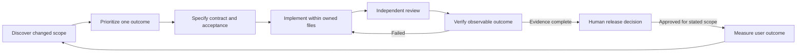

# Stoquify Development Operating Playbook

Date: **2026-09-02**  
Purpose: make the nine recommended responsibilities usable in bounded development work.  
Companions: [recommendation report](<E:/ohada saas/Focused projects/stoquify/what-next/agents-skills/STOQUIFY_DEVELOPMENT_AGENT_SKILL_RECOMMENDATIONS_2026-09-02.md>) · [recommendation registry](<E:/ohada saas/Focused projects/stoquify/what-next/agents-skills/STOQUIFY_DEVELOPMENT_AGENT_SKILL_REGISTRY_2026-09-02.json>)

This is a proposed playbook, not an activation instruction. No agents were installed, no product code was changed, and no live program gate was cleared by this audit.

## 1. Operating rule

Use the existing `001-aqstoqflow-program-orchestrator` as the coordinating skill. Assign one accountable developer/operator to the active package. The coordinator sequences work and records evidence; it does not replace domain ownership or independent review.

The current live analytics register is:

[PROGRAM_STATUS_REGISTER.json](<E:/ohada saas/Focused projects/stoquify/what-next/analytics-network-program/PROGRAM_STATUS_REGISTER.json>)

It lists P0-02 and P0-03 as active and limits major work in progress to two. The recommendations do not create additional active packages. Close existing work, or record an explicit reprioritization with the existing program owner, before adding another major package. Do not rename unfinished work “complete” to free capacity.

The recommendation registry describes reusable capabilities. Live status remains in the existing program register and its referenced domain evidence.

## 2. Delivery flow



| Stage | Accountable responsibility | Required handoff |
|---|---|---|
| Discovery | D01 with relevant domain contributor | Current candidate/dirty paths, source links and exact changed assumptions |
| Prioritization | Product owner, assisted by D01 | One user outcome, package ID, dependency order, WIP decision |
| Specification | Appropriate D03–D09 implementation owner; Workflow Architect if useful | Inputs, business state transitions, authority, failure/recovery and observable acceptance |
| Implementation | One named file/module owner | Surgical changes, contract version, relevant tests and impact list |
| Independent review | D02; domain/security reviewer where material | Reproducible findings and an explicit acceptance decision for the reviewed scope |
| Verification | D02 with authorized test operator | Commands, candidate/environment, results, evidence classification and limitations |
| Release decision | Authorized human owner/checker | Traceable approval for the exact candidate, scope and environment |
| Outcome measurement | Product/domain owner with D03 telemetry support | Correct denominator, baseline, review window and trust guardrails |

A single contributor may wear different design/implementation roles, but cannot describe their own review as independent. When no independent reviewer is available, finish reproducible evidence and mark independent review pending.

A failed check returns to the owner of the relevant code or contract. Evidence-collection failures go to D02; UI failures to D05; source-semantic failures to D03; access failures to D04; import/target failures to D06; economic invariant failures to D07; agent behavior failures to D08; provider/device failures to D09. D01 keeps the handoff current.

## 3. File ownership and work boundaries

| Responsibility | Typical owned scope when specifically assigned | Boundary |
|---|---|---|
| D01 | Active package handoff and existing program/decision entries | No new parallel status authority; no automatic implementation |
| D02 | Focused test/evidence helpers and review findings | Domain fixes are handed back to their implementation owner |
| D03 | Selected analytical contract/service and tests | Source-domain services retain balances and corrective writes |
| D04 | Selected wrapper/action/API/export authorization and tests | Preserve current global module mode and grant boundaries |
| D05 | Selected components/hooks/routes/translations and UI tests | No financial formulas or direct DB access in presentation |
| D06 | Selected migration/fixture/import procedure and tests | Schema replay, fixtures and customer migration are separate scopes |
| D07 | Selected source event/transaction service and invariant tests | One event family per slice |
| D08 | Existing evaluation harness, capability adapter and result contract | No new framework or autonomous runtime activation |
| D09 | One connector/device adapter, health/recovery contract and tests | Fixtures first; live delivery is separately authorized |

These are proposed ownership rules, not an edit grant for every listed directory. Before a change, record the exact files. Existing dirty files remain user-owned; integrate only authorized relevant changes without overwriting another contributor.

### Minimal handoff

Use the existing package record plus one short attachment containing:

```text
Package ID and accepted user outcome:
Accountable owner / receiving owner:
Current commit, dirty scope and relevant source hashes:
Exact files this slice may change:
Inputs and evidence: source, date, candidate, environment, authority:
Acceptance: observable success, denied/empty/error states, relevant invariants:
Commands actually run and results:
Blockers: technical / evidence / external / human decision:
Next concrete action:
```

A report is not a passed gate. A hash is not an approval. A test fixture's approved-looking strings are not actual approval records.

### Resume and evidence invalidation

1. Read the existing active package and latest accepted handoff.
2. Compare relevant source hashes and changed assumptions.
3. Reuse unchanged evidence within its original scope.
4. Rerun only checks invalidated by changes or required by the next explicit gate.
5. Record historical results as historical until rebound to the relevant candidate/environment.
6. Stop dependent advancement on a failed invariant; complete unaffected preparatory work.
7. Hand off with one next action rather than opening another general audit.

## 4. Top-three ready-to-use capability briefs

### D01 — Delivery Coordinator and Current Evidence

**Form:** extend the existing program-orchestrator procedure with the release-evidence ratchet. No new orchestrator service or agent definition is needed.

**Purpose:** make the current package resumable and its completion claim truthful.

**Triggers:** start/resume, new evidence, conflicting status, blocked dependency, or implementation-to-review handoff.

**Inputs:** active program/decision registers; current Git state; accepted package scope; source/test/evidence paths; accountable owners and existing approval references.

**Procedure:**
1. Identify the active package and its user outcome.
2. Capture current commit, dirty scope and relevant source hashes.
3. Separate source implementation, tests, local runtime evidence, approved evidence and human decisions.
4. Reconcile older claims with newer evidence only where scope matches.
5. Assign implementation, review and decision owners; keep exact file boundaries.
6. List remaining acceptance work and executable verification.
7. Update the existing authorized package record when appropriate; otherwise produce an additive handoff for its owner.
8. Recommend the next eligible action without advancing blocked packages.

**Output:** one package handoff, evidence-disposition delta, and owner-specific next action.

**Verification:** one status owner; no conflicting denominator/environment/candidate; current two-package WIP respected; no evidence or approval invented.

**Stop conditions:** unknown target for a write, conflicting scope, a failed critical invariant, or an approval requiring an accountable human. Continue read-only analysis and prepare the missing evidence request.

**Handoff:** selected D02–D09 owner; Product receives priority decisions; release authority retains activation.

**First application:** reconcile P0-02/P0-03 against August 30 isolated replay and September 1 local X1 evidence. Do not carry forward “no browser evidence” without qualification, and do not turn local captures into release evidence.

### D02 — Independent Workflow Verification Engineer

**Form:** compose Code Reviewer, Entity Workflow Verifier and Release Verification Foundation for one workflow.

**Purpose:** prove the user can complete the promised task, and expose the exact boundary of the evidence.

**Triggers:** completion claim, defect correction, candidate change, or release-evidence preparation.

**Inputs:** route/persona/data-state matrix; accepted source contract; current fixture identity; allowed test environment; existing harness and relevant artifacts.

**Procedure:**
1. Express one task as observable success and failure states.
2. Trace the route/action/service/data boundary.
3. Inspect the test's readiness assertions and the result's actual meaning.
4. Reproduce the weakest material claim using existing artifacts or a permitted focused test.
5. Define contract-specific loaded, expected-empty, denied and failed states.
6. Exercise delayed data, stale input, incorrect scope and missing permissions where relevant.
7. Keep data-ready timing separate from screenshot/accessibility/test duration.
8. Bind results to source hashes and the exact environment/authority class.
9. Return findings to the implementation owner and review the correction independently.

**Output:** acceptance matrix, reproducible findings and classified evidence manifest.

**Verification:** a perpetual loading state cannot pass a completed-data claim; synthetic approvals remain synthetic; only observed behavior receives PASS.

**Stop conditions:** unavailable approved credentials or dataset for authenticated execution; unclear fixture expectations; attempted promotion of simulation evidence. Complete the test contract and pure/local checks while the specific runtime step remains pending.

**Handoff:** D05 for UI behavior, D03 for analytical/source semantics, D04 for access, or the relevant domain owner. Human approval remains separate.

**First application:** AR-history capture. The existing local screenshot still displays loading; the local harness has no business-readiness wait. The separate authoritative harness already waits for a table, so inspect and reuse appropriate checks rather than replacing both harnesses.

### D03 — Trusted Analytics and Decision Engineering

**Form:** extend the BI trust procedure with a scoped metric/read-model contract; use Data Engineer as an engineering role.

**Purpose:** turn source truth into useful operating decisions while preserving organization context and evidence quality.

**Triggers:** new/changed KPI, source aggregation, forecast, cohort, cross-client view or analytical export.

**Inputs:** accepted P0 ownership/context contracts; canonical source definitions; currency/timezone/period rules; permissions; metric/denominator and evidence expectations.

**Procedure:**
1. Identify the canonical job and existing route.
2. Name one source owner and metric owner.
3. Specify formula, grain, period, currency policy, location scope and exclusions.
4. Define source coverage, freshness, confidence and unknown/blocked behavior.
5. Keep actual cash, projected cash, unresolved exposure and proven loss distinct.
6. Define a deterministic read model with permitted drill-throughs.
7. Test boundaries and compare selected outputs with authoritative source values.
8. Hand off the stable contract to UI and independent verification.
9. Instrument the user decision outcome before setting numerical value targets.

**Output:** metric contract/read model, source mapping, tests and measurement definition.

**Verification:** no silent XAF/timezone fallback, no mixed-currency totals, explicit missing-data states, one formula owner, and authorized evidence links.

**Stop conditions:** unapproved financial semantics, missing source coverage, unresolved access boundaries or an unmet phase dependency. Produce the contract and decision questions; do not fabricate data.

**Handoff:** Finance/Data for semantics, D04 for access, D05 for presentation and D02 for independent acceptance.

**First application:** P0-04 after current acceptance. Define the projected-closing-cash and reconciliation-exposure contracts before new dashboards. The current Business Pulse skill does not authorize predictive/AI additions; later forecasting follows its separately accepted roadmap scope.

## 5. Next three executable development prompts

These prompts are for subsequent scoped work. Executing this strategy audit did not execute them.

### Prompt 1 — Reconcile and close the current P0 handoff

```text
Work in E:\ohada saas\Focused projects\stoquify.

Use 001-aqstoqflow-program-orchestrator and the evidence-recording procedure
from stoquify-release-evidence-ratchet. Keep this run limited to the
existing P0-02/P0-03 closure boundary.

Read:
- what-next/analytics-network-program/PROGRAM_STATUS_REGISTER.json
- what-next/analytics-network-program/DECISION_REGISTER.json
- what-next/analytics-network-program/P0_01_TO_P0_03_EXECUTION_REPORT.md
- what-next/analytics-network-program/SURFACE_OWNERSHIP_REGISTRY.json
- services/analytics/analytical-context-contracts.ts
- what-next/migrations/isolated-next-level-fresh-replay-20260830.md
- what-next/evidence/finance-x1/X1_APPROVAL_INTAKE_PREFILLED_2026-09-01.md
- the September 2 development recommendation registry.

Objective:
Prepare one current, reviewable acceptance handoff that identifies what
is implemented, what has been verified, and which accountable decisions
remain. Do not activate P0-04/P0-06.

Ownership:
Own only an additive P0 closure handoff under the existing
what-next/analytics-network-program directory. Preserve application
changes and existing approvals. Route any proposed canonical status
change to its existing owner; never infer sign-off.

Verification:
Capture git status and HEAD. Run npm run typecheck once to determine
whether the four historical errors still exist; report current errors
without silently fixing unrelated files. Run the existing analytical
context suite with:
node node_modules/jest/bin/jest.js --runInBand --runTestsByPath
services/analytics/__tests__/analytical-context-contracts.test.ts
Put the command on one line when executing it.

Produce:
A dated closure handoff containing candidate/source hashes, evidence
scope, current verification, remaining decision owners and exact next
action. Reference existing registers rather than creating another live
program register.

Done:
Each P0-02/P0-03 acceptance item has a current result or a specific
technical/human dependency. WIP and phase status remain truthful.
```

### Prompt 2 — Make AR-history capture wait for a real task state

```text
Work in E:\ohada saas\Focused projects\stoquify.

Use aqstoqflow-entity-workflow-verifier in remediate mode for the
receivables-history evidence-capture workflow. Use the existing
release-verification foundation only for the relevant checks.

Before implementing, confirm this bounded test-harness slice is assigned
within existing WIP. If not, prepare the exact patch plan and acceptance
scenarios without advancing another package.

Inspect:
- tests/e2e/finance-x1-local-authenticated-evidence.spec.ts
- tests/e2e/finance-x1-authenticated-evidence.spec.ts
- components/finance/AROpenItemsHistoryWorkbench.tsx
- components/DataTableComponents/finance-x1-evidence-binding.ts
- the LOCAL-X1-20260901144339 local manifest and AR screenshot
- the current AR read model, fixture scope and route state contract.

Problem:
The local harness can record routeLoaded=true and capture a screenshot
while Loading AR history remains visible. Its usefulResultMs includes
later accessibility/screenshot work.

Ownership:
Own the local evidence spec and the smallest directly related
test-helper/test files. Preserve authoritative approval semantics.
Do not change the AR domain service, fixture data, global permissions,
or unrelated routes. Report any reproduced product defect to its owner.

Implement:
Add route-specific acceptance of a completed data state or explicitly
expected valid empty state. A loading spinner, denied response or failed
fetch must not satisfy completed-data evidence. Match known fixture
expectations; do not require nonempty tables for every route.
Record time to that state separately from total capture time.
Reuse applicable readiness checks from the authoritative harness.

Verification:
Add focused tests that demonstrate delayed/perpetual loading fails the
completed-data claim and valid terminal states pass. Run only those
tests and the existing FinanceX1EvidenceBinding contract suite.
An authenticated browser rerun requires a currently authorized local
environment and fixture; complete code and non-runtime verification
even if that capture is pending. Retain LOCAL_SIMULATION classification.

Produce:
Scoped patch, focused verification, a dated finding/closure record and,
if execution is authorized, a new local evidence run with hashes.
Do not recycle earlier captures as post-approval evidence.

Done:
The false completion path is prevented; loading, empty, denied and data
states have explicit meaning; timing labels describe what was measured.
Independent review and any approved release capture remain separate.
```

### Prompt 3 — Define the first trusted analytics metric contracts

```text
Work in E:\ohada saas\Focused projects\stoquify.

Use kontava-workflow-bi-trust-gates with the accepted analytics roadmap.
Use the Data Engineer role for the existing TypeScript/Prisma service
architecture. No warehouse, new framework or new dashboard is required.

Entry:
Confirm P0-02/P0-03 acceptance and an available P0-04 WIP assignment in
the existing program register. If unmet, prepare an explicitly proposed
contract and decision packet; do not claim implementation activation.

Inspect:
- what-next/analytics-network-program/SURFACE_OWNERSHIP_REGISTRY.json
- services/analytics/analytical-context-contracts.ts
- services/analytics/sales-analytics.service.ts
- services/cash-command/cash-command.service.ts
- services/cash-command/cash-command-contracts.ts
- services/payments/payment-reconciliation-workbench.service.ts
- services/bi/bi-contracts.ts
- the P0-04 and Phase 1 definitions in the August 30 roadmap.

Objective:
Specify projected_closing_cash and unreconciled_exposure with a single
canonical metric owner, authoritative source mapping, formula, grain,
currency policy, IANA timezone, half-open period, location scope,
coverage/freshness, unknown-state behavior and permitted drill-through.

Ownership:
Own only the P0-04 metric specification and, after entry is satisfied,
the smallest explicitly assigned analytics contract and focused tests.
Do not modify source ledgers, create saved scenarios, add UI or expand
Business Pulse's existing skill into predictive/AI functionality.

Verification:
Check duplicate metric ownership and test missing/invalid context,
period boundaries, mixed-currency rejection or segregation, incomplete
source coverage, and the distinction between exposure and proven loss.
Reuse the analytical-context suite; add focused contract tests only
for new behavior.

Produce:
A versioned metric contract, source/permission mapping, fixture examples,
focused results and a handoff to Finance/Data, D04 access review, D05 UI
and D02 independent verification. Keep the existing P0 register as the
status authority.

Done:
A reviewer can compute each selected metric from declared source inputs,
see when it is unavailable, and identify the canonical source workflow.
No forecast UI, financial action or external activation is implied.
```

## 6. Dependency order and safe concurrency

- Current: P0-02 and P0-03 remain active. D01 reconciles their closure.
- After acceptance: P0-04 metric semantics (D03) and P0-06 access (D04) may run as separate lanes because their exact file ownership can be disjoint.
- P0-07 shared read-model/evidence contracts depend on the accepted context, metrics and access work.
- UI integration (D05) consumes accepted contracts; D02's independent review follows the actual implementation.
- D06/D07/D09 join only when the selected package touches import, economic truth or integration. They are not permanent extra workstreams.
- D08 is required before new product-agent activation. Provider-free deterministic analytics and UI engineering do not wait for the entire AI portfolio.
- X1 harness/UI work needs an explicit capacity assignment; do not silently add it as a third major package.
- Live delivery, statutory scope, production secrets, deployment and release require their own named owner/evidence decisions.

Within one package, independent source inspection and fixture design can be prepared concurrently. Dependent schema/contract/implementation/review steps stay sequential. A reviewer must not approve their own implementation.

## 7. Verification command discipline

Read package.json and the script body before running a command. Current examples:

| Command or tool | Meaning / caution |
|---|---|
| git status --short; git rev-parse HEAD | Read-only candidate/dirty-scope identification; use separate shell lines |
| Focused rg and Get-Content | Read-only source/instruction inspection; avoid secret-bearing artifacts |
| node node_modules/jest/bin/jest.js --runInBand --runTestsByPath FILE | Bounded test selection; inspect imports/setup first |
| npm run typecheck | Candidate-wide TypeScript result; not browser, database or release evidence |
| npm run build | Currently chains secret preflight and migration deployment; unsuitable as a casual read-only check |
| npm run policy:gates / verify:release | Broad suites may write canonical reports or require database/external inputs |
| seed:verify:realistic | Points to a read-only verifier, but still requires an explicitly scoped database connection |
| Local X1 capture | Authentication/fixture authorization and local classification remain necessary |
| Authoritative X1 capture | Approved evidence contract and a new post-approval run; old local images cannot be relabeled |

Only the three selected Jest suites and local file/hash inspection were executed during the September 2 strategy audit. The 999-case catalog was inspected, not behaviorally executed.

## 8. Outcome review

Use the metric definitions in the registry. Baselines and numerical targets are intentionally unset. For the first three comparable accepted slices:

1. Measure implementation/review time separately from external waiting.
2. Record reopened acceptance failures and their cause.
3. Observe whether the intended user task actually completes.
4. Record evidence coverage and any access/financial/privacy incident.
5. Retain a capability if it improves verified delivery or user outcomes.
6. Narrow or consolidate responsibilities that add paperwork without improving those outcomes.

The immediate aim is accepted P0 closure and a trustworthy finance-workflow acceptance method. Broader agent and network expansion follows demonstrated outcomes.

