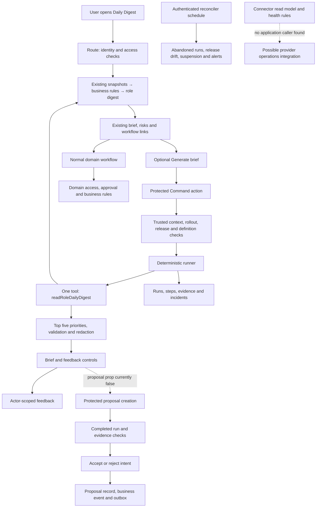

# Stoquify AI functionality: value and retention audit

**Date:** 6 September 2026  
**Decision:** Retain the useful operating assistance and essential controls; simplify the Command interface; replace navigation approvals with direct workflow access; defer additional agents and model integration until measured demand justifies them.  
**Scope:** Repository audit and product investment recommendation. Application behavior was not changed.

## 1. Executive assessment

The AI work has produced a real, tested foundation, but the currently connected Command Agent does **not call a language model**. It takes information from the existing Daily Habit Digest, selects up to five permitted priorities, applies output validation and redaction, and records the run and its evidence. Its release manifest explicitly says `modelProvider: "none"`. No external or self-hosted inference path was found in the application source searched. The presence of “prompt,” “agent,” and “AI” names is not evidence of model reasoning. [S01–S04]

This can still be useful. Helping an owner, finance user, accountant, or stockkeeper find the most important existing exception is a sound product objective. However, much of that value already belongs to Stoquify’s snapshots, business signals, action queue, and Daily Digest. The Command panel adds traceability, validation, and feedback; it does not currently add new analysis, causal explanation, forecasting, or personalized reasoning.

The Copilot proposal feature is more limited than its name suggests. Its UI prepares a navigation proposal and lets someone accept or reject it. Acceptance records intent and creates an audit event and notification-outbox entry. **It does not open, assign, approve, pay, post, reconcile, or complete the underlying task.** A separate “Open” link already takes the user to the workflow. Furthermore, the dashboard caller does not enable the proposal controls. [S05–S07]

A connector-health evaluator also exists. It uses fixed checks to identify stale feeds, gaps, signature problems, credential expiry and other issues. Its read model has no application caller in the searched source. It is a tested building block, not an available monitoring assistant. Most of the broader domain-agent portfolio remains specifications and contracts. [S08, S14]

**Is this worth keeping? Yes, selectively.** The strongest assets are:

1. The existing role-based digest, priorities and links to authoritative workflows.
2. Server-side authorization, evidence handling, safe output validation and run accountability.
3. Connector-health rules, if an operations owner demonstrates that integrating them into the existing provider workflow solves a recurring problem.

The incremental benefit of the separate Command panel has not been demonstrated. Neither customer adoption nor time savings can be inferred from passing tests. The smallest useful next step is to improve and measure one existing digest workflow, with precise source links and a single clear route into the work. An external model is unnecessary for that milestone.

Verification found **141 existing tests passing across 29 suites**, plus four isolated audit probes reproducing proposal weaknesses. Static runtime checks and 18/18 Copilot guardrail checks pass. The operational release report remains **BLOCKED with 152 evidence blockers**. These are different forms of evidence: static checks do not establish release readiness or business value.

## 2. What exists, and what users can actually encounter

“Connected” below means a repository execution path exists. It does not establish deployment or usage. No live deployment, tenant configuration, production database or customer analytics was inspected.

| ID | Capability | Processing and current implementation | Availability | Primary recommendation |
|---|---|---|---|---|
| C01 | Role-based Daily Habit Digest, risks and next actions | Existing snapshots plus fixed business-signal rules, role filtering and templates | Connected dashboard route; ordinary access controls apply | **Simplify** presentation while retaining the underlying functionality |
| C02 | Command Agent / role daily brief | One fixed digest read; copies existing narrative, ranks up to five priorities, validates/redacts, persists execution evidence | Connected panel; off by default unless environment, tenant, role, definitions and release requirements permit it | **Simplify** into the existing brief experience |
| C03 | Navigation proposal and accept/reject record | Client assembles a draft; service binds it to a completed run and records decisions, events and outbox entries | Tested service/actions/UI; dashboard omits the enablement prop; separate Phase 3 release gate | **Replace** navigation approval with direct workflow access |
| C04 | Review checklist and human-review request proposal types | Allowlisted enum/schema values; same generic proposal storage; no distinct checklist builder, assignment or review-queue workflow found | No corresponding connected user flow found | **Defer** |
| C05 | Command feedback and run telemetry | Helpful/not helpful/stale/wrong/unsafe feedback; duration, tool/evidence counts and failures | Feedback connected to rendered Command briefs; adoption results not inspected | **Complete and pilot** outcome measurement |
| C06 | Connector inventory, health, drift and evidence reliance | Database read model plus deterministic scoring and trust rules | Tested services; no application caller found | **Complete and pilot**, conditionally after a specific operations need is confirmed |
| C07 | Business-event anomaly recording | Detects reuse of an idempotency key with a different payload hash; records conflict evidence | Existing event-service control; not a general fraud-detection model | **Keep as-is** within this audit’s scope |
| C08 | Payroll cash-obligation forecast | Aggregates dated payroll/payment/declaration facts and checks source evidence | Connected through existing finance/analytics read models; not an AI prediction | **Keep as-is** as an existing domain capability, subject to its own controls |
| C09 | Broad financial revenue prediction | Inspected financial analytics schema/return explicitly has `revenue.forecast: null` and partial source availability | No working revenue forecasting capability established | **Defer** |
| C10 | Model gateway, natural-language assistant, learned personalization | Design material and schema preparation; no executable inference integration found | Planned | **Defer** |
| C11 | Development agents, skills and prompts | Instructions and role definitions used by development assistants outside the application | Development assets; not customer AI functionality | **Simplify** into a maintained development portfolio |

“Keep as-is” is a retention decision, not a certification of every underlying domain implementation. C07 and C08 were examined to distinguish fixed business logic from AI; their full domain correctness is outside this audit.

### The planned domain portfolio

The product capability registry contains **28 skill definitions and nine agent definitions**. These are not 37 shipped features. Some concepts have corresponding deterministic services; this does not mean the corresponding product agent can execute them. The actual Command manifest binds one skill and one tool. [S04, S14]

| Planned agent beyond Command | Intended benefit and illustrative future scenario | Current distinction | Decision |
|---|---|---|---|
| Exception and Action Orchestrator | Keep an exception moving between owners; for example, escalate an unresolved cash discrepancy | Existing action queues and event infrastructure exist; no general agent-led case orchestration path was found | **Defer** the general agent |
| Cash and Reconciliation Agent | Explain payment exceptions and prepare reviewable match suggestions | Payment workflows exist; the proposal release uses a cash-agent identity, but generic navigation proposals are not a match-suggestion agent | **Defer** until one cash-review task demonstrates unmet need |
| Inventory and Replenishment Agent | Explain stock risk and prepare replenishment or transfer proposals | Existing inventory signals are fixed rules; no connected agent replenishment planner found | **Defer** |
| Purchasing and Accounts Payable Agent | Explain receipt/invoice differences and supplier exposure | Domain services and proposed skills are not an operational AP agent | **Defer** |
| Close and Compliance Agent | Explain a close blocker and point to missing evidence | Existing close readiness can support this; no connected general explanation agent found | **Defer** |
| Payroll and Workforce Agent | Explain an aggregate readiness or variance issue | Existing payroll calculations/forecast facts are separate from the proposed agent | **Defer** |
| Customer Success and Adoption Agent | Guide a new user through a workflow | No connected learned coach or preference memory found | **Defer** |
| Platform Assurance Agent | Observe unsafe or drifting versions and suspend them | Some deterministic release reconciliation and suspension already exist; this is not a model-driven assurance agent | **Defer** the broader agent; retain existing runtime protection |

Each scenario in this table is illustrative and envisioned, not an observed product result. Definitions marked “now” in the registry are roadmap priorities, not proof of availability.

## 3. Plain-language account of the meaningful capabilities

### C01: Existing digest and business priorities

**Who and why:** Owners, managers, finance users, accountants and stockkeepers need an ordered view of today’s issues without opening every module. Digest configurations also include end-of-day and weekly views.

**Trigger and inputs:** Opening the Daily Digest route loads organization-scoped operating, payment, inventory and close snapshots. Business-signal rules turn existing facts into signals; the action queue filters available actions by permission. Digest visibility depends on the role and required permission. The inventory-loss extension also explicitly checks tenant-wide operating authority and inventory entitlement. [S01]

**What it produces:** Existing summaries, metrics, changes, risks, next-step text and workflow links. Rules cover examples such as payment suspense, stockout risk, dead stock and delayed receiving. These are deterministic recommendations, not model-generated discoveries.

**Authority and failure:** The digest itself does not perform the linked business action. Evidence grades, freshness, blockers and redactions accompany the data. Missing snapshots or access can withhold information; the implementation must not be interpreted as complete knowledge of the business. Source-domain and location restrictions need explicit verification before expanding the audience.

**Illustrative current-capability scenario:** A finance user opens the digest and sees unresolved payment suspense as a priority, then opens the existing reconciliation workflow. The intended benefit is less time finding the issue. No measured time saving was supplied.

### C02: Command Agent brief

**Trigger:** A permitted user presses “Generate brief” in the digest’s Command panel. This is a fixed request, not a chat box.

**Processing:** The server resolves identity, organization, permissions, roles, locale, currency and period; checks rollout and release; checks stored definitions against the code manifest; reads the selected digest; then selects up to five permitted priorities. It copies the digest’s title, summary and conclusion. Validation checks the output shape and evidence references, and redaction filters sensitive fields and recognizable sensitive strings. [S02–S04]

**Output:** A short list, evidence/freshness labels, limitations, source-workflow links and feedback buttons. The run, steps and evidence links are recorded.

**Increment over C01:** A governed execution record, additional output checks and feedback capture. It does not currently explain why something happened beyond the existing service text, compare alternative remedies, answer follow-up questions, or learn the user’s preferences. Both the Command panel and the ordinary brief header render on the same page.

**Failure:** Rollout denial or incomplete release requirements prevent execution; invalid output and failed reads return errors. Stale/partial states can appear with limitations. Shadow mode returns no rendered brief; the UI disables generation when rendering is unavailable. The inspected scheduled route maintains runtime state and alerts, rather than generating daily briefs.

**Illustrative current-capability scenario:** An owner requests a brief and gets five already-known operating priorities plus evidence metadata. This may make the list easier to review, but the information was already present in the digest. A controlled comparison must establish whether the extra interface helps.

### C03–C04: Copilot proposals

**Inputs:** The UI supplies the run ID, priority text, target route, required permission, source evidence, period, “as of” time, expiry and idempotency key. The service requires an actor-owned, organization-scoped completed run. Creation and decision actions require fresh authentication, dashboard access and a separate release authorization. [S05–S07]

**Current UI behavior:** Only `NAVIGATE_TO_WORKFLOW` is prepared. The user can accept or reject; decision reasons are fixed UI strings. The other two proposal types do not have specialized task creation or checklist-building behavior.

**What acceptance does:** It changes the proposal status, records the deciding actor, time and reason, and writes the corresponding business event and notification-outbox message. The service explicitly returns `executionAuthority: "NONE"`. Actual notification delivery depends on the existing outbox machinery; recording an outbox item is not proof of delivery.

**What remains separate:** The destination workflow must enforce its own access, approval and business rules when the person opens it. Proposal acceptance is not that workflow’s approval.

**Illustrative current-code scenario:** An authorized pilot user could prepare “Review operational exception” and accept the suggestion. A decision record would exist, but the exception would still require work in its normal module. In the current dashboard integration, these proposal buttons are not enabled.

For simple navigation, this adds clicks, writes and potentially notifications without completing useful work. Use the existing link. Retain proposal records and contracts only for a future concrete draft or handoff that needs them.

### C05: Feedback and telemetry

**Current behavior:** A user can mark a brief helpful, not helpful, stale, wrong or unsafe. Feedback is scoped to the same actor’s Command run and upserted per run/actor. Changing feedback overwrites that feedback record; it is not an immutable sequence of corrections. The implementation leaves correction text and acceptance fields unused. [S09]

**What it can show:** Execution frequency, duration, failure/denial patterns, source counts and subjective feedback—if actual records are collected and analyzed.

**What it does not establish:** Whether a downstream task was completed, correctly completed, completed faster, or worth the support and operating cost. It does not retrain a model or automatically correct a brief.

**Illustrative current-capability scenario:** A stockkeeper marks a brief stale. That records a signal for review; it does not itself refresh inventory or repair the source.

### C06: Connector health

**Inputs and rules:** The read model inspects provider accounts, events, statement files, reconciliation runs and inbox items. The evaluator checks synchronization age, signatures, schema drift, gaps, duplicates, dead letters and credential-expiry metadata. It derives healthy/degraded/blocked state, reasons, risk and evidence-reliance decisions. [S08]

**Authority:** It does not reconnect providers, replay dead letters or disclose credential secrets automatically. Its input contract expects trusted organization scope and a server-derived authorization decision. A future action must supply those securely; the boolean `actorAuthorized` is not a substitute for an authenticated boundary.

**Availability and failure:** No production caller for the inventory read model was found. Invalid scope and malformed evidence are rejected; stale/blocked evidence affects reliance. Some credential/drift facts depend on supplied metadata, not an independently verified external provider state.

**Illustrative service-level scenario:** A provider with no successful sync within its allowed age would be marked blocked with a freshness reason. An operator could then investigate through the normal provider workflow. The evaluator can compute this today; a connected user experience was not found.

### C07–C09: Other features that could be mistaken for AI

The anomaly service records a concrete payload-hash conflict when an event identifier is reused inconsistently. **Illustrative current-capability scenario:** A repeated event arrives with different content; the system records a high-severity conflict for investigation. It does not infer fraud or intent. [S10]

The payroll forecast assembles dated obligations over its forecast horizon and checks posted runs, payments, declarations and source evidence. **Illustrative current-capability scenario:** A finance user sees upcoming payroll obligations supported by the required records, or a blocker when evidence is missing. This is cash-planning arithmetic and evidence processing, not learned prediction. Broad revenue forecasting is explicitly unavailable in the inspected financial analytics read model. [S11]

Development skills and role prompts assist the people building Stoquify. They are not deployed product agents merely because they have Stoquify-specific names. Their value should be measured through development outcomes such as verified delivery and fewer regressions, separately from customer adoption. [S15]

## 4. Current execution and dependency relationships

There is no model gateway in this current execution diagram, and no arrow from proposal acceptance to domain execution.

The knowledge graphs corroborate the separation of components, actions and runtime. Examples: `copilot_copilotproposalcontrols_tsx` is component community 102; `daily_habit_dailyhabitdigestdashboard_tsx` is community 156; Command and Copilot actions are communities 105 and 84; Command service/runner are service community 30; connector health is community 43; release control is community 15. Graph source locations are historical and some current components are absent. All consequential relationships above were checked against current source. The extracted nodes and edges are saved in [graph evidence](<E:/ohada saas/Focused projects/stoquify/what-next/ai/ai-functionality-value-retention-audit-2026-09-06-evidence/graph-evidence.json>).

The registry’s eight general read-tool definitions cover operating snapshots, signals, action queue, proof trail, payment truth, reconciliation workbench, inventory cash and close readiness. They declare permissions and evidence contracts. They do **not** constitute eight implemented dispatch paths in the Command service; that service explicitly dispatches only its digest adapter. The standalone freshness skill likewise has no production caller in the agent-source search. Preserve useful contracts, but do not count them as available features.

## 5. Findings that affect the investment decision

### F01 — Proposal listing does not filter each record by the viewer’s permission

**Priority: resolve before proposal enablement. Confidence: high; reproduced with mocks.**

The list action checks dashboard access, organization and release scope, but passes only organization and list options to the service. The service returns the tenant’s matching proposals—including their titles, details, evidence and target permissions—without checking the requesting actor’s permission for each proposal or applying creator/reviewer scope. A synthetic restricted payroll proposal was returned by that service path. [S06, S07]

This is a potential **same-tenant disclosure** under an enabled release, not a demonstrated cross-tenant breach. The absent UI caller reduces current exposure; it does not establish safe authorization of an exported server action.

**Required change if retained:** Define intended reviewer scope; resolve current actor permissions server-side; filter and redact each returned proposal. Use dedicated tests for a dashboard-only user, a permitted reviewer, a foreign actor and another tenant.

### F02 — Authentic evidence references do not establish an authentic recommendation

**Priority: resolve before proposal enablement. Confidence: high; reproduced with mocks.**

The service matches evidence subject, source module, source hash and availability against a stored run. It does not match the supplied freshness or evidence grade against the stored grade/freshness. Nor does it reconstruct the supplied recommendation text, target route and permission from the actual generated priority.

A probe supplied “certified/fresh” labels against a stored operational/stale reference, plus unrelated recommendation text and a different route. Creation succeeded. This did not execute the route, but it can create a misleading audit record that appears to have trusted provenance. [S06]

**Required change:** Accept an opaque run/priority reference; derive the content, target permission, source labels and source hashes on the server. Validate the route/permission pairing against a known destination contract. Store the exact reviewed draft version if a real draft workflow is retained.

### F03 — A new expiry can make old evidence appear eligible

**Priority: resolve before proposal enablement. Confidence: high; reproduced with mocks.**

Creation checks period equality, that “as of” does not exceed completion/current time, and that expiry is within the next 24 hours. It does not impose a maximum source age or re-fetch source truth. A consistent thirty-day-old run/period with a new expiry was accepted by the service probe. Decision checks the stored expiry and current target permission, but does not revalidate current source facts. [S06]

**Required change:** Separate draft lifetime from evidence freshness. Define maximum source age for the particular task, recheck source state at preparation and decision, and explain when refreshed evidence supersedes a draft. A navigation link can tolerate a stale warning; a financial draft needs stricter rules.

### F04 — Proposal retries conflict with the UI’s expiry calculation

**Priority: fix if proposals remain. Confidence: high; reproduced with mocks.**

The UI uses a stable run/priority idempotency key but recalculates expiry as “now plus 24 hours.” Expiry is included in the request hash. Repeating the preparation with the same key and a later expiry therefore raises a conflict. This matters after a lost response, retry or remount. [S05, S06]

**Required change:** Let the server establish expiry once for the stable request identity, or reuse an unchanged request envelope on retry.

### F05 — Command citations are coarse, and the extra panel duplicates existing work

**Priority: next useful product improvement. Confidence: high from source; user impact unmeasured.**

The adapter creates source-module evidence entries from digest-level provenance and attaches all resulting evidence IDs to each selected priority. Validation confirms that referenced IDs exist; it does not establish that each source substantiates the specific statement. A count of evidence links is therefore not a count of independently substantiated claims. [S02, S03]

The page already loaded the digest before the user requests the agent, and the tool loads it again. The current run storage retains hashes and safe summaries rather than a replayable full brief; receipt replay returns no brief. The UI creates a new request ID on another generation attempt. These choices add work without established benefit.

**Required change:** Use one source-owned brief projection, carry statement-specific evidence and freshness, and provide a dependable retry/refresh experience. Any reuse must remain server-authorized and scoped; do not trust client-submitted digest content or serve a cached brief across permission changes.

### F06 — Availability shown in the UI is less complete than execution authorization

**Priority: pilot usability. Confidence: high from source.**

The page computes environment rollout access, while the actual run additionally checks stored definitions and release readiness. A visible enabled generation button can consequently lead to a release-readiness error. Proposal authorization is tied to a `cash-reconciliation-agent` release while the generic Command panel can display priorities from other domains. [S01, S04, S07]

**Required change:** Present a sanitized server-computed availability reason, and make proposal scope match its real domain if that workflow is built. Keep the execution-side gate authoritative.

### F07 — Branch scope and embedded-domain access require a defined pilot contract

**Priority: before adding restricted operational roles. Confidence: high on current context shape; deployment impact unverified.**

Command context has organization and actor data but no location field. The digest loads tenant aggregates. The adapter filters priorities by permissions, and the inventory-loss extension has additional authority/entitlement checks, but those facts do not establish branch-level isolation or entitlement enforcement for every embedded domain.

**Required change:** Initially choose users who are authorized for tenant-wide information. Verify each source and destination module’s entitlement and redaction contract. Add explicit trusted location scope before promising a branch-specific assistant. Do not describe the current Command as location-aware.

### F08 — Passing gates leave important gaps in assurance and measurement

The four probes passed because they assert the **current problematic behavior**; they are not evidence that those cases are safe. Existing tests cover useful boundaries, but do not cover these particular invariants. The 18-check Copilot gate relies on source/test presence checks; it cannot prove semantic evidence relevance, productive use or deployment readiness.

The timeout wrapper bounds the digest/tool operation, not the full authorization and persistence path, and uses a promise race without cancelling the underlying read. No whole-request latency measurement, cancellation contract or retry budget was established. The connector inventory caps accounts but loads related events/statements/runs/inbox rows without an evident per-query history bound, creating a scale concern before integration. [S08, S12]

## 6. Shared infrastructure: retain proportionately

| Infrastructure | What is real | Decision | What must remain / what can wait |
|---|---|---|---|
| Trusted identity, tenant and permission context; tool allowlist | Enforced server-side on the Command path | **Keep as-is** | Preserve these boundaries; resolve the additional location/source-domain scope described above before expansion |
| Output validation, redaction and evidence records | Implemented and tested; evidence relevance is weaker than ID validity | **Complete and pilot** | Strengthen source-specific provenance; regex masking is not a complete privacy or future prompt-injection defense |
| Deterministic runner and run/step history | Implemented, with failure/policy records and scoped correlation identity | **Simplify** | Preserve audit identity; improve retry semantics and avoid duplicate reads; no general agent planner is needed now |
| Release packages, separated approvals, owners, certification, kill switch | Implemented; operational evidence is incomplete | **Simplify** operating procedure, after review | Consolidate evidence collection; retain current enforcement until an approved replacement is implemented and tested |
| Reconciler, drift suspension and alert delivery | Real privileged operational path; can update runtime/control records and send alerts | **Keep as-is** while active packages depend on it | Do not disable the scheduler to bypass freshness requirements; it is operational automation, not customer business-action AI |
| Eight general tool contracts and unused freshness helper | Metadata/helper foundation beyond the actual Command dispatch | **Defer** expansion | Retain contracts/tests where useful; implement an adapter only for a proven task |
| Agent cost ledger/model-provider preparation | Schema exists; production writer not found; fixture/smoke writers exist | **Defer** further model billing machinery | No need to invent token costs for a path with no inference; keep migration history and existing records |
| General model gateway, preference memory and autonomous orchestration | Planned | **Defer** | Require an approved use case, data boundary, evaluation and cost budget before implementation |

The machinery is substantial for a single deterministic digest read: stored definitions, manifests, approvals, six owner responsibilities with primary/backup coverage, certification, release reconciliation, operational alerts and several evidence-capture procedures. That creates real maintenance cost. However, it is already wired into authorization and failure recovery. Removing it casually would break the current contract.

The practical simplification is to reduce duplicated user flows and release paperwork, reuse existing operational ownership where appropriate, and stop adding speculative capabilities. If the Command runner is later removed in favor of the standard digest, map and retire its dependent release path deliberately. The older July note that said a runtime still had to be built is now partly obsolete: a deterministic runtime exists. Its proposed model gateway still does not. [S04, S12–S14]

## 7. Value, costs and what the evidence cannot tell us

| Capability | Intended benefit | Evidence currently available | Simplest credible comparison |
|---|---|---|---|
| Digest / Command | Less searching and faster identification of the next task | Existing deterministic source path, UI and passing tests | Existing digest with one ranked list and direct links |
| Proposals | Traceable human review | Decision/event storage and mocked workflow tests | Direct navigation; for a real handoff, the existing task/approval workflow |
| Connector health | Earlier detection and faster resolution of unreliable feeds | Tested rule evaluator/read model; no connected adoption | Provider-status table with explicit rules and source timestamps |
| Feedback | Discover poor answers and prioritize improvements | Feedback fields and run metrics | A small review queue linked to actual task outcomes |
| Model reasoning | Potential explanation of messy, varied questions | Plans only | Search, filters, templates and deterministic explanations |

No user counts, repeat-use cohorts, conversion rates, completed-task samples, customer feedback dataset, support-ticket analysis or realized savings were available in this audit. No observed retention or commercial differentiation is established. Tests and historical local evidence are not substitutes.

**Cost:** The inspected Command path has no model-call/token expenditure. It still incurs application compute, multiple database reads/writes, retained evidence, monitoring, release maintenance and human review. The cost ledger’s existence does not measure these costs, and its production use was not found. Record platform usage and maintenance time before attaching a price or ROI claim.

Calculate:

- Cost per useful completion = attributable infrastructure + retained-data cost + monitoring/support + allocated maintenance/review cost, divided by verified useful completions.
- Incremental cost and benefit must be measured against the existing digest, because that baseline already provides much of the information.
- Count a completion only when the destination domain records the intended successful outcome. A generated brief, clicked link, accepted proposal or “helpful” vote is not that completion.
- If no verified completions are observed, report the metric as unproven rather than dividing by assumed activity.

No monetary estimates or provider pricing were necessary for the retention decision, so none are presented. For later sizing, construct low/base/high cases from measured workload, completion rate and actual operating costs; do not use hypothetical token prices for the current deterministic implementation.

**Language and usability:** UI wrappers offer English and French, but several French strings omit accents and much of the source-generated digest narrative is English. Localization must cover the source text, status labels and domain terminology, not only buttons. Semantic buttons, ordered lists and loading/error states are present; no current browser, keyboard-only, screen-reader or visual audit was performed. Ordinary anchor targets also need locale-preservation checks. Limited connectivity increases the importance of clear failure states, stable retries and avoiding repeated full digest reads; no offline agent execution was found.

**Future model controls:** There is currently no model hallucination or model prompt-injection evaluation to certify. Current validation, regex filtering and static read-only tool checks would be useful components but insufficient proof for a model-driven assistant. Any future model pilot must evaluate untrusted business text, evidence relevance, cross-tenant/role disclosure, unsupported financial conclusions, tool misuse, refusal/uncertainty, latency and cost. The model must not become the authority for balances, statutory rules, payroll calculations or approvals.

## 8. Retention decisions and evidence that could change them

| Item | Rationale and confidence | Remaining investment / dependencies | Evidence that would change the decision |
|---|---|---|---|
| C01 Simplify | Existing useful facts and actions; high confidence in implementation, unknown measured benefit | Product/frontend consolidation; source-quality work | Users demonstrably need separate brief modes |
| C02 Simplify | Duplicate narrative and retrieval; high confidence | Shared projection, accurate evidence, retry/availability work | Separate panel materially improves task completion over the digest |
| C03 Replace | Recording approval of a link adds friction; high confidence on behavior | Dependency review and safe removal of entry points; preserve records | A real compliance or collaboration need requires reviewable drafts |
| C04 Defer | Types alone do not deliver a checklist/handoff; high confidence | A concrete owner, domain task and state machine | Repeated user demand with a clear existing-workflow gap |
| C05 Complete and pilot | Current telemetry misses productive outcomes; high confidence | Domain outcome joins and review ownership | Existing trustworthy analytics prove sufficient |
| C06 Complete and pilot | Useful operational rules, disconnected service; medium confidence in value | Protected integration, query bounds, source metadata and operator validation | Existing provider dashboard already answers the same need |
| C07 Keep as-is | Useful deterministic integrity control; high confidence in classification | Existing event owners; no AI-specific expansion | Separate event-domain audit finds defects |
| C08 Keep as-is | Evidence-based cash planning belongs in finance; high confidence in classification | Existing payroll/finance ownership and domain release requirements | Domain audit or user evidence rejects its usefulness |
| C09 Defer | Revenue forecast unavailable; high confidence | Reliable connected financial sources before forecasting | Proven demand and sufficient validated data |
| C10 Defer | No current task requires an LLM; high confidence on current path | Bounded use case, evaluation set and funding | Deterministic baseline fails materially on valuable recurring tasks |
| C11 Simplify | Development assets are distinct from product; high confidence | One maintained registry/playbook and verified handoffs | Demonstrated development outcomes justify additional roles |

Shared infrastructure decisions are in Section 6. No wholesale deletion is justified by missing usage evidence or sunk development cost.

## 9. Prioritized implementation and pilot plan

These are proposed follow-up changes. None were applied by this audit. Effort labels are planning judgments, not estimates of calendar delivery: **small** means a focused change within an existing boundary; **medium** means coordinated UI/service/test work; **large** means a new operational or release dependency. Human approvals and production access may dominate elapsed time.

| Order / owner | Smallest useful scope and files/contracts | Effort assumptions and dependencies | Acceptance and verification | Rollout / rollback |
|---|---|---|---|---|
| 1 — Product + domain owner | Choose one task, preferably finance exception triage, using `daily-habit-digest.service.ts`, `business-signal-rules.service.ts` and the existing destination workflow | Small discovery; users/data accessible; no model | Baseline task definition, source of completion, current pain and owner agreed | Existing digest remains usable |
| 2 — Backend + Security | Before any proposal use: address F01–F04 in proposal service/actions/schemas; introduce server-owned priority provenance if retained | Medium; only justified for a real draft workflow | Negative tests for list filtering, spoofed grade/text/route, old evidence, permission changes and retry; preserve no-execution authority | Keep current proposal UI inactive; roll back to inactive state while retaining audit records |
| 3 — Frontend + Backend + domain owner | Present one coherent brief in `DailyHabitDigestDashboard.tsx` / `AgentCommandPanel.tsx`; strengthen `command-tool-adapters.ts` and the source projection contract; use direct workflow links | Medium; source-specific evidence and explicit audience scope | No duplicate narrative; accurate source links; correct freshness and availability; EN/FR content; bounded reads; repeatable retry; protected destination still enforces rules | Pilot only after applicable release requirements; fallback to existing digest |
| 4 — Product Analytics + QA | Extend `agent-metrics.service.ts`, `agent-feedback.service.ts`, relevant action/link events and domain completion correlation | Medium; existing event identifiers and data-access approval | Record exposure, task started, domain-confirmed completion, correction, abandonment and full response latency; do not log sensitive narrative unnecessarily | Time-bounded pilot; instrumentation can be disabled without deleting historical data |
| 5 — Operations + Backend | If interviews confirm a gap, connect `getConnectorInventoryReadModel` to an existing provider operations surface | Medium; protected action, tenant/module scope, trustworthy metadata, bounded queries; no new agent | Synthetic stale/signature/gap cases; restricted-role and tenant tests; large-history query check; operator can identify a concrete next action | Small operator cohort; disable surface if unreliable; no automatic provider writes |
| 6 — Platform/SRE + Security + Release owner | Consolidate evidence capture and ownership for existing runtime/reconciler; retain enforced contracts | Potentially large external dependency; existing report has 152 blockers | Current release identity, approved owners, scheduler, alerts, credential evidence and required review; focused browser verification on the intended target | Existing kill switch/suspension/retirement flow; do not claim activation from a report-only command |

### Proposed pilot, not a forecast of results

**Accountable owner:** Product owner for the selected domain, supported by its operational lead and an analyst/QA reviewer.

**Audience:** A small cohort of authorized tenant-wide finance/owner users, including English and French users. Do not include branch-restricted roles until location scope has been verified. Aim for at least five representative users and 30 comparable task attempts per experience; if the minimum is not reached, extend once or report insufficient evidence.

**Window and comparison:** One week recording the existing digest baseline, then two weeks comparing the simplified experience. Where practicable, alternate task order for the same users using comparable cases to reduce learning and workload bias. This is an operational pilot, not a statistically powered retention experiment.

**Proposed continuation thresholds:**

- At least 20% lower median time to identify and start the correct workflow than the baseline.
- No deterioration in verified correct task-completion rate; review all material corrections.
- At least 70% of participating users choose to reuse the experience in the second week.
- Zero cross-tenant disclosures, unauthorized disclosures or unauthorized domain actions.
- At least 95% of sampled priorities have relevant, inspectable evidence and correctly communicated freshness.
- Full response latency no worse than the measured baseline plus one second at the 95th percentile for comparable workloads.
- Cost per verified useful completion fits a budget agreed before the pilot; no commercial premium assumed.

**Stop conditions:** Any unauthorized disclosure/action; material unsupported financial instruction; repeated stale evidence presented as current; or no benefit over the ordinary digest after adequate observation. Pause the affected capability through its existing controls. Record incidents and preserve the evidence.

A proposal workflow should not enter this pilot merely to increase adoption metrics. If a real draft/handoff need emerges, define its downstream completion and reviewer obligations first. A model pilot should only follow if repeated valuable tasks remain unsolved by the simplified deterministic workflow.

### Safe simplification or retirement

Map imports, actions, records, release packages, outbox consumers and scheduler dependencies before removal. The current proposal UI is already inactive through its caller, but live records/packages were not inspected; do not assume none exist.

For C03 replacement: keep direct links; remove or disable draft creation only through a deliberate follow-up change. Preserve existing proposals, decisions, event evidence and delivery history. Define how pending drafts expire or are cancelled, and communicate their final status. Accepted proposals must never be retroactively treated as completed domain work.

If Command is eventually retired: suspend new runs using the established release path, reconcile pending runs, preserve required audit records, and then retire the package. Retain the digest and shared event/security services. Retain the reconciler while any other active package depends on it. Do not drop tables, rewrite migrations or cascade-delete evidence as a UI simplification.

## 10. Verification and limitations

| Check | Result | Interpretation |
|---|---|---|
| Focused existing Jest tests: six restricted source roots, 29 explicit paths | **141/141 passed; 29/29 suites** | Mocked service/action/UI behavior; no live workflow |
| Four isolated audit probes | **4/4 reproduced** | Confirms F01–F04 in synthetic service calls; passing probes describe weaknesses |
| `agent:runtime:gates` | **Passed** | Static registry, prohibited-action and release-control checks |
| `ai:copilot:guardrails:gate` with new output paths | **18/18 ready** | Source/test presence checks; not semantic or deployment certification |
| `agent:operational-release:report` with new output path | **BLOCKED; 152 blockers** | Report command exits successfully while reporting an unready release register |
| `prisma:validate` | **Passed** | Schema validity only; no migration deployment or database-history proof |
| Live inference, environment provisioning, migrations, seeding, E2E scripts, deployment, message delivery | **Not run** | Excluded by audit scope; E2E scripts can migrate/seed |
| Production usage, live availability, browser/accessibility and end-to-end destination workflows | **Not verified** | No live target or usage dataset inspected |
| Broad lint/build/full regression suite | **Not run** | No application changes; focused verification was sufficient for this audit |

The test setup mocks Prisma and external side effects. Audit probes also mock event/outbox writing. Their only files are inside this report’s evidence folder. A corrected old-run probe was rerun with internally consistent historical period dates; the final result remains four reproduced cases.

The operational report evaluates the repository’s July 25 evidence register at execution time. Its unresolved package/commit identities, CI, governance, scheduler, alerts and credential proofs explain the blocked result. It is not a live inspection of every environment. The historical July 27 blocker report and August guardrail readiness file were treated as context, not current release authority.

The audit began on commit `a05a41ef66cd5d98fd69ae3df18225795f912232` with an already dirty working tree. Initial discovery counted 250 modified and 278 untracked status entries; untracked directory entries are not file counts. Source hashes and later status snapshots are retained because concurrent work may change the workspace. This audit changed only its new report/evidence area.

Final validation resolved all 44 linked local paths and found no changes in the 70 hashed source/evidence inputs since manifest capture; HEAD was unchanged. Four unrelated new member-access files appeared in the working-tree comparison and were not touched by this audit. The detailed record is `final-validation.json` in the evidence folder.

No legal, statutory, accounting, privacy, security, accessibility or production release certification is asserted. Financial and payroll boundaries were assessed as product-control dependencies; this audit does not validate country-specific calculations or authority decisions.

### Review coverage

| Review lens | Disposition |
|---|---|
| Platform/backend/integration | Traced connected paths, duplicate reads, tool definitions, outbox and scheduler boundaries |
| Database/migrations | Examined run/proposal relations, correlation identity, schema and migration inventory; schema validated only |
| Security/IAM/privacy/abuse | Examined tenant/actor/RBAC, release gates, redaction and proposal trust; four probes; location/source-domain gap identified |
| Frontend/UX/localization/accessibility | Examined caller enablement, duplicated panels, extra approval steps, language and state handling; no browser certification |
| Product/analytics/customer success | Distinguished intended value from observed results; baseline, outcomes and stop criteria proposed |
| Quality/release | Restricted mocked tests and static checks; release evidence remains blocked |
| SRE/performance/cost | Reviewed timeout scope, retries, reconciliation, alert dependency, unbounded history reads and missing outcome economics |
| SaaS packaging/billing/growth | Entitlements remain required; no measured basis for an AI premium or retention claim |
| AI/evidence governance | Established deterministic processing and missing model path; source relevance/trust gaps identified |
| Finance/reconciliation/payroll | Preserved domain authority; navigation acceptance has no financial execution power |
| Statutory country-pack details | Not applicable to this audit’s implementation changes: no statutory calculation, filing or country-pack modification proposed |
| Offline/edge/provider integration | No offline agent path found; connector freshness and normal retry/limited-connectivity behavior considered |

## 11. Evidence index

Verification files are in the [dated evidence folder](<E:/ohada saas/Focused projects/stoquify/what-next/ai/ai-functionality-value-retention-audit-2026-09-06-evidence>). See [existing test results](<E:/ohada saas/Focused projects/stoquify/what-next/ai/ai-functionality-value-retention-audit-2026-09-06-evidence/tests.json>), [audit probe results](<E:/ohada saas/Focused projects/stoquify/what-next/ai/ai-functionality-value-retention-audit-2026-09-06-evidence/probes.json>), [guardrails](<E:/ohada saas/Focused projects/stoquify/what-next/ai/ai-functionality-value-retention-audit-2026-09-06-evidence/copilot-guardrails.md>), [operational release](<E:/ohada saas/Focused projects/stoquify/what-next/ai/ai-functionality-value-retention-audit-2026-09-06-evidence/operational-release.md>) and [70-file source manifest](<E:/ohada saas/Focused projects/stoquify/what-next/ai/ai-functionality-value-retention-audit-2026-09-06-evidence/source-manifest.json>).

- **S01:** [Daily Digest service](<E:/ohada saas/Focused projects/stoquify/services/daily-habit/daily-habit-digest.service.ts>), [dashboard caller](<E:/ohada saas/Focused projects/stoquify/components/daily-habit/DailyHabitDigestDashboard.tsx>), [page](<E:/ohada saas/Focused projects/stoquify/app/[locale]/(dashboard)/dashboard/daily-digest/page.tsx>), [signal rules](<E:/ohada saas/Focused projects/stoquify/services/signals/business-signal-rules.service.ts>).
- **S02:** [Command service](<E:/ohada saas/Focused projects/stoquify/services/agents/command-agent.service.ts>), [digest adapter](<E:/ohada saas/Focused projects/stoquify/services/agents/tools/command-tool-adapters.ts>), [brief skill](<E:/ohada saas/Focused projects/stoquify/services/agents/skills/role-daily-brief.skill.ts>).
- **S03:** [Command panel](<E:/ohada saas/Focused projects/stoquify/components/agents/AgentCommandPanel.tsx>), [output validator](<E:/ohada saas/Focused projects/stoquify/services/agents/agent-output-validator.service.ts>), [context resolver](<E:/ohada saas/Focused projects/stoquify/services/agents/agent-context.service.ts>).
- **S04:** [Release manifest/contracts](<E:/ohada saas/Focused projects/stoquify/services/agents/agent-release-contracts.ts>), [definition service](<E:/ohada saas/Focused projects/stoquify/services/agents/agent-definition.service.ts>), [rollout](<E:/ohada saas/Focused projects/stoquify/services/agents/agent-rollout.service.ts>), [release authorization](<E:/ohada saas/Focused projects/stoquify/services/agents/agent-release-control.service.ts>).
- **S05:** [Proposal UI](<E:/ohada saas/Focused projects/stoquify/components/copilot/CopilotProposalControls.tsx>).
- **S06:** [Proposal service](<E:/ohada saas/Focused projects/stoquify/services/ai/copilot-proposal.service.ts>), [proposal schemas](<E:/ohada saas/Focused projects/stoquify/services/ai/copilot-proposal.schemas.ts>).
- **S07:** [Proposal actions](<E:/ohada saas/Focused projects/stoquify/actions/ai/copilot-proposal.actions.ts>), [proposal release gate](<E:/ohada saas/Focused projects/stoquify/services/ai/copilot-proposal-release.service.ts>).
- **S08:** [Connector inventory](<E:/ohada saas/Focused projects/stoquify/services/agents/portfolio/connector-inventory-read-model.service.ts>), [health evaluator](<E:/ohada saas/Focused projects/stoquify/services/agents/portfolio/connector-health.service.ts>), [evidence reliance contract](<E:/ohada saas/Focused projects/stoquify/services/agents/portfolio/evidence-trust.contracts.ts>).
- **S09:** [Feedback](<E:/ohada saas/Focused projects/stoquify/services/agents/agent-feedback.service.ts>), [metrics](<E:/ohada saas/Focused projects/stoquify/services/agents/agent-metrics.service.ts>), [run governance](<E:/ohada saas/Focused projects/stoquify/services/agents/agent-run-governance.service.ts>).
- **S10:** [Event anomaly service](<E:/ohada saas/Focused projects/stoquify/services/events/business-event-anomaly.service.ts>).
- **S11:** [Payroll forecast source](<E:/ohada saas/Focused projects/stoquify/services/snapshots/tenant-operating-snapshot.service.ts>), [financial analytics read model](<E:/ohada saas/Focused projects/stoquify/services/analytics/financial-analytics.service.ts>).
- **S12:** [Runner](<E:/ohada saas/Focused projects/stoquify/services/agents/agent-runner.service.ts>), [timeout](<E:/ohada saas/Focused projects/stoquify/services/agents/agent-execution-control.service.ts>), [scheduled route](<E:/ohada saas/Focused projects/stoquify/app/api/internal/agents/reconcile-abandoned/route.ts>), [control reconciliation](<E:/ohada saas/Focused projects/stoquify/services/agents/agent-control-plane-reconciliation.service.ts>).
- **S13:** [Schema](<E:/ohada saas/Focused projects/stoquify/prisma/schema.prisma>), [operational evidence register](<E:/ohada saas/Focused projects/stoquify/docs/agents-runtime/STOQUIFY_AGENT_RUNTIME_OPERATIONAL_RELEASE_EVIDENCE_2026-07-25.json>).
- **S14:** [Product capability registry](<E:/ohada saas/Focused projects/stoquify/docs/copilot/stoquify-agent-skill-definition-suite/registry/capability-registry.md>), [historical model/runtime note](<E:/ohada saas/Focused projects/stoquify/docs/copilot/STOQUIFY_AI_AGENTS_SKILLS_RUNTIME_EXTERNAL_LLM_NOTE_2026-07-16.md>).
- **S15:** [Development portfolio recommendations](<E:/ohada saas/Focused projects/stoquify/what-next/agents-skills/STOQUIFY_DEVELOPMENT_AGENT_SKILL_RECOMMENDATIONS_2026-09-02.md>).
