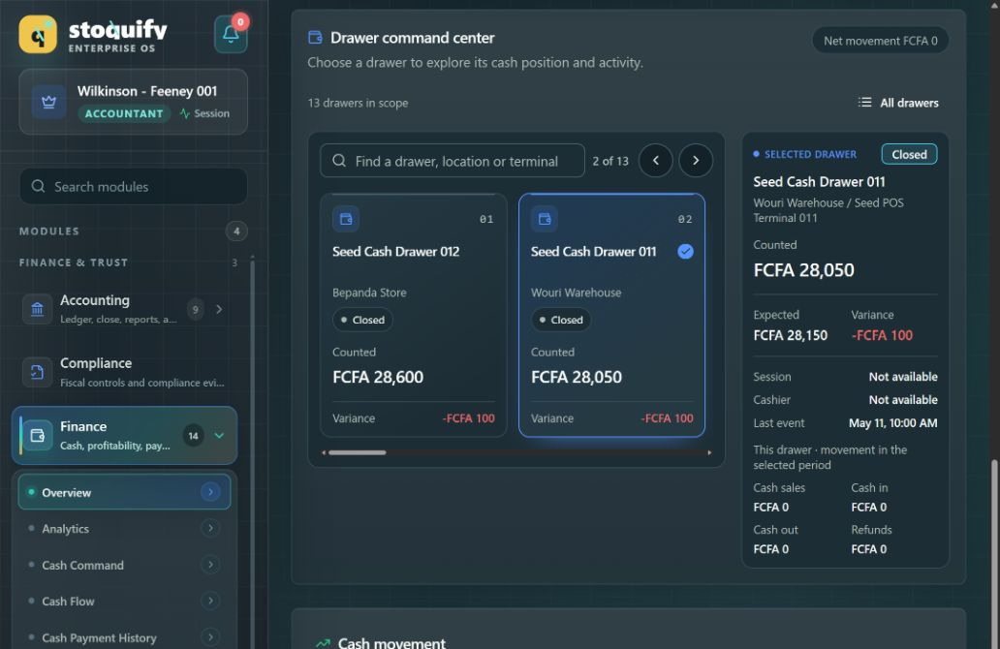
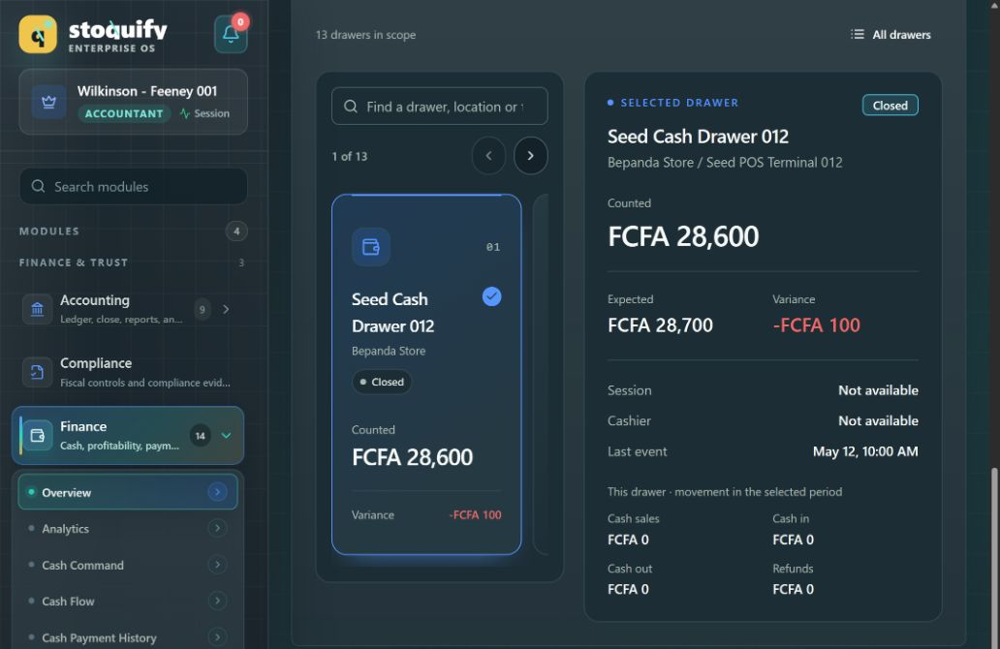
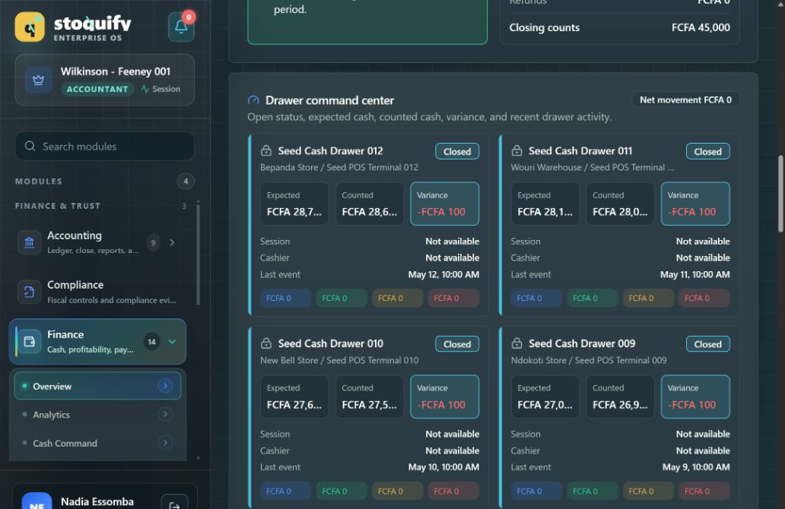
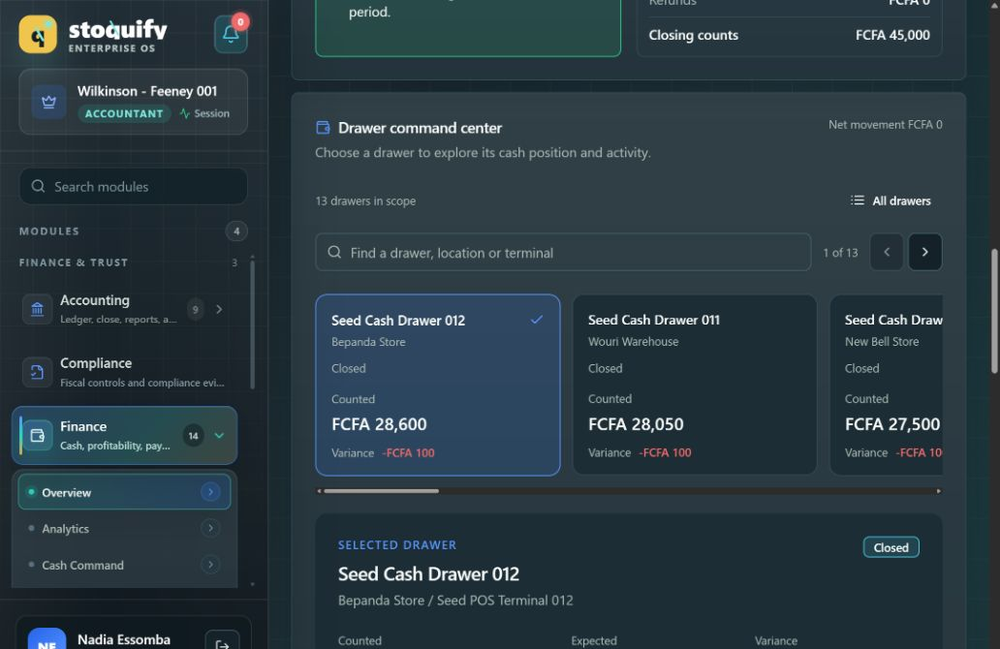
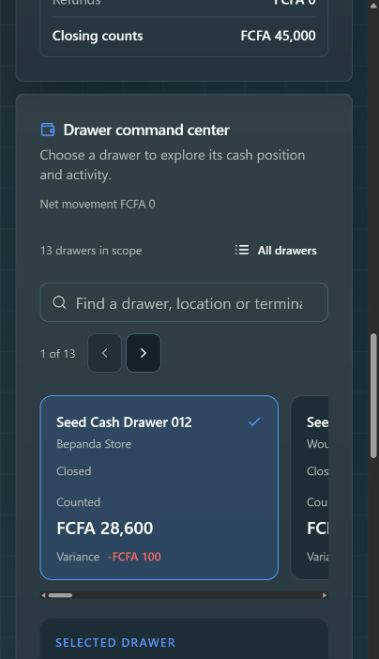

# Cash drawer command center redesign

Date: 2026-09-24. Route: `/en/dashboard/finance/cash-drawer` (also verified in French).

## Latest refinement: remove unused space inside carousel cards

Removed the separate decorative icon/position row and the reserved minimum title height. Reduced card padding and the gaps around location, status, balance and variance. The rail aligns cards at the top so a longer drawer does not stretch the others. The two-card carousel and one-third detail column remain in place.

The live page at 1440px showed cards measuring approximately 173px tall, down from 255px in the previous iteration (about 32% shorter), with two fully visible cards and no horizontal page overflow. Scoped ESLint passed with exit 0: [log](evidence/dense-cards-lint.log). This presentation-only refinement does not change selection or financial behavior. The previous screenshots below show the earlier card spacing; a new screenshot capture was interrupted by browser tool timeouts.

## Previous refinement: compact cards and a wider carousel

The carousel now takes approximately two-thirds of the row and the selected-drawer panel takes one-third. Two complete cards are visible together from the medium breakpoint. Both panels use smaller padding, tighter spacing and more compact type, retaining the existing gradients, selection treatment, financial values and controls. Mobile continues to stack the panels and allows horizontal card scrolling.

At a measured 1440px viewport, the carousel and detail columns measure 701px and 351px. Two cards are fully visible, each about 255px tall; the detail panel is about 433px tall. The 1043px laptop layout also shows two full cards. A long drawer name wraps at 927px, and the 390px mobile layout stacks correctly without horizontal page overflow. Next-drawer selection still updates the detail panel.



Verification passed: scoped lint and TypeScript exited 0; all 12 interaction and authorization tests passed across two suites. Evidence: [responsive and navigation checks](evidence/compact-browser-checks.json), [mobile capture](evidence/cash-drawer-compact-mobile.png), [scoped lint](evidence/compact-lint.log), [interaction and authorization tests](evidence/compact-tests.log), and [TypeScript](evidence/compact-typecheck.log). This section supersedes the proportions in the earlier iterations below.

## Previous refinement: carousel left, detail right

The follow-up request is implemented. The selector and selected-drawer detail share a row from the medium breakpoint (768px), with the wider column reserved for details. Narrow screens stack the two panels. Search and previous/next controls stay inside the left selector. The overview remains available in the same left column.

The cards now use a restrained tonal gradient, drawer icon, quiet position number, outlined status pill, explicit selected check, larger counted balance, separated variance footer and subtle depth. Long names wrap. The right panel emphasizes counted cash, then expected cash/variance, then session and period activity. Financial data and interaction semantics are unchanged.



Final follow-up checks: [TypeScript](evidence/side-by-side-typecheck.log) exit 0; [scoped lint](evidence/side-by-side-lint.log) exit 0; [12 tests across two suites](evidence/side-by-side-tests.log) passed. [Browser evidence](evidence/side-by-side-browser-checks.json) verifies next selection, overview search, equal top alignment and separated columns at 927px with a long drawer name, and vertical stacking at a measured 390×844 with no horizontal page overflow. The initial desktop inspection also verified the two columns at 1440px. [Mobile capture](evidence/cash-drawer-side-by-side-mobile.png) records the stacked layout. The final source manifest has been refreshed.

The remaining screenshots and verification narrative below document the first iteration; this section and its evidence supersede the earlier stacked desktop presentation.

## Delivered

Replaced the repeated detailed drawer grid with a compact, manually navigated card rail and one selected-drawer detail panel. The existing 13-drawer scope now exposes identity, location, status, counted balance and variance in the selector. Expected balance, session, cashier, last event and explicitly labeled period movements appear once in the detail panel.

Search matches drawer name/number, location and terminal name/number. “All drawers” switches to a compact, vertically scrollable overview. Previous/next, keyboard Left/Right/Home/End and native horizontal scrolling provide alternatives to swiping. Selection is announced and associated with the detail region. There is no autoplay or animated navigation.

Selection follows drawer IDs across refresh/reordering. Removing or filtering out the selected drawer selects the first remaining result and commits that fallback. Global organization/location/period/custom-range changes reset the selector through its scope key. Local search never changes the page-wide financial totals. Warning/critical drawer counts remain outside the local search results and can reveal those drawers by clearing the search. Existing global alerts continue to expose session and other scope-level risks.

## Layout decision

| Option | Strength | Tradeoff |
| --- | --- | --- |
| Compact rail + shared detail (chosen) | Strong visual hierarchy; a stable detail area; touch and keyboard navigation | Off-screen drawers require search/navigation; addressed by the overview and persistent review count |
| Searchable list beside detail | Fast scanning and good large-collection access | Permanently allocates width to a list; stacks awkwardly at narrow widths |
| Compact grid with expandable detail | Direct comparison of a few drawers | Still grows vertically with the collection and moves detail around when expanded |

The chosen layout retains the list as an optional overview. It adds no dependency: native scrolling and existing components are sufficient. It reuses the current finance palette, including the intentionally dark finance surfaces under both application theme settings.

## Scope and source evidence

Changed production files:

- `components/pos/DrawerCommandCenter.tsx`: new presentation and selection component.
- `components/pos/CashDrawerManagementDashboard.tsx`: imports the component, replaces the grid and removes its obsolete internal card renderer/styles.
- `messages/en.json` and `messages/fr.json`: adds only `cashDrawerDashboard.commandCenter`.

Added `components/pos/__tests__/DrawerCommandCenter.test.tsx` for interaction regression coverage.

The pre-existing worktree was extensively modified before this task. Original component and translation bytes are retained under [evidence/baseline](evidence/baseline). The [component delta](evidence/component-delta.patch) isolates this task's edits from the saved starting component. [Translation verification](evidence/translation-checks.json) confirms all other entries in both locales were preserved. [Final source hashes](evidence/source-final.json) identify the delivered files.

Discovery covered the route wrapper, POS read hook, action, service contract, existing theme, and the September 23 POS modernization report. The existing component graph node `pos_cashdrawermanagementdashboard_tsx`, community 11, was used for orientation and checked against source. The hook's 30-second refresh, service-owned balances/severity and parent ordering remain intact.

## Verification

| Check | Result | Evidence |
| --- | --- | --- |
| `npm run typecheck` on final source | Passed, exit 0 | [Log](evidence/typecheck-final.log) |
| Scoped ESLint for both components and the test | Passed, exit 0, no diagnostics | [Log](evidence/lint-final.log) |
| Drawer component interactions + existing drawer action authorization suite | Passed: 2 suites, 12 tests | [Log](evidence/tests-final.log) |
| Translation preservation | Passed for EN and FR | [JSON](evidence/translation-checks.json) |
| Browser interactions | Passed for the exercised cases below | [Recorded checks](evidence/browser-checks.json) |

The final test command used the repository's Jest configuration with command-local loader settings to avoid slow TypeScript configuration loading:

```powershell
$env:TS_NODE_TRANSPILE_ONLY = 'true'
$env:TS_NODE_COMPILER_OPTIONS = '{"module":"CommonJS","moduleResolution":"node"}'
node node_modules/jest/bin/jest.js --runInBand --watchman=false --roots components/pos actions/pos --runTestsByPath components/pos/__tests__/DrawerCommandCenter.test.tsx actions/pos/__tests__/drawer-dashboard.actions.test.ts
node node_modules/eslint/bin/eslint.js components/pos/CashDrawerManagementDashboard.tsx components/pos/DrawerCommandCenter.tsx components/pos/__tests__/DrawerCommandCenter.test.tsx
npm run typecheck
```

These environment settings applied only to the test command process, not repository configuration. The test mocks the decorative icon module to accommodate its ESM distribution. The initial broad test run was stopped after its scan stalled; the subsequent run exposed that harness issue before the final passing run. Intermediate logs are retained and are not pass evidence.

Component tests cover zero/one/13/50 drawers, numeric zero versus absent session metadata, money and movement labels, refreshed amounts and reordered data, removal/reappearance fallback, search/no-results/reset, an exception outside the search, keyboard bounds and view switching. The four existing action tests protect the read authorization boundary.

Browser checks used the actual local application and existing accountant session:

- All-location scope with 13 drawers; next selection and keyboard End/Home.
- Terminal search, overview switching, no-results feedback and clear filters.
- Explicit refresh preserving the selected drawer and unchanged global totals.
- French search, localized amounts and the complete new French control labels.
- Switching to Akwa Flagship Store: one drawer, disabled next navigation and cleared local search.
- Main onboarding branch: genuine empty drawer scope.
- Light/dark application theme switching, with the existing finance color contract retained.
- Existing session and journal detail expansion/collapse.
- Actual measured viewports of 1043×724, 1440×1001 and 390×844, all without horizontal page overflow. A 282×611 stress width also had no page overflow. At 1440 px, the drawer panel and next/overview controls were separately measured within the viewport.

The browser scales requested viewport sizes; dimensions above are measured `innerWidth`/`innerHeight`, not assumed requested sizes. Before/after screenshots share the 1043×724 viewport, all-locations/today scope and first selected drawer. Browser overrides were reset, the original dark theme restored, and the final page returned to English/all locations/today.

## Visual evidence

Before, 1043×724:



After, matching viewport and scope:



Mobile, measured 390×844:



Additional captures: [wide desktop](evidence/cash-drawer-wide.png), [French with light application theme](evidence/cash-drawer-french-light.png).

## Controls and proportional review

| Lens | Assessment |
| --- | --- |
| Platform architecture | Existing route, component ownership and POS read model retained; extraction is limited to presentation |
| Backend/integration | No API, action, service, event or write-path change |
| Database/data integrity | No schema, migration or financial calculation change; unavailable session metadata and numeric zero remain distinct |
| Security/IAM/privacy | No authority expansion or new request; existing action authorization tests pass |
| Frontend/design system | Existing primitives/tokens; no added dependency; narrow component extraction |
| Workflow/accessibility/localization | One detail region, named controls, keyboard focus retention, no motion, bilingual labels; no screen-reader certification claimed |
| Product/process | Less repeated detail, direct drawer search and overview access while preserving exception visibility |
| QA/release | Final typecheck, lint, focused tests and browser evidence passed; no production build/deployment claim |
| SRE/performance | Existing refresh cadence retained; fewer repeated detailed panels; no quantitative performance claim |
| SaaS/product operations | Existing entitlement and scope contract retained; billing/packaging changes not applicable |
| Treasury/POS/audit | Balances, severity thresholds, global alert semantics, session history and journal are preserved |
| Statutory/country-pack, AI, payroll and purchasing | Not applicable: no rules, model, workforce or procurement changes |

## Limits and handoff

Fifty drawers, reordering/removal and an off-screen critical drawer were verified with component fixtures, not manufactured in the application database. Network failure/permission denial were not newly injected through the browser; existing parent loading/error/denial handling remains unchanged. The location change exercised the loading transition. Touch hardware and an actual screen reader were not exercised; native horizontal scrolling, responsive layout and keyboard operation were checked. No release or compliance certification is implied.

No database changes, new financial actions, global theme rewrite, unrelated cleanup, commit or deployment were performed. To reverse this change, revert only the saved component delta, new component/test and new translation subtree; do not restore whole dirty-worktree files over subsequent changes.
