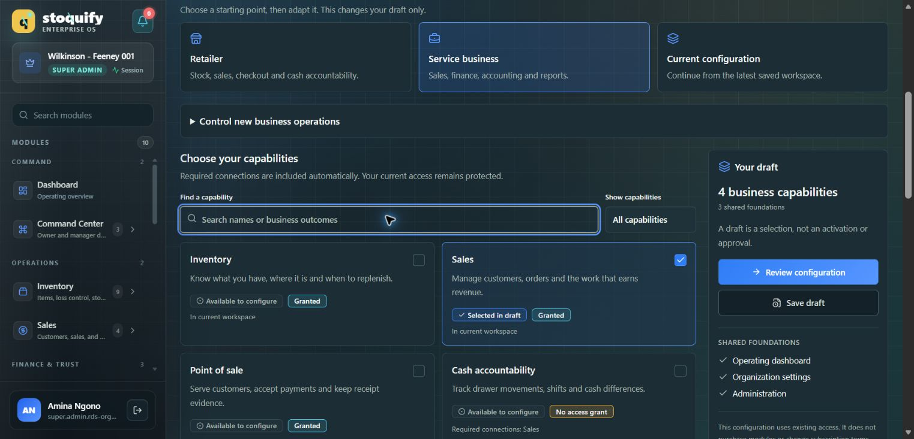

# Capability catalogue redesign — 27 September 2026

Status: implementation complete; visual acceptance remains pending. Component behavior, TypeScript and lint checks passed within the limits below. This is not an accessibility or release certification.

## Scope and design decision

The change concerns “Choose your capabilities” on `/en/dashboard/settings/modules` and its adjacent draft summary. The previous two-column card grid displayed access badges, workspace membership, dependency text and setup paragraphs at similar visual weight. Card heights varied, business categories existed only as a filter, and the draft's combined business-capability count did not distinguish choices from automatic connections. There was no focused view of the current selection or named list of explicit selections in the summary.

A grouped list supports scanning the same information in a consistent order. Existing Operations, Finance & assurance, People, and Insights & content categories now have visible section headings. The list is more vertical than a dense two-column grid; search, category filtering, Selected view, and compact disclosures manage that tradeoff. No grid/list preference or separate mobile workflow was introduced.

The prior published analysis was background only. Current component/service sources and an authenticated browser inspection established the baseline. The older graph node `locale_dashboard_dashboard_settings_modules_page_tsx` (community 23) was treated as a navigation aid, not current implementation evidence.

## Implemented behavior

Each row provides a checkbox, localized capability name and business-value description. Selection is separate from the Details disclosure and setup links. Four concepts remain distinct:

| Concept | Presentation and authority |
| --- | --- |
| Draft inclusion | Not in draft, Selected in draft, or Required connection, derived from the existing local selection/dependency hint resolver |
| Workspace membership | In current workspace or Not included, from `activeModules` |
| Access | Existing granted, trial, read-only, suspended, expired or absent-grant status; this does not mean selection or readiness |
| Setup | Existing server setup/requirement state, with a last-check explanation and explicit sandbox limitations |

Unavailable options keep visible explanations alongside disabled controls. Previously selected unavailable capabilities remain removable. An automatically required capability cannot be unchecked directly; its row names the dependent selections to remove first. If a user removes an explicit choice that another capability still requires, it becomes an automatic connection. This preserves the existing dependency semantics.

Search uses localized names and descriptions. Category and Selected filters intersect, and Selected includes automatic connections. Filtering never edits the draft. Result counts describe the filtered catalogue; draft totals remain independent. Clearing filters restores search focus. Removing the focused final selection in Selected view returns focus to its stable filter control.

The draft distinguishes explicit choices, automatic required connections, and shared foundations. Expandable lists show choices and connection reasons. Known access/setup restrictions for included business capabilities appear by name. The summary explicitly remains informational until the existing authoritative server review.

Native details/summary elements provide disclosures. Checkboxes retain labels and descriptions. Text distinguishes states without relying on color. Focus outlines extend to summaries, and selection hit areas reserve 44 CSS pixels. The responsive styles stack facts on small screens, retain the existing review control as a bottom action in the single-column layout, reserve bottom space, and add a direct link to the draft. Desktop summaries have a bounded scroll area so an expanded draft cannot extend indefinitely below the viewport. These layout measures still need rendered acceptance checks.

English and French each gained 21 namespaced strings. Existing translation values were compared with pre-edit copies and remained identical. French count labels avoid singular/plural ambiguity.

## Changed files

- `components/modules/ModuleCompositionWorkbench.tsx`: grouping, filters, row disclosure/state presentation, focus recovery, draft counts/lists/restrictions.
- `components/modules/module-composition.module.css`: row layout, touch targets, focus, responsive draft access and summary bounds.
- `components/modules/__tests__/ModuleCompositionWorkbench.test.tsx`: 12 additional cases, including parameterized access states; original tests retained.
- `messages/en.json` and `messages/fr.json`: new `moduleComposition.catalog` copy only from this task. Their pre-existing unrelated edits were preserved.
- This report and `evidence/`: verification record, scoped Jest configuration/results and before screenshot.

No changes were made to schema, services, actions, billing, entitlement rules, operational-stop controls or other workbench tabs. Review/apply, fresh authentication, revision checks, idempotency, history and lifecycle commands remain in place. No real configuration was applied and no operational stop or entitlement was changed through the browser. Mutation and preview behavior was exercised with the existing mocked organization fixture.

## Verification

| Check | Result |
| --- | --- |
| Required repository Jest command | Interrupted after a bounded 90-second timeout without test output. Not a pass. |
| First scoped component run | 38 passed / 8 failed: five 5-second timeouts, one hidden sandbox notice and two new assertion mistakes. |
| Scoped rerun after fixes, 20-second per-test timeout | 45 passed / 1 failed. Remaining failure was a French test counting operational-stop controls outside the catalogue. |
| Corrected French test rerun | 1 passed / 45 skipped. No production-code change was needed for this final correction. |
| Latest outcome per distinct test | 46 passed / 0 failed across the full run and focused rerun. This is not a single all-green full-suite run. |
| `npm run typecheck` | Passed, exit 0. |
| Configured ESLint on both changed TypeScript files | Passed, exit 0. |
| Focused `git diff --check` | Passed; only line-ending notices. |
| Translation preservation comparison | Passed for all pre-existing English and French values. |
| Before browser capture | Captured at the existing 1523 × 733 viewport. |
| After capture; 390 / 768 / 1440 px; 200% zoom | Blocked; not verified. |
| Screen-reader review and actual rendered focus/overlap | Not verified. Component semantics/focus tests are not a substitute. |

The default Jest command was attempted once during implementation. A task-local CommonJS configuration reuses the repository's existing SWC test setup, limits discovery to `components/modules`, and adds the standard Next CSS-module mapper. It does not modify the repository's global Jest configuration. The timeout's precise root cause was not proven; the narrower entry point did execute the suite.

Reproduce the scoped suite:

```powershell
node ./node_modules/jest/bin/jest.js --config what-next/modules-capability-catalog-redesign/evidence/jest.config.cjs --runInBand --watch=false --testTimeout=20000 --runTestsByPath components/modules/__tests__/ModuleCompositionWorkbench.test.tsx
npm run typecheck
node ./node_modules/eslint/bin/eslint.js components/modules/ModuleCompositionWorkbench.tsx components/modules/__tests__/ModuleCompositionWorkbench.test.tsx
```

Evidence: [full run](evidence/jest-results.json), [French correction rerun](evidence/jest-french-recheck.json), [structured verification](evidence/verification.json), [scoped runner](evidence/jest.config.cjs).

## Browser limitation and remaining acceptance

The original page could be inspected and captured before editing. Later port 3000 timed out on a basic route-response check. An isolated development preview on port 3126 compiled the updated route and eventually logged HTTP 200 responses (72.4 and 172.4 seconds). Browser automation repeatedly timed out or lost its debugging connection, including after compilation. Those responses establish server rendering, not visual correctness.

The temporary preview was stopped and its generated TypeScript include was removed. The original server and the user's draft were not intentionally replaced or reset. No viewport or zoom override was applied.

Before this work can be accepted as fully verified, open the updated route in a responsive browser and check the following in English and French:

1. At 390, 768 and 1440 px, scan groups, filter to Selected and search; verify no clipped labels or horizontal overflow.
2. At 200% zoom, reach every checkbox, disclosure, setup link and draft/review control without overlap.
3. Use Tab, Shift+Tab, Space and Enter to traverse filters, selection, details and the review dialog; confirm focus after filtering, deselection and closing review.
4. Expand a long draft and inspect the bounded desktop summary and mobile bottom action.
5. Capture the after screenshots and record actual rendered contrast/screen-reader findings.

Before image only — this is not the redesigned result:



## Separate unresolved product issue

Reports' destination in `services/modules/module-composition.service.ts:37` is `/dashboard/analytics/reports` and requires Analytics access. The catalogue has an Analytics → Reports dependency, without a corresponding Reports → Analytics required connection. The route also uses the existing Analytics surface guard. Consequently, selection of Reports does not itself establish destination access. This inconsistency is documented; no invented dependency or client-side access rule was added.

## Review lenses

These are evidence-based review perspectives applied in this task, not independent expert approvals or delegated sign-offs.

| Review area | Outcome |
| --- | --- |
| Platform architecture | Existing composition read model, commands and local hint resolver reused; no new policy authority. |
| Backend/domain integration | Review/apply/lifecycle contracts and effects preserved; regression component tests retained. |
| Data/database | No schema, migration or write-path changes; no separate database review required for this presentation diff. |
| Security/IAM | No RBAC, tenancy, fresh-auth or entitlement changes; disabled controls remain presentation, not enforcement. |
| Frontend/design system | Existing primitives, dashboard tokens and native disclosures used; browser visual acceptance pending. |
| Workflow/accessibility/localization | Draft/filter/focus/disclosure behavior tested; EN/FR provided; responsive, zoom and screen-reader checks remain open. |
| Product/business processes | Selection, access, workspace membership, setup and new-work stopping remain distinct. |
| Quality/release assurance | Exact pass/fail/interruption history recorded; no release-readiness claim while browser checks are incomplete. |
| SRE/performance | No added requests, packages or telemetry; local filtering covers the existing small catalogue. No latency/benchmark claim. |
| SaaS modularity/product operations | Existing catalogue taxonomy and access semantics retained; workspace configuration does not purchase modules. |
| Finance, statutory/country-pack, provider/offline, AI governance | Rule changes not applicable. Existing setup/sandbox boundaries and server-owned controls remain intact. |
