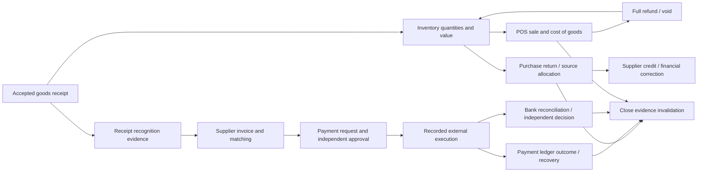

# POS, purchasing and inventory — shared evidence register

Phase 1: mapping and repair handoff complete. Phase 2: B1–B4 implemented; B5 is now implemented and tested behind existing authoring rollout controls. Phase 3 and the closure pass below have scoped passing evidence. **Program verification remains incomplete**, particularly external-provider verification and open operating policy. Updated 2026-10-26.

## Mixed-version delivery workers and close writes — scoped completion, 2026-10-28

Scope authorized 2026-10-28: actual historical/current source processes and their schema-specific clients against the retained localhost disposable database. The [report](mixed-worker-close/REPORT.md), [combined matrix](mixed-worker-close/combined-results.json), [22 evidence stages](mixed-worker-close/combined-reconciliation.json), [database readback](mixed-worker-close/database-readback.json) and [source manifest](mixed-worker-close/start-source.json) record this continuation independently of prior runs. The workflow contract passed before execution. Synthetic receiver receipts use uniquely named retained test tables; alert probes use an explicit logical lease clock and refuse to run if another retained delivery is eligible. No existing delivery was rescheduled to make room. MTN, open policy and deployed rollout defaults remain excluded/unchanged.

- **Workers PASS both directions:** actual child exit 73 after consumer commit, recovery with one retained consumer effect/one delivery audit, bounded retry and sanitized dead letter, lost HTTP reply after receiver commit, and no new HTTP attempt from an exhausted lease.
- **Active lease controls PASS:** reused worker identities, predecessor success and failure while the successor remains LOCKED/PROCESSING, wrong-tenant acknowledgement against a live lease, and independently changed attempt/lock-time values all fail without altering the successor. The successor's correct acknowledgement then completes normally. These stronger cases replace the initial terminal-state-only proof.
- **Close writes PASS both directions:** earned blocked draft → approved schedules → READY → independent certification; actual mixed certification race yields one certificate; scoped audit failures roll back certification and period seal; close/reopen replay and changed-payload rejection; closed-period correction denial; controlled return, stale original certificate, refreshed assessment/certification and reseal. Each final organization has stock 1.000/value 100.00, four balanced journals, one payment/transaction/return, CLOSED/version 3 and CLOSE → REOPEN → CLOSE history.
- **Close denials PASS with exact causes:** missing certification permission, self-certification, foreign run and stale authentication were verified against both source versions on the retained artifacts, preserving export counts. These are direct service controls, not new authenticated HTTP/session tests.
- **Verification:** fourteen initial tests plus eight affected/new tests yield **eighteen distinct passing tests**; four overlap. Twenty-two evidence stages reconcile to sixteen final worker/close states. Zero residual fault triggers. Scoped TypeScript passed; both run receipts show no captured owner/harness drift. Readback now refuses incomplete matrices. No new application defect was confirmed; only harness/configuration/evidence changes were needed. An independent read-only harness review identified the evidence improvements and confirmed they were addressed.
- **Concurrent work preserved:** the final broader manifest records an unrelated `tsconfig.json` generated-types/include-exclude edit, alongside the two intentionally strengthened harness files. Recovery uses its own include list and explicit Jest mappings. No other captured application owner or historical source drift was detected.
- **Scope closed / remaining gates:** no requested local active-lease, close-denial or reconciliation check remains blocked. This supersedes prior mixed-worker/close-write not-run labels for this exact local pair. Production mixed Next/browser transport, hosted routing/drain enforcement, real receiver guarantees and the older pre-baseline receiver-key transition still lack their specified artifact/configuration/receipt evidence. Earlier MV1–MV3 unsafe PO/restoration combinations remain unsupported. MTN and open operating policy stay excluded; no deployment, production mutation, commit or push occurred.

## Mixed-version compatibility — scoped results, 2026-10-28

Scope: baseline commit `9ab93a2a1d81e37ef7e0b10357885b48a3bc5886` versus the current working tree, separate source processes and separately generated historical Prisma Client, sharing only the retained disposable `stoquify_pos_audit_20261026_d30f` database. [Source snapshot](mixed-version/start-source.json) and [historical client generation](mixed-version/client-generation.json) bind the selected versions. The workflow contract passed before checks. Default rollout values, MTN configuration and open operating/retention policy remain unchanged.

The [mixed-version report](mixed-version/REPORT.md), [combined scenario evidence](mixed-version/combined-reconciliation.json), [final database readback](mixed-version/database-readback.json) and [source comparison](mixed-version/final-source.json) record thirteen scenarios: nine compatible within the exercised contract, one reservation boundary that safely rejects cross-version replay, and three UNSUPPORTED combinations. All thirteen retained database states matched on final readback. The 2026-10-28 [resume comparison](mixed-version/resume-provenance.json) found no drift in captured source or the then-final harness. All 120 applied migration checksums and both schema-derived clients match their source models.

- **Compatible:** durable draft/receipt handoff both directions; retained current create/clone recovery under all four flag combinations; interrupted/discarded draft protection; existing new-admission contract; POS commit recovery both directions with one payment/movement and two balanced journals; receiving replay; real observed mixed-process stock lock contention with one successful writer.
- **MV1 / B5 rollback boundary, confirmed:** the pre-adapter historical PO actions duplicate current durable create/clone requests and ignore recovery-only semantics. Do not return these writers to the admission/recovery cohort.
- **MV2 / B5 rollout boundary, confirmed:** an initial current-node legacy admission with both flags off followed by enabled-node admission creates two POs for one identity. Keep flags consistent and drain in-flight admissions before transitions. Default legacy behavior and rollout policy remain unchanged/open.
- **MV3 / B1 rollback boundary, confirmed:** the old return writer restores 300.03 after the repaired stock owner removes 300.02. Current retry preserves that historical result without another effect. Keep restoration writes on repaired owners; immutable historical outcomes are not rewritten by replay.
- **MV4 / B3 payload boundary:** old/current reservation hashes reject cross-version retries while retaining the original reservations (2.000 total). This proves fail-closed safety, not transparent resumption. Do not weaken hash checks or create replacement identities to evade the conflict.
- **Verification accounting:** the initial full matrix had twelve passing assertions and one incorrect replay-cost expectation. After correcting the harness to assert zero newly applied replay cost plus the original durable movement, the affected case passed. These are combined results from the full run and targeted rerun, not a single all-green full invocation. Scoped TypeScript passed. No application changes were needed in the supported cohort; only test/configuration/evidence files were added.
- **Retained certified-close reads:** two additional 2026-10-28 service/database comparisons PASS for the existing EN/FR fixtures. Historical/current dashboard, evidence graph, full certificate and period-seal records match after excluding only two observation timestamps. [Results](mixed-version/close-read-results.json). No new close writes or authenticated browser rendering were exercised by this check. [Completion provenance](mixed-version/completion-source.json) binds the added reader branch separately from the original matrix harness.
- **Concurrent changes:** seven HRIS/payroll files changed after the resume source comparison. Completion provenance records their hashes; they remain untouched and outside the exercised workflow/read paths. The earlier zero-drift snapshot is historical, not a whole-tree claim at completion.
- **Evidence limits:** request-context authentication/cache APIs in this harness are synthetic; business owners, schemas, transactions and records are real PostgreSQL. New authenticated HTTP/build skew and mixed delivery-worker evidence remain absent. Exact production artifact versions/routing/worker configuration and an appropriate disposable rehearsal are needed for release-specific certification. MTN, open operating policy and negative-stock certification remain excluded. No deployment, commit, push or production mutation occurred.

## Authenticated close screens — completed local continuation

The [close-browser report](close-browser/REPORT.md), [final scenario summary](close-browser/summary.json), [source comparison](close-browser/final-source.json), [owned patch](close-browser/owned.patch) and [database reconciliation](close-browser/database-readback.json) record this continuation. Actual Next routes and protected actions ran against the retained localhost disposable database with separate synthetic EN/FR preparer/reviewer actors. MTN, open policy/rollout decisions and negative-stock certification remain excluded.

- **F9/B8 — confirmed, repaired and verified:** saved draft/certified exports were reported as failures when post-commit cache invalidation threw. The existing `revalidateAfterCommit` helper now owns the same close-path refreshes; no transaction, authorization or retry policy changed. [Two failing regressions](close-browser/cache-before-results.json) became [33 passing action tests](close-browser/cache-after-results.json). Real EN/FR cache faults and a deliberately lost French successful reply preserve one certificate per assessment and recover the recorded outcome.
- **F10/B9 — confirmed, repaired and verified:** denied protected reads left cached private evidence visible. The screen now hides it on the first FORBIDDEN/AUTH_REQUIRED response, clears local draft/export/password state, and retains the denial through retry startup until a newer successful read confirms access. [Original browser failure](close-browser/access-before-results.json), [retry-window failure](close-browser/access-retry-gap-results.json) and [four failing retry-start regressions](close-browser/denial-latch-before-results.json) remain recorded. All [44 component tests](close-browser/ui-unit-results.json) pass. Actual EN/FR delayed-read, permission/session revocation, generic denial, keyboard sign-in and transient-error recovery checks pass. This does not claim to erase already-delivered data from browser memory.
- **F11/B10 — confirmed and repaired:** the French period-closing section used English title/action/status/date formatting and success notice. Those presentation strings now follow the selected locale; period ID/version fields, protected action and close gates are unchanged. [Four setup tests](close-browser/setup-unit-results.json) and [final authenticated rendering](close-browser/setup-copy-results.json) pass. Other setup configuration sections are outside this focused translation repair.
- **Authenticated lifecycle PASS:** EN/FR assessment → draft → independent password step-up → certified download → reload, cache-failure/response-loss recovery and actual period sealing. Both seals bind retained certificate IDs/hashes with different preparer/reviewer identities. No READY run, certificate or CLOSED period was seeded. Closed-period final rendering is retained separately from the earlier loading-transition screenshots.
- **Validation:** 81 mocked tests; one real PostgreSQL fixture-preparation test; 34 recorded browser stages across five scripts; scoped TypeScript and owned diff checks pass. Browser stages are not 34 independent unit/integration tests. EN/FR × desktop/mobile checks report no page overflow or targeted WCAG A/AA axe violations in exercised close states. The final denial rendering was checked after removing repeated explanatory copy.
- **Durable reconciliation PASS:** each synthetic organization retains stock 2.000/value 200.00, three balanced journals, one supplier payment, one payment transaction, and one CLOSED/version-1 period with exactly one seal. Distinct explicitly rerun assessments remain historical records; none has duplicate certified exports. Fixture permissions were restored, cache fault instrumentation is inactive, and the owned isolated server was stopped. The database is retained.
- **Source and limits:** all three owned application files match the browser copy; five unrelated concurrent HRIS/landing changes remain preserved and unverified by this scope. No period-reopen UI exists; its preceding protected-action/database proof does not constitute browser evidence. Authentication uses real sign-in endpoints/cookies, not a login-form design test. MTN sandbox configuration, open retention/operating/rollout decisions, the default legacy cohort risk and mixed-version certification remain unresolved outside this continuation. No production mutation, live charge, deployment, commit or push occurred.

## Certified close-pack lifecycle — completed local continuation

The [certified-close report](certified-close/REPORT.md), [results and source comparison](certified-close/summary.json), [retained scenario stages](certified-close/lifecycle-reconciliation.json) and [final database readback](certified-close/database-readback.json) close the earlier complete close-pack evidence gap for the supported synthetic zero-tax cash/nonnegative-stock lifecycle. This supersedes the historical “not certified” close-lifecycle status below only within that scope; the program-wide provider and policy gates remain open.

- **PASS: actual readiness → draft → independent certification → seal → reopen → invoiced supplier return → refreshed schedules → recertification → reseal.** No READY run, certificate, CLOSED period or period-control receipt was seeded. Existing owners enforce the transitions. Initial missing accounting configuration, cash review and schedules were fixture prerequisites, not product defects.
- **Integrity and recovery PASS:** missing permission, stale authentication, self-certification, foreign tenant and obsolete run were denied; injected audit errors rolled certification/sealing back; competing certification calls produced one durable certificate; reopen and return replay produced one effect; changed-payload reopen was denied. Closed-period correction was denied until controlled reopen. The original certificate hash remains retained with stale evidence metadata; the new seal binds the corrected certificate/hash.
- **Durable reconciliation:** stock/value 2/200 → 1/100, inventory GL 100, GRNI/AP zero, supplier return claim 100 and cash outflow unchanged at 200. Four balanced journals, one return, one supplier payment and one payment transaction remain. Period is CLOSED/version 3 with exactly CLOSE/REOPEN/CLOSE history. Temporary lifecycle fault functions are absent.
- **Evidence classes:** one real PostgreSQL end-to-end test with seven retained stages; 139 mocked/pure tests across five suites; workflow check and scoped TypeScript PASS. No new browser/accessibility or provider checks were run. Real concurrent certification calls prove the observed single effect, not every lock interleaving. Synthetic approved schedules prove the workflow, not independent external-document authenticity.
- **Changes:** test fixtures, scoped verification configurations and evidence only; no application defect was exposed and no application code/migration was changed. Existing application diffs are preserved. The final two test edits are type-only run-ID assertions with no runtime effect.
- **Still open/out of scope:** MTN MoMo sandbox configuration and callback/test endpoint; retention/resumption/escalation, default durable-authoring rollout and legacy compatibility policy; mixed-version rollout certification. The default legacy duplicate-create risk remains. The scoped authenticated close UI gap is addressed by the continuation above. Negative-stock certification stays excluded. No production mutation, live charge, deployment, commit or push occurred.

## Remaining local scenarios — completed continuation

The local continuation is documented in [remaining-local/REPORT.md](remaining-local/REPORT.md), with [machine-readable results](remaining-local/summary.json), [final source manifest](remaining-local/final-source-manifest.json) and [owned application patch](remaining-local/owned-application.patch). Baseline: HEAD `9ab93a2a1d81e37ef7e0b10357885b48a3bc5886`; all 3,354 source fingerprints matched revalidation 02 before edits. The current tree's unrelated changes are preserved. Workflow contract passed before application/database checks. The PostgreSQL target is still only `stoquify_pos_audit_20261026_d30f` on localhost; initial sandbox connection failure was environmental, and the inspected fixed-target runner subsequently connected outside that restriction.

- **F6/B6 confirmed and repaired:** interactive POS commit/refund/void trusted the action's earlier role/session check through the financial transaction. Five real PostgreSQL regressions reproduced completed financial effects after role/session/account revocation. The protected actions now supply server-owned session identity separately from tender payloads; the financial transaction locks and rereads actor, role membership and session, including correction step-up freshness. Existing trusted offline admission remains a separate contract. The initial failure is retained in `remaining-local/authority-before-results.json`. Acceptance: denied authority causes no new financial/stock effects; admitted operations serialize with revocation; current-authority success and caller claim binding remain valid.
- **F7/B6 confirmed and repaired:** raw PostgreSQL authority-lock serialization errors (`P2010` / SQLSTATE `40001`) became generic internal errors instead of using the existing whole-transaction retry. Explicit serialization/deadlock codes now use that retry; exhausted conflicts return `DATABASE_CONFLICT` with the retained operation identity. No retry limit was increased. Waiting-transaction regression and final verification are recorded in the continuation report.
- **Supplier credit / period checks: 4 PostgreSQL cases PASS.** Credits after recorded cash settlement preserve `amountPaid=200`, produce an outstanding supplier credit of `-100`, and reverse to zero without another cash movement. Same-key credit/reversal replay and competing distinct credits produce one effect. New credits and reversals fail in a closed period. Existing database policy also requires controlled reopening of the original journal's period before its reversal metadata can change; the actual reopen owner, replay and changed-payload denial passed, followed by exact later-period credit/return reversal. Synthetic closed-state receipts are explicit fixture setup, **not** evidence of a certified close pack. No period guard was weakened.
- **F8/B7 confirmed and repaired:** actual mobile POS rendering exposed an unnamed stock progress bar and a SKU/barcode strip without keyboard scrolling. The redundant bar is decorative; the strip has localized region semantics, normal tab order and visible focus. Actual EN/FR × desktop/mobile checks pass keyboard focus/scroll, no page overflow and zero detected WCAG A/AA axe violations. [Before scan](remaining-local/pos-axe-before-fr.json), [final rendered evidence](remaining-local/pos-accessibility-results.json).
- **Final validation:** 69 mocked tests, 38 real PostgreSQL behavioral cases, one separate browser-fixture preparation case, scoped TypeScript and diff checks passed. The 38 cases comprise 11 authority/location/races, 4 supplier-credit/period cases, 15 existing POS and 8 connected-chain regressions. These counts do not include earlier historical worker/upgrade results.
- **Concurrent work preserved:** final hashing also detected seven unrelated HRIS/landing/not-found changes made during this continuation. They are separated in the summary and were not edited or reverted; these scoped results do not certify that other work.
- **Actual POS recovery:** authenticated checkout was denied after stored permission revocation; restoring access and reloading retained the original request. A deliberately lost successful commit reply was recovered by status lookup with exactly one sale commit/payment and stock 0/0. [Functional result](remaining-local/pos-browser-results.json) records the two accessibility findings from that initial run separately; B7's later four-view check closes those findings. The isolated app was stopped and port 3168 has no listener.
- **Still blocked/open at this earlier pass:** MTN sandbox account/product/configuration and safe callback/test endpoint are required for provider recovery/reconciliation. Retention/resumption/escalation and durable-authoring rollout/legacy compatibility remain open by user instruction; the unchanged default legacy cohort still has the earlier duplicate-create risk. Mixed-version rollout remains uncertified. The then-missing complete close-pack lifecycle evidence is superseded by the scoped certified-close continuation above. Negative-stock certification remains explicitly excluded. No production changes, charges, deployments, commits or pushes occurred.

## Latest requested rerun — revalidation 02

The user requested that all five reported closure areas be run again. They were re-executed against the retained synthetic local database and newly created upgrade/restore databases. See [the revalidation report](closure/revalidation-02/REPORT.md) and [machine-readable summary](closure/revalidation-02/summary.json).

- B5: 5 PostgreSQL cases passed again, including preparation of fresh browser fixtures.
- Authenticated journeys: real EN/FR authorization, response-loss, cache-failure, reload/focus and clone-recovery checks passed again. The clone added exactly one order (6 → 7) while recovering the original request after locale navigation.
- Supplier/worker: 2 AP/return cases and 2 worker cases passed again with fresh durable reconciliation evidence.
- Upgrade/restore: populated upgrade 92 → 120 migrations passed; all 120 migration checksums match current source; the fresh restore matched all 246 public data tables.
- Validation: 48 mocked action/hook tests, scoped TypeScript (exit 0, no diagnostics) and the repository workflow check passed again.

Application code and rollout defaults were unchanged. Only repeatability/evidence harness changes were needed: unique draft titles, count assertions relative to the populated database's starting state, and fresh cache-fault proof. Previous evidence was preserved. The isolated app was stopped before backup; no listener remained on its port. No production mutation, live provider charge, deployment, commit or push occurred.

The program-wide exclusions remain: missing MTN MoMo sandbox configuration, open retention/operating policy, negative-stock certification excluded by instruction, and the broader scenarios listed in the closure report. Fresh scoped passes do not close those gates.

## Prior closure pass — implementation and evidence

See [closure/CLOSURE_REPORT.md](closure/CLOSURE_REPORT.md) for the repair, scenario matrix, invariant mapping, exact procedures, compatibility and rollback guidance. Historical statuses below are preserved; this table supersedes them only within its stated scope.

| Requested work | Current state | Durable evidence |
|---|---|---|
| Authenticated authorization/recovery/cache journeys | PASS for actual purchasing sessions/actions in EN desktop and FR mobile: stored permission/session revocation, lost reply, cache exception, reload and receipt focus | [Authenticated results](closure/authenticated-browser-results.json), [clone recovery](closure/clone-browser-results.json) |
| B5 legacy create/clone | Implemented opt-in through existing durable authoring owner; retained immutable input, actor-scoped client identity, no legacy fallback during recovery, replay and changed-payload controls | [PostgreSQL reconciliation](closure/authoring-reconciliation.json), [mocked action/hook results](closure/clone-action-hook-results.json), [owned patch](closure/owned-application.patch) |
| Supplier settlement/returns and workers | PASS for supported synthetic zero-tax receipt/invoice/independent approval/cash execution, return/reversal, and local inbox lease/retry recovery | [AP reconciliation](closure/ap-reconciliation.json), [worker reconciliation](closure/worker-reconciliation.json) |
| MTN MoMo | BLOCKED: user identified MTN MoMo and confirmed no local sandbox; no provider calls or live charges made | Required configuration and scenarios in closure report |
| Upgrade/restore | PASS: populated pre-authoring schema upgraded 92→120 migrations; full populated audit restore compared by table counts/digests | [Upgrade](closure/upgrade-results.json), [restore](closure/restore-results.json) |
| Policy decisions | Retention/creator resumption/admin escalation deliberately OPEN; implement/test behind existing flags. Negative-stock behavior preserved and certification EXCLUDED by explicit user decision | User answers in this chat, recorded in closure report |

The closure source revision remains `9ab93a2a1d81e37ef7e0b10357885b48a3bc5886`; [start provenance](closure/start-provenance.json) records pre-existing drift in `stock-integrity.repairs.postgres.test.ts`, which this closure did not modify. [Final source manifest](closure/final-source-manifest.json) and [final summary](closure/final-summary.json) bind new evidence to the final local files. Existing unrelated working-tree changes remain preserved. No commit, push, deployment or production mutation occurred.

Remaining broad cases include every POS/location authority race, provider-specific reconciliation/unknown outcomes, credit-note allocation after settlement and closed-period correction variants. New passing cases do not certify those paths. The default legacy cohort still has the reproduced duplicate-creation risk until rollout is separately authorized; the user requested controlled implementation, not default activation.

This is the durable findings and acceptance register for all three phases. Append implementation diffs, verification results and disposition against the same F/B identifiers. Do not replace source inspection with a general claim that the system is secure or production-ready.

The principal confirmed defect is a mismatch between inventory value removed and the movement cost returned to POS accounting. The surrounding architecture already has useful controls: reviewed commands, retained results, transaction-owned stock events, independent payment actors and uncertain-outcome recovery. Repairs should extend those controls to alternate paths and fix arithmetic at the owning boundary, rather than rebuild the workflows.

## Phase 3 — current verification and closure gate

### Source state, environment and evidence classes

- Tested working tree at HEAD `9ab93a2a1d81e37ef7e0b10357885b48a3bc5886`; HEAD alone is not the tested source. Rechecked all 25 phase-2 owned file hashes before execution; no drift. Final source hashes, current local diff and working-tree status are retained in [final-source-manifest.json](phase3/final-source-manifest.json), [current-owned.diff](phase3/current-owned.diff), and [working-tree-end.txt](phase3/working-tree-end.txt). The baseline-relative phase-2 diffs remain the ownership boundary; the full Git diff can include pre-existing changes.
- Read current workflow/routing/command definitions, register, source and approved design contracts. Started verification with `npm run agent:workflow:check` (PASS; unclassified commands remain subject to review). No application build, environment-loading Jest wrapper, production mutation, provider charge, deployment, commit or push was performed.
- **Real PostgreSQL:** newly created, explicitly disposable localhost database `stoquify_pos_audit_20261026_d30f`, PostgreSQL 17.5. Applied all 120 repository migrations with `prisma migrate deploy`; no application database reset or schema push. [Target receipt](phase3/target.json) and [migration log](phase3/migrations.log) record the target and installed checksums. Test fixtures are synthetic, zero-tax XAF, open-period, nonnegative-stock data. Each case uses separate organization/actor/document IDs. Test-owned triggers simulate failures inside transactions and are removed in `finally` blocks. The database is retained for inspection.
- **Source/static:** reviewed final repair boundaries, current callers and baseline-relative diffs. Final manifest covers 852 source/config files, with no phase-2 owned-file drift; all 120 applied migration checksums match current files. Phase-3 scoped TypeScript check includes the new chain fixture/tests and their imported services and passed with zero diagnostics ([result](phase3/typecheck-result.json)). Source inspection does not prove browser or lock behavior.
- **Mocked component tests:** 17 tests passed in 3 suites; [results](phase3/component-results.json), [log](phase3/components.log). This verifies UI contracts and mocks, not persistence. The phase-2 197 unit/action and 11 hook passes remain historical evidence tied to unchanged phase-2 hashes; they are not presented as newly rerun tests.
- **Real PostgreSQL tests:** 15 existing full POS tests plus 8 new connected chain tests passed. The separate offline browser test adds one real HTTP/IndexedDB/PostgreSQL scenario. [POS results](phase3/pos-results.json), [chain results](phase3/chain-results.json), [offline browser results](phase3/browser-results.json), and [machine-readable summary](phase3/verification-summary.json). The POS run skips only its opt-in browser case; the separate browser run selects that case and skips the other 15, rather than counting them twice.
- **Rendered/browser/accessibility:** 12 Chromium cases passed: receiving, inventory history and local offline recovery × English/French × 1440px/375px. Actual components, real translations/styles, Radix focus behavior and real IndexedDB are used; action/network outcomes are explicitly simulated. [Browser results](phase3/ui-results.json) record assertions and axe checks; zero WCAG A/AA violations were reported in these exercised states. This is not a screen-reader audit or authenticated Next-route certification. The additional offline integration browser case uses real ingestion/replay and DB through a test-only fixed-actor HTTP adapter, not production middleware.
- **External-provider sandbox:** NOT RUN. No named provider sandbox, callback/worker configuration or approved synthetic electronic tender fixture was established. Cash and on-account database effects do not demonstrate external money movement.

### Scenario matrix — starting state, procedure and durable outcome

All database rows below use the migrated disposable target; all rendered rows use the isolated loopback component harness. PASS is bounded to the stated scope. BLOCKED/NOT RUN rows remain open.

| ID / status | Starting state, actor and procedure | Expected result and observed evidence |
|---|---|---|
| P3-RECEIVING — PASS | Empty stock; buyer creates/submits PO 1 for 1 unit at 100 and PO 2 for 2 at 100.01; separate live-session approver approves. Receiver records PO 1, then partial/final PO 2 deliveries through reviewed commands. | Partial pool 2 / 200.01, second PO PARTIALLY_RECEIVED; final pool 3 / 300.02, both POs RECEIVED, 3 posted stock receipts. Exact command replay leaves full snapshot unchanged; changed quantity under same key rejects. `receivePool`, chain reconciliation snapshots. |
| P3-CHAIN-refund — PASS | Received pool above; cashier finalizes retained checkout for 3 units / 450 cash, retries original command, then fully refunds and repeats correction. | Stock 3→0→3, value 300.02→0→300.02; drawer 100→550→100. One sale commit/payment; original retry no extra effects. Final sale RETURNED/payment REFUNDED for 450, one refund, five retained stock movements with exact original reversal link. Repeated correction denies without changes. |
| P3-CHAIN-void — PASS | Same received pool and cash sale; cashier voids original sale and repeats void. | Same exact stock/value/cash restoration. Sale CANCELLED/payment CANCELLED; no fabricated refund record. Original sale movement retained, linked return added; repeated void has no effect. |
| P3-ACCOUNTING — PASS | Same purchase chain, with active default inventory journal and configured INVENTORY/GRNI account mappings and receipt posting rule. Finalize sale then full refund. | 3 receipt journals → 5 after sale/payment → 6 after refund; every journal balanced and batch POSTED. Stock GL balance equals retained stock value at each stage; GRNI remains credit 300.02 because supplier invoice settlement is outside this scenario. COGS 0→300.02→0. Receiving read model reports posted accounting. |
| P3-HELD — PASS | Approved PO for 2; receiver saves a stale preview, then records 1 failed-inspection unit. Same receiver attempts acceptance; independent buyer reviews/accepts using fresh session assurance. | Held goods contribute zero availability/value/movements. Stale preview and self-acceptance denied. Independent acceptance posts 1 / 100 once; exact acceptance replay unchanged. |
| P3-CONTENTION — PASS | 3 received units; two cashiers with separate tills/shifts and retained checkouts both request all 3. A third connection holds the stock row while both start. | PostgreSQL recursive blocking graph observes at least two waiting backends (including indirect waits). Release yields one completed sale, one payment, one commit, two sale/payment journals, zero remaining stock/value and combined drawer cash 650 from opening 200 plus sale 450. Losing checkout does not partially commit. Wait queries and durable rows retained. |
| P3-RECEIPT-DUP — PASS | One approved order and one reviewed receive command submitted concurrently twice. | One original result and one replay, one receipt/movement, stock 1 / 100. |
| P3-RECEIPT-ROLLBACK — PASS | Approved order; trigger fails the final receipt-decision business event after stock work is attempted. Sequence probe proves trigger execution despite transaction rollback. Remove test trigger; retry original command. | Failure leaves the pre-operation durable snapshot unchanged; retry records one receipt/movement. Probe, before/after records and retry state retained. |
| P3-AUTH — PASS, bounded | Review receipt with real stored role/session; remove receiving permission, then restore permission and expire session; attempt foreign-tenant location/read scope. | Each denial leaves quantities, values, documents, payments, journals and event/outbox counts unchanged. This tests persisted receiving authority, not the full authenticated route or all action-to-commit revocation schedules. |
| P05 / existing POS — PASS | Retained commit fixtures: substituted ID, changed payload, foreign org/user/location/terminal/session, duplicate completion, stale cart and insufficient stock. | Denied attempts produce no financial effects or foreign receipt disclosure. Exact retries converge on retained result. Full stock/cash/receivable/payment/journal/event/outbox/commit-result assertions run against real kernels. See named assertions in `pos-results.json`. |
| POS uncertain/failure/close — PASS, bounded | Receipt read fails after commit; database trigger forces serialization retry; final commit-result trigger fails; previously certified close evidence exists. | Original request remains recoverable, changed intent rejected, finalization failure rolls back all real kernels and original retry succeeds. Committing sale invalidates the prior close certification. Does not prove every worker or provider crash window. |
| P06 offline — PASS, bounded | Signed registered device, retained local event, lost ingestion and replay responses; repeat/reload through real IndexedDB and test HTTP adapter. Also duplicate replay, payload conflict, revoked device and expired policy. | Original evidence retained, one financial commit and acknowledgment, conflicts quarantined, revoked/expired evidence does not create a sale. Test-only replay flag is scoped to the test process; deployed offline checkout availability remains unchanged. |
| UI receiving — PASS, component scope | EN/FR desktop/mobile; enter quantity/inspection, review, simulated lost confirmation response, retry, keyboard cycle and Escape. | Same retained command is sent twice; one completion callback. Recovery guidance remains visible, keyboard stays in dialog, Escape restores trigger focus, no page overflow. Accounting review is not presented as posted success. |
| UI inventory/offline — PASS, component scope | EN/FR desktop/mobile; search/no-results/reset, keyboard details, refresh/loading; retained local evidence with simulated server failure and disconnected browser. | Responsive table/card controls work; offline pending evidence remains in IndexedDB and sending disables offline. No console runtime errors or detected axe violations in final 12 cases. |
| V07 authenticated cache failure/reload — NOT RUN | Need actual Next action, faulted post-commit cache invalidation and authenticated reload against disposable target. | Phase-2 mocked safe-refresh proof remains; component adapters cannot close this requirement. |
| V01 complete authority race/location policy — NOT RUN | Need authenticated restricted cashier/receiver and barrier-controlled role/session/location reassignment between action check and owning transaction, including alternate writers. | Stored receiving revocation and POS foreign scopes passed; same-tenant location assignment and action-to-commit races are not certified. |
| V08 provider/worker recovery — BLOCKED | Need identified sandbox provider, credential/configuration owner, signed callback fixtures and deployed-worker-equivalent local runner. | Live charges forbidden; no provider or delivery-worker success inferred from DB state or outbox counts. |
| V09 legacy create/clone — BLOCKED | B5/Q2 rollout, fallback compatibility and retained-intent ownership remain unresolved. | F4 remains open; successful receiving does not repair legacy PO creation replay. |
| V10 extended purchasing close chain — NOT RUN | Receipt → supplier invoice → AP approval/payment → purchase return/credit/reversal and close, with approved mappings/actors. | Receipt accrual and POS refund/void tie-outs passed; supplier settlement, purchase-return chain, competing corrections and all closed-period transitions were not executed here. |
| V12 upgrade/restore and negative stock — NOT RUN / decision open | Representative existing DB upgrade/restore rehearsal and approved Q3 negative-stock valuation semantics. | Fresh migration application/checksums are evidence for a new database only. B1 deliberately leaves negative-stock policy unchanged. |

### Reconciliation and invariant-to-evidence matrix

[chain-reconciliation.json](phase3/chain-reconciliation.json) retains the concrete organization, order, receipt, sale, stock movement, reversal and journal IDs; quantities, values, statuses; payment/refund counts; commit counts; journal lines; cash; business-event/outbox counts. Equality assertions compare complete snapshots after denied or replayed operations. Synthetic rows are retained in the disposable DB. Outbox persistence is not delivery execution.

| Stage in configured accounting chain | On hand / reserved / available | Stock value = stock GL | Drawer | Journal count | COGS net | GRNI balance |
|---|---|---|---|---|---|---|
| Received | 3 / 0 / 3 | 300.02 | 100.00 | 3 | 0.00 | credit 300.02 |
| Sale + payment | 0 / 0 / 0 | 0.00 | 550.00 | 5 | debit 300.02 | credit 300.02 |
| Full refund | 3 / 0 / 3 | 300.02 | 100.00 | 6 | 0.00 | credit 300.02 |

| Invariant / owning source | Evidence | Disposition / limit |
|---|---|---|
| F1/B1 stock value removed equals retained SALE movement and COGS; full reversal uses original allocation (`inventory-stock-event.service.ts`, POS/accounting owners) | P3-CHAIN-refund/void, P3-ACCOUNTING; prior kernel rounding cases | PASS for nonnegative complete-sale/full-correction scenarios. Negative stock and partial customer returns are not inferred. |
| Reviewed receiving binds actor, session, scope, revision and payload (`purchase-receiving-authority.ts`, `purchase-receiving-workbench.service.ts`) | P3-AUTH, HELD, RECEIPT-DUP and receivePool replays | PASS for exercised server boundaries; authenticated-route and timing-race limits above. |
| Receipt stock and recognition consume the frozen accepted source (`receipt-recognition-source.ts`, `receipt-recognition.service.ts`, `ap-control.service.ts`) | P3-ACCOUNTING and no-rule review-required fixtures | PASS for stock/accrual recognition. Synthetic rules do not certify a statutory chart or supplier settlement. |
| Only one last-stock sale and one retained result (`checkout.service.ts`, `pos.service.ts`, stock/event owners) | Observed PostgreSQL blocking graph, POS duplicate/changed-payload cases | PASS for tested competition and denial/replay outcomes; not a performance/load certification. |
| F2–F3/B4 reservation identity binds full atomic intent (`postInventoryReservationBatch`, actions and retained hook key) | Phase-2 real rollback/race/replay evidence plus unchanged source hashes | Existing scoped acceptance retained. No supported rendered reservation consumer or new release/expiry policy was invented. |
| F5/B3 committed results survive view invalidation failure (`cache-revalidation.ts`, affected action wrappers) | Phase-2 mocked checks; current source/diff | Authenticated cache-fault/reload scenario remains NOT RUN. |
| F6/B2 read paths enforce purchasing entitlement (`GoodsReceiptAndSummary.ts`) | Phase-2 read-denial tests; unchanged final hash | Module behavior verified by mocks/source; full authenticated browser permission path remains open. |
| Unknown responses do not imply no commit (`pos.service.ts`, retained receipt and offline replay owners) | POS read-failure/commit-result fault tests; real offline HTTP loss test; rendered receiving retained-command assertions | PASS within separate DB/browser scopes. Provider outcome and Next middleware are excluded. |
| Retained history and accounting/close effects remain linked | Original movement/reversal IDs, balanced journal lines, payment states, existing close invalidation test | PASS for covered sale/receipt/refund/void; extended V10 remains open. |
| Localized recovery is operable (`PurchaseReceivingWorkbench`, `InventoryMovementHistoryTable`, `LocalOfflineRecovery`) | 12 browser cases, 17 component tests, screenshots, axe and manual screenshot inspection | PASS for exercised components at 1440/375; full POS cart/tender flow and screen-reader audit NOT RUN. |

### Exact procedures, failures retained and repair disposition

Commands run from the workspace root after inspecting current definitions. Task-owned runners reject remote/production/application database targets; no secrets appear in reports.

```text
npm run agent:workflow:check
node what-next/pos-purchasing-inventory-audit-2026-10-26/phase3/run.cjs prepare
node what-next/pos-purchasing-inventory-audit-2026-10-26/phase3/run.cjs pos
node what-next/pos-purchasing-inventory-audit-2026-10-26/phase3/run.cjs chain
node what-next/pos-purchasing-inventory-audit-2026-10-26/phase3/run.cjs browser
node what-next/pos-purchasing-inventory-audit-2026-10-26/phase3/build-ui.cjs
node what-next/pos-purchasing-inventory-audit-2026-10-26/phase3/check-ui.cjs
node node_modules/jest/bin/jest.js --config jest.cross-workflow-phase3-ui.config.cjs --runInBand --no-cache --runTestsByPath components/pos/__tests__/LocalOfflineRecovery.test.tsx components/purchase-orders/__tests__/PurchaseReceivingHistoryCurrency.test.tsx components/inventory/movements/__tests__/InventoryMovementHistoryTable.test.tsx --json --outputFile=what-next/pos-purchasing-inventory-audit-2026-10-26/phase3/component-results.json
node node_modules/typescript/bin/tsc --project tsconfig.cross-workflow-phase3.json --pretty false
node what-next/pos-purchasing-inventory-audit-2026-10-26/phase3/finalize-evidence.cjs
```

`prepare` creates a new database and refuses an existing name; do not rerun it against retained evidence. Other modes require its receipt. The POS/browser/chain commands run Jest with no mock setup or application configuration. UI bundling uses installed Next webpack/SWC and Tailwind, substitutes only explicit server/hook adapters, and serves on an ephemeral loopback port. The browser controller closes its server/context after execution. Existing installed Chromium required an unsandboxed launch because the restricted process could not locate the user's browser installation; no browser download was performed.

Retained intermediate failures are not hidden:

- Initial concurrent POS/chain suite execution produced a retry-exhausted serialization failure in one chain sale; the trace and initial reconciliation are retained in `initial-chain-*`. Running the suites sequentially passed; the dedicated stock-contention scenario still exercises real concurrency. Cross-suite SSI interference is plausible, not proven. This is not evidence of load robustness or of a repaired production defect.
- `fixture-failure-chain-results.json`: second checkout fixture omitted required customer ID. Corrected the fixture.
- `observer-failure-chain-results.json`: the initial observer counted only direct stock-row waiters. Current PostgreSQL blocking-chain query also records indirect waits on earlier shared locks; it still requires two distinct blocked backends and all final financial invariants.
- `account-fixture-failure.json`: configured receipt rule initially omitted required account mapping keys. Existing recognition controls correctly withheld posting. Fixture now specifies INVENTORY/GRNI; no accounting guard was weakened.
- `ui-harness-failure.json`: initial component bundle lacked a browser process-environment shim. Corrected harness, then all 12 browser cases passed. The restricted-browser executable lookup failure also preceded the successful installed-browser run.
- Scoped TypeScript surfaced required defaults omitted from the fixture's typed PO input; tax, discount and shipping are now explicitly zero. Application code was unchanged.

No newly confirmed application defect required a phase-2 production-code patch in this phase. B1–B4 remain unchanged. New files are the connected fixture/tests, two phase-3 Jest configs, scoped TypeScript config, and this phase's evidence/harness files. Test-setup failures above are not reported as application repairs.

### Final change summary, rollback and next closure batches

- Across the program, B1 conserves POS value and original reversal allocations; B2 guards legacy purchasing reads; B3 separates post-commit refresh errors from authoritative results; B4 requires retained atomic reservation identity. B5 legacy PO create/clone replay remains unresolved.
- Phase 3 adds reproducible cross-workflow verification and records real quantity/value/payment/journal tie-outs. No application/schema/feature-flag change was made in phase 3. Removing only these new test/harness/config files reverses phase-3 code changes without changing application behavior. Retain reports and DB evidence for review; no automatic database deletion is part of rollback.
- For phase-2 rollback, use the owned baseline-relative diffs/hunks, preserve unrelated edits and existing command/event/history rows, and rerun affected scenarios. Reverting B1/B4 would reintroduce the identified integrity/replay defects; no downgrade, data erasure or blanket stock/reservation release is authorized.
- **Next closure batch:** establish the isolated authenticated Next-app fixture for V01/V07/V11, exercise role/location revocation and post-commit cache failure/reload with real server actions, then attach results to this register. Independently resolve B5/Q2 caller/rollout ownership before changing legacy create/clone. Provider/worker V08 requires a named sandbox and tested transport configuration; V10 needs the supplier invoice/payment/return fixture; V12 needs upgrade/restore evidence and Q3 policy.
- **Gate remains open:** scoped passes support the repaired boundaries but do not close the blocked/not-run rows. No deployment approval, absolute security, perfection or freedom from future refactoring is claimed.

## Provenance and scope

- Repository: `E:/ohada saas/Focused projects/stoquify`.
- Starting HEAD: `9ab93a2a1d81e37ef7e0b10357885b48a3bc5886`. This is a **working-tree audit**, not an audit of that commit alone.
- [Starting revision](<E:/ohada saas/Focused projects/stoquify/what-next/pos-purchasing-inventory-audit-2026-10-26/source-revision.txt>) and [starting status](<E:/ohada saas/Focused projects/stoquify/what-next/pos-purchasing-inventory-audit-2026-10-26/working-tree-start.txt>) preserve the pre-existing changes. The tree was extensively dirty, including security/RBAC, accounting-period, onboarding and POS read-query work. None of that work was reverted, staged or committed by this audit.
- Phase-1 owned changes: this report directory only. Phase-2 owned application/test/config changes and baseline-relative diffs are listed in `phase2/owned-files.json` and `phase2/diffs/`; the phase-1 provenance below remains historical. No schema, rollout flag or deployed data change was made.
- Read AGENTS.md, `docs/ecc/WORKFLOW.md`, `skill-routing.md`, `command-registry.json`, `test-lanes.md`, approved design master, UI constitution/component registry and the POS, inventory, payables and AP-payment contracts. Applied ECC security-review and project UI/UX Pro Max guidance within those controls.
- Discovery: five existing graph files, then current imports, callers, schemas, services, actions and tests. [Graph extracts](<E:/ohada saas/Focused projects/stoquify/what-next/pos-purchasing-inventory-audit-2026-10-26/graph-discovery.json>) retain nodes and timestamps. All five graph mtimes were 2026-08-09, so their line numbers and coverage are stale.
- Concrete graph anchors: `inventory_inventorymovementactions_reserveinventory`, action community 93; `purchaseorderworkflow_purchaseordersystemaction_createpurchaseorder`, action community 2; `pos_professionalpossystem_tsx`, component community 1; `new_page_createpurchaseorderpage`, route community 45; `userecentpurchaseorderqueries_ts`, hook community 0. For example, the graph places PO create at L135; current source places it at L157. Graph communities are discovery aids, not proof of ownership.
- [Source catalog](<E:/ohada saas/Focused projects/stoquify/what-next/pos-purchasing-inventory-audit-2026-10-26/source-catalog.json>) lists 821 domain-matched files with exports/imports. The expanded [mutation discovery appendix](<E:/ohada saas/Focused projects/stoquify/what-next/pos-purchasing-inventory-audit-2026-10-26/MUTATION_DISCOVERY.md>) and [machine-readable index](<E:/ohada saas/Focused projects/stoquify/what-next/pos-purchasing-inventory-audit-2026-10-26/mutation-owner-index.json>) scan 3,693 source/test files across ten roots, yielding 256 named-model/SQL mutation candidates, 169 boundary calls and 382 source hashes. The earlier `mutation-candidates.json` is preliminary; use the expanded index for handoff.
- Scope limit: static discovery cannot prove the absence of dynamic/aliased writers or deployed integrations. Seeds, fixtures, imports and workers are explicitly distinguished below. Payroll, customer settlement, generic reconciliation and account administration were inspected only as adjacent writers/dependencies, not audited as full products. No claim about deployed feature-flag values or live historical corruption is made.
- Final artifact check: 40 absolute links resolved and all referenced line numbers existed. The 382 indexed source hashes were unchanged when rechecked. [Artifact verification](<E:/ohada saas/Focused projects/stoquify/what-next/pos-purchasing-inventory-audit-2026-10-26/artifact-verification.json>) and `working-tree-end.txt` retain the check. Concurrent unrelated status changes appeared for HRIS fresh-auth UI/test/config and `scripts/verify-af16-build-publication.py`; `tsconfig.json` no longer appeared modified. These were not audit edits. Status comparison alone cannot detect additional edits inside already-dirty files; refresh provenance before phase 2.

## Phase-2 execution evidence

Starting revision remains `9ab93a2a1d81e37ef7e0b10357885b48a3bc5886`. Fresh status, baseline copies of owned source files and source-drift comparison are retained in `phase2/`. All 382 phase-1 indexed sources matched before editing. `npm run agent:workflow:check` passed before tests. Authorization B2 was moved ahead of B1 according to the user's repair priority. The dedicated unit configuration uses bounded source roots, mocks and no Next config/environment loading; it is separately reviewed, not a newly approved command-registry lane. Initial test discovery was too broad, then an incompatible test-match pattern found no tests; roots/pattern were corrected before the recorded red/green runs. No command-registry fingerprints were changed.

### B2 / F6 — implemented; action-boundary regression verified

- Before: both legacy readers returned data despite module denial/unavailable module authority. New regression produced 5 failures, 2 passes (`phase2/b2-before.json`).
- Correction: `actions/purchaseOrderWorkflow/GoodsReceiptAndSummary.ts` now applies the same enforced purchasing **read** decision as the main action, using current server actor/org/permissions. Existing tenant rejection and DTO mapping remain intact.
- After: 7/7 tests passed (`phase2/b2-after.json`): both reader denials, authority lookup failure, foreign tenant, current identity/allowed read-only access/DTO, revoked permission. Diff reviewed: guard/import changes only. Test: `actions/purchaseOrderWorkflow/__tests__/goods-receipt-read.repairs.test.ts` with `jest.pos-purchasing-inventory-repairs.config.cjs`.
- Evidence limits: mocked action-boundary proof; no DB transaction/locking behavior changed, no UI interaction changed. Persisted revocation timing and rendered denied states remain phase-3 cases.
- Compatibility/rollback: no signature/schema/DTO change. Revert the guard hunk only if necessary; no data rollback. Keep canonical module read semantics rather than inventing a subscription-status rule.

### B1 / F1 — implemented; unit and real PostgreSQL kernel regressions passed

- Before: new `pos-valuation.repairs.test.ts` produced 5 failures / 3 passes (`phase2/b1-before.json`): depletion and partial sales allocated 300.03 from 300.02; refund/void restored the rounded amount; mismatched original quantity was accepted.
- Correction: the POS issue adapter selects retained-pool allocation inside the existing version-guarded stock writer. Nonnegative partial issues allocate proportionally; final depletion consumes the exact residual. The POS return adapter rereads original SALE movements in the same transaction, checks the full item/quantity correspondence, uses retained cost and links each restoration to its original movement. Neither public input accepts an arbitrary total-value override. Event command payload shape remains compatible with existing replay evidence. Caller still consumes the kernel's returned cost for accounting.
- Scope: `services/inventory/inventory-stock-event.service.ts` and new `services/inventory/__tests__/pos-valuation.repairs.test.ts`; no change to receipt-return allocation, opening stock or delivery-order valuation. Missing/inconsistent original sale movements now fail with REVIEW_REQUIRED rather than inventing a cost. Negative-stock valuation remains the existing policy and is explicitly not certified.
- After: 40/40 tests across the new suite and existing stock-event suite passed (`phase2/b1-after.json`), including stock conflict, applied-event replay and negative-stock compatibility. Original evidence/report remains intact. Real kernel PostgreSQL tests were added in `stock-integrity.repairs.postgres.test.ts`; 7/7 passed in 18.474 seconds (`phase2/b1-postgres.json`): exact refund/void restoration and replay, fractional depletion, changed-payload/foreign-tenant denial, outer-transaction rollback, concurrent last-stock competition and closed-period denial. This proves kernel behavior against PostgreSQL, not complete sale/journal posting or deployed constraints.
- DB target: only `stoquify_local_pos_repairs_20261026_a19f` on localhost, newly created empty target with refusal of existing database. Sandbox attempt failed EACCES before creation; the same reviewed target-bound runner was retried with network access. No application database target or provider used. Schema prepared by db push, so migration-only constraints are not certified by this lane.
- Rollback: revert owned valuation/return hunks; do not rewrite already recorded movements/journals. Existing historical discrepancies require separately reviewed corrections. Full authenticated checkout→posting→refund/void and browser journeys remain phase-3 evidence even if kernel DB checks pass.

### B3 / F5 — implemented; action-boundary regressions passed

- Trigger: a domain mutation commits, then cache invalidation throws; the wrapper returns failure for an already recorded transfer, PO, AP operation or reservation.
- Correction: `services/_shared/cache-revalidation.ts` applies the existing POS best-effort pattern to independent invalidations in transfer lifecycle, transfer creation/reservation, central PO refresh and legacy AP refresh. Cache and logger exceptions cannot replace the service outcome; domain failures still propagate.
- Before: retained baseline-source imports reproduce exactly five failures (transfer and replay, PO create, clone, AP approval), with 55 passing tests (`phase2/b3-before.json`). An initial run overlapped edits and exposed outdated AP fresh-auth/logger fixtures; it is retained separately and is not the red baseline. Updated fixtures supply matching actor/tenant claims and warn logging; production auth guards were not weakened.
- After: 77/77 in five suites (`phase2/b3-after.json`), including authority/failure cases and continued invalidation after cache/logger failure. Scope includes the four action files, shared helper and targeted tests. Existing invalidation tags, path types and after-service ordering preserved.
- Limits: mocked wrapper proof, not cache availability or browser freshness. No transaction/schema or rendered control changed. Phase 3 must observe committed outcomes after interrupted requests and refreshed/reloaded views. Cache failure can leave a stale view until reload.
- Rollback: revert only owned helper/import/refresh hunks; no data/schema rollback. Preserve other work in the same files.

### B4 / F2–F3 — implemented; PostgreSQL and adapter/hook regressions passed

- Before: source reproduction retained in phase 1 proves timestamp keys and partial Promise.all effects. Real PostgreSQL baseline (`phase2/b4-before-postgres.json`) additionally accepted a keyless write and an altered-actor replay; two new batch checks failed because no atomic entry point existed (4 failures, 8 passes). Those missing-entry failures are not claimed as a database reproduction of partial commit.
- Contract decision: existing action promises one success/failure and has no partial receipt consumer. Consumer search found only the exported hook/tests, no rendered reservation consumer. Preserve the whole-request promise with one atomic event. Release/expiry ownership remains Q1; this patch does not implement release or scheduled expiration.
- Correction: `postInventoryReservationBatch` validates retained identity/positive bounded lines, binds the actor and complete payload, sorts stock targets, then uses one existing stock-event transaction. The single-line adapter delegates to it; the batch action no longer starts independent transactions. Trusted auth/module guards remain first. Hook and positional adapter forward the caller's retained key; no retry generates a new key. Missing keys fail closed.
- Scope: stock-event service; inventoryActions/inventoryMovementActions; ReserveInventoryRequest; useInventoryMovementQueries; reservation action/hook and PostgreSQL tests. Batch data remains an array, now one scoped per-line receipt referencing the shared event, with no false per-line independent commit identity.
- After: 57/57 unit/action regressions (`phase2/b4-after-unit.json`); 11/11 jsdom hook checks (`phase2/b4-after-hooks.json`) including explicit retry key retention and EN/FR denial/unknown feedback. 12/12 real PostgreSQL checks (`phase2/b4-after-postgres.json`), including B1's seven and five reservation cases: missing key, replay/changed payload/actor, later-line rollback, changed batch membership, competing last-stock reservations. Quantity/value conservation checked alongside reserved/available quantities.
- Compatibility: callers must retain an 8–191 character request key. Previously keyless callers receive REVIEW_REQUIRED; no deployed caller invents a new key on retry. Existing legacy event payloads lack the new actor binding and may return a hash conflict; resolve the original recorded reservation rather than resubmit under a new key. Old per-line batch result internals are replaced by shared event receipts; no consuming application UI was located. No schema or migration change.
- Limits: jsdom hook execution is not browser evidence; there is no rendered reservation entry to exercise in current-source consumer discovery. DB tests prove the tested schedules and kernel, not session revocation races or a deployed reservation workflow. Release and expiry policy remain unimplemented. No provider calls.
- Rollback: stop new generic reservations before reverting caller/kernel contracts; retain existing events and balances. Do not delete reservations, release stock by editing quantities, or reuse new identities to recover old commands.

### B5 / F4 — blocked at existing rollout/compatibility gate; defect remains open

- Current source still defaults to legacy create (`app/[locale]/(dashboard)/dashboard/purchase-orders/new/page.tsx`), with the additional hook caller `useCreatePurchaseOrder` and separately exposed clone path. Both durable-authoring flags remain explicit opt-ins in source; no environment value was inferred or changed.
- Inspected `what-next/ui-workflow-roadmap/PURCHASE_AUTHORING_IMPLEMENTATION_NOTES.md`, `POSTGRES_WORKFLOW_VERIFICATION.md`, current authoring service/contracts and legacy create owner. Existing durable authoring already owns prepared identity, fresh transactional authority, one creation/number/receipt and recovery; adding a parallel recovery model would duplicate this boundary.
- Exact blocker: the established UX14/15 rollout contract still lacks accepted D07 retention/operating ownership, compatibility disposition for legacy hook/clone callers and recovery acceptance for the default route. Historical eight-case migrated PostgreSQL proof exists, but is not a current production-schema or browser rollout acceptance. Replacing the fallback with a write-disabled route would stop creation; enabling flags globally would skip those unresolved gates. Neither is a routine reversible repair to the identified defect.
- Next work: close the named decisions, verify current migration/upgrade and recovery browser scenarios on a named disposable target, migrate each inventoried caller through the existing owner, and retain status/receipt access during rollback. No application edit was made for B5. F4 is not fixed or verified; B3 only removes one cache-induced retry trigger.

### B6 — consolidated repair verification and handoff

Acceptance is scoped: B2 requires module/tenant denial before data access; B1 requires nonnegative stock value conservation and exact original-cost restoration; B3 requires committed outcomes to survive cache/logger failure while domain failures remain failures; B4 requires one retained batch intent with zero partial writes and no duplicate reservation. Each has the evidence categories recorded above. B5 does not meet its acceptance gate and remains open.

- Combined mocked/action regression run: **197 tests passed in 11 suites**, exit 0, 46.519 seconds (`phase2/final-unit.json`). Includes existing checkout lifecycle, payment-release evidence and durable-authoring regressions alongside repaired boundaries. This is not PostgreSQL or browser evidence.
- Separate jsdom hook run: **11 passed** (`phase2/b4-after-hooks.json`). Separate actual PostgreSQL kernel run: **12 passed** (`phase2/b4-after-postgres.json`). Counts are separate evidence sets, not additions to historical phase-1 counts.
- Scoped no-emit TypeScript checks include owned application and test files plus their transitive imports. Initial diagnostic identified one existing receipt-denial fixture missing required receivedBy; the fixture now supplies an untrusted client actor while retaining the no-write assertion. No application type contract or guard was weakened. Final result is retained in `phase2/typecheck-result.json` and `phase2/typecheck.log`; the affected PO suite is rechecked in `phase2/final-po-fixture.json`.
- Final TypeScript result: **exit 0, zero diagnostics**. Affected PO suite: **32/32 passed**. Artifact check confirmed all 25 owned source/test/config/runner hashes still matched and all cited regression JSON files existed (`phase2/artifact-check.json`). The abandoned initial broad-discovery Jest session was stopped; it is not counted as evidence.
- Review: baseline-relative diffs retain only owned changes, avoiding conflation with pre-existing opening-stock/security/HRIS work. Scoped application `git diff --check` passed. `phase2/source-manifest.json`, `owned-files.json`, exact baseline copies and start/end working-tree snapshots support later verification. Original HEAD is retained; no commit/push/deployment occurred.
- Environment: the newly created local database `stoquify_local_pos_repairs_20261026_a19f` is retained as disposable evidence. No application database was migrated/reset, no production mutation or live/provider charge occurred. The first sandbox EACCES was resolved by the same target-bound runner with network access; it is not an outstanding blocker. No database was dropped.
- Reproduction commands: direct Node Jest with the inspected `jest.pos-purchasing-inventory-repairs.config.cjs` and explicit `--runTestsByPath`; hook lane uses `jest.workflow-repairs-hooks.config.cjs`; real DB uses `node what-next/pos-purchasing-inventory-audit-2026-10-26/phase2/run-postgres.cjs --test`. Its `--prepare` mode refuses existing databases and must not be rerun against the retained target. Type checks use `node node_modules/typescript/bin/tsc -p tsconfig.workflow-repairs.json --pretty false` (no emit or incremental output). These are reviewed task-local lanes, not newly registered project commands.
- Browser/rendered evidence: **not run**. No visual component or page was edited; the reservation hook's command contract changed, but no rendered consumer was found. Actual recovered UI outcomes and accessibility remain explicit V07/V09/V11 gates. No production-readiness certification is implied.

### Phase-3 scenario matrix and completion gate

Use this same register and append scenario IDs, revision/hashes, target identity, outputs and dispositions. Every database/provider mutation must remain on an explicitly identified disposable target or sandbox. A green kernel test must not close a full financial or browser scenario.

| ID | Required scenario / invariant | Evidence needed to close | Current evidence / remaining gap |
|---|---|---|---|
| V01 | Foreign tenant/location, revoked role/session and denied purchasing/inventory/POS module cannot read or mutate; denied retries do not reveal receipts | Actual stored authority + authenticated action/route; barrier-controlled revocation schedule | B2 and reservation mocked guards; kernel foreign-item denial passed. Fresh transaction-bound authority races across transfer/alternate paths remain open |
| V02 | Approved PO → accepted/held receipt → availability/value; stale review, over-receipt and same/changed command replay | Real migrated DB, receipt/inspection owner, quantity/value/event/journal assertions | Existing source/tests mapped in phase 1; no full-chain phase-2 execution |
| V03 | 3 units / 300.02 pool sold partially and fully; movement cost equals inventory decrease and COGS journal | Actual checkout + postSale + stock + ledger on disposable DB | B1 kernel conservation passed; complete sale/payment/journal tie-out not yet run |
| V04 | Full refund/void restores exact original cost; changed average, missing originals, concurrent competing corrections and later period close | Actual correction authority, sale state, cash/settlement, stock and journal assertions | Original movement restoration/link/replay and closed-period kernel denial passed; whole correction transaction and close artifacts open |
| V05 | Identical and conflicting reservation/checkout requests compete for last stock without negative availability or duplicate effects | Independent PostgreSQL connections and observed blocking schedule, retained command retry after uncertain response | B4 Promise.all competing reservations and B1 issues passed; explicit barrier schedules and checkout lease contention remain open |
| V06 | Reservation batch fails late with zero retained partial effects; same identity replays; changed lines/actor/expiry fail | Real batch transaction, event/movement/audit/outbox counts, action identity integration | B4 real late-line rollback, membership/actor denial passed; browser consumer absent. Legacy receipt reconciliation and expiry/release policy remain Q1 |
| V07 | Post-commit cache/logger failure preserves committed receipt; pre-commit domain failure remains a failure | Actual action/browser response under injected cache fault; reload resolves current state | B3 mocked wrappers/helper passed. No rendered cache-fault/reload proof |
| V08 | Unknown payment/commit outcomes recover original request; provider delivery retry creates no second sale/payment/receipt | Provider sandbox and worker crash/restart, authenticated recovery browser, durable event/ledger evidence | No provider/worker/sandbox run in phase 2; never infer execution from client timeout |
| V09 | Durable PO create/status/discard and multi-tab stale review yield one number/order/receipt; legacy create/clone callers cannot bypass | Close Q2, current migrated DB/upgrade rehearsal, representative restricted roles and EN/FR browser recovery | B5 blocked; historical authoring DB report is reference only; legacy F4 remains open |
| V10 | Purchasing, inventory, AP, accounting and close invalidation remain consistent after reversal/failure/retry | Connected return/credit/reversal, real journals and current close evidence on migrated schema | Source boundaries mapped; no broad phase-2 financial certification |
| V11 | Operable EN/FR, keyboard/focus, denied/stale/unknown states preserve work and show truthful outcomes | Rendered/browser captures and interaction assertions; accessibility review of changed/activated flows | 11 hook jsdom tests passed, no new rendered consumer or browser evidence; UI rollout remains conditional |
| V12 | Migration/compatibility/rollback preserve retained commands and receipts; negative-stock policy is explicit | Current migration checksums and representative upgrade/restore rehearsal; accepted Q3 policy | New target used db push, not migration-only constraints; no schema change in B1–B4. Negative-stock policy unchanged and uncertified |

Phase-2 application work stops at the explicit B5 gate; F4, Q1 release/expiry, Q3 negative-stock valuation and phase-3 end-to-end gaps are not silently closed. First remaining backlog item: resolve B5's durable-authoring rollout/legacy-caller contract, then execute V09 without routing uncertain commands into a fresh legacy creation. B1–B4 rollback notes above remain mandatory for any later rollback plan.

## Evidence ledger (phase-1 snapshot)

| ID | Evidence class | Executed/inspected result | Limits |
|---|---|---|---|
| E01 | Source/command review | Inspected current script definitions, delegated workflow checker, pilot Jest config/setup and selected imports before running checks | Command registry is bounded; it reported 196 unreviewed package scripts |
| E02 | Repository contract | `npm run agent:workflow:check`: PASS, exit 0 | Does not execute application/database checks |
| E03 | Mocked/pure Jest | Three targeted suites: **67 tests passed**, exit 0, 27.235 seconds | No PostgreSQL transaction, lock, browser or provider proof |
| E04 | Source-extracted diagnostic | Actual current function declarations evaluated with mocked dependencies: valuation discrepancy, unstable reservation identity and partial reservation batch effects reproduced; assertions passed | Demonstrates current defects; not a passing correctness test or full action/database execution |
| E05 | Static discovery/provenance | `node .../index-evidence.cjs`: source model writes, boundary calls, endpoint methods, existing tests and hashes recorded | Static named-call coverage only; each candidate needs the manual reachability classification |
| E06 | UI source review | Approved contracts compared with POS, receiving, payment and inventory components; focused skill query inspected | No rendered screenshots, keyboard run, screen reader, layout, contrast or EN/FR runtime result |
| E07 | Real database | NOT RUN | Disposable target not established; no migration/seed/build or application DB operation executed |
| E08 | Browser/provider/worker execution | NOT RUN | Deployment, network interruption, bank/provider delivery and worker crash recovery remain unverified |

E03 requested command:

```text
npm run test:ecc:pilots -- --selectProjects ecc-unit --runTestsByPath services/pos/__tests__/checkout-lifecycle.service.test.ts services/purchasing/__tests__/payment-release-evidence.test.ts services/inventory/__tests__/inventory-stock-event.service.test.ts --json --outputFile=what-next/pos-purchasing-inventory-audit-2026-10-26/pilot-results.json
```

The npm/PowerShell invocation did not forward those flags. The actual echoed Jest invocation was:

```text
node node_modules/jest/bin/jest.js --config jest.ecc-pilots.config.cjs --runInBand --no-cache ecc-unit services/pos/__tests__/checkout-lifecycle.service.test.ts services/purchasing/__tests__/payment-release-evidence.test.ts services/inventory/__tests__/inventory-stock-event.service.test.ts
```

The output selected the three listed suites and reported 67 passing tests. No `pilot-results.json` was produced; do not cite a nonexistent machine-readable test report. E04 ran `node what-next/pos-purchasing-inventory-audit-2026-10-26/reproduce-source-findings.cjs`; its [retained JSON](<E:/ohada saas/Focused projects/stoquify/what-next/pos-purchasing-inventory-audit-2026-10-26/source-reproductions.json>) identifies the mocked evidence class. Ordinary `rg` discovery attempts against nonexistent `services/workers` and shell wildcard paths were corrected by scanning actual roots; those failures are not application test failures.

## Workflow inventory and supported boundaries

| Workflow / intended outcome | Actors and authority | Supported states and transitions | Excluded or conditional paths |
|---|---|---|---|
| PO authoring: retain a scoped, priced purchase commitment for review | Purchaser; `purchases.orders.create/update/read`; current session/RBAC, module access and scoped supplier/location/item references | Legacy create → DRAFT; durable authoring save → PREPARED → CREATED/result receipt. PO DRAFT → SUBMITTED → independently APPROVED; cancellation/deletion/completion use reviewed lifecycle commands | Durable authoring UI and writes have separate feature flags. Default source branch still uses legacy create unless UI flag is explicitly true. Bulk approval rejected; other bulk lifecycle operations report per-order outcomes. Cloning creates a new draft |
| Goods receipt: record delivered quantities and release only accepted stock | Receiver; purchase receiving authority, current session; independent inspection-resolution checks | Approved order → partial/full receipt; inspection can retain HELD without stock; resolve accepted stock or rejected disposition; received order → COMPLETED | Legacy direct receive/inspection actions return REVIEW_REQUIRED. Quantities are constrained by order, previous receipts and held quantities. A held receipt is not available inventory |
| AP: establish payable, independently approve, record executed payment and reconcile evidence | Invoice preparer/approver, payment requester/approver/execution recorder; separate permissions and fresh password assurance where required | Prepared invoice → reviewed posting/approval; exception request/review; corrections; payment request → approval → execution record; separate ledger recovery and reconciliation propose/decide/reopen/finalize | Recording external execution does not itself prove a bank transfer or fetch/validate the submitted document contents. Explicit ledger-blocked/recovery states exist; payment execution, posting and reconciliation are distinct |
| Stock availability/value: maintain scoped movement history and projection | Inventory operators; item creation/stock adjustment/transfer/count permissions; supplier/POS/delivery domain owners | Receipt/opening → quantity/value increase; POS/delivery/purchase return → decrease; reservation shifts available to reserved; adjustments/count posting/reversal; transfers progress DRAFT → SUBMITTED → APPROVED → IN_TRANSIT → PARTIALLY_RECEIVED/COMPLETED | Generic reservation release explicitly disabled. Expiry is retained as metadata; no automatic release scheduler was located. Projection rebuild computes drift; its inspected implementation does not rewrite balances |
| Checkout: retain one sale outcome for a reviewed cart and tender | Cashier `pos.use`; active scoped shift/terminal/location, checkout lease; refund/void have separate permissions and fresh auth | Cart edit/park/resume; retained commit intent; guarded commit; recorded sale or recovery classification; receipt recovery can remain pending after sale success | STORE_CREDIT rejected. Current commit function accepts only development on-screen receipt (`NONE`); delivery channel enums/workers do not prove enabled checkout delivery. Partial line refunds are not exposed by the inspected correction schemas |
| Corrections: reverse supported stock and financial effects with traceable source | Authorized cashier for full sale refund/void; authorized purchasing operator for purchase return/credit/reversal; independent approvals where enforced | POS full refund/void uses original movements; purchase return and reversal; supplier credit and reversal have separate stock/financial recognition controls | A purchase return is not automatically a supplier credit. No assumption of arbitrary historic edits, partial POS returns or live electronic refund initiation |
| Auxiliary entry points and delayed effects | Supplier invitation token; server-owned import actor; scoped workers | Supplier proposal POST → retained proposal → internal amendment review; master-data import → domain owner; opening cutover → stock/AP/ledger owners; fiscalization, receipt delivery and export workers | Supplier proposal is not direct PO approval or stock receipt. Item API POST is method-not-allowed. Offline replay is test-gated; ingestion/review code does not establish production offline completion |

State definitions are operational summaries, not new requirements. Core sources: [PO transitions][S01], [receiving transaction][S02], [authoring][S03], [payment release][S04], [stock kernel][S05], [checkout][S06], [sale commit][S07], [transfer states][S08], [correction schemas][S09].

## Connected sequence and dependencies

```mermaid
sequenceDiagram
    participant UI as PO / receiving UI
    participant A as Scoped server actions
    participant P as Purchase services
    participant DB as PostgreSQL transaction
    participant I as Inventory owner
    participant L as Accounting / close controls
    UI->>A: Save, submit, approve; then review receipt
    A->>P: Server actor/org/session and reviewed command
    P->>DB: Lock scoped order/supplier; reread revision and prior result
    alt Exact replay
      DB-->>UI: Retained receipt/result
    else New accepted receipt
      P->>DB: Receipt, lines, quantity/status changes
      P->>I: postGoodsReceiptStock using same transaction
      I->>DB: Level version guard + movement + event/outbox
      P->>L: Receipt recognition / ledger outcome
      L->>DB: Posting evidence or explicit blocker; close invalidation
      DB-->>UI: Durable stock and accounting outcomes
    else Inspection held
      P->>DB: HELD receipt; no stock release
      DB-->>UI: Review/resolve disposition
    end
```

Concrete chain: `PurchaseReceivingWorkbench.tsx:107` → `purchase-receiving.actions.ts:30` → `purchase-receiving-workbench.service.ts:158` → `purchase-order.service.ts:925` / `:1281` → receipt stock adapter `purchase-order.service.ts:397` → `inventory-stock-event.service.ts:986` → movement writer `:454` and event owner `:647`. Receipt accounting is called at `purchase-order.service.ts:1195`. No remote provider call is asserted inside that transaction.

```mermaid
sequenceDiagram
    participant UI as POS workspace
    participant A as Checkout/tender actions
    participant C as Checkout/commit services
    participant DB as Serializable sale transaction
    participant P as Retained payment authority
    participant W as Post-commit delivery/workers
    UI->>A: Retained request ID + lease + reviewed revision
    A->>C: Authenticate and prepare exact commit intent
    C->>DB: Check replay hash, current cart, shift, module and stock
    C->>P: Validate/claim electronic tender evidence if applicable
    C->>DB: Sale/payment + stock movement + ledger + event/outbox + result
    DB-->>C: Committed authoritative result
    C->>W: Receipt rendering / queued work as supported
    C-->>UI: Recorded sale; separate receipt status
    alt Response lost
      UI->>C: Query retained commit status with original identity
      C-->>UI: Recorded / not committed / unresolved
    end
```

Concrete chain: [POS UI intent][S10] → `tender.actions.ts:35` → `checkout.service.ts:155` → `pos.service.ts:2166` → electronic authority `pos-electronic-tender-authority.service.ts:78` → stock issue `pos.service.ts:2434` → accounting `:2624` → retained result `:2820`. Receipt rendering at `:2925` is after the financial transaction; its failure is represented separately. Full correction starts at `pos.service.ts:3360` / `:3574`, with stock restoration at `:3176`.



AP owners: `invoice-preparation.service.ts:72`, `invoice-approval.service.ts:105`, `payment-request.service.ts:40` / `:72`, `payment-release.service.ts:59`, `payment-posting-recovery.service.ts:65`, `payment-reconciliation-service.ts:139`, `purchase-return-credit.service.ts:150` / `:443` / `:616` / `:903`. Shared stock close invalidation: `inventory-stock-event.service.ts:838`; transfer invalidation: `inventory-transfer-lifecycle.service.ts:220`. Arrows describe dependency/effect, not an assertion that every branch shares one transaction.

## Mutation owners, entry points and authority

The appendix lists individual model calls and boundary callers with source lines. This table gives their business meaning and transaction ownership. Application action guards do not replace scoped service reads; generic inventory helpers do not authenticate users themselves.

| Effect | Entry points / authorizing boundary | Persistence owner / authoritative data | Transaction, replay, recovery |
|---|---|---|---|
| PO create/update/clone/lifecycle | `purchaseOrderSystemAction.ts:157,177,240,270,339`; durable `purchase-order-authoring.actions.ts:35`; trusted actor/org and operation permissions | `purchase-order.service.ts:525`; authoring `:140`; amendment service; PO/line rows, server-validated supplier/item/location and recalculated amounts | Legacy create transaction lacks request identity (F4). Durable draft locks, reviewed revision, command hash and result event. Lifecycle/approval use reviewed commands; clone is separately exposed |
| Supplier acknowledgement/amendment | Supplier envelope GET/POST token boundary; internal `supplier-po-acknowledgement.actions.ts`; `purchase-order-amendment.actions.ts:23` | Acknowledgement/proposal records and amendment service → PO/line rows | Token-scoped proposal records; internal review is a distinct boundary. No direct supplier stock/approval authority inferred |
| Receipt and inspection | `purchase-receiving.actions.ts:22,26,30`; workbench scope/current identity; legacy direct actions fail closed | `purchase-order.service.ts:925,1281`; receipt/inspection/lines/order status; kernel quantity/value projection | Scoped source locks, idempotency/hash, quantity CAS; accepted stock + receipt recognition in same transaction; held stock excluded; receipt-ledger recovery does not re-receive |
| Invoice / payment / credit | `ap-control.actions.ts` plus invoice/payment workbench actions and purchase-return-credit actions; operation permission, session assurance and SoD | AP control service, invoice review/correction/recovery services, payment request/release/reconciliation, return-credit service; approved source terms and retained allocations | Serializable payment command boundary, source locks and business events; document fingerprint, duplicate execution checks; execution vs posting vs reconciliation statuses retained separately |
| Stock receipts/issues/returns/reservation | Receipt, POS, delivery-order and reservation domain callers; kernel verifies item and location organization | `inventory-stock-event.service.ts:317,362,454,647`; InventoryLevel projection, InventoryTransaction movement, BusinessEvent evidence | Same supplied transaction or own transaction; version/quantity guards; scoped event key/hash; close invalidation. F1 affects nonallocated valuation; F2/F3 affect generic reservation callers |
| Item opening stock/manual correction | `actions/item/items.ts:71`, `actions/itemsShow/createActionItem.ts:30`, `inventoryActions.ts:227,290`; item permissions | `item.service.ts:942,1013` → opening stock kernel; `updateItemStockFromForm:1364` and legacy level action → adjustment request owner | Item+opening stock owned by item service transaction; manual level action creates a reviewed adjustment request, not a free-form balance overwrite |
| Count/adjustment/reversal | `inventoryLossControlActions.ts:175,206,238,270`; legacy create adjustment at `inventoryActions.ts:467` | Count service → adjustment service; separate reversal service. Direct level writers at adjustment `:511,527` and reversal `:526` | Count/approval source evidence, movement and ledger ownership preserved; not all stock writers route through the generic stock kernel. Reversal service export exists; no current production action caller found in bounded call search |
| Transfer dispatch/reception | `transferLifecycleActions.ts:54`; legacy approve delegates at `inventoryMovementActions.ts:106`; both create actions reach transfer creation | Lifecycle `:72` owns scoped transfer lock; direct projection writes `:151,164,170,186`; movement `:195`; status `:207` | Stable request/payload hash, expectedUpdatedAt, independent approval and location checks; source value allocated on dispatch, cumulative residual on receipt; period/close checks. Old `postStockTransfer:703` still exported via valuation barrel, but no current runtime caller found |
| Checkout draft/lease/commit/corrections | Cart/checkout/session/tender actions, `protect`, current `pos.use` or correction permission; trusted cashier/session/terminal | Checkout service/state; POS service; SalesOrder/lines, Payment, POSSession/drawer, retained commit registry; accounting posting owners | Serializable commit plus replay/changed-payload rejection; active lease/cart revision; original request retained across unknown outcomes; corrections guarded by sale state and original evidence |
| Delivery-order alternate stock use | `services/order-to-cash/delivery-order.service.ts` and its action boundary | SalesOrder/lines; `postDeliveryOrderReservation` / `postDeliveryOrderStockIssue` | Reserving and consuming reserved quantity are distinct; kernel avoids double reduction of available quantity. Adjacent delivery/invoice product not fully re-audited |
| Imports and cutover | `actions/onboarding/master-data-onboarding.actions.ts`, opening-position/cutover actions | Master import `:877` routes item rows to `createItem` using a whitelist without opening quantity. Opening cutover `:214` → controlled stock owner `:868`; opening payable/ledger owners | Master-data import is not an unrestricted stock import. Controlled opening uses approved opening evidence and the existing ledger batch; this is pre-existing changing work and needs rebase/recheck before any repair touches it |
| Worker/external side effects | Fiscalization/WhatsApp/export worker scripts; provider-event ingestion service; reconciliation inbox worker | Outbox lease/status, fiscal document, delivery/export artifacts, provider event/inbox/exception records | Generic outbox `business-event-outbox.service.ts:130,251,324` uses exact lease attempt/lockedAt and bounded backoff; fiscalization has its own lease. Existence does not prove enabled delivery or successful external effect; uncertain provider outcomes need phase-3 evidence |
| Operational writers | `prisma/seed.ts`, `comprehensive-seed.ts`, `systematic-reseed-inventory.ts`, HRIS role seed; `boost-pos-demo-stock.ts`, browser/E2E fixtures and financial repair scripts | Direct model/SQL writes enumerated in appendix | Not browser routes or normal domain owners. Not executed. Do not use them as production repair mechanisms or infer that their data satisfies current invariants |

API discovery found no direct checkout/stock-mutation REST route in the scanned `app/api` tree. `app/api/v1/organisations/[id]/items/route.ts` GET checks org, inventory module and permission; POST explicitly rejects. Supplier proposal POST is an actual mutation; public receipt GET is a separate access/token concern. Server actions are independently invocable boundaries even where no rendered button was found.

## Sources of business truth

| Value/status | Authority | Not authoritative |
|---|---|---|
| Inventory on hand/reserved/available/in transit | Scoped InventoryLevel versioned projection backed by retained InventoryTransaction and BusinessEvent evidence | Client calculations, cached counts, a seed row alone |
| Inventory value / issue cost | Retained value pool and movement allocation; currently nonallocated kernel can diverge (F1) | Rounded average cost multiplied by quantity as unconditional proof of conserved value |
| PO prices, lines and totals | Validated PO draft/approved revision, scoped item/supplier/location and current service calculations | Browser form totals or supplier proposal before internal review |
| Receivable quantities/held capacity | Current order lines, prior receipt/inspection/return recognition under source locks | Stale receiving preview or invoice quantity alone |
| POS price/tax/discount/total | Server cart recomputation, current item/tax context and reviewed revision; committed sale result afterward | Visible UI total after underlying prices/cart have changed |
| Payment completion | POS retained sale/payment outcome plus claimed provider evidence where applicable; AP verified execution record | Timeout, toast, ledger posting alone, or unverified bank-document URI |
| Financial readiness | Posting batch/journal/exception/reconciliation/close evidence, kept as distinct states | A single green “paid/received” badge or previous report |

## Invariant matrix

“Existing tests” means located and relevant, not necessarily executed. Only the three suites in E03 were run. Paths below are relative to their named service/action directory; full paths are in the source/test index.

| ID / expected rule | Enforcing code / current assessment | Existing tests | Gap / repair link |
|---|---|---|---|
| I01 Actor/org come from current server authority; foreign related resources rejected | RBAC `requirePermission:251`; scoped action guards; kernel `loadItemAndLocation:317`; purchase source locks | `actions/inventory/__tests__/inventoryReservationActions.test.ts:39`; POS cart/tender-write-access tests | No real session-revocation race run; service-only caller trust reviewed separately (R1) |
| I02 Module denial applies to alternate reads and writes | Main PO read `purchaseOrderSystemAction.ts:83`; transferAccess `:25`; reservation guards | Module/action boundary suites in catalog | Alternate goods-receipt reader omits module read gate (F6) |
| I03 A reviewed command cannot silently use stale source/revised approval | Receiving `:158`; authoring `:140`; payment release `:59`; POS revision `:2253`; transfer `:90` | purchase-receiving-revision; purchase-order-authoring; payment-request-evidence; checkout lifecycle | Cross-domain revocation/price/source-change races not executed |
| I04 Same identity + same payload has one business effect; changed payload fails | BusinessEvent hash/unique identity `business-event.service.ts:172`; POS commit; receipt key check `purchase-order.service.ts:947` | stock-event `:641`; purchase-order-receive-batch; supplier proposal retry | F2 timestamp identity; F4 legacy create lacks operation identity; old transfer export replay requires separate review before reuse |
| I05 Batch response truthfully represents all persisted effects | Receiving one transaction; generic reservation Promise.all uses separate transactions | reservation action tests `:92` deny before effects | Mid-batch failure leaves a completed effect behind single failure (F3) |
| I06 Quantity conservation and no unauthorized oversell | Stock kernel `:505,538`; transfer version guards; receiving quantity CAS; explicit allowNegativeStock branch | stock-event `:567`; transfer-source-inventory; count tests | No real concurrent receive/sale/transfer/count races; negative-stock policy remains intentional but valuation consequences need decision R2 |
| I07 Value removed = movement cost = COGS; final depletion consumes remaining value | Stock kernel `:524-584` violates this for rounded average-cost path; transfer allocation `:160` and purchase-return allocation provide existing patterns | stock-event `:468` covers purchase-return residual, `:522` ordinary POS case | F1 reproduced 300.02 removed vs 300.03 cost; POS mixed-cost/depletion case absent from executed suite |
| I08 Refund/void restores exact original financial and stock value | POS `restockSaleInventory:3176` divides original movement cost into rounded unit cost; generic return kernel | POS corrections PostgreSQL test file exists | B1 must preserve exact original allocation; no current real correction execution; partial refund not an inferred requirement |
| I09 Held/rejected receipt cannot become available stock | Receive/inspection owner; acceptance/rejection branch and source quantities | purchase-order-receive-batch; purchase-receiving.postgres | DB rollback and racing inspection/receipt/return tests not run |
| I10 AP request/approval/execution roles and terms remain independent/current | payment-request-authority `:9` locks current actor/role/session; payment release approved source and plan | payment-release-evidence (executed); payment-request-evidence; AP control | Source is strong; no end-to-end bank proof or DB race certification |
| I11 Unknown commit does not create a fresh operation | Checkout service retained intent; commit recovery; receiving/payment workbench retained sessionStorage key | checkout lifecycle (executed); commit-recovery; workbench component tests | Legacy create/reservation violate the same principle (F2/F4); browser tab/network scenarios not run |
| I12 Cache/rendering failure cannot turn committed business success into mutation failure | POS safe cache helper; receiving and payment-release workbench actions catch cache failures | POS commit-result; action suites | Transfer and legacy PO/AP wrappers still expose post-commit cache exceptions (F5) |
| I13 Stock/financial changes invalidate dependent close evidence | Kernel `:838`; adjustment/reversal; transfer `:220`; AP reconciliation-close and purchase correction | inventory-close-invalidation; payment-reconciliation-close; purchase-correction-ledger | Current PostgreSQL close/reopen/concurrent mutation not run |
| I14 Worker replay/lease cannot authorize duplicate financial effects | Outbox exact lease CAS; fiscalization source identity; provider event/inbox evidence | outbox/provider/fiscalization/worker suites in catalog | External delivery crash-after-send outcome and deployment wiring unverified; at-least-once delivery is not exactly-once external execution |
| I15 UI preserves scope, review, pending/unknown/confirmed distinctions | POS retained request; receiving workbench `:107`; payment workbench `:44`; inventory history server filters | Workbench/table component tests exist | Source only; required rendered route/role/locale/state matrix below |

## Confirmed findings

Priorities: P1 = direct financial/stock integrity defect; P2 = reproducible boundary/reliability/access defect with bounded exposure. These are source findings, not assertions that production incidents occurred.

### F1 — P1 — POS stock issue can record a different cost from value removed

- Trigger: inventory holds quantity 3, total value 300.02, rounded average cost 100.01; sell all 3. This state is arithmetically reachable from receipts of 1 at 100.00 and 2 at 100.01.
- Evidence: [kernel value delta/reset][F1a] multiplies rounded unit cost to 300.03 but resets zero-quantity value to 0; [movement cost][F1b] remains 300.03. POS supplies average cost at [stock issue caller][F1c] and uses the returned total at [sale accounting][F1d]. E04 produced quantity/value after = 0/0, movement and returned cost = 300.03, discrepancy = 0.01.
- Impact: projection/movement/COGS conservation can fail; sign and size depend on rounding and sequence. No live population size established.
- Root cause: unconditional unit-price multiplication plus zero/max-zero projection normalization, without allocating the retained value pool. Purchase-return explicit allocation already solves a related residual problem; transfer has a proportional/cumulative allocation pattern.
- Repair: B1. Pair sale fix with exact-cost correction handling; [refund restoration][F1e] currently rounds original total/quantity back to a unit price. Do not introduce a general arbitrary client-supplied stock-value override.

### F2 — P2 — Generic reservation retry gets a new business identity

- Trigger: repeat the same reservation action after a lost response at a later timestamp.
- Evidence: [reservation action][F2a] omits idempotency key; [kernel default][F2b] embeds `Date.now()`. E04 used identical payloads with timestamps 1000/1001 and obtained different keys. Legacy batch has the same omission.
- Impact: available stock can be reserved again while sufficient quantity remains; guarded quantities do not deduplicate intent. Same-millisecond coincidence is not a reliable replay contract.
- Root cause: caller supplies no retained request identity and kernel invents one per execution.
- Exposure: exported server actions and hook exist; no currently rendered generic-reservation control was identified. Not classified as a demonstrated POS checkout duplicate.
- Repair: B4; reservation lifetime/release remains Q1, isolated from B1-B3.

### F3 — P2 — Reservation batch can return failure after some lines persisted

- Trigger: an authorized multi-line batch where one reservation succeeds and another fails, e.g. insufficient stock.
- Evidence: [batch Promise.all][F3a] invokes each kernel call without a shared transaction; [kernel transaction creation][F3b] commits each independently. E04's extracted handler rejected while the first mocked effect remained.
- Impact: a single failed action result can conceal partial reservation and encourage a duplicate retry. This is a confirmed transaction/response mismatch; the diagnostic is not a real PostgreSQL rollback test.
- Root cause: all-or-error response over separately owned transactions. If partial completion is intended, it needs an explicit durable per-line outcome contract; that intent is not established.
- Repair: B4; settle atomic vs explicit partial contract before application edits.

### F4 — P2 — Legacy PO creation lacks retry identity on the default source branch

- Trigger: legacy draft create commits, response is lost (or post-commit cache throws), and the client submits again.
- Evidence: [route feature branch][F4a] defaults to legacy form unless UI flag is `true`; [action][F4b] invokes [unconditional create][F4c] with no retained operation key. A new number and order are created each call. [Durable authoring owner][S03] already records one result per prepared authoring draft.
- Impact: duplicate draft orders and divergent subsequent approval/receipt work; not immediate duplicate approved purchase or payment.
- Root cause: retry-safe authoring is opt-in while old entry remains independently writable. Deployed flag state was not inspected.
- Intentional element: the fallback is an explicit rollout choice. The defect is missing retry semantics, not the existence of a feature flag.
- Repair: B5 after Q2; inspect create and clone callers together. Do not turn flags on or remove fallback blindly.

### F5 — P2 — Some actions report post-commit cache failure as business failure

- Trigger: domain transaction succeeds, then `revalidateTag`/`revalidatePath` throws.
- Evidence: [transfer wrapper][F5a] refreshes unguarded before returning its committed result. [PO create][F4b] catches refresh failure as create failure. [legacy AP wrapper][F5b] also refreshes after recorded execution/approval, unlike the safer payment-release workbench action. Reservation wrapper has the same ordering.
- Impact: false failed/unknown outcome; domain replay limits duplicates on transfer/AP, but PO/reservation gaps amplify risk. No actual cache exception was injected in this audit.
- Root cause: post-commit presentation work shares the mutation error channel. Existing safe patterns: `actions/pos/cache-revalidation.ts:7`, receiving action `:34`, `actions/purchasing/payment-release.actions.ts:17`.
- Repair: B3; return authoritative committed evidence, separately record refresh failure, preserve real pre-commit errors.

### F6 — P2 — Alternate goods-receipt read omits purchasing module enforcement

- Trigger: actor retains `purchases.orders.read` and org access but purchasing module's read decision would deny; invoke the legacy goods-receipt action.
- Evidence: [legacy scopedOrg][F6a] checks permission/org only; [current hook][F6b] imports it. [main read guard][F6c] explicitly enforces purchasing module read access. [receipt service][F6d] performs the scoped query without that module decision; `requirePermission` has no module check.
- Impact: different entry points enforce different module access policy. Tenant filters remain present; this evidence does not show a cross-tenant leak.
- Root cause: duplicated read wrappers drifted. The alternate summary export also lacks the guard, although the inspected current hook imports summary from the main wrapper.
- Repair: B2; preserve DTO compatibility and read-only module semantics through the existing canonical guard, not a new blanket entitlement rule.

## Plausible risks, intentional choices and optional improvements

| ID / classification | Evidence and uncertainty | Required disposition |
|---|---|---|
| R1 Plausible risk: revocation between action guard and transaction | Transfer action authorizes before transaction; lifecycle service receives actor/org and does not visibly lock/recheck session/roles like payment authority. Generic reservation has similar separation | Specify linearization contract, then test concurrent role/session/module revocation with actual DB. Do not label an unexecuted race a confirmed exploit |
| R2 Plausible risk: negative-stock valuation | Kernel explicitly allows negative stock per location and clamps nonallocated value; zero/negative quantity valuation and later replenishment policy not established | Keep B1 scope explicit. Domain decision needed before changing negative-stock accounting semantics; do not silently prohibit permitted sales |
| R3 Plausible risk: dormant writer divergence | Legacy postStockTransfer remains callable/exported; active transfer path is separate. Adjustment/reversal are additional direct projection owners | Preserve caller map and verify no use before removing/retiring; changed-payload and authorization semantics must be reviewed if reactivated |
| R4 Evidence gap: provider/worker outcomes | Provider-event inbox and electronic tender authority exist, but runtime ingestion wiring and crash-after-external-success were not executed | Phase 3 distinguishes money movement, retained proof, posting and delivery; never retry external payment solely because local response is unknown |
| R5 Evidence gap: location entitlements | Scoped related locations and POS session/location consistency were inspected; no universal per-user location-assignment policy was established | Do not invent such a requirement. Verify any documented location restrictions at exact affected boundaries |
| C1 Intentional choices | Held receipts exclude stock; independent AP actors; ledger blockers with explicit recovery; manual changes become adjustments; bulk PO approval disallowed | Preserve in repair acceptance criteria |
| C2 Intentional limitations | Store-credit disabled; development checkout delivery restricted; full POS corrections only; generic reservation release disabled; offline replay test-gated | Record as supported/excluded scope, not missing features to implement during repairs |
| O1 Optional improvement | Large service/component files and dense formatting increase review cost | No stylistic defect finding. Extract only a proven repeated invariant when needed by a repair |
| O2 Optional improvement | A regression ratchet can compare known mutation-owner families/callers | Consider after repairs; do not claim regex coverage is complete or add a framework during phase 1 |

## UI assessment and verification handoff

Approved reference: [MASTER](<E:/ohada saas/Focused projects/stoquify/design-system/stoquify/MASTER.md>), [POS contract](<E:/ohada saas/Focused projects/stoquify/design-system/stoquify/pages/pos.md>), [inventory contract](<E:/ohada saas/Focused projects/stoquify/design-system/stoquify/pages/inventory.md>), [payables](<E:/ohada saas/Focused projects/stoquify/design-system/stoquify/pages/payables.md>), [AP payment](<E:/ohada saas/Focused projects/stoquify/design-system/stoquify/pages/ap-payment.md>). No dedicated purchase-order page contract was found in that directory; apply the master plus relevant purchasing financial-state contracts without inventing a page design.

| Surface | Current source evidence | Assessment / next evidence |
|---|---|---|
| POS workspace | `ProfessionalPOSSystem.tsx:506,1146,1449,2179`: retained request/recovery, disable conditions, contextual quantity label; checkout lease hook | Recovery follows the approved distinction between pending, uncertain and confirmed. Browser proof still needed for two tabs, refreshed page, storage failure, stale price/cart, denied session and receipt failure |
| Purchase receiving | `PurchaseReceivingWorkbench.tsx:107,124,156,159,165`: persist exact command, validate returned identity/revision, focus restoration, separate stock/ledger outcomes and quantity help | Useful review/recovery structure in source. Verify keyboard/focus, held/rejected/partial states, long EN/FR values and unknown-response replay |
| AP execution | `PaymentExecutionWorkbench.tsx:33,44,48,53`: clear private state, retain request before confirmation, match returned result, semantic tokens; separate execution/posting/reconciliation | Preserves financial truth in source. Test denied/expired fresh auth, chronology error, duplicate external reference, refresh while pending and return-focus behavior |
| Inventory history/loss | Existing workbench/table and loss surfaces; protected service filters and evidence references | Contracts require scoped quantity/value/currency/freshness and distinct zero/empty/error/denied states. No rendered compliance claim; verify scroll region, sorting, pagination, row details and denied-result leakage |

Focused local advisory query executed: `python -B .agents/skills/ui-ux-pro-max/scripts/search.py "error recovery pending confirmation" --domain ux --max-results 3`. Returned `ux-guidelines.csv`: Feedback/Error Recovery, Accessibility/Error Messages, Feedback/Confirmation Messages. Applicable to web interaction semantics; release version unverified. Generic “Try again” advice is **not** accepted as authorization to generate a new financial request: existing retained identity/recovery controls take precedence. No framework-version-specific recommendation or palette was adopted.

Phase-3 browser record for each affected surface must include route, role, tenant/location, locale EN/FR, viewport, state, action and observed result/screenshot. Use the approved POS widths and inventory/workbench layout; exercise keyboard/focus and long labels. Until then, “professionally designed/accessibility verified” remains unproven. No stylistic redesign is required by this audit.

## Ordered phase-2 repair backlog

Ownership below assigns responsibility to a repair batch, not permission to overwrite existing edits. Re-read the current diff and source hashes before work. A batch may modify only necessary hunks in its listed files and tightly related regression tests. Keep all results in this register.

### B1 — First repair: conserve POS issue and reversal value (F1; I07–I08)

- Status: ready to start for nonnegative stock under existing weighted-average semantics. Negative-stock policy is Q3 and excluded from automatic policy changes.
- Own: `services/inventory/inventory-stock-event.service.ts` issue/return allocation boundary; `services/pos/pos.service.ts` cost input/restoration; the existing POS/stock test files. Reuse `receipt-cost-allocation.ts` or transfer arithmetic only where its semantics fit; do not broaden receipt-specific trust contracts to accept arbitrary caller values.
- Dependencies: current receipt-return allocation changes and opening-cutover work must remain intact. Review caller set for delivery/purchase return/adjustment before touching shared arithmetic. No schema change expected; if needed, document it separately before migration work.
- Acceptance: fixture 3 / 300.02 issues exactly 300.02; partial then final depletion consumes precisely the remaining value; stock projection delta = sum of movement cost = posted COGS; full refund/void restores exact original allocation even with changed current average cost. Replay has no further effect; changed payload/stale source rejects. Existing negative-stock behavior is preserved and identified as separately unresolved.
- Verify: add failing regression before fix using real service boundary, then targeted mocked/pure tests; disposable PostgreSQL receipt→sale→refund/void and concurrent final-stock issue; tie movement/projection/posting/close evidence. Include fractional quantity and zero-cost fixtures. Do not treat E04 as replacement for integrated regression.
- Rollback: revert owned logic/test diff only before release. Already recorded movements/journals require explicit audited correction, never rewriting history or replaying old sales. No historical backfill is authorized by this batch.

### B2 — Unify alternate purchasing read guards (F6; I01–I02)

- Own: `actions/purchaseOrderWorkflow/GoodsReceiptAndSummary.ts`, existing canonical PO read guard or a narrowly shared wrapper, `hooks/useRecentPurchaseOrderQueries.ts` only if changing imports, corresponding action/hook tests.
- Dependencies: current RBAC/module edits; independent of B1.
- Acceptance: identical allow/deny for both receipt readers and summary exports; foreign org denied; revoked/disabled module denied when canonical read decision denies; legitimate read-only module access preserved; DTO remains compatible; no receipt query on denial.
- Verify: mocked action boundary and caller tests; later real session/module change check. Do not infer module policy from subscription status alone.
- Rollback: restore owned wrapper/import changes; no data migration or record rollback.

### B3 — Preserve authoritative success after cache failure (F5; I11–I12)

- Own: `actions/inventory/transferLifecycleActions.ts`, affected reservation/movement wrappers, `actions/purchaseOrderWorkflow/purchaseOrderSystemAction.ts`, `actions/purchasing/ap-control.actions.ts`; reuse existing safe cache conventions; corresponding action tests.
- Dependencies: coordinate with B2 on PO action file and B4 on reservation wrappers; independent domain semantics.
- Acceptance: injected cache exception after a committed result returns that same business result, logs a safe refresh failure and does not encourage a new command; injected transaction error still reports failure. No swallowing permission, validation, commit or result-integrity failures.
- Verify: focused action tests with cache throw; replay same command after simulated lost response; browser retains recorded/unknown distinctions and refresh path.
- Rollback: wrapper-only diff; no financial reversal. Never “undo” a completed transaction because cache refresh failed.

### B4 — Give generic reservations durable identity and truthful batch outcomes (F2–F3)

- Status: Q1 blocks choosing release/lifetime behavior and the final batch contract; do not start those dependent edits until resolved. Investigate current consumers independently.
- Own: `actions/inventory/inventoryActions.ts`, `inventoryMovementActions.ts`, reservation input types, `hooks/useInventoryMovementQueries.ts`, `inventory-stock-event.service.ts` reservation boundary and focused tests. Do not change delivery-order reservation semantics as a side effect.
- Proposed contract: one retained caller request with hash-bound ordered/normalized line intent; atomic all-or-nothing batch if that matches intended API semantics. If partial completion is intended, persist and return explicit per-line outcomes instead. No timestamp-generated retry identity.
- Acceptance: exact retry produces same result with one reservation effect; changed quantity/item/location/reason/expiry under same identity rejects; mid-batch failure is either zero persisted effects or correctly retained/reported partial results according to the decided contract; action caller preserves identity on unknown response.
- Verify: unit/action rejection tests plus real DB mid-batch rollback, same-key race and concurrent stock issue; browser checks only if a supported consumer is established.
- Rollback: retain compatibility for previously recorded evidence; no bulk “release all reserved” operation. Existing stranded reservations require scoped source evidence and a separate correction decision.

### B5 — Close legacy PO create/clone replay gaps (F4)

- Status: Q2 blocks rollout/caller migration; independent inspection can continue.
- Own: purchase-order creation route, `ModernCreatePurchaseOrderForm` and its hook/caller as discovered; PO action/service authoring boundary; clone caller if it has the same unknown-outcome contract; focused tests.
- Dependencies: inspect existing durable-authoring schema/write/UI flag rollout and compatibility. Choose routing through the proven durable authoring contract or a narrowly compatible retained legacy operation result. Do not enable flags globally as a substitute for verification.
- Acceptance: create/clone response loss and cache failure cannot generate an extra draft for the same user intent; new intentional create gets a new identity; changed reviewed data cannot silently reuse old result; source/default and enabled flag paths tested separately.
- Verify: mocked action/form tests, DB concurrent create/replay and prepared-revision changes, browser reload/recovery; preserve module new-work denial.
- Rollback: maintain reads/recovery of durable drafts already created; do not delete duplicates automatically. Any schema change needs its own migration/rollback review.

### B6 — Resolve remaining authority/worker evidence gaps, then hand to phase 3

- Own only evidence/tests initially: affected authority tests, existing dedicated PostgreSQL/browser runners and this register. Application changes require a newly confirmed defect with intended behavior and an identified owner.
- Dependencies: B1–B5 dispositions; Q3/Q4 below; inspect each command and dedicated disposable target before use.
- Acceptance: revocation, changed-payload, unknown commit, concurrent stock, period/close and delayed-effect scenarios have current evidence or explicit blockers. No speculative service rewrite or cosmetic cleanup.
- Verify/rollback: fixture-only changes reversible; test runs must document target, seed scope and cleanup. No production fixtures, implicit schema promotion or provider charge/send test.

## Isolated decisions and phase-3 scenarios

| Question | Blocking scope | Continue independently |
|---|---|---|
| Q1 What is the supported generic reservation consumer, atomic/partial batch promise, and release/expiry owner? | B4 behavior and any new release workflow | B1–B3 and reservation consumer discovery |
| Q2 Are durable authoring write/schema prerequisites ready, and which fallback callers must stay supported? | B5 flag/caller migration | B1–B4 where understood; inventory all create/clone callers |
| Q3 What is the approved value/COGS policy when a location permits negative stock? | Changes to negative-stock valuation | B1 nonnegative conservation with exact original reversal allocation |
| Q4 What guarantees apply to action-to-commit authority revocation, and which worker/provider paths are deployed? | R1/R4 remediation and external release claims | Existing scoped guards and retained-outcome tests |

Required cross-workflow verification: approved PO → partial/held receipt → accepted receipt → available stock/value → reviewed checkout with mixed tenders → committed sale/payment/COGS → full refund or void; separately receipt → supplier invoice → independent approval/payment execution → ledger recovery/reconciliation → purchase return/credit/reversal. At each transition compare source identity, quantities, value, stock/financial status and close evidence. Include exact replay, changed-payload replay, stale review, denied/revoked access, response loss, crash before/after commit, concurrent last-stock sale/transfer/return, closed-period denial and worker lease loss. Only exercise supported branches; no new payment, offline or partial-return product requirements.

Historical phase-1 gate: all six requested handoff artifacts were present in this register and its appendices. The first proposed repair was B1. Phase 2 executed B2 first for authorization priority, then B1/B3/B4; current dispositions and evidence are at the top of this register. Historical findings and source references are retained for before/after traceability.

[S01]: <E:/ohada saas/Focused projects/stoquify/services/purchase-order/purchase-order.service.ts:94>
[S02]: <E:/ohada saas/Focused projects/stoquify/services/purchase-order/purchase-receiving-workbench.service.ts:158>
[S03]: <E:/ohada saas/Focused projects/stoquify/services/purchase-order/purchase-order-authoring.service.ts:140>
[S04]: <E:/ohada saas/Focused projects/stoquify/services/purchasing/payment-release.service.ts:59>
[S05]: <E:/ohada saas/Focused projects/stoquify/services/inventory/inventory-stock-event.service.ts:647>
[S06]: <E:/ohada saas/Focused projects/stoquify/services/pos/checkout.service.ts:155>
[S07]: <E:/ohada saas/Focused projects/stoquify/services/pos/pos.service.ts:2166>
[S08]: <E:/ohada saas/Focused projects/stoquify/services/inventory/inventory-transfer-lifecycle.service.ts:24>
[S09]: <E:/ohada saas/Focused projects/stoquify/services/pos/pos.schemas.ts:188>
[S10]: <E:/ohada saas/Focused projects/stoquify/components/pos/ProfessionalPOSSystem.tsx:1146>
[F1a]: <E:/ohada saas/Focused projects/stoquify/services/inventory/inventory-stock-event.service.ts:524>
[F1b]: <E:/ohada saas/Focused projects/stoquify/services/inventory/inventory-stock-event.service.ts:584>
[F1c]: <E:/ohada saas/Focused projects/stoquify/services/pos/pos.service.ts:2422>
[F1d]: <E:/ohada saas/Focused projects/stoquify/services/pos/pos.service.ts:2624>
[F1e]: <E:/ohada saas/Focused projects/stoquify/services/pos/pos.service.ts:3197>
[F2a]: <E:/ohada saas/Focused projects/stoquify/actions/inventory/inventoryMovementActions.ts:241>
[F2b]: <E:/ohada saas/Focused projects/stoquify/services/inventory/inventory-stock-event.service.ts:1257>
[F3a]: <E:/ohada saas/Focused projects/stoquify/actions/inventory/inventoryActions.ts:350>
[F3b]: <E:/ohada saas/Focused projects/stoquify/services/inventory/inventory-stock-event.service.ts:862>
[F4a]: <E:/ohada saas/Focused projects/stoquify/app/[locale]/(dashboard)/dashboard/purchase-orders/new/page.tsx:55>
[F4b]: <E:/ohada saas/Focused projects/stoquify/actions/purchaseOrderWorkflow/purchaseOrderSystemAction.ts:157>
[F4c]: <E:/ohada saas/Focused projects/stoquify/services/purchase-order/purchase-order.service.ts:525>
[F5a]: <E:/ohada saas/Focused projects/stoquify/actions/inventory/transferLifecycleActions.ts:54>
[F5b]: <E:/ohada saas/Focused projects/stoquify/actions/purchasing/ap-control.actions.ts:200>
[F6a]: <E:/ohada saas/Focused projects/stoquify/actions/purchaseOrderWorkflow/GoodsReceiptAndSummary.ts:52>
[F6b]: <E:/ohada saas/Focused projects/stoquify/hooks/useRecentPurchaseOrderQueries.ts:21>
[F6c]: <E:/ohada saas/Focused projects/stoquify/actions/purchaseOrderWorkflow/purchaseOrderSystemAction.ts:83>
[F6d]: <E:/ohada saas/Focused projects/stoquify/services/purchase-order/purchase-order.service.ts:1671>
