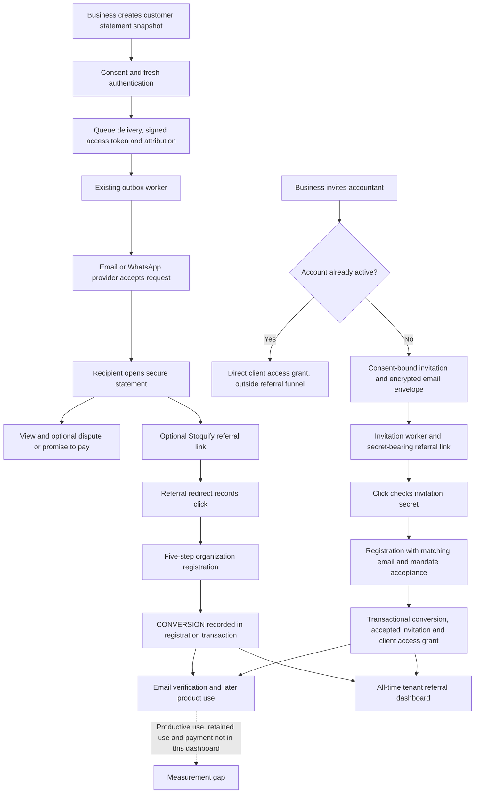

# Stoquify referral value and efficiency audit

Reviewed on 6 September 2026. Scope: existing customer-statement referrals and accountant invitations; analysis and implementation planning only.

**Recommendation: retain the useful workflows, run a limited pilot, and defer a larger referral investment. Prioritize accountant collaboration.** The repository contains substantial working infrastructure, but the evidence available to this audit does not demonstrate incremental paying customers, retention improvement, or positive referral economics. This is an evidence gap, not proof that nobody uses the system.

The reviewed working tree is based on commit `a05a41ef66cd5d98fd69ae3df18225795f912232`. It already contained 241 modified and 270 untracked status entries, excluding submodule detail. These are status entries, not a complete count of untracked files. Findings describe the current files, including existing changes, rather than a deployable commit. No application code, database, provider configuration, or Git index was changed by this audit.

The final status comparison also observed concurrent changes to `services/security/role-grant-policy.service.ts` and its test. This task did not edit those files; they are outside this audit's findings. The status delta is retained with the evidence so unrelated workspace activity is not attributed to the audit.

| Channel | Decision | Reason | Confidence |
|---|---|---|---|
| Accountant invitations | **Maintain and run a limited pilot first** | A named professional receives access to an existing client's accounting workspace. That is a concrete collaboration benefit. It does not automatically acquire a new paying client business. | Medium for expected workflow value; high for the code findings; commercial impact unproven. |
| Customer-statement referrals | **Maintain statement sharing; simplify and pilot the acquisition layer** | Secure statements and recipient responses can help existing businesses independently of referrals. A recipient viewing an amount owed is not necessarily a prospective software buyer. | Medium for workflow utility; low for incremental acquisition. |
| Combined system | **Limited pilot; conditional investment afterward** | Reuse attribution, access controls, and the outbox. Measure useful outcomes before adding incentives or more channels. | High confidence that present evidence is insufficient for a scale decision. |

## What exists and how it works

This diagram is grounded in the source register below, particularly E1–E18. Provider acceptance is not confirmed delivery or reading. The accountant referral code is attribution; the separate secret and invitation checks authorize acceptance. Statement access requires its own signed token and stored access record.

| Capability | Current classification | Evidence and practical limit |
|---|---|---|
| Statement snapshot, token, redacted external access, recipient responses | Implemented; focused access tests pass | Snapshot and token identities, expiry/revocation, content integrity and access logging exist. This audit did not repeat the historical PostgreSQL or browser pilot. E7, E8, E15, E17. |
| Consented statement delivery | Implemented; operational readiness partial | Email and WhatsApp adapters, encrypted destination envelope, outbox, retry states and provider result recording exist. Actual live delivery and hosting schedule are unverified. E7, E9, E11. |
| New-accountant invitation and accepted mandate | Implemented; lifecycle incomplete | Matching email, secret, recipient acceptance, expiry and transactionally created grant are checked. No application producer for pending-invite revocation was found. E4–E6. |
| Existing-accountant collaboration | Implemented outside referral reporting | Active existing users receive a grant through a separate branch; these successful collaborations do not enter the referral funnel. E4 at `inviteOrGrantAccountantAccess`. |
| Referral dashboard | Implemented, narrow metric | Tenant-scoped counts of issued links, clicks, registrations and accountant registration conversions. English/French dashboard copy; empty state and permission handling. E1–E3, E18. |
| Product activation, retained use, revenue attribution, incremental acquisition | Unverified / missing from referral read model | No cohort or payment joins in this model. The pilot gate adds verified login evidence, but not a completed productive task or payment. E2, E19. |
| Referral commissions, rewards or affiliate payouts | Proposed in strategy material; executable implementation not found in inspected scope | Searches across services, actions, schema, configuration and libraries did not find a referral-linked payout or reward lifecycle. Do not budget assumed rewards or describe commissions as working. |
| Deployment and real-user pilot | Unverified; available local evidence gate blocked | Fresh pilot report has 0/16 checks ready and no configured pilot database. This is not a production count. E19. |

Graph discovery corroborated the relevant neighborhoods: `accounting_customer_statement_actions_queuecustomerstatementdeliveryaction` in actions community 81, `referralcode_route_get` in app community 25, and `accounting_accountant_client_invite_service_acceptaccountantclientinviteintx` plus `referrals_referral_attribution_service_recordreferralconversionintx` in services community 1. The services graph includes an inferred relationship between conversion recording and invitation acceptance; current imports and calls confirm it. The graphs are undirected and contain inferred edges and older line positions, so they were not treated as authoritative call direction. The component graph lacks the newer referral dashboard; current code takes precedence.

## Value assessment

For a referring business, secure statement sharing, traceable responses and bounded accountant access are useful outcomes even if no new customer signs up. For a statement recipient, the benefit is understanding a balance and responding without creating an account. For an accountant, it is accessing a client's evidence with a defined mandate. For Stoquify, plausible benefits are improved customer retention, lower coordination effort and introductions to other businesses. None of these improvements was measured in the available pilot evidence.

The accountant path is currently **business-to-accountant onboarding**, not a proven accountant-to-many-new-clients acquisition program. The latter is a future hypothesis. An accountant creating a workspace during invitation acceptance must not be counted as a newly acquired paying SMB without qualification and billing evidence.

Statement branding appears after a useful professional artifact, which is a sensible placement hypothesis. However, a recipient dealing with overdue balances may be an individual, an existing user or someone who has no purchasing authority. Preserve access and response completion regardless of whether they engage with the promotional link. Pilot against eligible business recipients and assess the statement workflow separately from the promotional call to action.

There is no basis here for a measured ROI, conversion forecast or channel ranking by revenue. No production event dataset, retention cohort, provider invoice, support time record or referral-linked payment evidence was available. Recent 6 September product and roadmap reports also identify all-time signup metrics and missing retained-use evidence; those reports provide context, not independent usage proof.

Use this decision model after collecting costs:

`incremental contribution = incremental paying organizations × contribution per organization over the evaluation horizon − incremental delivery, support, operation and incentive costs − implementation cost`

Use contribution after variable product servicing costs, with explicit treatment of refunds and churn. Keep saved customer/staff time in a separate benefit calculation unless the business can defensibly convert it to contribution. Do not allocate the entire accounting platform's sunk cost to this small growth layer.

**Illustrative break-even only, not a price recommendation or forecast:** assume 300,000 XAF implementation cost and 30,000 XAF/month incremental operations for six months. Total cost is 480,000 XAF. If six-month contribution per incremental payer is 30,000 / 60,000 / 120,000 XAF, the program needs respectively **16 / 8 / 4 incremental paying organizations**. These are invented planning inputs to replace with actual records. Attributed registrations alone cannot satisfy this test. Accountant retention benefits require their own measured comparison rather than being added to acquisition revenue twice.

## Ranked findings

Priority 1 means resolve before expanding the relevant pilot or making an investment decision. Priority 2 means targeted improvement supported by the stated evidence. Impacts below are plausible consequences of observed code, not measured incidents.

| ID / priority | Observed evidence | Consequence and smallest response | Evidence confidence |
|---|---|---|---|
| F1 / P1 | Registration creates an unverified user and records `CONVERSION` before verification; `inviteActivations` increments for every accountant conversion. The funnel reads neither accepted-grant state nor productive use. E1–E3. | Label existing counts as registrations. Measure accepted mandates, verified onboarding, first useful task and repeat use separately. Current accountant acceptance is in the same transaction, so ordinary failures roll back; the criticism is metric meaning and missing outcomes, not a claim that every count is false. | High |
| F2 / P1 | Statement email provider input has no idempotency key; `resend.emails.send` receives only its payload. Accountant emails already pass a stable key. E9–E12. | If provider acceptance succeeds but settlement fails or its response is lost, a retry can resend the statement. Carry the stable outbox request key to the provider, retain outcome evidence and handle ambiguous results. | High for the gap; frequency unmeasured |
| F3 / P1 | The statement UI generates new command and correlation IDs and a new consent timestamp on every submit. Accountant UI omits an explicit stable command ID, while default effective time participates in fallback identity. E4, E6, E13. | Retrying after a lost application response can create another logical invitation/delivery despite server idempotency. Keep one command ID and immutable payload per submission attempt until its outcome is resolved. Preserve consent provenance. | High |
| F4 / P1 | Invite states declare `REVOKED`, but inspected application state producers create only `PENDING` and `ACCEPTED`. The access manager lists grants, not pending invites; its Revoke action targets grants. E4–E6, E16. | Add an audited pending-invite cancellation action and pending list; stop queued delivery and reject acceptance after cancellation. Also reject expired/cancelled invitations before the user completes registration: click resolution currently checks the secret but not state/expiry. No unauthorized access incident was demonstrated. | High for inspected application path |
| F5 / P1 before unattended operation | Both workers put unconfigured sends in `DEFERRED`; their claim queries select pending, failed or stale locked work, not deferred work. No referral-specific resume command was found. They claim batches up front, process serially and use a five-minute stale lease; raw provider fetches have no explicit deadline. E9, E10, E12. | Document and implement audited resumption after configuration recovery, revalidating consent and token expiry. Bound request time and claim size/lease lifetime. Test provider success followed by settlement failure and slow batches. Do not add another queue system. | High for code; deployment behavior unverified |
| F6 / P2 | Funnel loads every attribution and matching event for all time and reduces them in application memory. Existing event indexes already include tenant/type/time. E2, E16. | Use a bounded cohort window and database aggregation; define cohort selection separately from the time allowed for subsequent outcomes. Benchmark first. No observed latency or CPU reduction can be claimed from this audit. | High |
| F7 / P2 | Accountant onboarding uses the five-step business form, defaults to owner and broad modules; its inviter must paste a consent hash. Public statement and accountant manager copy are English-only despite bilingual delivery/dashboard. E6, E13–E15. | Prefill the accountant role, defer irrelevant business setup, preserve country/accounting prerequisites, select verifiable consent evidence through a normal user flow, and localize recipient/invitation pages. Add a useful explanation beside the optional referral CTA. | High for source behavior; usability impact needs observation |
| F8 / P2 | Issued links count records created before sending. Click dedupe is per attribution, IP/user-agent hash and UTC day; missing metadata uses a random key. Impressions occur per authorized view. Conversion trusts the code submitted with registration and has no time-window or first/last-touch policy. E1, E2, E7, E8. | Define denominators, distinguish provider acceptance, delivery, views and unique qualified people; document attribution precedence and eligibility windows. Exclude tests, scanners and duplicates without using invasive fingerprinting. A shared network may merge people; repeat days may multiply them. | High |
| F9 / P1 policy decision | Statement commands explicitly enforce the Accounting module. Accountant invitation actions use permission, tenant and fresh-auth controls but have no module option. Referral analytics uses analytics permission and tenant checks without an explicit module gate. E5, E17, E18. | Decide whether these surfaces are core or package-entitled and encode that policy consistently. Keep revocation reachable when an organization loses entitlement. This is an enforcement asymmetry, not a demonstrated cross-tenant disclosure. | High at inspected boundaries |

For F2, Resend's current documentation supports a stable idempotency key for repeated email requests, retained for 24 hours. Therefore, a key alone does not justify an unlimited exactly-once guarantee: delayed recovery outside that window still needs a defined reconciliation policy. The installed SDK also exposes `idempotencyKey`. [Resend idempotency documentation](https://resend.com/docs/dashboard/emails/idempotency-keys), checked 6 September 2026.

For F8, Resend distinguishes API acceptance (`email.sent`) from acceptance by the recipient's mail server (`email.delivered`). Neither establishes human reading or qualified product interest. The local adapters return `SENT` at provider API acceptance. Preserve historical meaning and introduce clearly named delivery evidence instead of silently redefining it. [Resend event documentation](https://resend.com/docs/webhooks/event-types), checked 6 September 2026.

Other controls worth preserving: composite tenant foreign keys; append-only migration triggers for attribution, invitation and delivery evidence; immutable statement hashes; secret-bound accountant acceptance; signed, expiring, revocable statement access; aggregate-only dashboard outputs; encrypted provider envelopes; stable outbox identity; and safe action errors. Hashing request metadata is not anonymization or a complete retention policy. The middleware supplies a process-local general rate limit; this does not establish a distributed, referral-specific abuse control. Referral impressions are written inside the statement read transaction, so their persistence adds work and failure coupling; keep required access evidence reliable while considering the existing outbox for nonessential growth telemetry only if measurement justifies it.

## Smallest implementation path

Estimates are engineering person-days for one engineer familiar with this code, including focused tests and review, but excluding external approvals, deployment repair, user recruitment and waiting for cohort maturity. Ranges are planning assumptions, not commitments. Implement in the existing domains and avoid a universal referral framework.

| Step / ownership | Change and dependencies | Acceptance and verification | Rollout / rollback | Effort |
|---|---|---|---|---|
| A: Product + analytics + backend | F1, F6, F8. Write metric definitions; rename current conversion/activation labels; add bounded cohort queries and accepted-mandate evidence. Reuse existing records before adding events. | Registrations are visibly distinct from verified/productive use; pending invites are not accepted mandates; direct grants are reported as collaboration, not acquisition; fixture counts match SQL for tenant, period and replay cases. Benchmark representative data and record query plan, rows and latency. | Shadow-compare old and new counts; release additive read contract and labels. Revert display/query selection without rewriting historical events. | 3–5 |
| B: Integration engineer | F2, F3 and F5. Stable client command identity, stable provider keys, bounded send deadlines, explicit ambiguous outcomes, deferred recovery and lease-safe processing. Uses the existing outbox. | Lost application response replays one command; accepted provider request followed by DB failure does not immediately send twice; configuration recovery resumes eligible deferred work; cancelled/expired work is rejected; slow batch and retry exhaustion cases pass. | Provider mocks, then separately authorized sandbox rehearsal; start with email and a small per-tenant batch. Pause channel/worker on failure; preserve unresolved outbox rows for reconciliation. | 3–5 |
| C: Backend/security + frontend | F4 and F9. Pending-invite read model, cancellation command, cancellation-vs-acceptance concurrency rule, early link validation, explicit package policy. | Cancelled invitation cannot create a grant; cancellation stops future dispatch; concurrent accept/cancel has one documented outcome; accepted grants use the existing revocation path; no stale signup funnel; permission/tenant/entitlement denial tests pass. | Release service contract before controls in UI; pilot-tenant rollout. Disable new invitations if rollback needed while retaining grant revocation and historical links/evidence. | 2–4 |
| D: UX/frontend + customer success | F7. Accountant-focused onboarding, normal evidence selection/capture, bilingual recipient and invitation content, clear pending/delivery/error states. Depends on A–C contracts and available consent evidence source. | English/French keyboard and screen-reader task checks; users can complete a mandate without unrelated POS setup or manually computing a hash; country and consent requirements remain enforced. Observe completion and time, including wrong-email and already-registered cases. | Small cohort; restore previous UI only while corrected security/command contracts remain effective. | 3–5 |
| E: Analytics + operations + product | Instrument first/repeat productive outcomes using existing accountant audit/access records and business events; bind paid outcomes only to the authoritative commercial source when available. Run pilot below. | Versioned event definitions, dedupe, cohort maturity and staff/test exclusion; dashboard reconciles to underlying evidence; no revenue claim from requested modules, a signup or a grant. | Read-only pilot reporting first; stop promotional CTA/new issuance independently of essential statement/grant operations. | 2–4 plus pilot window |

The complete set is approximately 13–23 person-days before the pilot observation period, with potential overlap. Do not authorize that total blindly. Start with A–C as a bounded 8–14 person-day readiness slice, then choose the minimum D changes needed for the actual pilot cohort. A consent evidence picker depends on a real evidence source; if none exists, document that dependency rather than presenting an unchecked checkbox as a signed mandate.

No core-schema rewrite is initially necessary for renaming metrics, aggregating existing events, stable provider keys or adding lifecycle commands that use existing state tables. New product-outcome events may require a small additive schema change only after checking the existing business-event contract. Append-only historical migrations must not be edited to change deployed behavior.

## Pilot and decision rules

**Proposed cohort, not existing customers or approved outreach:** recruit about 10 eligible existing businesses and 5 accountant firms; target approximately 20 new-accountant invitations and 100 eligible business statement recipients. Select the actual count after assessing available traffic. Use one configured email channel initially. Operations owns delivery/recovery, product owns the decision, analytics owns definitions and cohort comparison, and customer success records task friction and support time. Name individual owners before starting.

Run a six-week intake, then allow at least 30 days for final cohorts to mature. Start accountant workflow observation first; do not delay statement access to create an acquisition experiment. For statement branding, assign participating source businesses to current minimal branding versus a clearer optional CTA while keeping the underlying statement workflow equivalent. Keep repeated recipients in one assignment and record cross-business exposure. With a small number of businesses, this is exploratory and underpowered for firm causal revenue claims; a larger follow-up must be sized from observed base rates and minimum useful effect.

| Metric | Numerator / denominator and window |
|---|---|
| Provider acceptance | Unique eligible delivery commands accepted by provider / unique eligible commands queued, within 24 hours. Keep deferred, failed and unknown outcomes separate. |
| Confirmed delivery | Unique messages with validated delivery evidence / provider-accepted messages, within 48 hours. Mark unavailable until provider callback/reconciliation evidence exists. |
| Statement workflow use | Unique eligible recipients with an authorized statement view / confirmed delivered recipients, within 7 days. Treat link views as a proxy, not proven identity; report known scanner exclusions. |
| Recipient response | Unique recipients recording a dispute or promise to pay / recipients who viewed and had that permission, within 14 days. A response is not a payment or resolved dispute. |
| New-accountant acceptance | Distinct accepted mandates / eligible new-accountant invitations delivered, within 14 days; exclude direct grants to existing users from this denominator. |
| Accountant activation | Verified accountant completes a defined client task, such as reviewing a client report and recording a review outcome, within 14 days of acceptance / accepted mandates with a mature 14-day window. Merely logging in is insufficient. |
| Referred-business activation | Qualified new business with verified user and one legitimate completed operational task within 14 days of registration / qualified referred registrations with that window. Exclude demo/seed activity. |
| Retained useful use | Activated organizations performing another qualifying task on a different day in days 15–30 / activated organizations observed through day 30. |
| Paid conversion and contribution | Organizations with authoritative, non-test paid commercial evidence by day 60 / eligible mature referred registrations; count refunds, support, delivery and serving cost. If the billing truth is unavailable, report unavailable. |
| Incrementality | Compare assignment-level qualified activation/payment rates and contribution, using all eligible assigned recipients/businesses, not only those who clicked. Report uncertainty and exposure contamination. |
| Workflow efficiency | Median task completion time, unassisted completion rate and support minutes per completed mandate/statement task versus the prior process. Track duplicate sends, cancelled-link attempts and failed recoveries separately. |

Prespecify a 30-day referral eligibility window as a pilot policy, store attribution precedence explicitly, and do not retroactively apply it to historic all-time counts. Use stable command IDs and tenant-scoped evidence to exclude retries, staff, seed/demo accounts, existing organizations and known scanners. IP/user-agent hashes must not be treated as unique people. Prefer the least identifying data that answers the decision and set a purpose-specific retention policy for new telemetry.

**Proposed continuation thresholds:** at least 80% unassisted completion of the selected core task, at least 20% lower median completion time than the measured prior process, and at least 10 repeated real collaborations across the cohort. These are internal pilot targets, not market benchmarks or statistically sufficient proof. Existing roadmap proposals use similar workflow targets; validate their suitability with actual baseline observations.

Pause the affected channel immediately for unauthorized disclosure, cancellation bypass, or an unexplained duplicate sensitive send. Do not expand while delivery reconciliation or grant-state reconciliation has unresolved discrepancies. Scale acquisition spending only when mature incremental contribution is positive under a conservative cost scenario and a larger experiment supports the inference. If workflow targets are met but acquisition economics remain inconclusive, maintain collaboration and continue measurement without incentives. If a mature, adequately powered follow-up shows no worthwhile incremental acquisition, retire promotional investment while retaining the useful workflows.

Retirement must stop new promotional issuance/CTA exposure separately from essential statement delivery. Honor remaining legitimate statement access and accepted grants until their expiry or revocation, preserve append-only attribution history, and retain a defined destination for historical public referral codes. Pending invitations need the cancellation workflow from C before withdrawing the program cleanly.

## Assurance and current limitations

| Review lens | Audit disposition |
|---|---|
| Platform architecture | Retain accounting ownership, referral read services and existing outbox; no new standalone platform. |
| Backend/integration | Transactional acceptance is valuable; command/provider replay and recovery gaps need targeted work. |
| Data/migrations | Preserve composite tenant keys and append-only history; bounded aggregation first; live trigger enforcement and deployment drift unverified. |
| Security/IAM/privacy/abuse | Secret and tenant boundaries present; pending cancellation, entitlement policy and trustworthy telemetry need completion. No production security or privacy certification claimed. |
| Frontend/design systems | Existing shared dashboard primitives are useful; generic onboarding and technical evidence inputs add friction. |
| Workflow/accessibility/localization | Source and component tests reviewed. No fresh browser, keyboard, screen-reader or visual regression run; English-only external/admin surfaces need attention. |
| Product/business processes | Separate collaboration value from acquisition and distinguish accountants from new client businesses. |
| Quality/release assurance | 18 suites / 64 tests pass; schema valid. Release scope and pilot evidence remain blocked. |
| SRE/DevSecOps/performance/cost | Bounded CLI, retry/backoff and stale lease recovery exist; live scheduling, provider delivery, deadlines, capacity, alerts and costs unverified. |
| SaaS packaging/growth/customer success | Align module policy; prioritize qualified use and support burden over issued links; defer rewards. |
| Finance/internal controls/evidence | Statement provenance and consent records matter; a hash alone does not verify legal consent or commercial value. No new ledger/payout design required in this scope. |
| OHADA/tax/regulatory | No statutory interpretation or rule change proposed; country-specific consent and marketing requirements need qualified review for the selected pilot jurisdiction. No compliance certification. |
| Analytics/experimentation | Definitions, cohort windows, accepted/verified/productive/paid separation and comparison design are required. |
| AI/agent safety | Not applicable: no model or autonomous decision boundary is added or changed. |
| POS/inventory/offline, purchasing/AP, HR/payroll | Not applicable to this change: preserve any downstream business-task evidence without changing those domains. |

Fresh verification results are saved in the [audit evidence folder](<E:/ohada saas/Focused projects/stoquify/what-next/referrals/referral-value-efficiency-audit-2026-09-06-evidence>):

| Check | Result and scope |
|---|---|
| Requested six referral suites | **6 suites, 21 tests passed**, zero failed or pending. [Structured result](<E:/ohada saas/Focused projects/stoquify/what-next/referrals/referral-value-efficiency-audit-2026-09-06-evidence/focused-tests-bounded.json>). |
| Existing invitation, statement, provider, access-action and public-route boundary suites | **12 suites, 43 tests passed**, zero failed or pending. Dependencies are mocked; no live sends or database writes. [Structured result](<E:/ohada saas/Focused projects/stoquify/what-next/referrals/referral-value-efficiency-audit-2026-09-06-evidence/boundary-tests.json>). |
| Schema validation | **Passed.** [Validation log](<E:/ohada saas/Focused projects/stoquify/what-next/referrals/referral-value-efficiency-audit-2026-09-06-evidence/prisma-validate.log>). No migration was run. |
| Pilot evidence report, generated 2026-09-06 11:45 UTC | **Blocked, 0/16 ready.** Only the template manifest was found; no pilot database configured; no query executed. Zero fields are defaults from missing evidence, not measured customer counts. |
| Release-scope report, generated 2026-09-06 11:45 UTC | **Classification and release blocked.** 2,847 changed paths at that snapshot: 37 candidate, 1 split, 388 excluded, 2,421 unclassified. Generated audit/test evidence contributes to this broad inventory. The historical release policy does not classify today's tree sufficiently; these counts do not mean 2,421 referral bugs. |
| Initial broad test-discovery command | Interrupted after prolonged discovery with no test results. Reran the same six suites using explicit file paths and restricted roots; these passed. Both logs are retained. |
| Live PostgreSQL smoke, migration deployment, production build, browser/provider pilot | Not run: outside this read-only audit's operational scope and no bound release/pilot target. Historical reports were not promoted to current certification. |

The canonical 9–10 August referral reports describe earlier local success and unresolved target configuration. The new pilot result confirms that the local evidence package is still incomplete. The new scope result supersedes the old claim that every changed path was classified. The current broader migration readiness file also reports blockers, but this audit did not rerun target migration certification or infer that its historical database blockers necessarily remain unchanged in production.

The pilot gate itself is a useful end-to-end evidence check, not a growth experiment. Its target query requires an active organization, requested Accounting module, verified user and login. Requested modules are not proof of an enabled entitlement, a productive task, a paid subscription or retained use. Keep that gate and add business outcome measurement alongside it rather than weakening it to make the pilot pass.

To reproduce local verification, use the installed Jest runner with `--runInBand`, the six explicit paths recorded in `focused-tests-bounded.log`, and `--roots services/referrals actions/referrals components/referrals components/auth/v2/__tests__ scripts/__tests__`. Use the 12 exact paths in `boundary-tests.log` for the supplementary checks. Run `npm.cmd run prisma:validate`. Pilot and release report commands use explicit `--out` and `--json-out` under this audit folder, preserving canonical reports. No broad build or policy chain is necessary for this report-only change.

## Source register

Links identify current local files; source hashes and checked-file inventory are recorded in `source-manifest.json` in the evidence folder. A search finding that code was not found is scoped to the inspected application paths, not proof about inaccessible deployments or unpublished work.

| ID | Source |
|---|---|
| E1 | [Referral attribution producer and redirect policy](<E:/ohada saas/Focused projects/stoquify/services/referrals/referral-attribution.service.ts:53>) |
| E2 | [Funnel query and aggregate semantics](<E:/ohada saas/Focused projects/stoquify/services/referrals/referral-funnel-read-model.service.ts:46>) |
| E3 | [Registration, unverified user and conversion call](<E:/ohada saas/Focused projects/stoquify/services/users/user-identity.service.ts:526>) |
| E4 | [Accountant invitation issuance, direct grants and acceptance](<E:/ohada saas/Focused projects/stoquify/services/accounting/accountant-client-invite.service.ts:191>) |
| E5 | [Accountant access actions](<E:/ohada saas/Focused projects/stoquify/actions/accounting/accountant-access.actions.ts:68>) |
| E6 | [Accountant inviter UI and grant-only register](<E:/ohada saas/Focused projects/stoquify/components/accounting/AccountantAccessManager.tsx:34>) |
| E7 | [Statement delivery transaction](<E:/ohada saas/Focused projects/stoquify/services/accounting/customer-statement-delivery.service.ts:201>) |
| E8 | [Statement access resolution and impression recording](<E:/ohada saas/Focused projects/stoquify/services/accounting/customer-statement-access.service.ts:302>) |
| E9 | [Statement delivery worker](<E:/ohada saas/Focused projects/stoquify/services/communication/customer-statement-delivery-worker.service.ts:305>) |
| E10 | [Accountant invitation worker](<E:/ohada saas/Focused projects/stoquify/services/communication/accountant-client-invite-worker.service.ts:195>) |
| E11 | [Statement provider adapter](<E:/ohada saas/Focused projects/stoquify/services/communication/customer-statement-delivery.provider.ts:57>) |
| E12 | [Accountant provider adapter](<E:/ohada saas/Focused projects/stoquify/services/communication/accountant-client-invite.provider.ts:83>) |
| E13 | [Statement delivery form and command identity](<E:/ohada saas/Focused projects/stoquify/components/customers/CustomerStatementWorkflow.tsx:150>) |
| E14 | [Registration defaults and invitation handoff](<E:/ohada saas/Focused projects/stoquify/components/auth/v2/RegisterV2Form.tsx:266>) |
| E15 | [Public statement UI and referral CTA](<E:/ohada saas/Focused projects/stoquify/app/customer-statement/[statementId]/CustomerStatementPortal.tsx:304>) |
| E16 | [Referral and invitation schema](<E:/ohada saas/Focused projects/stoquify/prisma/schema.prisma:6643>); [referral evidence migration](<E:/ohada saas/Focused projects/stoquify/prisma/migrations/20260809143000_customer_statement_delivery_referral/migration.sql>); [invitation migration](<E:/ohada saas/Focused projects/stoquify/prisma/migrations/20260809160000_accountant_client_invite_onboarding/migration.sql>) |
| E17 | [Statement command entitlement and fresh-auth controls](<E:/ohada saas/Focused projects/stoquify/actions/accounting/customer-statement.actions.ts:47>) |
| E18 | [Referral read action](<E:/ohada saas/Focused projects/stoquify/actions/referrals/referral-funnel.actions.ts:12>); [public redirect](<E:/ohada saas/Focused projects/stoquify/app/api/referrals/[referralCode]/route.ts:15>); [dashboard](<E:/ohada saas/Focused projects/stoquify/components/referrals/ReferralFunnelDashboard.tsx>); [middleware rate limiter](<E:/ohada saas/Focused projects/stoquify/middleware.ts:48>) |
| E19 | [Pilot evidence gate](<E:/ohada saas/Focused projects/stoquify/scripts/customer-referral-pilot-evidence-gate.js:170>); [fresh pilot report](<E:/ohada saas/Focused projects/stoquify/what-next/referrals/referral-value-efficiency-audit-2026-09-06-evidence/pilot-readiness.md>) |
| E20 | [Fresh release-scope report](<E:/ohada saas/Focused projects/stoquify/what-next/referrals/referral-value-efficiency-audit-2026-09-06-evidence/release-scope.md>) |
| E21 | [Historical takeoff report](<E:/ohada saas/Focused projects/stoquify/what-next/referrals/CUSTOMER_REFERRAL_TAKEOFF_READINESS_2026-08-09.md>); [6 September product audit](<E:/ohada saas/Focused projects/stoquify/what-next/2026-09-06-ohada-product-competitive-audit.md>); [current execution roadmap](<E:/ohada saas/Focused projects/stoquify/what-next/2026-09-06-stoquify-enterprise-execution-roadmap.md>) |

The next concrete implementation is A–C: truthful bounded metrics, replay-safe delivery and a complete invitation cancellation boundary. Evaluate those improvements with a small accountant-led pilot before commissioning a broader referral program.
