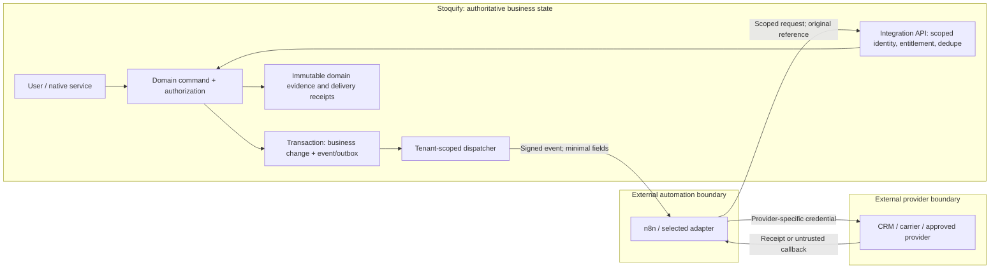

# Stoquify: n8n and alternative integration platforms

**Decision: run a limited internal n8n pilot, conditional on a measured operational need. Defer a customer-facing automation platform. Keep core transactions in Stoquify.**

Assessment date: **20 September 2026**. This is an investment and architecture assessment, not an implementation or production certification.

Stoquify's existing services already own business events, retries, payment evidence, inventory, POS commits, approval boundaries and accounting evidence. n8n's strongest incremental value is connecting those controlled capabilities to external applications more quickly and making peripheral workflows easier to configure. No reviewed capability is inherently impossible without n8n. The choice concerns delivery effort, operations and commercial fit. [R03] [R04] [R08] [R11] [R19] [W36]

For customer account connections, shortlist **Nango**, with **Pipedream Connect** as an alternative. For a customer-visible workflow editor, compare **Activepieces Embed** and **n8n OEM** only after customers demonstrate willingness to pay. **Inngest** addresses durable application jobs; **Temporal** becomes relevant for complex, long-lived processes. **Airbyte** and **Metabase** address data movement and analytics. These solve different problems and should not all be added.

The illustrative n8n Cloud pilot has a base estimate of **€7,080 setup, €570/month including staff time, €13,920 first year**. The subscription alone is a small part of the investment. Those are planning assumptions, not vendor quotes, observed salaries or measured return on investment.

Companion artifacts: [editable cost model](<E:/ohada saas/Focused projects/stoquify/what-next/stoquify-n8n-cost-model.csv>) · [evidence register](<E:/ohada saas/Focused projects/stoquify/what-next/stoquify-n8n-evidence-register.md>).

## 1. What Stoquify is and what is actually established

The inspected product catalog spans operations, finance and people: inventory, purchasing, sales/POS, cash, reconciliation, accounting, close assurance, compliance, presence and payroll. Commercial surfaces describe module adoption and onboarding, country/provider and assurance services. This supports an orientation toward controlled business operations with linked evidence and accountant participation. Historical strategy identifies inventory-heavy SMEs and a Cameroon pilot hypothesis; it does not establish market adoption. [R02] [R16] [R22] [R23]

The repository is a Next.js/React/TypeScript application with Prisma/PostgreSQL and declared Redis, notification, localization and test dependencies. The source is substantial, but module declarations are not proof of completed journeys. This assessment inspected relevant service boundaries and tests rather than every file. It found no installed shortlisted orchestrator in the scoped dependency/source search. Production hosting, workload, active customers, ARPU, backup recovery and actual support staffing remain unverified. [R01] [R20]

Evidence levels: **S** = current source inspected; **T** = focused tests passed here; **V** = official vendor documentation; **A** = proposal/estimate; **U** = unknown. Historical reports and Graphify communities were navigation aids, checked against current code where material. The working tree was already extensively modified; only assessment artifacts were intentionally changed.

### Current capability and incremental value

In the table, “owner” means the system authorized to decide the business result. n8n can relay a request without gaining that authority.

| Capability | Stoquify state and evidence | n8n contribution / overlap | Engineering, dependency and failure limit | Business owner |
|---|---|---|---|---|
| Events, retries, delivery | S/T: transactional recording, hashes, leases, backoff, dead letters; actual export-worker reuse. [R03] [R04] [R24] | Visual branching, external connectors and error handling. Existing delivery functions overlap. [W08] [W36] | Build a dispatcher adapter, identity map and receipt contract. An HTTP acceptance is not completed business work. | Stoquify event/evidence records |
| Public integration API | S: sampled item GET uses a browser session; POST is disallowed. [R05] [R06] | HTTP nodes can call supported APIs; they do not create a safe API. | Machine authentication, scopes, command endpoints and versioning are prerequisites. Session-cookie impersonation is unsuitable. | Stoquify services |
| Identity and modules | S: org/RBAC and managed entitlement rules; default observe mode, with explicit enforcement on inspected API. [R06] [R07] | n8n editor roles govern automation authors. | Recheck org, scope and entitlement at each command. Projects/folders do not prove application tenant isolation. Paid governance features vary. [W04] | Stoquify authorization |
| POS, stock and cart recovery | S: native checkout/stock/ledger commit; interruption and offline control paths. [R08] [R09] [R10] | Post-commit export or notification only. | A network workflow cannot solve cart ownership or offline transaction correctness. Never wait for it to charge a sale. | POS/inventory services |
| Purchasing/AP | S: supplier proposals retain buyer authority and evidence. [R15] | Supplier reminders and cross-app draft exchange. | Signed supplier links, proposal versions and fresh buyer approval; no automatic receipt, invoice approval or payment from a workflow status. | Purchasing/AP services |
| Provider payments/reconciliation | S: signature/hash/timestamp and inbox worker controls. [R11] [R12] | Gather authorized provider evidence and route exceptions. | Provider contracts/credentials still required. Unknown payment outcomes need reconciliation with original references, not fresh charges. | Verified provider boundary and reconciliation |
| Notifications/receipts | S: dedicated receipt worker includes configuration and tenant checks. [R13] | New channels and nonfinancial message sequences. | Reuse existing send authority and deduplication. Do not create a second receipt sender. Messaging/provider fees remain. | Communication service |
| Onboarding/import | S: staged customer/supplier/item imports with approvals; excludes ledger/stock migration. [R14] | Pull files/forms, transform candidate rows, route review. | Preserve mapping, validation and independent approval. “Connector succeeded” cannot bypass import controls. | Import/domain services |
| Accounting/close/accountants | S: controlled exports, grant expiry/revocation, suspense/evidence conditions. [R16] [R17] [R24] | Export distribution and deadline follow-up. | Fresh accountant permission and short-lived links; no close certification or journal posting through generic SQL nodes. | Ledger/close services |
| HR/payroll/country packs | S/partial operational evidence: authority worker has sandbox fallback; country review contract exists. [R18] | Missing-input reminders and approved handoffs. | Employee privacy, independent approval and qualified country review remain; no proof of live statutory submission. | Payroll/country-pack services |
| Analytics/replenishment | S: stock/reorder and cash read models. Advanced forecast accuracy U. [R25] | Consolidate external context and deliver alerts. | Metric definitions, data freshness and forecasts must be designed. n8n is not a warehouse or proven forecasting model. | Stoquify metrics; external warehouse for copies |
| AI/agents | S/T: deterministic governed runner and prohibited write tools. [R19] | Connect models, document extraction and tool-review channels. [W37] | Model/provider cost, evaluation and prompt-injection defense remain. External approval cannot override native permissions. | Stoquify policy and domain commands |
| Operations/release | S: CI, monitoring and authenticated reconciler. Live deployment/restore U. [R20] | Cross-tool incident routing and workflow diagnostics. | A second runtime needs owners, upgrades, restore drills and cost alarms. n8n success is not platform readiness. | Stoquify operations team |

The main integration gap is therefore a **supported machine-to-machine boundary**, not an absence of queues or business workflows. This is a finding from the inspected slice, not a claim that every API in the repository was audited.

## 2. n8n capabilities, editions and licensing

n8n provides API-oriented integration, configurable workflows and custom extensions. Schedules, webhooks, branching, code and wait/resume make it useful for peripheral coordination. A pause/resume feature does not make a workflow an accounting transaction. Custom-node deployment and package support must be checked against the chosen hosting tier. [W36] [W09] [W01]

| Area | Verified capability and practical implication |
|---|---|
| Core/internal edition | Community is self-hosted and source-available. Queue mode is included, but projects/sharing, SSO, Git/environments, external secrets and multi-main are among its exclusions. It requires operational ownership even with no license fee. [W02] [W04] |
| Published paid entry points | Annual-billed Starter €20/month: 2,500 runs, five concurrent; Pro €50: 10,000 runs, 20 concurrent; self-hosted Business €667: 40,000 runs, SSO and Git/environments. Enterprise is quoted and adds governance/support features. These are subscription prices, not integration budgets. [W01] |
| Recovery/concurrency | Queue deployment adds database/Redis/workers and shared credential-key management. Binary storage has restrictions; a worker pool is not multi-main high availability. Workflow retries must be paired with downstream idempotency. [W05] [W08] |
| Timeouts | Self-hosted limits are configurable; cancellation may be soft until the current node finishes. Do not assume timeout proves an external side effect did not happen. [W39] |
| Changes/promotion | Git/environments require Business/Enterprise. Enterprise workflow reviews are preview, optional, and exclude changing credentials, settings and subworkflows; the vendor advises against production reliance. Application release review is still needed. [W06] [W41] |
| Credentials/privacy | Stored credentials are encrypted; queue workers need the key. Enterprise execution redaction hides visibility, not necessarily stored data or privileged access. Prefer reference IDs and minimal payloads. [W38] [W10] |
| Retention/recovery | Saved execution data can be reduced/pruned. Waiting/running and annotated records require separate attention. Full self-hosted recovery needs keys, database and applicable storage/configuration; a workflow export alone is insufficient. [W40] [W42] |
| AI/human review | Tools can pause for approval through configured communication channels. Model inference, third-party tools and data transfer still have dependencies/costs. Require native approval validation for controlled Stoquify commands. [W37] |
| Support and security | Dedicated support/SLA is a contracted tier capability. Stable release observed: 2.39.8, 18 September; 2.40.3 was prerelease. A recent credential advisory was patched before that stable version. Budget patch testing; do not infer that the inspected stable version is vulnerable. [W01] [W11] [W33] [W34] |

### License boundaries that change the decision

The Community Sustainable Use License permits internal business use, with restrictions on commercial redistribution and products substantially deriving value from n8n. Its FAQ specifically excludes using customers' own app credentials for an app backend under that free license. It is not unrestricted open-source licensing. [W02] [W03]

The current OEM documentation separately says a **hidden backend is available on paid plans under standard licensing**, while exposing the editor requires a **separate OEM agreement and n8n branding**. Therefore a paid backend is not automatically an OEM purchase. Obtain written confirmation of the exact customer-credential, hosting and resale arrangement because this materially affects contracting; do not apply Community restrictions indiscriminately to paid plans. [W43]

| Arrangement | Assessment |
|---|---|
| Stoquify's own CRM/support automation using its own credentials | Good pilot candidate under the appropriate internal-use terms. |
| Customer-owned n8n instance calling Stoquify APIs | Useful optional interoperability. Customer operates/licenses its instance; Stoquify still needs scoped APIs and a clear support boundary. |
| Stoquify-controlled hidden backend with customer app connections | Paid-plan route exists. Select feature, volume, isolation and support tier; confirm the exact contract. Do not presume Community eligibility. |
| Customers editing workflows inside Stoquify | OEM agreement, branding, editor UX, tenant provisioning, support and abuse controls become a separate product investment. Defer. |

A connector only supplies part of an integration. Provider app approval, OAuth renewal, field mapping, pagination, API quotas, deletions, conflict resolution and reconciliation remain product work.

## 3. Alternatives: where each adds value and why to choose or defer it

These are twelve platforms including n8n, across four different jobs. Recommendations are analyst judgments about Stoquify's present needs; feature and tariff evidence is linked.

| Platform / category | Value and strengths for Stoquify | Costs, drawbacks and reasons to defer | Recommendation |
|---|---|---|---|
| **n8n — visual automation** | Configurable multi-step external coordination; self-host option; useful for internal operations. | Extra runtime, workflow governance, tier/licensing limits and duplicate orchestration. | Limited internal pilot; product backend only with a specific case. |
| **Activepieces — visual/embedded automation** | MIT core; commercial SDK designed for embedding and customer connections. [W13] [W14] | Enterprise features and Embed are commercial; platform support/UX become Stoquify's responsibility. | Compare with n8n OEM only if customers need a builder. |
| **Make — hosted visual automation** | Quick operations-team experiments and app-to-app flows. [W15] | Credit consumption grows with actions/loops; extra credits carry a premium. Hosted runtime dependency; an on-prem agent is not a self-hosted engine. [W16] | Good simpler internal alternative if visual usability is decisive. |
| **Zapier — hosted app automation** | Convenient business-app workflows with lower infrastructure burden. [W17] | Usage varies by task type; commercial governance and larger volumes cost more. Not a transaction engine. [W18] | Prefer when chosen customers/operators already use it; avoid a second parallel internal platform. |
| **Power Automate — Microsoft/RPA** | Valuable for customers operating Microsoft-centric approvals, files and legacy desktop processes. [W28] | User/bot and connector licensing; Microsoft tenant administration; desktop automation is fragile relative to an API. [W35] | Customer-specific connector/partner option, not Stoquify's general runtime. |
| **Windmill — developer automation** | Scripts, flows and internal tools align with technical operators; compute-oriented deployment. [W26] | More developer ownership; source and prebuilt-image licenses differ. Wrapping/reselling needs scrutiny. [W27] | Shortlist if code-based internal automation wins over a visual editor. |
| **Nango — product integrations** | OAuth/token lifecycle and TypeScript integration functions fit customers connecting their own external accounts. [W20] [W21] | Business mappings and UI still require code; recurring connection/compute/transfer costs; enterprise terms for some deployment needs. | Strongest conditional shortlist for product account connections. |
| **Pipedream Connect — product integrations** | Developer-oriented connection/action surface and external-user model; can reduce provider plumbing. [W19] | Usage and external users affect cost; current numeric tariff could not be verified. Runtime and integration dependence. | Compare with Nango after obtaining a sized quote. |
| **Inngest — durable application jobs** | Retryable functions/checkpoints fit the TypeScript application model. [W23] | Own compute still required; function-plus-step billing; possible overlap with existing outbox workers. [W22] | Evaluate only for an observed job reliability/developer-effort gap. |
| **Temporal — durable orchestration** | Explicit workflow/activity/worker model for complex, long-running processes and recovery. [W25] | Determinism/versioning expertise and worker operations; substantial implementation effort. | Defer until process complexity justifies it. |
| **Airbyte — data replication** | Scheduled data ingestion into a warehouse for cross-system analysis. [W31] | Replication/storage/schema maintenance; does not provide transactional business approval. | Later, when multi-source analytics demand is established. |
| **Metabase — BI/report exploration** | Can expand self-service analytics over governed data. [W32] | Seat/embedding/security tiers; metric ownership and tenant-safe datasets remain essential. | Consider separately for proven BI demand; never expose raw cross-tenant tables. |

Adding several overlapping orchestration tools would multiply support burden. Choose one internal automation platform, then add a narrowly scoped product-integration or analytics component only when it solves a different evidenced problem.

### Published prices and integration effort

Prices below were checked on 20 September 2026. USD prices remain in their quoted currency here; the CSV converts relevant USD costs at the documented exchange rate. Starting plans are not interchangeable capacity or governance packages.

| Platform | Published price / metering | Illustrative incremental engineering |
|---|---|---|
| n8n | See edition table above; enterprise/OEM quote when required. [W01] [W43] | Internal pilot 8–18 days; customer backend 25–65 days at growth scope, including shared integration prerequisites. |
| Activepieces | Monthly Plus $20/10k credits; Team $200/50k; additional credits $0.007; Embed starts $36,000/year. MIT core does not include the commercial Embed SDK. [W12] [W13] [W14] | Growth embedded product 35–90 days, including shared prerequisites and customer UX. |
| Make | Displayed 10k-credit Core $9, Pro $16, Teams $29/month; billing term must be confirmed. Code/AI have distinct consumption rules. [W15] | 5–10 days; €2,700–€5,400. |
| Zapier | Professional from $19.99/month, Team from $69 at the displayed annual term; task volume changes the price. [W17] | 6–12 days; €3,240–€6,480. |
| Power Automate | Annual-billed Premium $15/user/month; Process $150/bot/month; Hosted Process $215/bot/month. [W28] | 8–20 days; €4,320–€10,800. |
| Windmill | Community self-hosting has no software fee within its limits. A displayed $170/month calculator example includes one developer, two workers and native subworkers; it is not a universal starter tariff. [W26] [W27] | 10–20 days; €5,400–€10,800. |
| Nango | $50/month minimum includes $50 credits; $0.29/connection/month, $0.72/compute hour and $0.50/GB transfer. Enterprise quote for applicable requirements. [W20] | Growth product integration 25–65 days, including shared prerequisites. |
| Pipedream | Current numeric tariff unverified. Connect has external-user and compute dimensions; Workflows meters time/memory by execution segment. [W19] | 10–20 days after shared prerequisites; €5,400–€10,800. |
| Inngest | Pro from $99/month, one million included executions; function runs and steps both count. Own compute is additional. [W22] | 12–25 days; €6,480–€13,500. |
| Temporal Cloud | No stated base minimum; $50/million actions plus active/retained storage, support and customer worker compute. Developer support is 10% of usage. [W24] | 25–60 days; €13,500–€32,400. |
| Airbyte | Standard $20/month with five credits; Plus $189 with 40; extra-credit/volume costs and destination warehouse are additional. [W31] | 10–25 days; €5,400–€13,500. |
| Metabase | OSS self-hosting available; hosted Starter $100/month or $90 annual, five users included; Pro $575/month or $517.50 annual, ten included, with paid security/embedding options. Additional users cost extra. [W32] | 10–20 days; €5,400–€10,800. |

**Estimate basis:** the euro ranges are assumed days × €450/day × 1.20 contingency, for a bounded two-connector or equivalent analytics/job slice. Except rows explicitly saying otherwise, they exclude common API/identity work and therefore are not directly comparable to the full CSV totals. They are estimates, not measured vendor-specific delivery times.

For the alternatives without full scenario models, budget incremental maintenance separately: approximately 0.5–2 person-days/month (€225–€900 at the assumed rate) for a small hosted internal integration; 1–3 days (€450–€1,350) for developer/self-hosted/data systems; 2–5 days (€900–€2,250) for a Temporal pilot. Add the selected subscription, provider fees and infrastructure. Complex customer mappings or regulated support can exceed these allowances.

### Gains, costs and what Stoquify could lose

These are design-dependent tradeoffs, not observed incidents in an installed integration.

| Gain | Cost or potential loss | Mitigation and residual responsibility |
|---|---|---|
| Faster provider experimentation | Less of the full behavior is visible in normal application code review | Version workflows and mappings with owners; node/configuration changes still need review. |
| Operations staff can adjust peripheral flows | Workflow sprawl and inconsistent customer behavior | Use a small approved template catalog, retirement dates and named support owners. |
| Broader app connectivity | More credentials, subprocessors and connector supply-chain dependencies | Minimize scopes/data, restrict nodes, test upgrades and retain native authorization. |
| Configurable customer integrations | Support can expand into debugging every customer's external setup | Sell supported use cases with clear ownership, quotas and customization boundaries. |
| Fewer repeated connector implementations | Platform-specific workflow logic and commercial dependency | Keep domain rules, provider contracts and acceptance fixtures portable; fund exit work. |
| Faster peripheral automation | Opportunity cost and additional operational failures | Measure saved work net of maintenance; keep checkout independent and retain a manual path. |
| Potential integration revenue | Weaker product consistency if users face a generic editor too early | Start with native connection/status screens; validate demand before embedding authoring tools. |

## 4. Expansion opportunities and what is genuinely new

Classification: **1** already present in the inspected slice; **2** feasible natively with modest work; **3** external orchestration likely accelerates it; **4** requires external provider/data/contract regardless of tool; **5** only possible through n8n. Categories can coexist within a use case. **No category 5 capability was established.**

All estimates below are incremental person-days after the shared boundary is available, assuming a single provider and a narrow mapping. They are not additive project commitments. “Later” means prerequisites, demand or controls must be proven. Integration-specific fees must be sized from actual providers.

Common delivery rules apply to every row: scoped tenant/principal identity; least data necessary; stable event and command keys; bounded retry/backoff; duplicate suppression; dead-letter ownership; comparison of external receipts against Stoquify state; and a manual fallback. Sensitive approvals occur in Stoquify against the current record/version, with fresh permission checks.

| User/problem → trigger and steps → outcome | Existing equivalent / classification; native alternative | Permission, exception and data boundary | Effort; recurring driver; measurable benefit; timing |
|---|---|---|---|
| Operations: support form arrives → classify and create internal ticket → accountable follow-up | No complete cross-app equivalent established; 2/3/4. Native webhook plus provider SDK. | Support-only scope; minimize personal text; dedupe ticket ID; failed routing stays visible. | 2–4d; ticket/API usage; handling minutes and missed cases; **pilot** |
| Customer success: onboarding milestone → update Stoquify's own CRM and task list → fewer handoffs | Domain onboarding exists [R14]; cross-app CRM is 2/3/4. Native event adapter. | Own-company credentials; no tenant financial payload; stale milestone checked before notification. | 2–4d; CRM seats/API; time-to-activation; **pilot** |
| SRE: delivery backlog exceeds threshold → open/update one incident → quicker response | Monitoring/reconciler exists [R20]; routing 2/3/4. Native alert handler. | System metadata only; incident dedupe/rate limits; alternate alert path if automation fails. | 1–3d; incident provider; detection and recovery time; **pilot** |
| Inventory manager: reorder threshold → read stock/supplier context → propose replenishment | Read model exists [R25]; 2/3/4. Native scheduled proposal service. | Inventory read plus draft proposal; buyer confirms; recheck stock before commitment. | 3–6d; scheduled runs/provider API; stockout days/proposal acceptance; **later** |
| Buyer: PO awaiting response → timed reminder and supplier proposal intake → fewer stalled orders | Supplier proposal evidence exists [R15]; 2/3/4. Native scheduler/communication service. | Supplier-bound link, buyer approval; suppress reminder after response; no stock/AP write. | 3–6d; messages; response delay; **later** |
| Sales operator: e-commerce order → verify source and map SKU/tax/customer → native order draft | POS/sales foundations exist; new channel 3/4. Native channel adapter. | Channel credentials, signed events, mapping quarantine, stock recheck; no automatic paid status. | 8–20d; channel/API volume; re-keying and mismatch rate; **later** |
| Fulfilment staff: approved dispatch → carrier booking → store tracking receipt | External carrier integration not established; 3/4. Native carrier adapter. | Shipment scope, address PII, booking idempotency; ambiguous booking needs lookup before repeat. | 5–10d; carrier fees/calls; dispatch-to-tracking time; **later** |
| Treasury: provider statement available → fetch permitted evidence → native reconciliation intake | Capture/inbox controls exist [R11] [R12]; 3/4. Native provider connector. | Credential isolation; preserve signed/raw evidence; compare totals; quarantine malformed files. | 6–15d; provider access/storage; unmatched age/manual import time; **later** |
| Finance operator: reconciliation exception ages → create assigned task and reminder → faster resolution | Existing exception services [R12]; routing 2/3/4. Native scheduler. | Reference IDs only; current assignee/permission checked; external “done” does not clear suspense. | 2–5d; task/message usage; exception age; **later** |
| Accountant: approved export ready → deliver authorized link → predictable handoff | Export worker/access already exist [R16] [R24]; core 1, added destination 2/4. Extend existing worker. | Expiring link, revocation and receipt; don't duplicate current delivery path. | 2–5d; storage/egress/messages; handoff delay; **prefer native extension** |
| Owner/accountant: missing close evidence → reminder → review evidence in Stoquify | Close controls exist [R17]; 2/3/4. Native deadline worker. | No account balances in chat; recheck grant and period state; reminder isn't certification. | 2–4d; messages; unresolved evidence age; **later** |
| Onboarding admin: approved file/form → map and stage rows → reviewer accepts valid master data | Staged import already exists [R14]; acquisition 3/4. Native file/provider adapter. | Import scope; duplicates, schema errors and high-risk independent approval remain; no ledger import. | 4–8d; file/API storage; accepted rows/hour; **later** |
| HR operator: missing approved attendance/input → request completion → ready payroll inputs | Payroll domain exists [R18]; cross-app collection 3/4. Native forms/reminders. | Employee/manager scope; restricted details; versioned cutoff; never infer approval from email receipt. | 4–8d; HR/provider/messages; late-input count; **later** |
| Employee: payslip finalized → secure availability notice → employee opens existing portal | Authoritative payroll remains native; extra channel 2/4. Native notification. | Identity verified at portal; no payslip attachment in general chat; dedupe finalized version. | 2–4d; messages; successful access/support cases; **prefer native extension** |
| Compliance officer: reviewed deadline/evidence request → task and intake link → traceable preparation | Country review contract exists [R18]; coordination 2/3/4. Native scheduler. | Dated expert-reviewed rules; no inferred statutory approval; late/failed tasks escalate. | 3–6d; tasks/storage; on-time evidence completion; **later** |
| Analyst: nightly authorized data extract → warehouse model → dashboard | Current operational read models [R25]; 3/4. Native export plus ETL. Airbyte/Metabase fit better. | Read-only dataset, tenant separation, freshness and deletion propagation; reconcile aggregates. | 10–25d; replication/warehouse/seats; report preparation time; **later** |
| Reviewer: document uploaded → OCR/model suggests fields → controlled import review | Import/agent policies exist [R14] [R19]; 3/4. Native model adapter. | Untrusted document, no tool authority, provenance/confidence, PII controls, human correction. | 6–12d; OCR/tokens/evaluation; accuracy and review time; **later** |
| Tenant admin: configure external-account workflow → validate/test/publish → self-service automation | No safe general editor established; 3/4. Native constrained rule templates. | Tenant credentials, quotas, node restrictions, publishing governance and support; OEM/Embed terms. | 35–90d+; license/support/usage; paying adoption and gross margin; **defer** |

Statutory calculations, payroll finalization, ledger posting, stock write-offs, payment verification and POS completion **remain native**. External services may submit proposals or collect evidence through authorized interfaces. No orchestrator removes provider access restrictions, expert review, unavailable datasets or offline connectivity limitations.

## 5. Architecture and deployment choices

### Recommended boundary

**Credential ownership:** internal pilot credentials belong to Stoquify's company. Future customer connections belong to the tenant and map to a server-validated integration principal; a caller-supplied tenant ID is not authority. Stoquify's database credential must never be given to the workflow platform.

A separate analytical path can use governed extracts or an appropriately secured replica → Airbyte/other ETL → warehouse → Metabase. That path does not write accounting or stock state back into production.

| Adoption choice | Benefit | Residual responsibility / decision |
|---|---|---|
| Native adapters, no n8n | Few new dependencies, direct code review, existing outbox reuse | Slower breadth for many changing apps; **default for stable domain integrations** |
| n8n Cloud for internal work | Shortest managed-runtime pilot | Scope/data minimization, workflow review and recoverability remain ours; **recommended experiment** |
| Self-hosted Community internal | Hosting/location control without software fee | DB/keys/backups/patching and limited team governance; **only if operating capability already exists** |
| Paid shared backend | Reusable centrally managed workflows | Must build tenant isolation around it; projects are not sufficient evidence. Feature/license/support tier must be sized. **Conditional later** |
| Isolated tenant instances | Smaller incident/credential blast radius | Repeated databases/keys/upgrades/backups and higher fleet costs; quotas/rights still apply. **Premium requirement only** |
| Customer-owned instance | Customer flexibility without Stoquify operating every workflow | API contracts, diagnostics and support boundaries required; customer-specific license responsibility |
| Embedded editor | Configurable integration product and possible services revenue | OEM/Embed cost, authoring UX, abuse controls, version support and customer education. **Defer pending paid demand** |

### Contracts required before product integration

1. **Machine identity:** short-lived scoped tokens or equivalent service credentials; explicit organization, integration, environment and allowed commands. Separate credential rotation/revocation from a cashier's browser session.
2. **Authorization:** enforce tenant, RBAC/service scope and active module entitlement at the receiving service. Human financial approval must bind actor, record hash/version, amount and expiration; an n8n approval link cannot grant domain authority.
3. **Event contract:** versioned schema, event ID, organization, aggregate/version, timestamp, correlation and causation IDs, payload hash and minimal reference data. Verify signatures, time windows and replay nonce where appropriate.
4. **Delivery:** aim for at-least-once transport and effectively-once business commands through native deduplication. Track per-consumer acknowledgement separately from completed domain outcomes. Do not claim universal exactly-once external side effects.
5. **Ordering and failure:** aggregate versions detect stale/out-of-order work. Retry transient failures with capped backoff; quarantine authorization/schema failures. Reconcile ambiguous provider outcomes before resending money, orders or bookings.
6. **Workflow changes:** version the entire dependency set, including credentials/scopes, settings and subworkflows. Keep in-flight work on a compatible version; drain or deliberately migrate it. Replays must specify original event identity and intended workflow version.
7. **Data and nodes:** restrict outbound destinations and untrusted community/code nodes; isolate execution; avoid broad network access. Redact identifiers where possible. Keep business evidence in Stoquify with retention appropriate to its approved policy, independently of disposable workflow logs.
8. **Operations:** separate worker resources from checkout, alert on oldest pending event and dead letters, cap per-tenant usage, test restore and credential revocation, keep a supported rollback path.

During an n8n outage, checkout and authoritative writes continue. Native outbox entries accumulate within monitored capacity; operators can suspend optional automation or use a documented manual path. Recovery replays original IDs. A successful workflow must never erase an unresolved transaction or silently clear financial exceptions.

Exit strategy: retain event schemas, provider mappings and contract tests under Stoquify ownership; export workflow definitions without plaintext secrets; redirect one consumer at a time to native adapters; drain/check external receipts; revoke old credentials. Exported workflows are migration aids, not portable executable logic across all vendors.

## 6. Cost model, resources and break-even

The [CSV](<E:/ohada saas/Focused projects/stoquify/what-next/stoquify-n8n-cost-model.csv>) contains **33 low/base/high rows** for 11 option/scenario combinations. These are alternative steady-state scenarios, not a claim that Stoquify will grow through these stages or a combined rollout budget.

### Workload assumptions

| Assumption | Pilot | Growth | Larger |
|---|---:|---:|---:|
| Organizations | 1 internal organization | 50 customer tenants | 500 customer tenants |
| Workflow templates | 3 | 20 | 60 |
| Logical runs/month | 1,500 | 25,000 | 250,000 |
| Additional top-level redelivery allowance | 10% | 10% | 10% |
| Estimated top-level runs/month | 1,650 | 27,500 | 275,000 |
| Peak concurrency | 3 | 10 | 30 |
| Mean runtime | 5 seconds | 10 seconds | 15 seconds |
| Typical payload | 5 KB | 10 KB | 20 KB |
| Operational log retention target | 7 days | 14 days | 30 days |
| Logical environments | 2 | 2 | 3 |

None of these volumes was measured in production. They are sizing inputs for comparison, not capacity benchmarks. The pilot's two logical environments mean synthetic/manual testing with separate credentials and a controlled production flow; the €20 license assumption does **not** buy two separately hosted Cloud instances or Enterprise promotion features. Physical isolation changes the estimate.

For growth, model standard templates shared across tenants, two external connections per tenant and limited configuration. Fully bespoke mappings for every tenant are excluded and need a separate onboarding allowance. Larger deployments require load testing, negotiated support and explicit availability/restore targets; the model does not purchase a staffed 24/7 service.

### Formulas and scope

Base currency: **EUR**. For applicable USD subscriptions, USD ÷ 1.1460, using the ECB's 18 September 2026 reference. XAF = EUR × 655.957 using BEAC's stated parity. Bank spreads and taxes are excluded; no tax treatment is asserted. [W29] [W30]

- Assumed eight-hour person-day: **€250 / €450 / €750** for low/base/high. These are sensitivity inputs, not researched salary claims.
- Setup = (engineering days × rate + nonlabor setup allowance) × 1.20.
- Monthly = license + incremental infrastructure + monitoring/backup + external API allowance + maintenance days × rate.
- First year = setup + 12 × monthly. Three years = setup + 36 × monthly.
- Exit reserve, shown separately = rounded-up 25% of initial engineering days × rate; it is not included in totals.
- CSV amounts are rounded to cents before monthly/annual aggregation. Formula references are included; CSV edits do not automatically recalculate results.

Engineering allowances include discovery, boundary implementation, testing, security, deployment/runbooks, training and limited initial tenant setup. Nonlabor setup allowances are €0/€500/€1,500, doubled for larger scenarios, for initial review/procurement/training expenses; they are not legal-service quotes. Legal complexity, vendor procurement delays and provider approval can require more.

Infrastructure allowances include incremental compute, database/queue, storage/network as applicable. Monitoring/backup is separately visible. External API allowances are €0/50/150 per pilot month, €50/150/500 at growth and €250/750/2,500 at larger scale. Replace these with actual messaging, OCR/model, provider and transfer tariffs; payment processing fees on all sales are not included.

Existing Stoquify development/hosting, normal payroll, taxes, financing, revenue loss and eventual exit are not silently folded into the totals. Staff time is economic cost even when no additional employee is hired.

### Base cases

| Option | Scenario | One-time | Monthly | First year | Three years |
|---|---|---:|---:|---:|---:|
| Native adapters | pilot | €10,320 | €580 | €17,280 | €31,200 |
| Native adapters | growth | €27,600 | €2,300 | €55,200 | €110,400 |
| Native adapters | larger | €55,200 | €5,850 | €125,400 | €265,800 |
| n8n Cloud, internal | pilot | €7,080 | €570 | €13,920 | €27,600 |
| n8n Community, internal | pilot | €9,240 | €885 | €19,860 | €41,100 |
| n8n paid customer backend | growth | €22,200 | €2,800 + Q | €55,800 + 12Q | €123,000 + 36Q |
| n8n paid customer backend | larger | €44,400 | €7,350 + Q | €132,600 + 12Q | €309,000 + 36Q |
| Activepieces Embed | growth | €30,300 | ≥€6,267.8 | ≥€105,513.6 | ≥€255,940.8 |
| Activepieces Embed | larger | €57,900 | ≥€10,767.8 | ≥€187,113.6 | ≥€445,540.8 |
| Nango customer integrations | growth | €22,200 | €2,259.69 | €49,316.28 | €103,548.84 |
| Nango customer integrations | larger | €44,400 | €6,246.86 | €119,362.32 | €269,286.96 |

**Q** is the selected n8n commercial tier/volume fee, presently unresolved for the required customer governance configuration. The blank CSV license field means **unknown**, not free. Enterprise external secrets/redaction/support requirements may make a quote necessary. If the growth design can meet its controls on published Business terms, inserting Q = €667 yields **€3,467/month, €63,804 first year and €147,012 over three years**. That is a conditional substitution, not an assertion that Business meets every multi-tenant requirement. The larger workload must be priced separately. Hidden backend does not automatically require OEM. [W01] [W43]

Activepieces values use its published Embed floor converted to EUR; additional contractual volume/features remain unresolved, hence “≥”. Embedding provides a larger product scope than the backend-only alternatives, so it is not an equivalent deliverable at a higher price. [W12] [W14]

Nango growth assumes 100 connections, base 20 compute hours and 50 GB/month; larger assumes 1,000 connections, 200 hours and 500 GB. Its fee is max($50, connections × $0.29 + hours × $0.72 + GB × $0.50), then converted. Dedicated hosting or enterprise controls would change the tariff. Stoquify's worker/adapter infrastructure remains a separate allowance. [W20]

### Low/base/high example and staffing

| Internal n8n Cloud pilot | Low | Base | High |
|---|---:|---:|---:|
| Initial person-days | 8 | 12 | 18 |
| Setup | €2,400 | €7,080 | €18,000 |
| Monthly total | €165 | €570 | €1,770 |
| First year | €4,380 | €13,920 | €39,240 |
| Three years | €8,340 | €27,600 | €81,720 |

Base setup is approximately **XAF 4.64 million**; base monthly approximately **XAF 374,000**; first year approximately **XAF 9.13 million**. These include allocated staff time.

A base 12-day pilot can allocate two days to product/process discovery, four to integration engineering, two to QA, one to security/controls, two to operations/recovery and one to documentation/training. The same people may cover several roles; independent review still needs an actual second reviewer for controlled changes. Allow roughly **4–6 elapsed weeks** for part-time delivery and observing value, not 12 consecutive days of deployment work.

The base recurring €570 comprises €450 for one maintenance/support day, €20 license, €20 application-side infrastructure, €30 monitoring/backup and €50 provider allowance. Self-hosted Community saves a subscription but has a modeled base €885/month because more operations time and infrastructure are needed. This is an assumption to test against real team capability, not a universal claim that self-hosting always costs more.

Growth native integration needs 30/50/80 setup days and 2/4/7 maintenance days/month. Growth n8n backend and Nango each use 25/40/65 setup days, but their maintenance assumptions differ. Larger rows range from 50 to 170 setup days depending on option. These workloads require assigned backend/integration and QA owners with part-time product, security and SRE input, not just a workflow designer.

### Metering, sensitivity and economics

n8n bills production workflow runs. Manual testing, error workflows and subworkflows invoked through its subworkflow mechanism are excluded according to current execution documentation; automatic staging workflows still count. Schedules run even when there is no useful work, whereas polling triggers with no new data are treated differently. A node retry and a fresh top-level invocation must not be treated as the same cost event. Validate actual replay/retry billing in the chosen plan before forecasting. [W07]

A five-minute schedule makes 8,640 invocations in 30 days. It would overwhelm the assumed small-pilot budget. Prefer event delivery and suppress redundant triggers. A workflow replay can repeat provider charges or messages even where the automation platform does not bill the retry.

Units are not interchangeable: 1,650 runs with five billable steps could mean 8,250 step units on a step-metered system; Inngest function-plus-five-step accounting could mean 9,900 executions. Zapier's current rates distinguish standard trigger/action steps, free built-ins, AI and MCP; do not use the outdated blanket assumption that only actions count. Pipedream Workflows credits depend on segments/time/memory, while Connect also has external-user dimensions. [W18] [W19] [W22]

Sensitivity:

- One additional €450 maintenance day each month adds **€5,400/year or €16,200 over three years**.
- Every additional €100/month vendor fee adds €1,200/year.
- Doubling a multi-step workflow can multiply API/step/model charges even when top-level run count is unchanged.
- Growth n8n backend has €56/tenant/month in known operating costs **before Q**, versus about €45.19 in the modeled Nango case. These are different scopes, not a proven price-performance ranking.
- Ten bespoke tenant onboardings at one extra day each add €4,500 before contingency; repeat customization can erase connector savings.
- Long file/model jobs invalidate the short-runtime assumptions; use reference links rather than carrying full documents through every step.

For the base pilot, monthly cost plus setup amortized over one year is €570 + €7,080/12 = **€1,160**. At an assumed €15/hour of valuable time saved, break-even requires about **77 hours/month**; at €30/hour, about **39 hours/month**. Those hourly values and savings are unmeasured. Saved time is not automatically a cash saving or additional revenue.

Opportunity cost is explicit: 12 pilot days cannot also be spent on POS/provider/API work. If three stable native adapters solve the problem with less support, prefer them. Sell future integrations around measured customer value, supported providers and service levels; avoid promising unlimited customization or customer-authored workflow support at an untested flat fee.

## 7. Weighted decision and conditions that change it

Scores are 1–5 analyst judgments about the **next investment**, not vendor benchmarks. Weights: fit 25%, controls/isolation 20%, delivery speed 15%, TCO predictability 15%, connectors 10%, portability/licensing 10%, operating simplicity 5%. Licensing, tenant isolation and financial authority are pass/fail gates before scoring.

| Option | Fit | Controls | Speed | TCO | Connectors | Portability | Simplicity | Weighted /5 |
|---|---:|---:|---:|---:|---:|---:|---:|---:|
| Native adapters | 5 | 5 | 2 | 5 | 2 | 5 | 4 | 4.20 |
| n8n internal pilot | 5 | 4 | 5 | 4 | 5 | 4 | 3 | 4.45 |
| n8n customer backend | 3 | 3 | 4 | 2 | 5 | 2 | 3 | 3.10 |
| Activepieces embedded | 3 | 3 | 4 | 2 | 4 | 3 | 3 | 3.10 |
| Make internal | 4 | 4 | 5 | 4 | 5 | 3 | 4 | 4.15 |
| Zapier internal | 4 | 4 | 5 | 3 | 5 | 3 | 4 | 4.00 |
| Power Automate customer-owned | 4 | 4 | 3 | 3 | 4 | 2 | 3 | 3.45 |
| Windmill internal | 4 | 4 | 3 | 3 | 3 | 4 | 3 | 3.55 |
| Nango product integrations | 4 | 4 | 4 | 4 | 4 | 3 | 4 | 3.90 |
| Pipedream Connect | 4 | 4 | 4 | 3 | 5 | 2 | 4 | 3.75 |
| Inngest jobs | 4 | 4 | 3 | 4 | 2 | 3 | 4 | 3.55 |
| Temporal orchestration | 4 | 4 | 2 | 2 | 2 | 4 | 2 | 3.10 |

The internal n8n pilot scores well because it tests connector/workflow value without changing transaction authority. Native adapters score strongly on domain ownership and predictable scope. Nango aligns more closely with product account connections. These judgments follow the repository boundaries in section 1 and vendor scopes in section 3. Airbyte/Metabase are excluded from this automation ranking because they address different objectives.

Sensitivity is material: shifting weights toward fit/control (40/25/5/15/5/5/5) moves **native adapters to 4.65**, ahead of n8n internal at **4.45**. The recommendation is therefore a bounded value experiment, not a predetermined migration.

Change the decision when:

- There are only a few stable integrations: build native adapters.
- Customers repeatedly demand authenticated external-app connections: prototype Nango/Pipedream against two real provider contracts.
- Paying customers need to author workflows: assess Activepieces Embed and n8n OEM, including support margin and usability.
- Existing workers show measured failures involving long waits/checkpoints: compare Inngest or Temporal against improving current workers.
- Warehouse/report requests become frequent and cross-system: separately assess Airbyte/Metabase.
- No named owner, no measurable time saving, or required controls exceed the budget: defer all new orchestration.

## 8. Proposed pilot and adoption gates — not executed

Scope: one internal organization, company-owned credentials and up to three workflows from the catalogue: support intake → internal ticket; onboarding milestone → own CRM task; delivery-backlog metadata → incident record. Start with synthetic data and one flow. Do not duplicate receipt delivery or exercise real financial writes.

Owner: product/operations sponsor defines the baseline; integration engineer owns contracts; QA/security reviews failure and identity cases; SRE owns alerting/restore; operations accepts the runbook. No vendor account, external message or workflow has been created by this assessment.

Budget: initial €2,400–€18,000 economic setup cost, base €7,080. Monthly €165–€1,770, base €570. A six-week pilot should separately account for the chosen subscription's actual commitment: the €20/month assumption is an annual-billed equivalent, not a promise of a cancellable €20 trial.

Proposed acceptance gates:

1. Record actual weekly manual effort, misses and resolution delay before automation; define which saved hours matter.
2. Complete at least 200 synthetic/approved nonfinancial events, including duplicate, delayed, malformed and revoked-credential cases. No cross-tenant disclosure or duplicate business effect is acceptable.
3. For normal test traffic, target p95 routing below two minutes; measure rather than promise it. Simulate a one-hour provider/runtime outage and recover the backlog with original event IDs and no silent loss.
4. Demonstrate credential revocation, payload minimization, dead-letter ownership, provider rate-limit handling, cost caps and a native/manual fallback.
5. Export/restore configuration and validate secrets recovery without plaintext exports. Demonstrate an upgrade and rollback in a test environment.
6. Show an economic path to break-even using measured time or defensible revenue/error-reduction value; count support and debugging time.
7. Keep observed steady maintenance within the selected allowance. Publish a retain/change/stop decision after 4–6 weeks.

Stop if provider rights are unavailable, tenant separation fails, a workflow needs bypasses to native approvals, recovery loses accountability, or measured value cannot cover cost. A short successful pilot does not establish a production SLA.

Before any customer rollout, resolve: exact licensing/credential rights; enterprise feature requirements; per-tenant credential storage; machine API scope; usage limits/overage handling; data location/retention; restore objectives; ownership/support contracts; and actual customer willingness to pay.

## 9. Multidisciplinary review findings

These are assessment lenses applied by this review, not independent expert certifications.

| Review responsibility | Finding |
|---|---|
| Enterprise/platform architecture | Preserve domain ownership; use an optional event consumer at the boundary. |
| Backend/domain/integration | Existing event and worker patterns are reusable; missing machine API contracts require work. |
| Database/migration | No migration needed for this assessment; future inbox/receipt schemas need constraints and rollback planning. Never grant external SQL write access. |
| Security/IAM/privacy/abuse | Customer credentials and editor roles need separate tenant controls; reauthorize every command and restrict outbound/code capabilities. |
| Frontend/design systems | A future connection/status UI should reuse Stoquify primitives; an embedded canvas requires separate UX justification. No UI changes were made. |
| Workflow/accessibility/localization | Users need understandable pending/failed/retry states and English/French recovery guidance; no vendor editor accessibility conformance was established. |
| Product/business process | Measure repeated cross-app work and willingness to pay before adding a permanent platform. |
| Quality/release assurance | Focused native invariants passed; provider contracts, failure injection and browser/accessibility checks remain future rollout gates. |
| SRE/DevSecOps/performance/cost | Additional runtime means patches, keys, queues, restore and on-call ownership; no capacity or deployment SLA inferred. |
| SaaS packaging/billing/customer success | Separate internal tools, managed integrations and customer-authored automation; meter usage and price support/customization deliberately. |
| Finance/internal controls | Workflow completion is not ledger posting, approved payment or cleared suspense. |
| OHADA/statutory/country packs | No orchestrator supplies country certification. Existing sandbox authority fallback must not be mistaken for live submission. Qualified review remains necessary. |
| Audit/evidence/data quality | Keep source hashes, provenance and immutable native evidence independent of prunable workflow logs. |
| POS/inventory/offline consistency | Keep cart ownership, offline replay, stock and checkout outside synchronous external automation. |
| Purchasing/AP/maker-checker | Use workflows for proposals/reminders; retain buyer approval and receipt/invoice/payment separation. |
| HR/payroll/employee privacy | Limit automation to reviewed inputs/handoffs and minimal notifications; payroll authority remains native. |
| Payments/mobile money/reconciliation | Preserve signature/original-reference and ambiguous-outcome checks; provider agreements remain necessary. |
| Close/ledger/reporting/accountant access | Recheck expiring accountant grants and close conditions; a successful export does not certify accounts. |
| Analytics/BI/metric governance | Airbyte and Metabase can extend analysis, but freshness, tenant isolation and metric semantics need owners. |
| AI/model risk/human approval | Use extraction/triage proposals with evaluations; do not broaden the existing prohibited-tool policy. |
| API/webhook/outbox/import/export | Versioned event/command contracts, per-consumer dedupe and receipts are the portable investment across every option. |
| Change management/documentation/support | Train one accountable operator, version templates and provide recovery/escalation procedures before broader rollout. |

## 10. Verification and limits

- Inspected current services, API/auth boundaries, package/CI declarations, relevant historical reports and Graphify relationships. Detailed paths and confidence are in the evidence register.
- Ran the focused event gateway, outbox and agent-tool-registry suites: **3 suites, 27 tests passed; final command exit 0**. They use mocked boundaries and do not prove production throughput, tenant security in a deployed instance, or live provider behavior.
- The first test invocation passed its tests but exited unsuccessfully because its optional JSON report write was denied. A rerun without that output file passed; no JSON test artifact is claimed.
- Official capabilities, tariffs, license distinctions and release information were checked as of the stated date. Pipedream numeric pricing and commercial enterprise/OEM quotes remain unavailable.
- Artifact checks passed: all 33 CSV rows across 11 option/scenario combinations recalculated; complete low/base/high coverage; 68 repository/vendor reference definitions resolved; 64 local link occurrences checked; no whitespace/conflict-marker errors. The scoped Git check exited 0. Because the three files are new/untracked, their content was also checked directly rather than relying on Git diff alone. Git emitted an unrelated permission warning for the user's global ignore file.
- No integration installed, subscription purchased, credentials created, vendor contacted, messages sent, migrations run or customer data transmitted. No application source intentionally changed.

## 11. Optional next prompts — not executed

1. **Pilot specification:** “Specify a one-organization internal n8n pilot for support intake, onboarding CRM tasks and backlog alerts. Reuse Stoquify evidence/events, define exact contracts, synthetic fixtures, baseline metrics, staffing, budget and exit gates. Produce a reviewable specification without installing services or sending data.”
2. **Portable integration boundary:** “Audit and design the smallest machine-authenticated integration API and outbox consumer contract for Stoquify. Include tenant scopes, entitlement enforcement, idempotency, receipts and two provider examples. Compare extending current services with adding Nango; do not implement until the scope is explicit.”
3. **Commercial comparison:** “Prepare a sized procurement questionnaire comparing n8n paid backend/OEM, Activepieces Embed, Nango and Pipedream Connect for 50 and 500 tenants. Resolve customer credentials, usage units, support, residency, retention, branding and exit rights. Draft questions only; do not contact vendors.”

[R01]: <E:/ohada saas/Focused projects/stoquify/package.json>
[R02]: <E:/ohada saas/Focused projects/stoquify/services/modules/module-catalog.service.ts:72>
[R03]: <E:/ohada saas/Focused projects/stoquify/services/events/business-event.service.ts:172>
[R04]: <E:/ohada saas/Focused projects/stoquify/services/events/business-event-outbox.service.ts:112>
[R05]: <E:/ohada saas/Focused projects/stoquify/app/api/v1/organisations/[id]/items/route.ts:6>
[R06]: <E:/ohada saas/Focused projects/stoquify/lib/security/server-authz.ts:45>
[R07]: <E:/ohada saas/Focused projects/stoquify/services/modules/module-entitlement.service.ts:28>
[R08]: <E:/ohada saas/Focused projects/stoquify/services/pos/pos.service.ts:2210>
[R09]: <E:/ohada saas/Focused projects/stoquify/services/pos/checkout-state.ts>
[R10]: <E:/ohada saas/Focused projects/stoquify/services/pos/offline-sync.service.ts:1955>
[R11]: <E:/ohada saas/Focused projects/stoquify/services/payments/provider-event.service.ts:23>
[R12]: <E:/ohada saas/Focused projects/stoquify/services/payments/payment-reconciliation-inbox-worker.service.ts:332>
[R13]: <E:/ohada saas/Focused projects/stoquify/services/communication/whatsapp-receipt-worker.service.ts:235>
[R14]: <E:/ohada saas/Focused projects/stoquify/services/onboarding/master-data-import.service.ts:32>
[R15]: <E:/ohada saas/Focused projects/stoquify/services/purchase-order/supplier-po-acknowledgement.service.ts:204>
[R16]: <E:/ohada saas/Focused projects/stoquify/services/accounting/accountant-access.service.ts:30>
[R17]: <E:/ohada saas/Focused projects/stoquify/services/accounting/close-assurance.service.ts:1770>
[R18]: <E:/ohada saas/Focused projects/stoquify/services/payroll/authority-adapter-worker.service.ts:384>
[R19]: <E:/ohada saas/Focused projects/stoquify/services/agents/agent-policy.service.ts:26>
[R20]: <E:/ohada saas/Focused projects/stoquify/.github/workflows/ci.yml:1>
[R21]: <E:/ohada saas/Focused projects/stoquify/graphify-out/GRAPH_REPORT_actions.md>
[R22]: <E:/ohada saas/Focused projects/stoquify/what-next/2026-09-06-ohada-product-competitive-audit.md>
[R23]: <E:/ohada saas/Focused projects/stoquify/components/landing/pricing-section.tsx:27>
[R24]: <E:/ohada saas/Focused projects/stoquify/services/accounting/finance-statement-export.service.ts:400>
[R25]: <E:/ohada saas/Focused projects/stoquify/services/inventory/inventory-read.service.ts:574>
[W01]: https://n8n.io/pricing/
[W02]: https://raw.githubusercontent.com/n8n-io/n8n/master/LICENSE.md
[W03]: https://docs.n8n.io/n8n-community-license/sustainable-use-license
[W04]: https://docs.n8n.io/deploy/host-n8n/community-edition-features
[W05]: https://docs.n8n.io/deploy/host-n8n/configure-n8n/scaling/enable-queue-mode
[W06]: https://docs.n8n.io/administer/use-source-control-and-environments
[W07]: https://docs.n8n.io/build/understand-workflows/understand-executions
[W08]: https://docs.n8n.io/build/flow-logic/handle-errors-gracefully
[W09]: https://docs.n8n.io/build/flow-logic/wait
[W10]: https://docs.n8n.io/deploy/host-n8n/configure-n8n/security/redact-execution-data
[W11]: https://github.com/n8n-io/n8n/releases
[W12]: https://www.activepieces.com/pricing
[W13]: https://raw.githubusercontent.com/activepieces/activepieces/main/LICENSE
[W14]: https://www.activepieces.com/docs/embedding/overview
[W15]: https://www.make.com/en/pricing
[W16]: https://help.make.com/adjustments-to-plans-and-pricing
[W17]: https://zapier.com/pricing
[W18]: https://zapier.com/pricing/rates
[W19]: https://pipedream.com/docs/pricing
[W20]: https://nango.dev/pricing
[W21]: https://nango.dev/docs/getting-started/intro-to-nango
[W22]: https://www.inngest.com/pricing
[W23]: https://www.inngest.com/docs/learn/inngest-functions
[W24]: https://temporal.io/pricing
[W25]: https://docs.temporal.io/develop/typescript
[W26]: https://www.windmill.dev/pricing
[W27]: https://raw.githubusercontent.com/windmill-labs/windmill/main/LICENSE
[W28]: https://www.microsoft.com/en-us/power-platform/products/power-automate/pricing
[W29]: https://www.ecb.europa.eu/stats/policy_and_exchange_rates/euro_reference_exchange_rates/html/eurofxref-graph-usd.en.html
[W30]: https://www.beac.int/billets-pieces/mission-de-beac/
[W31]: https://airbyte.com/pricing
[W32]: https://www.metabase.com/pricing
[W33]: https://github.com/n8n-io/n8n/security/advisories/GHSA-9rhv-fhr8-7q5r
[W34]: https://github.com/n8n-io/n8n/security/advisories/GHSA-597w-c3jh-g8fg
[W35]: https://learn.microsoft.com/en-us/power-platform/admin/power-automate-licensing/faqs
[W36]: https://docs.n8n.io/
[W37]: https://docs.n8n.io/build/integrate-ai/ai-examples/human-in-the-loop-for-tools
[W38]: https://docs.n8n.io/deploy/host-n8n/configure-n8n/basic-configuration/configuration-examples/set-a-custom-encryption-key
[W39]: https://docs.n8n.io/deploy/host-n8n/configure-n8n/basic-configuration/configuration-examples/configure-workflow-timeouts
[W40]: https://docs.n8n.io/deploy/host-n8n/configure-n8n/scaling/manage-execution-data
[W41]: https://docs.n8n.io/build/manage-workflows/workflow-reviews
[W42]: https://docs.n8n.io/deploy/host-n8n/keep-n8n-running/backup-and-restore
[W43]: https://docs.n8n.io/deploy/host-n8n/deploy-as-an-oem-integration
