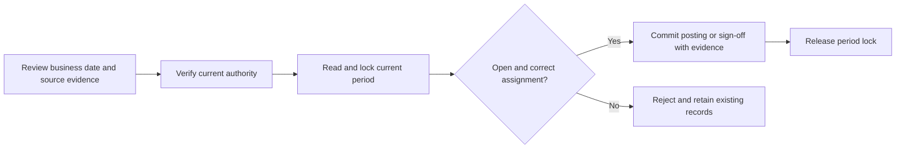

# Reconciliation and suspense period controls — v87

Evidence date: 2026-09-09. This extends the v86 shared accounting-period protocol. It is an engineering correction, not statutory approval or production release certification.

## What changed

Suspense approval and the ledger writer now check the current tenant period while holding a shared database row lock until commit. Reconciliation sign-off does the same even when the run already has a loaded period relation. The run's assigned period and the suspense batch/input period must agree with the period covering the business date. Closed, locked, missing or inconsistent periods stop new effects. Already posted suspense evidence and already signed reconciliation evidence keep their existing replay paths.

The existing screens are `/en/dashboard/finance/reconciliation` and `/fr/dashboard/finance/reconciliation`; period setup is `/en/dashboard/accounting/setup` or its `/fr` equivalent. Routes were traced in source; this batch does not establish fresh browser completion. No navigation, brand tokens, shared shell, schema or localization files changed.

## Required inputs and where to obtain them

| Situation | Required information | Owner and source | Action |
| --- | --- | --- | --- |
| Suspense approval | Item, proposed reclassification, reason, amount/currency and configured suspense account | Reconciliation operator; retained item and maker proposal, approved accounting mappings | Independent checker reviews the proposal and signs in again when required. Do not choose a different account merely to make posting pass. |
| Sign-off | Run, provider business date, current source revision, resolved exceptions and ledger evidence | Reconciliation operator; current run and its source evidence | Refresh the run before signing. The server rechecks period and evidence. |
| Closed or locked period | Correct business date, period status and reason for restriction | Accounting owner; period setup and close history | Review the source date and existing close controls. This change grants no permission to reopen a period or rewrite posted records. |
| Missing period | Fiscal calendar and correctly bounded period covering the source date | Accounting owner; organization fiscal calendar and accounting setup | Configure the approved period through normal setup. A missing period is not approval to use a nearby one. |
| Assignment changed | Original assigned period and current period covering the date | Accounting owner; run/batch record and fiscal calendar | Investigate overlapping calendar definitions or inconsistent source assignment. Preserve history; no automatic reassignment is implemented. |
| Interrupted or conflicting submission | Item/run ID, correlation/reference, current committed state | Operator; refreshed workbench/history and retained source record | Inspect whether it completed. Reopen retained evidence or retry the unchanged operation through its supported control. Never create a duplicate source to bypass a conflict. |

No new approval platform, provider credentials, subscription or user-supplied secret is needed for this code correction. Real provider and signer setup remains governed by existing controls. Synthetic approval records in the database verifier have no live authority.

## Rollout and recovery

Deliver the three changed reconciliation services together with the v86 shared period and close services. No migration or backfill is included. Use an isolated cohort to exercise real sessions, both languages and failure recovery before any authorized release. Monitor period rejections and transaction conflicts alongside actual posting/sign-off results; no production latency budget is asserted.

Rollback must preserve committed journal/source links and signed evidence. Reverting v87 restores the demonstrated stale-period behavior, so it is not a safe operational workaround for a rejected posting. Resolve the period/source problem instead. If a release must be withdrawn, restrict new affected operations through existing authorized controls while retaining historical access; do not edit financial records.

## Remaining engineering work

- Complete public role/session/module, EN/FR, responsive, keyboard and recovery journeys for suspense and sign-off. Trusted fixture actors are not public authorization proof.
- Review suspense transport authority: it currently supplies `Date.now()` after `protect(freshAuth:true)`, whereas sign-off forwards verified authentication evidence. Revalidate the guard contract before changing it.
- Review suspense assignment/reclassification controls, terminal retry behavior, retained obligations and notification delivery.
- Classify other direct period readers, low-level/null-period batches and overlapping fiscal periods. A file containing a period read is not automatically a defect.
- The close preflight scopes suspense through its reconciliation run. Standalone suspense obligations need explicit policy and source review; this batch does not certify their closure eligibility.
- Historical invoice status repair, reversal interfaces, and all remaining platform workflows remain open.

## Review accountability

| Responsibility | Bounded conclusion |
| --- | --- |
| Architecture/backend/distributed systems | Reused shared transaction-owned period check; no parallel approval or ledger system. |
| Database/migrations | Owned PostgreSQL verified denial rollback, ledger/source truth and lock retention. No migration. |
| Security/IAM/privacy/fraud | Tenant predicates and existing checker controls retained; broader public authority verification remains incomplete. No private fixture credentials retained in receipts. |
| Finance/accounting/reconciliation/close | New effects require current open assigned period; historical evidence replay retained. Full retained-obligation closure remains open. |
| Statutory/country packs | No accounting recipe or country rule prescribed; synthetic ledger rule is test-only. No professional approval. |
| Frontend/design system/UX/accessibility/localization | No interface change; EN/FR routes and current hooks traced. Runtime interface checks remain incomplete. |
| Product/operations/support | Errors identify period/setup conflicts; operator inputs and recovery above. No measured user-time saving claimed. |
| API/events/audit/records | Existing actions, source links, audit and events retained; denial rollback checked. External delivery not verified. |
| QA/release/SRE/performance/cost | Focused regressions, typecheck/lint and isolated persisted effects recorded separately. No full build, deployment or production performance claim. |
| Analytics/data governance | Source, journal and run evidence retained. No analytical model change. |
| POS/offline/inventory/AP | Shared period helper unchanged in v87; v86 cross-domain evidence remains historical with its hashes. No new domain behavior added here. |
| HRIS/payroll | Not applicable to this bounded patch: no payroll input, calculation or payment change. |
| AI/agents | Not applicable: no agent tool or automated approval behavior changed. |
| SaaS packaging/billing/growth | Not applicable: no entitlement, package, price or billing change. |

Selected skill: `009-aqstoqflow-payment-reconciliation-moat`. Tenant/ledger/error/idempotency/evidence checks passed within the recorded scope. Full public authority, UX and release gates remain unverified. The next numbered skill is `010-aqstoqflow-inventory-valuation-kernel`, after outstanding reconciliation priorities in the broader workflow register.
