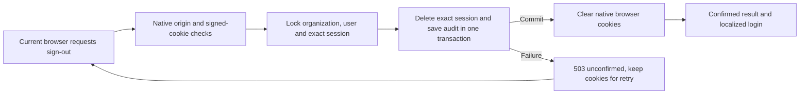

# Current-session sign-out

This implements the existing OA-SELF-SIGNOUT workflow. The full platform assignment remains active. This record supplements the historical SELF_SIGN_OUT_DISCOVERY.md; it does not replace earlier source or failed attempts.

## Delivered behavior and reason

All four application callers now use the same confirmed-result helper: desktop Sidebar, mobile Navbar, account menu and session-recovery button. A failed or interrupted request keeps the current page, displays EN/FR recovery guidance and enables retry. Pending controls suppress duplicate clicks. Only a confirmed successful response redirects to the localized login page.

The access-denied page now also offers the recovery button. A disabled organization or account must not trap someone in a session because they lack profile permissions. Ending the presented session grants no account access and requires no new organizational approval.

The original installed Better Auth endpoint swallowed session-deletion errors and still returned success with cleared cookies. A supported plugin overrides only its `signOut` endpoint. It uses the provider's signed-cookie verification, complete native cookie cleanup and router origin/media controls. No vendor file, global cookie-cache setting, session-creation hook or other provider endpoint is changed by this batch. The earlier rejected global-auth patch remains unapplied.

## Server-owned lifecycle

Only the credential verified from the session cookie identifies the target. Session IDs, user IDs, organization IDs or tokens in a request body cannot retarget the operation. Locks follow organization → user → session order. A changed owner/scope during acquisition is rejected. An absent session is a safe no-op: a lost acknowledgement can be retried without deleting a later sign-in or creating a second audit.

The existing Session and AuditLog tables provide the necessary durability; no migration is required. Each actual deletion records `auth.session.signed_out`, the stable actor/organization/session IDs, a completion time and deterministic receipt ID. It retains no session token, password, email, IP address or user agent. Audit failure rolls back session deletion. Audit records retain the existing organization's deletion/retention behavior; this is not a new legal archive or signature register.

The success payload distinguishes `revoked`, `absent` and `not_presented`. The last state means no valid signed credential was presented and native local cookies were cleared; it does not claim an unknown server session was revoked. A future secondary session store requires a coordinated implementation before it is enabled. The current application uses Prisma sessions.

## UI and design mapping

The existing Button, Sheet, Radix menu and dashboard shell remain. Pending/uncertain states use text, disabled state and alerts rather than a success-colored selection. The account menu retains its existing localized messages. The mobile drawer has a localized accessible title, description, search label and close label; its close control sits above the content layer. An optional shared close label preserves other Sheet callers' default behavior.

Screenshot review found the drawer's count/brand header overflowing when text was enlarged. It now wraps within a wider, viewport-bounded drawer, uses the existing dark-surface logo, and reserves space for the close icon. The sign-out button has a minimum 44px height and wraps. Navigation remains scrollable. Broader navigation terminology, counts, search behavior and language coverage are separate incomplete shell workflows.

## How to use it and information needed

| Situation | What to do | Information needed and its source |
| --- | --- | --- |
| Leave the current account | Use Sign out in the account menu, desktop account card or mobile navigation. Wait for the login page. | None beyond the current browser session. No approval document or SOURCE RECORD URI is needed. |
| Sign-out is unconfirmed | Keep the page open and retry the same control. Do not interpret the message as completed sign-out. | No new credentials or approval required for retry; the browser supplies its remaining cookie. |
| Workspace access was removed | Use Sign out on the access-denied page, then sign in with an account that has access. | Ask the administrator about account/organization status and current permissions. Do not send a password or session cookie. |
| End sessions on other devices | Use the separate Security session-review workflow after an authorized sign-in. | The service supplies the current review list. Current-session sign-out does not end other devices. |
| Repeated service failure | Report the approximate time and affected account/workspace to the authorized operator. | Operators correlate the generic failure event/correlation ID in server logs, then inspect current Session/AuditLog records through approved internal access. Never request cookies or passwords from the user. |

The current logout path does not offer an end-user audit export. Its retained record is distinct from product approval, signer authority or X1 evidence. Never use it to clear a release or commercial gate.

## Verification and limits

The canonical evidence receipt is `../../evidence/self-signout-receipt.json`, published after final checks. It binds exact source hashes and keeps initial attempts in `../../evidence/self-signout-initial-attempts.md`.

- Focused tests: 27 passed in four suites, including exact-target behavior, ownership conflicts, mandatory audit failure, helper failure/redirect semantics, reviewed-other-session and dashboard recovery regressions.
- Real PostgreSQL: eight scenarios passed, including concurrent duplicates, audit rollback/retry, other-device/tenant preservation and inactive, locked, roleless or expired current sessions.
- Installed authentication router: five scenarios passed with origin checks explicitly enabled in its test environment, including foreign origin, malformed body/method, body retargeting, invalid/missing cookies and audit-failure recovery.
- Actual application: ten EN/FR journeys passed across desktop, mobile, account menu and disabled-organization recovery, plus lost acknowledgement. Exact current rows/audits, cookie removal and subsequent permissions HTTP 401 were checked. Additional final mobile reflow and close-target checks are recorded separately in the receipt.
- The first observed sign-out→login transition took 43,680ms; the remaining initial successful cases took 923–4,037ms. These are development observations with no approved performance budget or established explanation for the first outlier.

No native assistive-technology audit, native browser zoom, complete contrast review, production performance assessment or full build pass is claimed. Existing cached-session behavior on unrelated transports is unchanged and remains a separate security boundary. A cookie captured before revocation must not be assumed invalid on every historical cached transport merely because this browser signed out.

## Review accountability

| Responsibility | Engineering review / remaining scope |
| --- | --- |
| Platform/backend/API | One service owner and one supported endpoint override; four consistent UI callers. Current provider routing and native cookie semantics exercised. |
| Database/migrations | Exact-session deletion plus mandatory audit in one transaction; concurrent duplicates, scope drift and rollback verified. No schema change. |
| Security/IAM/privacy/fraud | Signed-cookie authority, origin denial, no body-selected targets, unusable-account exit, no credentials in evidence. Global cached transports and full abuse/load assessment remain open. |
| Frontend/design/workflow/EN/FR/accessibility | Real pending/failure/retry, keyboard drawer containment/return, localized accessible names, screenshot review and bounded reflow. Native zoom/AT/full contrast remain open. |
| Product/process/customer support | Removes false completion and recovery dead ends without requiring approvals to leave an account. Operators need time/account context, never session credentials. |
| Quality/release/SRE/cost | Source-bound DB/router/browser evidence; failed attempts and slow development observation retained. No production release or performance certification. |
| Audit/records/analytics governance | Minimal deterministic record per actual revocation; no duplicate on retry. End-user history/export and organization-delete retention remain under separate review. |
| SaaS packaging/billing/growth | No commercial eligibility or subscription change. Current-session exit is not a paid capability or activation approval. |
| Finance/accounting/reconciliation/ledger/close | Not applicable to this mutation: no financial records or balances changed; unrelated financial hashes were checked. |
| OHADA/SYSCOHADA/country packs | Not applicable: no statutory rule or expert approval changed. |
| POS/offline/inventory/purchasing/AP/HRIS/payroll | Not applicable to this bounded mutation: domain records and continuing obligations are untouched. Their complete workflow reviews remain active. |
| Events/integrations/providers | Native authentication provider router applies; no external provider requests, event delivery or worker introduced. Secondary session storage is explicitly unsupported until coordinated. |
| AI/agents/human approvals | Not applicable: no agent authority, autonomous action or approval policy introduced. |
| Rollout/operations | Deploy only through the existing authorized release process after remaining release checks. Preserve the strict endpoint/helper contract and audit records during recovery. |

## Rollout and recovery

No live customer, deployment, database reset, migration or external email was used. Verify configured cookie domain/path/secure attributes and the actual session storage strategy in each authorized cohort. Observe unavailable responses and route timings; an audit outage intentionally makes confirmation unavailable and leaves the credential available for retry.

Do not roll back to the provider's swallowed-deletion-error behavior or restore unconditional client redirects. If an incident affects this path, preserve an explicit unconfirmed response and investigate the transaction/audit failure. Retain completed audit records and later sessions. Operators must use an authorized exact-session recovery procedure if normal retry cannot proceed; this patch does not grant a new administrative revocation bypass.

The full platform register, all remaining workflows, native accessibility checks, retention/export review and release verification remain incomplete. Ordinary authorized implementation can continue without inventing approval evidence.
